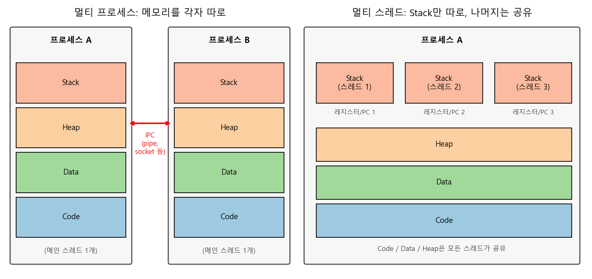
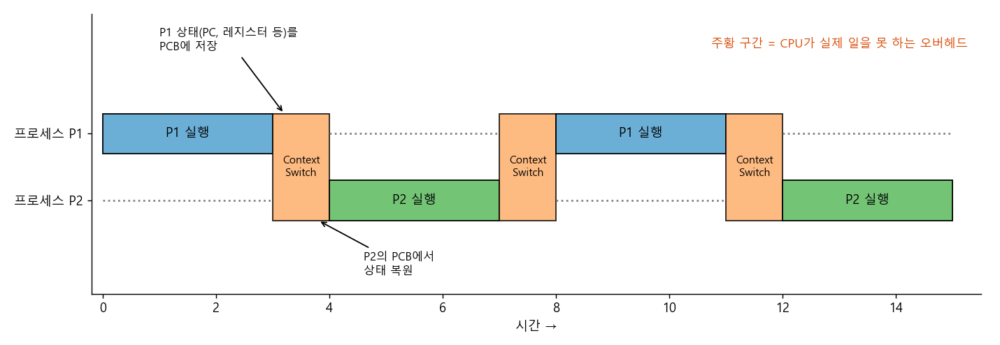
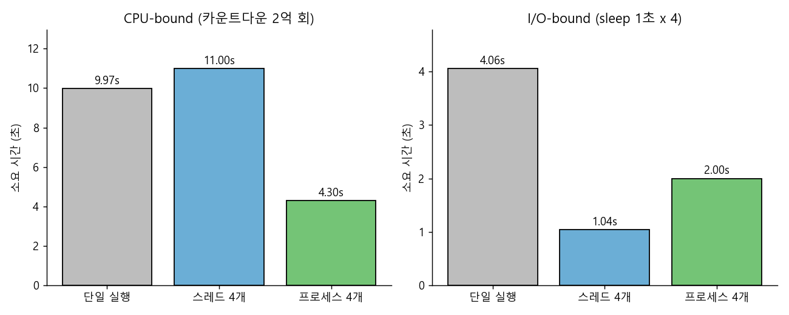

### 프로세스와 스레드는 무엇이 다르고, 왜 멀티 프로세스 대신 멀티 스레드를 쓰는지 알아봅니다.  


> 참고 자료  
> 프로세스와 스레드의 차이 (https://gmlwjd9405.github.io/2018/09/14/process-vs-thread.html)  
> 멀티 프로세싱의 이점 (https://donghoson.tistory.com/15)  
> 스레드에 대한 자세한 설명 (https://niceman.tistory.com/138)  

<center></center>   

<br/>


>  **1. 프로세스는 OS로부터 독립된 메모리(Code/Data/Heap/Stack)를 할당받는 작업의 단위이고, 스레드는 프로세스 안에서 Stack과 레지스터만 따로 갖고 나머지는 공유하는 실행의 단위임**
>
>  **2. 멀티 프로세스는 안정적(하나가 죽어도 나머지는 무사)이지만, Context Switching 비용과 IPC의 복잡함이라는 대가가 있음**
>
>  **3. 멀티 스레드는 가볍고 통신이 쉽지만 동기화 문제가 생기며, Python에서는 GIL 때문에 CPU-bound 작업은 멀티 프로세싱을 써야 실제로 빨라짐**

<br/>

----

**본 포스트는 프로세스/스레드, 그리고 Context Switching에 관한 여러 블로그 글을 읽고 정리한 노트입니다.**
참고한 글은 글 하단의 출처에서 보실 수 있습니다.  

----
#### Contents

1. [들어가며](#intro)
2. [프로그램, 프로세스, 스레드](#concepts)
3. [멀티 프로세스: 따로 또 같이](#multiprocess)
4. [Context Switching은 왜 비쌀까?](#context-switching)
5. [멀티 스레드: 가볍지만 조심해야 하는](#multithread)
6. [왜 멀티 프로세스 대신 멀티 스레드를 쓸까?](#why-thread)
7. [Python으로 직접 확인해보자! (feat. GIL)](#python-demo)
8. [마치며](#conclusion)
<br />

<a id="intro"></a>
## 1. 들어가며  

데이터 전처리 코드를 짜다 보면 "이거 병렬로 돌리면 빨라지지 않을까?" 하는 순간이 꼭 오는데요. 그래서 `threading`을 import해서 열심히 스레드를 띄웠더니... 오히려 더 느려지는 경험, 한 번쯤 해보셨을 겁니다. (네, 제 얘기입니다.)  

이 현상을 제대로 이해하려면 결국 운영체제의 기본기, 즉 **프로세스와 스레드가 무엇이 다른지**, 그리고 **CPU가 여러 작업을 번갈아 처리할 때 무슨 일이 일어나는지(Context Switching)**를 알아야 합니다. 면접 단골 질문이기도 하죠.  
이번 포스트에서는 이 개념들을 정리하고, 마지막에는 Python으로 간단한 실험을 해서 실제 숫자로 확인해 보겠습니다.  

<br/>

<a id="concepts"></a>
## 2. 프로그램, 프로세스, 스레드  

먼저 용어부터 정리해 보겠습니다.  

**프로그램(Program)**  
- 어떤 작업을 위해 실행할 수 있는 파일임  
- 디스크에 저장되어 있는, 아직 실행되지 않은 정적인 코드 덩어리  

**프로세스(Process)**  
- 메모리에 올라와 실행되고 있는 프로그램의 인스턴스(독립적인 개체)임  
- 운영체제로부터 시스템 자원(CPU 시간, 주소 공간, 독립된 메모리 영역)을 할당받는 **작업의 단위**  
- 메모리 영역은 **Code / Data / Heap / Stack** 구조로 되어 있음  
	- Code: 실행할 기계어 코드  
	- Data: 전역 변수, static 변수  
	- Heap: 런타임에 동적으로 할당되는 메모리 (`malloc`, `new`, Python 객체 등)  
	- Stack: 함수 호출 시의 지역 변수, 매개변수, 리턴 주소  
- 프로세스당 최소 1개의 스레드(메인 스레드)를 가짐  
- 각 프로세스는 별도의 주소 공간에서 실행되므로, 한 프로세스는 다른 프로세스의 변수나 자료구조에 직접 접근할 수 없음  
- 다른 프로세스의 자원에 접근하려면 **IPC(Inter-Process Communication)**, 즉 파이프, 파일, 소켓, 공유 메모리 등을 이용해야 함  

같은 크롬 브라우저 실행 파일(프로그램)을 두 번 실행하면 두 개의 프로세스가 생기는 것처럼, 프로그램은 "설계도", 프로세스는 "설계도대로 지어서 실제로 돌아가고 있는 공장"쯤으로 생각하면 편합니다.  

**스레드(Thread)**  
- 프로세스 내에서 실행되는 여러 흐름의 단위, 즉 프로세스의 특정한 수행 경로임  
- 프로세스가 할당받은 자원을 이용하는 **실행의 단위**  
- 스레드는 프로세스 내에서 **Stack만 따로 할당받고, Code / Data / Heap 영역은 공유**함  
- 각 스레드는 별도의 레지스터(Program Counter 포함)와 스택을 갖지만, 힙 메모리는 서로 읽고 쓸 수 있음  
- 따라서 한 스레드가 프로세스 자원을 변경하면, 이웃 스레드(sibling thread)도 그 변경 결과를 즉시 볼 수 있음  

공장 비유를 이어가자면, 스레드는 같은 공장 안에서 일하는 직원들입니다. 공장 설비(Code), 창고(Heap), 게시판(Data)은 다 같이 쓰지만, 각자 자기 작업 메모장(Stack)과 "지금 몇 번째 공정을 하고 있는지"(PC, 레지스터)는 따로 들고 있는 셈이죠.  

맨 위의 그림이 바로 이 차이를 나타낸 것입니다. 왼쪽의 멀티 프로세스는 메모리 4개 영역을 통째로 각자 갖고 있고, 서로 대화하려면 IPC라는 다리를 건너야 합니다. 오른쪽의 멀티 스레드는 Stack만 여러 개이고, 나머지는 한 벌을 함께 씁니다.  

그렇다면 왜 Stack만 따로 가질까요? 스레드는 각자 독립적으로 함수를 호출하고 리턴하는 **실행 흐름**이기 때문에, 함수 호출 기록(지역 변수, 리턴 주소)이 섞이면 안 되기 때문입니다. 반대로 나머지는 공유해도 문제가 없거나, 오히려 공유하는 것이 목적이죠.  

<br/>

<a id="multiprocess"></a>
## 3. 멀티 프로세스: 따로 또 같이  

**멀티 프로세스**는 하나의 응용 프로그램을 여러 개의 프로세스로 구성하여, 각 프로세스가 하나의 작업(태스크)을 처리하도록 하는 방식입니다. 크롬이 탭마다 별도 프로세스를 띄우는 것이 대표적인 예인데요.  

**장점**  
- 독립성/안정성: 여러 자식 프로세스 중 하나에 문제가 생겨도 그 프로세스만 죽을 뿐, 다른 프로세스로 영향이 확산되지 않음  
	- 크롬에서 탭 하나가 멈춰도 브라우저 전체가 죽지 않는 이유임  
- 멀티 코어를 그대로 활용할 수 있음 (각 프로세스를 다른 코어에 스케줄링 가능)  

**단점**  
1. **Context Switching 오버헤드**  
	- 프로세스는 각자 독립된 메모리 영역을 갖기 때문에 공유하는 메모리가 없음  
	- 따라서 프로세스를 전환하면 주소 공간 자체가 바뀌고, CPU 캐시와 TLB에 있던 내용이 쓸모 없어져 다시 채워야 함 (자세한 내용은 다음 장에서)  
2. **어렵고 복잡한 통신 기법(IPC)**  
	- 하나의 프로그램에 속하는 프로세스끼리도 변수를 공유할 수 없음  
	- 데이터를 주고받으려면 직렬화(serialization)해서 파이프나 소켓으로 보내야 하므로 코드도 복잡해지고 비용도 큼  
3. **생성 비용**  
	- 프로세스를 새로 만드는 것 자체도 메모리 공간 할당, 페이지 테이블 구성 등 무거운 작업임  

<br/>

<a id="context-switching"></a>
## 4. Context Switching은 왜 비쌀까?  

CPU 코어 하나는 한 순간에 하나의 작업만 실행할 수 있습니다. 그런데도 우리가 음악을 들으면서 코드를 짜고 브라우저를 띄워놓을 수 있는 건, OS가 아주 짧은 시간 단위로 여러 작업을 **번갈아** 실행해 주기 때문인데요. 이때 일어나는 것이 바로 **Context Switching**입니다.  

- CPU에서 여러 프로세스(또는 스레드)를 돌아가면서 작업을 처리하는 과정임  
- 동작 중인 프로세스가 대기 상태로 갈 때 해당 프로세스의 상태(context)를 보관하고, 대기하고 있던 다음 순서의 프로세스가 동작하면서 이전에 보관해 두었던 그 프로세스의 상태를 복구하는 작업임  
- 이때 "상태"란 Program Counter, 레지스터 값, 스택 포인터, 메모리 관리 정보 등을 말하며, 이는 **PCB(Process Control Block)**에 저장됨  

<center></center>   

<br/>

위 그림에서 주황색 구간이 Context Switching입니다. 이 구간 동안 CPU는 P1의 일도, P2의 일도 하지 않고 오직 "짐 싸고 짐 푸는" 일만 하고 있죠. 즉, **순수한 오버헤드**입니다.  

그런데 실제 비용은 PCB를 저장하고 복원하는 것 이상입니다. 프로세스 간 전환이 특히 무거운 이유는 다음과 같습니다.  

- **주소 공간 전환**: 프로세스마다 가상 주소 공간이 다르기 때문에, 페이지 테이블을 바꿔야 함  
- **TLB flush**: 가상 주소를 물리 주소로 바꿔주는 캐시인 TLB의 내용이 이전 프로세스 기준이므로 무효화해야 함 (최신 CPU는 PCID/ASID 같은 태그로 이 비용을 일부 줄임)  
- **Cold cache**: 새로 들어온 프로세스가 쓸 데이터는 CPU 캐시(L1/L2)에 없기 때문에, 한동안 캐시 미스가 연달아 발생함  

참고했던 글들에서는 이를 "캐시 메모리 초기화"라고 표현하는데요, 엄밀히 말하면 캐시를 일부러 지운다기보다는 **이전 프로세스의 데이터로 채워져 있던 캐시가 새 프로세스에게는 쓸모가 없어져서, 결국 다시 채워야 한다**는 의미에 가깝습니다. 어느 쪽이든 결과는 같습니다. 느려진다는 것이죠.  

반면 **같은 프로세스 내의 스레드끼리** 전환할 때는 주소 공간이 같으므로 페이지 테이블도, TLB도 그대로 쓸 수 있고, 공유하는 Heap/Code 데이터는 캐시에 남아 있을 가능성이 높습니다. 저장하고 복원할 것은 각 스레드 고유의 레지스터, PC, 스택 포인터 정도뿐이죠. 그래서 **스레드 간 Context Switching이 프로세스 간 Context Switching보다 훨씬 가볍습니다.**  

<br/>

<a id="multithread"></a>
## 5. 멀티 스레드: 가볍지만 조심해야 하는  

**멀티 스레딩**은 하나의 응용 프로그램을 여러 개의 스레드로 구성하고, 각 스레드가 하나의 작업을 처리하도록 만드는 방식입니다.  

- 윈도우, 리눅스 등 많은 운영체제들이 멀티 프로세싱을 지원하지만, 실행 단위로는 멀티 스레딩을 기본으로 함  
- 웹 서버는 대표적인 멀티 스레드 응용 프로그램임 (요청 하나당 스레드 하나를 배정하는 식)  

**장점**  
1. **시스템 자원 소모 감소 (자원의 효율성 증대)**  
	- 프로세스를 생성하여 자원을 할당하는 시스템 콜이 줄어들어, 자원을 효율적으로 관리할 수 있음  
2. **시스템 처리량 증가 (처리 비용 감소)**  
	- 스레드 간 데이터를 주고받는 것이 간단해지고, 시스템 자원 소모가 줄어듦  
	- 스레드 간 전환 시 처리할 것이 적어 Context Switching이 빠름  
3. **간단한 통신 방법으로 인한 응답 시간 단축**  
	- 스레드는 Stack 영역을 제외한 모든 메모리를 공유하므로, 통신의 부담이 적음  
	- 그냥 같은 변수를 읽고 쓰면 됨  

**단점**  
1. 주의 깊은 설계가 필요함  
2. 디버깅이 까다로움 (실행 순서가 매번 달라져서 재현이 어려운 버그가 생김)  
3. 단일 프로세서(싱글 코어) 시스템에서는 CPU 작업을 진짜 병렬로 돌릴 수 없으므로, 성능 향상 효과를 기대하기 어려움  
4. 프로세스 밖에서 스레드 각각을 제어할 수 없음  
5. **자원 공유 문제 (동기화 문제)**  
6. 하나의 스레드에 문제가 생기면 전체 프로세스가 영향을 받음  

장점과 단점이 사실 같은 뿌리에서 나온다는 게 재밌는데요. "메모리를 공유한다"는 것이 통신을 쉽게 만들어주는 동시에, 여러 스레드가 같은 변수를 동시에 건드리는 **race condition**을 낳습니다. 예를 들어 두 스레드가 동시에 `counter += 1`을 하면, "읽기 -> 더하기 -> 쓰기" 사이에 다른 스레드가 끼어들어 값이 하나 사라질 수 있습니다. 이를 막기 위해 Mutex, Semaphore 같은 동기화 도구를 쓰게 되는데, 잘못 쓰면 이번엔 **deadlock**이 기다리고 있죠.  

또 6번처럼, 한 스레드가 잘못된 메모리를 건드려 segmentation fault를 내면 같은 주소 공간을 쓰는 프로세스 전체가 함께 죽습니다. 멀티 프로세스의 장점이었던 "격리"를 내려놓은 대가인 셈입니다.  

<br/>

<a id="why-thread"></a>
## 6. 왜 멀티 프로세스 대신 멀티 스레드를 쓸까?  

여기서 "멀티 프로세스 대신 멀티 스레드를 쓴다"는 말은, **프로그램을 여러 개 켜는 대신 하나의 프로그램 안에서 여러 작업을 해결한다**는 뜻입니다. 앞의 내용을 정리하면 이유는 크게 두 가지입니다.  

**1) 자원의 효율성**  
- 프로세스를 생성하여 자원을 할당하는 시스템 콜이 줄어들어, 자원을 효율적으로 관리할 수 있음  
- 프로세스 간 Context Switching 시에는 CPU 레지스터 교체뿐만 아니라 주소 공간 전환, TLB/캐시 재적재까지 일어나 오버헤드가 큼  
- 스레드는 프로세스 내의 메모리를 공유하기 때문에 데이터를 주고받는 것이 간단하고 시스템 자원 소모가 적음  

**2) 처리 비용 감소 및 응답 시간 단축**  
- IPC보다 스레드 간 통신 비용이 훨씬 적음 -> Stack을 제외한 모든 메모리를 공유하기 때문  
- 프로세스 간 전환보다 스레드 간 전환이 빠름 -> 스레드 전환 시에는 각 스레드 고유의 레지스터와 스택 정보만 바꾸면 되기 때문  

정리하면 아래 표와 같습니다.  

| 구분 | 멀티 프로세스 | 멀티 스레드 |
|---|---|---|
| 메모리 | 각자 독립 | Stack만 독립, 나머지 공유 |
| 생성 비용 | 큼 | 작음 |
| Context Switching | 무거움 (주소 공간 전환) | 가벼움 |
| 통신 | IPC 필요 (복잡, 느림) | 공유 메모리 (간단, 빠름) |
| 안정성 | 하나가 죽어도 나머지 무사 | 하나가 죽으면 전체가 위험 |
| 주의할 점 | IPC 설계, 메모리 사용량 | 동기화(race condition, deadlock) |

결국 어느 하나가 절대적으로 우월한 것은 아니고, **격리가 중요하면 프로세스, 가벼움과 공유가 중요하면 스레드**라는 트레이드오프의 문제입니다.  

<br/>

<a id="python-demo"></a>
## 7. Python으로 직접 확인해보자! (feat. GIL)  

여기까지만 보면 "스레드가 가볍고 빠르니 무조건 스레드!"라고 생각하기 쉬운데요, Python을 쓰는 분이라면 한 가지 함정을 알아야 합니다. 바로 **GIL(Global Interpreter Lock)**입니다.  

- CPython 인터프리터는 한 번에 **오직 하나의 스레드만 Python 바이트코드를 실행**하도록 막는 전역 락(GIL)을 가지고 있음  
- 메모리 관리(reference counting)를 단순하고 안전하게 만들기 위한 설계임  
- 따라서 스레드를 여러 개 띄워도, 순수 Python으로 된 CPU 연산은 사실상 한 코어에서 번갈아 실행됨  
- 단, I/O 대기(파일, 네트워크, `sleep`) 중에는 GIL을 놓아주므로 I/O-bound 작업에서는 스레드가 효과적임  

정말 그런지 실험해 보겠습니다. 숫자를 0까지 카운트다운하는 순수 CPU 작업을 (1) 그냥 4번 순차 실행, (2) 스레드 4개, (3) 프로세스 4개로 나눠 실행해 시간을 재봅니다.  

```python
import time
from threading import Thread
from multiprocessing import Process

def count(n):
    while n > 0:
        n -= 1

N = 200_000_000
W = 4

def run(kind):
    if kind == "single":
        t0 = time.perf_counter()
        for _ in range(W):
            count(N // W)
        return time.perf_counter() - t0
    Worker = Thread if kind == "thread" else Process
    workers = [Worker(target=count, args=(N // W,)) for _ in range(W)]
    t0 = time.perf_counter()
    for w in workers: w.start()
    for w in workers: w.join()
    return time.perf_counter() - t0

if __name__ == "__main__":
    for kind in ["single", "thread", "process"]:
        print(f"{kind:8s}: {run(kind):.2f} sec")
```

```
single  : 9.97 sec
thread  : 11.00 sec
process : 4.30 sec
```

(Windows, Python 3.10, AMD Ryzen 7 5800X 8코어/16스레드 환경에서 실행한 결과입니다.)  

결과가 꽤 극적인데요.  
- **스레드 4개는 순차 실행보다 오히려 느림** (9.97초 -> 11.00초): GIL 때문에 한 번에 하나만 돌 수 있는데, 스레드끼리 GIL을 주고받는 비용과 Context Switching 비용만 추가되었기 때문임  
- **프로세스 4개는 약 2.3배 빨라짐** (9.97초 -> 4.30초): 프로세스마다 독립된 인터프리터와 GIL을 가지므로 실제로 여러 코어에서 병렬 실행됨  
- 이론상 4배가 나와야 할 것 같지만, 프로세스 생성 비용(Windows는 `spawn` 방식이라 인터프리터를 새로 띄움), 코어 클럭 변화 등으로 그보다는 덜 빨라짐  

이번엔 같은 구조에서 작업만 `time.sleep(1)`(I/O 대기를 흉내 낸 것)로 바꿔 보았습니다.  

```
single  : 4.06 sec
thread  : 1.04 sec
process : 2.00 sec
```

<center></center>   

<br/>

이번엔 상황이 정반대입니다.  
- **스레드 4개가 가장 빠름** (약 1초): `sleep` 중에는 GIL을 놓아주므로 4개가 동시에 기다릴 수 있음  
- **프로세스 4개는 2초**: 기다리는 시간은 똑같이 1초인데, 프로세스 4개를 새로 띄우는 데만 약 1초가 더 걸림  
- 앞에서 이야기한 "프로세스 생성은 무겁다"는 것을 숫자로 직접 확인할 수 있는 부분임  

정리하면 Python에서는 다음과 같은 경험칙을 따르면 됩니다.  
- **I/O-bound (크롤링, API 호출, 파일 읽기 등)** -> `threading` 또는 `concurrent.futures.ThreadPoolExecutor`  
- **CPU-bound (순수 Python 연산, 전처리 루프 등)** -> `multiprocessing` 또는 `ProcessPoolExecutor`  
- 참고로 NumPy, PyTorch처럼 내부 연산을 C/C++로 수행하는 라이브러리는 연산 중 GIL을 놓아주는 경우가 많아서, 스레드로도 병렬 효과를 볼 수 있음  

(덧붙여, 이후 [PEP 703](https://peps.python.org/pep-0703/)을 통해 GIL을 선택적으로 제거한 free-threaded CPython 빌드가 Python 3.13부터 실험적으로 제공되기 시작했습니다. 이 빌드에서는 위 실험의 결과가 달라질 수 있습니다.)  

<br/>

<a id="conclusion"></a>
## 8. 마치며  

프로세스와 스레드의 차이는 결국 **"무엇을 공유하느냐"**로 요약되는 것 같습니다. 공유하지 않으면 안전하지만 무겁고, 공유하면 가볍지만 조심해야 하죠. Context Switching 비용의 차이도, IPC의 번거로움도, 동기화 문제도 모두 이 한 가지 선택에서 파생된다는 점이 정리하면서 가장 인상 깊었습니다.  

개인적으로는 "스레드 쓰면 빨라지겠지"라는 막연한 기대로 코드를 짰다가 오히려 느려졌던 경험이 이번 정리로 깔끔하게 설명되어 속이 시원했는데요. 앞으로는 병렬화를 하기 전에 먼저 **이 작업이 CPU를 기다리는지, I/O를 기다리는지**부터 따져보는 습관을 들여야겠습니다.  

----------------


**개선을 위한 여러분의 피드백과 제안을 코멘트로 공유해 주세요.**
**내용에 대한 지적, 혹은 질문을 환영합니다.**  


**출처**  
[프로세스와 스레드의 차이 - Heee's Development Blog](https://gmlwjd9405.github.io/2018/09/14/process-vs-thread.html)  
[멀티 프로세싱의 이점](https://donghoson.tistory.com/15)  
[스레드에 대한 자세한 설명](https://niceman.tistory.com/138)  
[Python Docs - threading](https://docs.python.org/3/library/threading.html)  
[Python Docs - Glossary: global interpreter lock](https://docs.python.org/3/glossary.html#term-global-interpreter-lock)  
[PEP 703 - Making the Global Interpreter Lock Optional in CPython](https://peps.python.org/pep-0703/)  
