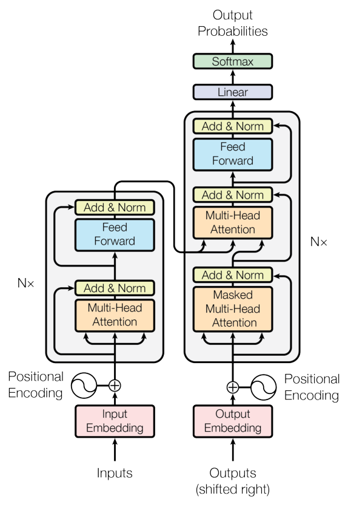
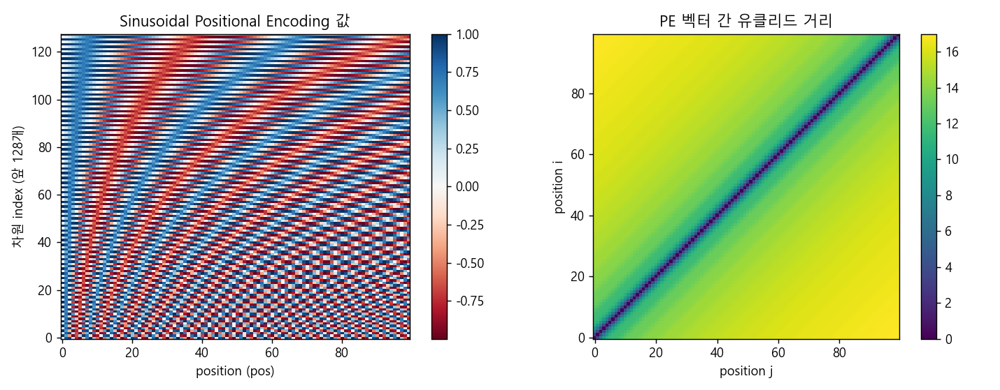
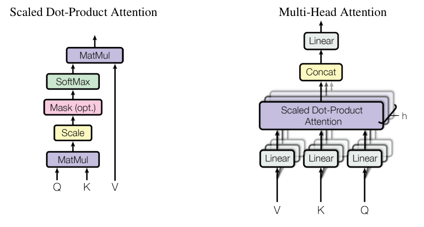
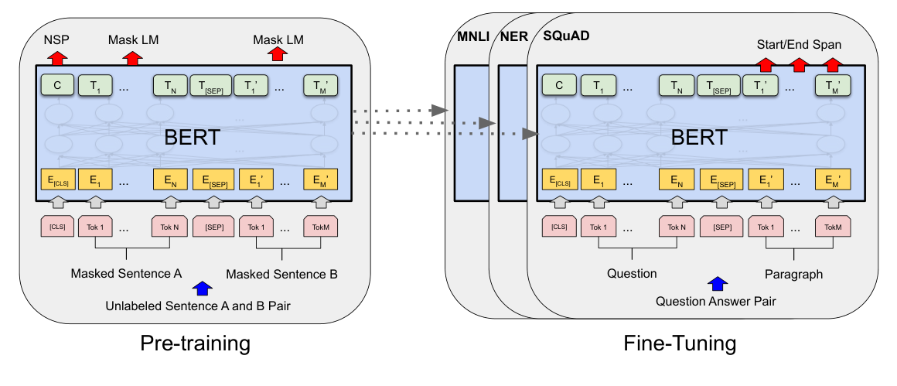
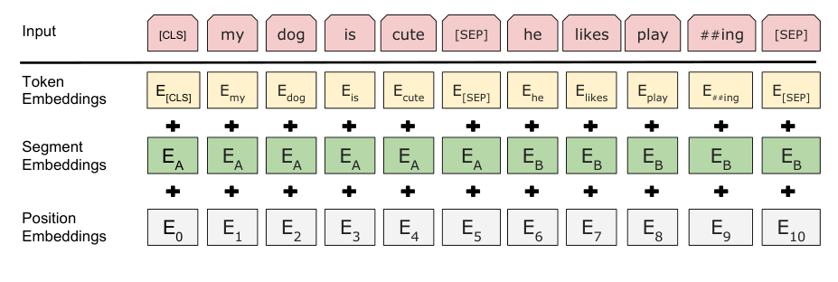

### 지금의 NLP를 만든 두 모델, Transformer와 BERT의 구조를 처음부터 다시 짚어봅니다.  


> 다루는 강의 및 논문  
> **강의**: 고려대학교 산업경영공학과 Unstructured Data Analysis (Text Analytics) 08-2: Transformer, 08-5: BERT - 강필성 교수님 (DSBA 연구실)  
> **Transformer**: Attention Is All You Need (Vaswani et al., NeurIPS 2017)  
> **BERT**: BERT: Pre-training of Deep Bidirectional Transformers for Language Understanding (Devlin et al., NAACL 2019)  

<center></center>   

<font size="2"><center> 출처: Vaswani et al., Attention Is All You Need (https://arxiv.org/abs/1706.03762) </center>  </font>   

<br/>


>  **1. Transformer는 RNN 없이 attention만으로 인코더-디코더를 구성하여, 학습 병렬화와 장거리 의존성 포착을 동시에 잡은 모델임**
>
>  **2. 핵심 부품은 Scaled Dot-Product Attention, Multi-Head Attention, Positional Encoding, 그리고 Residual + LayerNorm + Position-wise FFN의 반복 구조임**
>
>  **3. BERT는 Transformer의 인코더만 쌓은 뒤 MLM과 NSP로 사전학습하여 양방향 문맥 표현을 얻고, 출력층 하나만 붙여 다양한 다운스트림 태스크에 fine-tuning함**

<br/>

----

**본 포스트는 고려대학교 강필성 교수님의 Text Analytics 강의 영상(Transformer, BERT)을 보고 정리한 노트에, 원 논문의 내용을 보충한 글입니다.**  
강의 영상은 여기에서 보실 수 있습니다. [08-2: Transformer](https://www.youtube.com/watch?v=Yk1tV_cXMMU), [08-5: BERT](https://www.youtube.com/watch?v=IwtexRHoWG0)  
원 논문은 여기에서 보실 수 있습니다. [Transformer paper](https://arxiv.org/abs/1706.03762), [BERT paper](https://arxiv.org/abs/1810.04805)  

----
#### Contents  

1. [Intro - 왜 다시 Transformer인가?](#intro)  
2. [Transformer의 큰 그림: 인코더와 디코더](#overview)  
3. [입력 임베딩과 Positional Encoding](#positional)  
4. [Self-Attention을 6단계로 뜯어보자](#self-attention)  
5. [Multi-Head Attention, Residual, 그리고 FFN](#mha)  
6. [디코더: Masked Attention과 최종 출력층](#decoder)  
7. [BERT: 인코더만 쌓아 양방향으로 학습하자!](#bert)  
8. [BERT의 입력 표현](#bert-input)  
9. [BERT의 사전학습: MLM과 NSP](#bert-pretrain)  
10. [마치며](#conclusion)  
<br />

<a id="intro"></a>
## 1. Intro - 왜 다시 Transformer인가?  

얼마 전 [Longformer](https://myeonghak.github.io/natural%20language%20processing/NLP-Longformer/)를 정리하면서, 정작 그 뿌리가 되는 Transformer와 BERT는 "대충 안다"는 느낌으로 넘어가고 있다는 생각이 들었는데요.  
막상 누가 "Q, K, V 차원은 왜 64로 줄이나요?", "FFN은 왜 2048로 키웠다가 다시 512로 줄이나요?"라고 물어보면 시원하게 대답하기가 어렵더라고요.  
그래서 DSBA 연구실 강필성 교수님의 강의를 다시 보면서 기본기를 다져보기로 했습니다. 강의가 워낙 친절해서, 논문만 읽을 때 놓쳤던 디테일들을 많이 챙길 수 있었습니다.  

Transformer는 한 마디로 **RNN의 순차 연산을 걷어내고 attention만으로 시퀀스를 처리하는 모델**입니다.  
RNN 계열은 $t$ 시점의 hidden state를 계산하려면 $t-1$ 시점의 결과가 있어야 해서 병렬화가 어렵고, 멀리 떨어진 단어 간의 관계는 여러 step을 거쳐 전달되어야 했는데요.  
Transformer는 모든 토큰 쌍의 관계를 한 번에 행렬 연산으로 계산하므로, **학습 속도와 병렬화**에서 큰 이점을 얻게 됩니다.  


<a id="overview"></a>
## 2. Transformer의 큰 그림: 인코더와 디코더  

맨 위 그림이 Transformer의 전체 구조입니다. 크게 **인코더 파트**(왼쪽), **디코더 파트**(오른쪽), 그리고 **둘을 연결하는 부분**으로 구성됩니다.  

- 인코더 파트: 인코딩 블록 6개가 쌓여(stack) 구성됨  
- 디코더 파트: 디코딩 블록 6개가 쌓여 구성됨  
- 6이라는 숫자에 특별한 의미가 있는 것은 아니고, 논문에서 처음 제안한 값일 뿐임 (그림의 $N\times$)  

각 블록의 내부 구성은 아래와 같습니다.  

- **인코더 블록**: Self-Attention -> FFN의 2단계 구성  
- **디코더 블록**: Masked Self-Attention -> Encoder-Decoder Attention -> FFN의 3단계 구성  

여기서 주의할 점이 하나 있는데요. 모든 인코더 블록이 **같은 구조**를 갖는다고 해서 **같은 가중치를 공유한다는 뜻은 아닙니다.** 6개 블록은 각자 다른 파라미터를 학습합니다.  

인코더와 디코더 블록의 가장 큰 차이는 **masking 여부**입니다.  
디코더는 다음 토큰을 예측해야 하므로, 예측 과정에서 정답(미래 토큰)을 컨닝할 수 없도록 마스킹을 걸어줍니다. 예를 들어 4번째 토큰을 예측하는 차례라면 4번째 이후의 토큰은 보이지 않게 가려지는 식입니다.  
"나는 너를 사랑하는데"까지 디코더에 들어왔다면, "사랑하는데"는 "나는", "너를"과 자기 자신에게만 attention을 줄 수 있는 것이죠.  

그리고 디코더의 두 번째 sub-layer인 **Encoder-Decoder Attention**이 바로 인코더와 디코더를 연결하는 다리 역할을 합니다. Query는 디코더에서, Key와 Value는 인코더의 최종 출력에서 가져와, 디코더가 지금 생성하려는 토큰과 유관한 입력 부분에 주목하도록 돕습니다.  


<a id="positional"></a>
## 3. 입력 임베딩과 Positional Encoding  

### 입력 임베딩  

- 단어를 고정 길이(논문에서는 $d_{model}=512$)의 벡터로 바꾸는 임베딩은 가장 아래(bottom-most) 인코더의 입력에서만 이루어짐  
- 이후의 모든 인코더 블록은 512차원 벡터의 리스트를 입력으로 받는데, 첫 블록에서는 이것이 워드 임베딩이고 그 위 블록부터는 바로 아래 블록의 출력이 됨  
- 리스트의 길이(최대 시퀀스 길이)는 하이퍼파라미터로, 보통 학습 데이터에서 가장 긴 문장 길이 정도로 잡음  

강의에서는 word2vec이나 GloVe 같은 사전학습 임베딩을 가져다 쓸 수도 있다고 언급되는데요, 원 논문의 Transformer는 임베딩을 **처음부터(from scratch) 함께 학습**하고, 입력/출력 임베딩과 마지막 softmax 직전의 linear layer가 가중치를 공유하는 방식을 사용했습니다.  

### Positional Encoding  

Attention은 본질적으로 순서를 모르는 연산입니다. "개가 사람을 물었다"와 "사람이 개를 물었다"를 같은 단어 집합으로 보게 되는 거죠.  
그래서 단어의 위치 정보를 따로 넣어줘야 하는데, Transformer는 512차원의 입력 임베딩에 **같은 512차원의 positional encoding 벡터를 더해(addition)** 줍니다. 강의에서는 이를 "Embedding with time signal"이라고 표현합니다.  

좋은 positional encoding이 갖춰야 할 성질로 강의에서는 두 가지를 꼽습니다.  

- 인코딩 벡터의 norm이 모든 위치에 대해 동일해야 함 (특정 위치만 튀면 안 됨)  
- 두 위치가 멀리 떨어져 있을수록, 두 인코딩 벡터 사이의 거리도 커져야 함  

Transformer는 이를 위해 sin, cos 함수를 사용합니다.  

$$
PE_{(pos, 2i)} = \sin\left(\frac{pos}{10000^{2i/d_{model}}}\right), \quad PE_{(pos, 2i+1)} = \cos\left(\frac{pos}{10000^{2i/d_{model}}}\right)
$$

짝수 차원에는 sin, 홀수 차원에는 cos을 쓰고, 차원 index가 커질수록 주기가 길어지도록 설계되어 있습니다.  
정말 위 두 성질을 만족하는지 간단히 확인해 보겠습니다.  

```python
import numpy as np

def pe(max_len, d_model):
    pos = np.arange(max_len)[:, None]
    i = np.arange(0, d_model, 2)[None, :]
    angle = pos / np.power(10000, i / d_model)
    P = np.zeros((max_len, d_model))
    P[:, 0::2] = np.sin(angle)
    P[:, 1::2] = np.cos(angle)
    return P

P = pe(100, 512)
norms = np.linalg.norm(P, axis=1)
print(f"norm mean={norms.mean():.4f}, std={norms.std():.6f}")
dist = np.linalg.norm(P[0] - P, axis=1)
print("pos 0과의 거리:", np.round(dist[[1, 2, 5, 10, 20, 50, 99]], 2))
```

```
norm mean=16.0000, std=0.000000
pos 0과의 거리: [ 3.71  6.97 11.52 12.82 14.03 15.81 16.98]
```

같은 주파수의 sin, cos이 한 쌍을 이루므로 $\sin^2 + \cos^2 = 1$이 256쌍 더해져, 모든 위치에서 norm이 정확히 $\sqrt{256}=16$으로 동일하게 나오네요. (강의 노트에는 평균에 비해 표준편차가 매우 작다고 적어 두었는데, 위 수식 그대로 구현하면 아예 0이 됩니다.)  
또 0번 위치에서 멀어질수록 거리가 단조롭게 커지는 것도 확인할 수 있습니다.  

<center></center>   

<br/>

오른쪽 거리 행렬을 보면 대각 원소는 자기 자신과의 거리이므로 0이고, 대각선에서 멀어질수록 거리가 커지는 경향이 뚜렷합니다.  
다만 강의에서도 짚었듯, 세세하게 보면 더 먼 위치가 오히려 거리가 살짝 작아지는 역전 구간이 듬성듬성 존재하는데요. 주기 함수를 쓰니 어쩔 수 없는 부분이고, 전반적인 경향성은 조건을 잘 만족한다고 보면 되겠습니다.  


<a id="self-attention"></a>
## 4. Self-Attention을 6단계로 뜯어보자  

> *"The animal didn't cross the street because it was too tired."*  

이 문장에서 "it"이 가리키는 것은 street가 아니라 animal이죠. 사람은 쉽게 알지만 모델은 어떻게 알 수 있을까요?  
Self-Attention은 **한 단어를 인코딩할 때 문장 내 다른 유관 단어들을 참고하도록 만드는 도구**입니다. "it"을 인코딩할 때 "animal"의 정보를 많이 섞어주면 되는 것이죠.  

<center></center>   

<font size="2"><center> 출처: Vaswani et al., Attention Is All You Need (https://arxiv.org/abs/1706.03762) </center>  </font>   

<br/>

강의에서는 Self-Attention을 6단계로 나누어 설명하는데요, 하나씩 따라가 보겠습니다.  

**Step 1. 입력 벡터마다 Query, Key, Value 3개의 벡터를 만듦**  

- **Query**: 현재 처리 중인 단어의 표현으로, 다른 단어들과의 점수를 매길 때 "질문"하는 역할  
- **Key**: 시퀀스 내 모든 단어에 붙은 "레이블" 같은 것으로, Query와 매칭되는 대상  
- **Value**: 실제 단어의 표현으로, 점수가 매겨진 뒤 실제로 가중합되어 현재 단어를 표현하는 값  
- 입력 $x_1$이 $1\times4$, q/k/v가 $1\times3$이라면 $W^Q, W^K, W^V$는 모두 $4\times3$ 행렬이 되며, 이 $W$들이 학습으로 찾아야 할 파라미터임  

논문에서는 $d_{model}=512$인데 Q, K, V의 차원은 $d_k=d_v=64$로 더 작게 잡습니다. 이는 8개의 head 출력을 이어 붙였을 때(concat) $8\times64=512$로 원래 차원이 복원되도록, 즉 **multi-head attention을 거쳐도 전체 구조의 차원을 일관되게 유지**하기 위함입니다. 덕분에 head를 8개로 늘려도 총 연산량은 single-head attention과 비슷하게 유지됩니다.  

**Step 2. Score 계산**  

- 현재 단어의 Query와 모든 단어의 Key를 내적하여, 현재 단어를 인코딩할 때 각 단어에 얼마나 관심을 기울일지 점수를 매김  

**Step 3. $\sqrt{d_k}$로 나누기**  

- 차원이 커질수록 내적 값의 분산이 커져 softmax가 한쪽으로 극단적으로 쏠리고, gradient가 매우 작아짐  
- $\sqrt{d_k}$로 나눠 스케일을 맞춰 주면 gradient가 안정됨 (그래서 이름이 **Scaled** Dot-Product Attention)  

**Step 4. Softmax 통과**  

- 점수를 합이 1인 확률 형태로 바꾸며, 이 값이 해당 위치에서 각 단어가 얼마나 반영될지를 결정함  

**Step 5. 각 Value 벡터에 softmax score를 곱함**  

- 주목해야 할 단어의 값은 최대한 그대로 살리고, 관심 없는 단어의 값은 거의 남지 않게 만드는 과정  

**Step 6. 가중된 Value 벡터를 모두 더함**  

- 이것이 해당 위치에서 self-attention layer의 출력이 됨  

실제로는 이 과정을 단어 하나씩 하지 않고, 모든 단어를 행렬로 묶어 한 번에 계산합니다.  

$$
\text{Attention}(Q, K, V) = \text{softmax}\left(\frac{QK^\top}{\sqrt{d_k}}\right)V
$$

한 가지 짚고 넘어갈 점은, **self-attention layer 안에서는 단어 벡터들(path) 간에 의존성이 존재**하지만, 그 다음의 FFN에서는 위치끼리 의존성이 없다는 것입니다. 각 위치가 독립적으로 FFN을 통과하므로 이 부분은 자연스럽게 병렬화가 가능해집니다.  


<a id="mha"></a>
## 5. Multi-Head Attention, Residual, 그리고 FFN  

### Multi-Head Attention  

Attention을 한 번만 하면 하나의 관점으로만 문장을 보게 되는데요. 사람도 문장을 읽을 때 "주어-동사 관계", "대명사가 가리키는 대상" 등 여러 관점에서 보죠.  
Multi-Head Attention은 서로 다른 $W^Q, W^K, W^V$를 가진 attention을 8개(head) 병렬로 수행해, **모델이 서로 다른 위치와 표현 공간에 동시에 집중할 수 있는 능력**을 줍니다. 과정을 정리하면 다음과 같습니다.  

1) 문장을 입력함  
2) 각 단어를 임베딩함 (0번째 블록에만 해당)  
3) 이전 블록의 출력(혹은 임베딩)에 head별 $W^Q_i, W^K_i, W^V_i$를 곱함  
4) head별로 attention을 계산해 $Z_0, Z_1, \dots, Z_7$을 얻음  
5) 모든 $Z_i$를 concat한 뒤 함께 학습되는 $W^O$를 곱해 최종 $Z$를 계산하고, 이를 FFN에 전달함  

$$
\text{MultiHead}(Q, K, V) = \text{Concat}(\text{head}_1, \dots, \text{head}_h)W^O, \quad \text{head}_i = \text{Attention}(QW^Q_i, KW^K_i, VW^V_i)
$$

### Residual Connection과 Layer Normalization  

- ResNet에서 도입된 개념으로, 하위 층의 출력 $f(x)$에 입력 $x$를 더한 $f(x)+x$를 다음 층으로 전달함  
- 미분하면 $f'(x)+1$이 되어, $f'(x)$가 작더라도 gradient가 최소한 1의 경로로 흘러갈 수 있으므로 깊은 네트워크 학습에 유리함  
- Transformer에서는 각 sub-layer 뒤에 residual connection(Add) 후 Layer Normalization(Norm)을 적용하며, 이 **Add & Norm**이 모든 인코딩/디코딩 블록에서 반복되는 기본 구조임  

### Position-wise Feed-Forward Network  

$$
\text{FFN}(x) = \max(0, xW_1 + b_1)W_2 + b_2
$$

- 두 개의 선형 변환 사이에 ReLU를 넣은 단순한 fully connected network임  
- 각 위치(토큰)에 **따로, 그리고 동일하게(separately and identically)** 적용됨  
- 즉 같은 블록 안에서는 $z_1, z_2, \dots$ 모든 위치가 같은 파라미터를 공유하고, 블록이 다르면 다른 파라미터를 사용함  

노트를 쓸 때 맨 위에 적어 두었던 질문이 바로 이 부분이었는데요. "왜 2048로 키웠다가 512로 줄이지? 이걸 어떻게 컨볼루션으로 이해하지?"  
지금 정리해 보면 이렇게 이해할 수 있을 것 같습니다.  

- **컨볼루션 관점**: 위치마다 같은 가중치를 공유하며 독립적으로 적용된다는 것은, 시퀀스 축 위를 kernel size 1짜리 필터가 훑고 지나가는 것과 정확히 같음. 즉 FFN은 kernel size 1인 1D convolution 두 개로 볼 수 있음 (논문에서도 이렇게 설명함)  
- **2048 -> 512**: 출력이 다시 512차원이어야 residual connection으로 입력과 더할 수 있고, 다음 블록에도 같은 차원으로 넘길 수 있음. 중간을 4배($d_{ff}=2048$)로 넓히는 것은 ReLU 비선형성이 작동할 넓은 공간을 주어 표현력을 키우기 위함으로, attention이 "섞는" 역할이라면 FFN은 각 위치의 표현을 "가공하는" 역할을 맡는다고 볼 수 있음  

실제로 이후 연구들에서 FFN이 일종의 key-value 메모리처럼 지식을 저장한다는 해석도 나왔으니, 결코 대충 붙인 부품은 아닌 셈이죠.  


<a id="decoder"></a>
## 6. 디코더: Masked Attention과 최종 출력층  

### Masked Multi-Head Attention  

디코더의 self-attention은 출력 시퀀스에서 **이미 등장한 위치에만** attention을 줄 수 있어야 합니다.  
이는 softmax를 통과하기 전에, 아직 보면 안 되는 위치의 score에 $-\infty$를 씌워주는 방식으로 구현합니다. $e^{-\infty}=0$이므로 softmax 후 해당 위치의 가중치는 0이 됩니다.  

- 마스킹을 순차적으로 할 필요 없이, 대각 원소 위쪽(미래 위치)이 모두 $-\infty$인 행렬을 score 행렬에 더해 한 번에 처리함  
- 그 뒤 행(row) 방향으로 softmax를 취함  

노트에 "이러면 attention 확률이 남은 토큰들에 재배정되니, 엄밀하게는 다른 값이 되는 것 아닌가?"라는 의문을 적어 두었는데요. 맞습니다, 재배정되는 것이 맞고 **그게 바로 의도한 동작**입니다.  
마스킹은 "softmax를 다 계산한 뒤 미래 부분을 지우는 것"이 아니라, "처음부터 과거 토큰들만 놓고 softmax를 계산하는 것"과 동일한 결과를 만들기 위한 트릭이거든요. 추론 시점에는 애초에 미래 토큰이 존재하지 않으니, 학습 때도 이와 똑같은 조건을 만들어 주는 것이죠.  

### Final Linear와 Softmax Layer  

- **Linear layer**: 디코더 스택의 출력 벡터(512차원)를 vocabulary 크기만큼의 훨씬 큰 logit 벡터로 projection하는 단순한 fully connected layer  
- **Softmax layer**: logit을 확률로 바꾸고, 가장 높은 확률을 가진 단어를 해당 time step의 출력으로 선택함  


<a id="bert"></a>
## 7. BERT: 인코더만 쌓아 양방향으로 학습하자!  

이제 BERT로 넘어가 보겠습니다. BERT는 **B**idirectional **E**ncoder **R**epresentations from **T**ransformers의 약자로, 이름 그대로 **Transformer의 인코더 파트만 사용해 양방향(bidirectional) 표현을 학습**하겠다는 모델입니다.  

<center></center>   

<font size="2"><center> 출처: Devlin et al., BERT (https://arxiv.org/abs/1810.04805) </center>  </font>   

<br/>

### 기존 언어 모델들과 무엇이 다를까?  

언어 모델은 본래 순차적인 모델입니다. 이전 단어들을 보고 다음 단어를 예측하죠.  

- **ELMo**: 정방향(forward) LSTM과 역방향(backward) LSTM을 **따로** 학습한 뒤, 두 표현을 선형 결합(concat)해 사용함. 양방향 정보를 쓰긴 하지만 각각은 단방향이라 얕은(shallow) 양방향임  
- **GPT**: Transformer의 디코더 부분을 사용해, 마스킹된 뒷부분을 왼쪽에서 오른쪽으로 예측하며 학습함. 구조적으로 왼쪽 문맥만 볼 수 있음  
- **BERT**: 문장 **가운데에 구멍을 뚫어 놓고** 앞뒤 문맥을 동시에 보며 채우도록 학습함. 방향성의 제약을 깨끗하게 해결한 셈  

이렇게 사전학습한 모델 위에 **간단한 출력 레이어 하나만 붙여** fine-tuning했더니, 당시 각 태스크별로 공들여 설계된 SOTA 모델들을 GLUE, SQuAD 등 11개 태스크에서 넘어서는 성능을 보였습니다. 위 그림처럼 사전학습과 fine-tuning에서 출력층을 제외한 구조가 완전히 동일하다는 점이 핵심입니다.  

### 모델 크기  

BERT의 하이퍼파라미터는 L(Transformer 블록 수), H(hidden size), A(self-attention head 수)로 표현합니다.  

| 모델 | L | H | A | 파라미터 수 |
|---|---|---|---|---|
| BERT-Base | 12 | 768 | 12 | 110M |
| BERT-Large | 24 | 1024 | 16 | 340M |

BERT-Base는 OpenAI GPT와 비교하기 위해 일부러 같은 크기로 맞춘 모델입니다. 같은 체급에서 붙어서 이겼다는 점이 의미가 있겠죠.  


<a id="bert-input"></a>
## 8. BERT의 입력 표현  

BERT를 다양한 다운스트림 태스크에 쓰려면, 입력이 **단일 문장**과 **문장 쌍**(예: Question-Answer)을 모두 명확하게 표현할 수 있어야 합니다. 여기서 용어를 하나 정리하고 가면 좋은데요.  

- **sentence**: 언어학적인 문장이 아니라 임의 길이의 연속된 텍스트 덩어리를 의미함. 실제 문장보다 길 수도, 문장의 일부일 수도 있음  
- **sequence**: BERT에 들어가는 입력 토큰 시퀀스로, 하나의 sentence 혹은 두 sentence를 묶은 쌍을 의미함  

입력의 구성은 다음과 같습니다.  

- 맨 앞에 **[CLS]** 토큰을, 두 sentence 사이와 끝에 **[SEP]** 토큰을 넣음  
- 사전학습 시에는 일정 비율의 토큰이 마스킹된 채로 들어감  
- 출력의 $n$번째 위치는 $n$번째 입력 토큰에 대한 최종 hidden vector임  
- 감성 분류 같은 분류 문제라면, 12개 레이어를 쭉 타고 올라간 마지막 레이어의 **[CLS] 토큰 하나의 hidden representation**만으로 예측을 수행함  

<center></center>   

<font size="2"><center> 출처: Devlin et al., BERT (https://arxiv.org/abs/1810.04805) </center>  </font>   

<br/>

그림처럼 최종 입력은 **세 가지 임베딩의 합**입니다.  

- **Token Embedding**: 30,000개 vocabulary의 WordPiece 임베딩. "playing"이 "play"와 "##ing"으로 쪼개지는 식으로, OOV 문제를 줄여줌  
- **Segment Embedding**: 해당 토큰이 앞 문장(A)에 속하는지 뒷 문장(B)에 속하는지를 알려줌. [CLS]와 첫 번째 [SEP]는 A에 속함. 768차원(Base 기준)의 $E_A$, $E_B$ 두 벡터 역시 주어지는 값이 아니라 **학습되는 파라미터**임  
- **Position Embedding**: 위치 정보를 전달함. 강의에서는 Transformer와 동일하다고 설명하는데, 엄밀히는 BERT는 sin/cos 고정 함수 대신 위치별 임베딩을 **학습**하는 방식(learned positional embedding, 최대 512)을 사용함  


<a id="bert-pretrain"></a>
## 9. BERT의 사전학습: MLM과 NSP  

BERT는 두 가지 목적 함수, **MLM**과 **NSP**를 동시에 학습합니다.  

### (1) Masked Language Model (MLM)  

- 각 시퀀스에서 WordPiece 토큰의 15%를 골라 예측 대상으로 삼음  
- 전체 입력을 복원하는 denoising autoencoder 방식이 아니라, **마스킹된 단어만** 예측함  
- 마스킹된 시퀀스가 인코더 블록들을 통과한 뒤, 해당 위치의 출력이 FC + GELU + LayerNorm을 거쳐 vocabulary에 대한 softmax로 원래 단어를 맞추도록 학습됨  

여기서 한 가지 문제가 생기는데요. 사전학습 때는 [MASK] 토큰이 잔뜩 나오지만, fine-tuning 때는 [MASK]가 전혀 나오지 않습니다. 학습과 실전의 입력 분포가 달라지는 **mismatch**가 발생하는 것이죠.  
이를 완화하기 위해 BERT는 예측 대상으로 고른 15%의 토큰을 다음과 같이 처리합니다.  

- 80%: [MASK] 토큰으로 대체  
- 10%: 랜덤한 다른 토큰으로 대체  
- 10%: 원래 토큰 그대로 둠  

이렇게 하면 모델은 어떤 토큰이 바뀌었는지 모르므로, [MASK]가 아닌 모든 토큰에 대해서도 문맥 기반의 좋은 표현을 유지해야 합니다. 저자들은 여러 비율을 실험해 본 결과 이 조합이 가장 좋았다고 밝히고 있습니다.  

### (2) Next Sentence Prediction (NSP)  

GPT나 ELMo는 문장 단위로만 언어 모델을 학습했고, 두 문장 사이의 관계는 직접 학습하지 않았습니다.  
하지만 QA나 NLI(Natural Language Inference, 뒷 문장이 앞 문장으로부터 함의되는지 판단)처럼 **두 문장의 관계 이해가 필요한 다운스트림 태스크**가 많죠. 그래서 BERT는 이진 분류 문제인 NSP를 도입했습니다.  

- 입력은 `[CLS] 문장A [SEP] 문장B [SEP]` 형태  
- 50%는 실제로 A 다음에 이어지는 문장(IsNext), 50%는 말뭉치에서 랜덤하게 뽑은 문장(NotNext)으로 구성  
- 마지막 레이어의 [CLS] 토큰 representation으로 IsNext / NotNext를 예측함  

이 단순한 구조임에도 QA와 NLI 태스크에 큰 도움이 되었다고 저자들은 주장합니다.  
다만 이후 RoBERTa 등의 후속 연구에서는 NSP를 제거해도 성능이 떨어지지 않거나 오히려 좋아진다는 결과가 나오면서, NSP의 효용에 대해서는 의견이 갈리게 되었습니다.  

### 사전학습 하이퍼파라미터  

- 학습 데이터: BooksCorpus(800M 단어) + English Wikipedia(2,500M 단어)  
- 최대 토큰 길이 512, batch size 256 시퀀스, 1M step 학습  
- Adam (lr 1e-4, $\beta_1=0.9$, $\beta_2=0.999$), L2 weight decay 0.01  
- 첫 10,000 step 동안 lr warmup 후 linear decay  
- 모든 레이어에 dropout 0.1, 활성화 함수는 ReLU 대신 GELU 사용  
- 긴 시퀀스는 attention 비용이 길이의 제곱에 비례하므로, 전체 step의 90%는 길이 128로 학습하고 나머지 10%만 길이 512로 학습해 position embedding을 익힘  
- BERT-Base는 Cloud TPU 4대(TPU 칩 16개), BERT-Large는 Cloud TPU 16대(칩 64개)로 각각 4일간 학습  

마지막 항목의 "길이의 제곱"이 바로 [Longformer](https://myeonghak.github.io/natural%20language%20processing/NLP-Longformer/) 같은 후속 연구들이 풀고자 했던 문제이기도 합니다.  


<a id="conclusion"></a>
## 10. 마치며  

Transformer와 BERT를 강의와 논문을 오가며 다시 정리해 봤습니다. 요약하면 다음과 같습니다.  

- Transformer는 Self-Attention으로 토큰 간 관계를 한 번에 계산하고, Positional Encoding으로 순서 정보를, Residual + LayerNorm + FFN으로 깊은 구조의 안정적인 학습을 확보함  
- BERT는 그 인코더만 가져와 MLM으로 진짜 양방향 문맥을, NSP로 문장 간 관계를 사전학습하고, 출력층 하나로 다양한 태스크에 적응함  

개인적으로는 노트 첫 줄에 적어 두었던 "FFN은 왜 2048로 키웠다가 512로 줄이지?"라는 질문을 이번에 스스로 정리해 볼 수 있었던 것이 가장 큰 수확이었습니다.  
그리고 "알고 있다고 생각하는 것"과 "설명할 수 있는 것"은 정말 다르다는 걸 다시 한번 느꼈는데요. 기본기가 탄탄해야 이후에 쏟아지는 변형 모델들도 금방 따라잡을 수 있겠죠.  
훌륭한 강의를 무료로 공개해 주신 강필성 교수님께 감사드립니다.  

----------------


**개선을 위한 여러분의 피드백과 제안을 코멘트로 공유해 주세요.**
**내용에 대한 지적, 혹은 질문을 환영합니다.**  


**출처**  
[강필성, 08-2: Transformer (Text Analytics 강의, DSBA)](https://www.youtube.com/watch?v=Yk1tV_cXMMU)  
[강필성, 08-5: BERT (Text Analytics 강의, DSBA)](https://www.youtube.com/watch?v=IwtexRHoWG0)  
[강의 자료 GitHub: pilsung-kang/text-analytics](https://github.com/pilsung-kang/text-analytics)  
[Vaswani et al., Attention Is All You Need (2017)](https://arxiv.org/abs/1706.03762)  
[Devlin et al., BERT: Pre-training of Deep Bidirectional Transformers for Language Understanding (2019)](https://arxiv.org/abs/1810.04805)  
