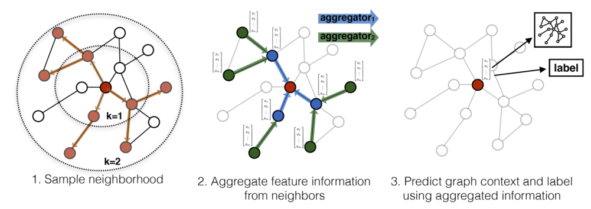
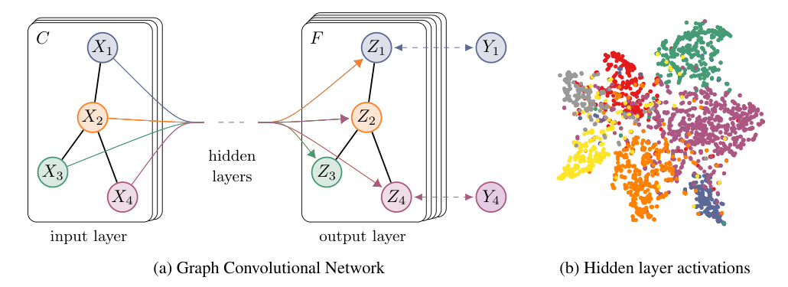
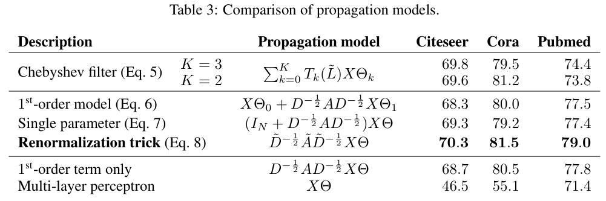
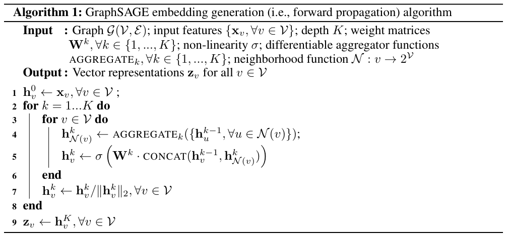

### 그래프 위에서 convolution을 한다는 것은 무슨 의미일까? GNN 기반 추천시스템의 뼈대가 되는 GCN과 GraphSAGE에 대해 알아봅니다.  


> 원제  
> **GCN**: Semi-Supervised Classification with Graph Convolutional Networks (Thomas N. Kipf, Max Welling, ICLR 2017)  
> **GraphSAGE**: Inductive Representation Learning on Large Graphs (William L. Hamilton, Rex Ying, Jure Leskovec, NeurIPS 2017)  
> 참고 강의: [Paper Review] MultiSAGE part1 GCN (서울대학교 산업공학과 DSBA 연구실)  

<center></center>   

<font size="2"><center> 출처: Hamilton et al., Inductive Representation Learning on Large Graphs (https://arxiv.org/abs/1706.02216) </center>  </font>   

<br/>


>  **1. GCN은 "이웃 노드의 feature를 정규화된 인접행렬로 모은 뒤, 모든 노드가 공유하는 weight W를 곱한다"는 단순한 layer 규칙으로 그래프 convolution을 구현함. spectral graph convolution을 1차 근사한 결과임**
>
>  **2. 다만 GCN은 전체 그래프(인접행렬)를 한 번에 올려 학습하는 transductive, full-batch 방식이라 대규모 그래프와 새로 들어온 노드에 약함**
>
>  **3. GraphSAGE는 이웃을 고정 개수만큼 샘플링(SAmple)하고 학습 가능한 aggregator로 통합(aggreGatE)하는 "임베딩 생성 함수"를 학습함. 덕분에 mini-batch 학습과 처음 보는 노드에 대한 inductive 추론이 가능해짐**

<br/>

----

**본 포스트는 GCN, GraphSAGE 논문과 DSBA 연구실의 MultiSAGE 논문 리뷰 강의를 보고 정리한 노트입니다.**
원문은 여기에서 보실 수 있습니다.  
[GCN paper](https://arxiv.org/abs/1609.02907), [GraphSAGE paper](https://arxiv.org/abs/1706.02216), [강의 영상](https://www.youtube.com/watch?v=8YNdlXtMn40)  

----
#### Contents  

1. [Intro - 추천시스템을 위한 GNN, 큰 그림부터](#intro)  
2. [왜 그래프에는 CNN을 그대로 쓸 수 없을까?](#why)  
3. [GCN: 이웃의 정보로 나를 표현하자!](#gcn)  
4. [GCN의 한계: 그래프가 너무 크다](#limit)  
5. [GraphSAGE: 샘플링하고, 통합하자!](#graphsage)  
6. [GCN vs GraphSAGE 한눈에 비교](#compare)  
7. [마치며](#conclusion)  
<br />

<a id="intro"></a>
## 1. Intro - 추천시스템을 위한 GNN, 큰 그림부터  

요즘 추천시스템 쪽 논문을 읽다 보면 GNN이 빠지지 않고 등장하는데요.  
유저-아이템의 상호작용은 그 자체로 그래프(bipartite graph)이기 때문에, 그래프 위에서 표현을 학습하는 GNN과 궁합이 좋을 수밖에 없겠죠.  
이번 포스트는 DSBA 연구실의 MultiSAGE 논문 리뷰 강의를 따라가며, 그 밑바탕이 되는 모델들을 정리하는 2부작 미니 시리즈의 첫 번째 글입니다.  

강의에서는 MultiSAGE에 이르기까지의 계보를 아래와 같이 정리하고 있습니다.  

- **GCN**: transductive한 방법론. full-batch 상황에서 homogeneous 그래프를 대상으로 함  
- **GraphSAGE**: inductive한 GCN 계열 모델. mini-batch 상황에서 neighborhood sampling으로 메모리 부하를 줄임. 역시 homogeneous  
- **GAT**: 이웃을 통합할 때 가중치를 학습하는 네트워크(attention)를 설계함. GCN + Attention으로 생각하면 됨  
- **PinSAGE**: GraphSAGE를 추천용 bipartite 그래프(pin-board)에 적용함. 더 똑똑한 neighborhood sampling + weight 적용  
- **MultiSAGE**: PinSAGE 구조에 GAT 아이디어를 적용해 heterogeneous 그래프로 확장함  

이번 글에서는 이 중 가장 기초가 되는 **GCN**과 **GraphSAGE**를 다루고, PinSAGE와 GAT는 다음 편에서 이어서 살펴보겠습니다.  
참고로 그래프 임베딩의 원조격인 DeepWalk, 그리고 heterogeneous 그래프를 다루는 MAGNN은 예전에 정리해둔 글이 있으니 함께 보시면 좋습니다. ([DeepWalk 포스트](https://myeonghak.github.io/graph%20neural%20networks/GNN-DeepWalk/), [MAGNN 포스트](https://myeonghak.github.io/graph%20neural%20networks/GNN-MAGNN/))  


<a id="why"></a>
## 2. 왜 그래프에는 CNN을 그대로 쓸 수 없을까?  

### CNN을 잠깐 복습해보면  

CNN이 이미지에서 잘 동작하는 이유를 다시 떠올려 보겠습니다.  

- **translational invariance**: 사진 속 물체가 몇 픽셀 옆으로 이동해도, MLP에 비해 의미의 손실이 적음  
- **weight sharing**: 같은 filter(weight)를 이미지 전체에 슬라이딩하며 적용하므로 파라미터 수가 이미지 크기와 무관함  
- **locality**: receptive field 안의 이웃 픽셀 간 관계만 보고 hidden representation(activation map)을 만듦  

28x28 이미지를 784차원 벡터로 쭉 펴서 MLP에 넣으면 (1) 위치 정보가 소실되고 (2) weight 파라미터 수가 폭증하는 문제가 있었는데, CNN은 바로 이 문제를 filter로 해결한 셈입니다.  

### 그래프에는 "순서"가 없다  

그렇다면 그래프에도 같은 filter를 쓰면 되지 않을까 싶은데요, 문제는 그래프에는 이미지 같은 격자 구조, 즉 **위치와 순서 정보가 없다**는 점입니다.  
이미지의 픽셀은 "왼쪽 위 이웃", "오른쪽 아래 이웃"처럼 정해진 자리가 있지만, 그래프의 노드는 이웃의 수도 제각각이고 이웃 사이의 순서도 정의되지 않습니다.  

강의에서 든 예시가 직관적이었는데요.  
5개 노드가 있고 각 노드마다 2차원 feature가 있다고 해보겠습니다. 노드와 이웃의 feature를 이어 붙여 FCN에 넣는다고 하면, 첫 번째 샘플에서는 (A, B의 feature)가, 두 번째 샘플에서는 (A, C의 feature)가 같은 입력 자리에 들어가게 됩니다.  
같은 자리에 매번 다른 의미의 정보가 들어오니 학습이 잘 될 리가 없겠죠.  
그렇다고 노드마다 입력 차원을 하나씩 할당하면 노드 수에 비례해 파라미터가 폭증해버립니다. CNN 이전에 이미지를 MLP로 다루던 시절과 똑같은 문제입니다.  

즉, 그래프용 연산은 다음 조건을 만족해야 합니다.  

- **node ordering invariant**: 노드(이웃)의 순서를 바꿔도 결과가 같아야 함. 본질적으로 같은 그래프를 다르게 그렸다고 결과가 달라지면 안 됨  
- **weight sharing**: 모든 노드가 같은 weight를 공유해야 함  
- **노드 수와 무관한 파라미터 수**: 연산량과 파라미터가 노드 수가 아닌 feature 차원에 비례해야 함  

이를 위해 GNN은 CNN의 filter 자리를 **aggregation**으로 대체합니다.  
mean, sum, max, weighted mean처럼 순서와 무관한(permutation invariant) 연산으로 이웃 정보를 하나의 대표값으로 요약하는 것이죠. 반대로 concat은 입력 순서(위치)가 결과에 반영되므로 이웃을 합치는 용도로는 쓰면 안 됩니다.  
결국 CNN이 "어떤 픽셀이 중요한가"를 filter로 잡아냈듯, GNN은 aggregation과 weight를 통해 "어떤 이웃 노드의 정보가 중요한가"를 잡아내려 한다고 보시면 됩니다.  


<a id="gcn"></a>
## 3. GCN: 이웃의 정보로 나를 표현하자!  

### 문제 설정: Graph Semi-Supervised Learning  

GCN 논문이 풀고자 한 문제는 **그래프 기반 준지도 학습(semi-supervised) 노드 분류**입니다.  
예를 들어 논문 인용 네트워크(Cora, Citeseer, Pubmed)에서 노드는 문서, 엣지는 인용 관계인데, 라벨은 클래스당 20개 정도의 극히 일부 노드에만 붙어 있습니다.  

기존의 접근은 손실함수에 그래프 라플라시안 정규화 항을 더하는 방식이었습니다.  

$$
\mathcal{L} = \mathcal{L}_0 + \lambda \mathcal{L}_{reg}, \quad \mathcal{L}_{reg} = \sum_{i,j} A_{ij} \lVert f(X_i) - f(X_j) \rVert^2 = f(X)^\top \Delta f(X)
$$

여기서 $\mathcal{L}_0$는 라벨이 있는 노드에 대한 지도학습 loss, $\Delta = D - A$는 (정규화되지 않은) 그래프 라플라시안입니다.  
라벨이 없는 노드들은 "연결된 노드끼리는 표현이 비슷해야 한다"는 정규화 항으로 학습에 참여하게 되는데요.  
이 방식은 **연결된 노드는 같은 라벨을 가질 것**이라는 가정에 기대고 있어서, 엣지가 단순한 유사도 이상의 정보를 담고 있는 경우에는 모델의 표현력을 제한하게 됩니다.  

그래서 GCN은 발상을 바꿉니다. 정규화 항으로 그래프 구조를 간접적으로 주입하지 말고, **모델 $f(X, A)$ 자체가 인접행렬 $A$를 입력으로 받도록** 만들자는 것이죠.  
이렇게 하면 라벨이 있는 노드에서 계산된 gradient가 인접행렬을 타고 라벨이 없는 노드에까지 퍼져나가, 두 종류의 노드 표현을 함께 학습할 수 있습니다.  

<center></center>   

<font size="2"><center> 출처: Kipf & Welling, Semi-Supervised Classification with Graph Convolutional Networks (https://arxiv.org/abs/1609.02907) </center>  </font>   

<br/>

왼쪽 그림처럼 입력은 $C$차원 feature를 가진 노드들이고, 그래프 구조(검은 선)는 모든 layer에서 공유됩니다. layer를 통과하면서 **인접행렬은 그대로, feature matrix의 값만 업데이트**되는 구조입니다.  
오른쪽은 라벨 5%만 사용해 학습한 2-layer GCN의 hidden representation을 t-SNE로 찍어본 것인데, 클래스별로 꽤 잘 뭉쳐있는 것을 볼 수 있네요.  

### GCN의 layer 전파 규칙  

GCN의 핵심은 아래 한 줄입니다.  

$$
H^{(l+1)} = \sigma\left(\tilde{D}^{-\frac{1}{2}} \tilde{A} \tilde{D}^{-\frac{1}{2}} H^{(l)} W^{(l)}\right), \quad \tilde{A} = A + I_N, \quad \tilde{D}_{ii} = \sum_j \tilde{A}_{ij}
$$

- $H^{(l)} \in \mathbb{R}^{N \times D}$: $l$번째 layer의 노드 representation ($H^{(0)} = X$)  
- $\tilde{D}^{-1/2} \tilde{A} \tilde{D}^{-1/2}$: 이웃 정보를 모으는 **aggregation** 역할  
- $W^{(l)}$: 모든 노드가 **공유하는** 학습 가능한 weight  
- $\sigma$: ReLU 같은 비선형 함수  

노드 하나의 관점에서 풀어 쓰면, "나와 내 이웃들의 feature에 같은 $W$를 곱한 뒤, 차수(degree)로 정규화해 더하고, 활성화 함수를 통과시킨다"는 뜻입니다.  
$W$의 크기는 feature 차원($D \times F$)에만 의존하므로, 앞서 말한 세 가지 조건(sharing, order invariant, 노드 수와 무관)을 모두 만족하게 됩니다.  

이 layer 하나가 forward 되는 것을 **message passing**이라고 부르기도 합니다. 연결된 이웃과 정보를 주고받으며 자신의 표현을 업데이트하는 과정이죠.  
layer를 $K$개 쌓으면 $K$-hop 떨어진 이웃의 정보까지 내 표현에 녹아들게 됩니다.  

### 왜 하필 self-loop와 대칭 정규화일까?  

단순하게 $\sigma(A H W)$로 하면 안 될까요? 강의에서는 이 naive한 message passing의 문제점 두 가지를 짚고 있습니다.  

**1) 내 정보가 사라진다**  
- $A$의 대각 성분은 0이므로, $AH$는 이웃의 정보만 더하고 자기 자신의 feature는 반영하지 않음  
- 해결: 인접행렬에 단위행렬을 더해 self-loop를 추가함 ($\tilde{A} = A + I_N$). residual connection을 두는 이유와 비슷한 맥락임  

**2) 이웃이 많을수록 값이 커진다**  
- 이웃이 많은(차수가 높은) 노드일수록 더해지는 정보의 양이 많아져, 정보의 중요도가 아니라 단순히 "양"에 의해 표현이 좌우됨  
- layer를 반복해서 통과하면 값의 스케일이 계속 커지거나 작아져 수치적으로 불안정해지고 gradient exploding/vanishing으로 이어질 수 있음  
- 해결: 차수로 정규화함. 평균처럼 $D^{-1}A$로 나눌 수도 있지만, GCN은 보내는 쪽과 받는 쪽의 차수를 모두 고려하는 대칭 정규화 $D^{-1/2} A D^{-1/2}$를 사용함  

이 두 가지를 합친 것이 바로 위 식의 $\tilde{D}^{-1/2} \tilde{A} \tilde{D}^{-1/2}$이고, 논문에서는 이를 **renormalization trick**이라고 부릅니다.  

### Spectral 관점: 이 식은 어디서 왔을까?  

사실 GCN 논문의 이론적 동기는 spectral graph convolution에 있습니다. 강의 노트에서는 이를 signal의 관점에서 설명하는데요.  
각 노드의 값을 그래프 위에 놓인 하나의 **신호(signal)**로 보면, 시간축 신호를 Fourier transform으로 주파수 성분으로 분해하듯 그래프 신호도 주파수 성분으로 분해해 분석할 수 있습니다.  
이때 그래프의 "Fourier 기저" 역할을 하는 것이 정규화된 그래프 라플라시안 $L = I_N - D^{-1/2} A D^{-1/2} = U \Lambda U^\top$의 고유벡터 $U$입니다.  
고유값이 작은 고유벡터는 이웃끼리 값이 비슷한 부드러운(저주파) 신호, 고유값이 큰 고유벡터는 이웃끼리 값이 크게 달라지는(고주파) 신호에 대응합니다. 이렇게 eigen decomposition을 통해 그래프 신호를 분석하는 접근을 **spectral based approach**라고 부릅니다.  

spectral graph convolution은 신호 $x$를 Fourier 도메인으로 보내($U^\top x$), filter $g_\theta$를 곱하고, 다시 돌아오는 연산으로 정의됩니다.  

$$
g_\theta \star x = U g_\theta U^\top x
$$

문제는 계산량입니다. $U$를 곱하는 데만 $O(N^2)$이 들고, 애초에 큰 그래프의 라플라시안을 고유분해하는 것 자체가 매우 비쌉니다.  
그래서 Hammond et al.(2011), Defferrard et al.(2016, ChebNet)은 filter를 체비쇼프 다항식 $T_k$의 $K$차 전개로 근사합니다.  

$$
g_{\theta'} \star x \approx \sum_{k=0}^{K} \theta'_k T_k(\tilde{L}) x, \quad \tilde{L} = \frac{2}{\lambda_{max}} L - I_N
$$

이렇게 하면 고유분해 없이 라플라시안의 거듭제곱만으로 계산할 수 있고, $K$차 다항식이므로 중심 노드에서 최대 $K$-hop 떨어진 이웃에만 의존하는 **지역적(localized) filter**가 됩니다. 계산량도 엣지 수에 선형입니다.  

GCN은 여기서 과감하게 한 발 더 나아갑니다.  

- $K = 1$로 제한 (1차 근사): 한 layer는 1-hop 이웃만 보고, 대신 layer를 여러 개 쌓아서 넓은 receptive field를 확보함. 차수 분포가 넓은 실세계 그래프에서 지역 구조에 대한 overfitting도 완화될 것으로 기대함  
- $\lambda_{max} \approx 2$로 근사: 스케일 차이는 학습 과정에서 파라미터가 알아서 흡수할 것이라 가정  
- 파라미터를 하나로 묶음 ($\theta = \theta'_0 = -\theta'_1$): overfitting 방지와 연산량 감소 목적  

그러면 $g_\theta \star x \approx \theta (I_N + D^{-1/2} A D^{-1/2}) x$가 되는데, 이 연산자의 고유값은 $[0, 2]$ 범위라 여러 번 반복 적용하면 앞서 말한 수치 불안정 문제가 생깁니다.  
그래서 $I_N + D^{-1/2} A D^{-1/2}$ 대신 $\tilde{D}^{-1/2} \tilde{A} \tilde{D}^{-1/2}$를 쓰는 renormalization trick이 등장한 것이고, 이를 다채널 feature로 일반화한 것이 위의 GCN layer 식입니다.  
즉, 직관적으로 설명했던 "self-loop + 차수 정규화"가 spectral convolution의 1차 근사로부터도 자연스럽게 유도되는 셈이네요.  

<center></center>   

<font size="2"><center> 출처: Kipf & Welling, Semi-Supervised Classification with Graph Convolutional Networks (https://arxiv.org/abs/1609.02907) </center>  </font>   

<br/>

논문은 여러 propagation model을 비교했는데, 가장 단순한 renormalization trick이 체비쇼프 filter보다도 오히려 좋은 성능을 냈습니다. 그래프 구조를 쓰지 않는 MLP와의 격차를 보면 이웃 정보가 얼마나 중요한지도 잘 드러나네요.  

### 2-layer GCN과 학습  

실제로 사용한 모델은 아주 간단한 2-layer GCN입니다. $\hat{A} = \tilde{D}^{-1/2} \tilde{A} \tilde{D}^{-1/2}$를 전처리로 한 번만 계산해두면,  

$$
Z = \mathrm{softmax}\left(\hat{A}\ \mathrm{ReLU}(\hat{A} X W^{(0)})\ W^{(1)}\right)
$$

이고, 라벨이 있는 노드에 대해서만 cross-entropy loss를 계산해 full-batch gradient descent로 학습합니다.  
인용 네트워크 3종에서 hidden 16, dropout 0.5, L2 $5 \cdot 10^{-4}$ 설정으로 당시 SOTA였던 Planetoid, DeepWalk, label propagation 등을 큰 차이로 앞섰고(Cora 기준 81.5%), 학습 시간도 훨씬 짧았다고 합니다.  

numpy로 GCN layer 하나를 직접 계산해보면 생각보다 정말 간단합니다.  

```python
import numpy as np
np.set_printoptions(precision=3, suppress=True)

# 4개 노드: 0-1, 1-2, 1-3 연결 (논문 Figure 1의 X1~X4와 같은 모양)
A = np.array([[0,1,0,0],
              [1,0,1,1],
              [0,1,0,0],
              [0,1,0,0]], dtype=float)
X = np.array([[1.,0.],[0.,1.],[1.,1.],[2.,0.]])   # 노드별 2차원 feature

A_tilde = A + np.eye(4)                          # self-loop 추가
d = A_tilde.sum(1)
D_inv_sqrt = np.diag(d ** -0.5)
A_hat = D_inv_sqrt @ A_tilde @ D_inv_sqrt        # renormalization trick

rng = np.random.default_rng(0)
W = rng.normal(size=(2, 3))                      # 모든 노드가 공유하는 weight
H1 = np.maximum(0, A_hat @ X @ W)                # ReLU(Â X W)

print("A_hat =\n", A_hat)
print("H1 shape:", H1.shape)
print("H1 =\n", H1)
```

```
A_hat =
 [[0.5   0.354 0.    0.   ]
 [0.354 0.25  0.354 0.354]
 [0.    0.354 0.5   0.   ]
 [0.    0.354 0.    0.5  ]]
H1 shape: (4, 3)
H1 =
 [[0.1   0.    0.448]
 [0.241 0.    1.124]
 [0.152 0.    0.629]
 [0.163 0.    0.768]]
```

이웃이 3개인 허브 노드(1번)는 자기 자신에게 0.25, 이웃에게 0.354씩의 가중치를 주고, 이웃이 하나뿐인 노드들은 자기 자신에게 0.5의 가중치를 주는 것을 볼 수 있습니다. 차수가 높을수록 개별 메시지의 영향력이 줄어드는 것이죠.  
그리고 $W$는 $2 \times 3$ 크기 하나뿐이라, 노드가 4개든 4억 개든 파라미터 수는 그대로입니다.  


<a id="limit"></a>
## 4. GCN의 한계: 그래프가 너무 크다  

GCN은 깔끔하고 강력하지만, 추천시스템처럼 노드가 수억 개 단위인 환경에 바로 쓰기에는 몇 가지 걸림돌이 있습니다.  

**1) Full-batch 학습과 메모리**  
- 매 iteration마다 전체 인접행렬과 전체 feature matrix로 gradient를 계산하므로, 메모리 요구량이 데이터셋 크기에 선형으로 증가함 (논문의 Limitations에서도 직접 언급함)  
- 그렇다고 단순히 노드 일부를 mini-batch로 뽑아도, $K$-layer GCN은 각 노드의 $K$-hop 이웃 전체가 필요하므로 계산해야 할 서브그래프가 생각만큼 줄지 않음. 이웃의 이웃의 ... 수가 기하급수적으로 늘어나는 neighborhood explosion 문제임  
- 해결책으로 **샘플링**을 통해 서브그래프의 크기를 줄이는 방향이 제시됨. 이후 서브그래프를 만드는 과정 자체를 효율화하려는 Cluster-GCN 같은 연구도 나옴  

**2) Transductive 하다**  
- 학습할 때 전체 그래프 구조($\hat{A}$)가 고정되어 있다고 가정함  
- 따라서 학습 후에 새로운 노드(신규 유저, 신규 아이템)가 들어오면 그래프 구조가 바뀌므로 깔끔하게 대응하기 어려움  
- 매일 새로운 아이템과 유저가 쏟아지는 추천시스템 입장에서는 꽤 치명적인 약점이겠죠  

**3) 구조에 고정된 aggregation**  
- 이웃의 가중치가 차수로만 결정됨. 즉, 전체 그래프의 구조(spectral 정보)에 의존하는 고정된 통합 규칙임  
- 어떤 이웃이 더 중요한지를 데이터로부터 학습할 여지가 없음  

강의에서는 이를 바탕으로 다음 모델의 아이디어를 이렇게 요약합니다.  
"샘플링으로 그래프를 작게 다루자. 그리고 전체 구조를 봐야 하는 차수 기반(spectral) 통합 대신, 내 주변 이웃만 보고 학습 가능한 방식(spatial)으로 통합해보자." 이것이 바로 GraphSAGE입니다.  


<a id="graphsage"></a>
## 5. GraphSAGE: 샘플링하고, 통합하자!  

### Transductive에서 Inductive로  

GraphSAGE는 **SA**mple and aggre**G**at**E**의 약자입니다.  
저자들은 Stanford의 Jure Leskovec 연구실 사람들로, node2vec(Grover & Leskovec, 2016)이 나온 바로 그 연구실입니다. DeepWalk, node2vec처럼 random walk 기반의 spatial한 접근에 익숙한 그룹이라 그런지, GraphSAGE에도 그 흔적이 곳곳에 남아 있습니다.  

잠깐 DeepWalk를 복습해보면, 그래프 위에서 random walk로 일정 길이의 노드 시퀀스를 만들고, 같은 시퀀스 안에 함께 등장한 노드를 "이웃"으로 보고 skip-gram으로 노드 임베딩을 학습하는 방식이었습니다. 자주 함께 등장하는 노드일수록 임베딩이 가까워지죠.  
그런데 DeepWalk나 matrix factorization 기반 방법들은 **노드마다 고유한 임베딩 벡터를 lookup table로 학습**합니다. 학습 때 없던 노드는 당연히 임베딩도 없으니 transductive할 수밖에 없습니다.  

GraphSAGE의 핵심 아이디어는 이렇습니다.  
**노드별 임베딩을 직접 학습하는 대신, 노드의 feature와 지역 이웃의 feature로부터 임베딩을 "생성하는 함수"를 학습하자.**  
함수를 학습해두면, 처음 보는 노드라도 feature와 이웃만 있으면 임베딩을 뽑아낼 수 있습니다. 심지어 같은 형태의 feature를 가진 완전히 새로운 그래프에도 적용할 수 있죠. 이것이 **inductive** 학습입니다.  

### 임베딩 생성 알고리즘 (Forward Propagation)  

<center></center>   

<font size="2"><center> 출처: Hamilton et al., Inductive Representation Learning on Large Graphs (https://arxiv.org/abs/1706.02216) </center>  </font>   

<br/>

알고리즘 1은 생각보다 단순합니다. $K$개의 aggregator와 weight $W^k$가 학습되어 있다고 할 때, 각 깊이(search depth) $k$마다  

1. 각 노드 $v$는 이웃들의 이전 단계 표현 $h_u^{k-1}$을 aggregator로 하나의 벡터 $h_{\mathcal{N}(v)}^k$로 요약함  
2. 자기 자신의 이전 표현 $h_v^{k-1}$과 이웃 요약 벡터를 **concat**한 뒤, $W^k$를 곱하고 비선형 함수를 통과시킴  
3. L2 정규화를 해서 다음 단계의 입력으로 사용함  

$$
h_v^k = \sigma\left(W^k \cdot \mathrm{CONCAT}\left(h_v^{k-1}, \mathrm{AGGREGATE}_k(\{h_u^{k-1}, \forall u \in \mathcal{N}(v)\})\right)\right)
$$

앞에서 concat은 쓰면 안 된다고 했는데 왜 여기서는 쓰냐고요? 여기서 concat하는 대상은 "나"와 "이웃 전체의 요약"이라는 고정된 두 덩어리라 순서 문제가 없습니다. 이웃들끼리는 여전히 순서와 무관한 aggregator로 묶입니다.  
또 GCN이 self-loop로 나와 이웃을 한데 섞었다면, GraphSAGE는 둘을 분리해서 concat하기 때문에 일종의 skip connection처럼 내 정보를 더 확실하게 보존할 수 있습니다.  

한 가지 주의할 점은 2-hop의 정보가 2-hop 이웃으로부터 "직접" 오는 것이 아니라는 점입니다.  
$k=1$ 단계에서 모든 노드가 1-hop 이웃의 정보로 자신을 업데이트하고, $k=2$ 단계에서 그렇게 업데이트된 이웃들의 표현을 다시 모으기 때문에, 결과적으로 2-hop 떨어진 정보가 순차적으로 전달되는 것입니다.  

### 이웃의 정의: 고정 크기 샘플링  

알고리즘 1은 전체 그래프를 넣는 full-batch 상황을 기준으로 쓰여 있는데요. 노드 수가 적어 샘플링이 필요 없다면 연결된 모든 노드를 이웃으로 쓰면 됩니다.  
하지만 논문 제목이 "on **Large** Graphs"인 이유는 바로 다음의 mini-batch 확장에 있습니다.  

- 이웃 전체를 쓰는 대신, 각 깊이마다 **고정된 개수의 이웃을 uniform하게 샘플링**함  
- 예를 들어 노드 D의 이웃이 A, B, E, G라면 그중 $S_1$개를 뽑고, 뽑힌 1-hop 이웃 각각에 대해 다시 $S_2$개의 2-hop 이웃을 뽑음 (이웃 수가 모자라면 복원 추출)  
- 논문에서는 $K=2$, $S_1 = 25$, $S_2 = 10$을 사용했고, 따라서 타겟 노드 하나당 최대 $25 \times 10 = 250$개의 노드만 보면 됨  
- mini-batch 학습 시에는 먼저 필요한 이웃 집합을 깊이 $K$까지 forward sampling해두고, 전체 노드가 아닌 **재귀 계산에 필요한 노드의 표현만 계산함**  

이렇게 하면 배치당 연산량이 그래프 전체 크기가 아니라 $\prod_k S_k$로 고정되므로, 아무리 큰 그래프라도 일정한 메모리로 학습할 수 있습니다.  
강의에서는 배치 단위에서 샘플링된 이웃들이 생각보다 서로 잘 겹치지 않기 때문에, 노드가 아주 많은 대규모 그래프에서 특히 유용하고 반대로 작은 그래프에서는 중복 계산이 많아 굳이 권장하지 않는다고 설명합니다. 또 매번 다른 서브그래프로 학습하니 일종의 앙상블 효과도 기대할 수 있다고 하네요. (물론 서브그래프 생성 자체도 비용이 꽤 드는 작업입니다.)  

그럼 $K$를 크게 하면 더 좋지 않을까요?  
그렇지 않습니다. $K$가 커지면 거의 모든 노드가 서로의 이웃이 되어버리고, 노드 임베딩들이 서로 비슷해지는 **over-smoothing** 문제가 생깁니다. 그래서 GCN과 마찬가지로 GraphSAGE도 보통 2-layer 정도만 쌓습니다. 이 경우 가장 먼 이웃끼리는 거리가 4까지 날 수 있는데, 강의에서는 이를 DeepWalk의 window size 4와 비슷한 감각으로 비유하고 있습니다.  

### Aggregator 아키텍처  

그래프의 이웃에는 자연스러운 순서가 없으므로, aggregator는 **대칭적(symmetric, 입력 순서 변화에 불변)**이면서도 학습 가능하고 표현력이 높아야 합니다. 논문은 세 가지 후보를 제시합니다.  

**1) Mean aggregator**  
- 이웃 표현의 원소별 평균을 취함  
- 알고리즘의 concat 대신 나와 이웃을 함께 평균내면 아래 식이 되는데, 이는 GCN의 전파 규칙과 거의 같음. 논문은 이를 GCN의 inductive 변형(GraphSAGE-GCN)으로 부름  

$$
h_v^k = \sigma\left(W \cdot \mathrm{MEAN}\left(\{h_v^{k-1}\} \cup \{h_u^{k-1}, \forall u \in \mathcal{N}(v)\}\right)\right)
$$

**2) LSTM aggregator**  
- LSTM은 표현력이 크지만 본래 순서에 민감한(대칭적이지 않은) 모델임  
- 그래서 이웃을 **랜덤하게 permutation한 순서**로 넣어 순서 의존성을 희석시키는 방식으로 사용함  

**3) Pooling aggregator**  
- 각 이웃 벡터를 학습 가능한 FC layer에 독립적으로 통과시킨 뒤, 원소별 max(또는 mean) pooling을 수행함  

$$
\mathrm{AGGREGATE}_k^{pool} = \max\left(\{\sigma(W_{pool} h_{u}^{k} + b), \forall u \in \mathcal{N}(v)\}\right)
$$

- max 연산이라 대칭적이면서도, FC layer 덕분에 이웃 각각의 다양한 특성을 잡아낼 수 있음  

GCN과의 큰 차이점이 여기서 드러나는데요. GCN은 이웃을 차수 기반 고정 가중치로 합칠 뿐이지만, GraphSAGE는 aggregator와 $W^k$에 **learnable parameter**가 들어갑니다.  
예를 들어 이웃 3개를 mean으로 모으면, 평균 벡터를 학습 가능한 layer에 통과시켜 최종 출력을 만드는 식이죠. 학습되는 것이 노드 임베딩이 아니라 이 파라미터들이기 때문에, 학습 때 보지 못한 새로운 노드가 와도 임베딩을 계산할 수 있는 것입니다.  

### Loss: 이웃과는 가깝게, 남과는 멀게  

GraphSAGE는 task label 없이도 학습할 수 있도록 그래프 기반의 비지도 loss를 사용합니다.  

$$
J_{\mathcal{G}}(z_u) = -\log\left(\sigma(z_u^\top z_v)\right) - Q \cdot \mathbb{E}_{v_n \sim P_n(v)} \log\left(\sigma(-z_u^\top z_{v_n})\right)
$$

- $v$: 고정 길이 random walk 상에서 $u$ 근처에 함께 등장한 노드 (positive)  
- $P_n$: negative sampling 분포, $Q$: negative sample의 수  
- 즉, 함께 등장하는 노드끼리는 내적이 크게, 랜덤하게 뽑은 negative 노드와는 내적이 작게 학습함  

어디서 많이 본 모양이죠? DeepWalk/node2vec의 skip-gram + negative sampling loss와 같은 형태입니다. 정리하자면 **random walk는 loss의 positive pair를 정의하는 데 쓰이고, 이웃 샘플링 자체는 uniform하게** 이루어집니다.  
결정적인 차이는 $z_u$가 lookup table에서 꺼낸 벡터가 아니라 **이웃의 feature로부터 생성된 벡터**라는 점입니다.  

물론 특정 downstream task가 정해져 있다면 이 비지도 loss를 cross-entropy 같은 task-specific loss로 대체하거나 함께 사용할 수 있습니다. GCN도 라벨 노드에 대한 지도 loss를 쓰니, 둘 다 지도/비지도 loss를 모두 활용할 수 있다는 점은 같고 수식이 다를 뿐입니다.  

### 실험 결과 간단히  

논문은 세 가지 inductive 벤치마크로 실험합니다.  

- **Citation (Web of Science)**: 이전 연도 논문으로 학습하고 다음 연도의 새 논문 카테고리를 예측함  
- **Reddit**: 약 23만 개 포스트로 구성된 그래프에서, 학습에 쓰지 않은 기간의 포스트가 어떤 커뮤니티에 속하는지 예측함  
- **PPI (단백질 상호작용)**: 여러 그래프 중 일부로 학습하고 **완전히 처음 보는 그래프**에서 단백질 기능을 예측함  

결과적으로 GraphSAGE는 노드 feature만 쓰는 방식 대비 supervised 기준 F1을 평균 51% 끌어올렸고, transductive한 DeepWalk(새 노드에 대해 추가 학습이 필요해 약 100배 느림)보다도 좋은 성능을 보였습니다.  
aggregator 중에서는 LSTM과 pooling이 mean(GCN 변형)보다 확실히 좋았고, 둘 사이의 성능은 비슷한데 pooling이 훨씬 빨라서 실용적으로는 pooling aggregator가 좋은 선택지라고 정리합니다.  


<a id="compare"></a>
## 6. GCN vs GraphSAGE 한눈에 비교  

| 구분 | GCN | GraphSAGE |
|---|---|---|
| 학습 방식 | transductive, full-batch | inductive, mini-batch |
| 이웃의 정의 | 1-hop 인접 노드 전체 (+self-loop) | 고정 개수 uniform 샘플링 (예: 25, 10) |
| 이웃 통합 | 차수 기반 대칭 정규화 합 (구조 정보 사용) | mean / LSTM / pooling (차수 정보 없이, learnable) |
| 나와 이웃의 결합 | self-loop로 함께 섞음 | concat 후 FC layer |
| 학습 대상 | layer weight (그래프 고정) | aggregator + weight (임베딩 생성 함수) |
| Loss | 라벨 노드의 cross-entropy | random walk 기반 비지도 loss 또는 지도 loss |
| 새 노드 대응 | 어려움 | feature와 이웃만 있으면 바로 임베딩 생성 |

정리하면, GCN이 "그래프 위의 convolution"이라는 개념을 깔끔한 식 하나로 정립했다면, GraphSAGE는 이를 **실제 서비스 규모의 그래프에서 돌아갈 수 있는 형태**로 바꿔놓았다고 볼 수 있습니다.  


<a id="conclusion"></a>
## 7. 마치며  

처음 GCN 논문을 읽을 때는 spectral graph theory, 체비쇼프 다항식이 줄줄이 나와서 꽤 겁을 먹었는데요.  
막상 끝까지 따라가 보면 결론은 "self-loop 붙이고, 차수로 정규화해서, 이웃 feature를 더한 뒤 W를 곱한다"는 아주 직관적인 식이라는 점이 인상적이었습니다. 복잡한 이론에서 출발해 과감한 근사를 거듭한 끝에 오히려 더 단순하고 성능 좋은 모델에 도달한 셈이죠.  
그리고 GraphSAGE를 보면서는 "임베딩을 외우지 말고, 임베딩을 만드는 법을 배우자"는 관점 전환이 추천시스템처럼 매일 새로운 유저와 아이템이 쏟아지는 환경에서 얼마나 중요한지 다시 한번 느낄 수 있었습니다.  

다만 GraphSAGE도 아직 아쉬운 점이 남아 있습니다. 이웃을 그냥 uniform하게 뽑고, 뽑힌 이웃을 모두 같은 비중으로 다루기 때문인데요.  
다음 편에서는 random walk 기반의 **중요도 샘플링**으로 이웃을 더 똑똑하게 고르고 이를 Pinterest의 수십억 규모 그래프에 적용한 **PinSAGE**, 그리고 attention으로 이웃별 가중치를 학습하는 **GAT**에 대해 알아보겠습니다.  

----------------


**개선을 위한 여러분의 피드백과 제안을 코멘트로 공유해 주세요.**
**내용에 대한 지적, 혹은 질문을 환영합니다.**  


**출처**  
[Kipf & Welling, Semi-Supervised Classification with Graph Convolutional Networks (ICLR 2017)](https://arxiv.org/abs/1609.02907)  
[Hamilton, Ying & Leskovec, Inductive Representation Learning on Large Graphs (NeurIPS 2017)](https://arxiv.org/abs/1706.02216)  
[DSBA 연구실, Paper Review - MultiSAGE part1 GCN](https://www.youtube.com/watch?v=8YNdlXtMn40)  
