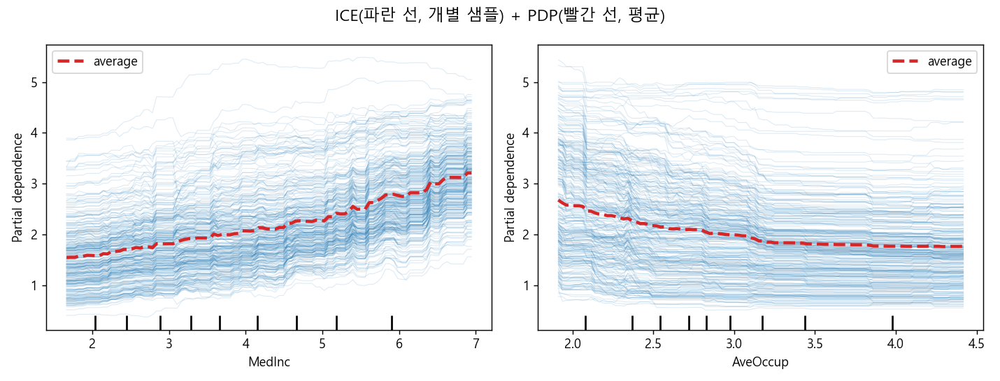
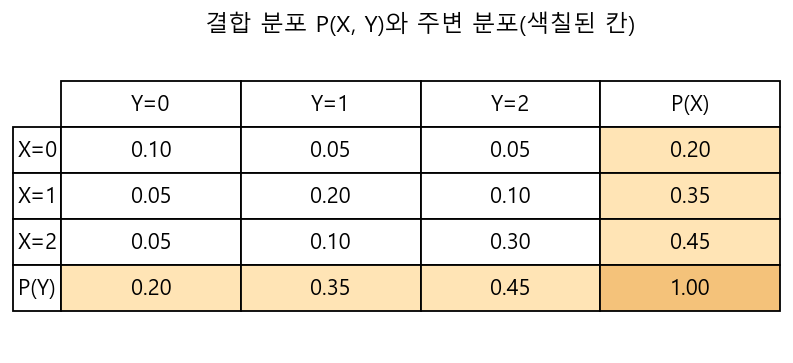
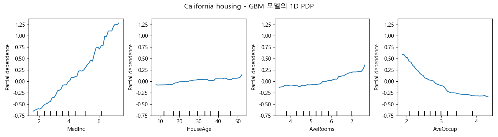
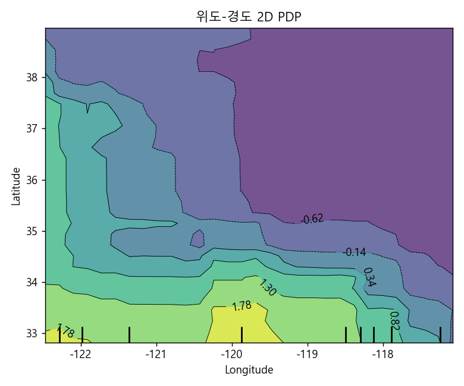

### XAI 방법론의 큰 그림을 정리하고, 가장 기본적인 global 설명 기법인 PDP에 대해 알아봅니다.

> DeepFindr, "Explainable AI explained! #1 Introduction" / "#2 By-design interpretable models with Microsofts InterpretML" (YouTube)  
> Friedman, "Greedy Function Approximation: A Gradient Boosting Machine", Annals of Statistics, 2001 (PDP 제안)

<center></center>

<br/>

>  **1. XAI는 해석 가능한 모델을 처음부터 쓰는 model-based(glass box) 방식과, 학습된 복잡한 모델을 사후에 해석하는 post-hoc 방식으로 크게 나뉨**
>
>  **2. PDP는 관심 변수 외의 나머지 변수들을 marginalize하여, 특정 피처가 모델 예측에 주는 평균적인(global) 영향을 보여주는 model-agnostic 기법임**
>
>  **3. 계산은 간단하지만 "관심 변수와 나머지 변수가 독립"이라는 강한 가정이 깔려 있어, 상관관계가 높은 피처가 있으면 비현실적인 데이터 위에서 평균을 내게 됨. ICE와 함께 보는 것이 좋음**

<br/>

----

**본 포스트는 DeepFindr의 XAI 강의 영상(#1, #2)과 PDP 관련 자료를 보고 정리한 노트입니다.**
영상은 여기에서 보실 수 있습니다. [#1 Introduction](https://www.youtube.com/watch?v=OZJ1IgSgP9E), [#2 By-design interpretable models](https://www.youtube.com/watch?v=qPn9m30ojfc)

----
#### Contents

1. [왜 모델 해석 가능성이 필요할까?](#why-xai)
2. [XAI 방법론의 분류](#taxonomy)
3. [애초에 해석 가능한 모델을 쓰자! - Glass box 모델](#glassbox)
4. [PDP를 위한 준비운동: 주변 분포와 Marginalization](#marginal)
5. [PDP(Partial Dependence Plot)](#pdp)
6. [sklearn으로 PDP 그려보기](#sklearn)
7. [PDP의 한계와 ICE](#limitation)
8. [마치며](#conclusion)

<br />

<a id="why-xai"></a>
## 1. 왜 모델 해석 가능성이 필요할까?

지난 포스트들에서 [EBM](https://myeonghak.github.io/xai/XAI-EBM%28Explainable-Boosting-Machine%29-%EC%95%8C%EA%B3%A0%EB%A6%AC%EC%A6%98-%EC%86%8C%EA%B0%9C/), [GAM](https://myeonghak.github.io/xai/XAI-GAM%28Generalized-Linear-Models%29-%EC%95%8C%EA%B3%A0%EB%A6%AC%EC%A6%98-%EB%B0%8F-pyGAM-%EC%86%8C%EA%B0%9C/), [LIME](https://myeonghak.github.io/xai/XAI-LIME%28Local-Interpretable-Model-agnostic-Explanation%29-%EC%95%8C%EA%B3%A0%EB%A6%AC%EC%A6%98/)과 같은 개별 알고리즘을 하나씩 살펴봤는데요. 정작 이 알고리즘들이 XAI라는 큰 지도에서 어디쯤 위치하는지는 정리하지 않고 넘어갔습니다. 그래서 이번 포스트에서는 한 발 물러서서 XAI 전반의 분류 체계를 먼저 훑고, 그 다음 가장 고전적이면서도 여전히 많이 쓰이는 global 설명 기법인 **PDP(Partial Dependence Plot)** 를 직접 그려보며 알아보겠습니다.

먼저, 왜 해석 가능성이 필요할까요?

- 모델의 해석 가능성은 이제 "있으면 좋은 것"이 아니라 필수적인 요소로 자리잡음
  - 금융, 의료처럼 의사결정의 근거를 설명해야 하는 도메인에서는 규제 차원에서도 요구됨
- 해석은 모델의 **robustness**를 보장하는 데에도 도움을 줌
  - 모델이 엉뚱한 피처(데이터 누수, 우연한 상관관계 등)에 기대어 예측하고 있지 않은지 확인할 수 있음
- 모델을 사용하는 사람의 신뢰를 얻고, 디버깅과 피처 엔지니어링의 단서를 얻을 수 있음

테스트 셋 정확도가 높다고 해서 모델이 "옳은 이유로" 맞히고 있다는 보장은 없습니다. 해석은 바로 그 "이유"를 들여다보는 도구라고 할 수 있겠죠.

<br/>

<a id="taxonomy"></a>
## 2. XAI 방법론의 분류

### 2-1. 해석 가능성을 얻는 두 갈래

- **Model-based (by-design)**: 처음부터 해석 가능한 모델을 사용하는 방법
  - 선형/로지스틱 회귀, 의사결정나무, GAM, EBM 등
- **Post-hoc**: 이미 학습된 복잡한 머신러닝 모델로부터 사후적으로 설명을 이끌어 내는 방법. 이는 다시 둘로 나뉨
  1. **Black box approach**: 모델의 내부 구조는 모른다고 가정하고, 입력과 출력의 관계만으로 그 사이의 response function을 유추함 (예: PDP, LIME, KernelSHAP)
  2. **White box approach**: 모델 내부에 접근할 수 있다고 가정하고, 뉴럴넷의 가중치나 기울기(gradient) 등을 활용함 (예: Saliency map, Integrated Gradients, Grad-CAM)

재밌는 점은, "어떤 설명이 사람에게 좋은 설명인가?"에 대한 심리학적인 연구도 활발히 이루어지고 있다는 것입니다. 수학적으로 정확한 설명이라도 사람이 이해하지 못하면 소용이 없으니까요.

### 2-2. XAI 알고리즘을 나누는 기준들

| 기준 | 구분 | 설명 |
|---|---|---|
| 모델 의존성 | model-agnostic vs model-specific | 모델 종류에 상관없이 쓸 수 있으면 agnostic, 특정 모델에만 적용되면 specific |
| 설명 범위(scope) | global vs local | 모델 전체의 동작을 설명하면 global, 개별 예측 하나를 설명하면 local |
| 데이터 타입 | tabular / image / text / graph ... | 방법론마다 적용 가능한 데이터 타입이 다름 |
| 설명 타입 | 시각화 / 변수 중요도 / 데이터 포인트 / 대리 모델 | 설명을 어떤 형태로 제공하는지 |

이 기준으로 보면, 지난번에 다룬 LIME은 **model-agnostic, local, 대리 모델(surrogate) 기반** 설명이고, 오늘 다룰 PDP는 **model-agnostic, global, 시각화 기반** 설명이라고 정리할 수 있겠습니다.

<br/>

<a id="glassbox"></a>
## 3. 애초에 해석 가능한 모델을 쓰자! - Glass box 모델

해석 가능성을 얻는 가장 쉬운 방법은 무엇일까요? 오컴의 면도날처럼 단순하게 생각하면, **그냥 해석 가능한 모델을 쓰면 됩니다.** 이런 모델들을 black box의 반대 의미로 glass box 모델이라고 부르기도 합니다. 영상에서는 Microsoft의 [InterpretML](https://github.com/interpretml/interpret) 라이브러리로 대표적인 glass box 모델 세 가지를 소개하는데요, 간단히 짚고 넘어가겠습니다.

### 3-1. 로지스틱 회귀

- 분류 문제를 위한 선형 회귀의 변형임
- 선형식 $\beta_0 + \sum_j \beta_j x_j$ 의 출력을 sigmoid로 0~1 사이에 밀어넣어 확률로 만듦
- 계수 $\beta_j$ 는 log-odds에 대한 피처의 기여도이므로, 피처 $x_j$ 가 1 증가하면 odds가 $\exp(\beta_j)$ 배가 된다고 직접적으로 해석할 수 있음
- 단, 피처 간 상호작용이나 비선형성은 직접 만들어 넣지 않는 한 표현하지 못함

### 3-2. 의사결정나무

- 비선형성과 상호작용을 학습할 수 있다는 장점을 가짐
- 여기서는 랜덤 포레스트나 부스팅 같은 앙상블이 아닌 **단일** 의사결정나무만을 의미함 (나무가 수백 개가 되는 순간 glass box라고 부르기 어려워지겠죠)
- 각 노드에서 가능한 분지 후보를 모두 시도해보고, 불순도(엔트로피, 지니 계수)를 가장 많이 줄이는, 즉 정보 이득이 가장 큰 분지를 택하는 greedy 방식으로 학습함
- 루트에서 리프까지의 경로 자체가 "if-then" 규칙이 되므로, 리프에 적힌 예측 결과가 왜 나왔는지 그대로 읽을 수 있음
- 대신 깊어질수록 해석이 어려워지고, 데이터의 작은 변화에도 구조가 크게 바뀌는 불안정성이 있음

### 3-3. EBM(Explainable Boosting Machine)

- 피처 하나씩 번갈아 가며 아주 작은 학습률로 많은 횟수를 부스팅하여, 피처별 shape function을 학습하는 GAM 계열 모델임
- 결과물로 각 피처가 타겟 변수에 미치는 영향을 나타내는 플롯이 나옴
- 자세한 내용은 [EBM 포스트](https://myeonghak.github.io/xai/XAI-EBM%28Explainable-Boosting-Machine%29-%EC%95%8C%EA%B3%A0%EB%A6%AC%EC%A6%98-%EC%86%8C%EA%B0%9C/)와 [GAM 포스트](https://myeonghak.github.io/xai/XAI-GAM%28Generalized-Linear-Models%29-%EC%95%8C%EA%B3%A0%EB%A6%AC%EC%A6%98-%EB%B0%8F-pyGAM-%EC%86%8C%EA%B0%9C/)를 참고해 주세요.

그런데 현실에서는 성능 때문에 GBM이나 뉴럴넷 같은 복잡한 모델을 써야 하는 경우가 대부분입니다. EBM이 "피처별 영향 플롯"을 모델 구조 덕분에 공짜로 얻는다면, **아무 모델에서나 비슷한 플롯을 사후에 뽑아낼 수는 없을까?** 이 질문에 대한 가장 고전적인 답이 바로 PDP입니다.

<br/>

<a id="marginal"></a>
## 4. PDP를 위한 준비운동: 주변 분포와 Marginalization

PDP의 정의에는 "marginal"이라는 단어가 계속 등장하기 때문에, 주변 분포부터 짚고 가겠습니다.

- **주변 분포(marginal distribution)** 는 여러 확률 변수의 결합 분포(joint distribution)가 있을 때, 그 확률 변수 집합의 부분집합에 포함된 변수들만의 분포를 의미함
- 예를 들어 3개의 이산 값을 갖는 두 변수 $X, Y$ 가 있다고 하면, 결합 확률은 $3 \times 3$ 표로 나타낼 수 있음
- 이 표의 각 행(열)을 끝까지 더하면, 다른 변수의 값에 상관없이 특정 변수 기준으로 발생한 확률, 즉 주변 분포를 얻음 (표의 "가장자리(margin)"에 적힌다고 해서 marginal이라는 이름이 붙었음)
- **Marginalization** 은 이렇게 관심 없는 변수를 더하거나(이산) 적분하여(연속) 없애는 과정을 의미함

<center></center>

$$
P(X=x) = \sum_{y} P(X=x, Y=y), \qquad p(x) = \int p(x, y)\, dy
$$

PDP는 이 아이디어를 확률 분포가 아니라 **모델의 예측 함수** 에 적용합니다. "관심 없는 변수들은 데이터 분포에 따라 평균내서 없애버리고, 관심 있는 변수에 대한 함수만 남기자"는 것이죠.

<br/>

<a id="pdp"></a>
## 5. PDP(Partial Dependence Plot)

### 5-1. 정의

- PDP는 학습된 모델의 예측값과 특정 피처 사이의 **marginal effect** 를 계산하여 보여주는 플롯임 (Friedman, 2001)
- 모든 샘플에 대해 marginalize하기 때문에 **global method** 이며, 예측값과 특정 피처 사이의 전역적인(평균적인) 관계를 나타냄
- 모델 내부를 전혀 들여다보지 않고 `predict`만 호출하므로 model-agnostic한 black box 방법임
- 피처가 타겟과 선형 관계인지, 단조 증가인지, 혹은 더 복잡한 관계인지를 한눈에 볼 수 있음

### 5-2. 수식 (회귀)

학습된 머신러닝 모델 $\hat{f}$ 에 대해, 전체 피처를 관심 있는 피처 집합 $S$ (보통 1~2개)와 그 외의 피처 집합 $C$ 로 나눕니다. 그러면 partial dependence function은 다음과 같이 정의됩니다.

$$
\hat{f}_S(x_S) = \mathbb{E}_{X_C}\left[\hat{f}(x_S, X_C)\right] = \int \hat{f}(x_S, x_C)\, dP(x_C)
$$

- $x_S$ : 관심 있는 피처의 값 (플롯의 x축)
- $X_C$ : 나머지 피처들. 이 변수들의 분포 $P(x_C)$ 에 대해 모델 출력값을 marginalize over 함
- 즉 관심 없는 변수들은 데이터 분포 그대로 내버려 두고 적분해서 지워버리고, 관심 있는 변수에 대한 함수만 남기는 것이 이 적분식의 의미임

### 5-3. 수식 (실제 계산)

물론 $P(x_C)$ 를 알 수 없으니 적분을 그대로 계산할 수는 없습니다. 대신 학습 데이터의 $n$ 개 샘플로 평균을 내어 근사하는데, 이것이 바로 수치 적분에서 쓰는 **몬테카를로 적분** 입니다.

$$
\hat{f}_S(x_S) \approx \frac{1}{n} \sum_{i=1}^{n} \hat{f}\left(x_S, x_C^{(i)}\right)
$$

절차로 풀어 쓰면 다음과 같습니다.

1. $x_S$ 가 가질 값들의 grid를 정함 (예: `MedInc` = 1, 2, ..., 8)
2. grid 값 하나를 골라, **모든 샘플의 $x_S$ 를 그 값으로 덮어씀.** $x_C$ 는 각 샘플의 실제 값을 그대로 둠
3. 이렇게 조작한 $n$ 개 샘플을 모델에 넣어 예측하고, 평균을 냄 → grid 한 점의 PD 값
4. 모든 grid 값에 대해 반복하고 선으로 이음

여기서 중요한 포인트는, $x_C$ 는 "실제 데이터에서 그대로 가져온다"는 점입니다. 덕분에 나머지 피처들의 분포를 따로 모델링하지 않아도 되죠. 다만 이 편리함의 대가로 **$x_S$ 와 $x_C$ 가 독립이라는 강력한 가정** 이 깔리게 되는데, 이는 7장에서 다시 다루겠습니다.

### 5-4. 분류 문제와 범주형 변수

- **분류 / 다중 분류**: 예측값 대신 클래스 확률(혹은 log-odds 같은 score)에 대해 같은 방법을 적용함. 다중 분류라면 클래스마다 PDP가 하나씩 나옴
- **범주형 변수**: grid 대신 각 카테고리를 하나씩 골라, 모든 인스턴스가 강제로 같은 카테고리를 갖도록 바꾼 뒤 평균 예측값을 구함. 결과는 선 대신 막대 그래프로 그리는 것이 일반적임

<br/>

<a id="sklearn"></a>
## 6. sklearn으로 PDP 그려보기

말로만 하면 감이 잘 안 오니, 직접 그려보겠습니다. California housing 데이터(블록 단위의 주택 가격 중앙값을 예측, 단위는 10만 달러)에 `HistGradientBoostingRegressor` 를 학습시켰습니다 (test $R^2$ = 0.848).

### 6-1. 직접 구현 vs sklearn

먼저 위의 몬테카를로 식을 그대로 구현해서, sklearn의 `partial_dependence` 결과와 같은지 확인해 보겠습니다.

```python
import numpy as np
from sklearn.datasets import fetch_california_housing
from sklearn.ensemble import HistGradientBoostingRegressor
from sklearn.model_selection import train_test_split
from sklearn.inspection import partial_dependence

X, y = fetch_california_housing(return_X_y=True, as_frame=True)
X_tr, X_te, y_tr, y_te = train_test_split(X, y, test_size=0.2, random_state=0)
model = HistGradientBoostingRegressor(max_iter=300, random_state=0).fit(X_tr, y_tr)

def manual_pdp(model, X, feature, grid):
    pd_values = []
    for v in grid:
        X_tmp = X.copy()
        X_tmp[feature] = v              # x_S를 grid 값 하나로 고정, x_C는 실제 데이터 그대로
        pd_values.append(model.predict(X_tmp).mean())  # n개 샘플에 대해 평균
    return np.array(pd_values)

res = partial_dependence(model, X_tr, ["MedInc"], grid_resolution=4,
                         percentiles=(0, 1), kind="average", method="brute")
print("grid   :", res["grid_values"][0].round(2))
print("sklearn:", res["average"][0].round(3))
print("manual on sklearn grid:", manual_pdp(model, X_tr, "MedInc", res["grid_values"][0]).round(3))
```

```
grid   : [ 0.5   5.33 10.17 15.  ]
sklearn: [1.536 2.475 4.138 4.138]
manual on sklearn grid: [1.536 2.475 4.138 4.138]
```

정확히 일치하네요. sklearn의 `method="brute"` 가 하는 일이 정말 "값 덮어쓰고 평균내기"라는 것을 확인할 수 있습니다. 참고로 트리 기반 모델에는 `method="recursion"` 이라는 빠른 계산법도 있는데, 트리 구조를 따라 내려가며 가중 평균을 계산하는 방식이라 예측을 $n \times$ (grid 수) 번 반복하지 않아도 됩니다. 또 하나 눈여겨볼 점은 `MedInc` 가 10과 15일 때 PD 값이 같다는 것인데요, 학습 데이터에 상위 소득 구간 샘플이 거의 없어 트리가 더 이상 분지하지 않았기 때문입니다. 데이터가 희박한 구간의 PDP는 믿기 어렵다는 것을 보여주는 작은 예시입니다.

### 6-2. 1D PDP

이제 `PartialDependenceDisplay` 로 주요 피처 4개의 PDP를 그려 보겠습니다.

```python
from sklearn.inspection import PartialDependenceDisplay
PartialDependenceDisplay.from_estimator(
    model, X_tr, ["MedInc", "HouseAge", "AveRooms", "AveOccup"], grid_resolution=50)
```

<center></center>

- 기본 설정에서 grid는 피처의 5~95 percentile 구간으로 잡히고, x축 아래의 눈금(rug)은 실제 데이터의 deciles를 표시함
- **MedInc(소득 중앙값)**: 거의 단조 증가함. 소득이 높은 동네일수록 집값이 높다는, 상식에 부합하는 관계를 모델이 학습했음
- **AveOccup(가구당 평균 인원)**: 인원이 많을수록 예측 가격이 떨어지다가 3명 이후로는 평평해짐
- **HouseAge, AveRooms**: 상대적으로 영향이 작음
- 이 그래프의 y값은 0 근처를 중심으로 하는데, GBM에 대해 기본값인 `recursion` 방식이 초기 예측값(평균)을 뺀 상대적인 값을 돌려주기 때문임. 절대값보다는 **곡선의 모양과 변화폭** 을 보는 것이 중요함

### 6-3. 2D PDP

관심 피처 집합 $S$ 에 두 개의 피처를 넣으면 두 피처의 상호작용까지 볼 수 있습니다. 위도와 경도로 그려 보겠습니다.

<center></center>

왼쪽 아래(LA, 샌디에이고 등 남부 해안)와 왼쪽 위 해안(샌프란시스코 베이 지역)의 예측 가격이 높고, 내륙으로 갈수록 낮아지는 것이 보입니다. 지도를 따로 그리지 않았는데도 캘리포니아의 해안선이 어렴풋이 보이네요. 그런데 오른쪽 위 보라색 영역을 잘 보시면... 이 부분은 사실 캘리포니아가 아니라 **네바다 주** 입니다. 데이터가 한 건도 없는 곳인데 PDP는 버젓이 값을 그려주고 있죠. 이것이 다음 장에서 이야기할 PDP의 약점입니다.

<br/>

<a id="limitation"></a>
## 7. PDP의 한계와 ICE

### 7-1. 독립성 가정 문제

앞서 PDP 계산 과정에서 "모든 샘플의 $x_S$ 를 grid 값으로 덮어쓰고 $x_C$ 는 그대로 둔다"고 했습니다. 이 조작은 **$x_S$ 와 $x_C$ 가 서로 독립** 일 때만 말이 됩니다.

- 만약 상관관계가 높은 변수가 $C$ 에 들어 있다면, 덮어쓰기 과정에서 현실에 존재하지 않는 조합의 데이터가 대량으로 만들어짐
  - 예: 위도와 경도의 상관계수는 이 데이터에서 -0.925로, 캘리포니아가 북서-남동 방향으로 비스듬히 누워 있기 때문임. 위도를 38도로 고정하고 남부 샌디에이고 샘플의 경도를 그대로 쓰면 네바다 사막 한가운데의 집이 됨
  - 예: 방 개수(AveRooms)를 1개로 고정했는데 침실 개수(AveBedrms)는 원래 값인 3개를 그대로 쓰는 경우
- 모델은 이런 out-of-distribution 입력에서 아무 값이나 외삽(extrapolation)해서 내놓고, PDP는 그 값들을 함께 평균내버림 → 이상한 결과가 도출됨
- 이를 보완하기 위해 조건부 분포 위에서 국소적인 변화량을 누적하는 **ALE(Accumulated Local Effects) plot** 같은 방법이 제안되었음

### 7-2. 평균의 함정, 그리고 ICE

두 번째 약점은 PDP가 **평균** 이라는 데서 옵니다. 어떤 피처가 샘플 절반에서는 예측을 크게 올리고, 나머지 절반에서는 크게 내린다면? 평균을 내면 평평한 선이 나와서 "이 피처는 영향이 없다"고 잘못 해석하게 됩니다. 즉 PDP는 **이질적인 효과(heterogeneous effect), 즉 상호작용을 숨길 수 있습니다.**

이를 위해 제안된 것이 **ICE(Individual Conditional Expectation) plot** (Goldstein et al., 2015) 입니다. 아이디어는 단순합니다. 위 5-3의 계산 과정에서 **3번 단계의 평균을 내지 않고**, 샘플 하나하나의 예측 곡선을 그대로 그리는 것이죠.

$$
\hat{f}_S^{(i)}(x_S) = \hat{f}\left(x_S, x_C^{(i)}\right), \qquad \hat{f}_S(x_S) \approx \frac{1}{n}\sum_{i=1}^{n} \hat{f}_S^{(i)}(x_S)
$$

ICE 곡선들의 평균이 곧 PDP가 됩니다. sklearn에서는 `kind="both"` 옵션 하나로 둘을 겹쳐 그릴 수 있습니다.

```python
PartialDependenceDisplay.from_estimator(
    model, X_tr.sample(300, random_state=0), ["MedInc", "AveOccup"], kind="both")
```

<center></center>

- 파란 선 하나하나가 샘플 한 개의 ICE 곡선이고, 빨간 점선이 그 평균인 PDP임 (여기서는 `brute` 방식이라 y축이 실제 예측값 스케일임)
- **MedInc**: 대부분의 곡선이 비슷하게 우상향하므로, PDP가 전체 경향을 잘 대표하고 있음
- **AveOccup**: 어떤 샘플은 인원이 2~3명 구간에서 예측값이 급격히 떨어지는 반면, 거의 평평한 샘플도 많음. 곡선들의 모양이 제각각이라는 것은 AveOccup이 다른 피처(아마도 위치나 소득)와 상호작용하고 있다는 신호임
- ICE는 개별 샘플 단위이므로 local 설명의 성격도 함께 가짐. 다만 곡선이 많아지면 읽기 어려우므로 샘플링해서 그리는 것이 보통임

정리하면 다음과 같습니다.

| | PDP | ICE |
|---|---|---|
| 범위 | global (평균 효과) | 개별 샘플 (local + global) |
| 장점 | 직관적, 구현 간단, 인과적 해석에 가까운 형태 | 이질적 효과, 상호작용 발견 가능 |
| 단점 | 독립성 가정, 평균이 상호작용을 가림, 최대 2개 피처까지만 시각화 | 독립성 가정은 동일, 곡선이 많으면 복잡함 |

<br/>

<a id="conclusion"></a>
## 8. 마치며

XAI의 큰 분류를 정리하고, 가장 기본적인 post-hoc global 설명 기법인 PDP와 그 단짝인 ICE까지 살펴봤습니다.

- XAI는 model-based(glass box)와 post-hoc으로 나뉘고, 다시 agnostic/specific, global/local 등의 기준으로 분류됨
- PDP는 나머지 피처를 marginalize하여 관심 피처의 평균적 효과를 보여주며, 실제로는 "값 덮어쓰고 예측해서 평균내기"라는 몬테카를로 근사로 계산함
- 피처 간 상관관계가 크면 비현실적인 데이터 위에서 평균을 내게 되므로 주의해야 하고, ICE와 함께 그려 상호작용 여부를 확인하는 것이 좋음

개인적으로 이번 정리에서 가장 인상 깊었던 건 2D PDP의 네바다 영역이었습니다. 수식으로 "독립성 가정"이라고 읽을 때는 그냥 그런가 보다 했는데, 집이 한 채도 없는 사막의 집값을 모델이 진지하게 예측하고 있는 걸 보니 확 와닿더라고요. 결국 설명 기법도 하나의 모델이고, 자기만의 가정을 품고 있다는 사실을 잊지 말아야겠습니다. 다음에는 이 한계를 보완하는 SHAP 등 다른 post-hoc 기법들도 정리해 보겠습니다.

----------------


**개선을 위한 여러분의 피드백과 제안을 코멘트로 공유해 주세요.**
**내용에 대한 지적, 혹은 질문을 환영합니다.**  


**출처**  
[DeepFindr, Explainable AI explained! #1 Introduction](https://www.youtube.com/watch?v=OZJ1IgSgP9E)  
[DeepFindr, Explainable AI explained! #2 By-design interpretable models with Microsofts InterpretML](https://www.youtube.com/watch?v=qPn9m30ojfc)  
[Friedman, Greedy Function Approximation: A Gradient Boosting Machine (2001)](https://projecteuclid.org/journals/annals-of-statistics/volume-29/issue-5/Greedy-function-approximation-A-gradient-boosting-machine/10.1214/aos/1013203451.full)  
[Goldstein et al., Peeking Inside the Black Box: Visualizing Statistical Learning with Plots of Individual Conditional Expectation](https://arxiv.org/abs/1309.6392)  
[Christoph Molnar, Interpretable Machine Learning - Partial Dependence Plot](https://christophm.github.io/interpretable-ml-book/pdp.html)  
[Christoph Molnar, Interpretable Machine Learning - Accumulated Local Effects](https://christophm.github.io/interpretable-ml-book/ale.html)  
[scikit-learn, Partial Dependence and Individual Conditional Expectation plots](https://scikit-learn.org/stable/modules/partial_dependence.html)  
[Wikipedia, Marginal distribution](https://en.wikipedia.org/wiki/Marginal_distribution)  
[InterpretML](https://github.com/interpretml/interpret)  
