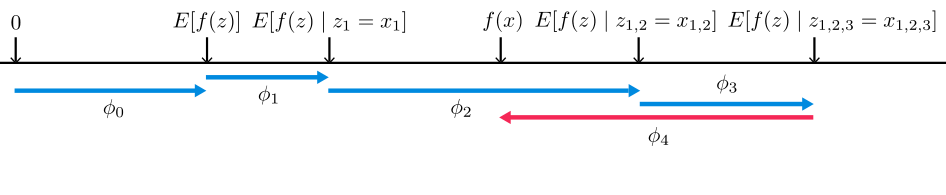
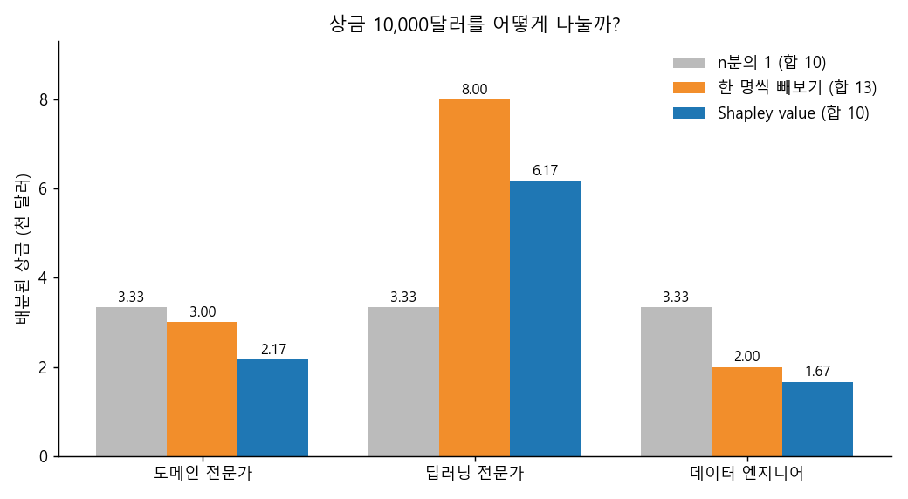
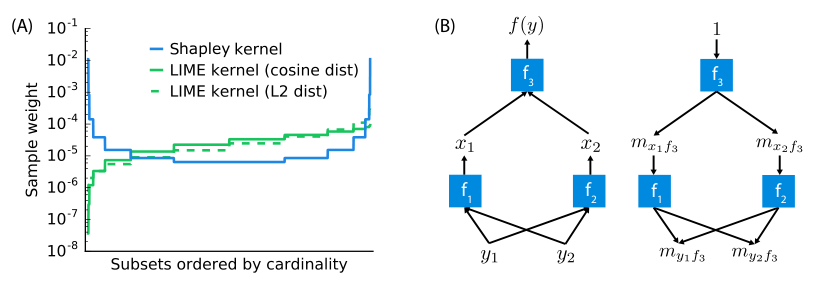

### 게임이론의 Shapley value로 블랙박스 모델의 예측을 설명하는 SHAP 알고리즘에 대해 알아봅니다.  


> 원제  
> **A Unified Approach to Interpreting Model Predictions** (Scott M. Lundberg, Su-In Lee, NIPS 2017)  
> 참고 영상: DeepFindr, *Explainable AI explained! #4 SHAP* / Scott Lundberg, *Explainable Machine Learning with Shapley Values* (H2O World)  

<center></center>   

<font size="2"><center> 출처: Lundberg & Lee, A Unified Approach to Interpreting Model Predictions (https://arxiv.org/abs/1705.07874) </center>  </font>   

<br/>


>  **1. SHAP은 협력 게임이론의 Shapley value를 머신러닝에 가져온 것으로, 플레이어 대신 피처를, 상금 대신 모델의 예측값을 공정하게 나누어 각 피처의 기여도를 계산함**
>
>  **2. 개별 예측을 설명하는 local explanation 기법이지만, 수많은 local explanation을 aggregation 하면 global한 설명도 얻을 수 있음**
>
>  **3. 정확한 계산은 피처 수에 대해 지수적으로 비싸므로 Kernel SHAP(model agnostic), Tree SHAP, Deep SHAP 등의 근사/특화 알고리즘을 사용함**

<br/>

----

**본 포스트는 SHAP 논문과 관련 강연 영상들을 보고 정리한 노트입니다.**
원문은 여기에서 보실 수 있습니다. [paper](https://arxiv.org/abs/1705.07874)  

----
#### Contents  

1. [Intro - 상금은 어떻게 나눠야 공평할까?](#intro)  
2. [Shapley value: 평균적인 기여도 구하기](#shapley)  
3. [직접 계산해보자! 3인 팀의 Shapley value](#example)  
4. [SHAP: 피처를 플레이어로](#shap)  
5. [SHAP이 갖는 좋은 성질들](#properties)  
6. [변수는 어떻게 숨길까?](#masking)  
7. [모든 조합을 다 볼 수는 없다 - Kernel SHAP과 친구들](#kernelshap)  
8. [SHAP은 어디에 쓸 수 있을까?](#usage)  
9. [마치며](#conclusion)  
<br />

<a id="intro"></a>
## 1. Intro - 상금은 어떻게 나눠야 공평할까?  

[XAI 개요와 PDP](https://myeonghak.github.io/xai/XAI-XAI-%EA%B0%9C%EC%9A%94%EC%99%80-PDP/) 포스트와 [LIME](https://myeonghak.github.io/xai/XAI-LIME%28Local-Interpretable-Model-agnostic-Explanation%29-%EC%95%8C%EA%B3%A0%EB%A6%AC%EC%A6%98/) 포스트에 이어, 오늘은 아마 실무에서 가장 많이 쓰이는 XAI 기법이 아닐까 싶은 SHAP에 대해 알아보겠습니다.  

SHAP을 이해하려면 먼저 게임이론 이야기를 조금 해야 하는데요.  
여러 명이 한 팀이 되어 협동하는 게임을 생각해 보겠습니다. 게임이 끝나고 팀이 상금을 받았다고 할 때, 이 상금을 어떻게 나눠야 할까요?  

가장 쉬운 방법은 n분의 1로 똑같이 나누는 것이겠죠. 하지만 누군가는 밤을 새워 팀을 캐리했고, 누군가는 묻어가기만 했다면 이건 누군가에게는 꽤 불공평한 일이 됩니다.  
따라서 **각자의 기여도에 따라 차등 분배하는 방법**이 필요한데요, 이 문제에 대해 1953년 Lloyd Shapley가 제시한 해답이 바로 **Shapley value**입니다.  
Shapley value는 가능한 여러 시나리오 하에서 각 플레이어가 평균적으로 얼마나 기여했는지를 계산합니다.  

그리고 이 Shapley value를 머신러닝 모델의 설명에 적용한 것이 바로 오늘의 주인공 **SHAP**입니다. 머신러닝에서는 플레이어 대신 각 **feature**를, 상금 대신 **모델의 예측값**을 사용하게 됩니다.  

<br/>

<a id="shapley"></a>
## 2. Shapley value: 평균적인 기여도 구하기  

조금 더 구체적인 예시를 들어보겠습니다.  
캐글 대회에 도메인 전문가, 딥러닝 전문가, 데이터 엔지니어 세 명이 한 팀으로 나갔다고 해 볼게요. 이 팀은 10,000달러의 상금을 받았는데, 도메인 전문가 한 명이 빠진 상태로 나갔다면 7,000달러를 받는 데 그쳤을 거라고 합니다.  

그렇다면 도메인 전문가의 기여도는 3,000달러라고 하면 될까요?  
안타깝게도 이건 엄밀하지 않습니다. 팀원들 사이에는 복잡한 **상호작용**이 있기 때문인데요.  
가령 도메인 전문가와 딥러닝 전문가가 함께 있을 때 큰 시너지를 낸다고 해 보죠. 그러면 딥러닝 전문가가 이미 빠진 팀에서는, 도메인 전문가까지 빠지더라도 상금에 별 차이가 없을 겁니다.  
즉, **어떤 팀원들과 함께 있느냐에 따라 한 사람의 기여도(marginal contribution)가 달라집니다.**  

이런 상호작용을 고려하기 위해 Shapley value는 다음과 같이 접근합니다.  

- 가능한 모든 팀 구성(부분집합, coalition)을 만듦  
- 각 구성에 플레이어 $i$를 추가했을 때 상금이 얼마나 늘어나는지(marginal contribution)를 계산함  
- 이를 적절한 가중치로 평균냄  

수식으로 쓰면 다음과 같습니다. $F$는 전체 플레이어 집합, $v(S)$는 부분집합 $S$만으로 게임을 했을 때 얻는 상금입니다.  

$$
\phi_i = \sum_{S \subseteq F \setminus \{i\}} \frac{\vert S \vert ! \, (\vert F \vert - \vert S \vert - 1)!}{\vert F \vert !} \left[ v(S \cup \{i\}) - v(S) \right]
$$

가중치 부분이 조금 낯설어 보이는데요, 사실 이건 **"플레이어들이 무작위 순서로 한 명씩 팀에 합류한다고 할 때, $i$가 합류하는 시점에 이미 $S$가 모여 있을 확률"** 입니다.  
그러니까 Shapley value는 가능한 모든 합류 순서($\vert F \vert !$가지)에 대해 $i$의 marginal contribution을 구하고 평균낸 값과 정확히 같습니다. 순열로 생각하면 훨씬 직관적이죠.  

<br/>

<a id="example"></a>
## 3. 직접 계산해보자! 3인 팀의 Shapley value  

말로만 하면 감이 잘 안 오니, 위 캐글 팀 예시로 직접 계산해 보겠습니다.  
D(도메인 전문가), L(딥러닝 전문가), E(데이터 엔지니어) 세 명의 모든 팀 구성별 상금(단위: 천 달러)을 아래처럼 가정해 볼게요. D와 L 사이에 시너지가 있도록 설정했습니다.  

| 팀 구성 | 없음 | D | L | E | D+L | D+E | L+E | D+L+E |
|---|---|---|---|---|---|---|---|---|
| 상금 | 0 | 1 | 4 | 1 | 8 | 2 | 7 | 10 |

순열 평균 방식과 subset 공식 두 가지로 모두 계산해 보겠습니다.  

```python
from itertools import permutations, combinations
from math import factorial

players = ["D", "L", "E"]   # D: 도메인 전문가, L: 딥러닝 전문가, E: 데이터 엔지니어
v = {  # 연합(coalition)별 상금 (단위: 천 달러)
    frozenset(): 0,
    frozenset("D"): 1, frozenset("L"): 4, frozenset("E"): 1,
    frozenset("DL"): 8, frozenset("DE"): 2, frozenset("LE"): 7,
    frozenset("DLE"): 10,
}

# 1) 모든 순열에 대한 marginal contribution의 평균
phi_perm = {p: 0.0 for p in players}
orders = list(permutations(players))
for order in orders:
    S = frozenset()
    for p in order:
        phi_perm[p] += v[S | {p}] - v[S]
        S = S | {p}
phi_perm = {p: phi_perm[p] / len(orders) for p in players}

# 2) 부분집합(subset) 공식
n = len(players)
phi_set = {}
for i in players:
    others = [p for p in players if p != i]
    total = 0.0
    for k in range(n):
        for S in combinations(others, k):
            S = frozenset(S)
            w = factorial(len(S)) * factorial(n - len(S) - 1) / factorial(n)
            total += w * (v[S | {i}] - v[S])
    phi_set[i] = total

for p in players:
    print(f"{p}: 순열 평균 = {phi_perm[p]:.4f}, subset 공식 = {phi_set[p]:.4f}")
print("합계:", round(sum(phi_set.values()), 4), "/ v(전체) - v(공집합) =", v[frozenset(players)] - v[frozenset()])
```

```
D: 순열 평균 = 2.1667, subset 공식 = 2.1667
L: 순열 평균 = 6.1667, subset 공식 = 6.1667
E: 순열 평균 = 1.6667, subset 공식 = 1.6667
합계: 10.0 / v(전체) - v(공집합) = 10
```

두 방식의 결과가 정확히 일치하네요. 도메인 전문가의 몫은 "한 명 빼보기"로 구한 3,000달러가 아니라 약 2,167달러가 됩니다.  
아래 그림처럼 세 가지 분배 방식을 비교해 보면 차이가 확연히 드러납니다.  

<center></center>   

<br/>

- **n분의 1**: 합은 맞지만 기여도를 전혀 반영하지 못함  
- **한 명씩 빼보기(leave-one-out)**: 기여도를 반영하는 것 같지만, 시너지가 중복으로 계산되어 **합이 13,000달러**로 실제 상금을 초과함  
- **Shapley value**: 상호작용을 고려하면서도 **합이 정확히 10,000달러**가 됨  

특히 D와 L의 시너지(D+L = 8)는 "빼보기" 방식에서 D에게도, L에게도 통째로 잡혀 버리는데, Shapley value는 이를 합류 순서에 따라 나눠 갖게 만듭니다. 이것이 Shapley value가 "공정한" 분배라고 불리는 이유입니다.  

<br/>

<a id="shap"></a>
## 4. SHAP: 피처를 플레이어로  

이제 이 아이디어를 머신러닝으로 옮겨 보겠습니다. 대응 관계는 단순합니다.  

- 플레이어 -> **피처**  
- 상금 -> **모델의 예측값** (정확히는 예측값과 평균 예측값의 차이)  

즉 머신러닝 컨텍스트에서 Shapley value는 **하나의 예측값이 각 피처들 사이에 얼마나 공평하게 분배되었는가**를 나타냅니다.  

SHAP은 **SHapley Additive exPlanations**의 약자인데요, 이름에 Additive가 들어간 데서 알 수 있듯이 논문은 설명 모델을 다음과 같은 **additive feature attribution** 형태로 정의합니다.  

$$
g(z') = \phi_0 + \sum_{i=1}^{M} \phi_i z'_i, \quad z' \in \{0, 1\}^M
$$

여기서 $z'_i$는 $i$번째 피처가 "참여했는지(1) 아닌지(0)"를 나타내는 simplified input이고, $\phi_0$는 아무 피처도 모를 때의 예측값, 즉 **base value** $E[f(z)]$입니다.  
논문의 재미있는 포인트는 LIME, DeepLIFT, Layer-wise Relevance Propagation, 기존 Shapley 기반 방법들이 **모두 이 형태에 속하는 한 가족**이라는 것을 보이고, 이를 하나의 프레임워크로 통합했다는 점입니다. 제목의 "Unified Approach"가 바로 이 의미입니다.  

맨 위의 그림(논문 Figure 1)이 이 과정을 잘 보여주는데요. base value $E[f(z)]$에서 출발해서 피처를 하나씩 조건으로 걸 때마다 기대 예측값이 $\phi_1, \phi_2, \dots$만큼 움직이고, 마지막에 실제 출력 $f(x)$에 도착합니다. $\phi_4$처럼 예측값을 깎아내리는 음의 기여도 당연히 가능하고요.  
다만 피처 간 상호작용이 있으면 이 값들이 조건을 거는 **순서에 따라 달라지기 때문에**, 앞 절처럼 모든 순서에 대해 평균을 낸 것이 SHAP 값이 됩니다.  

또 하나 짚고 넘어갈 점은, SHAP은 기본적으로 **개별 예측값을 설명하는 local explanation 기법**이라는 것입니다.  
하지만 동시에 수많은 샘플의 local explanation을 **aggregation** 하면 global한 설명도 얻을 수 있습니다. 예를 들어 모든 샘플에 대한 $\vert \phi_i \vert$의 평균은 그대로 global feature importance로 쓸 수 있죠. 이것이 LIME에 비해 SHAP이 가진 큰 장점 중 하나입니다.  

<br/>

<a id="properties"></a>
## 5. SHAP이 갖는 좋은 성질들  

그럼 왜 굳이 Shapley value여야 할까요? 논문에서는 additive feature attribution 방법이 갖추면 좋은 세 가지 성질을 정의하고, **이 세 가지를 모두 만족하는 해는 Shapley value 하나뿐**임을 보입니다.  

**1) Local accuracy (Additivity)**  
- 각 피처 기여도의 총합은 모델 출력과 base value의 차이와 같음  
- $f(x) = \phi_0 + \sum_{i} \phi_i$  
- 앞의 예제에서 세 명의 몫을 더하면 정확히 10이 되었던 것과 같은 성질임  

**2) Missingness**  
- 입력에 없는(빠진) 피처의 기여도는 0이어야 함  

**3) Consistency (Monotonicity)**  
- 모델이 바뀌어서 어떤 피처의 marginal contribution이 모든 경우에 대해 커지거나 같다면, 그 피처의 기여도는 감소하지 않아야 함  
- 당연해 보이지만, gain 기반 feature importance 등 많은 기존 방법들이 이 성질을 위반함  
- consistency를 위반한다는 것은, **기여도 점수에 기반한 피처의 순위를 신뢰할 수 없다**는 뜻임. 심지어 같은 모델 사이에서도 그럴 수 있음  

Lundberg의 강연에서도 이 consistency를 특히 강조하는데요. 피처 중요도를 보고 "이 피처가 저 피처보다 중요하다"라고 말하려면, 최소한 모델이 그 피처에 더 의존하도록 바뀌었을 때 중요도가 줄어드는 일은 없어야겠죠.  

<br/>

<a id="masking"></a>
## 6. 변수는 어떻게 숨길까?  

여기서 실용적인 문제가 하나 생깁니다.  
게임에서는 플레이어를 그냥 빼버리면 되지만, 머신러닝 모델에서는 피처를 단순히 빼버릴 수가 없습니다. 모델은 **고정된 크기의 입력**을 받기 때문이죠. 그렇다면 "피처 $i$가 없는 팀의 상금" $v(S)$는 어떻게 구할까요?  

SHAP은 빠진 피처의 값을 **학습 데이터셋(background data)에서 샘플링한 값으로 대체**하는 방식으로 이를 해결합니다.  

- 설명하려는 샘플 $x$에서 $S$에 속한 피처는 원래 값을 유지함  
- 나머지 피처는 background 데이터의 값으로 채워 넣음  
- 이렇게 만든 여러 입력에 대한 모델 출력의 평균을 $v(S)$로 사용함  

이렇게 하면 숨긴 피처는 사실상 **무작위로 셔플된 값**이 되어 해당 샘플에 대한 정보를 잃게 됩니다. 랜덤한 피처는 예측력이 없으므로 "그 피처를 모르는 상태"를 흉내 낼 수 있는 것이죠.  
다만 이 방식은 피처들이 서로 독립이라는 가정을 깔고 있다는 점은 기억해 둘 필요가 있습니다. 상관관계가 강한 피처들이 있으면 (예: 키 190cm인데 몸무게 40kg 같은) 현실에 없는 조합의 입력이 만들어질 수 있고, 모델이 이런 영역에서 이상하게 동작하면 설명도 왜곡될 수 있습니다.  

<br/>

<a id="kernelshap"></a>
## 7. 모든 조합을 다 볼 수는 없다 - Kernel SHAP과 친구들  

또 하나의 큰 문제는 **연산량**입니다.  
피처가 $M$개라면 가능한 부분집합의 수는 $2^M$개입니다. 피처가 30개만 되어도 약 10억 개의 조합을 평가해야 하니, 정확한 계산은 현실적으로 불가능하겠죠.  
SHAP 논문이 주장하는 바는 **모든 조합을 고려하지 않고도 기여도 값을 잘 근사할 수 있다**는 것입니다.  

### Kernel SHAP  

Kernel SHAP은 [LIME](https://myeonghak.github.io/xai/XAI-LIME%28Local-Interpretable-Model-agnostic-Explanation%29-%EC%95%8C%EA%B3%A0%EB%A6%AC%EC%A6%98/)과 매우 닮은 방식으로 동작합니다.  

1. 피처 부분집합(coalition) $z'$를 샘플링함  
2. 각 $z'$에 대해 빠진 피처를 background 값으로 채워서 모델 예측값을 구함  
3. $z'$(피처 포함 여부를 나타내는 binary 벡터)를 X로, 예측값을 y로 하는 **가중 선형회귀**를 적합함  
4. 적합된 선형회귀 모델의 **계수가 곧 SHAP 값의 근사치**가 됨  

LIME과의 결정적인 차이는 **가중치**에 있습니다. LIME은 원래 샘플과 얼마나 가까운지(proximity)를 가중치로 사용하지만, Kernel SHAP은 다음과 같은 **Shapley kernel**을 사용합니다.  

$$
\pi_{x}(z') = \frac{M - 1}{\binom{M}{\vert z' \vert} \, \vert z' \vert \, (M - \vert z' \vert)}
$$

<center></center>   

<font size="2"><center> 출처: Lundberg & Lee, A Unified Approach to Interpreting Model Predictions (https://arxiv.org/abs/1705.07874) </center>  </font>   

<br/>

논문 Figure 2(A)를 보면 그 차이가 잘 드러나는데요. Shapley kernel은 피처가 **아주 적게 포함되거나 아주 많이 포함된** coalition에 큰 가중치를 주는 U자 형태를 보입니다.  
피처 하나만 있는 coalition은 그 피처의 단독 효과를, 피처 하나만 빠진 coalition은 그 피처를 뺐을 때의 효과를 가장 깨끗하게 알려주기 때문에, **개별 피처에 대해 얼마나 많은 정보를 담고 있는지**에 따라 가중치를 준다고 이해할 수 있습니다. 이 kernel을 사용하면 선형회귀의 해가 이론적으로 Shapley value와 정확히 같아진다는 것이 논문의 핵심 결과 중 하나입니다.  

정말 그런지 간단히 확인해 보겠습니다. $f(x) = 2x_1 + x_2 x_3$처럼 상호작용 항이 있는 작은 모델에 대해, $2^3 = 8$개의 coalition 전부를 Shapley kernel로 가중해 회귀를 돌려 보았습니다. (빈 집합과 전체 집합은 가중치가 무한대라 큰 값으로 대신했습니다.)  

```python
import numpy as np
from itertools import product
from math import comb

f = lambda x: 2 * x[0] + x[1] * x[2]          # 상호작용 항(x2*x3)이 있는 블랙박스 모델
x = np.array([1.0, 2.0, 3.0])                # 설명하고 싶은 샘플
b = np.array([0.0, 0.0, 0.0])                # 배경(reference) 샘플
M = len(x)

Z, y, w = [], [], []
for z in product([0, 1], repeat=M):          # 2^M개의 모든 연합
    z = np.array(z)
    s = z.sum()
    Z.append(z)
    y.append(f(np.where(z == 1, x, b)))      # 빠진 피처는 배경값으로 대체
    w.append(1e6 if s in (0, M) else (M - 1) / (comb(M, s) * s * (M - s)))  # Shapley kernel

Z = np.c_[np.ones(len(Z)), np.array(Z)]      # 절편(phi_0) 포함
W = np.diag(w)
phi = np.linalg.solve(Z.T @ W @ Z, Z.T @ W @ np.array(y))
print("phi_0 (base value):", phi[0].round(4) + 0.0)
print("phi_1..3          :", phi[1:].round(4))
print("합계 =", phi.sum().round(4), "/ f(x) =", f(x))
```

```
phi_0 (base value): 0.0
phi_1..3          : [2. 3. 3.]
합계 = 8.0 / f(x) = 8.0
```

$x_1$의 기여는 단독 효과인 2, 그리고 상호작용 항 $x_2 x_3 = 6$은 두 피처가 대칭적으로 3씩 나눠 가졌네요. 회귀 계수가 정확한 Shapley value와 일치하고, 합도 $f(x)$와 정확히 같습니다(local accuracy).  
실제 Kernel SHAP은 여기서 모든 coalition 대신 일부만 샘플링하고, background 샘플도 여러 개를 사용한다는 점만 다릅니다.  

### 모델 특화 SHAP: Tree SHAP, Deep SHAP  

Kernel SHAP은 어떤 모델에든 쓸 수 있는 model agnostic 방법이지만, 여전히 모델을 수없이 호출해야 해서 느립니다. 그래서 모델의 **내부 구조를 활용**하는 방법들이 함께 제안되었습니다.  

- **Tree SHAP**: 트리 기반 모델(XGBoost, LightGBM, Random Forest 등)의 구조를 이용해 SHAP 값을 다항 시간에 **정확하게** 계산함 (후속 논문에서 제안됨)  
- **Deep SHAP**: DeepLIFT의 역전파 규칙을 Shapley value에 가깝도록 조합해 딥러닝 모델의 SHAP 값을 빠르게 근사함 (위 Figure 2(B)가 이 구성 요소를 나타냄)  
- **Linear SHAP**: 선형 모델이고 피처가 독립이라면 $\phi_i = w_i (x_i - E[x_i])$로 바로 계산됨  

이 방법들은 더 이상 model agnostic하지 않지만, 그 대가로 속도와 정확도 면에서 큰 이득을 얻습니다. 실무에서 GBDT 계열 모델에 SHAP을 많이 쓰는 이유도 Tree SHAP 덕분이라고 할 수 있겠죠.  

<br/>

<a id="usage"></a>
## 8. SHAP은 어디에 쓸 수 있을까?  

Lundberg의 강연에서는 SHAP의 활용처로 다음과 같은 것들을 소개합니다.  

**1) 개별 예측 설명**  
- "이 고객의 이탈 확률이 왜 높게 나왔는가?"에 대해 피처별 기여도로 답할 수 있음  
- force plot, waterfall plot 등으로 base value에서 예측값까지의 흐름을 시각화함  

**2) Global 해석**  
- 모든 샘플의 SHAP 값을 모아 summary plot(beeswarm)이나 mean $\vert \phi \vert$ 기반 피처 중요도를 그릴 수 있음  
- 피처 값과 SHAP 값의 관계를 그린 dependence plot으로 PDP와 비슷한, 그러나 개별 샘플 단위의 정보를 가진 해석이 가능함  

**3) 모델 디버깅**  
- 말이 안 되는 피처가 높은 기여도를 갖는다면 data leakage나 버그를 의심해 볼 수 있음  

**4) 모델 성능 모니터링**  
- 예측값 대신 **loss를 SHAP으로 분해**하면, 어떤 피처가 loss 증가에 기여하는지 알 수 있음  
- 배포 후 이 기여도의 추세를 지켜보면, 특정 피처의 분포가 바뀌거나 파이프라인이 망가졌을 때 이를 빠르게 감지하고 모델의 개선점을 도출할 수 있음  

<br/>

<a id="conclusion"></a>
## 9. 마치며  

오늘은 게임이론의 Shapley value를 바탕으로 블랙박스 모델의 예측을 설명하는 SHAP에 대해 알아보았습니다.  
정리하자면 SHAP은  

- 예측값을 피처들에게 "공정하게" 나누어 주는 방법이고  
- local accuracy, missingness, consistency라는 좋은 성질을 이론적으로 보장하며  
- Kernel SHAP, Tree SHAP 등을 통해 현실적인 시간 안에 계산할 수 있다는 점이 특징입니다.  

개인적으로는 3인 팀 예제를 직접 계산해 보면서 "한 명씩 빼보기"가 왜 합이 맞지 않는지 눈으로 확인한 것이 가장 와닿았는데요. 피처 중요도를 볼 때 막연히 "빼보면 알겠지" 하고 넘어갔던 습관을 반성하게 되었습니다.  
물론 SHAP도 만능은 아닙니다. 피처 독립 가정, background 데이터 선택에 따른 결과 차이, 그리고 SHAP 값은 어디까지나 **모델이 무엇을 보고 있는지**를 말해줄 뿐 **인과관계**를 말해주지는 않는다는 점은 늘 염두에 두어야 하겠습니다.  

----------------


**개선을 위한 여러분의 피드백과 제안을 코멘트로 공유해 주세요.**
**내용에 대한 지적, 혹은 질문을 환영합니다.**  


**출처**  
[Lundberg & Lee, A Unified Approach to Interpreting Model Predictions (NIPS 2017)](https://arxiv.org/abs/1705.07874)  
[DeepFindr, Explainable AI explained! #4 SHAP](https://youtu.be/9haIOplEIGM)  
[Scott Lundberg, Explainable Machine Learning with Shapley Values (H2O World)](https://youtu.be/ngOBhhINWb8)  
