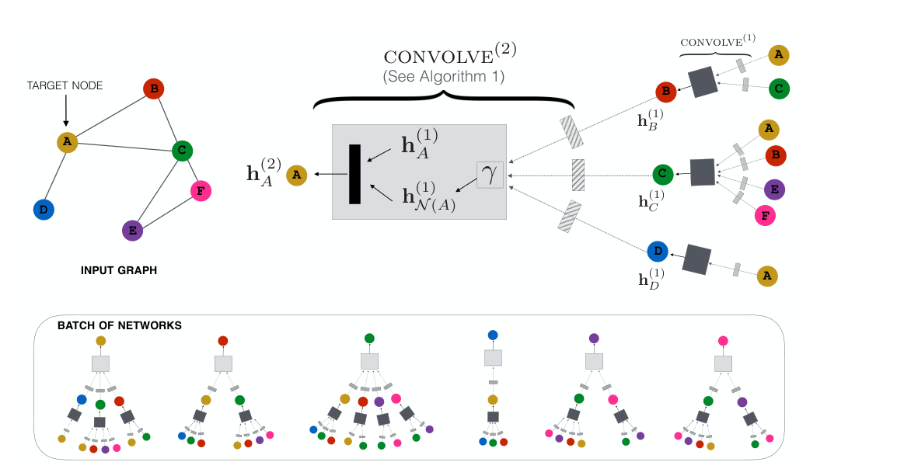
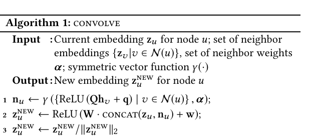
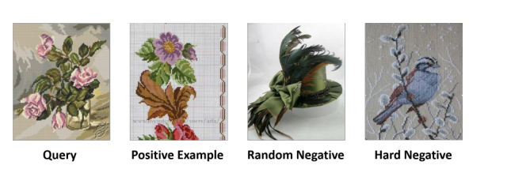
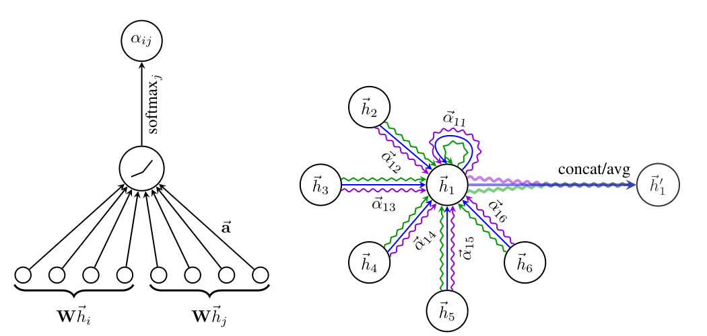

### 수십억 노드 위에서 돌아가는 추천용 GNN인 PinSAGE와, 이웃의 중요도를 attention으로 학습하는 GAT에 대해 알아봅니다.  


> 원제  
> **PinSAGE**: Graph Convolutional Neural Networks for Web-Scale Recommender Systems (Ying et al., KDD 2018)  
> **GAT**: Graph Attention Networks (Veličković et al., ICLR 2018)  

<center></center>   

<font size="2"><center> 출처: Ying et al., Graph Convolutional Neural Networks for Web-Scale Recommender Systems (https://arxiv.org/abs/1806.01973) </center>  </font>   

<br/>


>  **1. PinSAGE는 GraphSAGE를 개량해 30억 노드, 180억 엣지 규모의 핀터레스트 그래프에서 아이템 임베딩을 학습한 모델로, random walk 기반의 중요도 이웃(importance-based neighborhood)과 importance pooling을 사용함**
>
>  **2. 학습은 max-margin ranking loss로 이루어지며, PPR 기반 hard negative를 epoch에 따라 점진적으로 늘리는 curriculum training을 적용함. 여기에 producer-consumer 미니배치, MapReduce 추론 같은 엔지니어링이 더해짐**
>
>  **3. GAT는 이웃을 aggregate할 때의 가중치를 구조(차수, PPR)가 아닌 노드 피처 간의 learnable attention으로 결정함. masked attention과 multi-head 구조를 사용하며, aggregator 자리에 끼워 쓸 수 있음**

<br/>

----

**본 포스트는 PinSAGE와 GAT 논문, 그리고 관련 강의/영상을 보고 정리한 노트입니다.**
원문은 여기에서 보실 수 있습니다.  
[PinSAGE paper](https://arxiv.org/abs/1806.01973), [GAT paper](https://arxiv.org/abs/1710.10903)  

이 글은 추천시스템을 위한 GNN 시리즈의 두 번째 글입니다. 첫 번째 글은 [[GNN] GCN과 GraphSAGE - 추천시스템을 위한 GNN 1](https://myeonghak.github.io/graph%20neural%20networks/GNN-GCN%EA%B3%BC-GraphSAGE/)에서 보실 수 있습니다.  

----
#### Contents  

1. [Intro - GraphSAGE, 그 다음은?](#intro)  
2. [PinSAGE: 웹 스케일 그래프에 GCN 태우기](#pinsage)  
3. [이웃은 누구로 정할까? Importance-based Neighborhood](#neighborhood)  
4. [PinSAGE 학습: Max-Margin Loss와 Hard Negative Curriculum](#training)  
5. [수십억 노드를 감당하는 엔지니어링](#engineering)  
6. [GAT: 이웃의 중요도도 학습해보자!](#gat)  
7. [GAT의 Attention 계산 따라가 보기](#gat-attention)  
8. [GCN vs PinSAGE vs GAT, 무엇이 다를까?](#compare)  
9. [마치며](#conclusion)  
<br />

<a id="intro"></a>
## 1. Intro - GraphSAGE, 그 다음은?  

[지난 글](https://myeonghak.github.io/graph%20neural%20networks/GNN-GCN%EA%B3%BC-GraphSAGE/)에서는 GCN과 GraphSAGE를 살펴봤는데요.  
간단히 복습해 보면, GCN은 전체 그래프의 (정규화된) 인접 행렬, 즉 graph Laplacian을 사용해 이웃의 정보를 모으는 방식이었고, GraphSAGE는 이웃을 샘플링하고 aggregator 함수를 학습함으로써 학습 때 보지 못한 노드에도 임베딩을 만들어줄 수 있는 inductive한 방식이었습니다.  

그런데 이걸 실제 서비스에 적용하려고 하면 바로 벽에 부딪히게 됩니다.  
노드가 수십억 개, 엣지가 수백억 개인 그래프라면 인접 행렬을 메모리에 올리는 것부터가 불가능하겠죠. 또 GraphSAGE처럼 이웃을 균등하게 랜덤 샘플링하는 것이 과연 최선인지, 모든 이웃을 똑같이 평균 내는 것이 맞는지도 의문이 듭니다.  

오늘은 이 질문들에 각자의 방식으로 답한 두 모델을 알아보겠습니다.  

- **PinSAGE**: 이웃을 random walk 기반 **중요도**로 고르고, 그 중요도로 가중 평균하자! (그리고 이걸 핀터레스트 규모에서 돌아가게 만들자!)  
- **GAT**: 이웃의 중요도 자체를 **attention으로 학습**하자!  


<a id="pinsage"></a>
## 2. PinSAGE: 웹 스케일 그래프에 GCN 태우기  

### 어떤 문제를 풀고 싶었을까?  

핀터레스트는 유저가 마음에 드는 이미지(핀, pin)를 일종의 시각적 북마크처럼 모아서 보드(board)를 만드는 서비스입니다. 요리하고 싶은 레시피, 사고 싶은 옷 같은 것들을 주제별 보드에 모아두는 식이죠.  
논문 시점 기준으로 핀이 약 20억 개, 보드가 약 10억 개, 엣지가 약 180억 개에 달하는, 세계에서 가장 큰 user-curated 이미지 그래프라고 합니다.  

풀고자 하는 task는 단순합니다.  

- 쿼리 핀(이미지)이 주어졌을 때, 연관된 핀을 추천해 주는 것 (related pin, item-to-item 추천)  
- 이를 위해 고품질의 핀 임베딩을 만들고, 임베딩 공간에서의 최근접 이웃 탐색(nearest neighbor lookup)으로 후보를 생성하거나, 다른 랭킹 모델의 피처로 활용함  

그래프는 핀 집합 $I$와 보드 집합 $C$로 이루어진 bipartite graph로 모델링합니다. 다만 시각/텍스트 피처는 핀에만 있고, 실제 추천 대상도 핀이기 때문에 사실상 **핀 노드 위주의 homogeneous한 그래프처럼 다룬다**고 이해하면 편합니다. 보드는 핀과 핀을 이어주는 다리 역할 정도를 한다고 보면 되겠습니다. (논문에서도 표기의 편의상 핀과 보드를 굳이 구분하지 않고 "node"라고 부릅니다.)  

### 왜 기존 GCN은 안 되었을까?  

전통적인 GCN은 피처 행렬에 full graph Laplacian의 거듭제곱을 곱하는 방식으로 컨볼루션을 수행합니다.  
여기서 Laplacian(인접) 행렬을 메모리에 올려야 하는데, 핀터레스트의 경우 이게 수십억 x 수십억 크기의 행렬이니 애초에 불가능하겠죠. 게다가 그래프는 계속해서 변하기도 합니다.  

한편 DeepWalk, node2vec 같은 그래프 임베딩 방법은 다음과 같은 이유로 이 상황에 맞지 않습니다.  

- 비지도 방식이라 추천 목적에 맞춘 학습이 어려움  
- 노드 피처(이미지, 텍스트)를 활용할 수 없음  
- 노드마다 임베딩을 직접 학습하므로 파라미터 수가 그래프 크기에 선형적으로 비례함 -> 수십억 노드에서는 불가능함  

그래서 PinSAGE는 GraphSAGE를 출발점으로 삼았습니다. GraphSAGE는 노드별 임베딩이 아니라 **aggregation 함수(의 파라미터)**를 학습하기 때문에 파라미터 수가 그래프 크기와 무관하고, 새로운 노드에도 임베딩을 만들어줄 수 있으니까요.  

### PinSAGE의 컨볼루션: CONVOLVE  

맨 위의 그림이 PinSAGE의 전체 구조입니다. 타겟 노드 A의 2-layer 임베딩 $h_A^{(2)}$는, A 자신의 이전 표현 $h_A^{(1)}$과 이웃 집합 $N(A)$의 표현 $h_{N(A)}^{(1)}$을 합쳐서 만들어집니다. 그리고 그 이웃들의 표현은 다시 그 이웃의 이웃으로부터 만들어지죠. 하단의 "Batch of Networks"처럼, 노드마다 생김새가 다른 계산 그래프가 만들어지지만 **모든 노드가 같은 파라미터를 공유**합니다.  

하나의 컨볼루션 연산은 아래의 Algorithm 1과 같습니다.  

<center></center>   

<font size="2"><center> 출처: Ying et al., Graph Convolutional Neural Networks for Web-Scale Recommender Systems (https://arxiv.org/abs/1806.01973) </center>  </font>   

<br/>

수식으로 풀어보면 다음과 같습니다.  

$$
n_u = \gamma\left(\{\mathrm{ReLU}(Q h_v + q) \mid v \in N(u)\}, \alpha\right)
$$

$$
z_u^{new} = \mathrm{ReLU}\left(W \cdot \mathrm{CONCAT}(z_u, n_u) + w\right), \quad z_u^{new} \leftarrow \frac{z_u^{new}}{\lVert z_u^{new} \rVert_2}
$$

- 이웃 $v$의 표현을 dense layer($Q$, $q$)로 변환한 뒤, aggregator $\gamma$로 통합해 이웃 벡터 $n_u$를 만듦  
- 이때 $\gamma$는 이웃별 가중치 $\alpha$를 사용한 **가중 평균**(importance pooling)임  
- 자기 자신의 표현 $z_u$와 $n_u$를 **concat**한 뒤 다시 dense layer($W$, $w$)를 통과시킴. 논문에서는 평균보다 concat이 유의미하게 성능이 좋았다고 함  
- 마지막으로 L2 정규화를 해줌. 학습이 더 안정적이고, 정규화된 임베딩에서 근사 최근접 이웃 탐색이 더 효율적이기 때문임  

이 CONVOLVE를 K번 쌓으면 K-hop 거리의 정보까지 모을 수 있습니다. 파라미터는 노드 간에는 공유되지만 레이어 간에는 서로 다르고, 마지막 컨볼루션 레이어의 출력을 다시 fully-connected 레이어에 통과시켜 최종 임베딩 $z_u$를 얻습니다.  


<a id="neighborhood"></a>
## 3. 이웃은 누구로 정할까? Importance-based Neighborhood  

PinSAGE의 가장 중요한 아이디어는 **이웃 $N(u)$를 어떻게 정의하느냐**에 있습니다.  
GCN은 k-hop 이웃 전체를, GraphSAGE는 인접 이웃 중 균등하게 랜덤 샘플링한 일부를 사용했는데요. PinSAGE는 "노드 u에 가장 큰 영향을 주는 T개의 노드"를 이웃으로 정의합니다.  

### Random walk로 중요한 이웃 찾기  

방법은 이렇습니다.  

1. 노드 $u$에서 시작하는 짧은 random walk를 여러 번 시뮬레이션함  
2. 각 노드가 방문된 횟수를 세고 L1 정규화함  
3. 정규화된 방문 횟수가 가장 높은 상위 T개 노드를 $u$의 이웃으로 고정함  

쉽게 말하면, "u에서 출발해 랜덤하게 막 돌아다녀 봤더니 어떤 노드는 정말 자주 등장하더라!" 하는 노드를 중요한 이웃으로 뽑아 쓰겠다는 것입니다.  
시뮬레이션 횟수를 무한히 늘리면 이 정규화된 방문 횟수는 노드 $u$에 대한 **Personalized PageRank(PPR)** 점수에 수렴합니다. 그래서 흔히 "PPR로 이웃을 고른다"고 표현하기도 합니다.  

재밌는 점은, 이렇게 고른 이웃은 꼭 직접 연결된(1-hop) 노드가 아닐 수도 있다는 것입니다. 핀-보드-핀으로 이어지는 bipartite 구조에서 random walk를 돌리면 보드를 거쳐 자주 함께 등장하는 핀들이 자연스럽게 이웃이 되겠죠. ([DeepWalk](https://myeonghak.github.io/graph%20neural%20networks/GNN-DeepWalk/)에서 random walk로 노드의 문맥을 정의했던 것과 비슷한 직관입니다.)  

### 이 방식의 장점  

- **메모리 통제**: 이웃 수를 T개로 고정하므로 학습 중 메모리 사용량(footprint)을 예측하고 통제할 수 있음. 핀터레스트처럼 인기 핀의 차수가 엄청나게 큰 그래프에서 특히 중요함  
- **중요도 반영**: 이웃을 aggregate할 때 각 이웃의 중요도를 함께 고려할 수 있음  

### Importance Pooling  

두 번째 장점이 바로 **importance pooling**입니다. Algorithm 1의 $\gamma$를 단순 평균이 아니라, random walk 방문 횟수(L1 정규화)를 가중치로 한 **가중 평균(weighted mean)**으로 구현한 것인데요.  
구조적으로 여러 번 방문되는 노드를 더 중요한 노드로 간주해서, 그 노드의 피처를 더 많이 반영하겠다는 것입니다. 논문에 따르면 이 importance pooling 덕분에 offline 평가 지표가 무려 46% 개선되었다고 합니다.  

이 부분이 뒤에서 볼 GAT와 대비되는 지점이니 기억해 두시면 좋겠습니다. PinSAGE의 이웃 가중치는 **그래프 구조로부터 미리 계산된, 고정된 값**입니다.  


<a id="training"></a>
## 4. PinSAGE 학습: Max-Margin Loss와 Hard Negative Curriculum  

### Max-Margin Ranking Loss  

PinSAGE는 지도학습 방식으로 학습됩니다. 서로 연관된 아이템 쌍 $(q, i) \in L$이 주어졌다고 가정하는데요, 여기서 positive pair는 유저 행동 로그에서 만들어집니다. 유저가 핀 $q$와 상호작용한 **직후에** 핀 $i$와 상호작용했다면 $(q, i)$를 positive로 보는 식입니다. (session 기준 다음 클릭 아이템이라고 이해하면 됩니다.)  

손실 함수는 max-margin ranking loss로, triplet loss라고도 불리는 형태입니다.  

$$
J_G(z_q z_i) = \mathbb{E}_{n_k \sim P_n(q)} \max\{0,\; z_q \cdot z_{n_k} - z_q \cdot z_i + \Delta\}
$$

- 쿼리 $q$와 positive $i$의 임베딩 내적은 크게, 쿼리와 negative $n_k$의 내적은 작게 만듦  
- 단순히 positive가 negative보다 크기만 하면 되는 것이 아니라, 미리 정한 margin $\Delta$ 이상 차이가 나도록 유도함  

그렇다면 왜 classification loss가 아니라 ranking loss를 썼을까요? 정리해 보면 다음과 같습니다.  

1. 아이템 수가 수십억 개인 상황에서 이를 분류 문제로 풀면, 클래스 수가 많아질수록 출력층 파라미터가 급격히 늘어남  
2. 클래스를 딱 잘라 맞히는 것보다 상대적인 순서만 맞추면 되므로 더 robust한, 일종의 soft classifier로 볼 수 있음  
3. 추천 시스템의 랭킹 알고리즘이 지향하는 바(연관된 것을 위로)와 학습 목표가 일치하므로 추가적인 튜닝이 덜 필요함  

### Negative Sampling: 배치 단위로 공유하기  

Negative는 쿼리마다 따로 뽑는 대신, **미니배치마다 500개의 negative를 샘플링해 배치 내 모든 샘플이 공유**하도록 했습니다. 이렇게 하면 매 스텝 계산해야 하는 임베딩 수가 크게 줄어드는데, 쿼리마다 독립적으로 뽑는 방식과 성능 차이는 거의 없었다고 하네요.  

### 그런데 랜덤 negative는 너무 쉽다  

문제는 랜덤 negative가 너무 쉽다는 것입니다. 20억 개 아이템 중 무작위로 500개를 뽑으면, 쿼리와 조금이라도 관련 있는 아이템이 걸릴 확률은 매우 낮겠죠.  
반면 실제 서비스에서는 200만 개 후보 중 가장 연관된 1,000개를 골라내야 합니다. 즉 모델은 "200만 개 중 1개"를 구별할 해상도(resolution)가 필요한데, 랜덤 negative 500개로는 "500개 중 1개" 수준의 해상도밖에 학습하지 못합니다.  

그래서 PinSAGE는 **hard negative**를 추가합니다. 쿼리와 어느 정도 관련은 있지만 positive만큼은 아닌 아이템들인데요, 쿼리 $q$ 기준의 PPR 점수로 아이템을 줄 세운 뒤 **2,000~5,000위 사이**의 아이템을 랜덤하게 뽑아 사용합니다.  

<center></center>   

<font size="2"><center> 출처: Ying et al., Graph Convolutional Neural Networks for Web-Scale Recommender Systems (https://arxiv.org/abs/1806.01973) </center>  </font>   

<br/>

그림을 보면 감이 오는데요. 꽃 자수 그림 쿼리에 대해, 랜덤 negative(모자)는 누가 봐도 다른 반면 hard negative(새 자수 그림)는 꽤 비슷해 보입니다. 이런 샘플을 구분하도록 강제해야 모델이 더 세밀한 특징을 학습하게 되겠죠.  

### Curriculum Training  

다만 처음부터 어려운 예시만 들이밀면 학습이 안정적이지 않습니다. 실제로 hard negative를 처음부터 사용하면 수렴까지 필요한 epoch 수가 두 배로 늘었다고 합니다. 그래서 사람이 공부하듯 쉬운 것부터 차근차근 가르치는 curriculum training을 도입합니다.  

1. 첫 epoch에서는 hard negative 없이 (query, positive, random negative)만으로 학습함 -> 손실이 작은 파라미터 영역을 빠르게 찾음  
2. 이 과정에서 positive와의 관계, random negative와 구별되는 큰 특징을 먼저 익힘  
3. 이후 epoch이 진행될수록 hard negative 수를 늘림. $n$번째 epoch에서는 아이템마다 $n-1$개의 hard negative를 추가함 -> 점진적으로 positive와 구별되는 세부적인 특징을 학습함  

이 curriculum training으로 12%의 성능 개선을 얻었다고 합니다.  


<a id="engineering"></a>
## 5. 수십억 노드를 감당하는 엔지니어링  

PinSAGE 논문이 특별한 이유는 모델 아이디어 못지않게 "이걸 실제로 돌아가게 만든" 엔지니어링에 있습니다. 핵심만 짚어보겠습니다.  

**1) On-the-fly convolution**  
- 전체 Laplacian 대신, 노드 주변 이웃을 샘플링해 계산 그래프를 동적으로 구성함  
- 학습 중 전체 그래프를 대상으로 연산할 필요가 없어짐  

**2) Producer-Consumer 미니배치 구축**  
- 그래프의 인접 리스트와 피처 행렬은 너무 커서 CPU 메모리에 올려둠  
- 그런데 GPU에서 CPU 메모리에 매번 접근하는 것은 비효율적임  
- 그래서 CPU(producer)가 현재 미니배치 계산에 필요한 노드와 이웃만 뽑아 re-indexing한 작은 서브그래프 $G'$와 피처 행렬을 만들고, negative sampling까지 처리함  
- GPU(consumer)는 이걸 받아서 순전파/역전파만 수행함  
- 현재 iteration의 GPU 연산과 다음 iteration의 CPU 연산을 병렬로 처리해서 학습 시간을 거의 절반으로 줄였다고 함  

**3) 대규모 배치 Multi-GPU 학습**  
- 미니배치를 GPU 수만큼 나눠 multi-tower 방식으로 계산한 뒤 gradient를 모아 동기적으로 SGD를 수행함  
- 배치 크기는 512~4,096 수준이며, 큰 배치 학습을 위해 learning rate warmup 후 지수적으로 감소시키는 방식을 사용함  

**4) MapReduce 추론**  
- 학습된 모델로 모든 노드의 임베딩을 단순히 Algorithm 2로 하나씩 계산하면, K-hop 이웃이 겹치는 노드들의 표현이 반복적으로 계산되는 낭비가 생김  
- 그래서 (1) 모든 핀을 저차원으로 projection하는 job, (2) 그 결과를 보드 단위로 join하고 pooling해 보드 임베딩을 만드는 job을 MapReduce로 구성함. 이를 반복해 K층까지 계산함  
- 각 노드의 latent vector는 단 한 번씩만 계산되므로 중복 연산이 사라짐  

이렇게 구한 임베딩은 locality sensitive hashing 기반의 근사 KNN으로 서빙됩니다. 임베딩을 오프라인에서 미리 계산해 DB에 저장해두면 온라인에서는 최근접 이웃 탐색만 하면 되는 구조죠.  

### 결과는?  

- 75억 개의 학습 예시로, 30억 노드와 180억 엣지 규모의 그래프에서 학습함 (논문 시점 기준 가장 큰 deep graph embedding 적용 사례)  
- offline ranking 지표에서 가장 좋은 baseline 대비 40% 이상 개선됨  
- 사람이 직접 비교 평가한 user study에서 약 60% 더 선호됨  
- A/B 테스트에서 다양한 환경의 user engagement가 30~100% 개선됨  


<a id="gat"></a>
## 6. GAT: 이웃의 중요도도 학습해보자!  

이제 GAT로 넘어가 보겠습니다.  
지금까지 본 aggregator들을 이웃 가중치 관점에서 다시 보면 이렇습니다.  

- **GCN**: 노드의 차수(degree)만 고려해 이웃으로부터 받을 정보의 양을 결정함 ($\frac{1}{\sqrt{d_i d_j}}$ 형태의 정규화)  
- **PinSAGE**: random walk 방문 빈도(PPR)라는 구조적 정보로 가중치를 결정함. 여러 번 방문되는 노드를 더 중요한 노드로 간주해 피처를 더 많이 aggregate함  

둘 다 **그래프 구조만 보고 가중치를 미리 정해둔다**는 공통점이 있습니다. 그런데 정말 중요한 이웃이 누구인지는 구조뿐 아니라 노드가 가진 피처, 그리고 우리가 풀고자 하는 task에 따라 달라지지 않을까요?  

GAT(Graph Attention Network)는 바로 여기서 출발합니다. **"내 노드 기준으로 어떤 이웃과 연관성이 높은지"를 피처 간의 관계로부터 학습**하자는 것인데요. trainable한 attention weight를 통해 다음 두 가지를 학습하도록 유도합니다.  

1. 어떤 이웃이 나와 유사한가  
2. 어떤 이웃이 나에게 유익한 정보를 주는가 (loss function을 줄이는 관점에서)  

논문에서는 GCN 형태의 full-batch 구조에 attention layer를 적용했지만, 결국 GAT layer는 aggregator 역할을 하기 때문에 GraphSAGE 같은 샘플링 기반 구조에도 얼마든지 끼워 넣을 수 있습니다.  

### Motivation: 이웃의 조합으로 나를 표현한다  

GAT aggregator가 하는 일은 결국 "**이웃을 통해 나를 표현하는 것**"입니다. 내 주변 이웃들에 가중치를 잘 주어 통합하면, 나와 이웃의 정보가 잘 반영된 최종 노드 임베딩이 만들어지겠죠.  

논문에서도 언급하는데, 이는 LLE(Locally Linear Embedding)와 닮은 구석이 있습니다.  
LLE는 고차원 공간에서 각 데이터 포인트를 가까운 이웃들의 **가중 선형 결합**으로 재구성하는 가중치를 먼저 구하고, 저차원으로 내려가서도 그 가중치로 이웃을 조합했을 때 자기 자신이 잘 재구성되도록 임베딩을 찾는 기법입니다. 좁은 범위에서의 선형 구조들을 이어 붙이면 전체 매니폴드를 잘 표현할 수 있다는 아이디어죠.  
GAT도 마찬가지로 "이웃의 가중 조합으로 나를 표현"하는데, 그 가중치를 고정된 값이 아니라 attention으로 학습한다는 점이 다릅니다.  

또 하나의 배경은 spectral 방법론의 한계입니다. Laplacian 기반의 spectral GCN은 eigen decomposition 등 전체 그래프 구조에 의존하는 연산이 필요하고, 학습된 필터가 특정 그래프 구조에 묶여 있어서 다른 그래프로 옮기기 어렵습니다. 반면 GAT는 이런 비싼 행렬 연산 없이 **엣지 단위로 병렬 계산**이 가능하고, 전체 그래프 구조를 미리 알 필요가 없어서 inductive 세팅에도 그대로 쓸 수 있습니다.  


<a id="gat-attention"></a>
## 7. GAT의 Attention 계산 따라가 보기  

<center></center>   

<font size="2"><center> 출처: Veličković et al., Graph Attention Networks (https://arxiv.org/abs/1710.10903) </center>  </font>   

<br/>

왼쪽 그림이 attention coefficient $\alpha_{ij}$를 계산하는 과정이고, 오른쪽 그림이 multi-head attention(여기서는 head 3개, 색깔별 화살표)으로 이웃을 aggregate하는 과정입니다. 단계별로 따라가 보겠습니다.  

### Step 0. 먼저 떠올려볼 수 있는 방법: 내적 기반 coefficient matrix  

이해를 돕기 위해, 노드 수 5개, 입력 피처 3차원인 피처 행렬 $H \in \mathbb{R}^{5 \times 3}$이 있다고 해볼까요.  

- $3 \times 2$ 가중치 행렬 $W$로 선형 변환을 취해 $5 \times 2$ 행렬 $HW$를 만듦  
- 여기에 자기 자신의 전치($2 \times 5$)를 곱하면, 노드 피처 간의 내적(유사도)을 원소로 갖는 $5 \times 5$ 행렬이 만들어짐  
- 이 행렬을 인접 행렬로 마스킹하면 구조 정보까지 반영된 coefficient matrix가 됨  

가장 직관적인 방법이긴 한데, 유사도가 단순 내적으로 고정되어 있다는 한계가 있습니다. GAT는 이 점수를 매기는 부분 자체를 학습 가능한 레이어로 바꿉니다.  

### Step 1. 공유 선형 변환  

모든 노드 피처 $h_i \in \mathbb{R}^{F}$에 공유 가중치 행렬 $W \in \mathbb{R}^{F' \times F}$를 곱해 $W h_i$를 만듭니다. (위 예시라면 $5 \times 3$ -> $5 \times 2$)  

### Step 2. Scoring FC Layer로 attention score 구하기  

비교하려는 두 노드 $i$, $j$의 변환된 피처를 lookup해서 concat한 뒤, 학습 가능한 벡터 $a \in \mathbb{R}^{2F'}$(즉 출력이 1인 single-layer FC)와 LeakyReLU를 통과시켜 점수를 예측합니다.  

$$
e_{ij} = \mathrm{LeakyReLU}\left(a^{T} \left[ W h_i \,\Vert\, W h_j \right]\right)
$$

여기서 $\Vert$는 concat 연산입니다.  

### Step 3. Masked attention + softmax  

원칙적으로는 모든 노드 쌍에 대해 점수를 계산할 수 있지만, 그러면 그래프 구조 정보가 사라지겠죠. 그래서 **노드 $i$의 이웃 $N_i$(자기 자신 포함)에 대해서만** 점수를 계산하고(masked attention), softmax로 정규화합니다.  

$$
\alpha_{ij} = \mathrm{softmax}_j(e_{ij}) = \frac{\exp(e_{ij})}{\sum_{k \in N_i} \exp(e_{ik})}
$$

### Step 4. 가중합으로 새로운 표현 만들기  

$$
h_i' = \sigma\left(\sum_{j \in N_i} \alpha_{ij} W h_j\right)
$$

### Step 5. Multi-head attention  

Transformer처럼 독립적인 attention head를 $K$개 두어 학습을 안정화합니다.  

- 중간 레이어에서는 각 head의 출력을 **concat**함  
- 마지막(예측) 레이어에서는 concat 대신 **평균(average)**을 낸 뒤 softmax 등의 최종 activation을 적용함  

오른쪽 그림의 "concat/avg"가 바로 이 부분입니다.  

위 과정을 numpy로 아주 간단히 구현해 보면 아래와 같습니다. (single head, 앞서 든 노드 5개 x 피처 3개 예시)  

```python
import numpy as np
np.random.seed(42)

N, F, F_out = 5, 3, 2
H = np.random.randn(N, F)                 # 노드 피처 (5 x 3)
W = np.random.randn(F, F_out) * 0.5       # 공유 선형변환 (3 x 2)
a = np.random.randn(2 * F_out)            # attention 벡터 (4,)
A = np.array([[1,1,1,0,0],
              [1,1,0,1,0],
              [1,0,1,1,1],
              [0,1,1,1,0],
              [0,0,1,0,1]])               # self-loop 포함 인접행렬

Wh = H @ W                                # (5 x 2)
# e_ij = LeakyReLU(a^T [Wh_i || Wh_j])
e = (Wh @ a[:F_out])[:, None] + (Wh @ a[F_out:])[None, :]
e = np.where(e > 0, e, 0.2 * e)
e = np.where(A > 0, e, -np.inf)           # masked attention
alpha = np.exp(e - e.max(1, keepdims=True))
alpha = alpha / alpha.sum(1, keepdims=True)

print(np.round(alpha, 3))
H_new = alpha @ Wh                        # 이웃의 가중합
print(H_new.shape)
```

```
[[0.308 0.36  0.332 0.    0.   ]
 [0.372 0.435 0.    0.194 0.   ]
 [0.328 0.    0.354 0.175 0.143]
 [0.    0.422 0.389 0.188 0.   ]
 [0.    0.    0.691 0.    0.309]]
(5, 2)
```

$a^{T}[Wh_i \Vert Wh_j]$는 $a$를 앞뒤 절반으로 나눠 각각 $Wh_i$, $Wh_j$와 내적한 값의 합과 같기 때문에, 위처럼 broadcasting으로 한 번에 계산할 수 있습니다.  
결과를 보면 인접하지 않은 노드의 가중치는 0이고, 각 행의 합은 1이며, 이웃마다 서로 다른 가중치가 부여된 것을 확인할 수 있습니다. GCN이었다면 이 값들이 차수만으로 정해졌겠죠.  

참고로 GAT는 논문에서 Cora, Citeseer, Pubmed 같은 transductive 벤치마크와 PPI라는 inductive 벤치마크 모두에서 당시 SOTA 수준의 성능을 보였습니다. 특히 학습 때 보지 못한 그래프에 적용해야 하는 PPI에서 GraphSAGE를 큰 차이로 앞섰습니다.  


<a id="compare"></a>
## 8. GCN vs PinSAGE vs GAT, 무엇이 다를까?  

세 모델 모두 "이웃 정보를 가중 평균해서 나를 표현한다"는 큰 틀은 같습니다. 차이는 **이웃을 누구로 정하고, 가중치를 무엇으로 주느냐**에 있습니다.  

| 구분 | 이웃 정의 | 이웃 가중치 | 비고 |
|---|---|---|---|
| GCN | 1-hop 이웃 전체 | 노드 차수 기반 고정값 | full graph Laplacian 필요, transductive |
| GraphSAGE | 1-hop 이웃 균등 샘플링 | 평균/LSTM/pooling (가중치 동일) | inductive, 샘플링으로 확장성 확보 |
| PinSAGE | random walk 상위 T개 (PPR) | 방문 빈도 기반 고정값 (importance pooling) | 웹 스케일 엔지니어링, hard negative curriculum |
| GAT | 1-hop 이웃 (+ 자기 자신) | 피처 기반 learnable attention | multi-head, inductive 가능 |

정리하면, PinSAGE는 "**구조적으로 중요한 이웃**"을, GAT는 "**피처와 task 관점에서 중요한 이웃**"을 반영하는 방향이라고 볼 수 있겠습니다.  
둘은 배타적인 것이 아니어서, PinSAGE식으로 random walk로 이웃 후보를 고른 뒤 그 안에서 GAT식 attention으로 가중치를 학습하는 조합도 충분히 생각해볼 수 있습니다.  


<a id="conclusion"></a>
## 9. 마치며  

이번 글에서는 추천시스템을 위한 GNN의 두 번째 이야기로 PinSAGE와 GAT를 살펴봤습니다.  

PinSAGE를 공부하면서 가장 인상 깊었던 건, 모델의 핵심 아이디어 자체는 생각보다 단순하다는 점이었습니다. random walk로 이웃을 고르고, 그 빈도로 가중 평균하고, 어려운 negative를 점점 늘려가며 학습한다. 하나하나는 그리 복잡하지 않은데요, 이것들을 수십억 노드 규모에서 실제로 돌아가게 만든 producer-consumer 파이프라인이나 MapReduce 추론 같은 엔지니어링이 오히려 이 논문의 진짜 무게중심이 아닌가 싶습니다. 논문 벤치마크에서의 진전이 프로덕션에서의 진전으로 이어지지 못했다는 저자들의 문제 의식이 그대로 느껴지는 대목이었네요.  

GAT는 반대로 "이웃의 중요도를 우리가 정하지 말고 모델이 배우게 하자"는 아주 깔끔한 아이디어였습니다. attention이 NLP를 휩쓸던 시기에 그래프로 자연스럽게 넘어온 흐름이라고 볼 수 있겠죠.  

결국 GNN 기반 추천의 핵심 질문은 "누구의 말을, 얼마나 들을 것인가"로 요약되는 것 같습니다. 다음에는 이런 아이디어들이 user-item 상호작용 그래프 위에서 어떻게 발전해 가는지도 정리해 보겠습니다.  

----------------


**개선을 위한 여러분의 피드백과 제안을 코멘트로 공유해 주세요.**
**내용에 대한 지적, 혹은 질문을 환영합니다.**  


**출처**  
[Graph Convolutional Neural Networks for Web-Scale Recommender Systems (PinSAGE paper)](https://arxiv.org/abs/1806.01973)  
[Graph Attention Networks (GAT paper)](https://arxiv.org/abs/1710.10903)  
[PinSage Explained (YouTube)](https://youtu.be/ed0NJdqwEyg)  
[Locally Linear Embedding 정리 (woosikyang 블로그)](https://woosikyang.github.io/first-post.html)  
