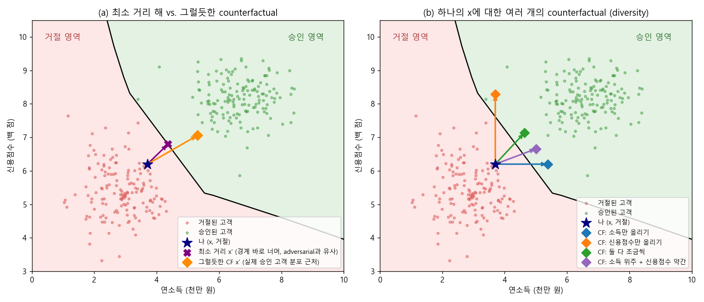
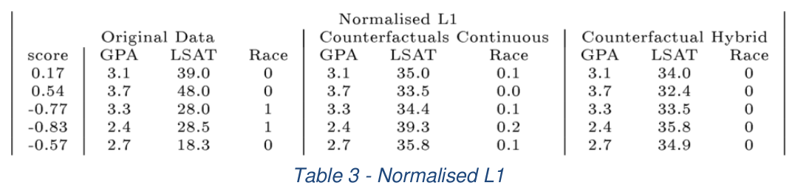
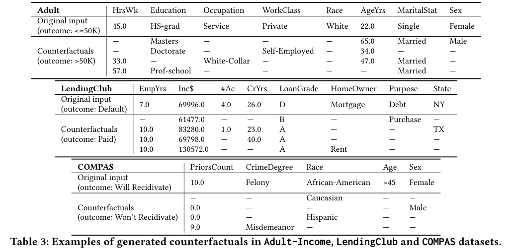

### "왜 이런 결과가 나왔나요?" 대신 "무엇을 바꾸면 결과가 달라지나요?"에 답하는 Counterfactual Explanation에 대해 알아봅니다.  


> 다루는 논문  
> **Wachter et al.**: Counterfactual Explanations without Opening the Black Box: Automated Decisions and the GDPR (Wachter, Mittelstadt, Russell, Harvard Journal of Law & Technology, 2018)  
> **DiCE**: Explaining Machine Learning Classifiers through Diverse Counterfactual Explanations (Mothilal, Sharma, Tan, ACM FAT* 2020)  

<center></center>   

<br/>


>  **1. Counterfactual explanation은 "모델의 예측 결과를 바꾸기 위해 입력 피처를 최소한 어떻게 바꿔야 하는가?"에 대한 답을 설명으로 제공함. feature importance 기반 설명(LIME, SHAP)과 달리 사용자가 취할 수 있는 행동(recourse)을 직접 알려줌**
>
>  **2. 수학적으로는 "x와 가장 가까우면서 예측이 다른 x'"을 찾는 최적화 문제로, adversarial example을 찾는 문제와 사실상 같은 형태임. 차이는 그 결과물이 그럴듯하고(plausible) 실행 가능한가(actionable)에 있음**
>
>  **3. Wachter et al.은 거리 + 예측 손실을 최소화하는 기본 틀을 제시했고, 이후 연구들은 feasibility(사용자 제약, 비용, 인과 관계)와 diversity(DiCE)를 더해 "실제로 쓸모 있는" counterfactual을 만드는 방향으로 발전함**

<br/>

----

**본 포스트는 Counterfactual Explanation 관련 강의와 아티클, 그리고 DiCE 논문의 FAT* 2020 발표 영상을 보고 정리한 노트입니다.**
원문은 여기에서 보실 수 있습니다.  
[Wachter et al. paper](https://arxiv.org/abs/1711.00399), [DiCE paper](https://arxiv.org/abs/1905.07697), [DiCE 발표 영상 (ACM FAccT)](https://youtu.be/zj2NliGD0Lg)  

----
#### Contents  

1. [Intro - 설명의 다른 접근](#intro)  
2. [Counterfactual과 Adversarial Attack은 같은 문제다?](#adversarial)  
3. [Take 1: 최소 거리 Counterfactual (Wachter et al.)](#wachter)  
4. [Counterfactual은 어떻게 계산할까? White-box vs Black-box](#calculation)  
5. [Take 2: 실행 가능하고 비용이 적은 Counterfactual](#feasible)  
6. [Take 3: 인과적으로 타당한 Counterfactual](#causal)  
7. [DiCE: 하나가 아니라 여러 개를 보여주자!](#dice)  
8. [Local에서 Global로](#global)  
9. [마치며](#conclusion)  
<br />

<a id="intro"></a>
## 1. Intro - 설명의 다른 접근  

지금까지 이 블로그에서 다룬 [LIME](https://myeonghak.github.io/xai/XAI-LIME%28Local-Interpretable-Model-agnostic-Explanation%29-%EC%95%8C%EA%B3%A0%EB%A6%AC%EC%A6%98/)이나 [SHAP](https://myeonghak.github.io/xai/XAI-SHAP/)은 "어떤 피처가 얼마나, 어떤 방향으로 예측에 기여했는가"를 기준으로 설명을 제공하는 방식이었습니다.  
feature importance나 dependency plot이 이런 접근을 대표하는 결과물이라고 할 수 있겠죠.  

그런데 이런 설명을 받아든 사용자 입장에서 생각해 볼까요? 대출 심사에서 거절된 사람이 "당신의 거절에는 연소득이 -0.3, 연체 이력이 -0.2만큼 기여했습니다"라는 설명을 듣는다고 해 봅시다.  
"그래서... 제가 뭘 어떻게 하면 되는데요?" 라는 질문이 자연스럽게 나올 텐데요.  
DiCE 발표에서도 이 점을 지적합니다. **feature importance 기반 설명은 해당 샘플이 원하는 클래스로 분류되려면 어떻게 변해야 하는지에 대한 정보를 담고 있지 않다**는 것이죠.  

Counterfactual explanation은 반대 방향에서 접근합니다. 예를 들면 이런 식입니다.  

> "존, 당신의 뇌졸중 위험 예측값은 0.9입니다. 그런데 **BMI를 25까지 줄이면**, 예측값은 0.3이 될 거예요."  

여기서 굵게 표시한 부분이 바로 counterfactual입니다. 정리하면 다음과 같습니다.  

- **Counterfactual**: 모델의 출력 결과를 바꿀 수 있는, 입력 피처의 최소한의 변화  
- "만약 ~였다면, 결과는 ~였을 것이다"라는 반사실적(counter-factual) 가정 형태의 설명임  
- 문헌에 따라 contrastive explanation이라고 부르기도 함  

ML 모델이 대출 승인, 채용, 보험료 산정처럼 개인에게 큰 영향을 주는 결정에 쓰이는 경우가 늘어나면서, 영향을 받는 개인에게 **recourse**(결과를 뒤집기 위해 취할 수 있는 조치)를 제공하는 것이 중요해졌습니다.  
대출이 거절된 경우 "연봉을 500만 원 올리고, 앞으로 3개월 동안 신용카드 대금을 제때 납부하세요"와 같은 구체적인 행동 지침을 줄 수 있다면, 설명이 단순한 해명을 넘어 해결책이 되는 셈입니다.  
GDPR의 "설명을 받을 권리" 논의와 맞물려 Wachter et al.의 논문이 법학 저널에 실린 것도 이런 맥락 때문입니다.  


<a id="adversarial"></a>
## 2. Counterfactual과 Adversarial Attack은 같은 문제다?  

"반사실적 사고(counterfactual thinking)"라는 개념 자체는 철학과 심리학에서 먼저 다뤄졌습니다. 사람은 원래 어떤 일의 원인을 "그때 그러지 않았다면 어땠을까?"라는 식으로 이해하곤 하죠.  
이것을 ML 모델의 설명 방법으로 정식화한 대표적인 논문이 바로 Wachter et al.의 *Counterfactual explanations without opening the black box* 입니다.  

재밌는 점은, 이 문제가 AI safety/robustness 분야에서 먼저 연구된 **adversarial attack**과 거의 똑같은 모양을 하고 있다는 것입니다.  
이미지에 사람 눈에는 보이지 않을 정도의 최소한의 픽셀 변화만 가해서 판다를 긴팔원숭이로 분류하게 만드는 유명한 예시([Goodfellow et al., 2014](https://arxiv.org/abs/1412.6572))를 떠올려 보면,  

- adversarial example: 입력 x와 최대한 가까우면서, 모델의 예측을 다르게 만드는 x'  
- counterfactual: 입력 x와 최대한 가까우면서, 모델의 예측을 (원하는 결과로) 다르게 만드는 x'  

두 작업의 목표는 수식 수준에서 정확히 같습니다. 차이는 **목적과 결과물의 성격**에 있는데요.  

- adversarial example은 모델을 속이는 것이 목적이므로, 변화가 사람 눈에 띄지 않을수록, 그리고 데이터 분포에서 벗어난 이상한 점이어도 상관없음  
- counterfactual은 사람에게 보여주는 설명이므로, 변화가 **해석 가능하고, 현실에서 일어날 법하며, 실행 가능해야** 함  

맨 위의 그림 (a)가 이 차이를 보여줍니다. 보라색 X는 "나(별)"에서 결정 경계까지의 최단 거리 점인데, 경계를 겨우 넘었을 뿐 실제 승인 고객이 아무도 없는 영역에 있습니다. 모델의 허점을 찌르는 adversarial example과 성격이 비슷하죠.  
반면 주황색 마름모는 조금 더 멀지만 실제 승인 고객들의 분포 근처에 있는, 훨씬 "그럴듯한" counterfactual입니다.  
뒤에서 다룰 연구들은 결국 이 주황색 점을 어떻게 잘 찾을 것인가에 대한 이야기라고 봐도 무방합니다.  


<a id="wachter"></a>
## 3. Take 1: 최소 거리 Counterfactual (Wachter et al.)  

### 직관  

CF 설명을 만드는 과정을 직관적으로 그려 보면 이렇습니다.  

1. ML 모델의 결정 경계를 그림  
2. 원하는 결과(예: 승인)가 나오는 영역 중에서, 설명하고 싶은 기준 샘플 x와 가장 가까운 점을 찾음  

그리고 counterfactual을 찾는 여러 방법론들은 크게 두 가지 관점에서 차이를 가집니다.  

- **후보 CF 중 어떤 점을 고를 것인가?** (거리 함수, 제약 조건, 다양성 등)  
- **예측 모델(underlying predictive model)에 얼마나 접근할 수 있어야 하는가?** (가중치/기울기 vs. 입출력만)  

### 목적 함수  

Wachter et al.은 가장 단순한 형태의 목적 함수에서 출발합니다. 주어진 x에 대해, 원하는 출력 y'을 내는 x' 중 가장 가까운 것을 찾는 것이죠.  

$$
\arg\min_{x'} d(x, x') \quad \text{s.t.} \quad f(x') = y'
$$

여기서 거리 함수 $d$를 무엇으로 고르느냐가 "후보 CF 중 어떤 것을 택할 것인가"를 결정하는 핵심 요인이 됩니다.  
그런데 등식 제약 조건이 붙어 있으면 최적화가 까다로우니, 이를 라그랑지안 형태로 풀어서 미분 가능한 목적 함수로 바꿉니다.  

$$
\arg\min_{x'} \max_{\lambda} \; \lambda \left(f(x') - y'\right)^2 + d(x, x')
$$

- 첫 번째 항: 예측값이 목표값 y'에 가까워지도록 함  
- 두 번째 항: x'이 원래 입력 x에서 멀어지지 않도록 함  
- $\lambda$를 점점 키워 가면서, $f(x')$이 y'에 충분히 가까워질 때까지 반복함  
- 실제 최적화에는 ADAM optimizer를 사용하고, 여러 초기점에서 출발(random restart)해서 서로 다른 local minimum을 찾음  

### 거리 함수: MAD로 정규화한 맨해튼 거리  

논문이 제안하는 거리 함수는 각 피처의 **중앙값 절대 편차(Median Absolute Deviation, MAD)** 로 정규화한 L1 거리입니다.  

$$
d(x, x') = \sum_{k \in F} \frac{\lvert x_k - x'_k \rvert}{\mathrm{MAD}_k}, \qquad \mathrm{MAD}_k = \mathrm{median}_{j \in P}\left( \lvert X_{j,k} - \mathrm{median}_{l \in P}(X_{l,k}) \rvert \right)
$$

이렇게 하면 두 가지 장점이 있습니다.  

- 피처마다 스케일이 달라도(소득 vs. 연체 횟수) 공정하게 비교할 수 있고, 평균/표준편차보다 이상치에 강건함  
- L1 norm의 특성상 **소수의 피처만 바뀌는 sparse한 해**가 나오기 쉬움 -> 사람이 읽기 쉬운 설명이 됨  

아래는 논문에서 LSAT 데이터(로스쿨 1학년 성적 예측)에 이 방법을 적용한 결과입니다.  

<center></center>   

<font size="2"><center> 출처: Wachter et al., Counterfactual Explanations without Opening the Black Box (https://arxiv.org/abs/1711.00399) </center>  </font>   

<br/>

정규화된 L1 거리를 쓰니 GPA는 그대로 두고 LSAT 점수만 바뀌는 sparse한 counterfactual이 나오는 것을 볼 수 있습니다. 이를 텍스트로 바꾸면 "당신의 LSAT 점수가 34.0이었다면, 평균 수준의 성적(0)이 예측되었을 것입니다"와 같은 설명이 되겠죠.  

그런데 3, 4번째 사람을 보면 Race가 1에서 0으로 바뀌어 있습니다. 즉 "당신이 백인이었다면..."이라는 counterfactual이 나온 것인데요.  
이는 모델에 존재하는 편향을 드러낸다는 점에서는 의미가 있지만, recourse로서는 전혀 쓸모가 없습니다. 인종을 바꿀 수는 없으니까요.  
이처럼 **feasibility가 보장되지 않는다**는 것이 이 방법의 한계이고, 이후 연구들이 이 부분을 다루게 됩니다.  

### 간단히 구현해보기  

로지스틱 회귀 위에서 Wachter 방식의 목적 함수를 직접 최소화해 보았습니다. 기울기를 손으로 계산할 수 있도록 일부러 단순한 모델을 썼습니다.  

```python
import numpy as np
from sklearn.linear_model import LogisticRegression

rng = np.random.default_rng(42)
n = 1000
income = rng.normal(5, 1.5, n)        # 연소득 (천만 원)
credit = rng.normal(7, 1.0, n)        # 신용점수 (백 점)
late = rng.poisson(1.0, n)            # 최근 1년 연체 횟수
X = np.c_[income, credit, late]
logit = 1.2 * (income - 5) + 1.5 * (credit - 7) - 1.0 * (late - 1)
y = (logit + rng.normal(0, 1, n) > 0).astype(int)
clf = LogisticRegression().fit(X, y)

mad = np.median(np.abs(X - np.median(X, axis=0)), axis=0)   # 피처별 MAD

def wachter_cf(x, y_target=0.6, lam=0.1, lr=0.01, steps=5000):
    w, b = clf.coef_[0], clf.intercept_[0]
    x_cf = x.copy()
    while True:
        for _ in range(steps):
            p = 1 / (1 + np.exp(-(x_cf @ w + b)))
            grad_pred = 2 * lam * (p - y_target) * p * (1 - p) * w   # lambda * (f(x')-y')^2 의 기울기
            grad_dist = np.sign(x_cf - x) / mad                     # MAD로 정규화한 L1 거리의 (sub)gradient
            x_cf -= lr * (grad_pred + grad_dist)
        if p >= 0.5:
            return x_cf, p, lam
        lam *= 2                                                    # 아직 결과가 안 바뀌면 lambda를 키움

x = np.array([4.0, 6.5, 2.0])
print("원래 승인 확률:", clf.predict_proba([x])[0, 1].round(3))
x_cf, p, lam = wachter_cf(x)
print("counterfactual:", x_cf.round(2), "/ 승인 확률:", round(p, 3), "/ lambda:", lam)
print("MAD:", mad.round(2), "/ |w|*MAD:", (np.abs(clf.coef_[0]) * mad).round(2))
```

```
원래 승인 확률: 0.006
counterfactual: [6.61 6.51 1.99] / 승인 확률: 0.588 / lambda: 102.4
MAD: [0.95 0.67 1.  ] / |w|*MAD: [1.97 1.76 1.64]
```

승인 확률 0.006이던 고객에게 "연소득을 4천만 원에서 약 6,600만 원으로 올리면 승인됩니다"라는 counterfactual이 나왔습니다.  
신용점수와 연체 횟수는 사실상 그대로이고(subgradient가 0 근처에서 진동하며 남긴 미세한 변화 정도) 소득 하나만 바뀌었는데요.  
MAD 단위로 한 칸 움직였을 때 예측에 가장 큰 영향을 주는 피처($\lvert w_k \rvert \cdot \mathrm{MAD}_k$가 가장 큰 피처)가 소득이기 때문입니다. L1 거리가 sparse한 해를 만든다는 것을 눈으로 확인할 수 있네요.  
물론 "연봉을 2,600만 원 올리세요"가 현실적인 조언인지는... 또 다른 문제입니다.  


<a id="calculation"></a>
## 4. Counterfactual은 어떻게 계산할까? White-box vs Black-box  

앞의 목적 함수를 최적화하는 방법은 모델 내부에 접근할 수 있느냐에 따라 크게 두 가지로 나뉩니다.  

**White-box approach**  
- 네트워크의 가중치 등 모델의 내부 구조에 접근할 수 있는 경우  
- 목적 함수의 기울기를 구해서 gradient descent를 적용하면 비교적 쉽게 최소점을 찾을 수 있음  
- model-specific함 (미분 가능한 모델이어야 함)  
- 사실 Wachter et al.도 제목은 "without opening the black box"지만, 최적화 과정에서 모델의 기울기가 필요하므로 완전한 의미의 black-box 방법은 아님. 여기서의 black box는 "모델 내부 로직을 사람에게 설명할 필요가 없다"는 의미에 가까움  

**Black-box approach**  
- 내부 구조에 접근할 수 없어 입력과 출력의 관계에만 의존해야 하는 경우  
- 모델에 굉장히 많은 횟수의 query를 날려야 함  
- model-agnostic함  
- 예: [CERTIFAI](https://arxiv.org/abs/1905.07857)는 genetic algorithm을 사용해 selection / mutation / crossover를 반복하며 counterfactual 후보를 진화시킴  

결국 어떤 방법이든 입력값에 일종의 perturbation을 가한다는 점은 같습니다. 그 perturbation이 무작위인지(예: BMI를 여러 번 random sampling해서 새 데이터를 만들고 결과를 비교), 기울기 같은 정보로 가이드되는지의 차이일 뿐이죠.  


<a id="feasible"></a>
## 5. Take 2: 실행 가능하고 비용이 적은 Counterfactual  

Wachter et al.의 "인종을 바꾸세요" 문제를 해결하기 위해 [Ustun et al. (2019), Actionable Recourse in Linear Classification](https://arxiv.org/abs/1809.06514)은 목적 함수를 다음과 같이 바꿉니다.  

$$
\arg\min_{x' \in \mathcal{A}} \mathrm{cost}(x, x') \quad \text{s.t.} \quad f(x') = y'
$$

- $\mathcal{A}$: 사용자가 실제로 바꿀 수 있는(feasible) 피처와 그 범위의 집합. end user가 직접 입력함 (예: 인종, 나이는 변경 불가, 학력은 올라가기만 가능)  
- $\mathrm{cost}$: 단순 거리 대신 **log percentile shift**를 사용함. 분포 상에서 95분위에서 90분위로 가는 것(=상위권에서 더 올라가는 것)이 50분위에서 55분위로 가는 것보다 훨씬 어렵다는 현실을 반영함  

다만 이 방법은 기저 모델이 **선형 분류기**이고 그 가중치 벡터에 접근할 수 있다고 가정합니다(정수 계획법으로 풀어냄). 따라서 black-box 모델에 쓰려면 LIME 같은 방법으로 먼저 국소적인 선형 근사를 한 뒤 적용하는 우회로를 택해야 합니다.  

그리고 여기에도 빈틈이 하나 있습니다. 현실의 변수들은 서로 독립적으로 움직이지 않는다는 것이죠. 하나의 변수를 바꾸면 다른 변수도 영향을 받게 되는데, 이 부분을 반영하는 방법이 필요합니다.  


<a id="causal"></a>
## 6. Take 3: 인과적으로 타당한 Counterfactual  

앞의 대출 상황으로 돌아가 볼까요? 신청자에게 "채무를 3,250에서 1,000으로 줄이세요"라는 recourse를 제공했다고 합시다.  
신청자는 1년 동안 열심히 빚을 갚아 채무를 1,000으로 줄였습니다. 그런데 다시 신청해 보니... 그 사이 나이가 한 살 늘어서 또 거절이 납니다.  
채무를 줄이는 데는 시간이 들고, 시간이 지나면 나이도 바뀌는데, 이런 변수 간의 관계를 고려하지 않았기 때문이죠. 억울할 노릇입니다.  

이 문제를 [Mahajan et al. (2019)](https://arxiv.org/abs/1912.03277)과 [Karimi et al. (2020)](https://arxiv.org/abs/2002.06278)이 각기 다른 방식으로 접근했는데요, 여기서는 Mahajan et al.의 접근을 살펴보겠습니다.  

- 손실 함수의 거리 $d$ 대신 $d_{causal}$이라는 거리 함수를 사용함. 즉, structural causal model(SCM)을 CF 생성 과정 전체에 반영하는 방법론임  
- 변수 간의 causal graph를 가정함. 예를 들어 $x_1, x_2, x_3$가 있고 $x_3$의 부모 노드가 $x_1, x_2$이며, $x_1, x_2$는 부모가 없는 구조를 생각해 볼 수 있음  
- 피처를 두 그룹으로 나눔  
  - U: 부모 노드가 없는 피처 -> L1, L2 같은 일반적인 거리로 원래 점과 CF 사이의 거리를 측정  
  - V: 부모 노드가 있는 피처 -> 부모 노드 값이 주어졌을 때의 조건부 분포로부터 기대값을 계산하고, 이 값과 CF의 값을 비교해서 거리를 측정. 즉 "부모가 이렇게 바뀌었으면 자식은 이 정도가 되는 게 자연스럽다"를 기준으로 삼음  
- 전체 causal graph의 구조를 다 안다고 가정하는 것은 비현실적이지만, 경험적으로는 일부 구조에 대한 지식(partial causal graph)이나 사용자가 입력한 feasibility constraint만으로도 충분히 잘 작동한다고 함  
- 목적 함수는 VAE 기반의 생성 모델로 풀며, 이 과정에서 모델 내부의 기울기에 대한 접근이 필요함  

### 그 밖의 유효한 CF를 위한 조건들  

이외에도 좋은 counterfactual이 갖춰야 할 성질로 다음이 자주 언급됩니다.  

- **Data manifold closeness**: 생성된 CF는 기존 데이터 분포와 가까워야 함. 기존 데이터 분포에서 동떨어진 CF는 현실적으로 유효한 데이터 포인트가 아니라는 직관에 근거함 (맨 위 그림 (a)의 보라색 X vs 주황색 마름모)  
- **Sparsity**: 적은 수의 피처만 바꿔서 CF에 도달할 수 있어야 함. 바꿔야 할 게 10가지라면 아무도 안 읽겠죠  


<a id="dice"></a>
## 7. DiCE: 하나가 아니라 여러 개를 보여주자!  

### Rashomon effect  

같은 사건을 두고 등장인물마다 전혀 다른 이야기를 하는 영화 "라쇼몽"처럼, 하나의 데이터 포인트에 대해서도 여러 개의 counterfactual이 동시에 존재할 수 있습니다. 이를 **Rashomon effect**라고 부릅니다.  
맨 위 그림 (b)를 보면, 같은 "나"라도 소득만 올리는 길, 신용점수만 올리는 길, 둘 다 조금씩 올리는 길 등 여러 경로로 승인 영역에 도달할 수 있죠.  
문제는 이들 중 **"객관적으로 가장 좋은" CF는 존재하지 않는다**는 것입니다. 소득을 올리기 쉬운 사람도 있고, 신용점수를 관리하기 쉬운 사람도 있으니까요.  
그렇다면 모델이 하나를 골라 주기보다는, 다양한 선택지를 보여주고 사용자가 고르게 하는 편이 낫지 않을까요? 이것이 DiCE(Diverse Counterfactual Explanations)의 출발점입니다.  

### 좋은 Counterfactual의 성질  

DiCE 논문은 좋은 counterfactual이 가져야 할 성질을 **actionability**로 묶어서 정리합니다. 사용자가 CF가 암시하는 변화를 실제로 취할 수 있어야 한다는 것이고, 이를 위해 크게 두 가지 성질이 필요합니다.  

**Feasibility**  
1. Proximity: 원래 입력과 가능한 한 가까운 샘플이어야 함  
2. User constraints: 사용자가 바꿀 수 있는 변수를 기준으로 해야 함  
3. Sparsity: 가능한 한 적은 수의 피처를 바꿔서 도달할 수 있어야 함  
4. Causal constraints: 실제 변수들은 독립적으로 변하지 않으므로 변수 간 관계를 감안해야 함  

**Diversity**  
- 사용자가 여러 선택지 중 하나를 고를 수 있도록, 서로 충분히 다른 CF들을 제공해야 함  

### 목적 함수  

DiCE는 k개의 counterfactual $\{c_1, \dots, c_k\}$를 한꺼번에 최적화합니다.  

$$
C(x) = \arg\min_{c_1, \dots, c_k} \frac{1}{k}\sum_{i=1}^{k} \mathrm{yloss}(f(c_i), y) + \frac{\lambda_1}{k}\sum_{i=1}^{k} \mathrm{dist}(c_i, x) - \lambda_2 \, \mathrm{dpp\_diversity}(c_1, \dots, c_k)
$$

- 첫 번째 항: 각 CF가 원하는 클래스로 분류되도록 함 (validity). 논문에서는 hinge loss를 사용함  
- 두 번째 항: 각 CF가 원래 입력 x와 가깝도록 함 (proximity). 연속형 변수는 Wachter et al.과 같이 MAD로 나눈 L1 거리를, 범주형 변수는 값이 바뀌었는지 여부를 사용함  
- 세 번째 항: CF들끼리 서로 다르도록 함 (diversity). **Determinantal Point Process(DPP)** 를 사용해서, $K_{ij} = \frac{1}{1 + \mathrm{dist}(c_i, c_j)}$로 정의된 커널 행렬의 행렬식 $\det(K)$를 키우는 방향으로 학습함. CF들이 서로 비슷하면 K의 행들이 비슷해져서 행렬식이 0에 가까워진다는 성질을 이용한 것임  

여기에 사용자가 지정한 변경 불가 피처나 변경 범위를 제약 조건으로 넣을 수 있고, sparsity를 높이기 위한 후처리(원래 값과 차이가 미미한 피처는 원래 값으로 되돌리기)도 적용합니다.  
또한 인과 관계는 최적화에 직접 넣기보다, 생성된 CF 중 인과적 제약(예: 학력이 올라가면 나이도 늘어나야 함)을 위반하는 것을 사후에 걸러내는(post-hoc filtering) 방식으로 다룹니다.  

### 결과  

아래는 DiCE로 생성한 counterfactual의 예시입니다.  

<center></center>   

<font size="2"><center> 출처: Mothilal et al., Explaining Machine Learning Classifiers through Diverse Counterfactual Explanations (https://arxiv.org/abs/1905.07697) </center>  </font>   

<br/>

Adult-Income 데이터의 첫 번째 블록을 보면, 소득이 50K 이하로 예측된 22세 고졸 여성에게 "석사 학위를 따고 결혼한다", "박사 학위를 따고 자영업을 한다", "주 33시간 일하고 화이트칼라 직종으로 옮긴다" 같은 서로 다른 경로를 제시합니다.  
"-"는 원래 값과 같다는 뜻인데, 대부분의 CF가 2~3개 피처만 바꾸는 sparse한 형태인 것도 확인할 수 있네요.  

한편 이 표는 모델의 편향을 드러내기도 합니다. Adult-Income의 첫 번째 CF에는 성별이 Male로 바뀌어 있고, COMPAS에서는 인종을 Caucasian이나 Hispanic으로 바꾸는 CF가 등장하죠.  
즉 counterfactual은 개인에게 recourse를 주는 도구이면서, 동시에 **모델이 민감 변수에 의존하고 있지 않은지를 점검하는 디버깅 도구**로도 쓸 수 있습니다. (물론 실제로 사용자에게 제공할 때는 이런 변수를 변경 불가로 지정해야겠죠.)  

논문은 validity, proximity, sparsity, diversity를 지표로 하여 DiCE가 단일 CF 방법(SingleCF)이나 다양성 항이 없는 버전보다 유효하면서도 다양한 CF를 만든다는 것을 보였습니다.  
또 하나 재밌는 실험은, **생성된 CF 몇 개만으로 1-NN 분류기를 학습시켜서 원래 모델의 국소적인 결정 경계를 얼마나 잘 근사하는지** 측정한 것인데요. 많은 설정에서 LIME보다 높은 F1 score를 기록했습니다. CF가 단순히 행동 지침을 넘어, 모델의 결정 경계에 대한 정보를 담고 있다는 의미로 볼 수 있겠습니다.  

DiCE는 Microsoft에서 [오픈소스 라이브러리](https://github.com/interpretml/DiCE)로 공개되어 있어서 `pip install dice-ml`로 바로 사용해 볼 수 있습니다. sklearn, TensorFlow, PyTorch 모델을 지원하고, 기울기 기반 방법 외에도 random sampling, genetic algorithm, KD-tree 기반 탐색 같은 model-agnostic한 방법도 제공합니다.  


<a id="global"></a>
## 8. Local에서 Global로  

지금까지 다룬 counterfactual은 모두 **하나의 샘플**에 대한 local explanation이었습니다. 그런데 모델을 배포해도 되는지 판단하려면, 주어진 black-box 모델의 전체적인 행태를 설명하는 **global explanation**도 필요합니다.  

- 전체 모집단 중 큰 부분 집단에 걸쳐 존재하는 모델의 편향을 감지하는 데 도움을 줌  
- 전체적인 관점의 편향을 찾기 위해 local explanation을 하나하나 들여다보는 것은 비효율적임  
- 모델이 배포하기에 적합한지에 대한 high-level overview를 제공함  
- 이런 점에서 global explanation은 local explanation을 보완하는 역할을 함  

global explanation을 만드는 한 가지 방법은 **local explanation의 모음**으로 대신하는 것입니다. 데이터셋 전체 인스턴스에 대해 local explanation을 생성한 뒤, 그중 k개를 골라 보여주는 것이죠. 그러면 자연스럽게 두 가지 질문이 생깁니다.  

1. 어떤 local explanation 방법을 쓸 것인가?  
2. k개의 부분집합을 어떻게 고를 것인가?  

LIME 논문에서 함께 제안된 **SP-LIME**(Submodular Pick LIME)이 대표적인 예입니다.  
- 전체 explanation을 사람이 다 볼 수 없으므로 k개를 골라 보여줌  
- 이때 고른 k개는 두 가지 성질을 만족해야 함  
  1. Representative: 모델의 global behavior를 잘 요약해야 함  
  2. Diverse (not redundant): 비슷한 지역의 설명이 여러 개면 중복이므로, 각각이 다른 가치를 기여해야 함  
- submodular optimization 문제로 정의하고 greedy하게 k개를 선택하며, model-agnostic함  

**SP-Anchor**도 같은 아이디어로, local rule set을 출력하는 [Anchors](https://ojs.aaai.org/index.php/AAAI/article/view/11491) 알고리즘의 결과를 종합해 global explanation을 만듭니다.  
"representative하면서 diverse하게"라는 기준은 DiCE가 CF를 고르는 기준과도 닮아 있어서 흥미롭네요. 같은 아이디어를 여러 개의 CF를 모아 global한 그림을 그리는 데 적용해 볼 수도 있을 것입니다.  


<a id="conclusion"></a>
## 9. 마치며  

LIME과 SHAP이 "모델이 왜 이렇게 판단했는가"를 데이터 사이언티스트의 언어로 설명한다면, counterfactual은 "그래서 무엇을 하면 되는가"를 사용자의 언어로 설명한다는 점에서 결이 꽤 다른 도구라는 생각이 들었습니다.  
특히 인상 깊었던 점은 counterfactual과 adversarial example이 수식상으로는 같은 문제라는 것인데요. 같은 최적화 문제라도 "누구에게, 무엇을 위해 보여주느냐"에 따라 공격이 되기도 하고 설명이 되기도 한다는 게 재밌습니다.  
그리고 그 차이를 메우기 위해 feasibility, 비용, 인과 관계, 다양성 같은 조건을 하나씩 덧붙여 온 연구의 흐름을 보면, 결국 좋은 설명이란 수학적으로 가장 가까운 답이 아니라 **사람이 실제로 받아들이고 행동할 수 있는 답**이라는 것을 다시 한 번 느끼게 됩니다.  
실무에서 쓴다면, 사용자에게 recourse를 제공하는 용도뿐 아니라 "성별이나 인종을 바꾸면 결과가 뒤집히는가?"를 체크하는 모델 디버깅 용도로도 꽤 유용하게 쓸 수 있을 것 같습니다.  

----------------


**개선을 위한 여러분의 피드백과 제안을 코멘트로 공유해 주세요.**
**내용에 대한 지적, 혹은 질문을 환영합니다.**  


**출처**  
[Wachter, Mittelstadt, Russell. Counterfactual Explanations without Opening the Black Box: Automated Decisions and the GDPR (2017)](https://arxiv.org/abs/1711.00399)  
[Mothilal, Sharma, Tan. Explaining Machine Learning Classifiers through Diverse Counterfactual Explanations (FAT* 2020)](https://arxiv.org/abs/1905.07697)  
[ACM FAccT - Explaining Machine Learning Classifiers through Diverse Counterfactual Explanations (발표 영상)](https://youtu.be/zj2NliGD0Lg)  
[Ustun, Spangher, Liu. Actionable Recourse in Linear Classification (FAT* 2019)](https://arxiv.org/abs/1809.06514)  
[Mahajan, Tan, Sharma. Preserving Causal Constraints in Counterfactual Explanations for Machine Learning Classifiers (2019)](https://arxiv.org/abs/1912.03277)  
[Karimi, Schölkopf, Valera. Algorithmic Recourse: from Counterfactual Explanations to Interventions (2020)](https://arxiv.org/abs/2002.06278)  
[Sharma, Henderson, Ghosh. CERTIFAI: Counterfactual Explanations for Robustness, Transparency, Interpretability, and Fairness of AI models (2019)](https://arxiv.org/abs/1905.07857)  
[Goodfellow, Shlens, Szegedy. Explaining and Harnessing Adversarial Examples (2014)](https://arxiv.org/abs/1412.6572)  
[interpretml/DiCE GitHub](https://github.com/interpretml/DiCE)  
[Christoph Molnar, Interpretable Machine Learning - Counterfactual Explanations](https://christophm.github.io/interpretable-ml-book/counterfactual.html)  
