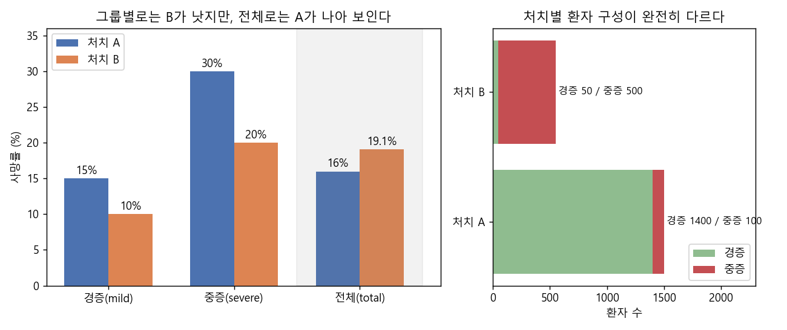
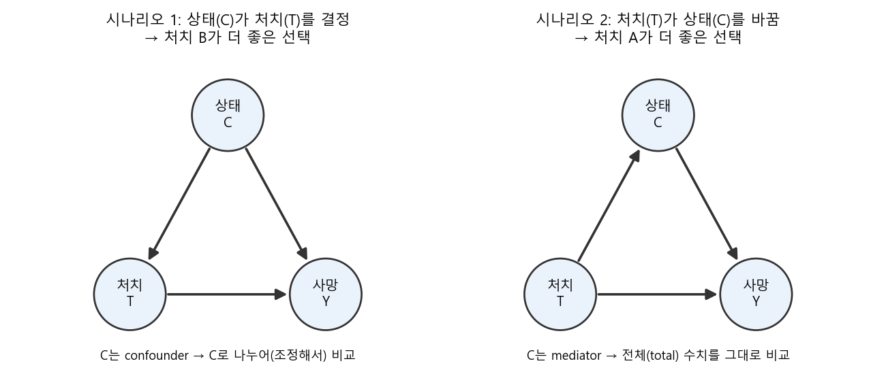
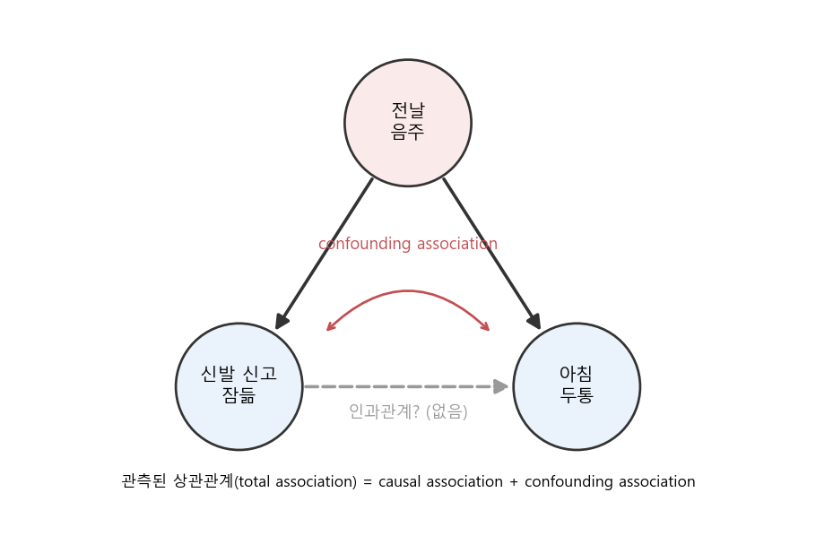
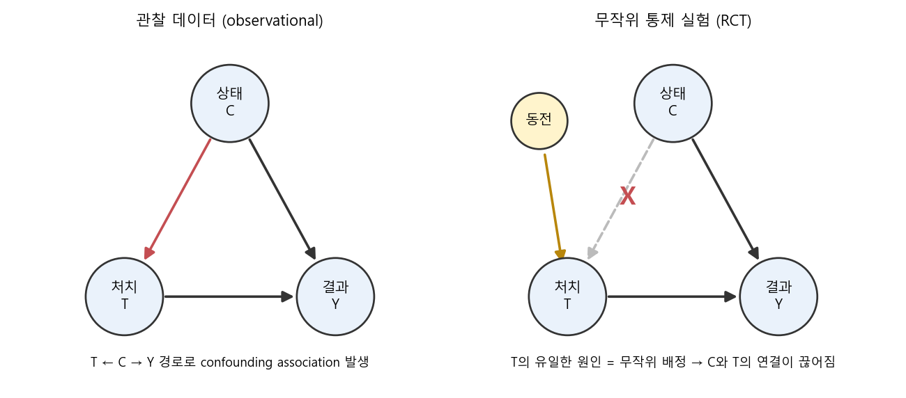

### 심슨의 역설로 시작해서, 상관관계가 왜 인과관계가 아닌지, 그리고 무엇이 인과를 말해줄 수 있는지 알아봅니다.  


> Brady Neal, **Introduction to Causal Inference** (강의 영상 및 강의 노트, 2020)  
> Lecture 1 - Motivation: 1-2. Simpson's paradox / 1-3. Correlation does not imply causation / 1-4. What does imply causation? RCT  

<center></center>   

<br/>


>  **1. 하위 그룹마다 B가 더 좋은데 전체로 합치면 A가 더 좋아 보이는 심슨의 역설은, 데이터만으로는 풀 수 없고 데이터 뒤의 인과 구조(causal structure)를 알아야 풀 수 있음**
>
>  **2. 관측된 상관관계(total association)는 인과적 연관(causal association)과 혼동 연관(confounding association)이 섞인 것이므로, 상관관계를 곧 인과관계로 해석할 수 없음**
>
>  **3. 처치를 무작위로 배정하는 RCT는 confounder와 처치 사이의 연결을 끊어 주기 때문에, 단순한 그룹 간 평균 차이가 곧 평균 인과효과(ATE)가 됨**

<br/>

----

**본 포스트는 Brady Neal의 Introduction to Causal Inference 강의 1강(1-2 ~ 1-4)을 보고 정리한 노트입니다.**
강의는 여기에서 보실 수 있습니다. [강의 페이지](https://www.bradyneal.com/causal-inference-course) / [YouTube 재생목록](https://www.youtube.com/playlist?list=PLoazKTcS0Rzb6bb9L508cyJ1z-U9iWkA0) / [강의 노트(PDF)](https://www.bradyneal.com/Introduction_to_Causal_Inference-Dec17_2020-Neal.pdf)

----
#### Contents

1. [들어가며](#intro)
2. [심슨의 역설: 어떤 약을 써야 할까?](#simpson)
3. [상관관계는 왜 인과관계가 아닐까?](#correlation)
4. [그렇다면 무엇이 인과를 말해줄까? - 잠재적 결과와 RCT](#rct)
5. [마치며](#conclusion)

<br />

<a id="intro"></a>
## 1. 들어가며

데이터 분석을 하다 보면 "이 변수가 올라가면 매출이 올라간다", "이 기능을 쓰는 유저가 리텐션이 높다" 같은 말을 정말 자주 하게 되는데요. 그런데 이게 정말 **원인**이라서 그런 걸까요, 아니면 그냥 **같이 움직이는** 것뿐일까요?  

머신러닝 모델은 기본적으로 상관관계(association)를 학습하는 도구입니다. 예측만 잘하면 되는 문제라면 상관관계만으로도 충분하지만, "그래서 무엇을 바꾸면 결과가 좋아지는가?"라는 의사결정의 질문에 답하려면 인과관계가 필요합니다.  

이런 고민을 하던 중 Brady Neal의 [Introduction to Causal Inference](https://www.bradyneal.com/causal-inference-course) 강의를 알게 되었습니다. 머신러닝 관점에서 인과추론을 소개하는 무료 강의인데, 강의 노트(책)까지 공개되어 있어 입문용으로 아주 좋습니다. 이번 포스트에서는 그 첫 강의인 Motivation 파트를 정리해 보겠습니다.  

<br />

<a id="simpson"></a>
## 2. 심슨의 역설: 어떤 약을 써야 할까?

### 2.1 상황 설정

강의는 가상의 전염병 COVID-27이 퍼진 상황에서 시작합니다. 나라 전체에서 단 하나의 치료법만 쓸 수 있고, 목표는 사망자를 최소화하는 것입니다.  

- 처치(treatment) $T$: A 또는 B  
- 환자 상태(condition) $C$: 경증(mild) 또는 중증(severe)  
- 결과(outcome) $Y$: 생존 또는 사망  

수집된 데이터는 아래와 같습니다. (강의 노트 Table 1.1의 수치)  

| 처치 | 경증(mild) | 중증(severe) | 전체(total) |
|:---:|:---:|:---:|:---:|
| A | 15% (210/1400) | 30% (30/100) | **16%** (240/1500) |
| B | **10%** (5/50) | **20%** (100/500) | 19% (105/550) |

<br/>

이상한 점이 보이시나요? **경증 환자끼리 비교해도 B의 사망률이 낮고, 중증 환자끼리 비교해도 B의 사망률이 낮습니다.** 그런데 전체를 합쳐 보면 A가 16%, B가 19%로 오히려 **A가 더 나아 보입니다.**  

이렇게 부분(하위 그룹)에서의 경향과 전체에서의 경향이 뒤집히는 현상을 **심슨의 역설(Simpson's paradox)** 이라고 부릅니다. 한 줄로 요약하면 "각 부분에서 크다고 해서 전체에서도 크다는 보장은 없다"는 것이죠.  

### 2.2 왜 이런 일이 생길까?

맨 위 그림의 오른쪽을 보면 비밀이 풀립니다.  

- 처치 A를 받은 1,500명 중 **93%가 경증 환자**임  
- 처치 B를 받은 550명 중 **91%가 중증 환자**임  
- 중증 환자는 어떤 약을 쓰든 사망률이 높으므로, 중증 환자를 몰아서 받은 B의 전체 사망률이 높게 나옴  

즉 전체 사망률은 "약의 효과"와 "어떤 환자가 그 약을 받았는지(환자 구성)"가 뒤섞인 숫자인 셈입니다. pandas로 직접 확인해 볼까요?  

```python
import pandas as pd

df = pd.DataFrame({
    "treatment": ["A", "A", "B", "B"],
    "condition": ["mild", "severe", "mild", "severe"],
    "n":         [1400, 100, 50, 500],
    "dead":      [210, 30, 5, 100],
})

# 1) 조건별 사망률
by_cond = df.assign(mortality=df.dead / df.n).pivot(index="treatment", columns="condition", values="mortality")
print(by_cond.round(3))

# 2) 전체 사망률
total = df.groupby("treatment")[["dead", "n"]].sum()
print((total.dead / total.n).round(3))

# 3) 처치별 환자 구성 비율
print(df.pivot(index="treatment", columns="condition", values="n")
        .apply(lambda r: r / r.sum(), axis=1).round(3))

# 4) 시나리오 1 가정 하에, condition 분포를 전체 인구 기준으로 맞춰 다시 계산 (adjustment)
p_c = df.groupby("condition").n.sum() / df.n.sum()
adjusted = (by_cond * p_c).sum(axis=1)
print(adjusted.round(3))
```

```
condition  mild  severe
treatment              
A          0.15     0.3
B          0.10     0.2
treatment
A    0.160
B    0.191
dtype: float64
condition   mild  severe
treatment               
A          0.933   0.067
B          0.091   0.909
treatment
A    0.194
B    0.129
dtype: float64
```

1~3번 출력은 표의 내용 그대로입니다. 4번은 조금 뒤에서 설명할 "시나리오 1"을 가정하고, **두 처치 그룹의 환자 구성을 전체 인구의 구성(경증 약 71%, 중증 약 29%)으로 똑같이 맞춰서** 사망률을 다시 계산한 것인데요. 이렇게 하면 A는 19.4%, B는 12.9%로 B가 확실히 좋아집니다. 이 계산은 강의 뒷부분(4강)에서 다루는 adjustment formula, 즉 $\sum_c P(Y \mid T, C=c)P(C=c)$ 와 같습니다.  

### 2.3 정답은 데이터가 아니라 인과 구조에 있다

그럼 A와 B 중 무엇을 골라야 할까요? 강의의 답은 **"데이터만으로는 알 수 없고, 인과 구조에 따라 다르다"** 입니다.  

<center></center>   

<br/>

**시나리오 1: 환자 상태(C)가 처치(T)의 원인인 경우 → B가 정답**  

- B는 A보다 희소하고 비싼 약이라, 의사들이 경증 환자에게는 주로 A를 주고 B는 중증 환자를 위해 아껴둔 상황임  
- 즉 환자 상태가 어떤 약을 받을지를 결정함 ($C \rightarrow T$), 동시에 상태는 사망에도 영향을 줌 ($C \rightarrow Y$)  
- 이때 $C$는 $T$와 $Y$의 공통 원인인 **confounder**이고, 전체 사망률에는 환자 구성 차이가 섞여 들어감  
- 따라서 상태별로 나누어 비교하는(조정하는) 것이 맞고, B가 더 좋은 선택이 됨  

**시나리오 2: 처치(T)가 환자 상태(C)의 원인인 경우 → A가 정답**  

- B는 공급이 부족해서 처방을 받고 실제 투약까지 오래 기다려야 하는 상황임  
- 기다리는 동안 환자의 상태가 악화되어, B를 처방받은 환자 중에 중증이 많아진 것임 ($T \rightarrow C$)  
- 여기서 $C$는 처치의 효과가 흘러가는 경로 위에 있는 **mediator**이고, 상태 악화 자체가 B를 선택한 결과임  
- 이 경우 상태별로 나누면 오히려 처치 효과의 일부를 지워버리게 되므로, 전체(total) 수치를 봐야 하고 A가 더 좋은 선택이 됨  

(참고로 강의 노트에서 $T$는 "처치를 실제로 받은 것"이 아니라 "처치를 처방받은 것"을 의미한다고 짚어 두는데, 시나리오 2가 성립하려면 이 구분이 필요합니다.)  

똑같은 숫자 표를 두고도 화살표 방향 하나에 따라 정반대의 결론이 나온다는 점이 핵심입니다. 개인적으로는 이 부분에서 **도메인 지식이 왜 중요한지**를 다시 느꼈는데요. 데이터 뒤에 어떤 인과 메커니즘이 있는지에 대한 사전 지식과 경험적인 법칙을 알고 있어야, 어떤 숫자를 믿어야 하는지 판단할 수 있기 때문입니다.  

<br />

<a id="correlation"></a>
## 3. 상관관계는 왜 인과관계가 아닐까?

### 3.1 신발을 신고 자면 두통이 생긴다?

강의에서 드는 두 번째 예시는 조금 더 친근합니다(?).  

> 신발을 신은 채로 잠든 사람은, 다음 날 아침 두통과 함께 깨어날 확률이 높다.  

데이터를 모아 보면 실제로 둘 사이에 강한 상관관계가 나올 겁니다. 그렇다고 "신발이 두통을 유발한다"고 결론 내리는 사람은 없겠죠. 신발을 신고 잠든 사람과 그렇지 않은 사람을 가르는 **다른 핵심 요인**이 있기 때문입니다. 바로 **전날 밤의 음주**입니다.  

<center></center>   

<br/>

- 술을 많이 마시면 신발도 못 벗고 잠들 확률이 높아짐 (음주 → 신발)  
- 술을 많이 마시면 다음 날 두통이 올 확률이 높아짐 (음주 → 두통)  
- 이렇게 두 변수의 공통 원인을 **confounder(교란 변수)** 라 부르고, confounder 때문에 생기는 연관을 **confounding association**이라고 함  
- 신발과 두통 사이에 직접적인 인과 경로가 전혀 없더라도, 음주를 통해 둘은 함께 움직이게 됨  

강의에서는 이를 다음과 같이 정리합니다.  

$$
\text{Total association} = \text{Causal association} + \text{Confounding association}
$$

우리가 데이터에서 관측하는 상관관계(total association)에는 진짜 인과적 연관과 confounding association이 섞여 있고, 겉보기 숫자만으로는 둘을 분리할 수 없습니다. 위 예시처럼 인과적 연관이 0이어도 상관관계는 얼마든지 크게 나타날 수 있죠. 이것이 **"Correlation does not imply causation"** 의 정확한 의미입니다. (엄밀히는 association이 더 넓은 개념이고 correlation은 선형 연관을 가리키지만, 강의에서도 둘을 혼용합니다.)  

### 3.2 "상관 = 인과"는 인지 편향이다

그런데 사람은 왜 이렇게 쉽게 상관을 인과로 착각할까요? 강의에서는 이를 하나의 **인지 편향(cognitive bias)** 으로 설명합니다. 그리고 이 편향은 다른 인지 편향들과 결합해 더 그럴싸한 가짜 인과 이야기를 만들어 냅니다.  

위 그래프에서 "신발", "음주" 자리에는 사실 어떤 것이든 들어갈 수 있습니다. 문제는 그 자리를 무엇으로 채우느냐인데요.  

- **Availability heuristic(가용성 휴리스틱)**: 그 순간 머릿속에 쉽게 떠오르는 것을 원인으로 지목함  
	- 예) 어제 "카페인이 두통을 유발한다"는 글을 읽었다면, 두통의 원인을 커피로 돌림 (2년 전에 "관련 없다"는 글을 읽었더라도 최근 기억이 이김)  
- **Motivated reasoning(동기에 의한 추론)**: 믿고 싶은 결론에 맞는 원인을 찾아냄  
	- 예) 친척 모임이 원래 싫었던 사람이라면, 아침에 친척을 만나고 나서 생긴 두통을 친척 탓으로 돌림  

이렇게 떠올린 후보를 "같이 일어났으니 원인이겠지"라는 상관 = 인과 편향에 넣으면, 순식간에 그럴듯한 인과 스토리가 완성됩니다. 데이터를 다루는 사람이라면 대시보드 숫자를 보고 원인을 단정하기 전에 한 번쯤 의심해 볼 대목이네요.  

<br />

<a id="rct"></a>
## 4. 그렇다면 무엇이 인과를 말해줄까? - 잠재적 결과와 RCT

### 4.1 잠재적 결과(Potential Outcomes)

상관이 인과가 아니라면, 인과는 어떻게 정의해야 할까요? 강의는 **잠재적 결과(potential outcomes)** 라는 직관에서 출발합니다. 어떤 처치/정책이 결과에 미치는 영향을 알고 싶다면, **같은 사람에게 처치를 했을 때와 하지 않았을 때를 비교**하면 된다는 것이죠.  

- $Y_i(1)$: 개체 $i$가 처치를 받았을 때($T=1$)의 결과  
- $Y_i(0)$: 같은 개체 $i$가 처치를 받지 않았을 때($T=0$)의 결과  
- 개별 처치 효과(Individual Treatment Effect, ITE): $\tau_i = Y_i(1) - Y_i(0)$  

예를 들어 두통약을 먹었을 때는 두통이 사라지고($Y_i(1)=0$), 안 먹었을 때는 두통이 남는다면($Y_i(0)=1$), 이 사람에게 두통약은 인과적 효과가 있다고 말할 수 있습니다.  

### 4.2 인과추론의 근본 문제

그런데 여기에 치명적인 문제가 있습니다. **한 사람은 동시에 두 세계를 살 수 없다**는 것인데요. 약을 먹은 사람에게서 "약을 안 먹었다면 어땠을지" $Y_i(0)$는 관측할 수 없습니다. 관측된 결과를 factual, 관측되지 않은 쪽을 **counterfactual(반사실)** 이라고 부릅니다.  

$$
Y_i(1) - Y_i(0) \quad \text{에서 둘 중 하나는 항상 관측 불가}
$$

이것이 인과추론의 **근본 문제(Fundamental Problem of Causal Inference)** 입니다. 개인 수준의 인과효과는 원칙적으로 직접 계산할 수 없다는 것이죠.  

### 4.3 평균 처치 효과(ATE)와 그 함정

개인 단위가 안 된다면 집단의 평균으로 가보자는 것이 다음 아이디어입니다.  

$$
\text{ATE} = \mathbb{E}[Y_i(1) - Y_i(0)] = \mathbb{E}[Y(1)] - \mathbb{E}[Y(0)]
$$

여기서 자연스럽게 떠오르는 계산법은 "약을 먹은 그룹의 평균 결과 - 안 먹은 그룹의 평균 결과"입니다. 그런데 일반적으로는

$$
\mathbb{E}[Y(1)] - \mathbb{E}[Y(0)] \neq \mathbb{E}[Y \mid T=1] - \mathbb{E}[Y \mid T=0]
$$

입니다. 왼쪽은 **인과적인 양(causal quantity)** 이고, 오른쪽은 조건부 기댓값의 차이, 즉 **연관(association)** 을 나타내는 양이기 때문입니다. 오른쪽에는 앞서 본 것처럼 causal association과 confounding association이 섞여 있습니다.  

신발 예시로 보면, $\mathbb{E}[Y \mid T=1]$은 "신발 신고 잔 사람들의 두통 비율"인데 이 그룹에는 술 마신 사람이 잔뜩 몰려 있으니, 신발의 효과가 아니라 음주의 효과가 숫자에 섞여 들어가게 됩니다. 심슨의 역설에서 B 그룹에 중증 환자가 몰려 있던 것과 똑같은 구조죠.  

### 4.4 무작위 통제 실험(RCT)

그렇다면 두 그룹을 **처치 여부만 빼고 모든 면에서 같게** 만들 수 있다면 어떨까요? 이것이 **무작위 통제 실험(Randomized Controlled Trial, RCT)** 의 아이디어입니다.  

- 누가 처치를 받을지를 동전 던지기처럼 완전히 무작위로 정함  
- 그러면 처치 그룹과 통제 그룹은 (표본이 충분히 크다면) 음주 여부, 환자 상태 등 모든 특성의 분포가 평균적으로 같아짐  
- 두 그룹 사이에 남는 체계적인 차이는 오직 처치뿐이므로, 결과의 차이는 처치 때문이라고 말할 수 있음  

<center></center>   

<br/>

그래프로 보면 더 명확합니다. 관찰 데이터에서는 $C \rightarrow T$ 화살표 때문에 $T \leftarrow C \rightarrow Y$ 라는 뒷문 경로(backdoor path)가 열려 있고, 이 경로로 confounding association이 흘러듭니다. 반면 RCT에서는 **$T$의 유일한 원인이 무작위 배정**이 되므로, $T$는 어떤 causal parent도 갖지 않게 되고 $C$와 $T$ 사이의 연결이 끊어집니다. confounding association이 사라지는 것이죠.  

수식으로는 무작위 배정이 잠재적 결과와 처치의 독립성(exchangeability), $(Y(1), Y(0)) \perp\!\!\!\perp T$ 를 보장해 주고, 따라서

$$
\mathbb{E}[Y(1)] - \mathbb{E}[Y(0)] = \mathbb{E}[Y \mid T=1] - \mathbb{E}[Y \mid T=0]
$$

가 성립합니다. RCT에서는 단순한 그룹 간 평균 차이가 곧 ATE가 되는 겁니다.  

신발 예시에 적용하면, 술을 마신 사람이든 아니든 상관없이 무작위로 누구는 신발을 신긴 채 재우고 누구는 벗기고 재워보는 실험이 됩니다. (윤리위원회 통과는 장담 못 하겠지만요.) 간단한 시뮬레이션으로 확인해 보겠습니다. 두통은 오직 음주에 의해서만 결정되도록, 즉 신발의 진짜 인과효과는 0이 되도록 데이터를 만들었습니다.  

```python
import numpy as np
import pandas as pd

rng = np.random.default_rng(42)
n = 100_000
drunk = rng.binomial(1, 0.3, n)                       # 전날 음주 여부 (confounder)

def headache(drunk):                                   # 두통은 음주에만 의존 (신발의 인과효과 = 0)
    return rng.binomial(1, np.where(drunk == 1, 0.7, 0.1))

# 1) 관찰 데이터: 술을 마신 사람이 신발 신고 잘 확률이 훨씬 높음
shoes_obs = rng.binomial(1, np.where(drunk == 1, 0.8, 0.05))
obs = pd.DataFrame({"drunk": drunk, "shoes": shoes_obs, "headache": headache(drunk)})

# 2) RCT: 신발을 신길지 말지를 동전 던지기로 결정
shoes_rct = rng.binomial(1, 0.5, n)
rct = pd.DataFrame({"drunk": drunk, "shoes": shoes_rct, "headache": headache(drunk)})

for name, d in [("관찰 데이터", obs), ("RCT", rct)]:
    g = d.groupby("shoes")[["headache", "drunk"]].mean()
    diff = g.loc[1, "headache"] - g.loc[0, "headache"]
    print(f"[{name}] E[Y|T=1]-E[Y|T=0] = {diff:.3f} / 음주 비율(T=0, T=1) = {g.drunk.round(3).tolist()}")
```

```
[관찰 데이터] E[Y|T=1]-E[Y|T=0] = 0.474 / 음주 비율(T=0, T=1) = [0.082, 0.871]
[RCT] E[Y|T=1]-E[Y|T=0] = -0.003 / 음주 비율(T=0, T=1) = [0.303, 0.297]
```

관찰 데이터에서는 신발을 신고 잔 그룹의 87%가 술을 마신 사람이라, 신발을 신으면 두통 확률이 47%p나 올라가는 것처럼 보입니다. 반면 RCT에서는 두 그룹의 음주 비율이 약 30%로 똑같이 맞춰지고, 차이는 진짜 효과인 0에 가깝게 나옵니다. 무작위 배정 하나로 confounder를 "공정하게 나눠 가진" 셈이죠.  

물론 현실에서는 RCT가 비싸거나, 비윤리적이거나(흡연의 효과를 보려고 사람들에게 담배를 피우게 할 수는 없겠죠), 아예 불가능한 경우가 많습니다. 그래서 관찰 데이터만으로 인과효과를 추정하는 방법들이 필요해지고, 강의의 이후 내용(인과 그래프, backdoor adjustment 등)이 바로 그 이야기를 다룹니다.  

<br />

<a id="conclusion"></a>
## 5. 마치며

이번 포스트에서는 Brady Neal의 인과추론 강의 1강을 따라 다음 내용을 살펴보았습니다.  

- 심슨의 역설: 같은 데이터라도 인과 구조(confounder인지 mediator인지)에 따라 정답이 정반대가 될 수 있음  
- 상관관계 = 인과적 연관 + 혼동 연관이며, "상관 = 인과"는 다른 인지 편향과 결합해 그럴싸한 가짜 인과를 만들어 냄  
- 잠재적 결과 프레임워크에서 개인의 인과효과는 관측 불가능하지만(근본 문제), RCT는 처치의 원인을 무작위로 만들어 단순 평균 차이를 ATE로 만들어 줌  

개인적으로 가장 와닿았던 건 심슨의 역설 예시에서 **"숫자는 똑같은데 화살표 방향에 따라 답이 바뀐다"** 는 점이었습니다. 모델링을 하다 보면 데이터를 더 모으고 더 쪼개 보면 답이 나올 거라 기대하기 쉬운데, 인과의 문제에서는 데이터 바깥의 지식, 즉 도메인 지식과 데이터 생성 과정에 대한 이해가 결론을 좌우하네요. 앞으로 대시보드의 숫자를 볼 때도 "이 그룹은 애초에 어떻게 나뉘었지?"라는 질문을 먼저 던져봐야겠습니다.  

다음 강의부터는 잠재적 결과 프레임워크와 인과 그래프를 좀 더 본격적으로 다루는데, 차근차근 정리해 보겠습니다.  

----------------


**개선을 위한 여러분의 피드백과 제안을 코멘트로 공유해 주세요.**
**내용에 대한 지적, 혹은 질문을 환영합니다.**  


**출처**  
[Brady Neal, Introduction to Causal Inference - 강의 페이지](https://www.bradyneal.com/causal-inference-course)  
[Brady Neal, Introduction to Causal Inference from a Machine Learning Perspective - 강의 노트 PDF (2020)](https://www.bradyneal.com/Introduction_to_Causal_Inference-Dec17_2020-Neal.pdf)  
[Introduction to Causal Inference - YouTube 재생목록](https://www.youtube.com/playlist?list=PLoazKTcS0Rzb6bb9L508cyJ1z-U9iWkA0)  
[Wikipedia - Simpson's paradox](https://en.wikipedia.org/wiki/Simpson%27s_paradox)  
