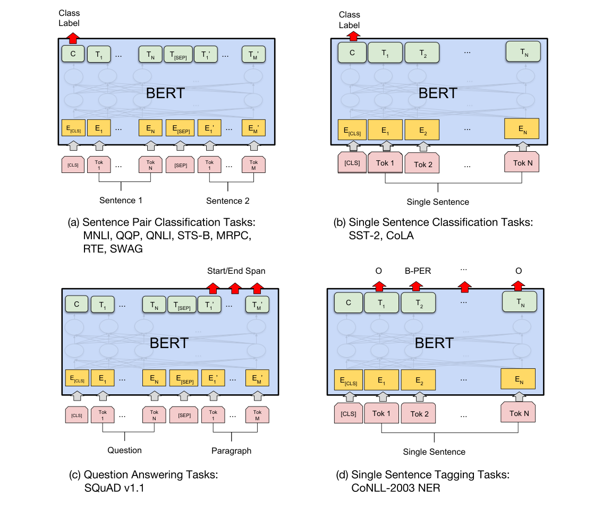
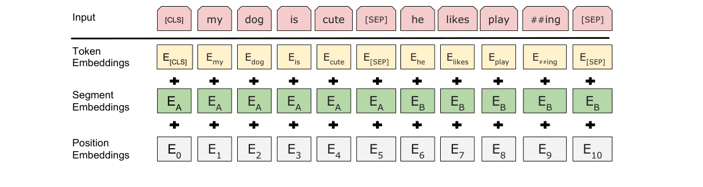
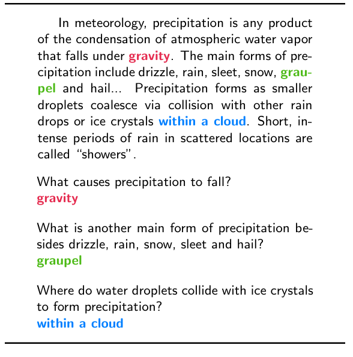
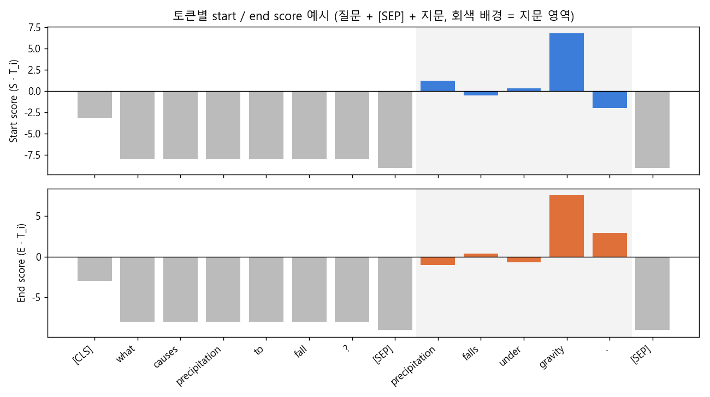

### BERT 위에 얇은 레이어 하나를 얹어 질의응답(QA) 시스템과 개체명 인식(NER) 태거를 만드는 방법에 대해 알아봅니다.


> **BERT**: Pre-training of Deep Bidirectional Transformers for Language Understanding (Devlin et al., NAACL 2019)    
> **SQuAD**: 100,000+ Questions for Machine Comprehension of Text (Rajpurkar et al., EMNLP 2016)    
> **BERT로 NER tagger 만들기** - 윤주성 님, 모두의연구소 발표    

<center></center>
<font size="2"><center> 출처: Devlin et al., BERT, Figure 4 (https://arxiv.org/abs/1810.04805) </center>  </font>

<br/>

>  **1. BERT로 QA를 할 때는 질문과 지문을 [SEP]으로 이어 붙여 입력하고, 지문의 각 토큰이 정답의 시작/끝일 점수를 계산해 정답 span을 뽑아냄**
>
>  **2. 시작/끝 분류기는 모든 토큰에 공유되는 벡터 하나씩(S, E)에 불과하며, 추론 시에는 start score + end score가 가장 큰 유효한 (start, end) 조합을 고름**
>
>  **3. NER은 각 토큰 출력 위에 태그 분류기를 붙이는 토큰 태깅 문제로, BERT 임베딩 덕분에 품사 등의 수작업 feature 없이도 잘 작동하며 CRF 레이어를 얹으면 성능이 조금 더 좋아짐**

<br/>

----

**본 포스트는 BERT 논문과 SQuAD 논문, BERT QA 관련 영상 두 편, 그리고 윤주성 님의 모두의연구소 발표 "BERT로 NER tagger 만들기"를 보고 정리한 노트입니다.**
원문은 여기에서 보실 수 있습니다.
[BERT paper](https://arxiv.org/abs/1810.04805), [SQuAD paper](https://arxiv.org/abs/1606.05250), [Applying BERT to Question Answering (SQuAD v1.1)](https://youtu.be/l8ZYCvgGu0o), [How to create a Question Answering System NLP](https://youtu.be/ohM7D21C_8Q), [pytorch-bert-crf-ner (발표자 레포)](https://github.com/eagle705/pytorch-bert-crf-ner)

----
#### Contents

1. [Intro - BERT, 이제는 기본 도구가 되다](#intro)
2. [복습: BERT는 두 문장을 어떻게 입력받을까?](#input)
3. [SQuAD - 지문 속에서 정답 찾기](#squad)
4. [BERT로 QA 시스템 만들기](#bert-qa)
5. [BERT 이전에는? 규칙 기반 QA 시스템](#rule-qa)
6. [BERT로 NER 태거 만들기](#bert-ner)
7. [마치며](#conclusion)
<br />

<a id="intro"></a>
## 1. Intro - BERT, 이제는 기본 도구가 되다

BERT가 공개된 지 어느덧 3년 가까이 지났는데요, 이제 BERT는 연구 주제라기보다는 **기본 도구(basic tool)** 에 가까워졌습니다.
대량의 텍스트로 미리 학습된(pre-trained) 모델을 가져와 우리가 풀고 싶은 downstream task에 맞게 fine-tuning만 해주면 되니, 예전처럼 태스크마다 모델 구조를 새로 고민할 필요가 크게 줄었죠.
BERT의 구조나 사전학습 방식(MLM, NSP)이 궁금하신 분들은 이전에 정리한 [Transformer와 BERT 포스트](https://myeonghak.github.io/natural%20language%20processing/NLP-Transformer%EC%99%80-BERT/)를 먼저 보시면 좋겠습니다.

위 그림은 BERT 논문의 Figure 4인데요, 태스크별로 BERT를 어떻게 fine-tuning하는지를 한 장에 보여줍니다.
(a), (b)처럼 문장(쌍) 전체를 분류하는 문제는 `[CLS]` 토큰의 출력 $C$ 위에 분류기를 얹으면 되는데, 이 방식은 [KoBERT Multilabel 분류 모델 개발기](https://myeonghak.github.io/natural%20language%20processing/NLP-KoBERT-Multilabel-Classifier-%EB%AA%A8%EB%8D%B8-%EA%B0%9C%EB%B0%9C%EA%B8%B0/)에서 다룬 적이 있습니다.

오늘 볼 것은 아래쪽 두 개입니다.

- (c) **Question Answering**: 질문과 지문을 함께 넣고, 지문 안에서 정답의 **시작/끝 위치(span)** 를 예측함
- (d) **Single Sentence Tagging (NER)**: 문장을 넣고, **각 토큰마다** 태그(B-PER, O, ...)를 예측함

두 태스크 모두 `[CLS]` 하나가 아니라 **토큰 단위 출력 $T_i$** 를 사용한다는 공통점이 있는데요, 하나씩 살펴보겠습니다.


<a id="input"></a>
## 2. 복습: BERT는 두 문장을 어떻게 입력받을까?

QA에서는 "질문"과 "지문"이라는 두 덩어리의 텍스트를 동시에 넣어야 합니다. BERT는 이걸 어떻게 처리할까요?

<center></center>
<font size="2"><center> 출처: Devlin et al., BERT, Figure 2 (https://arxiv.org/abs/1810.04805) </center>  </font>

BERT의 입력 임베딩은 세 가지 임베딩의 합으로 만들어집니다.

- **Token Embedding**: WordPiece로 쪼갠 각 서브워드 토큰의 임베딩
- **Segment Embedding**: 이 토큰이 앞 문장(A)에 속하는지, 뒤 문장(B)에 속하는지를 나타내는 임베딩
- **Position Embedding**: 토큰의 위치 정보

여기서 핵심은 Segment Embedding입니다. BERT는 사전학습 단계에서 Next Sentence Prediction(NSP)을 하기 위해 두 문장을 이어 붙여 입력받도록 학습되었고, 그 과정에서 **segment A와 segment B, 딱 두 종류의 segment embedding** 을 학습해 두었습니다.

QA에서는 이걸 그대로 활용합니다.

- 맨 앞에 `[CLS]`, 질문과 지문 사이와 맨 끝에 `[SEP]` 토큰을 넣음
- 질문 토큰에는 segment A, 지문 토큰에는 segment B 임베딩을 더해줌
- `[SEP]` 토큰과 segment embedding이 함께 작동하여 모델이 "어디까지가 질문이고 어디부터가 지문인지" 구분할 수 있게 됨

```
[CLS] what causes precipitation to fall ? [SEP] precipitation falls under gravity . [SEP]
  A     A     A         A          A   A  A    A       B          B     B      B     B  B
```

NSP를 위해 배워둔 장치가 QA에서 이렇게 재활용되는 셈이네요.


<a id="squad"></a>
## 3. SQuAD - 지문 속에서 정답 찾기

BERT가 QA 성능을 뽐낸 대표적인 벤치마크가 SQuAD(Stanford Question Answering Dataset)입니다.

<center></center>
<font size="2"><center> 출처: Rajpurkar et al., SQuAD, Figure 1 (https://arxiv.org/abs/1606.05250) </center>  </font>

SQuAD v1.1의 특징을 정리하면 다음과 같습니다.

- 500여 개의 Wikipedia 문서에서 뽑은 지문에 대해, 크라우드 워커들이 질문과 정답을 만든 10만 개 이상의 QA 쌍으로 구성됨
- **정답은 항상 지문 안의 연속된 구간(span)** 임. 즉 정답을 "생성"하는 것이 아니라 지문에서 "찾아내는" extractive QA 문제임
- 평가는 정답 문자열과 정확히 일치하는지를 보는 Exact Match(EM)와, 토큰 단위로 겹치는 정도를 보는 F1으로 수행함

위 예시에서 "What causes precipitation to fall?"의 정답은 지문 속 단어 `gravity` 그 자체입니다.
결국 모델이 할 일은 **"지문의 몇 번째 토큰부터 몇 번째 토큰까지가 정답인가?"** 를 맞히는 것으로 단순화됩니다. 이 단순화 덕분에 BERT 위에 아주 얇은 레이어만 얹어도 이 문제를 풀 수 있게 되는데요, 다음 장에서 보겠습니다.

(참고로 SQuAD 2.0에서는 지문에 정답이 없는 질문이 추가되는데, BERT는 이 경우 `[CLS]` 토큰을 정답 span으로 취급하는 방식으로 처리합니다.)


<a id="bert-qa"></a>
## 4. BERT로 QA 시스템 만들기

### 4-1. Start / End 토큰 분류기

BERT로 QA를 할 때 새로 추가되는 파라미터는 놀랍게도 **벡터 두 개** 가 전부입니다.

- **Start vector** $S \in \mathbb{R}^H$: 정답의 시작 토큰을 찾는 분류기의 가중치
- **End vector** $E \in \mathbb{R}^H$: 정답의 끝 토큰을 찾는 분류기의 가중치

여기서 $H$는 BERT의 hidden size로, BERT-base라면 768차원, BERT-large라면 1024차원입니다.

동작 방식은 이렇습니다. 지문의 $i$번째 토큰에 대한 BERT의 최종 출력 벡터를 $T_i$라고 하면, 이 토큰이 정답의 시작일 확률은 다음과 같이 계산됩니다.

$$
P^{start}_i = \frac{e^{S \cdot T_i}}{\sum_j e^{S \cdot T_j}}
$$

중요한 포인트는 **같은 $S$ 벡터를 모든 토큰에 똑같이 곱해준다** 는 점입니다. 토큰마다 다른 가중치를 쓰는 것이 아니라, 하나의 가중치 벡터와 각 토큰 임베딩을 내적해 점수를 매기고, 그 점수들에 softmax를 취해 "문장 내 모든 토큰 중 어느 것이 시작 토큰인가?"를 **토큰 개수만큼의 클래스를 갖는 멀티클래스 분류** 처럼 푸는 것이죠.

end 토큰도 똑같이 $E$ 벡터로 $P^{end}_i$를 계산합니다. 학습 시에는 정답 시작 위치와 끝 위치에 대한 log-likelihood의 합을 최대화하도록 BERT 전체와 $S$, $E$를 함께 fine-tuning합니다.

구현 관점에서는 hidden size $H$를 입력으로, 출력 2개(start, end)를 내는 `Linear(H, 2)` 레이어 하나와 같습니다. Huggingface의 `BertForQuestionAnswering`도 실제로 `qa_outputs = nn.Linear(hidden_size, 2)` 하나로 구현되어 있습니다.

### 4-2. 정답 span 고르기: 단순 argmax로는 부족하다

추론할 때 가장 쉬운 방법은 start score의 argmax와 end score의 argmax를 각각 고르는 것인데요, 이렇게 하면 문제가 생길 수 있습니다. **end 토큰이 start 토큰보다 앞에 나올 수도 있기 때문** 입니다. 혹은 둘 중 하나가 질문 영역에 찍힐 수도 있고요.

그래서 원 논문에서는 위치 $i$에서 $j$까지의 후보 span의 점수를 $S \cdot T_i + E \cdot T_j$로 정의하고, **$j \ge i$ 를 만족하는 조합 중 이 합이 최대인 span** 을 정답으로 고릅니다. 실제 구현에서는 여기에 더해 다음과 같은 조건을 거는 경우가 많습니다.

- start, end 모두 지문(segment B) 영역 안에 있을 것
- 정답 길이가 최대 길이(예: 30 토큰)를 넘지 않을 것

<center></center>
<font size="2"><center> 토큰별 start / end score 예시 (직접 그린 그림, 값은 설명을 위한 가상의 값) </center>  </font>

위 그림처럼 토큰별 점수를 시각화해 보면 **음수 값이 잔뜩 나오는 것** 을 볼 수 있는데요, 처음 보면 "확률인데 왜 음수지?" 싶을 수 있습니다.
이건 예측 단계에서는 굳이 softmax를 취할 필요가 없기 때문입니다. softmax는 단조 증가 함수라 순위를 바꾸지 않으니, 내적 값(logit) $S \cdot T_i$를 그대로 가져다 비교해도 결과는 같습니다. 그리고 start, end 점수를 "더해서" 비교하는 것도 로그 확률의 합, 즉 두 확률의 곱을 비교하는 것과 (상수항을 제외하면) 같은 의미가 됩니다.

span 선택 로직을 간단히 코드로 옮기면 다음과 같습니다. (위 그림과 같은 가상의 logit 값을 사용했습니다.)

```python
import numpy as np

tokens = ["[CLS]", "what", "causes", "precipitation", "to", "fall", "?", "[SEP]",
          "precipitation", "falls", "under", "gravity", ".", "[SEP]"]
start_logits = np.array([-3.1, -8, -8, -8, -8, -8, -8, -9, 1.2, -0.5, 0.3, 6.8, -2.0, -9])
end_logits   = np.array([-3.0, -8, -8, -8, -8, -8, -8, -9, -1.0, 0.4, -0.7, 7.5, 2.9, -9])

def best_span(start_logits, end_logits, context_start, max_answer_len=30):
    best, best_score = (0, 0), -np.inf
    for s in range(context_start, len(tokens) - 1):
        for e in range(s, min(s + max_answer_len, len(tokens) - 1)):
            score = start_logits[s] + end_logits[e]
            if score > best_score:
                best, best_score = (s, e), score
    return best, best_score

(s, e), score = best_span(start_logits, end_logits, context_start=8)
print("answer:", " ".join(tokens[s:e + 1]), "| score:", round(score, 2))
```

```
answer: gravity | score: 14.3
```

지문 영역(8번 토큰부터 마지막 `[SEP]` 전까지)에서만, 그리고 $e \ge s$인 조합만 탐색하는 것이 포인트입니다.

### 4-3. 이미 학습된 모델 가져다 쓰기

참고한 영상에서는 직접 fine-tuning을 하지 않고, SQuAD로 이미 fine-tuning된 모델을 그대로 가져다 씁니다. 사용한 모델은 Huggingface에 공개된 [`bert-large-uncased-whole-word-masking-finetuned-squad`](https://huggingface.co/bert-large-uncased-whole-word-masking-finetuned-squad)입니다.

이름이 꽤 긴데요, 하나씩 뜯어보면 이렇습니다.

- **bert-large**: 24 layer, hidden size 1024의 큰 모델
- **uncased**: 대소문자 구분 없이 소문자로 처리
- **whole-word-masking**: 사전학습 MLM 단계에서 마스킹 방식을 바꾼 버전임. 원래 BERT는 WordPiece로 쪼갠 **서브워드 단위** 로 마스킹했기 때문에 `play ##ing` 중 `##ing`만 가려지는 식이었는데, whole word masking은 **원래 단어를 통째로** 가림. 단어 일부만 보고 나머지를 맞히는 쉬운 문제를 줄여, 더 의미 있는 표현을 학습하게 하려는 의도임
- **finetuned-squad**: SQuAD로 QA fine-tuning까지 완료된 체크포인트

영상의 예제는 한 번에 하나의 (질문, 지문) 쌍만 처리하기 때문에 패딩도 하지 않습니다. 여러 샘플을 배치로 처리한다면 길이를 맞추기 위한 padding과 truncation이 필요하겠고, 지문이 최대 길이(보통 384 또는 512 토큰)를 넘는다면 지문을 겹치게 잘라(sliding window, `doc_stride`) 여러 조각으로 나눈 뒤 조각별 최고 점수 span을 비교하는 처리도 필요합니다.

### 4-4. 성능은?

BERT 논문에 따르면 BERT-large는 SQuAD v1.1 테스트셋에서 앙상블 기준 F1 93.2를 기록해, 사람의 F1(91.2)을 넘어섰습니다. 새로 추가한 파라미터가 벡터 두 개뿐이라는 걸 생각하면, 결국 성능의 대부분은 사전학습된 표현에서 나온다고 볼 수 있겠죠.


<a id="rule-qa"></a>
## 5. BERT 이전에는? 규칙 기반 QA 시스템

BERT로 QA를 만드는 게 이렇게 간단하다는 것을 알고 나니, 반대로 "딥러닝 없이 QA 시스템을 만들면 어떤 모습일까?"가 궁금해졌는데요. 마침 [규칙 기반으로 QA 시스템을 설계하는 영상](https://youtu.be/ohM7D21C_8Q)이 있어 함께 정리해 봅니다. BERT 방식과 비교해 보면 꽤 재미있습니다.

### 5-1. 문제 정의

이 시스템은 두 가지 기능을 목표로 합니다.

1. **질문 생성**: 문서와 정수 $N$을 입력받아, 문서로부터 만들 수 있는 상위 $N$개의 질문을 출력함
2. **질문 답변**: 문서와 질의들을 입력받아, 각 질의에 대한 최적의 답변을 생성함

여기서 "최적의 답변"이란 **fluent + correct + concise** 한 답을 말합니다. 사람이 보기에도 자연스럽고, 정확해야 하며, 전치사구처럼 불필요한 부가 정보가 붙지 않은 간결한 답이어야 한다는 것이죠.

### 5-2. 접근 방식: Syntax vs Semantics

- **Syntactic 접근**: 문법 구조의 유사성을 기준으로 함. 구현이 상대적으로 쉬움
- **Semantic 접근**: 의미적 유사성을 기준으로 함. 더 정교하지만 구현이 어렵고 연산도 복잡함

영상의 시스템은 기본적으로 syntactic 접근을 취하되, 의미를 일부 반영하는 장치로 **대명사 변환(coreference 치환)** 을 사용합니다. 예를 들어 지문의 He, his를 Albert, Albert's처럼 원래 가리키는 대상으로 바꿔 두는 것이죠. 그래야 "Who ...?"라는 질문에 "He"가 아니라 "Albert"라고 답할 수 있으니까요.

### 5-3. 질문의 종류와 생성 규칙

문장을 질문으로 바꾸는 규칙은 질문 유형별로 다릅니다.

- **Binary question**: yes/no로 답할 수 있는 질문. 문장에서 동사와 주어(명사)를 찾아 위치를 바꿔 질문을 만듦 (He is a doctor → Is he a doctor?)
- **Compound question**: 일반 동사가 있는 경우, 조동사(do/does/did)를 만들어 문장 맨 앞으로 꺼내고 동사는 원형으로 바꿈 (John likes Gucci → Does John like Gucci?)
- **형용사 변환**: POS(Part-Of-Speech) 태깅으로 형용사를 찾아 유의어나 반의어로 바꿔 질문을 다양화함 (Is he good? → Is he nice?)
- **Wh-question**: NER로 문장 속 개체(사람, 장소, 시간 등)를 찾고, 그 개체 자리를 who / where / when 등으로 바꿔 질문을 만듦

전체 흐름은 "문서 → 토크나이징 → 대명사 변환 → binary question 생성 → NER을 이용한 wh-question 생성"이고, 결과는 `{"who": [...], "when": [...], "what": [...]}`처럼 **wh 유형을 key로, 해당 유형의 질문 리스트를 value로 갖는 dict** 형태로 나옵니다.

생성된 질문을 반환할 때는 유형 간 빈도 차이를 고려합니다. 보통 binary 질문은 많이 만들어지고 why 질문은 적게 만들어지니, **희소한 유형의 질문부터 우선적으로 반환** 해 질문의 다양성을 확보하는 방식입니다.

### 5-4. 답변 시스템의 흐름

답변은 다음 순서로 진행됩니다.

1. 문서와 질의를 토큰화함
2. **Levenshtein 거리(편집 거리)** 로 질의와 가장 유사한 문장을 문서에서 찾음
3. 질의가 어떤 유형인지(who, when, binary, ...) 라벨을 판별함
4. 유형별 규칙으로 찾아낸 문장에서 정답을 추출함

binary 질의의 예를 들어 보겠습니다.

- 질의: "Is he a bad person?"
- 문서에서 가장 유사한 문장: "He is not a good person."
- 문장에 no, not, never 같은 **부정어(negation word)** 가 있으면 문장의 극성을 뒤집음
- 찾아낸 문장을 질문 형태로 바꾼 뒤 질의와 일치하는지 비교해 yes/no를 판정함 (여기서는 bad와 good의 반의어 관계까지 고려해야 "Yes"가 나옴)

이렇게 보면 규칙 기반 시스템은 **유형마다 규칙을 사람이 다 짜 주어야** 하고, 부정어나 반의어 같은 예외 처리가 끝없이 늘어나는 구조입니다. 반면 BERT 기반 extractive QA는 "지문 속 span의 시작과 끝을 맞혀라"라는 하나의 문제로 모든 질문 유형을 통일해 버렸죠. 두 방식을 나란히 놓고 보니 사전학습 모델이 얼마나 많은 일을 대신해 주고 있는지 새삼 체감됩니다.


<a id="bert-ner"></a>
## 6. BERT로 NER 태거 만들기

이번에는 BERT 논문 Figure 4의 (d), 토큰 태깅 태스크입니다. 윤주성 님이 모두의연구소에서 발표한 "BERT로 NER tagger 만들기" 내용을 정리했습니다. 발표에서 소개된 결과물은 [KoBERT와 CRF로 만든 한국어 개체명 인식기 레포](https://github.com/eagle705/pytorch-bert-crf-ner)로 공개되어 있습니다.

### 6-1. 프로젝트는 이렇게 진행했다

발표는 "BERT가 기본 도구가 되어가는데, 나도 한 번 제대로 써 봐야겠다!"라는 동기에서 출발합니다. 진행 순서는 다음과 같았다고 합니다.

**task 정의 → 데이터 탐색 → 결과물 형태 결정 → contribution 정의 → evaluation**

마지막 evaluation을 특히 강조하셨는데요, 각 단계를 정리해 보면 다음과 같습니다.

- **Task**: 너무 뻔한 문장 분류나, BERT 구조에 잘 맞지 않는 생성 태스크는 제외하고, 이전에 시도해 본 적이 있는 NER을 선택함
- **Data**: 공개된 한국어 NER 데이터셋을 찾아다니다가 우연히 지인의 GitHub star 목록에서 발견함 (레포에 따르면 한국해양대학교 자연언어처리 연구실의 NER 데이터셋)
- **결과물**: GitHub 레포에 주피터 노트북 형식으로 정리해, 처음 보는 사람도 그대로 따라 쓸 수 있게 만드는 것을 목표로 함
- **Contribution**: 모델링 자체로 기여할 것인지, 전처리부터 학습, 추론, 시각화까지의 전체 파이프라인으로 기여할 것인지 고민함. BERT NER 모델링은 이미 구현체가 많아 새로 기여할 여지가 적다고 판단해, **다른 사람이 training부터 inference까지 쉽게 재현할 수 있게 하는 것** 을 contribution으로 삼음

모델 성능을 올리는 것만이 기여가 아니라, 남들이 쉽게 쓸 수 있게 만드는 것도 훌륭한 기여라는 관점이 인상적이었습니다.

### 6-2. 데이터와 토크나이저 준비

NER 라벨은 기본적으로 **(시작 인덱스, 끝 인덱스, 태그)** 의 형태로 주어집니다. 예를 들어 "윤주성 연구원은"에서 "윤주성"이 0~3번 글자이고 태그가 PER이라는 식이죠.

그런데 BERT는 문장을 서브워드 단위로 쪼개기 때문에, 이 글자 단위 라벨을 **토큰 단위 라벨로 다시 정렬(alignment)** 해주는 작업이 필요합니다. 보통은 BIO 태깅을 사용하는데,

- **B-태그**: 개체의 첫 번째 토큰 (B-PER)
- **I-태그**: 개체의 이어지는 토큰 (I-PER)
- **O**: 개체가 아닌 토큰

와 같은 식으로, 예를 들어 `▁윤 / 주 / 성` 세 토큰은 각각 `B-PER / I-PER / I-PER`가 됩니다. 한국어는 조사가 붙어 있어 토큰 경계와 개체 경계가 어긋나는 경우가 생기는데(예: "13일까지"에서 "일까지"가 한 토큰이 되는 경우), 발표자 레포에서는 이런 경우를 버리지 않고 포함해 학습하는 쪽을 택했다고 합니다.

이 과정에서 발표자가 강조한 팁은 다음과 같습니다.

- **나만의 vocab과 tokenizer를 준비해 wrapper 형태로 만들어 두면 좋음.** 토큰화와 라벨 정렬 로직을 한 번 잘 감싸 두면 다른 프로젝트에서도 재사용할 수 있음
- **NLP 프로젝트의 디렉토리 구조도 템플릿화해 두면 좋음.** 김보섭 님의 모두의연구소 자료 "Structuring your first NLP project"를 참고할 것을 추천함

### 6-3. 모델 구조: BERT + CRF

BERT 이전의 NER 모델은 주로 CNN(문자 단위 임베딩) + BiLSTM + CRF 구조였는데, 이 모델들은 품사(POS) 같은 **추가 feature** 를 넣어 줘야 성능이 잘 나왔습니다.
반면 BERT는 문맥을 반영한 임베딩이 워낙 우수해서 이런 수작업 feature 없이도 좋은 성능을 냅니다.

다만 동전의 양면처럼 단점도 있는데요, **추가 feature를 넣고 싶어도 넣기가 쉽지 않다** 는 점입니다. 사전학습된 입력 구조를 건드리기 어려우니, feature를 반영하려면 BERT 출력 이후 단계(출력 레이어나 후처리)에서 결합해 주어야 합니다.

모델은 BERT의 토큰별 출력 위에 **CRF(Conditional Random Field) 레이어** 를 하나 더 얹어 학습과 추론을 수행합니다.

- 단순히 토큰별로 softmax 분류를 하면 각 토큰의 태그를 독립적으로 예측하게 됨. 그러면 `O` 다음에 `I-PER`가 오는 것처럼 BIO 규칙상 말이 안 되는 시퀀스가 나올 수 있음
- CRF는 **태그 간 전이(transition) 점수** 를 함께 학습하고, Viterbi 디코딩으로 문장 전체에서 가장 그럴듯한 태그 시퀀스를 고르므로 이런 오류를 줄여 줌

참고로 BERT 원 논문의 NER 실험(CoNLL-2003)에서는 CRF 없이, 각 단어의 **첫 번째 서브워드 토큰** 출력만 분류기에 넣는 단순한 방식을 사용했습니다.

발표에서는 여러 구조를 비교해 본 결과, **BERT 위에 CRF 하나만 붙인 구조가 가장 성능이 좋았다** 고 합니다. 레포에 공개된 dev set 결과도 같은 경향을 보여줍니다.

| Model | Macro Avg F1 |
|:---:|:---:|
| KoBERT | 0.8554 |
| **KoBERT + CRF** | **0.8756** |
| KoBERT + BiLSTM + CRF | 0.8659 |

BiLSTM을 하나 더 쌓는다고 더 좋아지지는 않았다는 점이 흥미로운데요, BERT 자체가 이미 양방향 문맥을 충분히 담고 있어서 BiLSTM이 주는 추가 이득이 크지 않았던 것으로 보입니다.

### 6-4. 실험 관리와 평가

마지막으로 실험 관리와 평가에 대한 팁입니다.

- **Experiment 디렉토리 안에 실험별 결과와 configuration을 함께 저장할 것.** 어떤 설정으로 어떤 결과가 나왔는지를 나중에 추적할 수 있어야 함
- **Huggingface의 구현체를 꼭 읽어볼 것.** 모델 구현, config 관리, 학습 루프 등에서 배울 점이 매우 많음
- **Evaluation은 confusion matrix로 수행함.** 태그별로 어떤 태그와 헷갈리는지(예: 기타(POH)를 기관(ORG)으로 예측) 확인할 수 있고, 이 평가 코드 역시 템플릿화해 관리하면 좋음
- **Attention score 시각화**: bertviz 같은 도구로 각 layer, head의 attention을 시각화해 모델이 어디를 보고 판단하는지 살펴봄


<a id="conclusion"></a>
## 7. 마치며

정리해 보면, BERT로 QA와 NER을 만드는 일은 생각보다 훨씬 단순합니다.
QA는 토큰 출력 위에 start/end 벡터 두 개를, NER은 토큰 출력 위에 태그 분류기(그리고 원한다면 CRF)를 얹는 것이 전부입니다. 결국 "BERT 출력 중 무엇을, 어떤 모양의 레이어에 넣느냐"만 태스크에 맞게 바꿔 주면 되는 셈이죠.

그런데 막상 직접 만들어 보면 시간이 드는 곳은 모델이 아니라 그 주변입니다. 서브워드 토큰과 라벨을 정렬하는 일, 긴 지문을 잘라 처리하는 일, 말이 되는 span만 골라내는 디코딩, 그리고 실험을 기록하고 평가하는 일까지요.
윤주성 님 발표에서 "모델링은 이미 구현체가 많으니, 누구나 처음부터 끝까지 재현할 수 있게 만드는 것을 기여로 삼겠다"고 하신 부분이 특히 와닿았는데요, 저도 앞으로 무언가를 만들 때 모델 구조보다 **남이 그대로 가져다 쓸 수 있는 파이프라인** 을 남기는 데 조금 더 신경을 써 봐야겠다는 생각이 들었습니다.

----------------


**개선을 위한 여러분의 피드백과 제안을 코멘트로 공유해 주세요.**
**내용에 대한 지적, 혹은 질문을 환영합니다.**  


**출처**  
[BERT: Pre-training of Deep Bidirectional Transformers for Language Understanding](https://arxiv.org/abs/1810.04805)  
[SQuAD: 100,000+ Questions for Machine Comprehension of Text](https://arxiv.org/abs/1606.05250)  
[Applying BERT to Question Answering (SQuAD v1.1) - YouTube](https://youtu.be/l8ZYCvgGu0o)  
[How to create a Question Answering System NLP - YouTube](https://youtu.be/ohM7D21C_8Q)  
윤주성, "BERT로 NER tagger 만들기", 모두의연구소 발표  
[eagle705/pytorch-bert-crf-ner - GitHub](https://github.com/eagle705/pytorch-bert-crf-ner)  
[bert-large-uncased-whole-word-masking-finetuned-squad - Huggingface](https://huggingface.co/bert-large-uncased-whole-word-masking-finetuned-squad)  
