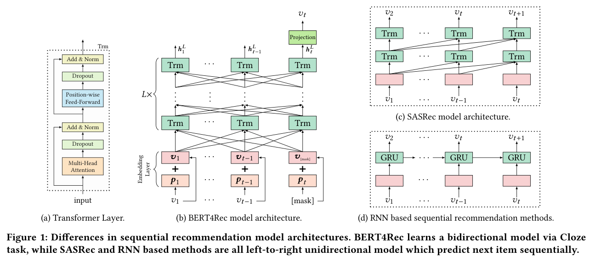
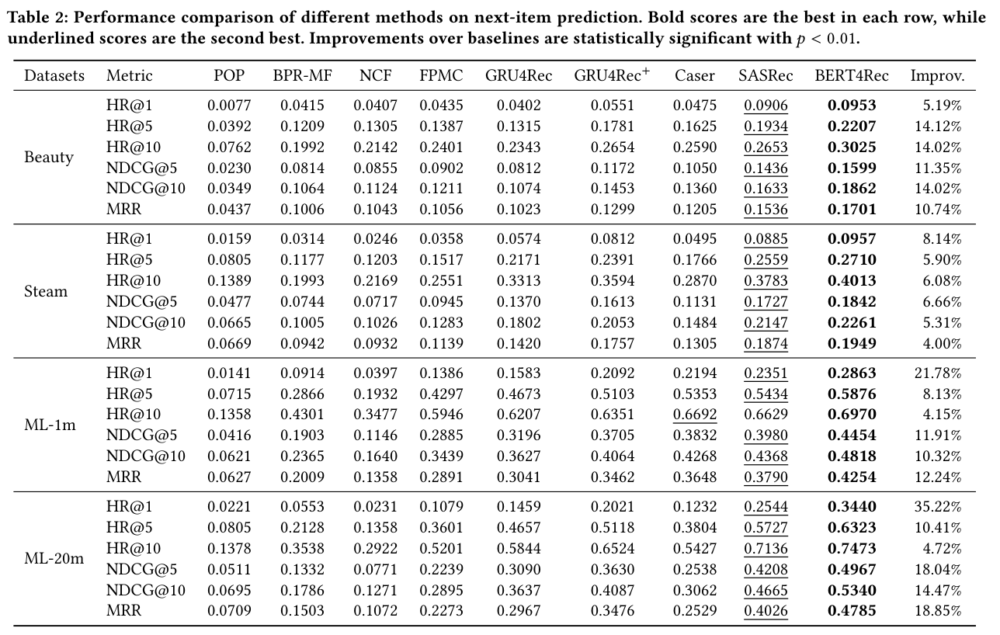
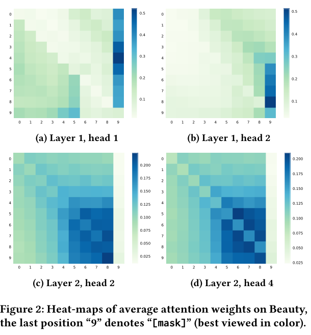

### 양방향 Transformer와 Cloze task로 유저의 행동 시퀀스를 학습하는 BERT4Rec에 대해 알아봅니다.


> 원제  
> **BERT4Rec**: Sequential Recommendation with Bidirectional Encoder Representations from Transformer  
> Fei Sun, Jun Liu, Jian Wu, Changhua Pei, Xiao Lin, Wenwu Ou, Peng Jiang (Alibaba), CIKM 2019  

<center></center>   

<font size="2"><center> 출처: Sun et al., BERT4Rec (https://arxiv.org/abs/1904.06690) </center>  </font>   

<br/>


>  **1. 기존 순차 추천 모델(GRU4Rec, SASRec 등)은 왼쪽에서 오른쪽으로만 정보를 보는 단방향(left-to-right) 구조임**
>
>  **2. BERT4Rec은 시퀀스의 일부 아이템을 [mask]로 가리고 앞뒤 문맥을 모두 사용해 맞히는 Cloze task로 양방향 표현을 학습함**
>
>  **3. 4개 데이터셋에서 SASRec 대비 HR@10 평균 7.24%, NDCG@10 평균 11.03% 개선됨. 단, 사전학습-파인튜닝이 아닌 end-to-end 학습이라는 점에서 원조 BERT와는 다름**

<br/>

----

**본 포스트는 DSBA 연구실 유튜브 채널의 이정호 님의 BERT4Rec 발표 영상을 보고, 원 논문을 함께 읽으며 정리한 노트입니다.**
원문은 여기에서 보실 수 있습니다. [paper](https://arxiv.org/abs/1904.06690), [발표 영상](https://youtu.be/PKYVHGrSO2U)

----
#### Contents

1. [추천시스템 연구, 크게 세 갈래로 나눠보자](#overview)
2. [일반적인 추천시스템: MF와 BPR](#mf-bpr)
3. [Sequential Recommendation의 흐름: GRU4Rec에서 SASRec까지](#sequential)
4. [BERT4Rec: 양쪽을 다 보면 안 될까?](#bert4rec)
5. [Word2Vec, 그리고 원조 BERT와는 무엇이 다를까?](#comparison)
6. [실험 결과](#experiments)
7. [마치며](#conclusion)
<br />

<a id="overview"></a>
## 1. 추천시스템 연구, 크게 세 갈래로 나눠보자

본격적으로 BERT4Rec을 살펴보기 전에, 발표자 분이 추천시스템 연구 흐름을 세 갈래로 나누어 정리해 주셨는데요. 큰 그림을 잡는 데 도움이 되어 먼저 옮겨 보겠습니다.

**1) Sequential Recommendation**

- 상품1 -> 상품2 -> 상품3처럼 유저가 순서대로 소비한 기록을 활용하는 방법임
- 시퀀스 데이터를 다루는 문제이다 보니, 자연어처리에서 개발된 방법론(RNN, CNN, Self-Attention 등)이 그대로 응용되는 경우가 많음
- 오늘 다룰 BERT4Rec이 바로 이 갈래에 속함

**2) Side Information을 활용한 Embedding**

- 상품의 주변 정보, 예를 들어 제조국, 브랜드, 영화 감독 등을 side information이라고 부름
- 이처럼 종류가 서로 다른(heterogeneous) 정보를 함께 엮기 위해 Heterogeneous Information Network(HIN)나 Knowledge Graph(KG) 같은 graph 계열 방법론이 많이 활용됨
- 정보를 더 많이 쓰는 만큼 성능뿐 아니라 explainability도 높일 수 있다는 장점이 있음

**3) Learning Method**

- positive/negative 샘플을 어떻게 뽑아서 학습에 쓸지에 대한 고민임
- 크게 두 방향이 있음
  - adversarial한 방법으로 모델이 구분하기 더 어려운(hard) negative 샘플을 만들어 내는 방법
  - negative sampling 자체를 효율적으로 수행하는 방법 (주로 인기 있는(popular) 아이템을 negative로 활용)

Side information 쪽 이야기를 조금만 덧붙이면, session 기반 추천은 첫 로그만 있어도 추천이 가능하긴 하지만 결국 historical data에 의존한다는 한계가 있습니다. 반면 KG 기반 임베딩을 사용하면 새로 등장한 아이템이라도 브랜드나 카테고리 같은 연결 정보를 통해 비슷한 임베딩을 갖는 상품을 찾아 추천해 줄 수 있어서, cold-start에 더 강건하다고 합니다. 패션 도메인처럼 이미지가 중요한 곳에서는 CNN 기반 style transfer 류의 기법으로 시각적으로 유사한 상품을 추천하는 방식도 많이 쓰인다고 하네요.

<a id="mf-bpr"></a>
## 2. 일반적인 추천시스템: MF와 BPR

순차 추천으로 넘어가기 전에, 비교 대상이 되는 "일반적인" 추천 모델 두 가지를 짚고 넘어가겠습니다.

### Matrix Factorization (MF)

Collaborative Filtering의 대표 주자인 MF는 sparse한 user-item 행렬을 저차원의 user 행렬과 item 행렬로 분해(차원축소)하는 방법입니다. 딥러닝 관점에서 보면, user와 item을 각각 같은 latent space로 embedding한 뒤 두 벡터의 inner product로 선호도를 계산하는 구조라고 볼 수 있겠죠.

$$
\hat{r}_{ui} = \mathbf{p}_u^\top \mathbf{q}_i
$$

### BPR (Bayesian Personalized Ranking)

implicit feedback 환경에서는 유저가 상호작용한 아이템은 "좋아한다"고 볼 수 있지만, 상호작용하지 않은 아이템은 싫어서 안 본 것인지 몰라서 안 본 것인지 알 수가 없습니다. BPR은 여기서 한 가지 합리적인 가정을 합니다.

- 유저가 상호작용(긍정)한 아이템은 **적어도 상호작용하지 않은 아이템보다는 선호된다**고 봄
- 예를 들어 user1이 A를 긍정, B는 미평가, C를 긍정했다면 "A가 B보다 낫다", "C가 B보다 낫다"는 관계는 만들어지지만, A와 C끼리는 비교할 수 없음
- 이렇게 유저별로 아이템 쌍 $(i, j)$의 선호 관계를 만들고, 이 관계를 잘 설명하는 latent vector를 찾음
- 유저 간에는 서로 독립이라고 가정하고, 모든 유저에 대한 likelihood를 maximize하도록 학습함

수식으로는 유저 $u$가 $i$를 $j$보다 선호할 확률을 $\sigma(\hat{x}_{ui} - \hat{x}_{uj})$로 두고, 아래 목적함수를 최대화합니다.

$$
\text{BPR-Opt} = \sum_{(u,i,j)} \ln \sigma(\hat{x}_{ui} - \hat{x}_{uj}) - \lambda_\Theta \lVert \Theta \rVert^2
$$

MF든 BPR이든 공통점은 **유저의 과거 행동을 순서 없는 집합으로 본다**는 점입니다. 어제 산 것과 1년 전에 산 것이 같은 무게를 갖는 셈인데요, 바로 이 지점에서 sequential recommendation이 등장합니다.

<a id="sequential"></a>
## 3. Sequential Recommendation의 흐름: GRU4Rec에서 SASRec까지

순차 추천은 특히 e-commerce처럼 유저의 관심사가 세션 단위로 빠르게 바뀌는 상황에서 유용합니다. 방금 노트북을 샀다면 다음엔 노트북 파우치나 마우스를 보여주는 게 자연스럽겠죠. 이 분야는 자연어처리의 발전을 거의 그대로 따라왔다고 해도 과언이 아닌데, 대략 다음과 같은 흐름입니다.

> **GRU4Rec (RNN) -> Caser (CNN) -> SASRec (Self-Attention) -> BERT4Rec (Bidirectional Self-Attention)**

### Markov Chain 계열은 왜 잘 됐을까?

딥러닝 이전에는 FPMC 같은 Markov Chain(MC) 기반 방법이 많이 쓰였습니다. MC는 다음 아이템이 직전 $k$개의 아이템에만 의존한다고 가정하는데, 어텐션의 관점에서 보면 **이전 $k$개 시점에 어텐션을 몰빵한 모델**로 해석할 수 있습니다. 단순한 이 방법들이 꽤 잘 작동했던 이유도, 실제로 유저의 다음 행동이 바로 직전 행동에 크게 종속되는 경우가 많기 때문이라고 하네요.

### SASRec (Self-Attentive Sequential Recommendation)

GRU4Rec처럼 RNN으로 시퀀스를 학습하면 long-term dependency를 잘 반영하지 못하고, 순차적으로 계산해야 하니 병렬화도 어렵습니다. 그래서 Kang & McAuley(2018)는 Transformer의 decoder 구조를 가져와 SASRec을 제안합니다. 위 그림의 (c)가 SASRec 구조입니다.

- $t$ 시점까지의 시퀀스로 $t+1$ 시점의 아이템을 예측하는 autoregressive(AR) 방식임
- 다음에 예측할 아이템을 미리 보면 학습이 제대로 되지 않으므로, attention 행렬에서 대각원소 위쪽 삼각형 부분을 masking함 (causal mask)
- Self-attention 뒤에는 point-wise feed-forward network를 두어 ReLU로 비선형성을 더함
  - 이 FFN은 모든 위치(position)에서 같은 weight를 공유하고, 각 아이템 위치마다 독립적으로 적용됨
  - 즉, FFN 단계에서는 아이템 간 정보 교환이 없으며, kernel size 1짜리 1D conv와 같은 효과임
- layer normalization, dropout, residual connection으로 깊은 네트워크의 학습을 안정화함
- 출력층에서는 입력에서 쓴 item embedding 행렬을 공유해 다음 아이템의 점수를 계산함

참고로 self-attention을 추천에 쓰는 비슷한 시기의 다른 시도로는 [Self-Attentive Metric Learning 포스트](https://myeonghak.github.io/recommender%20systems/RecSys-Next_item_Recommendation_with_Self-Attentive_Metric_Learning/)에서 다룬 AttRec도 있습니다.

그런데 SASRec에는 한 가지 아쉬운 점이 있습니다. 바로 **단방향(left-to-right)** 이라는 것입니다. 문장과 달리 유저의 행동 시퀀스는 꼭 엄격한 순서를 따르지 않는 경우가 많습니다. 쇼핑몰에서 장바구니에 A, B, C를 담았다고 해서 그 순서에 큰 의미가 있다고 보기는 어렵겠죠. 그렇다면 굳이 왼쪽 정보만 볼 이유가 있을까요?

<a id="bert4rec"></a>
## 4. BERT4Rec: 양쪽을 다 보면 안 될까?

BERT4Rec의 아이디어는 이름 그대로입니다. 자연어처리에서 GPT식 단방향 모델 다음에 BERT가 나왔던 것처럼, SASRec 다음으로 양방향 Transformer encoder를 추천에 가져온 것입니다. BERT 자체에 대한 설명은 이전에 정리한 [Transformer와 BERT 포스트](https://myeonghak.github.io/natural%20language%20processing/NLP-Transformer%EC%99%80-BERT/)를 참고해 주세요.

### 문제 정의

유저 $u$의 상호작용 시퀀스를 $S_u = [v_1^{(u)}, \dots, v_{n_u}^{(u)}]$라고 할 때, 다음 시점에 상호작용할 아이템의 확률 $p(v_{n_u+1}^{(u)} = v \mid S_u)$을 모델링하는 것이 목표입니다.

### 모델 구조

그림 (b)를 보면 구조는 BERT와 거의 같습니다.

- **Embedding Layer**: 아이템 임베딩 $\mathbf{v}_i$와 학습 가능한 positional embedding $\mathbf{p}_i$를 더해 입력으로 사용함
- **Transformer Layer**: Multi-Head Self-Attention + Position-wise FFN(GELU 사용) 블록을 $L$개 쌓음. causal mask가 없으므로 모든 위치가 앞뒤 모든 위치를 볼 수 있음
- **Output Layer**: 마지막 층의 은닉 벡터 $\mathbf{h}_t^L$을 projection한 뒤, 입력과 공유하는 item embedding 행렬 $E$와 곱해 전체 아이템에 대한 확률 분포를 얻음

$$
P(v) = \text{softmax}\left(\text{GELU}(\mathbf{h}_t^L W^P + \mathbf{b}^P) E^\top + \mathbf{b}^O\right)
$$

### 학습: Cloze task

여기서 문제가 하나 생깁니다. 양방향으로 다 볼 수 있게 열어두면, 다음 아이템을 예측하라고 할 때 모델이 정답을 그냥 "엿보게" 되겠죠. 그래서 BERT의 Masked Language Model처럼 **시퀀스의 일부 아이템을 랜덤하게 [mask]로 바꾸고, 그 자리의 원래 아이템을 앞뒤 문맥으로 맞히도록** 학습합니다. 이를 Cloze task(빈칸 채우기)라고 부릅니다.

```
Input : [v1, v2, v3, v4, v5]  →  [v1, [mask], v3, [mask], v5]
Labels: [mask]1 = v2, [mask]2 = v4
```

손실함수는 마스킹된 아이템들에 대한 negative log-likelihood입니다.

$$
\mathcal{L} = \frac{1}{\vert S_u^m \vert} \sum_{v_m \in S_u^m} -\log P(v_m = v_m^* \mid S_u')
$$

Cloze task의 숨은 장점은 **학습 샘플 수가 늘어난다**는 점입니다. 길이 $n$인 시퀀스에서 $k$개를 마스킹하면 $\binom{n}{k}$가지 조합이 나오므로, 같은 데이터로 매 epoch마다 다른 샘플을 만들어 낼 수 있습니다.

### 그런데 테스트는 "다음 아이템 예측"인데?

Cloze task로 학습하면 모델은 "중간의 빈칸 맞히기"에 익숙해지는데, 실제로 우리가 원하는 건 "시퀀스 맨 끝 다음 아이템 맞히기"입니다. 학습과 추론 사이에 불일치가 생기는 거죠. 이를 해결하기 위해 BERT4Rec은 두 가지 장치를 둡니다.

- **추론 시**: 유저의 시퀀스 맨 끝에 [mask] 토큰을 붙이고, 그 위치의 출력으로 다음 아이템을 예측함
- **학습 시**: 랜덤 마스킹 샘플 외에 **마지막 아이템만 마스킹한 샘플**도 추가로 만들어 학습함. 원래 BERT의 fine-tuning처럼, 마지막 위치를 맞히는 상황에 모델을 맞춰주는 역할임

이렇게 해서 시퀀스 끝의 [mask] 자리에 정답 아이템이 가장 높은 score로 나오도록 유도합니다. 물론 다른 유저들의 시퀀스에서 비슷한 맥락에 자주 등장한 아이템이 더 높은 점수를 받는 경우도 생기는데, 이 자체가 일종의 collaborative한 추천 효과라고 볼 수도 있겠습니다.

간단하게 Python으로 마스킹 과정을 흉내 내 보면 다음과 같습니다.

```python
import random

def cloze_mask(seq, mask_prob=0.4, mask_token="[mask]", seed=0):
    random.seed(seed)
    inputs, labels = [], []
    for item in seq:
        if random.random() < mask_prob:
            inputs.append(mask_token)
            labels.append(item)
        else:
            inputs.append(item)
            labels.append(None)
    return inputs, labels

seq = ["v1", "v2", "v3", "v4", "v5"]
for s in range(2):
    print(cloze_mask(seq, seed=s))

print("train(last only):", seq[:-1] + ["[mask]"])
print("inference       :", seq + ["[mask]"])
```

```
(['v1', 'v2', 'v3', '[mask]', 'v5'], [None, None, None, 'v4', None])
(['[mask]', 'v2', 'v3', '[mask]', 'v5'], ['v1', None, None, 'v4', None])
train(last only): ['v1', 'v2', 'v3', 'v4', '[mask]']
inference       : ['v1', 'v2', 'v3', 'v4', 'v5', '[mask]']
```

같은 시퀀스라도 seed마다 다른 학습 샘플이 만들어지는 것을 볼 수 있습니다.

<a id="comparison"></a>
## 5. Word2Vec, 그리고 원조 BERT와는 무엇이 다를까?

### Skip-gram & CBOW와의 차이

"주변 아이템으로 가운데 아이템을 맞힌다"고 하면 item2vec 같은 Word2Vec 계열 방법이 떠오르는데요. BERT4Rec도 masked item을 예측하면서 representation을 학습한다는 점은 비슷하지만, Word2Vec이 개별 아이템의 임베딩을 얻는 데 그치는 반면 BERT4Rec은 **시퀀스 전체의 맥락을 반영한 sequential representation**을 학습한다는 점이 다릅니다.

논문에서는 오히려 CBOW와 Skip-gram을 BERT4Rec의 단순화된 버전으로 볼 수 있다고 설명합니다.

- self-attention layer가 1개뿐이고, attention weight가 모든 위치에 대해 uniform한 것과 같음
- 입력 쪽과 출력 쪽 item embedding이 공유되지 않음
- positional encoding이 없음
- 시퀀스에서 가운데 아이템 1개만 마스킹하는 것과 같음

### 원조 BERT와의 차이

- **사전학습이 아닌 end-to-end 학습**: BERT는 대규모 코퍼스로 사전학습한 뒤 다양한 task에 fine-tuning하는 모델이지만, 추천은 도메인마다 아이템 집합과 데이터가 완전히 달라서 BERT4Rec은 해당 데이터로 처음부터 끝까지 학습함
- **NSP loss와 segment embedding 제거**: 문장 쌍이 없으니 Next Sentence Prediction과 segment embedding은 사용하지 않음
- **유저의 전체 이력을 하나의 시퀀스로 봄**: 세션 단위로 나누지 않고 유저의 모든 시퀀스를 하나로 뭉쳐서 다룸

발표자 분도 언급하셨지만, 특히 마지막 두 가지는 개선의 여지가 많은 부분입니다. 세션 경계를 segment처럼 표현하거나, 여러 도메인에 걸쳐 사전학습하는 방향 등을 생각해 볼 수 있겠죠.

<a id="experiments"></a>
## 6. 실험 결과

실험은 Amazon Beauty, Steam, MovieLens-1m, MovieLens-20m의 4개 데이터셋에서 진행되었습니다.

- **평가 방식**: leave-one-out. 각 유저의 마지막 아이템을 test, 그 직전 아이템을 validation으로 사용함
- **후보 아이템**: 정답 1개 + 인기도 기반으로 샘플링한 negative 100개 중에서 순위를 매김
- **지표**: HR@k, NDCG@k ($k=1,5,10$), MRR
- **주요 하이퍼파라미터**: layer 수 $L=2$, head 수 $h=2$, hidden 차원 $d=64$, 최대 길이는 ML 데이터셋 200 / Beauty, Steam 50, mask 비율 $\rho$는 Beauty 0.6, Steam 0.4, ML 0.2

<center></center>   

<font size="2"><center> 출처: Sun et al., BERT4Rec (https://arxiv.org/abs/1904.06690) </center>  </font>   

<br/>

- 모든 데이터셋, 모든 지표에서 BERT4Rec이 가장 좋은 성능을 보임
- 가장 강한 baseline인 SASRec 대비 평균적으로 HR@10 7.24%, NDCG@10 11.03%, MRR 11.46% 향상됨
- 순서 정보를 쓰지 않는 BPR-MF, NCF보다 FPMC, GRU4Rec 등 순차 모델이 전반적으로 좋다는 점에서, 순서 정보 자체가 추천에 유용하다는 것도 확인할 수 있음

### 성능 향상은 양방향 덕분일까, Cloze 덕분일까?

좋은 질문인데요, 논문에서도 이 둘을 분리해서 확인합니다. Cloze task에서 마지막 아이템 하나만 마스킹하도록 제한한 "BERT4Rec (1 mask)"를 만들어 SASRec과 비교하면, 두 모델의 차이는 사실상 양방향 attention 여부뿐입니다. Beauty 기준 HR@10이 SASRec 0.2653 -> BERT4Rec (1 mask) 0.2940 -> BERT4Rec 0.3025로 올라가는데, **양방향 구조와 Cloze 목적함수 모두 성능에 기여**한다는 것을 알 수 있습니다.

### Attention은 어디를 보고 있을까?

<center></center>   

<font size="2"><center> 출처: Sun et al., BERT4Rec (https://arxiv.org/abs/1904.06690) </center>  </font>   

<br/>

마지막 위치 9가 [mask]인 시퀀스에서 평균 attention weight를 시각화한 그림입니다.

- head마다 보는 곳이 다름. Layer 1의 head 1은 왼쪽 아이템, head 2는 오른쪽 아이템에 주로 집중함
- 1층에서는 [mask] 위치(9)에 attention이 몰리는 경향이 있지만, 2층에서는 [mask]보다 최근 아이템들에 더 집중함. 1층에서 이미 [mask] 정보가 다른 위치로 퍼졌기 때문으로 해석됨
- 전반적으로 가까운 아이템에 attention이 몰리는 경향이 보이는데, 앞서 이야기한 Markov Chain의 가정과도 통하는 부분임

<a id="conclusion"></a>
## 7. 마치며

BERT4Rec은 "NLP에서 GPT 다음에 BERT가 나왔듯, SASRec 다음엔 양방향이다"라는 아주 직관적인 아이디어를 추천에 옮긴 논문입니다. 구조 자체는 BERT와 거의 같지만, 학습-추론 불일치를 마지막 아이템 마스킹 샘플로 메우는 부분이나 Word2Vec을 단순화된 BERT4Rec으로 해석하는 부분은 곱씹어 볼 만했습니다.

개인적으로는 "유저 행동 시퀀스는 문장만큼 엄격한 순서를 갖지 않는다"는 관찰이 가장 와닿았는데요. 순서를 쓰되 순서에 너무 얽매이지 않는다는 점이 양방향 모델이 잘 작동하는 이유가 아닐까 싶습니다. 한편 실험이 100개의 negative 후보 중에서 순위를 매기는 sampled metric 기반이라는 점, 그리고 세션 경계나 side information을 쓰지 않는다는 점은 실무에 적용할 때 염두에 두어야 할 부분인 것 같습니다. 앞서 1장에서 본 side information, learning method 갈래의 아이디어들과 결합할 여지가 많은 모델이라고 생각합니다.

----------------


**개선을 위한 여러분의 피드백과 제안을 코멘트로 공유해 주세요.**
**내용에 대한 지적, 혹은 질문을 환영합니다.**  


**출처**  
[BERT4Rec: Sequential Recommendation with Bidirectional Encoder Representations from Transformer (arXiv)](https://arxiv.org/abs/1904.06690)  
[이정호 - BERT4REC 발표 영상 (DSBA 연구실 유튜브)](https://youtu.be/PKYVHGrSO2U)  
[Self-Attentive Sequential Recommendation (SASRec, arXiv)](https://arxiv.org/abs/1808.09781)  
[BPR: Bayesian Personalized Ranking from Implicit Feedback (arXiv)](https://arxiv.org/abs/1205.2618)  
