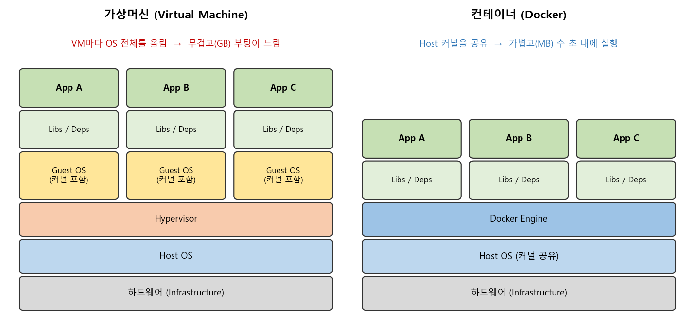
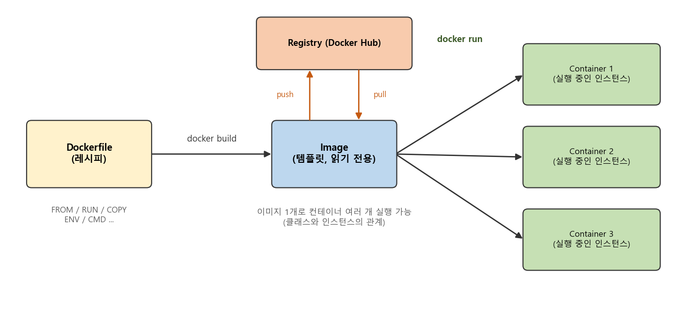
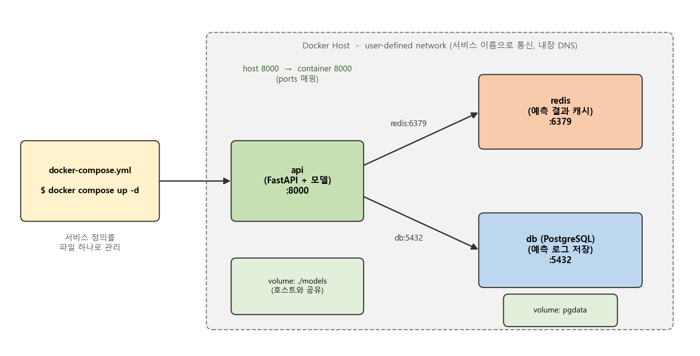

### "제 컴퓨터에서는 잘 돌아가는데요?"를 끝내기 위한 Docker 기초부터 Compose까지 알아봅니다.  


> 참고한 영상  
> **Docker Tutorial for Beginners - A Full DevOps Course on How to Run Applications in Containers** (freeCodeCamp.org, KodeKloud 강의)  
> **Docker For Data Scientists** (Abhishek Thakur)  
> **What is Docker Compose - How to create docker compose file** (Automation Step by Step, Raghav Pal)  

<center></center>   

<br/>


>  **1. 도커는 Host OS의 커널을 공유하는 컨테이너로 독립된 실행 환경을 만들기 때문에, OS 전체를 올리는 가상머신보다 훨씬 가볍고 빠름**
>
>  **2. Dockerfile로 이미지를 build하고, 이미지로 컨테이너를 run하며, 레지스트리(Docker Hub)에 push/pull해 환경을 그대로 공유함. 데이터 과학자에게는 포트 매핑(-p), 볼륨 마운트(-v), GPU 사용(--gpus)이 특히 중요함**
>
>  **3. 모델 API, 캐시, DB처럼 여러 컨테이너로 구성된 서비스는 docker-compose.yml 파일 하나로 정의하고 한 줄의 커맨드로 띄우고 내릴 수 있음**

<br/>

----

**본 포스트는 도커 관련 유튜브 튜토리얼 영상 세 편을 보고 정리한 노트입니다.**
영상은 여기에서 보실 수 있습니다.  
[Docker Tutorial for Beginners (freeCodeCamp)](https://www.youtube.com/watch?v=fqMOX6JJhGo)  
[Docker For Data Scientists (Abhishek Thakur)](https://youtu.be/0qG_0CPQhpg)  
[What is Docker Compose (Automation Step by Step)](https://youtu.be/HUpIoF_conA)  

----
#### Contents

1. [왜 데이터 과학자가 도커를 알아야 할까?](#why)  
2. [도커의 기본 개념: 이미지, 컨테이너, 레지스트리](#concept)  
3. [docker run 제대로 쓰기](#run)  
4. [Dockerfile로 나만의 이미지 만들기](#dockerfile)  
5. [도커 네트워킹 맛보기](#network)  
6. [Docker Compose로 여러 컨테이너 한 번에 다루기](#compose)  
7. [예제: ML 모델 API를 Dockerfile과 Compose로 묶어보자!](#example)  
8. [마치며](#conclusion)  
<br />


<a id="why"></a>
## 1. 왜 데이터 과학자가 도커를 알아야 할까?  

주피터 노트북에서 열심히 학습시킨 모델을 서버에 올리려고 하면, 꼭 한 번은 이런 일을 겪게 되는데요. 로컬에서는 잘 돌던 코드가 서버에서는 라이브러리 버전이 안 맞아서 터지고, CUDA 버전이 달라서 터지고, 심지어 OS 패키지가 없어서 터집니다. "제 컴퓨터에서는 잘 돌아가는데요?"라는 말이 괜히 밈이 된 게 아니겠죠.  

전통적으로는 개발팀이 만든 환경을 문서로 정리해 운영팀에 넘기면, 운영팀이 그 문서를 보고 서버에 환경을 다시 구성하는 방식으로 일했습니다. 당연히 이 과정에서 누락과 불일치가 생기기 쉽습니다. 도커는 **환경 자체를 이미지라는 패키지로 묶어서 넘기는** 방식으로 이 문제를 해결하는데요, 개발과 운영 사이의 벽을 낮췄다는 점에서 DevOps 문화에 크게 기여한 도구로 꼽힙니다.  

데이터 과학자 입장에서 정리해 보면 다음과 같은 이점이 있습니다.  

- 재현성: 실험 환경(OS, 파이썬 버전, 라이브러리 버전)을 코드로 고정할 수 있음  
- 이식성: 노트북, 사내 서버, 클라우드 어디서든 동일한 이미지를 그대로 실행 가능함  
- 배포: 모델 서빙 API를 컨테이너 하나로 패키징해 넘길 수 있음  
- 격리: 프로젝트마다 다른 라이브러리 버전이 서로 충돌하지 않음  

이전 포스트에서 다룬 [MLflow](https://myeonghak.github.io/mlops/MLOps-MLFlow%EB%A1%9C-%EB%AA%A8%EB%8D%B8-%ED%95%99%EC%8A%B5-%EA%B4%80%EB%A6%AC%ED%95%98%EA%B8%B0/)가 "어떤 실험을 했고 어떤 모델이 나왔는가"를 관리해 준다면, 도커는 "그 모델이 어떤 환경에서 돌아가는가"를 관리해 준다고 보면 되겠습니다.  

<br/>

### 가상머신과 무엇이 다를까?  

격리된 환경을 만든다는 점만 보면 가상머신(VM)도 같은 일을 할 수 있습니다. 차이는 맨 위 그림에서 볼 수 있듯 **커널을 공유하느냐**에 있는데요.  

- VM: Hypervisor 위에 VM마다 Guest OS(커널 포함)를 통째로 올림. 크기가 GB 단위이고 부팅에 수십 초~분 단위가 걸림  
- 컨테이너: Host OS의 커널을 공유하고, 그 위에 앱과 라이브러리만 격리된 공간에 띄움. 크기가 MB 단위이고 수 초 안에 실행됨  

대신 커널을 공유하기 때문에, 리눅스 컨테이너는 기본적으로 리눅스 커널 위에서 돌아갑니다. 윈도우나 맥에서 Docker Desktop을 쓰면 내부적으로 가벼운 리눅스 VM(WSL2 등)을 하나 띄워서 그 위에서 컨테이너를 돌리는 구조입니다.  

<br/>


<a id="concept"></a>
## 2. 도커의 기본 개념: 이미지, 컨테이너, 레지스트리  

<center></center>   

<br/>

도커에서 가장 먼저 구분해야 할 세 가지 개념입니다.  

- **이미지(Image)**: 컨테이너를 만들기 위한 템플릿이자 패키지임. VM 템플릿과 비슷하다고 생각할 수 있음. 읽기 전용이며, 하나의 이미지로 여러 개의 컨테이너를 실행할 수 있음  
- **컨테이너(Container)**: 이미지의 실행 인스턴스임. 각자 독립된 파일시스템, 네트워크, 프로세스 공간을 가짐  
- **레지스트리(Registry)**: 이미지를 저장하고 공유하는 저장소임. 대표적으로 Docker Hub가 있음. 이미 만들어진 이미지(python, redis, postgres 등)를 가져다 쓰고, 적당한 게 없으면 직접 만들어 올리면 됨  

파이썬에 익숙하신 분이라면 이미지는 클래스, 컨테이너는 그 클래스로 만든 인스턴스라고 생각하면 이해가 쉽습니다.  

<br/>

### 자주 쓰는 기본 커맨드  

| 커맨드 | 역할 |
|---|---|
| `docker run <image>` | 컨테이너 실행. 로컬에 이미지가 없으면 먼저 Docker Hub에서 pull해 옴 |
| `docker ps` / `docker ps -a` | 실행 중인 컨테이너 목록 / 종료(exited)된 것까지 전체 목록 |
| `docker stop <id or name>` | 컨테이너 중지 |
| `docker rm <id or name>` | 컨테이너 삭제 (이미지는 그대로 남음!) |
| `docker images` | 로컬에 받아둔 이미지 목록 |
| `docker rmi <image>` | 이미지 삭제. 해당 이미지를 쓰는 컨테이너를 먼저 지워야 함 |
| `docker exec <id> <cmd>` | 실행 중인 컨테이너 안에서 커맨드 실행 |
| `docker inspect <id>` | 상태, 마운트, 환경변수, 네트워크 설정 등 상세 정보를 JSON으로 출력 |
| `docker logs <id>` | 백그라운드 컨테이너의 로그 확인 |

<br/>

소소한 팁으로, 컨테이너 ID는 전체를 다 칠 필요 없이 다른 컨테이너와 구분될 만큼 앞의 몇 글자만 입력해도 알아서 인식합니다.  

<br/>

### ubuntu 컨테이너는 왜 바로 꺼질까?  

처음 도커를 써보면 `docker run ubuntu`를 실행했는데 아무 일도 없이 바로 종료되어 당황하게 되는데요. `docker ps`를 쳐봐도 보이지 않고, `docker ps -a`를 쳐야 Exited 상태로 나타납니다.  

이는 **컨테이너가 OS를 호스팅하기 위한 것이 아니라, 특정 태스크나 프로세스를 실행하기 위한 것**이기 때문입니다. 웹 서버 하나를 띄우거나, 배치 학습이나 분석 작업을 하나 돌리는 식이죠. 컨테이너는 그 안의 메인 프로세스가 살아있는 동안만 살아있고, 프로세스가 끝나면 컨테이너도 종료됩니다. ubuntu 이미지는 기본 명령이 bash인데, 연결된 터미널이 없으니 bash가 바로 종료되고 컨테이너도 같이 끝나는 것입니다.  

그래서 `docker run ubuntu sleep 5`처럼 실행할 프로세스를 주면 5초 동안은 컨테이너가 살아있고, 그 사이에 `docker exec <name> cat /etc/hosts`처럼 내부에서 커맨드를 실행해볼 수 있습니다.  

<br/>


<a id="run"></a>
## 3. docker run 제대로 쓰기  

`docker run`에는 옵션이 정말 많은데, 데이터 과학자 입장에서 자주 쓰는 것만 추려보겠습니다.  

<br/>

### 태그로 버전 고르기  

`docker run redis:4.0`처럼 콜론 뒤에 태그를 붙이면 특정 버전의 이미지를 사용합니다. 태그를 생략하면 기본값인 `latest`가 붙는데요, 재현성이 중요하다면 `latest`는 피하고 버전을 명시하는 습관을 들이는 게 좋습니다. 오늘의 latest와 반년 뒤의 latest는 다른 이미지일 수 있으니까요.  

<br/>

### attach / detach 모드  

- 그냥 실행하면 attached 모드로 실행되어, 웹 서버처럼 계속 도는 프로세스라면 터미널이 그대로 붙잡혀 있음  
- `docker run -d`로 실행하면 detached 모드로 백그라운드에서 돌고, 컨테이너 ID만 출력한 뒤 바로 터미널을 쓸 수 있음  
- 다시 붙고 싶으면 `docker attach <id>`, 로그만 보고 싶으면 `docker logs -f <id>`를 사용함  

<br/>

### -i, -t: 입력을 주고받고 싶을 때  

도커 컨테이너는 기본적으로 표준 입력(stdin)을 listen하지 않습니다. 그래서 사용자 입력을 받는 프로그램을 그냥 실행하면 입력을 전달할 방법이 없는데요.  

- `-i`(interactive): 호스트의 stdin을 컨테이너에 연결해 줌  
- `-t`(tty): 가상 터미널을 할당해 줌. 이게 없으면 입력을 요구하는 prompt 자체가 보이지 않음  

그래서 보통 둘을 합쳐 `docker run -it ubuntu bash`처럼 사용합니다. 컨테이너 안에 들어가서 이것저것 확인해보고 싶을 때 가장 많이 쓰는 형태입니다.  

<br/>

### -p: 포트 매핑  

컨테이너 안에서 Flask나 FastAPI 서버를 5000번 포트로 띄웠다고 해봅시다. 브라우저에서 어떤 주소로 접근해야 할까요?  

모든 컨테이너는 기본적으로 `172.17.0.x` 같은 내부 IP를 할당받습니다. 그런데 이 IP는 도커 호스트 안에서만 접근 가능한 내부 주소라서 외부 사용자는 접근할 수 없습니다. 외부에서 접근하려면 **도커 호스트의 포트를 컨테이너의 포트에 매핑**해 주어야 합니다.  

```bash
# 호스트의 80번 포트로 들어오는 트래픽을 컨테이너의 5000번 포트로 전달
docker run -d -p 80:5000 my-flask-app
```

순서가 `호스트포트:컨테이너포트`라는 것만 기억하면 됩니다. 이렇게 하면 같은 이미지의 컨테이너 여러 개를 호스트의 서로 다른 포트(8001, 8002, ...)에 붙여 동시에 띄울 수도 있습니다.  

<br/>

### -v: 볼륨 마운트  

모든 컨테이너는 자기만의 파일시스템을 가지고, 컨테이너를 삭제하면 그 안의 데이터도 같이 사라집니다. 학습 결과물이나 DB 데이터를 이렇게 날려먹으면 곤란하겠죠.  

그래서 호스트의 디렉터리를 컨테이너 안의 디렉터리에 연결(마운트)해 사용합니다.  

```bash
docker run -it -v "$(pwd)/data:/workspace/data" my-ds-image bash
```

- 형식은 `-v 호스트경로:컨테이너경로`이며, bind mount의 호스트 경로는 절대경로로 주어야 함 (상대경로를 쓰면 이름 있는 볼륨으로 해석되어 의도대로 동작하지 않음. 그래서 `$(pwd)`를 자주 씀)  
- 마운트된 디렉터리는 양방향으로 동기화됨. 호스트에서 파일을 고치면 컨테이너에서도 바로 보이고, 그 반대도 마찬가지임  
- 데이터셋은 이미지에 굽지 말고 마운트해서 쓰는 게 일반적임. 이미지는 가볍게, 데이터는 밖에  

<br/>

### -e: 환경변수  

애플리케이션 설정값을 바꿔가며 실행하고 싶을 때는 환경변수가 편리합니다.  

```bash
docker run -e APP_COLOR=blue simple-webapp-color
```

코드에서는 `os.environ["APP_COLOR"]`로 읽으면 되고, 이미 실행 중인 컨테이너의 환경변수는 `docker inspect`의 `Config.Env` 항목에서 확인할 수 있습니다. 모델 경로, 로그 레벨, DB 접속 정보 같은 값을 이미지 밖으로 빼두기에 좋습니다.  

<br/>

### 컨테이너 시작과 동시에 커맨드 실행하기  

이미지 이름 뒤에 커맨드를 주면 이미지의 기본 명령(CMD) 대신 그 커맨드가 실행됩니다. 여러 명령을 이어서 실행하고 싶다면 `bash -c`로 문자열을 넘기면 됩니다.  

```bash
docker run --rm -v "$(pwd):/workspace" my-ds-image bash -c "cd /workspace && python train.py --epochs 10"
```

이렇게 옵션이 길어지기 시작하면 매번 타이핑하기 괴로운데요, 영상에서도 추천하듯 쉘 스크립트로 만들어 두거나 뒤에서 볼 Compose 파일로 관리하면 편합니다.  

<br/>

### --gpus: GPU 사용하기  

딥러닝을 한다면 빠질 수 없는 부분입니다. 컨테이너에서 호스트의 NVIDIA GPU를 쓰려면 호스트에 NVIDIA 드라이버와 **NVIDIA Container Toolkit**(예전 이름 nvidia-docker)을 설치해야 합니다.  

```bash
docker run --rm --gpus all nvidia/cuda:11.8.0-base-ubuntu20.04 nvidia-smi
```

- `--gpus all`은 호스트의 모든 GPU를, `--gpus '"device=0"'`처럼 쓰면 특정 GPU만 컨테이너에 노출함  
- 컨테이너 안에는 CUDA 런타임만 있으면 되고, 드라이버는 호스트의 것을 그대로 사용함. 그래서 호스트 드라이버가 컨테이너의 CUDA 버전을 지원하는지 확인이 필요함  
- 영상 시점에는 윈도우에서 지원되지 않는다고 했지만, 지금은 WSL2 기반 Docker Desktop에서 GPU 사용이 가능함  

<br/>


<a id="dockerfile"></a>
## 4. Dockerfile로 나만의 이미지 만들기  

Docker Hub에 원하는 이미지가 없다면 직접 만들면 됩니다. 이미지를 만드는 레시피가 바로 Dockerfile인데요, 각 줄은 왼쪽에 instruction, 오른쪽에 argument가 오는 단순한 구조입니다.  

| Instruction | 역할 |
|---|---|
| `FROM` | 베이스 이미지 지정. 모든 Dockerfile은 FROM으로 시작함 (ubuntu:20.04, python:3.9-slim, 혹은 내가 만든 다른 이미지도 가능) |
| `RUN` | 빌드 시점에 커맨드 실행. `apt-get install`에는 `-y`를 꼭 붙여야 함 (대화형 확인을 기다리다 빌드가 멈춤) |
| `COPY` | 호스트의 파일을 이미지 안으로 복사 |
| `WORKDIR` | 이후 명령의 작업 디렉터리 지정 |
| `ENV` | 이미지와 컨테이너 실행 시점까지 유지되는 환경변수 |
| `ARG` | `docker build` 시점에만 쓰이는 변수. `--build-arg`로 값을 넘길 수 있고, 컨테이너 실행 시점에는 남지 않음 |
| `EXPOSE` | 컨테이너가 사용하는 포트를 문서화 (실제 공개는 `-p`로 해야 함) |
| `CMD` / `ENTRYPOINT` | 컨테이너 시작 시 실행할 기본 명령 |

<br/>

### 레이어와 캐시  

Dockerfile의 각 instruction은 하나의 **레이어(layer)**를 만들고, 이미지는 이 레이어들이 층층이 쌓인 구조입니다. 도커는 빌드할 때 각 레이어를 캐시해 두기 때문에, 다시 빌드하면 바뀌지 않은 레이어는 캐시를 재사용하고 **바뀐 레이어부터 그 아래쪽만** 다시 빌드합니다. 빌드 도중 실패하더라도 성공한 레이어까지는 캐시에 남아 있어 처음부터 다시 할 필요가 없습니다.  

여기서 실무적인 교훈이 하나 나오는데요. **자주 바뀌는 것(소스 코드)은 아래에, 잘 안 바뀌는 것(OS 패키지, requirements)은 위에** 두어야 합니다. 코드 한 줄 고쳤다고 pytorch 설치부터 다시 하는 걸 보고 있으면 정말 괴롭거든요. 뒤의 예제에서 `requirements.txt`를 먼저 복사해 설치하고, 소스 코드를 나중에 복사하는 이유가 바로 이것입니다.  

<br/>

### CMD와 ENTRYPOINT  

둘 다 컨테이너가 시작될 때 실행할 명령을 지정하지만 동작이 조금 다릅니다.  

- `CMD`: `docker run <image> <command>`처럼 실행 시 커맨드를 주면 **통째로 대체**됨  
- `ENTRYPOINT`: 실행 시 준 인자가 ENTRYPOINT 뒤에 **덧붙여짐**  

영상의 예시를 빌려오면, `sleep`만 하는 ubuntu-sleeper 이미지를 만든다고 할 때  

```dockerfile
FROM ubuntu:20.04
ENTRYPOINT ["sleep"]
CMD ["5"]
```

로 작성하면 `docker run ubuntu-sleeper`는 `sleep 5`를, `docker run ubuntu-sleeper 10`은 `sleep 10`을 실행합니다. ENTRYPOINT는 고정된 실행 파일, CMD는 그 기본 인자로 쓰는 패턴이죠. 참고로 JSON 배열 형태(exec form)로 써야 시그널이 메인 프로세스에 제대로 전달되어 `docker stop` 시 깔끔하게 종료됩니다.  

<br/>

### 빌드하고 공유하기  

```bash
docker build -t myname/my-ds-image:0.1 .
docker push myname/my-ds-image:0.1
```

`-t`로 이름과 태그를 붙여 빌드하고, Docker Hub에 로그인한 뒤 push하면 다른 사람도 `docker pull`로 똑같은 환경을 받아 쓸 수 있습니다. 영상 말미의 "거의 모든 소프트웨어를 도커라이즈할 수 있다"는 말처럼, 한 번 이미지로 만들어 두면 설치 과정 없이 어디서든 실행할 수 있다는 게 도커의 진짜 매력입니다.  

<br/>

### 이미지 크기 줄이기: alpine을 쓰면 될까?  

이미지가 가벼울수록 pull과 배포가 빨라지니, 아주 작은 리눅스 배포판인 alpine 기반 이미지가 자주 언급됩니다. 그런데 데이터 과학 용도라면 조심할 필요가 있습니다. alpine은 glibc 대신 musl libc를 쓰기 때문에, numpy, pandas, scikit-learn 같은 패키지의 미리 빌드된 wheel을 그대로 못 쓰고 소스 빌드가 일어나는 경우가 많습니다. 결과적으로 빌드는 훨씬 느려지고 이미지도 생각만큼 작아지지 않는 일이 생기죠. ML 용도에서는 보통 `python:3.x-slim`(Debian 기반)이 무난한 선택입니다.  

<br/>


<a id="network"></a>
## 5. 도커 네트워킹 맛보기  

모델 API가 DB나 캐시와 통신해야 한다면 컨테이너끼리 어떻게 대화하는지 알아둘 필요가 있습니다.  

<br/>

### 기본 네트워크 세 가지  

도커를 설치하면 `bridge`, `host`, `none` 세 가지 네트워크가 자동으로 만들어지고, 이런 네트워크의 종류를 driver라고 부릅니다.  

- **bridge**: 기본값. 호스트 위에 만들어지는 private 내부 네트워크로, 컨테이너는 `172.17.x.x` 대역의 내부 IP를 받음. 외부에서 접근하려면 포트 매핑이 필요함  
- **host**: `--network=host`. 컨테이너가 호스트의 네트워크를 그대로 사용해 포트 매핑 없이 접근 가능함. 대신 네트워크 격리가 사라져서, 5000번 포트를 쓰는 컨테이너를 같은 호스트에 두 개 띄울 수 없음  
- **none**: 어떤 네트워크에도 연결되지 않은 완전히 고립된 상태  

<br/>

### 사용자 정의 네트워크와 내장 DNS  

`docker network create my-net`으로 별도의 내부 네트워크를 만들 수 있고, `docker network ls`로 현재 네트워크 목록을, `docker inspect <container>`의 `NetworkSettings`에서 컨테이너의 IP와 네트워크 설정을 확인할 수 있습니다.  

그럼 웹 서버 컨테이너가 같은 호스트의 MySQL 컨테이너에 접근하려면 어떻게 해야 할까요? 내부 IP로 접근할 수도 있지만, 재시작할 때마다 같은 IP를 받는다는 보장이 없어서 좋은 방법이 아닙니다. 정답은 **컨테이너 이름으로 접근하는 것**입니다.  

도커에는 내장 DNS 서버(컨테이너 안에서 `127.0.0.11`)가 있어서, 같은 사용자 정의 네트워크에 있는 컨테이너끼리는 이름으로 서로를 찾을 수 있습니다. 즉 웹 서버 코드에 `mysql:3306`이라고 적으면 알아서 해당 컨테이너로 연결되는 거죠. (기본 bridge 네트워크에서는 이름 해석이 되지 않으니, 사용자 정의 네트워크를 만들어야 한다는 점에 주의해야 합니다.)  

내부적으로는 리눅스의 network namespace로 컨테이너마다 독립된 네트워크 공간을 만들고, 가상 이더넷 페어(veth pair)로 컨테이너와 브리지를 연결하는 방식입니다. 그리고 다행히도, 뒤에서 볼 Compose는 이 네트워크를 자동으로 만들어 줍니다.  

<br/>


<a id="compose"></a>
## 6. Docker Compose로 여러 컨테이너 한 번에 다루기  

<center></center>   

<br/>

실제 서비스는 컨테이너 하나로 끝나는 경우가 드뭅니다. 쇼핑몰이라는 큰 애플리케이션을 로그인, 검색, 결제 같은 작은 서비스로 쪼개 각각 컨테이너로 관리하는 마이크로서비스 구조가 대표적이죠. ML 서비스도 모델 API, 캐시, DB, 모니터링 등 여러 컨테이너로 구성되곤 합니다.  

이걸 매번 `docker run`에 긴 옵션을 달아 하나씩 띄우고, 네트워크를 만들어 연결하는 건 꽤 번거로운 일인데요. **Docker Compose**는 여러 컨테이너로 구성된 애플리케이션을 정의하고 실행하는 도구입니다.  

- 서비스 구성을 YAML 파일 하나(관례적으로 `docker-compose.yml`)에 정의함  
- `up` / `down` 한 줄로 전체 서비스를 띄우고 내림  
- 같은 Compose 프로젝트의 서비스들은 자동으로 하나의 네트워크에 묶여, **서비스 이름으로 서로 통신**할 수 있음  
- 필요할 때 특정 서비스의 컨테이너 수를 늘릴(scale) 수 있음  

<br/>

### 설치와 파일 작성  

Docker Desktop을 설치하면 Compose도 함께 설치됩니다. 영상 시점에는 `docker-compose`라는 별도 명령(v1)을 썼지만, 지금은 도커 CLI 플러그인 형태인 `docker compose`(v2)가 표준입니다. 버전은 `docker compose version`(v1은 `docker-compose -v`)으로 확인할 수 있습니다.  

파일 작성 규칙은 단순합니다. 최상위에 `services`를 쓰고, 그 아래 들여쓰기로 서비스 이름을, 다시 그 아래에 사용할 이미지(혹은 build 경로), 포트, 볼륨, 환경변수 등을 적습니다. 영상에서는 맨 앞에 `version`을 명시해야 하고 Compose 버전에 맞는 값을 써야 한다고 설명하는데요, 현재의 Compose Specification에서는 `version` 필드가 더 이상 필요 없고(써도 무시됨) 생략하는 것이 권장됩니다. 각 이미지의 Docker Hub 페이지에 Compose 예시가 있는 경우가 많으니 참고하면 좋습니다.  

<br/>

### 주요 커맨드  

| 커맨드 | 역할 |
|---|---|
| `docker compose config` | YAML 문법과 설정이 올바른지 검증하고, 최종 해석된 설정을 출력 |
| `docker compose up -d` | 전체 서비스를 detached 모드로 실행 (`--build`를 붙이면 이미지 재빌드) |
| `docker compose ps` / `logs -f api` | 서비스 상태 확인 / 특정 서비스 로그 확인 |
| `docker compose down` | 컨테이너 stop과 rm, 네트워크 삭제를 한 번에 처리 (`-v`를 붙이면 볼륨까지 삭제) |
| `docker compose up -d --scale worker=4` | worker 서비스 컨테이너를 4개로 늘림 |

<br/>

`--scale`을 쓸 때 주의할 점이 하나 있는데요, 호스트 포트를 `8000:8000`처럼 고정해 둔 서비스는 컨테이너를 여러 개 띄우면 포트가 충돌합니다. 스케일할 서비스는 호스트 포트를 고정하지 않거나 앞단에 로드밸런서를 두는 식으로 구성해야 합니다.  

<br/>


<a id="example"></a>
## 7. 예제: ML 모델 API를 Dockerfile과 Compose로 묶어보자!  

지금까지 본 내용을 모아, 학습된 scikit-learn 모델을 FastAPI로 서빙하고, 예측 결과를 Redis에 캐시하며, 예측 로그를 PostgreSQL에 쌓는 작은 서비스를 구성해 보겠습니다. 실제로 실행한 결과가 아닌 **구성 예시**이니, 본인 프로젝트에 맞게 고쳐 쓰시면 됩니다.  

디렉터리 구조는 다음과 같다고 가정합니다.  

```
ml-api/
├── app/
│   └── main.py
├── models/
│   └── model.joblib
├── requirements.txt
├── Dockerfile
├── docker-compose.yml
└── .env
```

<br/>

### main.py (요약)  

```python
import os
import joblib
from fastapi import FastAPI
from pydantic import BaseModel

MODEL_PATH = os.getenv("MODEL_PATH", "/app/models/model.joblib")
app = FastAPI()
model = joblib.load(MODEL_PATH)


class Features(BaseModel):
    values: list[float]


@app.get("/health")
def health():
    return {"status": "ok"}


@app.post("/predict")
def predict(x: Features):
    pred = model.predict([x.values])[0]
    # redis 캐시 조회 / postgres 로그 적재 로직은 생략
    return {"prediction": float(pred)}
```

DB와 캐시 주소는 `REDIS_HOST=redis`, `DATABASE_URL=postgresql://...@db:5432/...`처럼 환경변수로 받는데, 여기서 `redis`, `db`가 바로 Compose의 서비스 이름입니다. 앞에서 본 내장 DNS 덕분에 IP를 몰라도 이름으로 접근할 수 있는 거죠.  

<br/>

### Dockerfile  

```dockerfile
FROM python:3.9-slim

ARG DEBIAN_FRONTEND=noninteractive
ENV PYTHONDONTWRITEBYTECODE=1 \
    PYTHONUNBUFFERED=1 \
    MODEL_PATH=/app/models/model.joblib

# 잘 안 바뀌는 OS 패키지
RUN apt-get update \
    && apt-get install -y --no-install-recommends build-essential curl \
    && rm -rf /var/lib/apt/lists/*

WORKDIR /app

# requirements를 먼저 복사해 설치 -> 코드만 바뀌면 이 레이어는 캐시 재사용
COPY requirements.txt .
RUN pip install --no-cache-dir -r requirements.txt

# 자주 바뀌는 소스 코드는 마지막에
COPY app/ ./app/

# root가 아닌 사용자로 실행
RUN useradd --create-home appuser
USER appuser

EXPOSE 8000
CMD ["uvicorn", "app.main:app", "--host", "0.0.0.0", "--port", "8000", "--workers", "2"]
```

몇 가지 포인트를 짚어보면 다음과 같습니다.  

- `ARG DEBIAN_FRONTEND=noninteractive`: 빌드 중 apt가 대화형 질문을 던지지 않도록 하는 설정. 빌드 시점에만 필요하니 ENV가 아닌 ARG로 둠  
- `PYTHONUNBUFFERED=1`: 로그가 버퍼링되지 않고 바로 출력되어 `docker logs`로 확인하기 좋음  
- 모델 파일은 이미지에 굽지 않고 볼륨으로 마운트함. 모델만 갈아끼울 때 이미지를 다시 빌드할 필요가 없음 (반대로 "이미지 = 모델 버전"으로 묶어 배포하고 싶다면 COPY로 넣는 것도 방법임)  
- `--host 0.0.0.0`: 컨테이너 안에서 `127.0.0.1`로 띄우면 포트 매핑을 해도 밖에서 접근이 안 됨. 초보 시절 가장 많이 헤매는 부분 중 하나임  
- `.dockerignore`에 `.git`, `data/`, `*.ipynb`, `__pycache__` 등을 넣어 빌드 컨텍스트를 가볍게 유지하는 것도 잊지 말 것  

<br/>

### docker-compose.yml  

```yaml
services:
  api:
    build: .
    image: myname/ml-api:0.1
    ports:
      - "8000:8000"
    environment:
      MODEL_PATH: /app/models/model.joblib
      REDIS_HOST: redis
      DATABASE_URL: postgresql://mluser:${POSTGRES_PASSWORD}@db:5432/predictions
    volumes:
      - ./models:/app/models:ro
    depends_on:
      - redis
      - db
    restart: unless-stopped

  redis:
    image: redis:6.2-alpine
    restart: unless-stopped

  db:
    image: postgres:13
    environment:
      POSTGRES_USER: mluser
      POSTGRES_PASSWORD: ${POSTGRES_PASSWORD}
      POSTGRES_DB: predictions
    volumes:
      - pgdata:/var/lib/postgresql/data
    restart: unless-stopped

volumes:
  pgdata:
```

- `build: .`과 `image`를 함께 쓰면 현재 디렉터리의 Dockerfile로 빌드한 이미지에 해당 이름과 태그를 붙여줌  
- `ports`는 `docker run -p`, `volumes`는 `-v`, `environment`는 `-e`와 같은 역할임. 앞에서 길게 치던 옵션들이 파일로 옮겨온 셈임  
- redis와 db는 외부에 노출할 필요가 없으니 `ports`를 열지 않았음. 같은 Compose 네트워크 안의 api만 이름으로 접근함  
- `pgdata`는 이름 있는 볼륨(named volume)으로, `docker compose down`을 해도 DB 데이터가 보존됨 (`down -v`를 하면 삭제됨)  
- 비밀번호 같은 값은 YAML에 직접 쓰지 말고 같은 디렉터리의 `.env` 파일에 두면 Compose가 `${POSTGRES_PASSWORD}`를 치환해 줌. 물론 `.env`는 git에 올리지 않아야 함  
- `depends_on`은 **시작 순서만** 보장할 뿐, DB가 접속 가능한 상태가 될 때까지 기다려주지는 않음. 실서비스에서는 healthcheck를 정의하고 `condition: service_healthy`를 쓰거나, 앱에서 재시도 로직을 두는 것이 안전함  

이제 `docker compose config`로 설정을 검증한 뒤 `docker compose up -d --build` 한 줄이면 세 개의 컨테이너와 네트워크, 볼륨이 한 번에 만들어지고, `docker compose down`이면 깔끔하게 정리됩니다.  

<br/>


<a id="conclusion"></a>
## 8. 마치며  

세 편의 튜토리얼을 보며 정리한 내용을 요약하면 다음과 같습니다.  

- 도커는 커널을 공유하는 컨테이너로 가볍고 빠르게 격리된 환경을 만들어 줌  
- Dockerfile -> 이미지 -> 컨테이너의 흐름을 이해하고, 레이어 캐시를 고려해 Dockerfile을 작성해야 함  
- 데이터 과학자에게는 `-p`(API 서빙), `-v`(데이터와 모델), `--gpus`(학습)가 특히 중요한 옵션임  
- 컨테이너가 여러 개가 되는 순간부터는 Compose로 구성을 코드로 관리하는 것이 정신 건강에 이로움  

개인적으로 도커를 공부하면서 가장 크게 와닿았던 부분은, 도커가 단순한 배포 도구가 아니라 **"환경도 코드로 관리한다"는 사고방식**이라는 점이었습니다. 실험 코드는 git으로 열심히 관리하면서 정작 그 코드를 돌리는 환경은 "그때 pip install 뭐 했더라..." 하고 기억에 의존해 왔던 걸 반성하게 되네요. 영상에서도 강조하듯 결국 가장 좋은 교재는 [도커 공식 문서](https://docs.docker.com/)이니, 막히는 부분이 있을 때마다 찾아보는 습관을 들여야겠습니다.  

다음에는 이렇게 컨테이너로 묶은 모델을 여러 서버에 걸쳐 운영하는 쿠버네티스나, 학습 파이프라인을 스케줄링하는 워크플로 도구 쪽도 정리해 보고 싶습니다.  

----------------


**개선을 위한 여러분의 피드백과 제안을 코멘트로 공유해 주세요.**
**내용에 대한 지적, 혹은 질문을 환영합니다.**  


**출처**  
[Docker Tutorial for Beginners - A Full DevOps Course on How to Run Applications in Containers (freeCodeCamp.org)](https://www.youtube.com/watch?v=fqMOX6JJhGo)  
[Docker For Data Scientists (Abhishek Thakur)](https://youtu.be/0qG_0CPQhpg)  
[What is Docker Compose - How to create docker compose file - How to use Compose (Automation Step by Step)](https://youtu.be/HUpIoF_conA)  
[Docker 공식 문서](https://docs.docker.com/)  
[Compose Specification (Docker Docs)](https://docs.docker.com/compose/compose-file/)  
[NVIDIA Container Toolkit](https://github.com/NVIDIA/nvidia-container-toolkit)  
