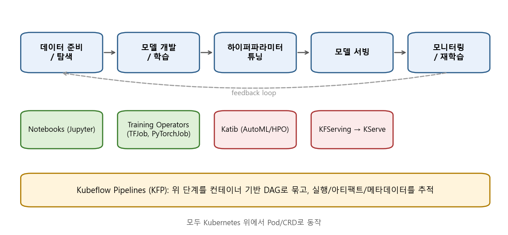
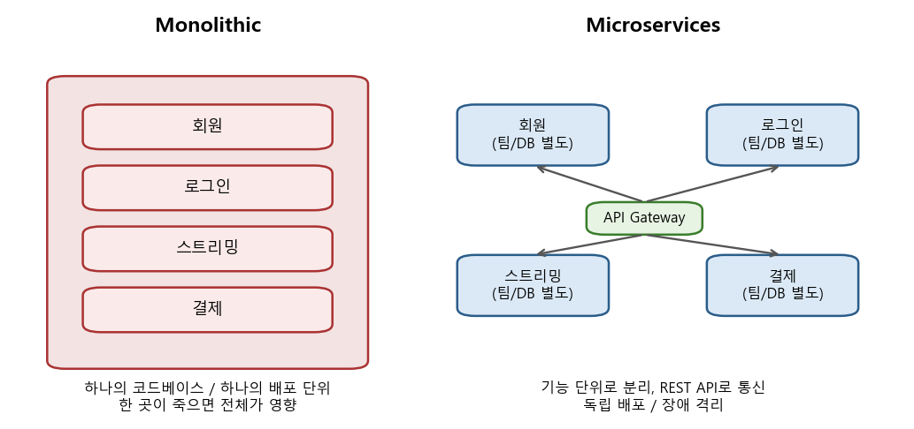
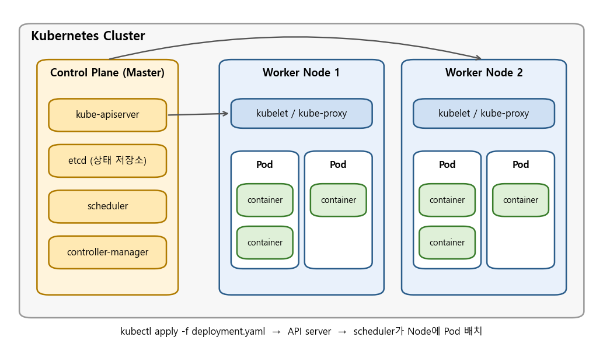
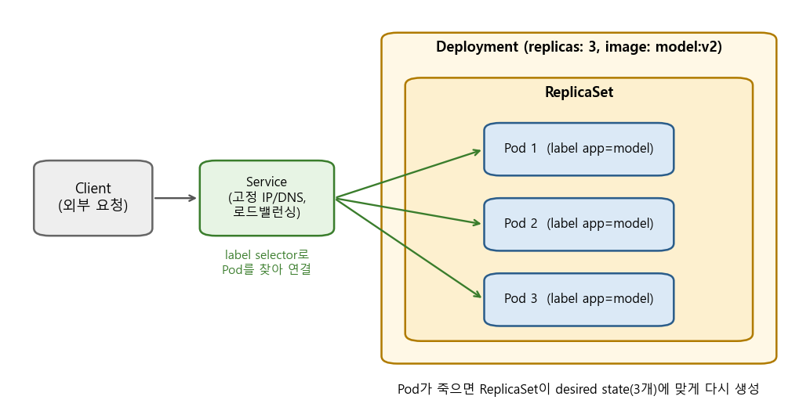

### 마이크로서비스에서 출발해 쿠버네티스, 그리고 Kubeflow까지 알아봅니다.

> 44BITS, "[초보를 위한 쿠버네티스 안내서] 컨테이너 오케스트레이션이란?"  
> 기술노트with 알렉, "마이크로서비스의 철학, 개념 간단히 말씀드립니다."  
> David Aronchick (Microsoft), "Managing Machine Learning in Production with Kubeflow and DevOps", CNCF  

<center></center>

<br/>

>  **1. 마이크로서비스는 하나의 거대한 서비스를 기능 단위로 쪼개어 독립적으로 배포/운영하는 구조이며, 그 결과 관리해야 할 컨테이너 수가 폭증함**
>
>  **2. 쿠버네티스는 "원하는 상태(desired state)"를 선언하면 클러스터가 알아서 그 상태를 유지해 주는 컨테이너 오케스트레이션 도구임 (Pod, Deployment, Service, Node가 핵심 오브젝트)**
>
>  **3. Kubeflow는 쿠버네티스 위에서 ML 라이프사이클(학습, 튜닝, 서빙, 파이프라인)을 돌리기 위한 툴킷으로, Pipelines, Katib, KFServing(KServe) 등으로 구성됨**

<br/>

----

**본 포스트는 위 세 개의 영상을 보고 정리한 노트에, 공식 문서를 참고해 내용을 보충한 글입니다.**
영상은 여기에서 보실 수 있습니다. [컨테이너 오케스트레이션이란?](https://youtu.be/Ia8IfowgU7s) / [마이크로서비스의 철학](https://youtu.be/Vb8xo7VU04A) / [Kubeflow and DevOps](https://youtu.be/lu5zHvpQeSI)

----
#### Contents

1. [들어가며](#intro)
2. [마이크로서비스의 철학](#microservices)
3. [왜 컨테이너 오케스트레이션이 필요할까?](#why-orchestration)
4. [쿠버네티스의 핵심 오브젝트](#k8s-objects)
5. [MLOps와 Kubeflow](#kubeflow)
6. [마치며](#conclusion)

<br />

<a id="intro"></a>
## 1. 들어가며

[지난 포스트](https://myeonghak.github.io/mlops/MLOps-%EB%8D%B0%EC%9D%B4%ED%84%B0-%EA%B3%BC%ED%95%99%EC%9E%90%EB%A5%BC-%EC%9C%84%ED%95%9C-Docker/)에서 데이터 과학자 입장에서 Docker를 왜, 어떻게 쓰는지 정리해 보았는데요. 컨테이너 하나를 띄우는 것까지는 할 만합니다. 그런데 "모델 서버 컨테이너를 트래픽에 따라 3개에서 10개로 늘리고, 하나가 죽으면 자동으로 다시 띄우고, 새 버전 모델로 무중단 교체해 주세요"라는 요구가 들어오면 이야기가 달라지죠.

이번 포스트에서는 그 문제를 푸는 도구인 **쿠버네티스(Kubernetes, k8s)**, 그리고 그 위에서 ML 워크플로우를 돌리기 위한 **Kubeflow**에 대해 정리해 보겠습니다. 순서는 "왜 서비스를 쪼개는가(마이크로서비스) -> 쪼개면 무엇이 어려워지는가(오케스트레이션) -> 쿠버네티스는 그걸 어떻게 푸는가 -> ML에는 어떻게 적용되는가(Kubeflow)"로 가 보겠습니다.

<br />

<a id="microservices"></a>
## 2. 마이크로서비스의 철학

<center></center>

<br/>

### 모놀리식 vs 마이크로서비스

- 모놀리식(monolithic): 회원, 로그인, 스트리밍, 결제 등 모든 기능이 하나의 큰 애플리케이션으로 묶여 함께 빌드/배포됨
- 마이크로서비스(microservice): 이 큰 서비스를 **기능을 기준으로 잘게 쪼갠 것**. 쪼개진 각각의 작은 서비스를 마이크로서비스라고 부름
- 대표적인 채택 사례가 넷플릭스임. 회원, 로그인, 스트리밍, 결제 등을 별개의 서비스로 나누어 서빙함

<br/>

### 마이크로서비스의 장점

- **독립성(장애 격리)**: 한 서비스의 실패가 전체 서비스로 번지지 않음. 결제 서버가 죽어도 영상 스트리밍은 계속 될 수 있음
- **조직적 관점**: 마이크로서비스 하나를 한 팀이 맡아 개발부터 배포까지 책임짐. 기능 간 결합도(coupling)가 크게 줄어듦
- **실패를 전제로 한 설계**: 내가 의존하는 다른 마이크로서비스가 죽을 수 있다는 것을 감안하고 개발함 (timeout, retry, fallback 등)
- 넷플릭스는 이를 검증하기 위해 운영 환경에서 클라우드 인스턴스를, 심지어는 가용 영역(zone) 전체를 일부러 죽여 보고 나머지가 잘 버티는지 테스트하는 것으로 유명함 (Chaos Monkey로 시작된 Chaos Engineering). **완벽한 서버를 준비하는 것이 아니라, 서버는 언제든 죽을 수 있다는 것을 전제**하는 것이 핵심임

<br/>

### 마이크로서비스 간의 통신

- 주로 HTTP 기반의 REST API를 사용함 (내부적으로는 gRPC나 메시지 큐도 많이 씀)
- 가장 단순한 프로토콜로 서로의 인터페이스를 간결하게 유지하는 것이 목적임

여기서 ML 하는 입장에서 눈여겨볼 점이 있는데요. 사실 ML 서비스도 본질적으로 마이크로서비스의 집합입니다. 데이터 수집, 전처리, 피처 생성, 학습, 하이퍼파라미터 튜닝, 모델 서빙, 모니터링... 모델링 코드 자체는 전체 시스템에서 아주 작은 조각에 불과하죠. 이 이야기는 5장에서 다시 하겠습니다.

<br />

<a id="why-orchestration"></a>
## 3. 왜 컨테이너 오케스트레이션이 필요할까?

### 서버 관리의 역사

서버 관리란 결국 "**서버가 죽지 않도록 관리하는 것**"입니다. 그 방식은 대략 다음과 같이 발전해 왔습니다.

1. **문서로 관리**: 설치 순서와 설정을 문서로 남겨 사람이 손으로 세팅함
2. **설정 관리 도구**: Chef, Puppet, Ansible 같은 도구로 서버 설정을 코드화함. 그러나 시스템이 복잡해지면서(한 서버에 여러 버전의 런타임이 공존하는 등) 도구 자체를 다루는 난이도가 높아짐
3. **가상머신(VM)**: 환경을 통째로 격리함. 조금 느리고 무겁지만 쓸 만했음. 다만 이미지가 크고 특정 클라우드 벤더에 의존성이 생기는 등 클라우드 환경에는 다소 부적합한 면이 있었음
4. **Docker(컨테이너)**: 매우 가볍고 쉬움. 배포/롤백이 간편하고, 세팅의 자유도가 높고, 자원을 효율적으로 사용함. 프로그램을 컨테이너 이미지로 만드는 것을 **containerize**한다고 함

<br/>

### 도커 이후에 생긴 문제들

컨테이너가 너무 편하다 보니 모든 것을 컨테이너로 만들게 되었고, 그러자 컨테이너의 **수**가 문제가 되기 시작합니다.

- **배포와 롤아웃/롤백**: 수십~수백 개의 컨테이너를 어느 서버에 띄울지, 새 버전으로 어떻게 순차적으로 교체할지, 문제가 생기면 어떻게 되돌릴지가 어려워짐
- **서비스 검색(service discovery)**: 프록시 뒤에 웹앱 컨테이너들이 있을 때, 컨테이너가 새로 뜨거나 죽을 때마다 IP가 바뀜. 로드밸런서 설정을 계속 갱신해 주어야 함
- **서비스 노출(gateway)**: 내부 서비스를 외부에 노출하려면 public 영역에 nginx 같은 proxy를 두고 내부 컨테이너에 연결함. 그런데 새 도메인/서비스가 추가될 때마다 nginx 설정을 손으로 고치는 일은 서버 관리자에게 꽤나 귀찮은 일임
- **이상/부하 모니터링**: 부하가 커져 응답이 느려진 서버를 찾아 대응하고, 죽은 컨테이너를 다시 살려야 함

<br/>

### 컨테이너 오케스트레이션이란

**컨테이너 오케스트레이션**은 이렇게 복잡한 컨테이너 환경을 효과적으로 관리하기 위한 도구(개념)입니다. 공통적으로 다음과 같은 기능을 제공합니다.

- **Cluster**: 여러 서버(노드)를 하나의 군집으로 묶고, 마스터 서버를 두어 전체를 간단하게 제어함
- **State 관리**: "이 컨테이너를 2개에서 3개로 바꿔줘!"라고 선언만 하면, 별다른 조치 없이도 그 상태가 되도록 맞춰 주고 유지해 줌
- **Scheduling**: 어떤 컨테이너를 어떤 서버에 띄울지 자원 상황을 보고 결정함. 부하가 커지면 컨테이너를 더 띄우는 것(오토스케일링)도 가능함
- **Rollout/Rollback**: 버전 관리. 중앙에서 소프트웨어 버전을 제어하고 순차 배포, 되돌리기를 지원함
- **Service discovery**: 서비스가 어떤 IP에 등록되었는지 저장소에 기록하고, 프록시가 이 저장소를 관찰하다가 변경이 생기면 설정을 갱신하고 트래픽을 알맞게 보내 줌
- **Volume**: 컨테이너가 여러 개일 때 각 컨테이너에 NAS, GCP/AWS의 디스크 등 스토리지를 마운트해 주는 일을 관리함

컨테이너 오케스트레이션은 개념이기 때문에 다양한 구현체가 존재합니다. Docker Swarm, Apache Mesos, Nomad 등이 있지만, 사실상의 표준(de facto standard)은 **쿠버네티스**가 되었습니다.

<br />

<a id="k8s-objects"></a>
## 4. 쿠버네티스의 핵심 오브젝트

<center></center>

<br/>

### 클러스터의 구성: Control Plane과 Node

- **Node**: 컨테이너가 실제로 실행되는 머신(물리 서버 또는 VM). 각 노드에는 다음이 떠 있음
	- `kubelet`: 컨트롤 플레인의 지시를 받아 자기 노드에서 Pod를 실행/관리하는 에이전트
	- `kube-proxy`: Service로 들어온 트래픽을 알맞은 Pod로 보내 주는 네트워크 프록시
	- 컨테이너 런타임 (Docker, containerd 등)
- **Control Plane(마스터)**: 클러스터의 두뇌 역할
	- `kube-apiserver`: 모든 요청의 관문. `kubectl` 명령도 결국 이 API를 호출함
	- `etcd`: 클러스터의 모든 상태를 저장하는 key-value 저장소. 앞서 말한 "서비스 등록 정보를 저장하는 저장소"가 바로 이것임
	- `scheduler`: 새 Pod를 어느 노드에 배치할지 결정함
	- `controller-manager`: 현재 상태가 원하는 상태와 다르면 맞춰 주는 컨트롤러들의 묶음

쿠버네티스의 가장 중요한 철학은 **선언형(declarative)** 관리입니다. "컨테이너 하나 띄워, 하나 더 띄워"처럼 명령을 내리는 것이 아니라, "이 이미지로 된 Pod가 3개 떠 있는 상태"를 YAML로 선언하면, 컨트롤러가 끊임없이 현재 상태를 관찰하면서 원하는 상태와의 차이를 메워 나갑니다(reconciliation loop). 2장에서 본 "서버는 언제든 죽는다"는 전제와 아주 잘 맞는 설계이죠.

<br/>

### Pod

- 쿠버네티스에서 배포할 수 있는 **가장 작은 단위**. 컨테이너가 아니라 Pod가 기본 단위라는 점이 중요함
- 하나 이상의 컨테이너를 묶은 것으로, 같은 Pod 안의 컨테이너는 네트워크(IP)와 볼륨을 공유함
- 보통은 컨테이너 1개 = Pod 1개로 쓰고, 로그 수집기 같은 보조 컨테이너(sidecar)를 붙일 때 여러 개를 넣음
- Pod는 언제든 죽고 새로 만들어질 수 있는 일회용(ephemeral) 존재이며, 새로 뜨면 IP도 바뀜

<br/>

### Deployment (와 ReplicaSet)

<center></center>

<br/>

- Pod를 직접 만들기보다는 보통 **Deployment**를 선언함
- Deployment는 "어떤 이미지로, 몇 개의 Pod를 유지할지"를 정의하고, 실제 개수 유지는 내부의 **ReplicaSet**이 담당함
- Pod 하나가 죽으면 ReplicaSet이 자동으로 새 Pod를 만들어 replicas 수를 맞춤 (self-healing)
- 이미지 버전을 바꾸면 새 ReplicaSet을 만들어 Pod를 조금씩 교체하는 **rolling update**를 수행하고, 문제가 있으면 `kubectl rollout undo`로 이전 버전으로 되돌릴 수 있음

예를 들어 모델 서버를 3개 띄우는 Deployment와 이를 묶는 Service는 다음처럼 선언합니다.

```yaml
apiVersion: apps/v1
kind: Deployment
metadata:
  name: model-server
spec:
  replicas: 3
  selector:
    matchLabels:
      app: model
  template:
    metadata:
      labels:
        app: model
    spec:
      containers:
      - name: model
        image: myrepo/model-server:v2
        ports:
        - containerPort: 8080
---
apiVersion: v1
kind: Service
metadata:
  name: model-svc
spec:
  selector:
    app: model
  ports:
  - port: 80
    targetPort: 8080
```

`kubectl apply -f model.yaml` 한 줄이면, 이후의 일(노드 배치, 재시작, 개수 유지)은 쿠버네티스가 알아서 해 줍니다.

<br/>

### Service

- Pod는 IP가 계속 바뀌기 때문에, 클라이언트가 Pod IP에 직접 접근하는 것은 불가능에 가까움
- **Service**는 label selector(`app: model`)로 Pod 집합을 찾아 **고정된 가상 IP와 DNS 이름**을 부여하고, 요청을 그 Pod들에 로드밸런싱해 줌
- 3장에서 언급한 서비스 검색 문제를 이렇게 해결함. Pod가 늘거나 줄어도 클라이언트는 `model-svc`라는 이름만 알면 됨
- 타입에 따라 클러스터 내부용(`ClusterIP`), 노드 포트로 외부 노출(`NodePort`), 클라우드 로드밸런서 연동(`LoadBalancer`)이 있음. 도메인/경로 기반 라우팅은 **Ingress**가 담당하며, nginx 설정을 손으로 고치던 일을 YAML 선언으로 대체해 줌

<br/>

### 정리하면

| 오브젝트 | 역할 | 해결하는 문제 |
|---|---|---|
| Node | 컨테이너가 실행되는 머신 | 여러 서버를 하나의 클러스터로 묶음 |
| Pod | 배포의 최소 단위 (컨테이너 묶음) | 컨테이너 실행 단위의 표준화 |
| Deployment | Pod 개수/버전의 원하는 상태 선언 | state 관리, 롤아웃/롤백, self-healing |
| Service | Pod 집합에 고정 주소와 로드밸런싱 제공 | service discovery, 서비스 노출 |

이 밖에도 설정값을 위한 ConfigMap/Secret, 스토리지를 위한 PersistentVolume, 일회성 작업을 위한 Job 등이 있지만, 위 네 가지만 이해해도 쿠버네티스가 어떻게 돌아가는지 그림이 그려집니다.

<br />

<a id="kubeflow"></a>
## 5. MLOps와 Kubeflow

### ML 서비스도 결국 마이크로서비스의 집합

ML 서비스를 만드는 일은 모델링 이외의 수많은 작은 서비스들로 이루어져 있습니다. 전처리부터 하이퍼파라미터 튜닝, 배포까지 말이죠. 발표에서는 ML의 end-to-end 라이프사이클을 다음과 같이 정리합니다.

- **모델 개발 및 학습**: 재사용 가능한 파이프라인 위에서 수행함
- **모델 패키징**: 추론 시점의 런타임 의존성을 잡기 위해 컨테이너를 사용함
- **모델 행동 검증**: 기능 측면, 응답성(latency) 측면, 규제 준수(compliance) 측면에서 검증함
- **모델 배포**: 클라우드와 엣지에, 실시간/스트리밍/배치 등 용도에 맞게 배포함
- **모델 모니터링**: 모델의 행동과 비즈니스 가치를 관찰하고, 언제 새 모델로 교체하고 구 모델을 폐기할지 판단함

<br/>

### MLOps = ML + Dev + Ops

- **ML (Experiment)**: 데이터 획득, 비즈니스 이해, 초기 모델링
- **Dev (Develop)**: 모델링 & 테스트, 지속적 통합(CI), 지속적 배포(CD)
- **Ops (Operate)**: 지속적 전달(delivery), 데이터 피드백 루프, 시스템 & 모델 모니터링

발표자는 이전에는 GitOps 방식, 즉 Git 저장소의 변경을 트리거로 학습 스테이지와 배포 스테이지 두 단계로 나눈 파이프라인을 구성했다고 소개하는데요. MLOps를 제대로 갖추면 다음과 같은 이점을 얻을 수 있다고 합니다.

- **자동화/관측 가능성**: 코드가 모델 생성과 배포를 주도함. 파이프라인이 재사용 가능하고 검증 가능함. 모든 구성 요소에 태그가 붙어 추적/감사될 수 있음
- **검증(validation)**: 소프트웨어 엔지니어링의 best practice를 품질 관리에 적용함. 오프라인에서 모델 간 품질을 비교하고, 편향을 줄이며 설명 가능성을 확보함
- **재현성/감사 가능성**: 통제된 롤아웃, 기대 성능과 실제 성능의 실시간 비교, 모델 현황 분석과 개선을 위한 피드백

결국 협업(코드 공유) -> 앱 빌드 -> 테스트 -> 출시 -> 모니터링을 하나의 흐름으로 처리하자는 것이죠. 그리고 이 흐름의 각 단계는 앞에서 본 컨테이너로 만들 수 있고, 그 컨테이너들은 쿠버네티스가 관리할 수 있습니다. 여기서 Kubeflow가 등장합니다.

<br/>

### Kubeflow란

**Kubeflow**는 구글에서 시작된 오픈소스 프로젝트로, "쿠버네티스 위에서 ML 워크플로우를 간단하고, 이식 가능하고(portable), 확장 가능하게(scalable)" 배포하는 것을 목표로 하는 ML 툴킷입니다. 이름 그대로 Kubernetes + (Tensor)Flow에서 출발했지만, 지금은 PyTorch, XGBoost 등 다양한 프레임워크를 지원합니다. 2021년 11월 현재 최신 버전은 1.4입니다.

Kubeflow 자체가 하나의 프로그램이라기보다는, ML 라이프사이클의 각 단계를 담당하는 컴포넌트들의 모음입니다. 맨 위의 그림을 다시 보시면 이해가 쉬울 텐데요. 주요 컴포넌트는 다음과 같습니다.

- **Notebooks**: 클러스터 위에 Jupyter 노트북 서버를 띄워 줌. 노트북도 결국 Pod로 실행되므로 GPU 같은 클러스터 자원을 그대로 쓸 수 있음
- **Training Operators**: TFJob, PyTorchJob, MPIJob 등 분산 학습 작업을 쿠버네티스 커스텀 리소스(CRD)로 정의해 실행함. 분산 학습을 위한 worker/parameter server Pod 구성을 대신 해 줌

<br/>

#### Kubeflow Pipelines (KFP)

- Kubeflow의 핵심 컴포넌트. ML 워크플로우를 **컨테이너 기반 단계들의 DAG**로 정의하고 실행함 (내부적으로 Argo Workflows 사용)
- 각 단계(component)는 하나의 컨테이너로 실행되므로, 단계별로 다른 이미지/라이브러리/자원(GPU 등)을 쓸 수 있음
- Python SDK(`kfp`)로 파이프라인을 정의하고 컴파일해서 업로드하면, UI에서 실행 기록, 단계별 로그, 아티팩트, 메트릭을 확인할 수 있음
- 실행(run)과 실험(experiment) 단위로 결과가 관리되고, 메타데이터가 남기 때문에 재현성 확보에 도움이 됨

간단한 예시로, kfp v1 SDK에서는 파이썬 함수를 컴포넌트로 만들어 다음처럼 파이프라인을 정의합니다.

```python
import kfp
from kfp import dsl
from kfp.components import create_component_from_func

def preprocess(n: int) -> int:
    return n * 2

def train(x: int) -> float:
    return x / 10.0

preprocess_op = create_component_from_func(preprocess, base_image="python:3.8")
train_op = create_component_from_func(train, base_image="python:3.8")

@dsl.pipeline(name="toy-pipeline")
def toy_pipeline(n: int = 5):
    p = preprocess_op(n)
    train_op(p.output)

kfp.compiler.Compiler().compile(toy_pipeline, "toy_pipeline.yaml")
```

`preprocess`와 `train`은 각각 별도의 Pod에서 실행되고, 앞 단계의 output이 다음 단계의 input으로 전달됩니다. 마이크로서비스처럼 각 단계가 독립적인 단위가 되는 셈입니다.

<br/>

#### Katib

- 쿠버네티스 네이티브한 **AutoML** 컴포넌트. 하이퍼파라미터 튜닝(HPO), 조기 종료(early stopping), 신경망 구조 탐색(NAS)을 지원함
- Random search, Grid search, Bayesian optimization, Hyperband, TPE 등 다양한 탐색 알고리즘을 제공함
- `Experiment`라는 리소스에 탐색 공간과 목표 메트릭을 선언하면, 각 시도(`Trial`)를 별도의 Pod로 병렬 실행하고 결과를 모아 최적값을 찾아 줌
- 프레임워크에 독립적이라 학습 코드가 메트릭만 출력하면 됨

<br/>

#### KFServing -> KServe

- 학습된 모델을 **서빙**하기 위한 컴포넌트. `InferenceService`라는 리소스 하나에 모델 저장 위치(S3, GCS 등)와 프레임워크(TensorFlow, PyTorch, scikit-learn, XGBoost, ONNX 등)만 적어 주면 추론 서버를 띄워 줌
- Knative 기반으로 트래픽에 따른 오토스케일링(요청이 없으면 0개까지 줄이는 scale-to-zero 포함)을 지원함
- 전처리/후처리를 위한 transformer, 예측 설명을 위한 explainer를 붙일 수 있고, canary 배포로 새 모델에 트래픽을 일부만 흘려 볼 수 있음
- 2021년 9월, KFServing은 Kubeflow에서 독립된 프로젝트인 **KServe**로 이름을 바꾸고 별도 GitHub 조직으로 이전함. 앞으로는 KServe라는 이름으로 보게 될 것 같음

<br/>

### MLflow와는 무엇이 다를까?

[이전에 정리한 MLflow](https://myeonghak.github.io/mlops/MLOps-MLFlow%EB%A1%9C-%EB%AA%A8%EB%8D%B8-%ED%95%99%EC%8A%B5-%EA%B4%80%EB%A6%AC%ED%95%98%EA%B8%B0/)와 비교하면 차이가 분명해지는데요.

- **MLflow**: 실험 추적(tracking), 모델 레지스트리, 패키징에 초점. 로컬에서도 `pip install` 하나로 바로 쓸 수 있을 만큼 가벼움
- **Kubeflow**: 쿠버네티스 위에서 파이프라인 실행, 분산 학습, 튜닝, 서빙까지 **인프라 레벨**의 워크플로우를 다룸. 대신 쿠버네티스 클러스터라는 무거운 전제 조건이 붙음

둘은 경쟁 관계라기보다 보완 관계에 가깝고, 실제로 Kubeflow Pipelines 안에서 MLflow로 실험을 기록하는 조합도 많이 쓰입니다.

<br />

<a id="conclusion"></a>
## 6. 마치며

정리하면 흐름은 이렇습니다. 서비스를 기능 단위로 쪼개니(마이크로서비스) 관리할 컨테이너가 폭증했고, 이를 선언형으로 관리하기 위해 쿠버네티스가 등장했으며, ML 라이프사이클 역시 결국 컨테이너들의 연결이기에 쿠버네티스 위에 Kubeflow가 올라갔습니다. 하나의 문제를 풀면 다음 층위의 문제가 생기고, 그 문제를 푸는 도구가 그 위에 쌓이는 모습이 재미있네요.

개인적으로는 넷플릭스의 "서버는 언제든 죽는다는 것을 전제한다"는 철학이 가장 인상 깊었습니다. 쿠버네티스의 desired state와 self-healing도 결국 같은 이야기이고, 생각해 보면 ML 모델도 데이터 분포가 바뀌면 언제든 "죽을" 수 있으니 모니터링과 재학습을 전제로 시스템을 설계해야 한다는 점에서 맥이 닿아 있는 것 같습니다.

다만 Kubeflow는 설치와 운영 자체가 꽤 무거워서, 클러스터를 관리해 줄 사람이 없는 작은 팀(혹은 가난한 영세 개발자)에게는 MLflow 같은 가벼운 도구로 시작하는 편이 현실적일 수도 있겠습니다. 다음에는 직접 minikube 위에 Kubeflow Pipelines를 올려 보는 실습을 정리해 보겠습니다.

----------------


**개선을 위한 여러분의 피드백과 제안을 코멘트로 공유해 주세요.**
**내용에 대한 지적, 혹은 질문을 환영합니다.**  


**출처**  
[44BITS - [초보를 위한 쿠버네티스 안내서] 컨테이너 오케스트레이션이란?](https://youtu.be/Ia8IfowgU7s)  
[기술노트with 알렉 - 마이크로서비스의 철학, 개념 간단히 말씀드립니다.](https://youtu.be/Vb8xo7VU04A)  
[David Aronchick - Managing Machine Learning in Production with Kubeflow and DevOps (CNCF)](https://youtu.be/lu5zHvpQeSI)  
[Kubernetes Documentation - Concepts](https://kubernetes.io/docs/concepts/)  
[Kubeflow Documentation - Components](https://www.kubeflow.org/docs/components/)  
[Kubeflow Pipelines](https://www.kubeflow.org/docs/components/pipelines/)  
[Katib](https://www.kubeflow.org/docs/components/katib/)  
[KServe GitHub](https://github.com/kserve/kserve)  
