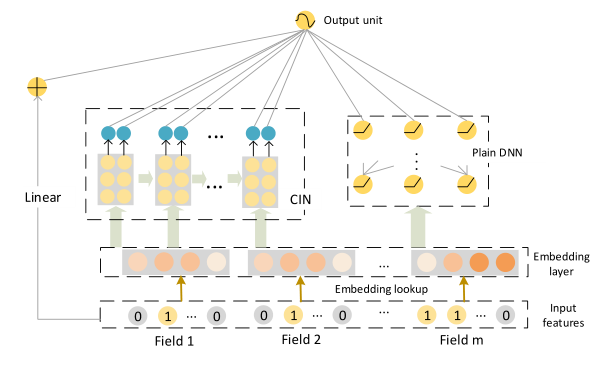
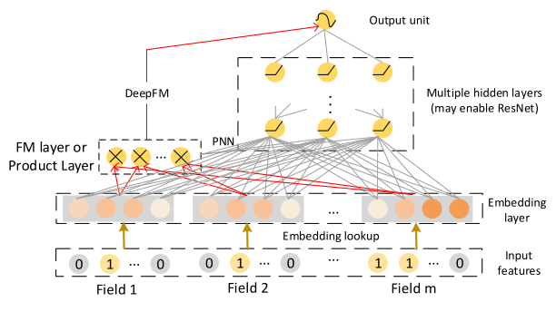
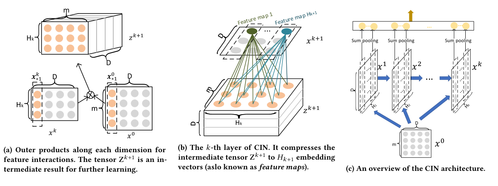
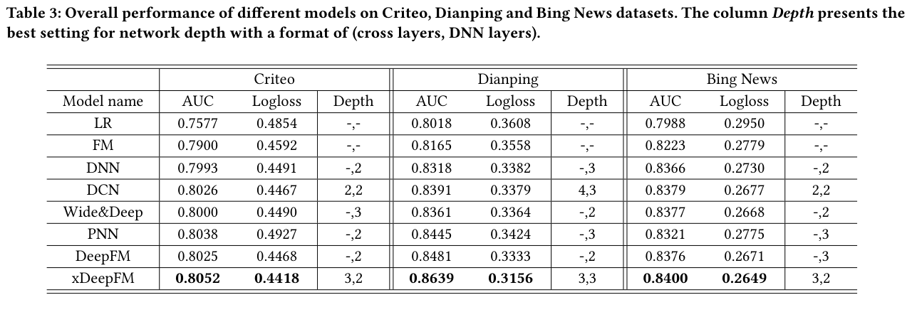

### FM에서 출발해 DeepFM, DCN을 거쳐 CIN(Compressed Interaction Network)으로 명시적인 고차 피처 상호작용을 학습하는 xDeepFM에 대해 알아봅니다.  


> 원제  
> **xDeepFM**: Combining Explicit and Implicit Feature Interactions for Recommender Systems   
> Jianxun Lian, Xiaohuan Zhou, Fuzheng Zhang, Zhongxia Chen, Xing Xie, Guangzhong Sun (KDD 2018)  

<center></center>   

<font size="2"><center> 출처: Lian et al., xDeepFM (https://arxiv.org/abs/1803.05170) </center>  </font>   

<br/>


>  **1. 수작업 cross feature는 비용이 크고, 대규모 데이터에서 다 만들 수 없으며, 학습 데이터에 없던 조합으로 일반화되지 않음 -> 임베딩 기반으로 상호작용을 자동 학습하는 흐름이 생김**
>
>  **2. DNN은 고차 상호작용을 implicit하게, bit-wise로 학습하고, DCN의 CrossNet은 explicit하지만 출력이 $x_0$의 스칼라배라는 특수한 형태로 제한됨**
>
>  **3. xDeepFM은 vector-wise, explicit하게 고차 상호작용을 학습하는 CIN을 제안하고, 이를 Linear + DNN과 결합해 세 데이터셋 모두에서 기존 모델(DeepFM, DCN 등)을 앞섬**

<br/>

----

**본 포스트는 xDeepFM 논문을 읽고, 관련 영상을 보며 정리한 노트입니다.**
원문은 여기에서 보실 수 있습니다. [xDeepFM paper](https://arxiv.org/abs/1803.05170)      

----
#### Contents  

1. [Intro - 왜 피처 상호작용이 중요할까?](#intro)  
2. [FM: 잠재 벡터의 내적으로 상호작용 측정하기](#fm)  
3. [DeepFM과 DCN: 고차 상호작용을 향해](#deepfm_dcn)  
4. [CIN: 압축하면서 상호작용을 쌓아보자!](#cin)  
5. [xDeepFM: Explicit + Implicit의 결합](#xdeepfm)  
6. [실험 결과](#experiments)  
7. [마치며](#conclusion)  
<br />

<a id="intro"></a>
## 1. Intro - 왜 피처 상호작용이 중요할까?  

오늘날의 사용자는 정보의 홍수 속에 살고 있습니다. 이른바 information overload 상황인데요, 이런 환경에서 사용자에게 필요한 정보만 걸러내 주는 information filtering 도구로서 추천시스템이 유용하다는 것은 이미 여러 차례 증명되었습니다.  

추천시스템, 특히 CTR(Click-Through Rate) 예측 모델은 일반적으로 **data -> feature -> model -> output** 의 파이프라인을 거칩니다. 이 중에서 모델의 예측 성능을 좌우하는 핵심은 단연 feature engineering이라고 할 수 있겠죠.  

피처 엔지니어링을 수행하는 대표적인 방법 하나는 **combinatorial feature(cross feature)** 를 만드는 것입니다. 여러 raw feature 간의 상호작용을 하나의 피처로 표현하는 것인데요. 논문에서 든 예시를 보면, 아래와 같은 3-way 피처를 생각해볼 수 있습니다.  

- `AND(user_organization=msra, item_category=deeplearning, time=monday)`
- 사용자가 MSRA(Microsoft Research Asia) 소속이고, 딥러닝 관련 기술 아티클이, 월요일에 노출되었을 때만 1의 값을 가짐  

이런 피처는 분명 강력하지만, 사람이 손으로 만들려고 하면 다음과 같은 3가지 단점이 있습니다.  

**1) Task specific**  
- 좋은 cross feature는 task에 종속적임  
- 데이터에 적합한 패턴을 찾아내려면 도메인 전문가가 될 때까지 아주 많은 시간을 투자해야 함  

**2) Web-scale data**  
- 웹 시스템의 데이터는 high dimension, large volume임  
- raw feature의 수가 너무 많아, 모든 cross feature를 수동으로 만들어 내는 것이 feasible하지 않음  

**3) Unseen patterns**  
- 수작업 cross feature는 학습 데이터셋에서 한 번도 관측되지 않은 조합(unseen interaction)으로 일반화되지 않음  

이러한 이유로, 임베딩 기반 방법론을 사용해 **feature interaction을 자동으로 학습**하도록 하는 연구 흐름이 생겨났습니다. 그 출발점이 바로 Factorization Machine(FM)입니다.  


<a id="fm"></a>
## 2. FM: 잠재 벡터의 내적으로 상호작용 측정하기  

FM(Rendle, 2010)은 각 피처 $i$를 $D$차원의 잠재 벡터(latent vector) $\mathbf{v}_i = [v_{i1}, v_{i2}, ..., v_{iD}]$로 임베딩하고, 두 피처 간의 상호작용을 두 잠재 벡터의 내적으로 측정합니다.  

$$
f^{(2)}(i, j) = \langle \mathbf{v}_i, \mathbf{v}_j \rangle \, x_i x_j
$$

전체 모델을 쓰면 다음과 같습니다.  

$$
\hat{y}(\mathbf{x}) = w_0 + \sum_{i=1}^{n} w_i x_i + \sum_{i=1}^{n}\sum_{j=i+1}^{n} \langle \mathbf{v}_i, \mathbf{v}_j \rangle x_i x_j
$$

핵심은 $x_i$와 $x_j$가 학습 데이터에서 함께 등장한 적이 없더라도, 각각이 다른 피처들과 함께 등장하며 학습된 $\mathbf{v}_i$, $\mathbf{v}_j$가 있으니 그 내적으로 상호작용을 추정할 수 있다는 점입니다. 앞서 말한 unseen pattern 문제를 자연스럽게 해결하는 셈이죠.  

여기서 짚고 넘어갈 용어가 두 가지 있습니다. 논문 전체를 관통하는 개념이니 미리 정리해 두겠습니다.  

- **bit**: 잠재 벡터의 원소 하나(예: $v_{i1}$)를 bit라고 부름  
- **vector-wise interaction**: FM처럼 임베딩 벡터 전체를 하나의 단위로 보고 상호작용을 계산함  
- **bit-wise interaction**: DNN처럼 임베딩 벡터들을 이어붙인 뒤 원소 단위로 섞어버림. 같은 필드 임베딩 안의 원소끼리도 서로 영향을 줌  

FM은 이론적으로 임의의 고차 상호작용으로 확장할 수 있지만, 실제로는 계산량 때문에 대개 2차 상호작용까지만 사용합니다. 또 모든 조합을 다 모델링하다 보니 쓸모없는 조합이 noise로 작용해 성능을 떨어뜨리기도 합니다. 그래서 등장한 것이 뉴럴 네트워크를 활용해 고차 상호작용을 효율적으로 학습하려는 시도들입니다.  


<a id="deepfm_dcn"></a>
## 3. DeepFM과 DCN: 고차 상호작용을 향해  

### 임베딩 레이어  

웹 스케일 추천시스템의 입력은 이미지나 텍스트와 달리 sparse하고, 차원이 엄청나게 크며, 공간적/시간적 상관관계도 없습니다. 그래서 보통 multi-field categorical 형태로 one-hot 인코딩한 뒤, 필드별 임베딩 레이어를 통과시켜 $D$차원의 dense 벡터로 압축합니다.  

- 필드가 univalent(값이 하나)이면 해당 피처의 임베딩을 필드 임베딩으로 사용함  
- 필드가 multivalent(예: interests=comedy&rock)이면 피처 임베딩의 합을 필드 임베딩으로 사용함  
- 결과적으로 필드 수가 $m$일 때 $\mathbf{e} = [\mathbf{e}_1, ..., \mathbf{e}_m]$, 길이 $m \times D$의 벡터를 얻음  

### Implicit 고차 상호작용: DNN 계열  

FNN, Deep Crossing, Wide&Deep의 deep part 등은 이 임베딩 벡터 $\mathbf{e}$ 위에 feed-forward 네트워크를 쌓아 고차 상호작용을 학습합니다.  

$$
\mathbf{x}^1 = \sigma(\mathbf{W}^{(1)}\mathbf{e} + \mathbf{b}_1), \quad \mathbf{x}^k = \sigma(\mathbf{W}^{(k)}\mathbf{x}^{k-1} + \mathbf{b}_k)
$$

PNN과 DeepFM은 여기에 2차 상호작용 레이어(Product layer / FM layer)를 추가했습니다. 둘의 차이는 PNN은 product layer의 출력을 DNN의 입력으로 넣고, DeepFM은 FM layer를 출력 유닛에 바로 연결한다는 점입니다. DeepFM은 Wide&Deep의 wide part를 FM으로 대체해서, 수작업 피처 없이도 저차(FM)와 고차(DNN) 상호작용을 함께 학습할 수 있게 한 모델이죠.  

<center></center>   

<font size="2"><center> 출처: Lian et al., xDeepFM (https://arxiv.org/abs/1803.05170) </center>  </font>   

그런데 저자들은 여기서 문제를 제기합니다.  

- DNN이 학습하는 상호작용은 **implicit**함. 최종적으로 학습된 함수가 임의의 형태일 수 있고, 최대 몇 차 상호작용까지 학습하는지 이론적으로 말할 수 없음  
- DNN은 상호작용을 **bit-wise**로 모델링함. FM이 보여준 vector-wise 방식과는 다름  
- 그렇다면 정말 DNN이 고차 상호작용을 표현하는 데 가장 효과적인 모델인가? 는 열린 질문임  

### Explicit 고차 상호작용: DCN의 Cross Network  

고차 상호작용을 명시적으로 학습하려는 시도로는 Deep & Cross Network(DCN, 2017)의 CrossNet이 있습니다. 각 레이어는 다음과 같은 cross 연산으로 계산됩니다.  

$$
\mathbf{x}_k = \mathbf{x}_0 \mathbf{x}_{k-1}^T \mathbf{w}_k + \mathbf{b}_k + \mathbf{x}_{k-1}
$$

레이어가 하나 쌓일 때마다 $\mathbf{x}_0$와 한 번 더 곱해지니 상호작용 차수가 1씩 올라가고, 파라미터도 레이어당 $O(mD)$ 정도라 매우 효율적입니다. 그런데 xDeepFM 저자들은 여기에 함정이 있다고 지적하는데요. bias를 생략하고 첫 레이어를 풀어보면,  

$$
\mathbf{x}_1 = \mathbf{x}_0(\mathbf{x}_0^T \mathbf{w}_1) + \mathbf{x}_0 = \mathbf{x}_0(\mathbf{x}_0^T \mathbf{w}_1 + 1) = \alpha_1 \mathbf{x}_0
$$

괄호 안은 스칼라이므로 $\mathbf{x}_1$은 $\mathbf{x}_0$의 스칼라배가 됩니다. 귀납적으로 $\mathbf{x}_{i+1} = \alpha_{i+1}\mathbf{x}_0$, 즉 **CrossNet의 모든 hidden layer 출력은 $\mathbf{x}_0$의 스칼라배**라는 것이 논문의 Theorem 2.1입니다.  

물론 $\alpha$ 자체가 $\mathbf{x}_0$에 의존하므로 출력이 $\mathbf{x}_0$에 대해 선형이라는 뜻은 아닙니다. 하지만 표현할 수 있는 상호작용의 형태가 특수하게 제한되고, 여전히 bit-wise 방식이라는 한계가 남습니다. 그래서 저자들은 CrossNet을 대체할 새로운 네트워크를 설계합니다. 그것이 바로 CIN입니다.  


<a id="cin"></a>
## 4. CIN: 압축하면서 상호작용을 쌓아보자!  

CIN(Compressed Interaction Network)은 다음 세 가지를 목표로 설계되었습니다.  

- 상호작용을 bit-wise가 아니라 **vector-wise** 수준에서 계산함  
- 고차 상호작용을 **explicit**하게 측정함  
- 상호작용 차수가 올라가도 네트워크 복잡도가 **지수적으로 증가하지 않음**  

### 입력과 레이어 계산  

임베딩 벡터 하나를 상호작용의 단위로 보기 위해, 필드 임베딩을 행렬 $\mathbf{X}^0 \in \mathbb{R}^{m \times D}$로 둡니다. $i$번째 행이 $i$번째 필드의 임베딩입니다. $k$번째 레이어의 출력도 행렬 $\mathbf{X}^k \in \mathbb{R}^{H_k \times D}$이고, $H_k$는 $k$번째 레이어의 feature vector(=feature map) 개수입니다($H_0 = m$).  

$k$번째 레이어의 $h$번째 feature vector는 다음과 같이 계산됩니다.  

$$
\mathbf{X}^k_{h,*} = \sum_{i=1}^{H_{k-1}} \sum_{j=1}^{m} \mathbf{W}^{k,h}_{ij} \left( \mathbf{X}^{k-1}_{i,*} \circ \mathbf{X}^0_{j,*} \right)
$$

여기서 $\circ$는 Hadamard product(원소별 곱)이고, $\mathbf{W}^{k,h} \in \mathbb{R}^{H_{k-1} \times m}$은 $h$번째 feature vector를 만드는 파라미터 행렬입니다. 말로 풀어보면 이렇습니다.  

- 직전 레이어의 벡터 $H_{k-1}$개와 원래 필드 임베딩 $m$개를 모든 쌍으로 원소별 곱함 -> $H_{k-1} \times m$개의 $D$차원 벡터가 생김  
- 이 벡터들을 가중합해서 새로운 벡터 하나를 만들고, 이런 가중합을 $H_k$번(서로 다른 가중치로) 수행함  
- 매 레이어마다 $\mathbf{X}^0$와 한 번 더 곱해지므로, **$k$번째 레이어는 정확히 $(k+1)$차 상호작용**을 명시적으로 표현함  
- 연산 내내 $D$차원 임베딩 벡터의 구조가 유지되므로 상호작용이 **vector-wise** 수준에서 일어남  

### RNN과 닮았고, CNN과도 닮았다  

제가 영상을 보면서 가장 인상 깊었던 부분이 이 비유였는데요.  

- **RNN과 유사한 점**: 다음 hidden layer의 출력이 직전 hidden layer($\mathbf{X}^{k-1}$)와 추가 입력($\mathbf{X}^0$)에 의존함. 마치 RNN의 hidden state가 이전 state와 매 시점의 입력에 의존하는 것과 같은 구조임  
- **CNN과 유사한 점**: 각 레이어의 계산 단계가 여러 개의 feature map을 생성함  

<center></center>   

<font size="2"><center> 출처: Lian et al., xDeepFM (https://arxiv.org/abs/1803.05170) </center>  </font>   

CNN 관점을 조금 더 자세히 볼까요? 위 그림의 (a)처럼, $\mathbf{X}^k$와 $\mathbf{X}^0$를 임베딩 차원(D) 축을 따라 outer product해서 중간 텐서 $\mathbf{Z}^{k+1} \in \mathbb{R}^{H_k \times m \times D}$를 만듭니다. 이 $\mathbf{Z}^{k+1}$를 일종의 이미지로, $\mathbf{W}^{k,h}$를 필터로 보면, (b)처럼 필터를 D 방향으로 슬라이딩하면서 하나의 hidden vector $\mathbf{X}^{k+1}_{h,*}$를 얻게 됩니다. 이것이 바로 CNN에서 말하는 feature map이죠.  

이름에 붙은 **"Compressed"** 가 바로 여기서 나옵니다. $H_{k-1} \times m$개의 상호작용 벡터 공간을 $H_k$개의 벡터로 **압축**하기 때문입니다. 모든 조합을 다 들고 가면 차수가 오를수록 조합 수가 폭발하지만, 매 레이어에서 압축해 주니 복잡도가 지수적으로 늘지 않게 됩니다.  

### 출력: Sum pooling  

(c)처럼 CIN은 마지막 레이어만 쓰는 것이 아니라, **모든 hidden layer가 출력에 연결**됩니다. 각 레이어의 feature map마다 D 방향으로 sum pooling을 한 뒤,  

$$
p^k_i = \sum_{j=1}^{D} \mathbf{X}^k_{i,j}, \quad \mathbf{p}^k = [p^k_1, ..., p^k_{H_k}]
$$

모든 레이어의 pooling 벡터를 이어붙여 $\mathbf{p}^+ = [\mathbf{p}^1, ..., \mathbf{p}^T]$를 만듭니다. 덕분에 2차부터 $(T+1)$차까지의 상호작용이 모두 최종 예측에 기여할 수 있습니다.  

참고로 첫 레이어에서 $\mathbf{W}$를 모두 1로 고정(constant sum filter)하고 sum pooling을 하면, $\sum_i \sum_j \langle \mathbf{e}_i, \mathbf{e}_j \rangle$ 형태가 되어 FM의 2차 항과 같은 꼴이 됩니다. CIN이 FM을 고차, 그리고 학습 가능한 가중치로 일반화한 것이라고 볼 수 있겠네요.  

### 코드로 shape 감 잡기  

수식만 보면 헷갈리니, PyTorch로 간단하게 CIN 레이어를 짜서 텐서의 shape이 어떻게 변하는지 확인해 보겠습니다. $\mathbf{W}^{k,h}$로 가중합하는 부분은 kernel size 1짜리 `Conv1d`로 구현할 수 있습니다.  

```python
import torch
import torch.nn as nn

class CIN(nn.Module):
    def __init__(self, m, layer_sizes=(4, 4, 4)):
        super().__init__()
        self.filters = nn.ModuleList()
        h_prev = m
        for h in layer_sizes:
            # (H_{k-1} * m) -> H_k : 1x1 conv = 압축(compress)
            self.filters.append(nn.Conv1d(h_prev * m, h, kernel_size=1, bias=False))
            h_prev = h

    def forward(self, x0):                      # x0: (B, m, D)
        B, m, D = x0.shape
        xk, pooled = x0, []
        for conv in self.filters:
            z = torch.einsum('bhd,bmd->bhmd', xk, x0)   # Z^{k+1}: (B, H_k, m, D)
            z = z.reshape(B, -1, D)                    # (B, H_k*m, D)
            xk = conv(z)                               # (B, H_{k+1}, D)
            pooled.append(xk.sum(dim=2))               # sum pooling -> (B, H_{k+1})
            print('Z:', tuple(z.shape), '-> X:', tuple(xk.shape))
        return torch.cat(pooled, dim=1)

x0 = torch.randn(2, 5, 8)   # batch=2, field m=5, embedding D=8
p_plus = CIN(m=5)(x0)
print('p+:', tuple(p_plus.shape))
```

```
Z: (2, 25, 8) -> X: (2, 4, 8)
Z: (2, 20, 8) -> X: (2, 4, 8)
Z: (2, 20, 8) -> X: (2, 4, 8)
p+: (2, 12)
```

첫 레이어에서는 $5 \times 5 = 25$개의 상호작용 벡터가 4개로, 이후에는 $4 \times 5 = 20$개가 4개로 압축되는 것을 볼 수 있습니다. 임베딩 차원 $D=8$은 끝까지 유지되고요(vector-wise!). 최종적으로 3개 레이어의 pooling 결과를 이어붙인 길이 12의 $\mathbf{p}^+$가 출력됩니다. 논문에서도 CIN의 활성화 함수로 identity를 사용하는데, 실험에서 sigmoid, tanh, relu보다 identity가 가장 좋았다고 합니다.  

### 복잡도  

- **공간 복잡도**: $k$번째 레이어의 파라미터는 $H_k \times H_{k-1} \times m$개로, 임베딩 차원 $D$와 무관함. 반면 일반 DNN은 첫 레이어가 $m \times D \times H_1$이라 $D$에 비례해 커짐. 필요하면 $\mathbf{W}^{k,h}$를 $\mathbf{U}\mathbf{V}^T$로 low-rank 분해해 더 줄일 수 있음  
- **시간 복잡도**: $T$층 CIN은 $O(mH^2DT)$로, DNN의 $O(mHD + H^2T)$보다 무거움. CIN의 주된 단점은 시간 복잡도임  
- **표현력**: 일반적인 $k$차 다항식은 $O(m^k)$개의 계수가 필요한데, CIN은 feature map의 연쇄를 통해 $O(km^3)$개의 파라미터만으로 이를 근사함  


<a id="xdeepfm"></a>
## 5. xDeepFM: Explicit + Implicit의 결합  

CIN은 explicit, vector-wise 상호작용을, 일반 DNN은 implicit, bit-wise 상호작용을 학습합니다. 둘은 서로 보완적이니, Wide&Deep이나 DeepFM의 정신을 이어받아 합쳐버리면 되겠죠. 그렇게 탄생한 것이 **xDeepFM(eXtreme Deep Factorization Machine)** 입니다. 맨 위의 구조 그림을 다시 보시면 세 개의 컴포넌트가 하나의 출력 유닛으로 모입니다.  

- **Linear**: raw feature에 대한 1차 항  
- **CIN**: explicit한 고차 feature interaction 학습  
- **DNN**: implicit한 고차 feature interaction 학습  

$$
\hat{y} = \sigma\left( \mathbf{w}_{linear}^T \mathbf{a} + \mathbf{w}_{dnn}^T \mathbf{x}^k_{dnn} + \mathbf{w}_{cin}^T \mathbf{p}^+ + b \right)
$$

$\mathbf{a}$는 raw feature, $\mathbf{x}^k_{dnn}$과 $\mathbf{p}^+$는 각각 DNN과 CIN의 출력입니다. CIN과 DNN은 **같은 임베딩 레이어를 공유**하고, 손실 함수로는 log loss에 정규화 항을 더해 end-to-end로 학습합니다.  

이름에 FM이 들어간 이유도 재밌는데요. 논문에서는 xDeepFM과 FM/DeepFM의 관계를 이렇게 설명합니다.  

- CIN의 depth와 feature map 수를 모두 1로 두면, xDeepFM은 FM layer에 학습 가능한 가중치를 붙인 DeepFM의 일반화가 됨  
- 여기서 DNN을 제거하고 feature map에 constant sum filter를 쓰면, 전통적인 FM으로 다운그레이드됨  

즉 FM -> DeepFM -> xDeepFM으로 이어지는 계보의 "극단적인(eXtreme)" 확장판이라는 의미로 이해하면 될 것 같습니다.  


<a id="experiments"></a>
## 6. 실험 결과  

실험은 Criteo(광고 CTR, 4,500만 건), Dianping(중국 리뷰 사이트의 식당 방문 예측, 120만 건), Bing News(뉴스 클릭 로그, 500만 건) 세 데이터셋에서 AUC와 Logloss로 진행되었습니다. 논문의 관심사가 상호작용의 자동 학습이므로, 수작업 cross feature는 일절 사용하지 않았습니다.  

**Q1. CIN 단독으로는 얼마나 잘하나?**  
- FM, DNN, CrossNet, CIN을 각각 단독 모델로 비교했을 때, CIN이 세 데이터셋 모두에서 가장 좋았음  
- DNN, CrossNet, CIN 모두 FM을 크게 앞섬 -> 실제 데이터에서는 sparse feature 간의 고차 상호작용이 필요하다는 증거임  

**Q2. Explicit과 Implicit을 합치는 게 의미가 있나?**  

<center></center>   

<font size="2"><center> 출처: Lian et al., xDeepFM (https://arxiv.org/abs/1803.05170) </center>  </font>   

- xDeepFM이 세 데이터셋 모두에서 AUC, Logloss 기준 최고 성능을 기록함 (Dianping에서 AUC 0.8481(DeepFM) -> 0.8639)  
- LR은 다른 모델들에 크게 뒤처짐 -> sparse feature를 다룰 때 factorization 기반 접근이 필수적임  
- Wide&Deep, DCN, DeepFM, xDeepFM 같은 hybrid 모델이 단순 DNN보다 확실히 좋음  
- 흥미롭게도 모든 뉴럴 모델이 아주 깊은 구조를 필요로 하지 않았음. xDeepFM의 최적 CIN depth는 3으로, 학습한 상호작용은 최대 4차 정도임  

**Q3. 하이퍼파라미터의 영향은?**  
- **깊이**: 3층까지는 성능이 오르다가 그 이상에서는 떨어짐. 학습 loss는 계속 줄어드는 것으로 보아 overfitting임  
- **레이어당 feature map 수**: Bing News는 20 -> 200으로 늘릴수록 꾸준히 좋아졌고, Dianping은 100이 적당했음  
- **활성화 함수**: CIN에는 비선형 함수보다 identity가 가장 적합했음  

Criteo에서의 AUC 차이(0.8025 -> 0.8052)가 작아 보일 수 있지만, CTR 예측 분야에서는 0.001 수준의 AUC 개선도 의미 있는 향상으로 받아들여진다는 점을 감안하면 꽤 괜찮은 결과입니다.  


<a id="conclusion"></a>
## 7. 마치며  

xDeepFM의 메시지를 한 줄로 정리하면 "DNN에게 상호작용을 다 맡기지 말고, FM처럼 vector-wise로, 그리고 명시적으로 차수를 쌓아 올리자"라고 할 수 있겠습니다. 그 과정에서 DCN의 CrossNet이 사실은 $\mathbf{x}_0$의 스칼라배밖에 표현하지 못한다는 것을 깔끔하게 증명하고, 이를 RNN과 CNN의 아이디어를 섞은 CIN으로 대체한 흐름이 꽤 우아하다고 느꼈습니다.  

개인적으로는 CIN을 "outer product로 만든 상호작용 이미지에 1x1 conv를 거는 것"으로 이해하고 나니 구조가 훨씬 명확하게 들어왔습니다. 다만 시간 복잡도가 DNN보다 무겁다는 점은 실서비스의 latency를 고려하면 분명 고민해야 할 부분일 것 같습니다. 필드 수 $m$이 수백 개 단위로 커지면 $H_{k-1} \times m$ 크기의 중간 텐서가 부담스러워질 테니까요. 이후 나온 DCN-V2가 CrossNet의 한계를 보완하는 방향으로 발전한 것을 보면, explicit 상호작용을 효율적으로 학습하는 문제는 이후로도 계속 이어지는 주제라는 생각이 듭니다.  

----------------


**개선을 위한 여러분의 피드백과 제안을 코멘트로 공유해 주세요.**
**내용에 대한 지적, 혹은 질문을 환영합니다.**  


**출처**  
[xDeepFM: Combining Explicit and Implicit Feature Interactions for Recommender Systems (arXiv)](https://arxiv.org/abs/1803.05170)  
[xDeepFM (KDD 2018, ACM Digital Library)](https://dl.acm.org/doi/10.1145/3219819.3220023)  
[참고 영상 (YouTube)](https://youtu.be/3bsGsq3-VfM)  
[Factorization Machines (Rendle, ICDM 2010)](https://ieeexplore.ieee.org/document/5694074)  
[DeepFM: A Factorization-Machine based Neural Network for CTR Prediction (arXiv)](https://arxiv.org/abs/1703.04247)  
[Deep & Cross Network for Ad Click Predictions (arXiv)](https://arxiv.org/abs/1708.05123)  
