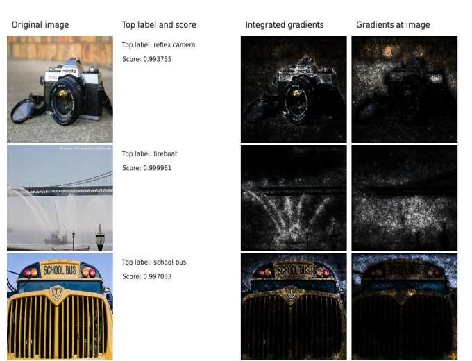
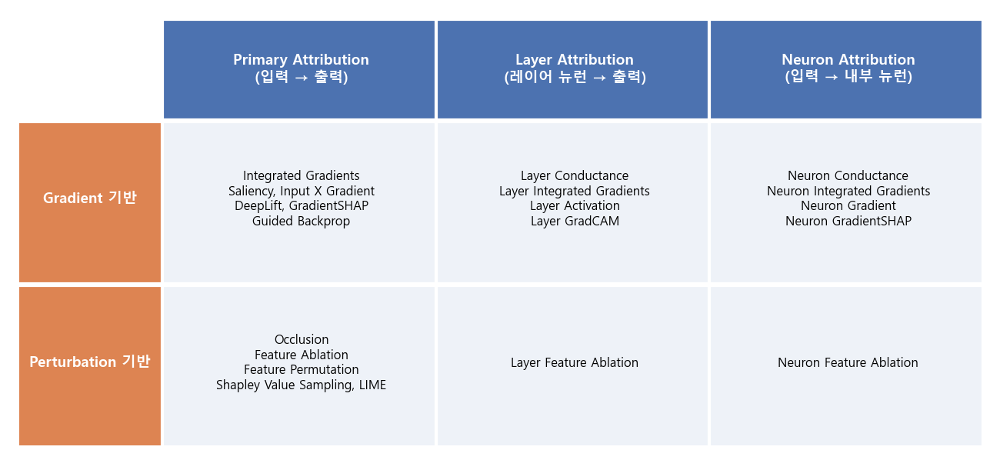
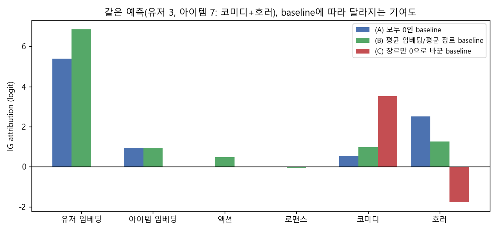
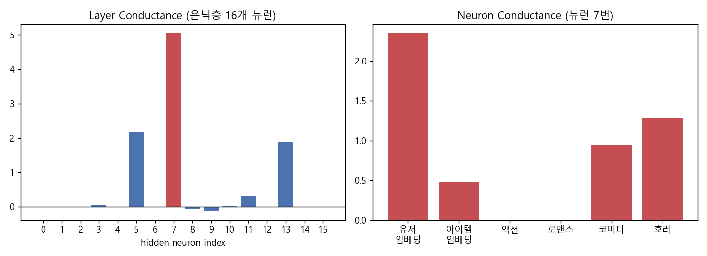

### PyTorch 해석가능성 라이브러리 Captum의 attribution 알고리즘과, 이를 임베딩 기반 추천 모델에 적용하는 방법에 대해 알아봅니다.


> 발표: **Using Captum for Interpretability - Building Recommender Systems with PyTorch** (Narine Kokhlikyan, PyTorch)  
> 함께 다루는 논문: **Axiomatic Attribution for Deep Networks** (Sundararajan, Taly, Yan, ICML 2017)  

<center></center>   

<font size="2"><center> 출처: Sundararajan et al., Axiomatic Attribution for Deep Networks, Figure 2 (https://arxiv.org/abs/1703.01365) </center>  </font>   

<br/>


>  **1. Captum은 PyTorch 모델을 위한 해석가능성 라이브러리로, "입력 → 출력", "레이어 → 출력", "입력 → 내부 뉴런" 세 관점의 attribution을 거의 동일한 API로 제공함**
>
>  **2. 대표 알고리즘인 Integrated Gradients는 baseline에서 실제 입력까지의 경로를 따라 gradient를 적분하며, 기여도의 합이 F(x) - F(baseline)과 같아지는 completeness 성질을 가짐**
>
>  **3. 추천 모델처럼 임베딩을 쓰는 경우 "무엇을 baseline으로 둘 것인가"가 해석 결과를 통째로 바꿀 수 있으므로, baseline 설계가 가장 신중해야 할 부분임**

<br/>

----

**본 포스트는 PyTorch 채널에 공개된 Narine Kokhlikyan의 Captum 발표를 보고 정리한 노트에, Integrated Gradients 논문 내용과 간단한 토이 추천 모델 실험을 덧붙인 글입니다.**
영상은 여기에서 보실 수 있습니다. [link](https://youtu.be/hY_XzglTkak)

----
#### Contents

1. [왜 모델 해석가능성이 중요할까?](#why)
2. [Captum 소개](#captum)
3. [Attribution 알고리즘의 분류](#taxonomy)
4. [Integrated Gradients 톺아보기](#ig)
5. [Baseline, 생각보다 어려운 문제](#baseline)
6. [토이 추천 모델에 IG 적용해보기](#toy)
7. [Layer / Neuron Attribution까지 해보자!](#layer)
8. [마치며](#conclusion)

<br />

<a id="why"></a>
## 1. 왜 모델 해석가능성이 중요할까?

그동안 이 블로그에서는 [LIME](https://myeonghak.github.io/xai/XAI-LIME%28Local-Interpretable-Model-agnostic-Explanation%29-%EC%95%8C%EA%B3%A0%EB%A6%AC%EC%A6%98/)과 [SHAP](https://myeonghak.github.io/xai/XAI-SHAP/)처럼 모델 구조와 무관하게(model-agnostic) 예측을 설명하는 방법들을 다뤄 보았는데요. 이번에는 조금 방향을 틀어서, **딥러닝 모델의 내부 gradient를 직접 활용하는 attribution 방법**과 이를 PyTorch에서 손쉽게 쓸 수 있게 해주는 라이브러리 Captum을 정리해 보려 합니다.

발표에서는 모델 해석가능성이 필요한 이유를 세 가지로 정리합니다.

- **모델의 판단 과정에 대한 이해**: 모델이 왜 이런 예측을 했는지 근거를 확인할 수 있음
- **모델에 대한 이해도 향상**: 모델이 어떤 피처, 어떤 내부 표현에 의존하는지 파악할 수 있음
- **오분류 분석**: 틀린 예측을 뜯어보면서 데이터 보강, 피처 수정 등 결정 경계를 개선하는 조치를 취할 수 있음

추천 시스템에서는 특히 마지막 항목이 중요하다고 생각하는데요. "왜 이 유저에게 이 아이템이 이렇게 높은 점수를 받았지?"라는 질문은 추천 모델을 운영하다 보면 하루에도 몇 번씩 마주치게 되기 때문입니다. 유저 임베딩 때문인지, 아이템의 인기도 때문인지, 혹은 특정 메타 피처 때문인지를 분리해서 볼 수 있다면 디버깅이 훨씬 수월해지겠죠.

<br />

<a id="captum"></a>
## 2. Captum 소개

[Captum](https://captum.ai/)(라틴어로 "이해"라는 뜻)은 Facebook AI(현 Meta)에서 공개한 PyTorch용 해석가능성 라이브러리입니다. 발표에서는 Captum의 특징을 세 가지로 소개합니다.

- **Multimodal**: 이미지, 텍스트, tabular 등 다양한 도메인의 모델에 동일한 방식으로 해석 기능을 붙일 수 있음
- **Extensible**: 새로운 attribution 알고리즘을 쉽게 추가할 수 있는 구조임
- **Easy to use**: 몇 줄의 코드로 실행 가능하고, 시각화 유틸리티(Captum Insights 등)도 제공함

사용법의 핵심은 아주 단순합니다. **모델의 forward 함수(혹은 모델 자체)를 알고리즘 인스턴스에 넘기고, `attribute()`에 입력과 baseline을 넣으면 끝**입니다. 알고리즘이 바뀌어도 이 패턴은 거의 그대로 유지되는데, 이 점이 Captum의 가장 큰 장점이라고 생각합니다.

```python
from captum.attr import IntegratedGradients

ig = IntegratedGradients(model)
attributions, delta = ig.attribute(inputs, baselines=baselines,
                                   target=0, return_convergence_delta=True)
```

<br />

<a id="taxonomy"></a>
## 3. Attribution 알고리즘의 분류

Captum의 attribution 알고리즘은 "무엇을 무엇에 대해 설명하는가"에 따라 세 갈래로 나뉩니다.

1. **Primary Attribution**: 모델 출력을 **입력 피처**의 기여로 설명함
2. **Layer Attribution**: 모델 출력을 **특정 레이어의 뉴런들**의 기여로 설명함
3. **Neuron Attribution**: **특정 내부 뉴런의 값**을 입력 피처의 기여로 설명함

그리고 각각은 다시 계산 방식에 따라 gradient 기반, perturbation 기반(입력을 가리거나 섞어보는 방식), 그 밖의 방법으로 나뉩니다. 대표적인 알고리즘을 표로 정리하면 아래와 같습니다.

<center></center>   

<br/>

발표에서 소개된 알고리즘들을 성격별로 묶어보면 이렇습니다.

- **Simple baseline 성격의 알고리즘** (gradient, activation, 입력값에 기반함): Input X Gradient, Saliency, Layer Activation, Layer Gradient X Activation
- **Computer vision 커뮤니티에서 유명한 알고리즘** (하지만 generic해서 다른 도메인에도 사용 가능함): Guided GradCAM, Occlusion, Guided Backprop / Deconvolution, GradCAM
- **Baseline(reference, background)이 필요한 알고리즘**: Integrated Gradients, DeepLift, GradientSHAP, Conductance 계열 등 다수

참고로 앞서 다룬 SHAP과 LIME도 Captum 안에 구현되어 있습니다(`KernelShap`, `Lime`, `ShapleyValueSampling` 등). 이 중 실무에서 가장 많이 쓰이는, 그리고 발표에서도 메인 예제로 사용한 Integrated Gradients를 조금 더 자세히 보겠습니다.

<br />

<a id="ig"></a>
## 4. Integrated Gradients 톺아보기

### 왜 그냥 gradient를 쓰면 안 될까?

가장 단순한 attribution은 "출력을 입력으로 미분한 값", 즉 saliency입니다. 그런데 이 방식에는 치명적인 약점이 있는데요. ReLU나 sigmoid처럼 **포화(saturation)되는 구간에 들어가면 gradient가 0이 되어버린다**는 점입니다. 어떤 피처가 출력을 크게 올려놓았더라도, 현재 입력 지점에서 함수가 평평하다면 gradient는 "이 피처는 중요하지 않다"고 말해버립니다.

논문은 이 문제를 **Sensitivity** 공리로 정리합니다. 입력과 baseline이 한 피처만 다르고 예측도 다르다면, 그 피처에는 0이 아닌 기여도가 부여되어야 한다는 것이죠. 단순 gradient는 이 공리를 만족하지 못합니다. 또 하나의 공리인 **Implementation Invariance**는 내부 구현이 달라도 입출력이 같은 두 모델(functionally equivalent)은 같은 attribution을 가져야 한다는 것인데, DeepLift나 LRP 같은 방법은 이 공리를 깨뜨린다는 것이 논문의 지적입니다.

### 경로를 따라 gradient를 적분하자

Integrated Gradients(IG)의 아이디어는 간단합니다. 아무 정보도 없는 baseline $x'$에서 실제 입력 $x$까지 직선 경로를 그리고, 그 경로 위의 모든 지점에서 gradient를 모아(적분해) 사용하는 것입니다. $i$번째 피처의 attribution은 다음과 같습니다.

$$
\text{IG}_i(x) = (x_i - x'_i) \times \int_{0}^{1} \frac{\partial F\big(x' + \alpha (x - x')\big)}{\partial x_i} \, d\alpha
$$

경로 중간의 어딘가에서는 함수가 포화되지 않은 상태일 테니, 그 구간의 gradient가 적분에 반영되면서 saliency의 문제가 해결됩니다. 실제 계산은 적분을 $m$개 구간의 리만 합으로 근사합니다.

$$
\text{IG}_i(x) \approx (x_i - x'_i) \times \frac{1}{m} \sum_{k=1}^{m} \frac{\partial F\big(x' + \tfrac{k}{m} (x - x')\big)}{\partial x_i}
$$

### Completeness: 기여도의 합은 예측 차이와 같다

IG의 가장 매력적인 성질은 **Completeness**입니다. 미적분의 기본정리(정확히는 선적분의 기본정리) 덕분에 모든 피처의 attribution을 더하면 정확히 $F(x) - F(x')$가 됩니다.

$$
\sum_{i} \text{IG}_i(x) = F(x) - F(x')
$$

즉 "baseline 대비 예측이 이만큼 올라간 것을, 피처별로 이만큼씩 나눠 가졌다"고 해석할 수 있다는 뜻입니다. SHAP의 efficiency 성질과 닮아 있죠. 그리고 이 성질은 구현을 검증하는 용도로도 유용합니다. 논문에서는 보통 20~300 step 정도면 이 합이 5% 이내로 맞는다고 하며, 맞지 않으면 step 수를 늘리라고 권장합니다. Captum의 `return_convergence_delta=True` 옵션이 바로 이 차이를 돌려주는 기능입니다.

<br />

<a id="baseline"></a>
## 5. Baseline, 생각보다 어려운 문제

IG를 비롯한 많은 알고리즘이 baseline을 필요로 하는데요. Baseline은 **"예측에 중요한 정보가 없는" 기준 입력**으로, 실제 입력과 이 기준을 비교함으로써 "입력의 어떤 부분이 예측의 원인인가"를 알려주는 역할을 합니다. 도메인별로 흔히 쓰는 baseline은 다음과 같습니다.

- **이미지**: 검은(혹은 흰) 이미지, 강아지 부분을 박스로 마스킹하거나 빈 잔디밭 같은 배경 사진으로 대체함
- **자연어**: 토큰을 `<unk>`나 `<pad>` 토큰으로 대체함
- **Tabular**: 해당 칼럼을 0으로 바꾸거나(ablation), 다른 행의 값으로 섞음(permutation)

그런데 발표에서도 강조하듯이, **0이라는 값 자체가 큰 의미를 가질 수 있기 때문에** baseline 결정은 신중해야 하고, 그래서 어려운 작업입니다. 예컨대 "구매 횟수 = 0"은 정보가 없는 상태가 아니라 "신규 유저"라는 강력한 정보일 수 있죠. Captum에서는 baseline을 명시하지 않으면 모두 0으로 채운 텐서를 사용하므로, 기본값을 그대로 쓰는 것은 주의가 필요합니다.

추천 모델이라면 이 문제가 더 까다로워집니다. 유저 ID, 아이템 ID 같은 입력은 이산적인 값이라 "0.3만큼의 유저 ID" 같은 보간이 불가능하거든요. 그래서 보통은 **임베딩 lookup 이후의 벡터 공간에서** 경로를 그리게 되는데(Captum의 `LayerIntegratedGradients`를 임베딩 레이어에 거는 방식), 이때 "0 벡터 유저"나 "평균 유저"가 정말 의미 없는 유저인가라는 질문이 남습니다. 이게 실제로 얼마나 결과를 흔드는지 아래 토이 예제에서 확인해 보겠습니다.

<br />

<a id="toy"></a>
## 6. 토이 추천 모델에 IG 적용해보기

아쉽게도 지금 작업 환경에는 Captum이 설치되어 있지 않아서(가난한 영세 개발자는 남의 환경에 패키지를 함부로 깔 수 없습니다), IG를 PyTorch로 직접 구현해서 돌려 보았습니다. 어차피 IG는 수십 줄이면 구현되는 알고리즘이라 원리를 이해하는 데는 오히려 더 좋은 것 같습니다.

### 실험 세팅

- 유저 50명, 아이템 40개, 장르 4개(액션, 로맨스, 코미디, 호러)
- 각 유저는 장르별 선호도를 가지고, 각 아이템은 1~2개의 장르를 가짐
- "선호도 · 장르 + 노이즈 > 0"이면 클릭(1)으로 라벨링함
- 모델: `[유저 임베딩(8) ; 아이템 임베딩(8) ; 장르 multi-hot(4)]`를 concat해 MLP(20 → 16 → 1)에 넣고 클릭 logit을 출력하는 간단한 NCF 스타일 구조
- Adam(lr=1e-2, weight decay=1e-3)으로 300 epoch 학습 → train loss 0.072, accuracy 0.988

IG 부분의 코드는 아래와 같습니다. 임베딩 lookup을 마친 벡터를 입력으로 받는 `forward_from_vecs`를 따로 만들어두고, 여기에 IG를 거는 것이 핵심입니다.

```python
class ToyRec(nn.Module):
    def __init__(self):
        super().__init__()
        self.user_emb = nn.Embedding(n_users, dim)
        self.item_emb = nn.Embedding(n_items, dim)
        self.mlp = nn.Sequential(nn.Linear(2 * dim + 4, 16), nn.ReLU(), nn.Linear(16, 1))
    def forward_from_vecs(self, u, i, g):
        return self.mlp(torch.cat([u, i, g], dim=-1)).squeeze(-1)
    def forward(self, uid, iid):
        return self.forward_from_vecs(self.user_emb(uid), self.item_emb(iid), item_genre[iid])

def integrated_gradients(f, inputs, baselines, n_steps=50):
    alphas = (torch.arange(n_steps) + 0.5) / n_steps          # Riemann middle
    total_grads = [torch.zeros_like(x) for x in inputs]
    for a in alphas:
        path = [(b + a * (x - b)).requires_grad_() for x, b in zip(inputs, baselines)]
        grads = torch.autograd.grad(f(*path).sum(), path)
        total_grads = [t + g for t, g in zip(total_grads, grads)]
    return [(x - b) * t / n_steps for x, b, t in zip(inputs, baselines, total_grads)]

uid, iid = torch.tensor([3]), torch.tensor([7])
u, i, g = model.user_emb(uid).detach(), model.item_emb(iid).detach(), item_genre[iid]
inputs = (u, i, g)
baselines = tuple(torch.zeros_like(x) for x in inputs)
attr_u, attr_i, attr_g = integrated_gradients(model.forward_from_vecs, inputs, baselines)
```

3번 유저와 7번 아이템(코미디 + 호러) 쌍에 대해, 모든 입력을 0으로 둔 baseline으로 실행한 결과입니다. 임베딩 attribution은 차원별 값을 합쳐서 하나로 보았습니다.

```
item genres : ['코미디', '호러']
user pref   : ['액션 +0.12', '로맨스 +1.24', '코미디 +1.12', '호러 -0.25']
user emb    : +5.386
item emb    : +0.941
genre       : ['액션 -0.000', '로맨스 +0.000', '코미디 +0.539', '호러 +2.501']
sum of attr = +9.3676  /  F(x)-F(x') = +9.3277
```

Completeness를 먼저 확인해 보면, attribution의 합(9.368)과 예측 차이(9.328)가 0.4% 이내로 맞습니다. 구현은 제대로 된 것 같네요. 참고로 step 수에 따른 오차(|합 - 예측 차이|)는 1 step 0.31, 10 step 0.013, 50 step 0.040, 100 step 0.010, 300 step 0.009였습니다. ReLU 때문에 함수가 구간별로 꺾여서 오차가 단조롭게 줄지는 않지만, 수십 step 이상이면 충분히 안정적입니다.

그런데 결과가 좀 이상합니다. 이 유저는 **호러를 약간 싫어하는데(-0.25), 호러 장르의 기여도가 +2.5로 가장 큰 양수**로 나왔습니다. 모델이 잘못 학습한 걸까요?

<br />

### Baseline을 바꿔보면?

범인은 baseline입니다. 모두 0인 baseline에서 출발하면 유저 임베딩, 아이템 임베딩, 장르가 **동시에** 0에서 실제 값으로 커지는데, 이 과정에서 생기는 상호작용(interaction) 효과가 피처들 사이에 어떻게든 나눠 담기게 됩니다. "0 벡터 유저가 장르 없는 0 벡터 아이템을 보는 상황"은 현실에 존재하지 않는 기준점이기도 하고요.

그래서 baseline을 세 가지로 바꿔가며 같은 예측을 설명해 보았습니다.

- **(A) 모두 0인 baseline**: Captum의 기본값과 같음
- **(B) 평균 baseline**: 유저/아이템 임베딩은 전체 평균, 장르는 전체 아이템의 평균 장르 분포를 사용함
- **(C) 장르만 0으로 바꾼 baseline**: 유저와 아이템 임베딩은 그대로 두고, 장르 정보만 제거함. 즉 "이 유저가 이 아이템을 장르 정보 없이 봤다면?"과 비교함

<center></center>   

<br/>

(C)의 결과는 코미디 +3.53, 호러 -1.78로, 유저 선호도(코미디 +1.12, 호러 -0.25)와 방향이 정확히 일치합니다. 이때 attribution의 합(1.75)은 장르 정보 유무에 따른 예측 차이(1.78)와 거의 같습니다. 반면 (A)와 (B)에서는 호러가 양의 기여로 나오고, 유저 임베딩이 기여도의 대부분을 가져갑니다.

여기서 중요한 점은 **세 결과 모두 "틀린" 것이 아니라 서로 다른 질문에 대한 답**이라는 것입니다.

- (A): "아무것도 없는 상태 대비, 이 점수는 어디서 왔나?" → 이 유저 자체가 클릭을 많이 하는 성향이라는 정보(유저 임베딩)가 가장 큼
- (B): "평균적인 유저-아이템 쌍 대비, 이 쌍은 왜 다른가?"
- (C): "같은 유저-아이템 쌍에서, 장르 정보가 점수를 어떻게 바꿨나?" → 코미디는 올리고 호러는 깎음

추천 모델을 설명할 때는 이렇게 **내가 던지고 싶은 질문을 먼저 정하고, 그에 맞는 baseline을 설계하는 것**이 알고리즘 선택보다 훨씬 중요하다는 걸 체감할 수 있었습니다. 실제 서비스 모델이라면 "같은 유저가 이 아이템 대신 평균 아이템을 봤을 때", "인기 아이템 대신 롱테일 아이템을 봤을 때" 등 다양한 counterfactual baseline을 생각해볼 수 있겠죠.

참고로 Captum을 쓴다면 위 실험은 대략 아래처럼 표현됩니다(이 코드는 실행해보지 않은 참고용입니다). ID를 직접 받는 `forward`를 그대로 두고 임베딩 레이어에 `LayerIntegratedGradients`를 거는 방식이 추천 모델에서는 더 자연스럽습니다.

```python
from captum.attr import IntegratedGradients, LayerIntegratedGradients

ig = IntegratedGradients(model.forward_from_vecs)
attr, delta = ig.attribute((u, i, g), baselines=(u, i, torch.zeros_like(g)),
                           n_steps=50, return_convergence_delta=True)

lig = LayerIntegratedGradients(model, model.user_emb)
attr_user = lig.attribute(inputs=uid, additional_forward_args=(iid,),
                          baselines=uid_ref)   # baseline으로 쓸 reference 유저 ID
```

<br />

<a id="layer"></a>
## 7. Layer / Neuron Attribution까지 해보자!

발표에서는 primary attribution 외에도 neuron attribution과 layer attribution 예제를 함께 보여줍니다. 둘 다 IG를 내부 레이어로 확장한 **Conductance** 계열 알고리즘(Dhamdhere et al., 2018)을 사용합니다.

### Layer Conductance: 어떤 은닉 뉴런이 출력을 만들었나

`LayerConductance`는 입력에서 baseline까지의 같은 경로를 따라가되, 출력의 변화를 **은닉층 뉴런 단위로** 나눠줍니다. 은닉 뉴런 $h_j$의 conductance는 다음과 같이 정의됩니다.

$$
\text{Cond}^{h_j}(x) = \int_{0}^{1} \frac{\partial F}{\partial h_j} \cdot \frac{\partial h_j\big(x' + \alpha (x - x')\big)}{\partial \alpha} \, d\alpha
$$

입력값과 대상 레이어를 넘기면 **그 레이어 크기와 같은 출력**이 나오고, 이것 역시 모두 더하면 $F(x) - F(x')$가 됩니다. 토이 모델의 은닉층(ReLU 이후 16개 뉴런)에 대해 직접 계산해 보면, (A) baseline 기준 합계 +9.328이 예측 차이 +9.328과 정확히 일치했고, 7번 뉴런 혼자 +5.05를 담당하고 있었습니다.

### Neuron Conductance: 그 뉴런은 무엇에 반응하나

그렇다면 7번 뉴런은 어떤 입력에 반응하는 뉴런일까요? `NeuronConductance`는 특정 뉴런을 지정하면, 그 뉴런을 **통과하는** 기여도를 입력 피처별로 나눠줍니다. IG와 비슷하게 chain rule로 $\frac{\partial F}{\partial h_j} \cdot \frac{\partial h_j}{\partial x_i}$를 경로 위에서 적분하는 방식이며, **입력과 같은 크기의 출력**을 돌려줍니다.

<center></center>   

<br/>

7번 뉴런의 neuron conductance는 유저 임베딩 +2.35, 아이템 임베딩 +0.48, 코미디 +0.94, 호러 +1.28이었고, 합계 +5.04는 앞서 구한 layer conductance(+5.05)와 맞아떨어집니다. 이 뉴런은 "유저 성향 + 장르가 붙어 있다는 사실" 자체에 반응하는, 일종의 공통 활성 뉴런으로 보입니다. 이런 식으로 레이어 → 뉴런 → 입력 순서로 드릴다운하면, 모델 내부에서 어떤 경로로 점수가 만들어지는지 추적할 수 있습니다.

### 결국 API는 하나의 패턴

발표에서 강조하는 부분이 바로 이것인데요. 세 종류의 attribution 모두 **"인스턴스 생성 시 forward(혹은 모델 + 레이어)를 넘기고, `attribute()`에 입력을 넣는다"**는 같은 구조를 공유합니다.

```python
from captum.attr import IntegratedGradients, NeuronConductance, LayerConductance

IntegratedGradients(model).attribute(x, baselines=x0)               # 입력 → 출력
NeuronConductance(model, model.mlp[1]).attribute(x, neuron_selector=7)  # 입력 → 7번 뉴런
LayerConductance(model, model.mlp[1]).attribute(x, baselines=x0)    # 은닉층 → 출력
```

(이 코드 역시 API 형태를 보여주기 위한 참고용입니다. 여기서 `model`은 concat된 벡터 `x` 하나를 입력으로 받는 모델을 가정했습니다.)

발표 후반부에서는 대규모 모델/데이터에 Captum을 적용하기 위한 스케일링 방법(배치 처리, `internal_batch_size`로 step을 나눠 계산하는 방식 등)과 Captum Insights를 이용한 시각화도 다루는데, 이 부분은 영상을 직접 참고하시길 추천합니다.

<br />

<a id="conclusion"></a>
## 8. 마치며

Captum 발표를 정리하면서, 직접 IG를 구현해 작은 추천 모델에 붙여 보았습니다. 정리하면 이렇습니다.

- Captum은 primary / layer / neuron attribution을 같은 API 패턴으로 제공해, 한 번 익혀두면 알고리즘을 바꿔가며 실험하기 쉬움
- Integrated Gradients는 saturation 문제를 경로 적분으로 해결하고, completeness 덕분에 결과를 "예측 차이의 분해"로 해석할 수 있음. 구현 검증에도 유용함
- 추천 모델에서는 ID가 이산값이므로 임베딩 공간에서 경로를 그려야 하고, 이때 baseline 선택이 해석 결과를 완전히 바꿀 수 있음

개인적으로 가장 인상 깊었던 건 역시 baseline 실험이었습니다. 처음 (A)의 결과를 봤을 때 "호러를 싫어하는 유저인데 호러가 가장 큰 양의 기여라니, 모델이 이상한가?" 하고 한참 고민했는데, 알고 보니 모델이 아니라 **제 질문이 모호했던 것**이었습니다. 설명 가능한 AI라고 하면 알고리즘이 알아서 답을 주는 것처럼 느껴지지만, 결국 "무엇과 비교해서 설명할 것인가"는 사람이 정해야 한다는 점을 다시 한 번 느꼈습니다. 이전에 다룬 LIME, SHAP에서도 background data를 무엇으로 두느냐가 중요했던 것과 같은 맥락이겠죠.

----------------


**개선을 위한 여러분의 피드백과 제안을 코멘트로 공유해 주세요.**
**내용에 대한 지적, 혹은 질문을 환영합니다.**  


**출처**  
[Using Captum for Interpretability - Building Recommender Systems with PyTorch (Narine Kokhlikyan, YouTube)](https://youtu.be/hY_XzglTkak)  
[Sundararajan et al., Axiomatic Attribution for Deep Networks (ICML 2017)](https://arxiv.org/abs/1703.01365)  
[Kokhlikyan et al., Captum: A unified and generic model interpretability library for PyTorch (2020)](https://arxiv.org/abs/2009.07896)  
[Dhamdhere et al., How Important Is a Neuron? (2018)](https://arxiv.org/abs/1805.12233)  
[Captum 공식 홈페이지](https://captum.ai/)  
