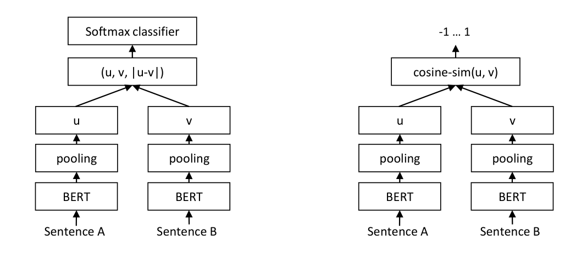
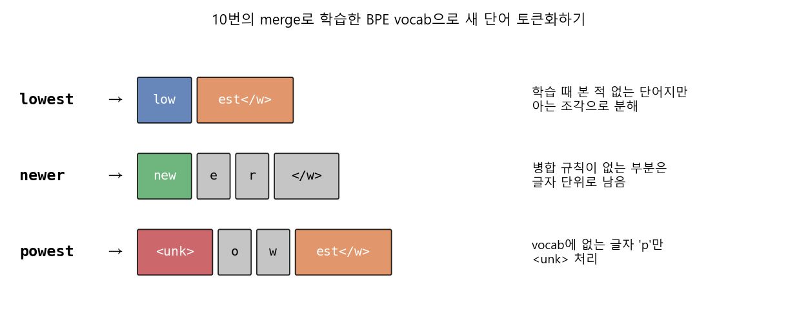
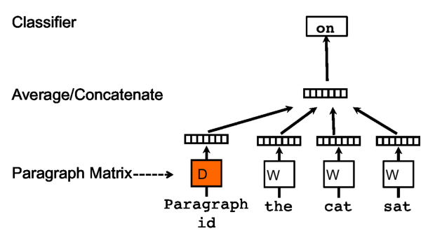
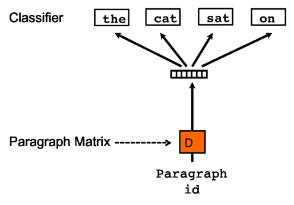

### 단어를 어떻게 쪼갤지(BPE)부터, 문서와 문장을 어떻게 하나의 벡터로 표현할지(Doc2Vec, SBERT)까지 알아봅니다.


> 다루는 논문 및 강의  
> **BPE**: Neural Machine Translation of Rare Words with Subword Units (Sennrich et al., ACL 2016)  
> **Doc2Vec**: Distributed Representations of Sentences and Documents (Le & Mikolov, ICML 2014)  
> **SBERT**: Sentence-BERT: Sentence Embeddings using Siamese BERT-Networks (Reimers & Gurevych, EMNLP 2019)  
> 강의: Abhishek Thakur, *Subword Tokenization: Byte Pair Encoding* (YouTube) / 고려대학교 강필성 교수님, Text Analytics - Doc2Vec  

<center></center>   

<font size="2"><center> 출처: Reimers & Gurevych, Sentence-BERT (https://arxiv.org/abs/1908.10084) </center>  </font>   

<br/>


>  **1. BPE는 코퍼스에서 가장 자주 등장하는 글자 쌍을 반복적으로 병합해 subword vocab을 만드는 방법으로, 처음 보는 단어(OOV)도 아는 조각으로 분해해 처리할 수 있음**
>
>  **2. Doc2Vec은 word2vec의 CBOW/Skip-gram 구조에 문서 고유의 벡터(paragraph vector)를 끼워 넣어, 단어를 맞추는 과정에서 문서 임베딩을 함께 학습함**
>
>  **3. SBERT는 가중치를 공유하는 두 BERT(siamese network)에 pooling을 붙여 NLI/STS 데이터로 fine-tuning함으로써, 코사인 유사도로 바로 비교 가능한 문장 임베딩을 만들어 냄**

<br/>

----

**본 포스트는 BPE, Doc2Vec, SBERT 관련 강의와 논문을 보고 정리한 노트입니다.**
원문은 여기에서 보실 수 있습니다.  
[BPE paper](https://arxiv.org/abs/1508.07909), [Doc2Vec paper](https://arxiv.org/abs/1405.4053), [SBERT paper](https://arxiv.org/abs/1908.10084), [BPE 강의 영상](https://youtu.be/zjaRNfvNMTs)

----
#### Contents  

1. [Intro - 텍스트를 숫자로 바꾸는 세 단계](#intro)  
2. [BPE: 단어를 어디서 쪼갤까?](#bpe)  
3. [Doc2Vec: 문서도 임베딩할 수 있을까?](#doc2vec)  
4. [SBERT: BERT로 문장 임베딩을 제대로 뽑아보자!](#sbert)  
5. [마치며](#conclusion)  
<br />

<a id="intro"></a>
## 1. Intro - 텍스트를 숫자로 바꾸는 세 단계  

자연어 처리 모델에 텍스트를 넣으려면, 결국 어딘가에서 글자를 숫자(벡터)로 바꿔야 하는데요.  
이 과정을 크게 나눠보면 다음과 같은 질문들로 정리할 수 있을 것 같습니다.  

- 문장을 **어떤 단위(token)로 쪼갤 것인가?** → Tokenization  
- 쪼갠 단위를 **어떻게 벡터로 표현할 것인가?** → Word Embedding  
- 단어 벡터들을 모아서 **문장/문서 전체를 어떻게 하나의 벡터로 표현할 것인가?** → Sentence/Document Embedding  

오늘은 이 중 첫 번째와 세 번째 질문에 대한 대표적인 답 세 가지를 순서대로 살펴보려고 합니다.  
첫 번째 질문에 대한 답으로는 GPT, RoBERTa 등 요즘 언어 모델의 기본 토크나이저가 된 **BPE(Byte Pair Encoding)** 를,  
세 번째 질문에 대한 답으로는 word2vec의 아이디어를 문서로 확장한 **Doc2Vec**, 그리고 BERT를 문장 임베딩에 맞게 fine-tuning한 **SBERT**를 다룹니다.  

Transformer와 BERT 자체에 대한 내용은 이전 포스트인 [Transformer와 BERT](https://myeonghak.github.io/natural%20language%20processing/NLP-Transformer%EC%99%80-BERT/)를 참고해 주세요.  

<br/>

<a id="bpe"></a>
## 2. BPE: 단어를 어디서 쪼갤까?  

### 단어 단위 토큰화의 한계, OOV  

가장 단순한 방법은 띄어쓰기 기준으로 단어를 자르고, 단어마다 하나의 id를 부여하는 것입니다.  
여기에 lemmatization이나 stemming을 더해 `running → run` 처럼 형태를 정리해 주기도 하는데요, 이 방식은 항상 잘 작동하지는 않습니다.  
가장 큰 문제는 **사전(vocab)에 없는 새로운 단어가 등장했을 때(OOV, Out-Of-Vocabulary)** 입니다. 학습 때 한 번도 보지 못한 단어는 그냥 `<unk>`로 뭉개져 버리고, 그 단어가 가진 정보는 모두 사라지게 되죠.  

그렇다면 단어를 **의미를 가진 더 작은 단위로 쪼개면** 어떨까요?  
강의에서 든 예시는 스웨덴어 단어 `nykomlingen`(새로 온 사람, 신참)인데요, 이를 `ny`(새로운) + `komling`(온 사람) + `en`(정관사)으로 쪼갠다면, 이 단어를 처음 보더라도 각 조각의 임베딩을 조합해 대략적인 의미를 추정할 수 있을 것입니다.  
Sennrich et al.의 논문 역시 같은 문제의식에서 출발합니다. 번역 모델은 고정된 크기의 vocab을 갖지만, 번역은 본질적으로 open-vocabulary 문제이므로 희귀어, 합성어, 고유명사를 **subword 단위**로 번역하자는 것이죠.  

### BPE 학습 방식  

BPE의 학습 절차는 놀라울 정도로 단순합니다.  

- 모든 단어를 글자(character) 단위로 쪼개고, 단어 끝에는 단어 경계 표시 `</w>`를 붙임  
- 코퍼스에서 **인접한 두 심볼 쌍(pair)의 빈도**를 셈  
- 가장 빈번한 쌍을 하나의 새로운 심볼로 병합(merge)하고, 이 병합 규칙을 기록함  
- 원하는 vocab 크기(= 병합 횟수)에 도달할 때까지 반복함. 이 병합 횟수가 사실상 유일한 **hyperparameter**임  

논문에 나오는 toy 코퍼스 `{low: 5, lower: 2, newest: 6, widest: 3}`로 직접 돌려보겠습니다.  
논문의 Algorithm 1을 거의 그대로 옮기고, 학습된 병합 규칙으로 새 단어를 토큰화하는 함수만 추가했습니다.  

```python
import re, collections

def get_stats(vocab):
    pairs = collections.defaultdict(int)
    for word, freq in vocab.items():
        symbols = word.split()
        for i in range(len(symbols) - 1):
            pairs[symbols[i], symbols[i + 1]] += freq
    return pairs

def merge_vocab(pair, vocab):
    bigram = re.escape(' '.join(pair))
    p = re.compile(r'(?<!\S)' + bigram + r'(?!\S)')
    return {p.sub(''.join(pair), word): freq for word, freq in vocab.items()}

vocab = {'l o w </w>': 5, 'l o w e r </w>': 2,
         'n e w e s t </w>': 6, 'w i d e s t </w>': 3}
alphabet = {c for word in vocab for c in word.split()}
merges = []
for i in range(10):
    pairs = get_stats(vocab)
    best = max(pairs, key=pairs.get)
    vocab = merge_vocab(best, vocab)
    merges.append(best)
    print(f'{i+1:2d}: {best} (freq={pairs[best]})')
print(vocab)

def tokenize(word, merges):
    symbols = [c if c in alphabet else '<unk>' for c in word] + ['</w>']
    for a, b in merges:
        i = 0
        while i < len(symbols) - 1:
            if symbols[i] == a and symbols[i + 1] == b:
                symbols[i:i + 2] = [a + b]
            else:
                i += 1
    return symbols

for w in ['lowest', 'newer', 'powest']:
    print(w, '->', tokenize(w, merges))
```

```
 1: ('e', 's') (freq=9)
 2: ('es', 't') (freq=9)
 3: ('est', '</w>') (freq=9)
 4: ('l', 'o') (freq=7)
 5: ('lo', 'w') (freq=7)
 6: ('n', 'e') (freq=6)
 7: ('ne', 'w') (freq=6)
 8: ('new', 'est</w>') (freq=6)
 9: ('low', '</w>') (freq=5)
10: ('w', 'i') (freq=3)
{'low</w>': 5, 'low e r </w>': 2, 'newest</w>': 6, 'wi d est</w>': 3}
lowest -> ['low', 'est</w>']
newer -> ['new', 'e', 'r', '</w>']
powest -> ['<unk>', 'o', 'w', 'est</w>']
```

결과를 한 줄씩 따라가 보면 이렇습니다.  

- 처음에는 `newest`(6회)와 `widest`(3회)에 공통으로 들어있는 `e`+`s`가 빈도 9로 가장 많아 `es`로 병합됨  
- 이제 `es`를 하나의 심볼로 보면, `es`+`t` 역시 빈도 9로 최다 쌍이 되어 `est`가 만들어지고, 한 번 더 반복하면 `est</w>`가 만들어짐  
- 즉, 처음 3번의 병합만으로 vocab에는 글자 단위 심볼들에 더해 `es`, `est`, `est</w>`가 추가됨  
- `</w>`를 붙인 덕분에 `est</w>`는 **단어 끝에 오는 est**(최상급 어미)라는 정보까지 담게 됨  

<center></center>   

<br/>

### OOV는 어떻게 처리될까?  

진짜 재미있는 부분은 학습이 끝난 후입니다. 위 그림처럼, 학습 코퍼스에 없던 `lowest`가 들어오면 단어 단위 토크나이저는 모른다고 하겠지만, BPE는 학습된 병합 규칙을 순서대로 적용해 `low` + `est</w>` 두 조각으로 쪼개줍니다.  
`powest`처럼 학습 때 아예 본 적 없는 글자(`p`)가 섞인 단어라면 그 글자만 `<unk>`로 처리하고 나머지는 `o` + `w` + `est</w>`로 살려내죠.  
극단적으로 말하면, 글자 단위까지 내려가면 어떤 단어든 표현할 수 있으니 OOV 문제가 크게 완화되는 셈입니다.  
자주 나오는 단어는 통째로 하나의 토큰이 되고, 드문 단어는 여러 조각으로 쪼개지는, 빈도에 따라 자연스럽게 균형이 잡히는 구조라는 점이 BPE의 매력입니다.  

### 엄밀히 말하면 character-level BPE  

참고로 BPE라는 이름은 원래 1994년 Philip Gage가 제안한 **데이터 압축 알고리즘**에서 왔는데요, 원본은 가장 자주 등장하는 바이트 쌍을 사용되지 않은 바이트 하나로 치환해 데이터를 압축하는 방식입니다.  
Sennrich et al.은 이 아이디어를 가져와 바이트 대신 **글자를 병합**하는 방식으로 바꾼 것이고, 그래서 지금까지 설명한 방식은 엄밀히는 character-level BPE라고 부르는 것이 정확합니다.  

그렇다면 진짜 **byte-level BPE**는 언제 필요할까요?  
중국어, 일본어처럼 글자 종류 자체가 수만 개에 이르는 언어나, 이모지 같은 다양한 유니코드 문자가 섞인 텍스트를 다루면 base vocab(글자 집합) 자체가 너무 커지고, 그래도 처음 보는 글자는 여전히 `<unk>`가 됩니다.  
GPT-2는 이 문제를 텍스트를 UTF-8 **바이트 열**로 보고 BPE를 적용하는 방식으로 해결했는데요, base vocab이 256개의 바이트로 고정되므로 어떤 문자열이든 `<unk>` 없이 표현할 수 있습니다.  

### 빈도 대신 확률로? WordPiece  

BPE는 병합할 쌍을 **빈도(count)** 로 골랐습니다. 그렇다면 count 대신 **확률(likelihood)** 을 기준으로 삼으면 어떨까요?  
이것이 BERT에서 사용하는 **WordPiece** 의 아이디어입니다. 예를 들어 `es`와 `er` 중 무엇을 병합할지 고를 때, 단순히 더 많이 나온 쌍이 아니라 **병합했을 때 코퍼스의 언어모델 likelihood를 가장 크게 높이는 쌍**을 고릅니다.  
실무적으로는 대략 아래 점수가 가장 높은 쌍을 고르는 것으로 이해할 수 있습니다.  

$$
\text{score}(a, b) = \frac{\text{freq}(ab)}{\text{freq}(a) \times \text{freq}(b)}
$$

- 분자만 보면 BPE와 같지만, 분모로 각 조각의 빈도를 나눠주므로 **개별로는 흔하지 않은데 붙어서 자주 나오는 쌍**이 우선 병합됨  
- 즉 "그냥 흔한 쌍"보다 "서로 강하게 엮여 있는 쌍"을 선호하는 방식임  
- BERT의 vocab에서 `##ing` 처럼 `##`이 붙은 토큰이 단어 중간/끝에 오는 subword를 나타내는 것도 이 WordPiece 방식의 흔적임  

<br/>

<a id="doc2vec"></a>
## 3. Doc2Vec: 문서도 임베딩할 수 있을까?  

이제 시점을 토큰에서 문서로 옮겨 보겠습니다. 이 부분은 고려대학교 강필성 교수님의 Text Analytics 강의를 보고 정리한 내용입니다.  
강의의 출발점은 간단합니다. **단어를 임베딩할 수 있다면, 문장/문단/문서도 임베딩할 수 있지 않을까?**  
논문에서는 문장, 문단, 문서처럼 길이가 가변적인 텍스트를 통틀어 **paragraph**라고 부르고, 이를 고정 길이 벡터로 표현하는 **Paragraph Vector**를 제안합니다. 우리가 흔히 Doc2Vec이라고 부르는 바로 그 모델입니다.  

단어 벡터를 평균 내는 방법도 있지 않냐고요? 물론 가능하지만, 평균은 단어 순서를 완전히 무시하고, bag-of-words는 단어 간 의미적 거리를 반영하지 못한다는 한계가 있습니다. Paragraph Vector는 이 둘의 단점을 학습으로 보완해보자는 접근입니다.  
word2vec에 CBOW와 Skip-gram이 있듯, Paragraph Vector에도 두 가지 버전이 있습니다.  

### PV-DM (Distributed Memory)  

<center></center>   

<font size="2"><center> 출처: Le & Mikolov, Distributed Representations of Sentences and Documents (https://arxiv.org/abs/1405.4053) </center>  </font>   

<br/>

- word2vec의 **CBOW에 상응**하는 방법론임  
- paragraph id에 해당하는 벡터(행렬 $D$의 한 열)와 window 내 단어 벡터(행렬 $W$)들을 평균 또는 concatenate하여 **다음에 등장할 단어를 맞추는** 태스크로 학습함  
- 예를 들어 paragraph 1이 "the cat sat on the table"이고 window size가 3이라면, (paragraph 1 벡터, the, cat, sat)으로 `on`을 예측하고, 다음엔 (paragraph 1 벡터, cat, sat, on)으로 `the`를 예측하는 식으로 진행함  
- **paragraph vector는 같은 paragraph에서 만들어진 모든 window에 걸쳐 공유**되지만, paragraph끼리는 서로 독립임  
- 반대로 **word vector는 모든 paragraph에 걸쳐 공유**됨. 즉 `cat`의 벡터는 어느 문서에서 등장하든 같음  

여기서 paragraph vector의 역할이 재미있는데요, 논문은 이 벡터를 **"현재 문맥에서 빠져 있는 정보, 즉 문단의 주제를 기억하는 메모리"** 로 해석합니다. 그래서 이름이 Distributed *Memory*인 것이죠.  
여러 window에서 다음 단어를 맞추는 데 기여하도록 계속 업데이트되다 보면, 결과적으로 그 문서의 전반적인 맥락을 담은 임베딩이 학습되게 됩니다.  

목적함수 자체는 word2vec과 거의 같습니다. 단어 열 $w_1, \dots, w_T$에 대해 평균 로그 확률을 최대화하는데,  

$$
\frac{1}{T}\sum_{t=k}^{T-k} \log p(w_t \mid w_{t-k}, \dots, w_{t+k}, d)
$$

조건부에 문서 벡터 $d$가 하나 더 들어갔다는 점만 다릅니다. 실제 구현에서는 hierarchical softmax나 negative sampling으로 계산량을 줄입니다.  

### PV-DBOW (Distributed Bag of Words)  

<center></center>   

<font size="2"><center> 출처: Le & Mikolov, Distributed Representations of Sentences and Documents (https://arxiv.org/abs/1405.4053) </center>  </font>   

<br/>

- word2vec의 **Skip-gram에 상응**하는 방법론임  
- paragraph vector 하나만 주어졌을 때, **그 문서 안에서 랜덤하게 샘플링한 단어들을 맞추도록** 학습함  
- 즉 입력에서 context word를 아예 무시하고, 출력층에서 문서 내 단어를 예측하도록 강제함  
- 입력에 단어 벡터가 필요 없으므로 저장해야 할 파라미터가 적음 (softmax 가중치만 필요)  
- 맞출 단어들의 **순서를 고려하지 않음** (그래서 Bag of Words라는 이름이 붙음)  

### 새로운 문서는 어떻게 임베딩할까?  

한 가지 짚고 넘어갈 점은, paragraph vector는 **학습 때 본 문서에만 존재**한다는 것입니다. 그렇다면 새 문서가 들어오면 어떻게 해야 할까요?  
Doc2Vec은 이때 **inference step**을 한 번 더 돌립니다. 단어 벡터 $W$와 softmax 가중치는 고정한 채, 새 문서에 해당하는 열만 $D$에 추가해 gradient descent로 그 벡터만 학습하는 것이죠.  
그래서 같은 문서라도 inference할 때마다 벡터가 조금씩 달라질 수 있고, 추론 비용도 단순한 forward pass보다 큽니다. 실무에서 Doc2Vec을 쓸 때 은근히 신경 쓰이는 부분입니다.  

### 그래서 뭘 써야 하나?  

둘 중 어떤 게 낫냐는 질문에 논문은 꽤 명확한 답을 줍니다.  

> "PV-DM alone usually works well for most tasks, but the combination of PV-DM and PV-DBOW are recommended"  

- PV-DM 단독으로도 대부분의 태스크에서 잘 작동함  
- 하지만 PV-DM과 PV-DBOW로 각각 얻은 벡터를 이어붙여(concatenate) 쓰면 더 일관되게 좋은 성능을 보임  
- (덧붙이자면, 논문의 IMDB 감성분석 결과는 이후 다른 연구자들이 재현하는 데 어려움을 겪었다는 이야기도 있으니, 수치 자체는 조금 걸러서 볼 필요가 있음)  

### 모든 것을 임베딩할 수 있다  

강의 말미에 강조된 메시지가 인상적이었는데요, **"id를 붙일 수 있는 것은 무엇이든 임베딩할 수 있다"** 는 것입니다.  
paragraph id 자리에 문서 대신 **클래스(class) id**를 넣으면 클래스 자체를 임베딩할 수 있고, 사용자 id를 넣으면 사용자를, 상품 id를 넣으면 상품을 임베딩할 수도 있겠죠.  
결국 Doc2Vec은 "어떤 대상이 생성한 토큰들을 잘 맞추도록 그 대상의 벡터를 학습한다"는 일반적인 프레임워크로 볼 수 있습니다.  

<br/>

<a id="sbert"></a>
## 4. SBERT: BERT로 문장 임베딩을 제대로 뽑아보자!  

### BERT, 문장 비교에는 왜 불편할까?  

BERT는 MLM(Masked Language Model)과 NSP(Next Sentence Prediction)를 목적함수로 사전학습되었고, 두 문장의 관계를 판단하는 태스크에서는 **Cross-Encoder** 방식으로 사용됩니다.  
즉 `[CLS] 문장A [SEP] 문장B [SEP]` 처럼 두 문장을 하나로 이어 붙여 Transformer encoder에 통과시키고, 그 위의 분류 레이어가 타깃 값(유사도, entailment 여부 등)을 예측하는 방식이죠.  
두 문장의 토큰들이 attention으로 서로를 직접 참조하므로 성능은 뛰어나지만, 문제는 **비용**입니다.  

- 문장 10,000개 중 가장 유사한 쌍을 찾으려면 $n(n-1)/2 \approx 5{,}000$만 번의 BERT inference가 필요함  
- 논문에 따르면 V100 GPU 한 장으로 약 **65시간**이 걸림  
- 검색, 클러스터링처럼 "미리 벡터를 계산해두고 비교만 하는" 시나리오에는 사실상 쓸 수 없음  

그럼 BERT에 문장을 하나씩 넣고 나온 벡터를 문장 임베딩으로 쓰면 되지 않을까요? 여기에도 문제가 있습니다.  

- **`[CLS]` 토큰 벡터가 semantic 관점에서 별 의미가 없음**: NSP용으로 학습된 `[CLS]` 벡터나 출력 토큰의 단순 평균은 코사인 유사도로 비교했을 때 성능이 좋지 않고, 논문 실험에서는 오히려 평균 GloVe 임베딩보다도 낮게 나옴  
- 대안으로 제안된 **Poly-encoder** 같은 구조는 score function이 symmetric하지 않고(A와 B의 순서를 바꾸면 결과가 달라짐), 클러스터링 같은 용례에 쓰기엔 계산 overhead가 너무 큼  

### SBERT 아키텍처  

<center></center>   

<font size="2"><center> 출처: Reimers & Gurevych, Sentence-BERT (https://arxiv.org/abs/1908.10084) </center>  </font>   

<br/>

SBERT의 해법은 이름 그대로 **Siamese(샴) 네트워크**입니다. 구성 요소를 하나씩 살펴보겠습니다.  

**1) BERT / RoBERTa**  
- 두 문장을 각각 BERT에 독립적으로 통과시킴  
- 두 BERT 네트워크는 **가중치를 공유(tied weights)** 하는 샴 구조이므로, 실제로는 하나의 BERT를 두 번 쓰는 것과 같음  

**2) Pooling strategy**  
- 토큰별 출력 벡터를 **고정된 크기의 문장 임베딩**으로 만들기 위해 pooling을 수행함  
- `[CLS]` 토큰 사용, **mean pooling**(모든 토큰 출력의 평균), **max pooling** 세 가지를 비교했고, 기본값은 mean pooling임  

**3) Concatenation**  
- pooling으로 얻은 두 문장 벡터 $u$, $v$를 조합해 분류기에 넣음  
- $(u, v)$, $\vert u - v \vert$, $u * v$ 등 여러 조합을 실험했는데, $(u, v, \vert u - v \vert)$가 가장 좋았음  
- 특히 **element-wise 차이 $\vert u - v \vert$가 핵심**이었다고 함. 두 문장이 어느 차원에서 얼마나 다른지를 직접 알려주는 셈이니 직관적으로도 납득이 됨  

**4) Objective function**  
학습 데이터의 형태에 따라 세 가지 목적함수를 사용합니다.  

- **Classification objective**: $(u, v, \vert u - v \vert)$를 이어붙이고 학습 가능한 가중치 $W_t \in \mathbb{R}^{3n \times k}$를 곱해 softmax로 분류함. NLI 데이터(entailment / contradiction / neutral)로 학습할 때 사용  

$$
o = \text{softmax}\left(W_t \, [u; v; \vert u - v \vert]\right)
$$

- **Regression objective**: 두 문장 임베딩의 **코사인 유사도**를 계산하고, 정답 유사도 점수와의 MSE를 최소화함. STS 데이터처럼 유사도 점수가 연속값으로 주어질 때 사용  
- **Triplet objective**: anchor 문장 $a$, 같은 클래스의 positive 문장 $p$, 다른 클래스의 negative 문장 $n$이 주어졌을 때, **같은 클래스면 최대한 가깝게, 다른 클래스면 최대한 멀게** 하도록 유도함. margin $\epsilon$은 논문에서 1을 사용  

$$
\max\left(\lVert s_a - s_p \rVert - \lVert s_a - s_n \rVert + \epsilon,\ 0\right)
$$

학습은 SNLI와 Multi-Genre NLI 데이터를 합친 약 100만 개의 문장 쌍으로 classification objective를 1 epoch만 돌리는 정도로 진행되는데요(batch size 16, Adam, learning rate 2e-5), 생각보다 가벼운 fine-tuning으로도 큰 효과를 본다는 점이 인상적입니다.  

### 추론은 코사인 유사도 한 방으로  

학습이 끝나면 위 그림 오른쪽처럼 분류기를 떼어내고, 각 문장을 한 번씩만 인코딩한 뒤 **코사인 유사도**로 비교하면 됩니다.  
앞서 65시간이 걸리던 10,000개 문장의 최근접 쌍 찾기가 SBERT로는 **약 5초** 수준으로 줄어든다고 하네요. 임베딩을 미리 계산해 두면 이후 비교는 벡터 연산뿐이니 당연한 결과이기도 합니다.  
성능 면에서도 STS 벤치마크들에서 `[CLS]` 벡터나 평균 BERT 임베딩, InferSent, Universal Sentence Encoder보다 좋은 결과를 보였습니다.  

정리하자면 SBERT는 Cross-Encoder의 정확도를 일부 양보하는 대신, **"문장 하나 = 벡터 하나"** 라는 Bi-Encoder 구조로 검색과 클러스터링에 쓸 수 있는 실용성을 얻은 모델이라고 할 수 있겠습니다.  
실제로 요즘 많이 쓰이는 semantic search나 RAG의 retriever 구조도 이 Bi-Encoder 아이디어의 연장선 위에 있습니다.  

<br/>

<a id="conclusion"></a>
## 5. 마치며  

세 가지 기법을 한 번에 정리하고 보니, 결국 모두 **"무엇을 하나의 단위로 볼 것인가"** 에 대한 고민이라는 생각이 듭니다.  
BPE는 단어보다 작은 단위를 데이터로부터 찾아내고, Doc2Vec은 단어보다 큰 단위인 문서를 하나의 id로 묶어 벡터를 학습하며, SBERT는 문장 하나를 비교 가능한 하나의 벡터로 만들기 위해 BERT를 다시 다듬었죠.  

개인적으로는 BPE가 가장 인상 깊었는데요, 코드로 직접 돌려보니 몇십 줄짜리 빈도 세기 알고리즘이 `lowest`를 `low` + `est</w>`로 쪼개는 걸 보고 꽤 감탄했습니다. 거창한 언어학 지식 없이도 데이터만으로 형태소 비슷한 단위가 튀어나온다는 점이 재밌습니다.  
또 Doc2Vec 강의의 "id를 붙일 수 있는 건 무엇이든 임베딩할 수 있다"는 말은 추천시스템에서 사용자/아이템 임베딩을 고민할 때도 그대로 적용되는 관점이라, 앞으로도 자주 꺼내 쓰게 될 것 같습니다.  

----------------


**개선을 위한 여러분의 피드백과 제안을 코멘트로 공유해 주세요.**
**내용에 대한 지적, 혹은 질문을 환영합니다.**  


**출처**  
[Neural Machine Translation of Rare Words with Subword Units (Sennrich et al., 2016)](https://arxiv.org/abs/1508.07909)  
[Distributed Representations of Sentences and Documents (Le & Mikolov, 2014)](https://arxiv.org/abs/1405.4053)  
[Sentence-BERT: Sentence Embeddings using Siamese BERT-Networks (Reimers & Gurevych, 2019)](https://arxiv.org/abs/1908.10084)  
[Abhishek Thakur - Subword Tokenization: Byte Pair Encoding (YouTube)](https://youtu.be/zjaRNfvNMTs)  
[고려대학교 강필성 교수님 Text Analytics 강의 자료 (GitHub)](https://github.com/pilsung-kang/Text-Analytics)  
