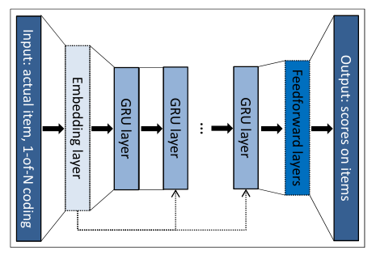
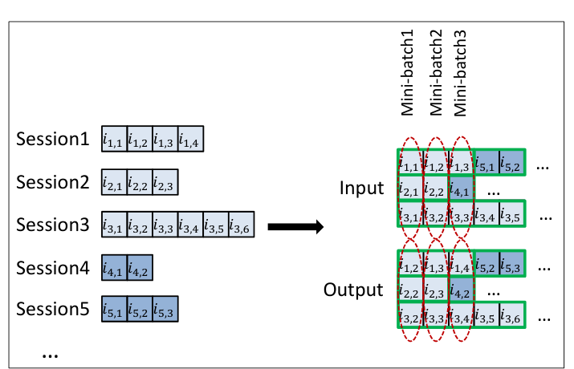
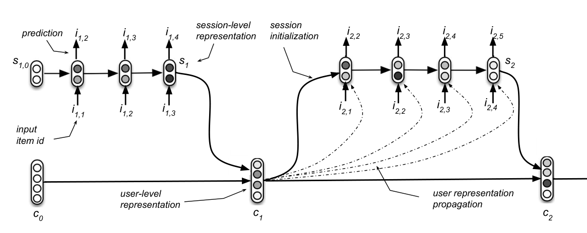

### 유저 정보 없이 세션 안의 클릭 흐름만으로 다음 아이템을 맞히는 GRU4Rec, 그리고 이를 개인화로 확장한 HRNN에 대해 알아봅니다.  


> 다루는 논문 및 발표  
> **GRU4Rec**: Session-based Recommendations with Recurrent Neural Networks (Hidasi, Karatzoglou, Baltrunas, Tikk, ICLR 2016)  
> **HRNN**: Personalizing Session-based Recommendations with Hierarchical Recurrent Neural Networks (Quadrana, Karatzoglou, Hidasi, Cremonesi, RecSys 2017)  
> **발표**: Recurrent Neural Networks for Session-based Recommendations - Alexandros Karatzoglou (Criteo Tech)  

<center></center>   

<font size="2"><center> 출처: Hidasi et al., Session-based Recommendations with Recurrent Neural Networks (https://arxiv.org/abs/1511.06939) </center>  </font>   

<br/>


>  **1. 세션 기반 추천은 유저 식별 정보 없이, 한 세션 안에서 발생한 클릭 시퀀스만으로 다음 아이템을 예측하는 문제임**
>
>  **2. GRU4Rec은 GRU에 session-parallel mini-batch, 미니배치 내 negative sampling, BPR/TOP1 같은 pairwise ranking loss를 결합해 item-KNN 대비 큰 폭의 성능 개선을 얻음**
>
>  **3. HRNN은 세션 GRU 위에 유저 GRU를 하나 더 얹어, 과거 세션에서 학습한 유저 표현으로 다음 세션의 hidden state를 초기화함으로써 장기 선호와 단기 의도를 결합함**

<br/>

----

**본 포스트는 Alexandros Karatzoglou의 발표 영상과 GRU4Rec, HRNN 논문을 읽고 정리한 노트입니다.**
원문은 여기에서 보실 수 있습니다.  
[GRU4Rec paper](https://arxiv.org/abs/1511.06939), [HRNN paper](https://arxiv.org/abs/1706.04148), [발표 영상](https://www.youtube.com/watch?v=M7FqgXySKYk)  

----
#### Contents  

1. [Intro - 시퀀셜 추천은 왜 필요할까?](#intro)  
2. [세션 기반 추천이란?](#session)  
3. [GRU4Rec: RNN으로 세션을 모델링해보자!](#gru4rec)  
4. [GRU4Rec 학습의 세 가지 트릭](#tricks)  
5. [아이템 피처를 넣어보자 - Parallel RNN](#prnn)  
6. [HRNN: 유저의 과거 세션까지 기억해보자!](#hrnn)  
7. [그 이후의 이야기들](#after)  
8. [마치며](#conclusion)  
<br />

<a id="intro"></a>
## 1. Intro - 시퀀셜 추천은 왜 필요할까?  

추천시스템을 공부하면 가장 먼저 만나는 것이 콘텐츠 기반 추천과 협업 필터링(Collaborative Filtering)인데요. 간단히 짚고 넘어가 보겠습니다.  

**콘텐츠 기반 추천**  
- 아이템의 특성(장르, 텍스트, 이미지 등)을 활용하므로 과거 이력이 없는 신규 아이템도 추천 가능함  
- 반면 고객 데이터가 부족하면 성능을 보장하기 어렵고, 이전에 고른 것과 비슷한 아이템만 추천하는 과도한 특수화(over-specialization) 문제가 있음  

**협업 필터링 - 메모리 기반**  
- 아이템에 대한 유저 반응 벡터가 유사한 유저/아이템을 찾아 추천함  
- cold start, 평점이 부족한 신규 아이템을 추천하지 못하는 first rater 문제, 취향이 일관되지 않은 유저가 추천을 혼란스럽게 만드는 grey sheep 문제, 악의적으로 평점을 조작하는 shilling attack 등의 한계가 있음  

**협업 필터링 - 모델 기반**  
- Matrix Factorization(MF)이 대표적이며, 유저와 아이템 사이에 행동에 영향을 주는 잠재 요인(latent factor)이 있다고 가정함  
- Neural CF는 유저/아이템 임베딩을 MLP에 통과시켜 상호작용 여부를 binary classification으로 학습함  

그런데 이 방법들에는 공통적인 가정이 하나 숨어 있습니다. **과거에 구매하거나 선택한 아이템들이 모두 균일하게 중요하다**는 것인데요.  
실제로는 그렇지 않겠죠. 어제 본 캠핑 의자가 3년 전에 산 겨울 코트보다 지금의 선택에 훨씬 큰 영향을 줄 겁니다.  
이렇게 **순서와 최신성**을 반영하기 위해 등장한 것이 시퀀셜 추천(Sequential Recommendation)이고, 그 방법론은 RNN을 시작으로 CNN, Transformer(self-attention), GNN 등으로 발전해 왔습니다.  
이 블로그에서도 self-attention 기반의 [Next Item Recommendation with Self-Attentive Metric Learning](https://myeonghak.github.io/recommender%20systems/RecSys-Next_item_Recommendation_with_Self-Attentive_Metric_Learning/)과 [BERT4Rec](https://myeonghak.github.io/recommender%20systems/RecSys-BERT4Rec/)을 다룬 적이 있는데요, 오늘은 그 흐름의 출발점이라고 할 수 있는 **RNN 기반 세션 추천, GRU4Rec**과 그 개인화 버전인 **HRNN**을 정리해 보겠습니다.  

<br/>

<a id="session"></a>
## 2. 세션 기반 추천이란?  

일반적인 추천 문제는 은연중에 다음과 같은 시나리오를 가정합니다.  
유저가 시스템에 들어와 추천을 받고, 반응하거나(혹은 하지 않거나), 떠납니다. 다음 주에 다시 올 수도 있고 영영 오지 않을 수도 있죠. 이런 상황이라면 MF 기반 추천도 꽤 잘 작동합니다.  

하지만 이커머스를 떠올려보면 조금 다릅니다.  

- 유저는 한동안 사이트에 머무르며 여러 상품을 탐색하고, 그 과정에서 추천을 받고, 최종적으로 구매 여부를 결정함  
- 탐색 도중에 선호가 바뀌기도 하고, 노출된 추천에 영향을 받기도 함  
- 무엇보다 **로그인하지 않은 유저가 많아 유저 정보를 항상 쓸 수 없음** -> 사실상 "영원한 cold-start" 상태임  

즉, 우리가 추천을 제공해야 할 유저에 대해 아는 것이라고는 **지금 이 세션에서 클릭한 아이템 몇 개**뿐인 상황입니다. 이것이 바로 세션 기반 추천(Session-based Recommendation) 문제입니다.  

이런 상황에서 업계가 오랫동안 써 온 방법은 아이템-아이템 유사도였습니다. 아마존의 "이 상품을 본 고객이 함께 본 상품"처럼, 여러 세션에서 함께 조회된 아이템을 추천하는 방식인데요. 연관 규칙(association rule)이나 단순한 코사인 유사도 기반의 item-KNN이 대표적입니다.  
잘 작동하긴 하지만, **마지막으로 클릭한 아이템 하나만 보고** 추천한다는 한계가 있습니다. 세션 전체의 흐름, 예컨대 "운동화 -> 러닝 양말 -> 러닝 벨트"로 이어지는 맥락은 버려지는 셈이죠. 그렇다면 시퀀스 전체를 볼 수 있는 모델을 쓰면 되지 않을까요?  

<br/>

<a id="gru4rec"></a>
## 3. GRU4Rec: RNN으로 세션을 모델링해보자!  

### RNN, LSTM, 그리고 GRU  

시퀀스 데이터를 다루는 대표적인 도구가 RNN입니다. 다음 hidden state가 현재 입력과 이전 hidden state에 의해 결정되는 구조인데요.  

$$
h_t = g(Wx_t + Uh_{t-1})
$$

vanilla RNN은 시퀀스가 길어지면 vanishing/exploding gradient 때문에 long-term dependency를 잘 잡지 못하고, 이를 해결하기 위해 LSTM과 GRU가 고안되었습니다.  

- **LSTM**: 메모리 셀이 forget gate로 통제되는 이전 셀 값과, input gate로 통제되는 후보 셀 값의 혼합으로 구성됨. hidden state는 output gate로 통제된 메모리 셀 값임  
- **GRU**: LSTM을 단순화한 구조로, update gate $z_t$와 reset gate $r_t$ 두 개만 사용함  

GRU의 수식은 다음과 같습니다.  

$$
\begin{aligned}
z_t &= \sigma(W_z x_t + U_z h_{t-1}) \\
r_t &= \sigma(W_r x_t + U_r h_{t-1}) \\
\hat{h}_t &= \tanh\left(W x_t + U(r_t \odot h_{t-1})\right) \\
h_t &= (1 - z_t) h_{t-1} + z_t \hat{h}_t
\end{aligned}
$$

update gate가 "이전 상태를 얼마나 유지할지"를, reset gate가 "후보 상태를 만들 때 과거를 얼마나 참고할지"를 결정한다고 이해하면 됩니다.  
RNN은 그동안 문서 분류/음성 인식 같은 시퀀스 라벨링, 기계번역/QA 같은 seq2seq, 텍스트/음성 생성 등에 쓰여 왔는데, 이를 추천에 처음 본격적으로 적용한 것이 GRU4Rec입니다.  

### 세션 모델링 구조  

맨 위의 그림이 GRU4Rec의 전체 구조입니다.  

- **입력**: 세션 내 현재 아이템 (1-of-N, 즉 one-hot 인코딩)  
- **출력**: 각 아이템이 이벤트 스트림의 다음 아이템이 될 가능성에 대한 스코어  
- 중간에는 GRU 레이어가 있고, 옵셔널하게 embedding 레이어와 feedforward 레이어를 붙일 수 있음  

재밌는 것은 실험을 통해 얻은 설계 결정들입니다.  

- **GRU를 선택**: vanilla RNN은 성능이 떨어지고, LSTM은 성능이 비슷한데 더 느렸음  
- **embedding/FFN 레이어는 없는 편이 나았음**: one-hot 입력을 바로 GRU에 넣는 것이 더 좋았음  
- **레이어는 1개로 충분**: 세션은 짧은 시간 동안만 유지되므로, 여러 스케일의 시간 의존성을 잡기 위해 레이어를 깊게 쌓을 이유가 없었음  

그런데 발표에 따르면, 이렇게 만든 첫 모델은 **단순한 item-KNN보다도 성능이 떨어졌다**고 합니다. 이를 끌어올린 것이 다음 장에서 볼 학습 트릭들입니다.  

<br/>

<a id="tricks"></a>
## 4. GRU4Rec 학습의 세 가지 트릭  

### 4-1. Session-parallel mini-batches  

NLP에서는 보통 문장을 sliding window로 잘라 fragment들을 나란히 쌓아 미니배치를 만듭니다. 그런데 세션 데이터에는 이 방식이 잘 맞지 않습니다.  

- 세션 길이의 분산이 매우 큼 (2개짜리 세션부터 수백 개짜리 세션까지)  
- 우리의 목적은 **세션이 시간에 따라 어떻게 변해 가는지(evolve)** 를 잡는 것이므로, 세션을 조각내면 의미가 없음  

그래서 제안된 것이 session-parallel mini-batch입니다.  

<center></center>   

<font size="2"><center> 출처: Hidasi et al., Session-based Recommendations with Recurrent Neural Networks (https://arxiv.org/abs/1511.06939) </center>  </font>   

<br/>

- 세션들에 순서를 매긴 뒤, 앞의 X개 세션의 **첫 번째 이벤트**로 첫 미니배치의 입력을 만들고, **두 번째 이벤트**가 그 정답(output)이 됨  
- 두 번째 미니배치는 두 번째 이벤트(입력)와 세 번째 이벤트(정답)로 구성되는 식으로 진행함  
- 어떤 세션이 끝나면 그 자리(slot)에 **다음으로 사용 가능한 세션을 이어 붙임**  
- 세션끼리는 독립이라고 가정하므로, 세션이 교체되는 slot의 hidden state는 0으로 리셋함  

말로 하면 헷갈리니, 위 그림의 예시를 그대로 코드로 옮겨보겠습니다.  

```python
sessions = {
    1: ["i1,1", "i1,2", "i1,3", "i1,4"],
    2: ["i2,1", "i2,2", "i2,3"],
    3: ["i3,1", "i3,2", "i3,3", "i3,4", "i3,5", "i3,6"],
    4: ["i4,1", "i4,2"],
    5: ["i5,1", "i5,2", "i5,3"],
}

def session_parallel_batches(sessions, batch_size):
    queue = list(sessions.keys())
    slots = [queue.pop(0) for _ in range(batch_size)]  # 각 slot이 담당하는 세션
    pos = [0] * batch_size                              # 각 slot의 세션 내 위치
    while True:
        reset = [p == 0 for p in pos]                   # 새 세션이 시작된 slot은 hidden state 초기화
        inp = [sessions[s][p] for s, p in zip(slots, pos)]
        out = [sessions[s][p + 1] for s, p in zip(slots, pos)]
        yield inp, out, reset
        for k in range(batch_size):
            pos[k] += 1
            if pos[k] + 1 >= len(sessions[slots[k]]):   # 다음 타깃이 없으면 세션 교체
                if not queue:
                    return
                slots[k], pos[k] = queue.pop(0), 0

for step, (x, y, r) in enumerate(session_parallel_batches(sessions, 3), 1):
    print(f"batch{step}: input={x} -> output={y} reset={r}")
```

```
batch1: input=['i1,1', 'i2,1', 'i3,1'] -> output=['i1,2', 'i2,2', 'i3,2'] reset=[True, True, True]
batch2: input=['i1,2', 'i2,2', 'i3,2'] -> output=['i1,3', 'i2,3', 'i3,3'] reset=[False, False, False]
batch3: input=['i1,3', 'i4,1', 'i3,3'] -> output=['i1,4', 'i4,2', 'i3,4'] reset=[False, True, False]
```

세 번째 미니배치에서 2번 세션이 끝난 자리에 4번 세션(`i4,1`)이 들어오고, 해당 slot만 hidden state가 리셋되는 것을 볼 수 있습니다. 그림의 Mini-batch3과 정확히 같죠. (예시를 단순화하느라 남은 세션이 없으면 그냥 종료하도록 짰습니다.)  
발표자에 따르면 이 미니배치 구성 방식만으로도 성능이 크게 개선되었다고 합니다.  

### 4-2. Output 샘플링 - 미니배치 안에서 negative 고르기  

이커머스 카탈로그의 아이템 수는 수만에서 수십만 개에 달합니다. 매 스텝마다 모든 아이템에 대해 스코어를 계산하면 학습이 너무 느려지는데, 추천 모델은 주기적으로 재학습되어야 하니 학습 속도는 매우 중요하죠. 그래서 정답 아이템과 일부 negative 아이템에 대해서만 스코어를 계산합니다.  

어떤 아이템을 negative로 쓸까요? GRU4Rec은 **인기도(popularity) 기반 샘플링**의 아이디어를 씁니다.  

- 유저가 어떤 아이템을 클릭하지 않은 이유는 (1) 그 아이템을 몰랐거나, (2) 알았지만 관심이 없었기 때문임  
- 인기 있는 아이템은 유저가 봤을 가능성이 높으므로, 인기 아이템을 클릭하지 않았다면 negative feedback일 개연성이 높음  

여기서 우아한 트릭이 등장하는데요, **같은 미니배치 안의 다른 세션들의 정답 아이템을 negative로 재활용**하는 것입니다.  

- 인기 있는 아이템일수록 미니배치에 정답으로 등장할 확률이 높으므로, 자연스럽게 인기도에 비례한 샘플링이 됨 (데이터 분포를 그대로 따름)  
- 별도의 샘플링 과정이 필요 없고, 행렬 연산으로 한 번에 처리할 수 있어 매우 빠르고 간편함  

요즘 two-tower 모델에서 흔히 쓰는 in-batch negative sampling을 2015년에 이미 쓰고 있었던 셈입니다.  

### 4-3. Pairwise ranking loss  

추천의 본질은 결국 **랭킹**입니다. 랭킹 loss에는 pointwise, pairwise, listwise가 있는데, listwise는 연산이 비싸고 pointwise는 순위 자체를 직접 다루지 않아 불안정한 경우가 많습니다. 실제로 cross-entropy(pointwise)는 이 문제에서 그다지 잘 작동하지 않았다고 하고, pairwise 방식이 종종 더 나은 결과를 보였습니다.  

pairwise loss는 세션의 한 시점에서 **유저가 실제로 클릭한 아이템(positive)의 스코어가 클릭하지 않은 아이템(negative)의 스코어보다 높도록** 유도합니다. positive 아이템 $i$의 스코어를 $\hat{r}_{s,i}$, 샘플링된 negative 아이템 $j$의 스코어를 $\hat{r}_{s,j}$, negative 샘플 수를 $N_S$라고 하면,  

**1) BPR (Bayesian Personalized Ranking)**  

$$
L_s = -\frac{1}{N_S}\sum_{j=1}^{N_S}\log \sigma\left(\hat{r}_{s,i} - \hat{r}_{s,j}\right)
$$

**2) TOP1**  

$$
L_s = \frac{1}{N_S}\sum_{j=1}^{N_S}\left[\sigma\left(\hat{r}_{s,j} - \hat{r}_{s,i}\right) + \sigma\left(\hat{r}_{s,j}^2\right)\right]
$$

TOP1은 이 논문에서 새로 고안한 loss로, 앞의 항은 positive 아이템의 상대적 랭킹을 근사하는 항이고, 뒤의 항은 **negative 아이템의 스코어를 0 근처로 끌어내리는 정규화 항**입니다. BPR도 꽤 잘 작동했지만, 이 정규화 항을 붙인 TOP1에서 추가적인 개선을 얻었다고 하네요.  

### 실험 결과  

- 데이터셋: RecSys Challenge 2015(이커머스 클릭스트림)와 OTT 비디오 서비스 데이터. 구매 데이터 없이 **클릭 스트림만** 사용함  
- 오프라인 평가: Recall@20, MRR@20 기준으로 item-KNN 대비 약 15~30%의 개선을 얻음  
- 발표에 따르면 온라인 테스트에서도 일부 데이터만으로 학습했음에도 준수한 성능을 보였다고 함  

처음엔 item-KNN에도 지던 모델이, 문제의 특성에 맞춘 미니배치/샘플링/loss 설계로 SOTA가 된 과정이 인상적입니다.  

<br/>

<a id="prnn"></a>
## 5. 아이템 피처를 넣어보자 - Parallel RNN  

GRU4Rec은 오직 아이템 ID만 사용합니다. 그런데 유저가 추천된 아이템을 클릭할지 말지는 썸네일 이미지, 제목/설명 텍스트, 가격 등 **노출된 아이템의 정보**에 큰 영향을 받겠죠. 이 정보를 모델에 넣으면 더 좋아지지 않을까요? 발표에서는 같은 그룹의 후속 연구(Hidasi et al., RecSys 2016)를 바탕으로 세 가지 시도를 소개합니다.  

**시도 1: 피처만 사용하기**  
- 아이템 one-hot 대신 pretrained 이미지 모델로 뽑은 피처를 입력으로 사용함  
- 추천 결과는 직관적으로 그럴듯하지만 다소 일반적(generic)이고, 오프라인 정확도는 떨어짐  
- 가격대 같은 다른 정보가 반영되지 않아 "생긴 게 비슷한 것"만 추천되는 것으로 추정됨  

**시도 2: ID와 피처를 concat하기**  
- 아이템 one-hot과 이미지 피처를 이어 붙여 입력함  
- 결과는 ID만 쓴 모델과 거의 같았음  
- ID 입력이 다음 아이템에 대한 훨씬 강한 시그널을 갖고 있어 이미지 입력을 압도하고, 네트워크가 ID 위주로만 학습해 버림  

**시도 3: Parallel RNN**  
- 입력 타입(ID, 이미지, 텍스트 등)마다 별도의 RNN 서브넷을 두고, 각 서브넷이 세션을 독립적으로 모델링함  
- 각 서브넷의 hidden state를 concat한 뒤(옵셔널하게 scaling/weighting 적용), 이를 바탕으로 출력 스코어를 계산함  

concat만 한 시도 2와 마찬가지로, 그냥 end-to-end로 학습하면 ID 서브넷이 혼자 다 해먹을 수 있겠죠. 그래서 **각 서브넷이 서로 다른 측면(aspect)을 학습해 상호 보완하도록** 학습 방식을 설계합니다. ALS나 앙상블에서 착안한 아이디어로, 한 서브넷을 학습할 때 나머지 서브넷의 가중치는 고정합니다. 서브넷 사이를 오가는(alternation) 빈도에 따라 다음과 같이 나뉩니다.  

- **Residual training**: 한 서브넷을 끝까지 학습한 뒤, 다음 서브넷이 남은 오차(residual)를 학습함  
- **Alternating training**: 에폭마다 학습할 서브넷을 교대함  
- **Interleaving training**: 미니배치마다 교대함  

비디오 썸네일 피처를 쓴 실험에서 기본 RNN 대비 약 10%의 성능 향상을 얻었고, residual training이 가장 좋았지만 다른 방식도 준수했다고 합니다. 텍스트 피처(다국어 제목+설명을 concat해 bi-gram TF-IDF로 만든 백만 차원 이상의 sparse 벡터)를 쓴 실험에서도 약간의 개선이 있었다고 하네요.  

<br/>

<a id="hrnn"></a>
## 6. HRNN: 유저의 과거 세션까지 기억해보자!  

### 유저 정보가 정말 없을까?  

세션 기반 추천의 출발점은 "유저에 대해 아무것도 모른다"는 가정이었습니다. 그런데 이게 항상 사실은 아닙니다. 로그인한 유저라면, 혹은 쿠키로 식별되는 유저라면 **과거에 방문했던 세션 기록**이 남아 있죠.  
그래서 연구 질문은 이렇게 바뀝니다. **"장기적인 유저 선호(과거 세션들)와 단기적인 의도(현재 세션)를 어떻게 결합할 수 있을까?"**  

가장 나이브한 방법은 유저의 전체 히스토리를 세션 구분 없이 하나의 긴 시퀀스로 이어 붙여 GRU4Rec에 넣는 것입니다. 구현은 쉽지만, 세션 사이의 시간 간격이나 맥락 전환이 뭉개지고 시퀀스가 길어져 효과가 제한적입니다.  

### Hierarchical RNN 구조  

HRNN은 **유저 표현과 세션 표현을 분리(decouple)** 하여 두 개의 GRU를 계층적으로 쌓습니다.  

<center></center>   

<font size="2"><center> 출처: Quadrana et al., Personalizing Session-based Recommendations with Hierarchical Recurrent Neural Networks (https://arxiv.org/abs/1706.04148) </center>  </font>   

<br/>

- **Session-level GRU ($GRU_{ses}$)**: 위쪽 줄. 세션 안의 아이템 시퀀스를 모델링하고 다음 아이템을 예측함 (GRU4Rec과 동일한 역할)  
- **User-level GRU ($GRU_{usr}$)**: 아래쪽 줄. 세션이 끝날 때마다 한 스텝씩 진행하며, 여러 세션에 걸친 유저의 latent state를 이어받고 발전시킴(relay and evolve)  

수식으로 보면 흐름이 더 명확합니다. $m$번째 세션의 $n$번째 hidden state를 $s_{m,n}$, $m$번째 세션까지 본 유저 표현을 $c_m$이라고 하면,  

**1) 세션이 끝나면 유저 표현을 업데이트**  

$$
c_m = GRU_{usr}(s_m, c_{m-1})
$$

여기서 $s_m$은 $m$번째 세션의 마지막 hidden state, 즉 세션 전체를 요약한 session-level representation입니다.  

**2) 유저 표현으로 다음 세션의 hidden state를 초기화**  

$$
s_{m+1,0} = \tanh\left(W_{init} c_m + b_{init}\right)
$$

**3) 다음 세션 진행 (옵셔널하게 $c_m$을 매 스텝 입력으로 함께 넣어줌)**  

$$
s_{m+1,n} = GRU_{ses}\left(i_{m+1,n}, s_{m+1,n-1} \, [, c_m]\right)
$$

$c_m$을 초기화에만 쓰면 **HRNN Init**, 초기화와 동시에 매 스텝 입력으로도 넣어주면(그림의 점선) **HRNN All**이라고 부릅니다. HRNN All은 모델이 조금 복잡해지는 대신 세션 내내 유저 표현을 더 강하게 반영합니다.  

노트를 정리하며 "세션이 끝났다는 정보는 어떻게 전달하지?"라는 의문을 적어 두었었는데, 답은 구조 자체에 있었습니다. 세션 GRU는 세션 경계에서 끊기고, 바로 그 시점에만 마지막 hidden state $s_m$이 유저 GRU로 넘어갑니다. 즉, **유저 GRU는 세션이 끝날 때만 업데이트되고 세션 진행 중에는 고정**되어 있습니다. 세션 경계는 데이터(세션 ID)로 주어지는 것이죠.  

이 구조 덕분에 흥미로운 성질이 생깁니다. GRU4Rec에서는 같은 아이템 시퀀스를 본 두 유저가 항상 같은 추천을 받지만, HRNN에서는 **동일한 세션이라도 유저의 과거 세션이 다르면 다른 추천**을 받게 됩니다. 비로소 "개인화된" 세션 기반 추천이 된 셈입니다.  

또한 유저 GRU는 단순히 이전 세션의 hidden state를 다음 세션으로 넘겨주는 통로가 아니라, 학습 과정에서 **유저 관심사가 세션을 거치며 어떻게 변해 가는지**를 함께 학습한다는 점이 중요합니다.  

### 학습 방법  

HRNN의 학습은 대부분 GRU4Rec을 그대로 따릅니다.  

- GRU 아키텍처, ranking loss(cross-entropy, BPR, TOP1), 미니배치 내 output 샘플링을 그대로 사용함  
- dropout 정규화, Adagrad with momentum으로 최적화함  
- 전체를 back-propagation으로 end-to-end 학습함  
- 미니배치는 session-parallel 방식을 **user-parallel mini-batch**로 확장함: 세션을 유저별로 묶고 각 유저 안에서는 시간순으로 정렬한 뒤, 유저 단위로 slot에 배치함. 한 세션이 끝나면 같은 유저의 다음 세션이 이어지고(이때 유저 GRU 업데이트 + 세션 hidden state 초기화), 유저의 세션이 모두 끝나면 다음 유저로 교체하며 두 hidden state를 모두 리셋함  

XING(구인 플랫폼) 데이터와 비디오 서비스 데이터에서 실험한 결과, HRNN은 GRU4Rec을 포함한 session-based 베이스라인 대비 상당한 성능 개선을 보였습니다. 데이터셋 특성에 따라 HRNN Init이 나은 경우와 HRNN All이 나은 경우가 갈렸다는 점도 흥미로운데요, 유저 과거 이력의 영향이 얼마나 강한 도메인인지에 따라 적절한 설정이 달라진다고 해석할 수 있겠습니다.  

<br/>

<a id="after"></a>
## 7. 그 이후의 이야기들  

발표 후반부에서는 GRU4Rec을 실서비스 규모로 키우며 마주한 문제들도 다룹니다.  

**추가 샘플링 (Additional sampling)**  
- 미니배치 내 샘플링은 인기도에 비례하므로, 아이템 대부분을 차지하는 롱테일 아이템은 negative로 거의 뽑히지 않아 스코어를 제대로 학습하지 못함  
- 그래서 미니배치 내 샘플에 더해, (인기도에 덜 치우친 분포로) 추가 negative 샘플을 함께 사용함  
- 미니배치당 2,000개 수준의 샘플을 추가해도 학습 시간이 크게 늘지 않았는데, 학습 시간의 대부분이 GPU 메모리와 메인 메모리 사이의 데이터 복사에 쓰이고 있었기 때문임  

**새로운 pairwise loss**  
- negative 샘플이 많아지면 대부분은 이미 스코어가 낮아 gradient가 사라지는(vanishing) 문제가 생김  
- 이를 해결하기 위해 BPR-max, TOP1-max를 제안함: 모든 negative를 평균내는 대신, **스코어가 가장 높은(가장 헷갈리는) negative에 집중**하도록 max 연산을 softmax 가중치로 부드럽게 근사(smooth approximation)함  
- 이 내용은 후속 논문 [Recurrent Neural Networks with Top-k Gains for Session-based Recommendations](https://arxiv.org/abs/1706.03847)에 정리되어 있음  

**더 작은 네트워크 - Bloom Embedding**  
- 딥러닝 추천 모델은 너무 큼: 제한된 GPU 메모리, 느린 학습/추론, 모바일 같은 저사양 기기 배포의 어려움  
- 그런데 파라미터의 대부분(발표에 따르면 99.9%)이 **아이템 수 크기의 one-hot 입력층과 softmax 출력층**에 몰려 있음  
- 이를 줄이기 위해 Bloom filter 아이디어를 가져옴: 여러 개의 해시 함수로 원소를 작은 비트 벡터에 매핑하면, false negative는 없고 false positive는 해시 공간 크기와 해시 함수 수로 확률을 통제할 수 있음  
- 같은 방식으로 아이템을 더 작은 차원의 sparse binary 벡터로 해싱해 입출력층을 압축하는 것이 Bloom embedding임 ([Serrà & Karatzoglou, RecSys 2017](https://arxiv.org/abs/1706.03993))  

<br/>

<a id="conclusion"></a>
## 8. 마치며  

GRU4Rec은 지금 보면 GRU 한 층짜리의 소박한 모델입니다. 하지만 이 논문의 진짜 기여는 모델 구조보다 **추천 문제에 맞게 학습 과정을 재설계한 부분**에 있다고 생각합니다. 세션 길이가 제각각인 데이터를 위한 session-parallel mini-batch, 인기도를 자연스럽게 반영하는 in-batch negative sampling, 랭킹을 직접 최적화하는 pairwise loss까지, 하나하나가 "이 데이터와 이 목적에는 무엇이 맞을까?"라는 질문에서 나온 답이었죠. 처음엔 item-KNN에도 졌다는 고백이 오히려 더 와닿았습니다.  

HRNN은 여기에 "유저는 한 번만 오지 않는다"는 현실적인 관찰을 더해, 장기 선호와 단기 의도를 계층 구조로 깔끔하게 분리했습니다. 이후 등장한 SASRec, BERT4Rec 같은 Transformer 기반 모델들이 성능 면에서는 앞서 나갔지만, 세션 단위로 데이터를 다루는 방식이나 in-batch negative 같은 아이디어는 지금도 곳곳에 녹아 있습니다. 새로운 모델을 공부할 때도, 결국 데이터의 생김새와 서비스의 제약을 먼저 들여다봐야 한다는 교훈을 다시 한번 얻어 갑니다.  

----------------


**개선을 위한 여러분의 피드백과 제안을 코멘트로 공유해 주세요.**
**내용에 대한 지적, 혹은 질문을 환영합니다.**  


**출처**  
[Session-based Recommendations with Recurrent Neural Networks (Hidasi et al., ICLR 2016)](https://arxiv.org/abs/1511.06939)  
[Personalizing Session-based Recommendations with Hierarchical Recurrent Neural Networks (Quadrana et al., RecSys 2017)](https://arxiv.org/abs/1706.04148)  
[Parallel Recurrent Neural Network Architectures for Feature-rich Session-based Recommendations (Hidasi et al., RecSys 2016)](https://dl.acm.org/doi/10.1145/2959100.2959167)  
[Recurrent Neural Networks with Top-k Gains for Session-based Recommendations (Hidasi & Karatzoglou, CIKM 2018)](https://arxiv.org/abs/1706.03847)  
[Getting deep recommenders fit: Bloom embeddings for sparse binary input/output networks (Serrà & Karatzoglou, RecSys 2017)](https://arxiv.org/abs/1706.03993)  
[Recurrent Neural Networks for Session-based Recommendations - Alexandros Karatzoglou (YouTube)](https://www.youtube.com/watch?v=M7FqgXySKYk)  
