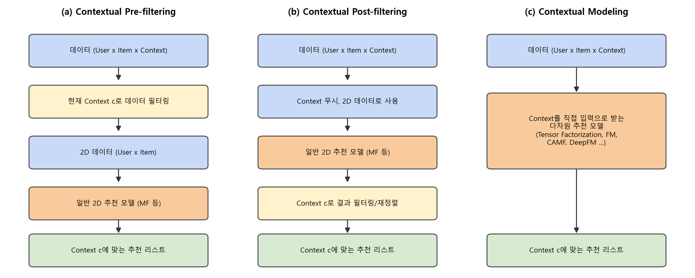
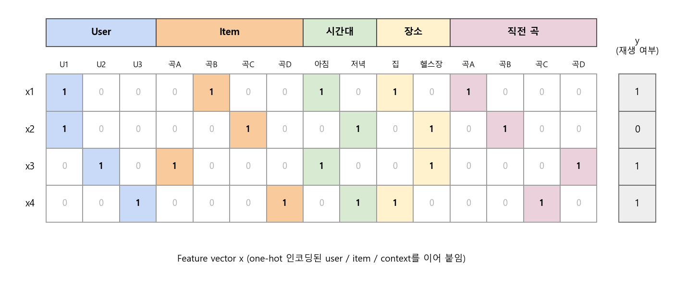
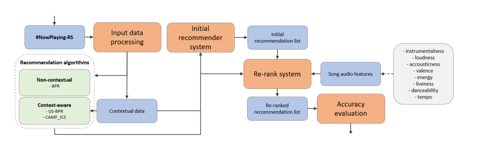
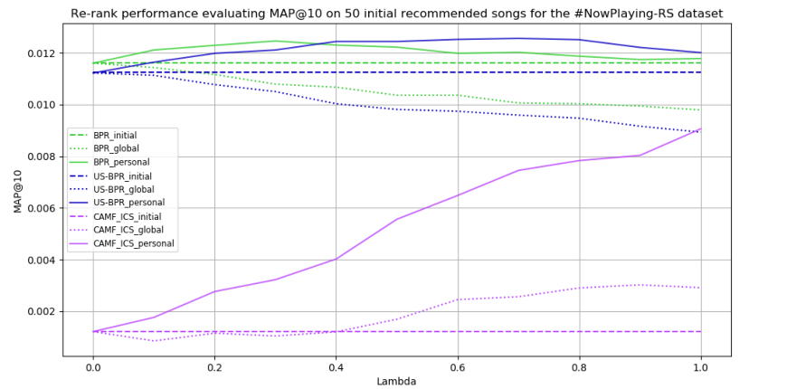

### 같은 유저라도 아침과 밤에 듣고 싶은 노래는 다르다! 상황(context)을 추천에 녹이는 방법들에 대해 알아봅니다.


> **발표**: Context-aware Recommendation Methods: A Machine Learning Perspective (Alexandros Karatzoglou, Google Research) - ACM RecSys CARS Workshop  
> **논문**: Contextual Personalized Re-Ranking of Music Recommendations through Audio Features (Boning Gong, Mesut Kaya, Nava Tintarev, CARS Workshop @ RecSys 2020)  

<center></center>   

<br/>


>  **1. Context-aware 추천은 user x item의 2차원 문제를 user x item x context의 다차원 문제로 확장한 것임**
>
>  **2. Context를 반영하는 방법은 크게 pre-filtering, post-filtering, contextual modeling(Tensor Factorization, FM 등)으로 나뉨**
>
>  **3. 최근에는 graph embedding, 세션 기반 sequential 모델, 강화학습으로 context를 latent하게 표현하려는 시도가 이어지고 있음**
>
>  **4. 오디오 피처처럼 직관적인 피처로 context별 선호를 표현해 re-ranking(post-filtering)하는 단순한 방법도 정확도와 설명 가능성을 모두 챙길 수 있음**

<br/>

----

**본 포스트는 Alexandros Karatzoglou의 CARS 워크숍 발표 영상과, Boning Gong 외의 논문을 보고 정리한 노트입니다.**
발표 영상은 [여기](https://youtu.be/qAr9YJlMqGk)에서, 논문은 [여기](https://arxiv.org/abs/2009.02782)에서 보실 수 있습니다.

----
#### Contents

1. [Context-aware 추천이란?](#what-is-cars)
2. [Context를 어디에 넣을까? - Pre-filtering, Post-filtering, Contextual Modeling](#three-paradigms)
3. [Contextual Modeling - Tensor Factorization과 FM](#tf-fm)
4. [그래프로 Context 표현하기 - Graph Convolutional Embedding](#gce)
5. [세션 자체가 Context다 - Sequential 모델과 강화학습](#session)
6. [사례: 오디오 피처로 음악 추천 Re-ranking하기](#music-rerank)
7. [마치며](#conclusion)
<br />

<a id="what-is-cars"></a>
## 1. Context-aware 추천이란?

침대에 누워 책을 읽을 때 듣는 음악과, 헬스장에서 데드리프트를 할 때 듣는 음악은 아마 많이 다르겠죠. 같은 사람이라도 **어떤 상황에 놓여 있느냐**에 따라 원하는 아이템이 달라지는데요, 전통적인 협업 필터링(CF)은 이 부분을 놓치고 있습니다.

일반적인 추천 문제는 유저와 아이템 사이의 선호를 예측하는 함수를 학습하는 것으로 정의됩니다.

$$
f: U \times I \rightarrow R
$$

Context-aware 추천 시스템(CARS)은 여기에 context 차원 $C$를 하나(혹은 여러 개) 더 붙여서 문제를 확장합니다.

$$
f: U \times I \times C_1 \times \cdots \times C_k \rightarrow R
$$

Karatzoglou는 발표에서 context를 크게 두 종류로 나누어 설명합니다.

- **전통적인 context**: 유저의 위치(직장/집/야외), 날씨, 날짜, 요일, 시간대, 동행자 등 유저 바깥의 상황 정보임
- **유저가 만들어내는 context**: 온라인에서 implicit하게 남긴 행동 기록, 즉 세션 내의 클릭/구매/재생 이력 등임. 지금 무엇을 보고 있었는지가 곧 다음에 원하는 것의 실마리가 됨

참고로 Gong의 논문에서는 context를 **contextual dimension**(예: 시간대, 활동, 기분)과 그 안의 구체적인 값인 **contextual condition**(예: 아침/오후/저녁/밤, 달리기/휴식)으로 구분해서 부르는데요, 이후 내용에서도 이 용어를 그대로 쓰겠습니다.

<br/>

<a id="three-paradigms"></a>
## 2. Context를 어디에 넣을까? - Pre-filtering, Post-filtering, Contextual Modeling

Context를 추천 파이프라인의 **어느 단계에 넣느냐**에 따라 방법론을 세 갈래로 나누는 것이 고전적인 분류법입니다 (Adomavicius & Tuzhilin). 맨 위의 그림이 이 세 가지를 나타낸 것입니다.

### 2-1. Contextual Pre-filtering

- 현재 context에 해당하는 데이터만 골라낸 뒤(필터링), 그 데이터로 일반적인 2D 추천 모델을 학습함
- 예: "주말" 추천을 하고 싶으면 주말에 발생한 interaction만으로 MF를 돌리는 식임
- 장점: 기존의 어떤 2D 추천 알고리즘이든 그대로 재활용 가능함
- 단점: context를 잘게 쪼갤수록 데이터가 급격히 sparse해짐. "토요일 밤 + 코펜하겐 + 비 오는 날"의 데이터는 몇 건 안 되겠죠
- 변형으로 **user splitting / item splitting**이 있음. 한 유저를 context별 sub-profile(예: 아침의 나, 저녁의 나)로 쪼개서 서로 다른 유저처럼 다루는 방식인데, 뒤에서 볼 Gong 논문의 베이스라인인 US-BPR이 바로 이 user splitting + BPR 조합임

### 2-2. Contextual Post-filtering

- 일단 context를 무시하고 일반 추천 모델로 추천 리스트를 만든 뒤, context를 이용해 결과를 **거르거나 재정렬(re-ranking)**함
- 예: 추천된 곡 중 "아침에 어울리지 않는" 곡의 순위를 내리는 식임
- 장점: 이미 운영 중인 추천 모델을 건드리지 않고 뒤에 레이어 하나만 덧붙이면 되므로 실무에서 도입하기 쉬움
- 단점: 처음 생성된 후보군 안에서만 조정할 수 있으므로, 후보군에 context에 맞는 아이템이 없으면 할 수 있는 일이 없음

### 2-3. Contextual Modeling

- context를 모델의 **입력으로 직접 넣어** user, item, context 사이의 상호작용을 한 번에 학습함
- Tensor Factorization, Factorization Machine, Context-Aware MF(CAMF), 그리고 DeepFM이나 Wide & Deep 같은 딥러닝 계열이 여기에 속함
- 가장 표현력이 높지만, 차원이 늘어나는 만큼 sparsity와 연산량 문제를 어떻게 다루느냐가 관건임

<br/>

<a id="tf-fm"></a>
## 3. Contextual Modeling - Tensor Factorization과 FM

### 3-1. 행렬에서 텐서로

user-item 평점을 행렬로 표현했듯, user-item-context의 관계는 **3차원 텐서**로 표현할 수 있습니다. 행렬도 이미 99% 이상 비어 있는 경우가 흔한데, 차원이 하나 늘어나면 그야말로 텅 빈 우주 같은 텐서가 되겠죠.

Matrix Factorization이 행렬을 user/item 잠재 벡터로 분해했던 것처럼, 텐서도 분해할 수 있습니다. 가장 단순한 형태인 CP(PARAFAC) 분해를 쓰면 예측값은 다음과 같습니다.

$$
\hat{y}_{u,i,c} = \sum_{f=1}^{F} p_{u,f} \, q_{i,f} \, z_{c,f}
$$

여기서 $p_u$, $q_i$, $z_c$는 각각 user, item, context의 $F$차원 잠재 벡터입니다. 재미있는 건, 이번 발표자인 Karatzoglou가 바로 이 분야의 대표 논문 중 하나인 **Multiverse Recommendation (RecSys 2010)**의 1저자라는 점인데요. 이 논문은 CP보다 일반적인 **Tucker 분해**를 사용해 core tensor $S$로 세 축의 상호작용을 모델링합니다.

$$
\hat{y}_{u,i,c} = S \times_U p_u \times_I q_i \times_C z_c
$$

Tensor Factorization은 user-item-context 사이의 고차 상호작용을 직접 잡아낸다는 장점이 있지만, context 차원이 늘어날 때마다 텐서의 차수(order)가 늘어나고 Tucker의 경우 core tensor의 크기가 지수적으로 커진다는 문제가 있습니다.

### 3-2. Factorization Machine (FM)

이 문제를 깔끔하게 풀어준 것이 Rendle의 **Factorization Machine**입니다. FM은 user, item, context를 전부 one-hot으로 인코딩해 하나의 긴 feature vector $x$로 이어 붙입니다.

<center></center>   

<br/>

그리고 모든 feature 쌍의 상호작용을 잠재 벡터의 내적으로 모델링합니다.

$$
\hat{y}(x) = w_0 + \sum_{i=1}^{n} w_i x_i + \sum_{i=1}^{n} \sum_{j=i+1}^{n} \langle v_i, v_j \rangle \, x_i x_j
$$

- user와 item만 넣으면 FM은 bias가 포함된 MF와 동일해짐
- 여기에 context feature(시간대, 장소, 직전에 들은 곡...)를 붙이면 user-context, item-context 상호작용이 자연스럽게 학습됨
- context가 몇 개든 feature 열을 늘리기만 하면 되므로 텐서 분해보다 훨씬 유연함
- pairwise 항은 $O(kn)$으로 계산할 수 있어 연산 측면에서도 효율적임 (Rendle et al., 2011에서 context-aware 추천에 FM을 적용해 Multiverse보다 빠르면서 좋은 성능을 보였음)

이후 FM은 NFM(Neural FM), DeepFM, Wide & Deep 같은 딥러닝 모델의 뼈대가 됐고, 이 모델들이 사실상 contextual modeling의 표준처럼 쓰이게 됩니다.

<br/>

<a id="gce"></a>
## 4. 그래프로 Context 표현하기 - Graph Convolutional Embedding

Karatzoglou의 발표는 이제 그래프 이야기로 넘어갑니다. 요즘 정말 핫한 graph 기반 추천인데요, 출발점은 가장 기본적인 GCN입니다.

### 4-1. GCN의 아이디어

- 한 노드의 representation을 이웃 노드들의 representation과 aggregation해서 업데이트함
- 직관은 간단함. **가까운 노드끼리는 비슷할 것**이라는 가정임. 소셜 네트워크에서 "나는 내 친구와 비슷할 것이다"라는 말은 꽤 그럴듯하죠
- 노드 임베딩을 랜덤 초기화한 뒤, 이웃의 평균을 더해 업데이트하는 과정을 여러 레이어에 걸쳐 반복하면 robust한 representation을 얻을 수 있음
- 이렇게 얻은 임베딩은 노드 분류 등 다양한 downstream task에 쓰일 수 있음

(그래프 기반 추천의 실무 사례가 궁금하신 분은 이전에 정리한 [우버 이츠가 GNN으로 메뉴 추천 하는 방법](https://myeonghak.github.io/recommender%20systems/RecSys-%EC%9A%B0%EB%B2%84-%EC%9D%B4%EC%B8%A0%EA%B0%80-GNN%EC%9C%BC%EB%A1%9C-%EB%A9%94%EB%89%B4-%EC%B6%94%EC%B2%9C-%ED%95%98%EB%8A%94-%EB%B0%A9%EB%B2%95/) 포스트도 참고해 주세요.)

### 4-2. 추천 문제를 그래프로

- 전통적인 추천 문제는 user와 item을 서로 다른 타입의 노드로, rating(explicit/implicit 모두 가능)을 edge로 둔 **bipartite graph**로 표현할 수 있음
- Graph Convolutional Matrix Completion(GC-MC, van den Berg et al.)은 이 bipartite graph에 graph auto-encoder를 붙여 비어 있는 edge(=평점)를 추론함

### 4-3. Context까지 넣으면 N-partite graph

여기에 context를 추가하면 user-item뿐만 아니라 **user-context-item**의 관계를 담은 N-partite graph를 만들 수 있습니다.

- 예: "user 1이 코펜하겐에서, 토요일 밤에, 직전에 'Oh La La'를 들었다" -> 다음 곡은?
- 하나의 interaction이 발생하면 그 user와 item이 당시의 context 노드들(시간, 장소, 직전 곡...)과 동시에 연결됨
- 이를 행렬로 펼치면 앞서 본 매우 sparse한 텐서가 되는데, 그래프로 보면 context 노드를 매개로 정보가 퍼져나갈 수 있다는 점이 다름

### 4-4. GCE + FM 계열 모델

**Graph Convolutional Embedding(GCE)**은 이 N-partite graph 위에서 graph convolution으로 user/item/context 임베딩을 만든 뒤, 이를 **어떤 형태의 CF 레이어든 그 입력으로** 쓸 수 있게 한 방법입니다.

- CF 레이어로는 FM, NFM, DeepFM, Wide & Deep 등을 붙일 수 있음
- 마지막에 BPR이나 categorical cross entropy 같은 loss를 달고 전체 네트워크를 end-to-end로 역전파 학습함
- 실험 결과, 위 네 가지 context-aware 모델 모두 GCE를 붙였을 때 성능이 크게 올랐음

발표자는 이 결과가 **그리 놀랍지 않다**고 말하는데요. 기존 FM 계열 모델에서는 context가 그저 feature 하나로 들어갈 뿐, "어떤 user가 어떤 context에서 어떤 item과 상호작용했다"는 **명시적인 구조(structure)**가 모델에 주입될 방법이 없었기 때문입니다. GCE는 그래프를 통해 이 구조를 임베딩 단계에서 미리 녹여준 셈이죠.

<br/>

<a id="session"></a>
## 5. 세션 자체가 Context다 - Sequential 모델과 강화학습

### 5-1. 세션 기반 추천

이번에는 두 번째 종류의 context, 즉 유저가 스스로 만들어내는 context입니다.

- 유저의 클릭 시퀀스가 주어졌을 때 다음 타임스텝의 행동(아이템)을 예측하는 문제임
- 클릭의 흐름 자체가 "이 사람이 지금 뭘 하려는지"에 대한 실마리를 줌
- 최근에는 RNN(GRU4Rec 등), CNN(Caser 등), Transformer(SASRec, BERT4Rec 등) 기반 모델로 다음 아이템을 예측함
- 즉, 시퀀스의 특정 시점까지를 latent representation으로 인코딩하고, 이를 바탕으로 다음 토큰을 예측함. 유저의 의도(aim)를 직접 관측할 수 없으니, 이 hidden state가 **context의 latent representation 역할을 대신**하는 것임

### 5-2. Self-supervised learning과 그 한계

이런 sequential 추천 모델은 언어 모델처럼 **self-supervised** 방식으로 학습됩니다. 별도의 라벨 없이, 시퀀스의 다음 아이템을 라벨로 삼아 학습하는 것이죠. 그런데 발표자는 여기에 분명한 한계가 있다고 지적합니다.

- loss 함수는 데이터 안의 패턴은 효율적으로 찾지만, 그것이 유저에게 **가장 유용한** 추천이라는 보장은 없음
- 장기적인 유저 여정(long-term user engagement)을 인코딩하지 못함
- 재고나 공급망(supply chain) 같은 비즈니스 제약을 반영하지 못함
- 클릭 데이터로 학습하면 클릭에 편향된 추천이 나오고, 정작 구매에 최적인 추천은 하지 못함

### 5-3. 강화학습으로 바라보기

그래서 등장하는 것이 강화학습(RL)입니다. 에이전트는 환경의 상태(state)가 주어졌을 때 **장기적인 누적 보상**을 최대화하는 방향으로 행동(action)을 고르는데요, 추천에 대입하면 다음과 같습니다.

- **state**: 현재까지의 시퀀스(세션)
- **action**: 추천할 아이템
- **reward**: 추천의 목표(구매, 다양성 등)

보상을 자유롭게 설계할 수 있고 장기적 관점의 최적화가 가능하다는 점에서 매력적이지만, 현실은 녹록지 않습니다.

1. action space가 너무 큼 (전체 아이템 수만큼)
2. on-policy 학습은 어려움 (실제 유저에게 오랫동안 랜덤한 추천을 보여줘야 함)
3. off-policy 학습은 로그 데이터에 시그널이 충분치 않음
4. model-based 접근은 유저와 환경을 시뮬레이션해야 하므로 훨씬 더 어려운 문제를 풀어야 함

### 5-4. Q-learning과 negative feedback 문제

off-policy 방법인 Q-learning을 쓰면 로그 데이터만으로 학습이 가능합니다. 목표는 주어진 state $s_t$에서 action $a_t$를 했을 때 앞으로 얻을 보상의 기댓값 $Q(s_t, a_t)$를 예측하는 함수를 배우는 것이고, 벨만 방정식에 기반한 TD(Temporal Difference) 업데이트로 학습합니다.

$$
Q(s_t, a_t) \leftarrow r_t + \gamma \max_{a'} Q(s_{t+1}, a')
$$

문제는 대부분의 추천 데이터가 그렇듯 **negative feedback이 없다**는 점입니다. 로그에는 유저가 실제로 상호작용한 positive 사례만 남아 있으니, Q 함수는 "뭘 해도 좋다"고 배우게 되고 모델이 편향되어 버립니다.

### 5-5. SQN과 SAC

이를 해결하기 위해 Karatzoglou 팀이 제안한 것이 **Self-supervised Q-learning(SQN)**과 **Self-supervised Actor-Critic(SAC)**입니다 (Xin et al., SIGIR 2020).

- next item을 맞추는 sequential 모델(GRU, Caser, SASRec 등)의 hidden state 위에 head를 두 개 붙임
- 하나는 기존처럼 cross entropy로 학습하는 self-supervised head, 다른 하나는 TD error로 학습하는 Q-learning head임
- self-supervised head가 모든 아이템에 대한 신호(사실상의 negative signal 포함)를 제공해 주고, Q head는 구매 같은 우리의 목적(reward)을 반영하도록 representation을 끌어당김
- SAC는 여기서 Q값을 actor(self-supervised head)의 가중치로 활용하는 형태임
- 결과적으로 GRU, Caser 등 베이스 모델 대비 클릭/구매 예측 성능이 모두 크게 향상됨

Q&A에서 "시퀀스 내 interaction도 context로 볼 수 있지 않느냐"는 질문이 나왔는데, 발표자는 GCE로 그런 시도를 해봤고, 사실 sequential(generative) 모델 자체가 지금까지의 interaction을 hidden state로 인코딩해 다음 예측에 쓰므로 같은 역할을 한다고 답했습니다.

<br/>

<a id="music-rerank"></a>
## 6. 사례: 오디오 피처로 음악 추천 Re-ranking하기

이제 두 번째 자료인 Gong et al.의 논문을 살펴볼까요? 앞서 본 분류로 말하면 **post-filtering(re-ranking)** 계열의 접근인데, 아주 단순하면서도 설명 가능하다는 점이 매력적인 연구입니다.

### 6-1. 연구 질문

1. **RQ1**: 다양한 contextual dimension의 contextual condition이 오디오 피처와 어떻게 연관돼 있는가?
2. **RQ2**: contextual condition별 유저 선호를 오디오 피처로 표현해 re-ranking하면 추천 정확도가 어떻게 달라지는가?
3. **RQ3**: 모든 유저를 합친 **global** 선호 표현과 유저 개개인의 **personalized** 선호 표현은 re-ranking 결과에 어떻게 다르게 영향을 미치는가?

### 6-2. Motivation

- context는 유저의 음악 선호에 영향을 미침
- 유저는 음악의 오디오 특성(템포, 에너지 등)에 기반해 곡을 좋아하거나 싫어함
- 기존 연구들과 달리 latent space를 쓰지 않고 **오디오 피처 벡터를 그대로** 사용함
- Lamche et al.은 아이템들의 평균적인 contextual representation으로 post-filtering을 했는데, 이 논문은 contextual condition 자체를 오디오 피처 벡터로 표현함
- 목표: 직관적이고 설명 가능한 context-aware 음악 추천

### 6-3. RQ1: Context와 오디오 피처는 관련이 있을까?

Spotify API에서 제공하는 오디오 피처(acousticness, danceability, energy, instrumentalness, liveness, loudness, speechiness, valence, tempo)를 사용합니다. 각 contextual condition(예: "Songs for sleeping")마다 팔로워 1,000명 이상의 공개 플레이리스트에서 500곡 이상을 모으고, condition 쌍별로 t-test(Bonferroni 보정)를 수행했습니다.

- 대부분의 오디오 피처가 condition 간에 **유의한 차이**를 보임
- 어떤 피처는 양의 방향으로, 어떤 피처는 음의 방향으로 연관됨 (예: 달리기 vs 휴식에서 energy는 크게 양, acousticness는 크게 음)
- 어떤 피처가 유의한지는 dimension과 condition에 따라 다름
- key와 mode는 몇 개의 이산값만 가지므로 분석에서 제외됨. liveness는 전반적으로 가장 약한 피처였지만 일부 비교에서는 쓸 만했음

즉, **오디오 피처만으로도 context를 꽤 잘 구분할 수 있다**는 것이죠.

### 6-4. Global 모델과 Personalized 모델

각 contextual condition $c_k$에서의 선호를 오디오 피처 벡터의 **centroid**로 표현합니다.

- **Global 모델**: condition $c_k$에서 모든 유저가 positive interaction을 한 곡들의 평균 벡터

$$
\vec{GM}_{c_k} = \frac{1}{\lvert S_{c_k} \rvert} \sum_{s_j \in S_{c_k}} \vec{s}_j
$$

- **Personalized 모델**: 같은 계산을 유저 $u$의 곡들만으로 수행한 벡터 $\vec{PM}_{c_k,u}$

예를 들어 [energy, tempo, acousticness] 세 피처를 쓴다면, global 모델의 "아침"은 잔잔하고 어쿠스틱한 쪽으로 나올 수 있습니다. 하지만 개인으로 보면 아침에 피아노곡을 듣는 사람(user 1)도 있고, 잠을 깨려고 신나는 댄스곡을 트는 사람(user 2)도 있겠죠. personalized 모델은 이 차이를 잡아내기 위한 것으로, user x condition마다 벡터를 하나씩 만들어야 하니 계산량은 더 많습니다.

### 6-5. Re-ranking 점수 계산

곡 벡터와 condition 벡터 사이의 정규화된 유클리디안 거리 $d'$로 유사도 $\text{Sim} = 1 - d'$를 구하고, 이를 초기 추천 모델의 (정규화된) 점수와 $\lambda$로 섞습니다.

$$
\text{new\_score} = \lambda \cdot \text{Sim}(\vec{s}_j, \vec{GM}_{c_k}) + (1 - \lambda) \cdot \text{Rec}(u, s_j, c_k)'
$$

노트의 예시를 그대로 코드로 옮겨 보겠습니다. 아침의 선호 벡터가 [0.4, 0.2, 0.8]일 때, 모차르트 [0.2, 0, 0.8]와 EDM [0.7, 0.9, 0.2] 등이 어떻게 재정렬되는지 보는 것입니다. (논문은 리스트 내 min-max 정규화를 쓰지만, 여기서는 간단히 가능한 최대 거리 $\sqrt{n}$으로 나눴습니다.)

```python
import numpy as np

# 오디오 피처: [energy, tempo, acousticness]
morning = np.array([0.4, 0.2, 0.8])          # '아침' 조건의 선호 벡터 (GM 또는 PM)
songs = {"Mozart": np.array([0.2, 0.0, 0.8]),
         "EDM": np.array([0.7, 0.9, 0.2]),
         "AcousticPop": np.array([0.5, 0.4, 0.6])}
rec_score = {"Mozart": 0.6, "EDM": 1.0, "AcousticPop": 0.8}  # 초기 추천 점수(정규화됨)

max_d = np.sqrt(len(morning))                 # 각 피처가 [0,1]이므로 가능한 최대 거리
lam = 0.5
for name, vec in songs.items():
    sim = 1 - np.linalg.norm(vec - morning) / max_d
    new = lam * sim + (1 - lam) * rec_score[name]
    print(f"{name:12s} sim={sim:.3f}  init={rec_score[name]:.2f}  new={new:.3f}")
```

```
Mozart       sim=0.837  init=0.60  new=0.718
EDM          sim=0.440  init=1.00  new=0.720
AcousticPop  sim=0.827  init=0.80  new=0.813
```

초기 추천에서는 EDM이 1등이었지만, 아침이라는 context를 반영하자 어쿠스틱 팝이 1등으로 올라오고 EDM은 간신히 2등을 지키네요. $\lambda$를 더 키우면 모차르트가 EDM을 역전하게 됩니다. 이렇게 "아침이라서 에너지가 낮고 어쿠스틱한 곡을 올렸다"는 **설명이 그대로 가능하다**는 것이 이 방법의 큰 장점입니다.

논문에서는 검증을 위해 유사도 대신 거리 $d'$를 넣어 **context와 반대되는 곡을 위로 올리는 opposite re-ranking**도 함께 실험합니다. 만약 opposite re-ranking으로 정확도가 떨어진다면, 오디오 피처 유사도 기반 re-ranking이 실제로 의미가 있다는 증거가 되겠죠.

### 6-6. 실험 셋업

<center></center>   

<font size="2"><center> 출처: Gong et al., Contextual Personalized Re-Ranking of Music Recommendations through Audio Features (https://arxiv.org/abs/2009.02782) </center>  </font>   

<br/>

- 데이터: #NowPlaying-RS (트위터에서 수집한 implicit feedback + Spotify 오디오 피처)의 일부. 333 유저, 7,304곡, 약 10만 건(108,202)의 청취 이벤트
- context는 데이터에 일관되게 존재하는 **시간대(아침/오후/저녁/밤)** 하나만 사용
- 초기 추천 모델 (CARSKit 사용)
    - non-contextual: BPR
    - context-aware: US-BPR (user splitting, 즉 **pre-filtering**), CAMF_ICS (context-aware MF, 즉 **contextual modeling**)
- 각 초기 추천 리스트의 상위 50곡을 오디오 피처와 context 정보로 re-ranking한 뒤, MAP@10, Prec@k로 평가함

세 가지 패러다임이 한 실험 안에 모두 등장한다는 점이 재미있습니다. pre-filtering이나 contextual modeling으로 만든 추천 위에 post-filtering을 한 번 더 얹어도 효과가 있는지를 본 셈이죠.

### 6-7. 결과 (RQ2, RQ3)

<center></center>   

<font size="2"><center> 출처: Gong et al., Contextual Personalized Re-Ranking of Music Recommendations through Audio Features (https://arxiv.org/abs/2009.02782) </center>  </font>   

<br/>

**RQ2: re-ranking은 정확도를 높이는가?**

- 높일 수 있음. 특히 personalized 모델 기반 re-ranking은 대체로 초기 추천보다 MAP@10이 높았고, 초기 성능이 낮았던 CAMF_ICS에서 개선 폭이 컸음
- 다만 최적의 $\lambda$는 초기 추천 모델마다 다름. 즉 초기 모델, contextual condition, $\lambda$ 등을 케이스별로 튜닝해야 함
- opposite re-ranking을 적용하면 personalized 모델의 정확도가 크게 **떨어졌음**. 이는 오디오 피처 유사도 기반 re-ranking이 실제로 유효하다는 것을 뒷받침함 (단, global 모델 + CAMF_ICS 조합에서는 opposite에서도 오히려 올라가는 예외가 있었는데, 저자들은 CAMF_ICS가 애초에 relevant한 곡을 적게 추천했기 때문으로 추정함)

**RQ3: global vs personalized**

- personalized 모델이 global 모델을 **일관되게 앞섬**
- 유저마다 같은 condition에서도 선호가 다르다는 것을 보여줌 (아침의 피아노파 vs 아침의 EDM파)
- 계산 비용은 더 들지만, 성능 향상으로 충분히 정당화됨

### 6-8. 결론

- 특정 오디오 피처에 대한 선호와 contextual condition 사이에는 유의한 상관관계가 존재함
- contextual condition별 유저 선호를 오디오 피처 벡터(centroid)로 표현할 수 있음
- 이 벡터와의 유사도를 기반으로 한 re-ranking은 좋은 성능을 보였고, 특히 personalized 모델이 global 모델보다 일관되게 우수함
- 결과적으로 **직관적이고 설명 가능한** contextual re-ranking 알고리즘을 제시함

<br/>

<a id="conclusion"></a>
## 7. 마치며

Context-aware 추천을 정리하다 보니, 결국 "context를 어디서, 얼마나 명시적으로 다루느냐"의 스펙트럼 위에 여러 방법론이 놓여 있다는 생각이 듭니다. 한쪽 끝에는 데이터를 자르거나(pre-filtering) 결과를 재정렬하는(post-filtering) 단순한 방법이 있고, 가운데에는 Tensor Factorization과 FM처럼 context를 모델 안으로 끌어들이는 방법이, 그리고 다른 끝에는 세션을 hidden state로 인코딩하고 강화학습으로 장기 목표까지 노리는 Karatzoglou의 접근이 있는 셈이죠.

개인적으로는 Gong의 논문이 꽤 인상 깊었는데요. 화려한 모델 없이 **오디오 피처의 평균 벡터와 유클리디안 거리**만으로 기존 추천 위에 한 겹을 얹었을 뿐인데, 정확도도 오르고 "왜 이 곡이 올라왔는지"를 설명할 수도 있습니다. 운영 중인 추천 모델을 갈아엎기 어려운 (대부분의) 현실에서는 이런 post-filtering 레이어가 가장 먼저 시도해 볼 만한 카드가 아닐까 싶습니다. 물론 데이터가 쌓이고 여유가 생긴다면 FM 계열이나 sequential 모델로 context를 직접 학습하는 쪽으로 넘어가는 것이 자연스러운 다음 단계겠죠.

----------------


**개선을 위한 여러분의 피드백과 제안을 코멘트로 공유해 주세요.**
**내용에 대한 지적, 혹은 질문을 환영합니다.**  


**출처**  
[Context-aware Recommendation Methods: A Machine Learning Perspective - Alexandros Karatzoglou (ACM RecSys CARS Workshop, YouTube)](https://youtu.be/qAr9YJlMqGk)  
[Contextual Personalized Re-Ranking of Music Recommendations through Audio Features (Gong et al., 2020)](https://arxiv.org/abs/2009.02782)  
[Context-Aware Recommender Systems (Adomavicius & Tuzhilin, Recommender Systems Handbook, 2011)](https://link.springer.com/chapter/10.1007/978-0-387-85820-3_7)  
[Multiverse Recommendation: N-dimensional Tensor Factorization for Context-aware Collaborative Filtering (Karatzoglou et al., RecSys 2010)](https://dl.acm.org/doi/10.1145/1864708.1864727)  
[Fast Context-aware Recommendations with Factorization Machines (Rendle et al., SIGIR 2011)](https://dl.acm.org/doi/10.1145/2009916.2010002)  
[Graph Convolutional Matrix Completion (van den Berg et al., 2017)](https://arxiv.org/abs/1706.02263)  
[Graph Convolutional Embeddings for Recommender Systems (Duran et al., 2021)](https://arxiv.org/abs/2103.03587)  
[Self-Supervised Reinforcement Learning for Recommender Systems (Xin et al., SIGIR 2020)](https://arxiv.org/abs/2006.05779)  
