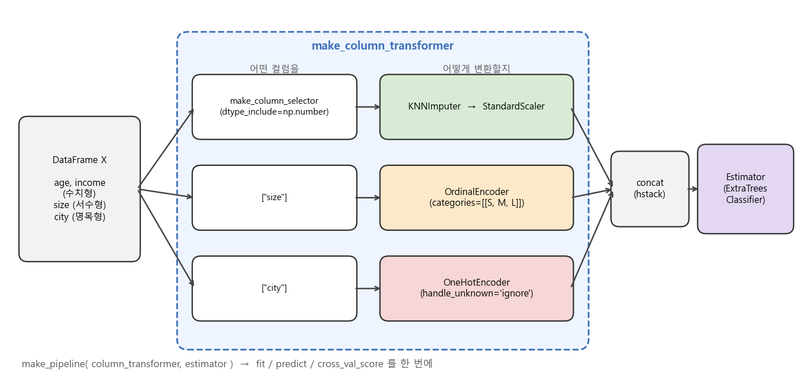
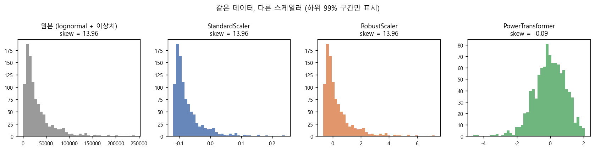
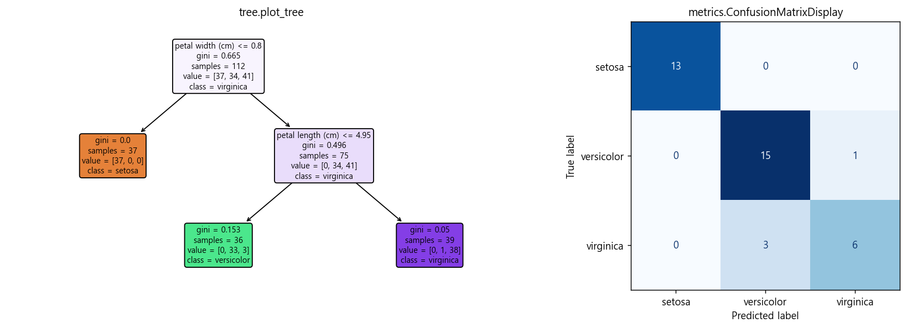

### 매일 쓰는 scikit-learn, 그런데 아직 모르는 기능이 이렇게나 많았다니! 숨은 기능들을 주제별로 묶어 알아봅니다.  


> 참고 아티클  
> **19 Hidden Sklearn Features You Were Supposed to Learn The Hard Way** (Bex T., Towards Data Science)  

<center></center>   

<font size="2"><center> 직접 그린 그림: ColumnTransformer + Pipeline 구조 </center>  </font>   

<br/>


>  **1. 전처리는 make_column_transformer + make_column_selector로 "어떤 컬럼을 어떻게 변환할지"만 선언하고, make_pipeline으로 모델과 묶으면 누수 없이 깔끔하게 CV를 돌릴 수 있음**
>
>  **2. 서수형 변수엔 LabelEncoder 대신 OrdinalEncoder, 치우친 분포엔 PowerTransformer, 이상치가 섞인 데이터엔 RobustScaler / HuberRegressor 등 상황별 대체재가 이미 준비되어 있음**
>
>  **3. RFECV 대신 SelectFromModel, GridSearchCV 대신 HalvingGridSearchCV처럼 "조금 덜 정확하지만 훨씬 빠른" 선택지를 알아두면 대규모 데이터에서 시간을 크게 아낄 수 있음**

<br/>

----

**본 포스트는 Bex T.의 아티클 "19 Hidden Sklearn Features You Were Supposed to Learn The Hard Way"를 읽고, 주제별로 다시 묶어 직접 실행해 보며 정리한 노트입니다.**
원문은 여기에서 보실 수 있습니다. [link](https://towardsdatascience.com/19-hidden-sklearn-features-you-were-supposed-to-learn-the-hard-way-5293e6ff149)  
(원문 링크가 열리지 않는다면, 저자가 이후 Towards AI에 다시 올린 확장판을 참고하세요. [link](https://towardsai.net/p/l/19-most-elegant-sklearn-tricks-i-found-after-3-years-of-use))

----
#### Contents

1. [들어가며](#intro)
2. [Pipeline 조립하기: ColumnTransformer와 column selector](#pipeline)
3. [전처리: 인코딩, 결측치, 스케일링](#preprocessing)
4. [피처 선택: RFECV vs SelectFromModel](#feature-selection)
5. [알아두면 좋은 모델들](#models)
6. [이상치 탐지: EllipticEnvelope와 IsolationForest](#outlier)
7. [모델 선택과 평가: get_scorer와 Successive Halving](#model-selection)
8. [모델 들여다보기와 sklearn.utils](#inspection)
9. [마치며](#conclusion)
<br />

<a id="intro"></a>
## 1. 들어가며  

scikit-learn은 아마 데이터 사이언스를 공부하는 사람이라면 가장 먼저, 그리고 가장 자주 import 하는 라이브러리일 텐데요. 막상 돌아보면 제가 쓰는 기능은 `train_test_split`, `StandardScaler`, `RandomForestClassifier`, `GridSearchCV` 정도의 아주 얇은 단면에 불과했습니다. 그러다 보니 이미 라이브러리에 잘 구현되어 있는 기능을 pandas로 한 땀 한 땀 직접 짜고 있던 경우도 꽤 많았습니다.  

이번에 읽은 아티클은 바로 그런 "알았으면 진작 썼을" 기능 19가지를 소개하는 글입니다. 원문은 기능들을 번호 순서대로 나열하고 있는데, 이 포스트에서는 실제 ML 워크플로우 순서(파이프라인 → 전처리 → 피처 선택 → 모델 → 평가 → 해석)에 맞게 주제별로 다시 묶고, 모든 코드를 직접 돌려 본 결과를 함께 실었습니다.  

참고로 원문이 쓰인 이후 scikit-learn에도 변화가 있었기 때문에, **본문의 코드는 scikit-learn 1.3 기준으로 실행했고**, 그 사이 deprecated/removed 된 부분(`metrics.SCORERS` 등)은 최신 방식으로 바꾸어 두었습니다.  

<br/>

<a id="pipeline"></a>
## 2. Pipeline 조립하기: ColumnTransformer와 column selector  

### 2.1. compose.make_column_transformer  

실전 테이블 데이터는 수치형, 서수형, 명목형 컬럼이 뒤섞여 있기 마련이고, 컬럼 유형마다 다른 전처리를 해 주어야 합니다. 이걸 pandas로 컬럼을 쪼개서 각각 변환한 뒤 `concat` 하는 방식으로 처리하면, 코드가 길어지는 것은 물론이고 **CV를 돌릴 때 검증 fold의 정보가 전처리에 새어 들어가는(data leakage)** 문제도 생기기 쉽습니다.  

`make_column_transformer`는 `(변환기, 적용할 컬럼)` 튜플만 나열하면 컬럼별 변환 결과를 알아서 이어 붙여 주는 함수입니다. 이것을 `make_pipeline`으로 모델과 묶어 주면, `fit`을 호출할 때마다 학습 fold에 대해서만 전처리가 학습되므로 누수 걱정 없이 `cross_val_score`에 그대로 넣을 수 있습니다.  

### 2.2. compose.make_column_selector  

컬럼 이름을 일일이 리스트로 적어 주는 것도 컬럼이 수십 개가 되면 번거롭죠. `make_column_selector`는 **dtype이나 정규표현식 패턴으로 컬럼을 자동 선택**해 주는 callable을 만들어 줍니다. `make_column_selector(dtype_include=np.number)`라고 쓰면 수치형 컬럼만, `dtype_include=object`라고 쓰면 문자열 컬럼만, `pattern="^feat_"` 같은 식으로 이름 패턴으로도 고를 수 있습니다.  

위의 구조도를 그대로 코드로 옮기면 다음과 같습니다.  

```python
import numpy as np, pandas as pd
from sklearn.compose import make_column_transformer, make_column_selector
from sklearn.pipeline import make_pipeline
from sklearn.impute import KNNImputer
from sklearn.preprocessing import OrdinalEncoder, OneHotEncoder, StandardScaler
from sklearn.ensemble import ExtraTreesClassifier
from sklearn.model_selection import cross_val_score

rng = np.random.default_rng(0)
n = 500
X = pd.DataFrame({
    "age": rng.normal(40, 10, n),
    "income": rng.lognormal(10, 1, n),
    "size": rng.choice(["S", "M", "L"], n),
    "city": rng.choice(["Seoul", "Busan", "Daegu"], n),
})
X.loc[rng.choice(n, 50, replace=False), "age"] = np.nan
y = ((X["age"].fillna(40) > 40) & (X["size"] != "S")).astype(int)

preprocess = make_column_transformer(
    (make_pipeline(KNNImputer(n_neighbors=5), StandardScaler()),
     make_column_selector(dtype_include=np.number)),       # 수치형 컬럼 자동 선택
    (OrdinalEncoder(categories=[["S", "M", "L"]]), ["size"]),
    (OneHotEncoder(handle_unknown="ignore"), ["city"]),
)
model = make_pipeline(preprocess, ExtraTreesClassifier(random_state=0))

print("CV accuracy:", cross_val_score(model, X, y, cv=5).mean().round(3))
model.fit(X, y)
print(model[:-1].get_feature_names_out())
```

```
CV accuracy: 0.948
['pipeline__age' 'pipeline__income' 'ordinalencoder__size'
 'onehotencoder__city_Busan' 'onehotencoder__city_Daegu'
 'onehotencoder__city_Seoul']
```

`model[:-1]`처럼 파이프라인을 슬라이싱하면 마지막 estimator를 뺀 전처리 부분만 꺼낼 수 있고, `get_feature_names_out()`으로 변환 후 각 컬럼이 어디서 왔는지도 확인할 수 있습니다. 나중에 feature importance를 해석할 때 꽤 유용합니다.  

> 참고로 Jupyter에서 `sklearn.set_config(display="diagram")`을 켜 두면(1.1부터는 기본값) 파이프라인 객체를 출력했을 때 위 그림과 비슷한 HTML 다이어그램을 보여줍니다. 복잡한 파이프라인을 디버깅할 때 은근히 도움이 됩니다.  

<br/>

<a id="preprocessing"></a>
## 3. 전처리: 인코딩, 결측치, 스케일링  

### 3.1. preprocessing.OrdinalEncoder - 서수형 변수에 LabelEncoder를 쓰지 말자!  

S < M < L처럼 순서가 있는 범주형 변수를 숫자로 바꿀 때 습관적으로 `LabelEncoder`를 쓰는 경우가 많은데요. `LabelEncoder`는 이름 그대로 **타깃(y) 레이블**을 인코딩하라고 만든 클래스라서, 1차원 입력만 받고 카테고리를 **알파벳 순으로 정렬**해 번호를 매깁니다.  

```python
import numpy as np
from sklearn.preprocessing import LabelEncoder, OrdinalEncoder

sizes = np.array(["S", "M", "L", "M", "S"])
print("LabelEncoder  :", LabelEncoder().fit_transform(sizes))
oe = OrdinalEncoder(categories=[["S", "M", "L"]])
print("OrdinalEncoder:", oe.fit_transform(sizes.reshape(-1, 1)).ravel())
```

```
LabelEncoder  : [2 1 0 1 2]
OrdinalEncoder: [0. 1. 2. 1. 0.]
```

`LabelEncoder`는 L=0, M=1, S=2로 순서를 뒤집어 버렸네요. 트리 모델이라면 그나마 괜찮겠지만, 선형 모델에선 의미가 완전히 달라집니다. 피처(X)에는 `OrdinalEncoder`를 쓰고, `categories` 인자로 순서를 명시해 주는 것이 정석입니다. 2차원 입력을 받기 때문에 앞서 본 ColumnTransformer에도 바로 끼워 넣을 수 있습니다.  

### 3.2. impute.KNNImputer와 IterativeImputer  

결측치를 평균/중앙값으로 채우는 `SimpleImputer`는 간단하지만, 피처 간 상관관계를 전혀 활용하지 못합니다. 이럴 때 쓸 수 있는 두 가지 대안이 있습니다.  

- **KNNImputer**: 결측치가 있는 샘플과 가장 가까운 k개의 이웃(결측이 아닌 피처들로 거리를 잼)을 찾아, 이웃들의 값 평균으로 채움  
- **IterativeImputer**: 결측치가 있는 피처를 나머지 피처들의 **회귀 문제**로 보고 예측값으로 채움. 피처 하나씩 돌아가며(round-robin) 회귀 모델을 학습·예측하는 과정을 여러 번 반복하며 값을 점점 다듬어 감 (R의 MICE와 비슷한 아이디어)  

`IterativeImputer`는 아직 experimental 기능이라 별도의 enable import가 필요하다는 점에 주의하세요. 상관관계가 강한 두 피처로 간단히 비교해 봤습니다.  

```python
import numpy as np
from sklearn.experimental import enable_iterative_imputer  # noqa
from sklearn.impute import SimpleImputer, KNNImputer, IterativeImputer

rng = np.random.default_rng(42)
x1 = rng.normal(0, 1, 300)
x2 = 3 * x1 + rng.normal(0, 0.3, 300)   # x1과 강하게 상관된 피처
X = np.c_[x1, x2]
mask = rng.random(300) < 0.2
X_miss = X.copy(); X_miss[mask, 1] = np.nan

for imp in [SimpleImputer(strategy="mean"), KNNImputer(n_neighbors=5),
            IterativeImputer(random_state=0)]:
    X_hat = imp.fit_transform(X_miss)
    rmse = np.sqrt(np.mean((X_hat[mask, 1] - X[mask, 1]) ** 2))
    print(f"{type(imp).__name__:17s} RMSE = {rmse:.3f}")
```

```
SimpleImputer     RMSE = 2.918
KNNImputer        RMSE = 0.346
IterativeImputer  RMSE = 0.315
```

평균 대치에 비해 오차가 10배 가까이 줄었습니다. 물론 이 예시는 선형 관계가 뚜렷하게 만들어진 데이터라 `IterativeImputer`(기본 estimator가 `BayesianRidge`)에 유리한 세팅이긴 합니다. 피처 간 관계가 비선형이라면 `estimator` 인자에 트리 모델을 넣어 볼 수도 있겠죠.  

### 3.3. preprocessing.RobustScaler와 PowerTransformer  

`StandardScaler`는 평균과 표준편차를 쓰기 때문에 이상치 몇 개만 있어도 스케일이 크게 흔들립니다. 그리고 어떤 선형 변환(scaler)을 쓰든 **분포의 모양(skewness) 자체는 바뀌지 않는다**는 점도 기억해 둘 만합니다.  

- **RobustScaler**: 평균/표준편차 대신 **중앙값과 IQR(사분위 범위)**로 스케일링함. 이상치의 영향을 덜 받음  
- **PowerTransformer**: 거듭제곱 계열의 비선형 변환으로 분포를 **정규분포에 가깝게** 만들어 줌. 기본값은 음수도 처리 가능한 Yeo-Johnson 변환이고, 양수 데이터라면 Box-Cox도 선택 가능함. 변환 강도 $\lambda$는 최대우도로 자동 추정됨 (Box-Cox에서 $\lambda=0$인 경우가 바로 로그 변환임)  

```python
import numpy as np
from scipy.stats import skew
from sklearn.preprocessing import StandardScaler, RobustScaler, PowerTransformer

rng = np.random.default_rng(0)
income = rng.lognormal(mean=10, sigma=1, size=(1000, 1))
income[:5] = income.max() * 20     # 극단적인 이상치 5개

for sc in [StandardScaler(), RobustScaler(), PowerTransformer()]:
    z = sc.fit_transform(income)
    print(f"{type(sc).__name__:16s} skew={skew(z.ravel()):7.2f}  "
          f"median={np.median(z):6.2f}  IQR={np.subtract(*np.percentile(z, [75, 25])):.2f}")
```

```
StandardScaler   skew=  13.96  median= -0.09  IQR=0.05
RobustScaler     skew=  13.96  median=  0.00  IQR=1.00
PowerTransformer skew=  -0.09  median=  0.02  IQR=1.27
```

<center></center>   

<font size="2"><center> 직접 그린 그림: 스케일러별 변환 결과 비교 </center>  </font>   

결과가 꽤 극명합니다. `StandardScaler`는 이상치에 표준편차가 끌려가서 데이터 대부분이 IQR 0.05라는 아주 좁은 구간에 뭉개져 버렸습니다. `RobustScaler`는 본체 데이터의 IQR을 깔끔하게 1로 맞춰 주지만 skew는 그대로이고, `PowerTransformer`만이 분포의 모양 자체를 정규분포 비슷하게 펴 주었네요. 정리하면, **이상치 때문에 스케일이 망가지는 게 문제면 RobustScaler, 분포가 한쪽으로 쏠린 게 문제면 PowerTransformer**를 떠올리면 되겠습니다.  

<br/>

<a id="feature-selection"></a>
## 4. 피처 선택: RFECV vs SelectFromModel  

### 4.1. feature_selection.RFECV  

RFE(Recursive Feature Elimination)는 모델을 학습하고 → 중요도가 가장 낮은 피처를 제거하고 → 다시 학습하는 과정을 반복하는 방법입니다. 문제는 "몇 개까지 남길지"를 사람이 정해야 한다는 것인데, `RFECV`는 이를 **교차검증 점수가 가장 높은 피처 개수로 자동 결정**해 줍니다.  

### 4.2. feature_selection.SelectFromModel  

`SelectFromModel`은 모델을 **한 번만** 학습해서 `feature_importances_`나 `coef_`가 임계값(threshold)보다 큰 피처만 남기는 훨씬 단순한 방법입니다. 반복 학습도, CV도 없으니 당연히 빠르겠죠. 30개 피처 중 5개만 유의미한 데이터로 둘을 비교해 봤습니다.  

```python
import time
from sklearn.datasets import make_classification
from sklearn.feature_selection import RFECV, SelectFromModel
from sklearn.ensemble import RandomForestClassifier

X, y = make_classification(n_samples=1000, n_features=30, n_informative=5,
                           n_redundant=0, random_state=0)
rf = RandomForestClassifier(n_estimators=100, random_state=0, n_jobs=-1)

t = time.time()
rfecv = RFECV(rf, step=1, cv=5, scoring="accuracy").fit(X, y)
print(f"RFECV          : {rfecv.n_features_:2d}개 선택, {time.time()-t:5.1f}s")

t = time.time()
sfm = SelectFromModel(rf, threshold="mean").fit(X, y)
print(f"SelectFromModel: {sfm.get_support().sum():2d}개 선택, {time.time()-t:5.1f}s")
print("RFECV 선택     :", rfecv.get_support(indices=True))
print("SFM 선택       :", sfm.get_support(indices=True))
```

```
RFECV          :  4개 선택,  70.1s
SelectFromModel:  4개 선택,   0.2s
RFECV 선택     : [ 3  5 27 28]
SFM 선택       : [ 3  5 27 28]
```

이 예시에서는 둘이 완전히 같은 피처를 골랐는데, 시간은 무려 350배 차이가 납니다. (RFECV는 피처 수 × fold 수만큼 모델을 학습하니까요.) 항상 결과가 같은 것은 아니고 `SelectFromModel`은 임계값 선택에 민감하지만, **대규모 데이터에서 먼저 SelectFromModel로 크게 걸러 낸 뒤 남은 피처에 RFECV를 적용**하는 식의 조합도 실용적인 전략입니다. RFECV를 쓸 때는 `step`을 1보다 크게(혹은 비율로) 주는 것만으로도 꽤 빨라집니다.  

<br/>

<a id="models"></a>
## 5. 알아두면 좋은 모델들  

### 5.1. ensemble.ExtraTreesClassifier / Regressor  

Extremely Randomized Trees는 랜덤 포레스트에 랜덤성을 한 스푼 더 넣은 앙상블입니다. 랜덤 포레스트는 후보 피처마다 **최적의 분할 기준값(threshold)을 탐색**하지만, ExtraTrees는 후보 피처마다 threshold를 **무작위로 하나씩 뽑고**, 그렇게 뽑힌 후보 분할들 중에서 가장 좋은 것을 고릅니다. 또 기본적으로 bootstrap 샘플링 없이 전체 데이터를 사용합니다.  

이렇게 하면 bias가 조금 늘어나는 대신 트리 간 상관이 줄어 variance가 감소하고, 무엇보다 최적 threshold를 찾는 정렬 비용이 없어 **학습이 훨씬 빠릅니다.**  

```python
import time
from sklearn.datasets import make_classification
from sklearn.model_selection import cross_val_score
from sklearn.ensemble import RandomForestClassifier, ExtraTreesClassifier

X, y = make_classification(n_samples=5000, n_features=40, n_informative=10,
                           random_state=0)
for m in [RandomForestClassifier(n_estimators=200, random_state=0, n_jobs=-1),
          ExtraTreesClassifier(n_estimators=200, random_state=0, n_jobs=-1)]:
    t = time.time()
    s = cross_val_score(m, X, y, cv=5)
    print(f"{type(m).__name__:22s} acc={s.mean():.3f}±{s.std():.3f}  {time.time()-t:.1f}s")
```

```
RandomForestClassifier acc=0.930±0.006  17.6s
ExtraTreesClassifier   acc=0.933±0.003  3.1s
```

성능은 비슷한데 시간은 5배 넘게 줄었네요. 랜덤 포레스트를 베이스라인으로 쓰고 있었다면 한 번쯤 바꿔 끼워 볼 만합니다.  

### 5.2. linear_model.HuberRegressor  

이상치를 일일이 찾아 지우는 대신, **손실 함수 자체를 이상치에 둔감하게** 만드는 방법도 있습니다. Huber loss는 잔차가 작을 땐 제곱 오차, 일정 수준($\epsilon$)을 넘으면 절대 오차처럼 선형으로 증가하기 때문에, 큰 잔차를 가진 샘플의 영향력이 자연스럽게 줄어듭니다.  

$$
L_\epsilon(r) =
\begin{cases}
r^2 & \text{if } \vert r \vert \le \epsilon \\
2\epsilon \vert r \vert - \epsilon^2 & \text{otherwise}
\end{cases}
$$

```python
import numpy as np
from sklearn.linear_model import LinearRegression, HuberRegressor

rng = np.random.default_rng(0)
X = rng.uniform(0, 10, (100, 1))
y = 2 * X.ravel() + 1 + rng.normal(0, 1, 100)
y[:5] += 80          # 이상치 5개

for m in [LinearRegression(), HuberRegressor()]:
    m.fit(X, y)
    print(f"{type(m).__name__:16s} coef={m.coef_[0]:.3f}  intercept={m.intercept_:.3f}")
```

```
LinearRegression coef=1.148  intercept=9.595
HuberRegressor   coef=1.960  intercept=1.294
```

참값은 기울기 2, 절편 1입니다. 이상치 5개 때문에 OLS는 크게 빗나갔지만 Huber는 거의 제자리를 찾았습니다.  

### 5.3. linear_model.Perceptron  

원문에는 Perceptron이 SGDClassifier보다 빠르다고 되어 있는데, 직접 확인해 보니 조금 다릅니다. 공식 문서에 따르면 `Perceptron()`은 `SGDClassifier(loss="perceptron", eta0=1, learning_rate="constant", penalty=None)`과 **동일한 구현**입니다.  

```python
import time
import numpy as np
from sklearn.datasets import make_classification
from sklearn.linear_model import Perceptron, SGDClassifier

X, y = make_classification(n_samples=200_000, n_features=50, random_state=0)
p = Perceptron(random_state=0)
s = SGDClassifier(loss="perceptron", penalty=None, learning_rate="constant",
                  eta0=1, random_state=0)
for m in [p, s]:
    t = time.time(); m.fit(X, y)
    print(f"{type(m).__name__:14s} acc={m.score(X, y):.4f}  {time.time()-t:.2f}s")
print("같은 가중치?", np.allclose(p.coef_, s.coef_))
```

```
Perceptron     acc=0.9374  0.48s
SGDClassifier  acc=0.9374  0.49s
같은 가중치? True
```

가중치까지 완전히 같네요. 즉 Perceptron은 "더 빠른 모델"이라기보다는 **대규모 데이터용 SGD 선형 분류기를 하이퍼파라미터 고민 없이 쓰는 단축키** 정도로 이해하면 되겠습니다. `partial_fit`도 지원하므로 메모리에 다 올라가지 않는 데이터를 나눠서 학습할 때도 쓸 수 있습니다.  

### 5.4. Generalized Linear Models: PoissonRegressor, GammaRegressor, TweedieRegressor  

`LinearRegression`은 타깃이 정규분포를 따른다고 가정하는데, 방문 횟수나 클레임 건수 같은 **카운트 데이터**(Poisson), 금액·대기시간처럼 **양수이면서 오른쪽으로 긴 꼬리**를 가진 데이터(Gamma), 0이 많이 섞인 보험금 같은 데이터(Tweedie)에는 잘 맞지 않습니다. GLM은 log link를 통해 $\mathbb{E}[y \mid x] = \exp(x^\top w + b)$를 모델링하므로 예측값이 항상 양수가 됩니다.  

```python
import numpy as np
from sklearn.linear_model import LinearRegression, PoissonRegressor
from sklearn.model_selection import train_test_split
from sklearn.metrics import mean_poisson_deviance

rng = np.random.default_rng(0)
X = rng.normal(size=(5000, 3))
y = rng.poisson(np.exp(0.3 + X @ [0.5, -0.4, 0.2]))   # 카운트 데이터
X_tr, X_te, y_tr, y_te = train_test_split(X, y, random_state=0)

lin = LinearRegression().fit(X_tr, y_tr)
poi = PoissonRegressor(alpha=0).fit(X_tr, y_tr)
print("LinearRegression 음수 예측 비율:", (lin.predict(X_te) < 0).mean().round(3))
print("PoissonRegressor 음수 예측 비율:", (poi.predict(X_te) < 0).mean().round(3))
print("PoissonRegressor deviance     :", mean_poisson_deviance(y_te, poi.predict(X_te)).round(3))
print("추정 계수:", poi.coef_.round(2), "절편:", round(poi.intercept_, 2))
```

```
LinearRegression 음수 예측 비율: 0.07
PoissonRegressor 음수 예측 비율: 0.0
PoissonRegressor deviance     : 1.075
추정 계수: [ 0.51 -0.4   0.19] 절편: 0.29
```

"방문 횟수 -0.3회"라는 이상한 예측이 7%나 나오는 선형회귀와 달리, Poisson 회귀는 음수를 내놓지 않고 계수도 참값(0.5, -0.4, 0.2, 절편 0.3)을 잘 복원했습니다. 참고로 `PoissonRegressor`의 `alpha` 기본값은 1.0(L2 규제)이라 계수 해석이 목적이라면 값을 줄여 주는 게 좋습니다.  

<br/>

<a id="outlier"></a>
## 6. 이상치 탐지: EllipticEnvelope와 IsolationForest  

두 탐지기 모두 `fit_predict` 결과로 정상은 1, 이상치는 -1을 돌려주고, `contamination` 인자로 예상 이상치 비율을 지정합니다.  

- **covariance.EllipticEnvelope**: 데이터가 (다변량) 정규분포를 따른다고 가정하고, 이상치에 강건한 방식(MCD)으로 평균과 공분산을 추정한 뒤 마할라노비스 거리가 먼 점을 이상치로 판단함. 즉 데이터를 감싸는 **타원**을 그리는 셈임  
- **ensemble.IsolationForest**: 무작위로 피처 하나를 고르고, 그 피처의 최솟값~최댓값 사이에서 무작위로 분할하는 트리를 여러 개 만듦. 이상치는 남들과 멀리 떨어져 있어 **적은 횟수의 분할만으로 고립(isolate)**되므로, 루트에서 리프까지의 평균 경로 길이가 짧을수록 이상치로 판단함. 분포 가정이 없음  

```python
import numpy as np
from sklearn.covariance import EllipticEnvelope
from sklearn.ensemble import IsolationForest

rng = np.random.default_rng(0)
inliers = rng.multivariate_normal([0, 0], [[1, 0.8], [0.8, 1]], 300)
outliers = rng.uniform(-6, 6, (15, 2))
X = np.r_[inliers, outliers]
is_out = np.r_[np.zeros(300), np.ones(15)].astype(bool)

for det in [EllipticEnvelope(contamination=0.05, random_state=0),
            IsolationForest(contamination=0.05, random_state=0)]:
    pred = det.fit_predict(X) == -1          # -1 이 이상치
    print(f"{type(det).__name__:16s} 탐지={pred.sum():2d}  "
          f"진짜 이상치 중 잡아낸 수={(pred & is_out).sum()}/15")
```

```
EllipticEnvelope 탐지=16  진짜 이상치 중 잡아낸 수=14/15
IsolationForest  탐지=16  진짜 이상치 중 잡아낸 수=12/15
```

정상 데이터가 실제로 상관된 정규분포에서 나왔기 때문에, 분포 가정이 딱 맞아떨어지는 EllipticEnvelope가 조금 더 잘 잡아냈습니다. 반대로 정상 데이터가 여러 군집으로 나뉘어 있거나 비정규적인 모양이라면 IsolationForest가 더 안전한 선택이겠죠. **"내 데이터가 정규분포에 가까운가?"**가 둘 중 하나를 고르는 첫 번째 질문이 되겠습니다.  

<br/>

<a id="model-selection"></a>
## 7. 모델 선택과 평가: get_scorer와 Successive Halving  

### 7.1. metrics.get_scorer와 get_scorer_names  

`cross_val_score(..., scoring="f1")`처럼 문자열로 넘길 수 있는 metric 이름이 정확히 뭐였는지 헷갈릴 때가 많습니다. 원문에서는 `sklearn.metrics.SCORERS.keys()`로 확인하라고 소개했는데, **`SCORERS` 딕셔너리는 1.1에서 deprecated 되고 1.3에서 제거**되었습니다. 지금은 `get_scorer_names()`를 쓰면 됩니다.  

그리고 `get_scorer(이름)`은 `(estimator, X, y)`를 받아 점수를 돌려주는 scorer 객체를 반환하므로, 여러 metric을 import 없이 이름만으로 한 번에 계산할 수 있습니다.  

```python
import sklearn.metrics as m
names = m.get_scorer_names()
print(len(names), names[:6])
print("SCORERS 남아있나?", hasattr(m, "SCORERS"))

from sklearn.datasets import load_breast_cancer
from sklearn.linear_model import LogisticRegression
from sklearn.model_selection import train_test_split
X, y = load_breast_cancer(return_X_y=True)
X_tr, X_te, y_tr, y_te = train_test_split(X, y, random_state=0)
clf = LogisticRegression(max_iter=5000).fit(X_tr, y_tr)
for name in ["accuracy", "f1", "roc_auc", "neg_log_loss"]:
    print(f"{name:12s} {m.get_scorer(name)(clf, X_te, y_te):.4f}")
```

```
54 ['accuracy', 'adjusted_mutual_info_score', 'adjusted_rand_score', 'average_precision', 'balanced_accuracy', 'completeness_score']
SCORERS 남아있나? False
accuracy     0.9510
f1           0.9600
roc_auc      0.9954
neg_log_loss -0.1058
```

`neg_log_loss`처럼 `neg_`가 붙은 것은 "클수록 좋다"는 규칙을 맞추기 위해 부호를 뒤집은 손실이라는 점도 함께 기억해 두면 좋습니다.  

### 7.2. model_selection.HalvingGridSearchCV / HalvingRandomSearchCV  

GridSearchCV는 모든 후보 조합을 전체 데이터로 끝까지 평가하기 때문에 조합이 많아지면 시간이 폭발합니다. **Successive Halving**은 토너먼트 방식으로 이 문제를 풉니다.  

1. 처음에는 모든 후보를 **적은 자원(샘플 수)**으로 평가함  
2. 상위 1/`factor`만 살아남고 나머지는 탈락함  
3. 살아남은 후보에게는 자원을 `factor`배로 늘려 다시 평가함  
4. 후보가 하나 남거나 자원을 다 쓸 때까지 반복함  

어차피 안 될 조합은 적은 데이터만 보고도 일찍 걸러 내자는 아이디어입니다. 이 기능도 experimental이라 enable import가 필요합니다.  

```python
import time
from sklearn.datasets import make_classification
from sklearn.ensemble import RandomForestClassifier
from sklearn.experimental import enable_halving_search_cv  # noqa
from sklearn.model_selection import GridSearchCV, HalvingGridSearchCV

X, y = make_classification(n_samples=4000, n_features=20, random_state=0)
grid = {"max_depth": [3, 5, 10, None], "min_samples_leaf": [1, 5, 10],
        "max_features": ["sqrt", 0.5, 1.0]}          # 36개 조합
rf = RandomForestClassifier(n_estimators=100, random_state=0)

for S in [GridSearchCV(rf, grid, cv=5, n_jobs=-1),
          HalvingGridSearchCV(rf, grid, cv=5, factor=3, random_state=0, n_jobs=-1)]:
    t = time.time(); S.fit(X, y)
    print(f"{type(S).__name__:20s} {time.time()-t:5.1f}s  best={S.best_score_:.4f}  {S.best_params_}")

h = S
print("iteration별 후보 수:", h.n_candidates_)
print("iteration별 샘플 수:", h.n_resources_)
```

```
GridSearchCV          92.4s  best=0.9130  {'max_depth': None, 'max_features': 0.5, 'min_samples_leaf': 10}
HalvingGridSearchCV   12.9s  best=0.9099  {'max_depth': 10, 'max_features': 'sqrt', 'min_samples_leaf': 1}
iteration별 후보 수: [36, 12, 4, 2]
iteration별 샘플 수: [148, 444, 1332, 3996]
```

36개 후보가 148개 샘플로 시작해 36 → 12 → 4 → 2로 줄어드는 동안, 샘플 수는 3배씩 늘어나 마지막엔 거의 전체 데이터를 쓰는 것을 볼 수 있습니다. 약 7배 빨라졌고 최고 점수 차이는 0.003 정도입니다. 다만 최종으로 고른 조합이 GridSearch와 다르다는 점에서 알 수 있듯이, **"거의 비슷하게 좋은 조합을 훨씬 빨리 찾는" 근사 방법**이라는 점은 염두에 두어야 합니다. 원문에서는 10배 이상 빠르다고 소개하는데, 실제 속도 향상은 후보 수와 `factor`, 데이터 크기에 따라 달라집니다.  

<br/>

<a id="inspection"></a>
## 8. 모델 들여다보기와 sklearn.utils  

### 8.1. tree.plot_tree와 metrics.ConfusionMatrixDisplay  

graphviz를 따로 설치하지 않아도 `plot_tree`로 의사결정나무를 matplotlib으로 바로 그릴 수 있고, `ConfusionMatrixDisplay`로 혼동 행렬도 한 줄에 시각화할 수 있습니다.  

```python
import matplotlib.pyplot as plt
from sklearn.datasets import load_iris
from sklearn.model_selection import train_test_split
from sklearn.tree import DecisionTreeClassifier, plot_tree
from sklearn.metrics import ConfusionMatrixDisplay

iris = load_iris()
X_tr, X_te, y_tr, y_te = train_test_split(iris.data, iris.target, random_state=0)
tree = DecisionTreeClassifier(max_depth=2, random_state=0).fit(X_tr, y_tr)

fig, axes = plt.subplots(1, 2, figsize=(13, 4.6),
                         gridspec_kw={"width_ratios": [1.7, 1]})
plot_tree(tree, feature_names=iris.feature_names, class_names=list(iris.target_names),
          filled=True, rounded=True, fontsize=8, ax=axes[0])
ConfusionMatrixDisplay.from_estimator(tree, X_te, y_te, display_labels=iris.target_names,
                                      cmap="Blues", ax=axes[1], colorbar=False)
```

<center></center>   

<font size="2"><center> 직접 그린 그림: 위 코드의 실행 결과 </center>  </font>   

직접 돌려 보며 만난 소소한 함정 두 가지를 공유하면,  

- `plot_tree`의 `class_names`에 `iris.target_names`(numpy array)를 그대로 넣으면 1.3에서는 `InvalidParameterError`가 남. `list(...)`로 감싸 주어야 함  
- 예전의 `metrics.plot_confusion_matrix(estimator, X, y)`는 1.2에서 제거됨. 지금은 `ConfusionMatrixDisplay.from_estimator` 또는 이미 예측값이 있다면 `from_predictions`를 쓰면 됨  

max_depth=2짜리 나무라 virginica를 versicolor로 헷갈리는 모습이 혼동 행렬에 그대로 드러나네요.  

### 8.2. sklearn.utils  

`sklearn.utils`는 scikit-learn 내부의 transformer, estimator들이 쓰는 도우미 함수 모음인데, 우리가 직접 가져다 써도 꽤 쓸모가 있습니다.  

- `class_weight.compute_class_weight`: 불균형 데이터의 클래스 가중치 계산  
- `shuffle`, `resample`: 여러 배열을 같은 순서로 섞기 / 부트스트랩 샘플링  
- `check_X_y`, `check_array`: 입력 검증 (커스텀 estimator를 만들 때 유용함)  
- `estimator_html_repr`: 파이프라인 다이어그램을 HTML 문자열로 뽑아 파일로 저장 가능함  

```python
import numpy as np
from sklearn.utils.class_weight import compute_class_weight
from sklearn.utils import shuffle

y = np.array([0] * 90 + [1] * 10)
w = compute_class_weight("balanced", classes=np.unique(y), y=y)
print("class weight:", dict(zip([0, 1], w.round(3))))

Xs, ys = shuffle(np.arange(5), np.arange(5) * 10, random_state=0)
print("shuffle     :", Xs, ys)
```

```
class weight: {0: 0.556, 1: 5.0}
shuffle     : [2 0 1 3 4] [20  0 10 30 40]
```

`balanced` 가중치는 $\frac{n_{\text{samples}}}{n_{\text{classes}} \times n_{c}}$ ($n_c$는 클래스 $c$의 샘플 수)로 계산되므로, 9:1 불균형에서 소수 클래스에 9배의 가중치가 붙은 것을 확인할 수 있습니다. 모델의 `class_weight="balanced"` 옵션이 내부적으로 하는 일이 바로 이것입니다.  

<br/>

<a id="conclusion"></a>
## 9. 마치며  

19가지 기능을 주제별로 다시 묶어 보니, 결국 이런 메시지로 정리되는 것 같습니다.  

- **파이프라인**: 전처리는 ColumnTransformer + Pipeline으로 선언적으로 작성하자. 코드도 짧아지고 누수도 막을 수 있음  
- **데이터의 특성에 맞는 도구**: 서수형엔 OrdinalEncoder, 상관된 결측엔 KNN/IterativeImputer, 이상치엔 RobustScaler/HuberRegressor, 치우친 분포엔 PowerTransformer, 카운트 타깃엔 PoissonRegressor  
- **속도와 정확도의 트레이드오프**: RFECV ↔ SelectFromModel, RandomForest ↔ ExtraTrees, GridSearch ↔ HalvingGridSearch  

개인적으로는 직접 돌려 보는 과정에서 배운 게 더 많았습니다. "Perceptron이 SGD보다 빠르다"는 소개가 사실은 같은 구현이었다는 점, `SCORERS`나 `plot_confusion_matrix`처럼 1~2년 사이에 사라진 API가 생각보다 많다는 점이 그랬는데요. 팁 모음 글은 편하게 읽고 넘기기 쉽지만, **라이브러리의 버전은 계속 바뀌니 공식 문서와 직접 실행 결과로 한 번 더 확인하는 습관**이 중요하다는 걸 다시 느꼈습니다. 이제 pandas로 한 땀 한 땀 짜던 전처리 코드부터 정리하러 가 봐야겠네요.  

----------------


**개선을 위한 여러분의 피드백과 제안을 코멘트로 공유해 주세요.**
**내용에 대한 지적, 혹은 질문을 환영합니다.**  


**출처**  
[Bex T., 19 Hidden Sklearn Features You Were Supposed to Learn The Hard Way (Towards Data Science)](https://towardsdatascience.com/19-hidden-sklearn-features-you-were-supposed-to-learn-the-hard-way-5293e6ff149)  
[Bex T., 19 Most Elegant Sklearn Tricks I Found After 3 Years of Use (Towards AI)](https://towardsai.net/p/l/19-most-elegant-sklearn-tricks-i-found-after-3-years-of-use)  
[scikit-learn User Guide: Searching for optimal parameters with successive halving](https://scikit-learn.org/stable/modules/grid_search.html#successive-halving-user-guide)  
[scikit-learn API Reference](https://scikit-learn.org/stable/modules/classes.html)  
