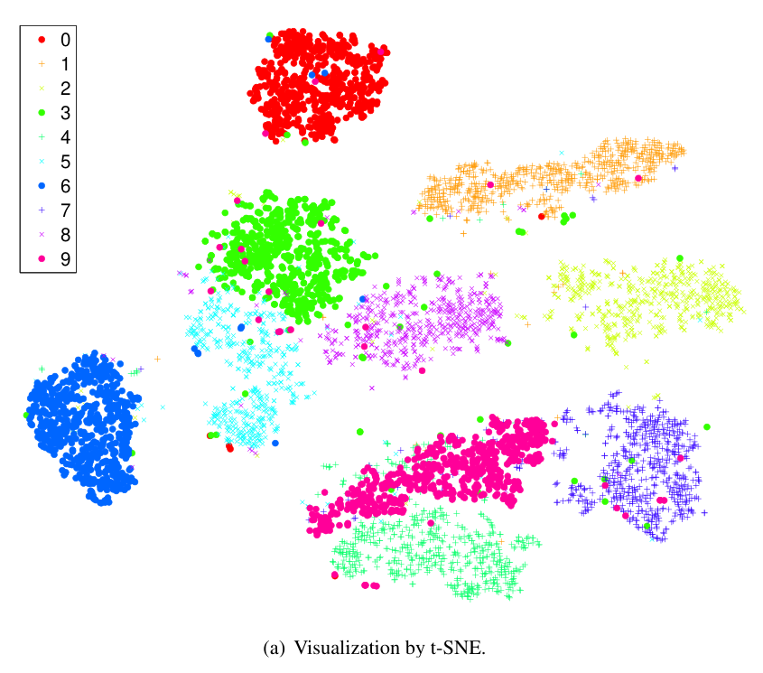
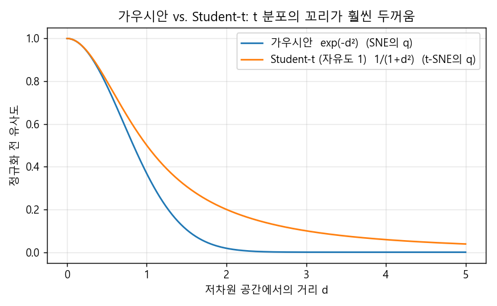
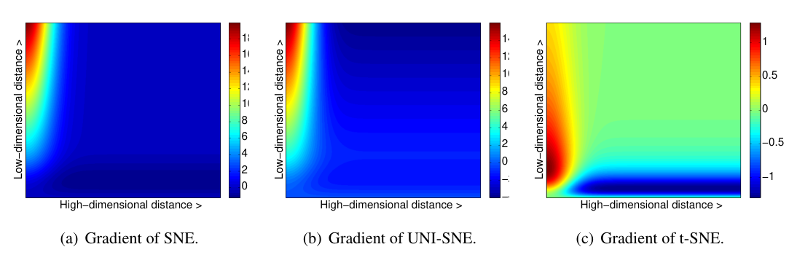
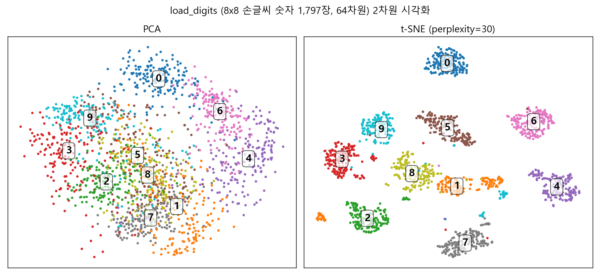
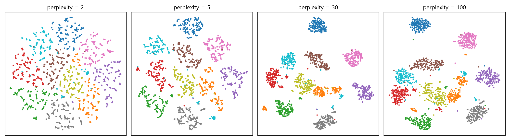

### 고차원 데이터 시각화의 표준 도구가 된 t-SNE가 어떻게 동작하는지, SNE부터 차근차근 알아봅니다.  


> 원제  
> **Visualizing Data using t-SNE**  
> Laurens van der Maaten, Geoffrey Hinton (Journal of Machine Learning Research, 2008)  

<center></center>   

<font size="2"><center> 출처: van der Maaten & Hinton, Visualizing Data using t-SNE, Figure 2(a) (https://www.jmlr.org/papers/volume9/vandermaaten08a/vandermaaten08a.pdf) </center>  </font>   

<br/>


>  **1. SNE는 고차원/저차원 공간의 거리를 "이웃으로 고를 확률"로 바꾸고, 두 확률분포의 KL-Divergence를 줄이도록 저차원 좌표를 학습함**
>
>  **2. t-SNE는 SNE의 비용함수를 대칭(symmetric) 형태로 바꾸고, 저차원 쪽 분포를 꼬리가 두꺼운 Student-t 분포로 바꿔 crowding problem과 최적화의 어려움을 해결함**
>
>  **3. perplexity는 "몇 명의 이웃을 볼 것인가"를 정하는 핵심 하이퍼파라미터이며, 값에 따라 그림이 크게 달라지므로 여러 값을 시도해 보는 것이 좋음**

<br/>

----

**본 포스트는 t-SNE 논문과 관련 강의 영상을 보고 정리한 노트에, 사이킷런으로 직접 돌려본 실험을 덧붙인 내용입니다.**
원문은 여기에서 보실 수 있습니다.  
[t-SNE paper (JMLR 2008)](https://www.jmlr.org/papers/volume9/vandermaaten08a/vandermaaten08a.pdf), [참고한 강의 영상](https://youtu.be/zCYKD3YfcSM)  

----
#### Contents  

1. [Intro - PCA로는 왜 부족할까?](#intro)  
2. [Stochastic Neighbor Embedding(SNE): 거리를 확률로 바꿔보자](#sne)  
3. [하이퍼파라미터 sigma와 perplexity](#perplexity)  
4. [t-SNE 1: Symmetric SNE](#symmetric)  
5. [t-SNE 2: Crowding problem과 Student-t 분포](#crowding)  
6. [사이킷런으로 직접 돌려보자! PCA vs t-SNE, 그리고 perplexity](#experiment)  
7. [마치며](#conclusion)  
<br />

<a id="intro"></a>
## 1. Intro - PCA로는 왜 부족할까?  

임베딩을 학습하고 나면 꼭 한 번씩 해보고 싶어지는 게 있죠. 바로 "이 벡터들이 실제로 잘 뭉쳐 있나?" 눈으로 확인해 보는 일입니다.  
그런데 사람 눈은 2차원, 많아야 3차원까지밖에 볼 수 없으니, 결국 고차원 데이터 $X = \lbrace x_1, x_2, ..., x_n \rbrace$를 저차원 데이터 $Y = \lbrace y_1, y_2, ..., y_n \rbrace$로 변환하는 **차원 축소**가 필요합니다.  
이때 목표는 당연히, 고차원 공간에 있던 유의미한 구조를 가능한 한 최대한 보존하는 것이겠죠.  

가장 먼저 떠오르는 방법은 PCA인데요, 지난 포스트([차원 축소 - PCA와 AutoEncoder](https://myeonghak.github.io/deep%20learning/Deep-Learning-%EC%B0%A8%EC%9B%90-%EC%B6%95%EC%86%8C-PCA%EC%99%80-AutoEncoder/))에서 다뤘던 내용을 잠깐 복습해 보겠습니다.  

- PCA는 데이터의 분산을 잘 설명하는 새로운 d차원 기저를 찾아냄  
- 찾아낸 기저는 기존 고차원 피처들의 선형 결합임  
- 데이터를 새 기저로 사영(projection)했을 때 분산이 가장 커지는 축을 고르며, 이 축은 공분산 행렬의 고유벡터, 그 축이 갖는 분산은 고유값이 됨  

문제는 PCA가 근본적으로 **선형** 변환이라는 점입니다.  
스위스롤(swiss roll)처럼 데이터가 휘어진 매니폴드(manifold) 위에 놓여 있으면, 유클리드 거리로는 가깝지만 매니폴드를 따라가면 아주 먼 점들이 생기는데요, PCA는 이런 비선형적인 구조를 보존하지 못합니다.  
게다가 PCA는 "분산이 큰 방향", 즉 멀리 떨어진 점들 사이의 관계를 잘 보존하는 데 초점이 맞춰져 있어서, 시각화에서 정작 중요한 **가까운 이웃끼리의 관계(local structure)**는 뭉개지기 쉽습니다.  

t-SNE는 바로 이 local structure를 지키는 데 집중한 방법입니다. 다만 t-SNE를 이해하려면 그 뿌리인 SNE부터 보는 것이 순서겠죠.  


<a id="sne"></a>
## 2. Stochastic Neighbor Embedding(SNE): 거리를 확률로 바꿔보자  

SNE(Hinton & Roweis, 2002)는 이름을 세 단어로 쪼개 보면 아이디어가 그대로 드러납니다.  

- **Stochastic**: 각 데이터 포인트 $x_i$마다 확률분포 $P_i$를 하나씩 정의함  
- **Neighbor**: $P_i$는 $x_i$가 다른 포인트 $x_j$를 "이웃으로 선택할 확률"을 나타냄. 고차원 공간에서 가까울수록 높은 확률을 가짐  
- **Embedding**: $x_i$를 $y_i$로 맵핑하되, 저차원에서 정의한 이웃 확률 $Q_i$가 $P_i$와 비슷해지도록 만듦  

즉 거리 자체를 맞추는 것이 아니라, **유클리드 거리를 "이웃일 확률"로 바꾼 다음 그 확률분포를 맞추는 것**이 핵심입니다.  

### 고차원 공간의 확률분포 $P_i$  

$x_i$가 $x_j$를 이웃으로 고를 조건부 확률은 다음과 같이 정의됩니다.  

$$
p_{j \mid i} = \frac{\exp\left(-\lVert x_i - x_j \rVert^2 / 2\sigma_i^2\right)}{\sum_{k \neq i} \exp\left(-\lVert x_i - x_k \rVert^2 / 2\sigma_i^2\right)}, \quad p_{i \mid i} = 0
$$

생김새가 정규분포의 pdf와 닮았는데요, 평균이 $x_i$이고 표준편차가 $\sigma_i$인 가우시안을 이산 버전으로 만든 것이라고 보면 됩니다.  
분모는 모든 이웃에 대한 확률의 합이 1이 되도록 하는 normalize term이고요.  
해석해 보면, $x_i$를 중심으로 $\sigma_i$만큼 퍼진 정규분포를 하나 씌웠을 때 그 아래에서 $x_j$가 등장할 확률을 "둘이 이웃일 확률"로 본 셈입니다.  
전체적으로는 데이터 포인트마다 자기를 중심으로 하는 종 모양 분포가 하나씩 그려져 있는 모습을 상상하시면 됩니다.  

### 저차원 공간의 확률분포 $Q_i$  

저차원에 맵핑된 $y_i$에 대해서도 똑같이 정의하는데, 이쪽은 분산을 고정해서 표준편차를 $1/\sqrt{2}$로 둡니다(그래서 지수 안의 $2\sigma^2$이 1이 됨).  

$$
q_{j \mid i} = \frac{\exp\left(-\lVert y_i - y_j \rVert^2\right)}{\sum_{k \neq i} \exp\left(-\lVert y_i - y_k \rVert^2\right)}
$$

- $P_i$는 데이터가 주어지면 처음에 한 번 계산하고 끝임  
- $y_i$는 처음에 작은 분산의 가우시안에서 랜덤하게 뽑음 (사이킷런에서는 `init="pca"`처럼 초기값을 지정할 수도 있음)  
- 학습이 진행되면서 $y_i$가 움직이고, 그에 따라 $Q_i$는 매번 바뀜  

### 손실함수: KL-Divergence  

우리의 목표는 고차원의 이웃 구조를 저차원에서도 유지하는 것이니, $P_i$와 $Q_i$의 차이를 줄이면 됩니다. 이 차이를 KL-Divergence로 재고, 모든 포인트에 대해 더한 것이 SNE의 비용함수입니다.  

$$
C = \sum_i KL(P_i \parallel Q_i) = \sum_i \sum_j p_{j \mid i} \log \frac{p_{j \mid i}}{q_{j \mid i}}
$$

이 비용을 $y_i$에 대해 미분해서 gradient descent(논문에서는 momentum을 곁들인)로 $y$들의 위치를 조금씩 옮겨 가면, KL-Divergence가 줄어들면서 저차원 배치가 완성됩니다.  

$$
\frac{\partial C}{\partial y_i} = 2 \sum_j \left(p_{j \mid i} - q_{j \mid i} + p_{i \mid j} - q_{i \mid j}\right)(y_i - y_j)
$$

### SNE 손실함수의 성격  

KL-Divergence는 비대칭이라는 점이 재밌는데요, 이 성질이 SNE의 성격을 결정합니다.  

- **고차원에서 가까운 점을 저차원에서 멀리 두면** ($p$ 큼, $q$ 작음) → 큰 cost  
- **고차원에서 먼 점을 저차원에서 가까이 두면** ($p$ 작음, $q$ 큼) → 상대적으로 작은 cost  
- 따라서 "가까운 애들을 가깝게" 만드는 데 집중하게 되고, 결과적으로 local structure가 잘 보존됨  

gradient 관점에서 보면 $y_i$와 $y_j$ 사이에 스프링이 달려 있다고 생각할 수 있습니다. 고차원에서 이웃인데 저차원에서 멀면 당겨지고, 이웃이 아닌데 저차원에서 가까우면 밀려나는 식이죠.  


<a id="perplexity"></a>
## 3. 하이퍼파라미터 sigma와 perplexity  

그런데 $\sigma_i$를 어떻게 정할까요? 데이터 포인트가 1만 개면 $\sigma$도 1만 개인데, 이걸 일일이 손으로 정해줄 수는 없겠죠.  
게다가 데이터가 빽빽한 영역에서는 작은 $\sigma$가, 성긴 영역에서는 큰 $\sigma$가 적절하니 하나의 값으로 통일하기도 어렵습니다.  

그래서 도입된 것이 **perplexity**라는 매개변수입니다.  

$$
Perp(P_i) = 2^{H(P_i)}, \quad H(P_i) = -\sum_j p_{j \mid i} \log_2 p_{j \mid i}
$$

- $\sigma_i$가 커지면 분포가 평평해지므로 엔트로피 $H(P_i)$가 증가함 (불확실성 증대)  
- 사용자가 perplexity 하나만 정해주면, 각 $x_i$마다 그 perplexity를 만족하는 $\sigma_i$를 이진 탐색(binary search)으로 찾아냄  
- perplexity는 직관적으로 "**실질적으로 고려하는 이웃의 수**" 정도로 해석할 수 있음 (논문에서는 5~50 사이를 권장)  

$\sigma$가 작으면 분포가 뾰족해져서 바로 옆 이웃들에게 확률이 몰리고, 조금만 멀어도 확률이 급격히 작아집니다.  
$P_i$와 $Q_i$의 모양을 맞추는 방향으로 학습한다는 점을 생각하면, 작은 $\sigma$(작은 perplexity)는 **고차원에서 바로 붙어 있는 소수의 이웃을 저차원에서도 바짝 붙여 놓는 데 집중**하게 만들고, 큰 $\sigma$는 더 넓은 범위의 이웃 관계를 반영하게 됩니다. 이 효과는 6장 실험에서 눈으로 확인해 보겠습니다.  


<a id="symmetric"></a>
## 4. t-SNE 1: Symmetric SNE  

SNE는 아이디어는 좋지만 두 가지 고질적인 문제가 있었습니다.  

- 비용함수가 최적화하기 까다로움 (논문 표현으로는 "difficult to optimize")  
- **crowding problem**: 저차원 지도의 가운데로 점들이 우르르 몰리는 현상  

t-SNE는 이를 두 가지 수정으로 해결합니다. **(1) 비용함수를 대칭 형태로 바꾸고, (2) 저차원 분포를 가우시안 대신 Student-t 분포로 바꾸는 것**이죠. 먼저 대칭화부터 보겠습니다.  

### 조건부 확률에서 결합 확률로  

SNE에서는 $\sigma_i$와 $\sigma_j$가 서로 다르기 때문에 $p_{j \mid i} \neq p_{i \mid j}$입니다. i가 j를 이웃으로 보는 정도와 j가 i를 이웃으로 보는 정도가 다른 거죠.  
Symmetric SNE는 이를 $p_{ij} = p_{ji}$인 **결합 확률(joint probability)** 하나로 바꾸고, 저차원 쪽도 분모를 "모든 쌍의 합"으로 잡아 대칭으로 만듭니다.  

$$
q_{ij} = \frac{\exp\left(-\lVert y_i - y_j \rVert^2\right)}{\sum_{k \neq l} \exp\left(-\lVert y_k - y_l \rVert^2\right)}
$$

이렇게 하면 비용함수가 포인트별 KL의 합이 아니라, 두 결합분포 $P$, $Q$ 사이의 KL 하나로 간결해집니다.  

$$
C = KL(P \parallel Q) = \sum_i \sum_j p_{ij} \log \frac{p_{ij}}{q_{ij}}
$$

gradient도 훨씬 깔끔해지고 계산도 빨라집니다.  

$$
\frac{\partial C}{\partial y_i} = 4 \sum_j (p_{ij} - q_{ij})(y_i - y_j)
$$

### 이상치(outlier) 문제와 해결  

그런데 고차원 쪽 $p_{ij}$도 저차원처럼 "모든 쌍에 대해 정규화한 가우시안"으로 정의하면 문제가 하나 생깁니다.  
$x_i$가 이상치라서 모든 점과 멀리 떨어져 있으면, $\lVert x_i - x_j \rVert^2$가 전부 커서 $p_{ij}$가 모든 $j$에 대해 아주 작아지는데요.  
그러면 $y_i$가 비용함수에 기여하는 몫이 거의 없어져서, $y_i$의 위치가 제대로 학습되지 않습니다(어디에 둬도 손해가 없으니까요).  

그래서 t-SNE는 고차원의 결합 확률을 **SNE의 조건부 확률을 대칭적으로 평균내서** 정의합니다.  

$$
p_{ij} = \frac{p_{j \mid i} + p_{i \mid j}}{2n}
$$

$p_{j \mid i}$는 $i$ 기준으로 정규화되어 있으니 $\sum_j p_{j \mid i} = 1$이고, 따라서 $\sum_j p_{ij} > \frac{1}{2n}$이 보장됩니다.  
즉 아무리 외톨이인 점이라도 최소한의 지분은 갖게 되어, 이상치도 학습에 제대로 기여할 수 있게 되는 거죠.  


<a id="crowding"></a>
## 5. t-SNE 2: Crowding problem과 Student-t 분포  

### Crowding problem이란?  

차원 축소 알고리즘에서 흔히 발생하는 현상인데, 공간의 "부피"를 생각해 보면 이해가 쉽습니다.  

- 1차원에서 반경 $r$ 이내의 영역 크기는 $2r$, 2차원에서는 $\pi r^2$, 3차원에서는 $\frac{4}{3}\pi r^3$임  
- 일반적으로 $m$차원에서는 $r^m$에 비례해서 커짐. 즉 차원이 높을수록 "중간 거리"에 놓일 수 있는 공간이 기하급수적으로 넓어짐  
- 예를 들어 10차원에서는 서로 등거리인 점을 11개까지 둘 수 있지만, 2차원에서는 3개가 한계임  

고차원에서는 한 점 주변에 적당히 떨어진 점들이 넉넉하게 자리 잡을 수 있었는데, 이를 2차원으로 그대로 옮기려고 하면 들어갈 자리가 모자랍니다.  
가까운 이웃의 거리를 충실히 맞추다 보면, 중간 거리에 있던 점들은 너무 멀리 밀려나야 하는데 가우시안 기반의 SNE는 이걸 허용하지 않아서(멀면 확률이 0에 가까워 버리니까요), 결국 모든 점이 지도의 가운데로 뭉개지게 됩니다. 마치 넓은 강당에 있던 사람들을 엘리베이터 하나에 몰아넣는 상황이랄까요.  

### 해법: 저차원에서는 꼬리가 두꺼운 분포를 쓰자  

t-SNE의 아이디어는 간단합니다. **고차원에서는 가우시안을 쓰고, 저차원에서는 자유도 1인 Student-t 분포(=Cauchy 분포)를 쓰자**는 것이죠.  

$$
q_{ij} = \frac{\left(1 + \lVert y_i - y_j \rVert^2\right)^{-1}}{\sum_{k \neq l} \left(1 + \lVert y_k - y_l \rVert^2\right)^{-1}}
$$

<center></center>   

<br/>

위 그림처럼 t 분포는 가우시안에 비해 꼬리가 훨씬 두껍습니다. 같은 확률값을 얻으려면 t 분포 쪽에서는 거리가 더 멀어야 하죠.  
따라서 고차원에서 "적당히 떨어져 있던" 점 쌍은 저차원에서 **더 멀리 떨어뜨려 놓아도** 같은 확률을 표현할 수 있게 되고, 덕분에 고차원에서 밀집해 있던 점들을 저차원에 좀 더 성기게 펼쳐 놓을 수 있습니다.  
그 결과 클러스터 사이에 뚜렷한 간격이 생기고, 우리가 흔히 보는 "섬처럼 떨어진" t-SNE 그림이 나오게 됩니다.  

덤으로 계산상의 이점도 있습니다. t 분포는 지수함수가 없어 가우시안보다 계산이 빠르고, gradient도 간결합니다.  

$$
\frac{\partial C}{\partial y_i} = 4 \sum_j (p_{ij} - q_{ij})(y_i - y_j)\left(1 + \lVert y_i - y_j \rVert^2\right)^{-1}
$$

<center></center>   

<font size="2"><center> 출처: van der Maaten & Hinton, Visualizing Data using t-SNE, Figure 1 (https://www.jmlr.org/papers/volume9/vandermaaten08a/vandermaaten08a.pdf) </center>  </font>   

<br/>

논문의 Figure 1은 고차원 거리(가로축)와 저차원 거리(세로축)에 따른 두 점 사이의 gradient를 보여주는데요, 양수는 당기는 힘(attraction), 음수는 미는 힘(repulsion)입니다.  

- **SNE (a)**: 고차원에서 먼데 저차원에서 가까운 점들(그림의 오른쪽 아래)을 밀어내는 힘이 거의 없음  
- **t-SNE (c)**: 고차원에서 먼데 저차원에서 가깝게 놓인 점들을 강하게 밀어냄(오른쪽 아래의 파란 띠). 그러면서도 이 반발력이 무한히 커지지는 않아서, 이미 충분히 떨어진 점들은 더 이상 밀지 않음  

이 덕분에 서로 다른 클러스터는 확실히 떨어지고, 같은 클러스터 내부는 촘촘하게 유지되는 그림이 만들어집니다.  
참고로 논문에서는 최적화 트릭으로 초반에 $p_{ij}$를 일정 배수(논문에서는 4배) 키워서 클러스터끼리 먼저 확실히 떨어지게 하는 **early exaggeration**도 함께 사용합니다. 사이킷런의 `early_exaggeration` 파라미터가 바로 이것이죠.  

맨 위에 걸어 둔 MNIST 6,000장 시각화가 이 모든 것의 결과물입니다. 같은 데이터를 Sammon mapping, Isomap, LLE로 그린 그림들과 비교하면 숫자별 클러스터가 압도적으로 깔끔하게 나뉘는데, 이 그림 한 장이 t-SNE를 시각화의 표준으로 만들었다고 해도 과언이 아닙니다.  


<a id="experiment"></a>
## 6. 사이킷런으로 직접 돌려보자! PCA vs t-SNE, 그리고 perplexity  

이론은 이쯤 하고 직접 돌려보겠습니다. 사이킷런(1.3.0)의 `load_digits` 데이터셋(8x8 손글씨 숫자 1,797장, 64차원)을 PCA와 t-SNE로 각각 2차원에 펼쳐 봤습니다.  

<center></center>   

<br/>

차이가 확연하죠?  
PCA(왼쪽)는 0, 6, 4 정도만 어느 정도 구분되고, 가운데는 1, 2, 5, 7, 8, 9가 뒤엉켜 있습니다. 분산이 가장 큰 두 방향만 남기다 보니 숫자 간 미묘한 차이는 다 뭉개진 거죠.  
반면 t-SNE(오른쪽)는 숫자별로 거의 완벽하게 섬이 나뉩니다. 재밌는 건 1(주황)이 두세 개의 작은 섬으로 쪼개져 있다는 점인데, 손글씨 1을 쓰는 방식(직선형, 밑줄 있는 형태 등)이 달라서 생긴 서브 클러스터로 보입니다. local structure를 잘 잡는다는 게 이런 뜻이겠죠.  

다음은 perplexity를 바꿔가며 돌려본 결과입니다.  

```python
from sklearn.datasets import load_digits
from sklearn.manifold import TSNE

X, y = load_digits(return_X_y=True)   # (1797, 64)

for p in [2, 5, 30, 100]:
    tsne = TSNE(n_components=2, perplexity=p, init="pca", random_state=42)
    Z = tsne.fit_transform(X)
    print(f"perplexity={p:>3} | KL={tsne.kl_divergence_:.4f} | iter={tsne.n_iter_}")
```

```
perplexity=  2 | KL=0.9128 | iter=999
perplexity=  5 | KL=0.9426 | iter=999
perplexity= 30 | KL=0.7552 | iter=999
perplexity=100 | KL=0.5941 | iter=999
```

<center></center>   

<br/>

- **perplexity = 2**: 바로 옆 한두 개의 이웃만 보기 때문에 점들이 실처럼 가느다란 조각으로 흩어지고, 전체적으로는 원형으로 고르게 퍼진 모양이 됨. 클러스터 경계가 흐릿함  
- **perplexity = 5**: 숫자별 덩어리가 보이기 시작하지만, 덩어리 내부가 여러 개의 작은 조각으로 쪼개져 있음  
- **perplexity = 30** (사이킷런 기본값): 숫자별로 깔끔하게 분리된 섬이 만들어짐  
- **perplexity = 100**: 더 넓은 범위의 이웃을 고려하면서 클러스터가 더 둥글고 촘촘해지고, 클러스터 사이의 상대적 배치(전역 구조)가 조금 더 반영됨  

3장에서 이야기한 대로, 작은 perplexity는 아주 가까운 이웃에만 집중하고 큰 perplexity는 넓은 이웃 관계를 봅니다.  
참고로 위 KL 값은 perplexity마다 $P$ 자체가 달라지기 때문에 **서로 다른 perplexity끼리 비교하는 용도로 쓰면 안 됩니다**. 같은 perplexity에서 여러 seed를 돌렸을 때 가장 좋은 결과를 고르는 용도 정도로만 쓰는 게 맞습니다.  

### t-SNE 그림을 읽을 때 주의할 점  

직접 돌려보면서 느낀 점과 일반적으로 알려진 주의사항을 정리해 보면 다음과 같습니다.  

- **클러스터의 크기는 의미가 없음**: t-SNE는 밀도가 다른 영역마다 $\sigma_i$를 따로 맞추기 때문에, 그림 상의 클러스터 크기가 실제 분산을 반영하지 않음  
- **클러스터 사이의 거리도 크게 믿으면 안 됨**: local structure에 집중하는 방법이라, 멀리 떨어진 섬 사이의 거리는 정량적인 의미가 약함  
- **결과가 랜덤함**: 비볼록(non-convex) 최적화라 seed와 초기화에 따라 그림이 달라짐. `init="pca"`를 쓰면 비교적 안정적임  
- **새 데이터에 바로 적용할 수 없음**: PCA처럼 변환 함수(`transform`)를 학습하는 게 아니라 좌표 자체를 최적화하는 방식이라, 새 포인트가 들어오면 다시 돌려야 함  
- **계산량**: 원 논문 방식은 $O(n^2)$이라 큰 데이터에는 무거움. 이후 Barnes-Hut 근사($O(n \log n)$)가 나왔고, 사이킷런의 기본값(`method="barnes_hut"`)도 이것임. 차원이 아주 높으면 PCA로 50차원 정도까지 먼저 줄인 뒤 t-SNE를 돌리는 것이 일반적임 (논문의 MNIST 실험도 PCA로 30차원까지 줄인 뒤 수행함)  


<a id="conclusion"></a>
## 7. 마치며  

t-SNE를 처음 썼을 때는 "예쁜 그림 그려주는 함수" 정도로만 생각했는데, 논문을 따라가 보니 하나하나의 설계에 이유가 분명히 있다는 게 인상 깊었습니다.  
거리를 확률로 바꾸고(SNE), 이상치까지 챙기도록 대칭화하고(symmetric SNE), 차원의 부피 차이에서 오는 crowding problem을 꼬리가 두꺼운 t 분포 하나로 풀어낸 흐름이 꽤 우아하죠.  

개인적으로 가장 와닿았던 교훈은 **"t-SNE 그림은 해석이 아니라 탐색의 도구"**라는 점입니다.  
perplexity 하나만 바꿔도 그림이 이렇게 달라지니, 그림 한 장 보고 "이 두 클러스터가 가깝네!"라고 결론을 내리기보다는 여러 perplexity와 seed로 돌려보고, PCA 같은 다른 방법과 함께 놓고 보는 습관을 들이는 게 좋겠습니다.  
다음에는 t-SNE의 속도와 전역 구조 보존 문제를 개선한 UMAP도 한 번 정리해 보려고 합니다.  

----------------


**개선을 위한 여러분의 피드백과 제안을 코멘트로 공유해 주세요.**
**내용에 대한 지적, 혹은 질문을 환영합니다.**  


**출처**  
[Visualizing Data using t-SNE (van der Maaten & Hinton, JMLR 2008)](https://www.jmlr.org/papers/volume9/vandermaaten08a/vandermaaten08a.pdf)  
[Stochastic Neighbor Embedding (Hinton & Roweis, NIPS 2002)](https://proceedings.neurips.cc/paper/2002/hash/6150ccc6069bea6b5716254057a194ef-Abstract.html)  
[참고한 강의 영상 (YouTube)](https://youtu.be/zCYKD3YfcSM)  
[scikit-learn TSNE 문서](https://scikit-learn.org/stable/modules/generated/sklearn.manifold.TSNE.html)  
