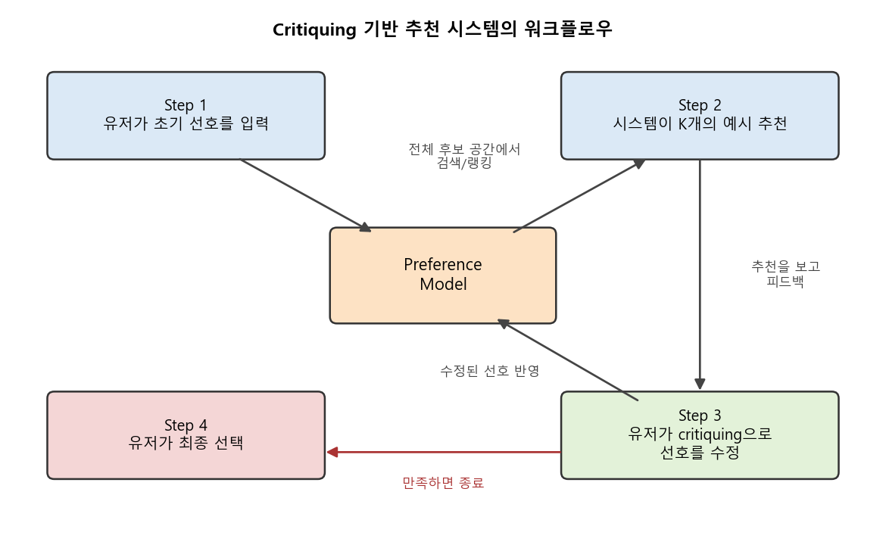
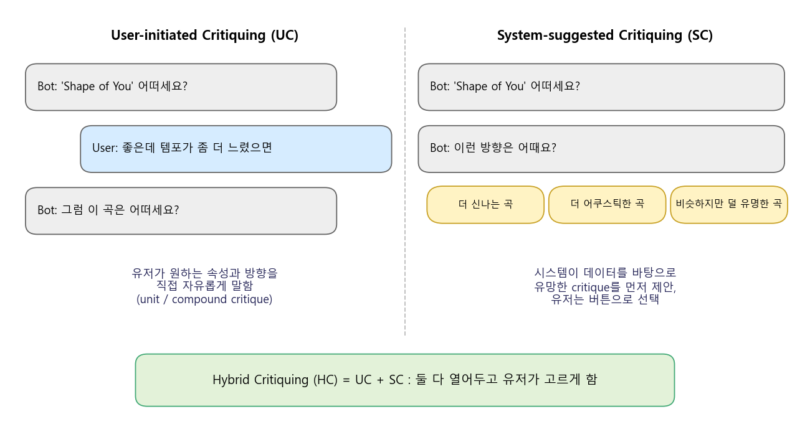
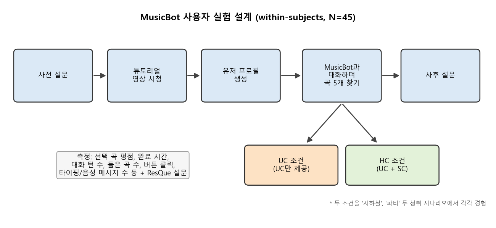
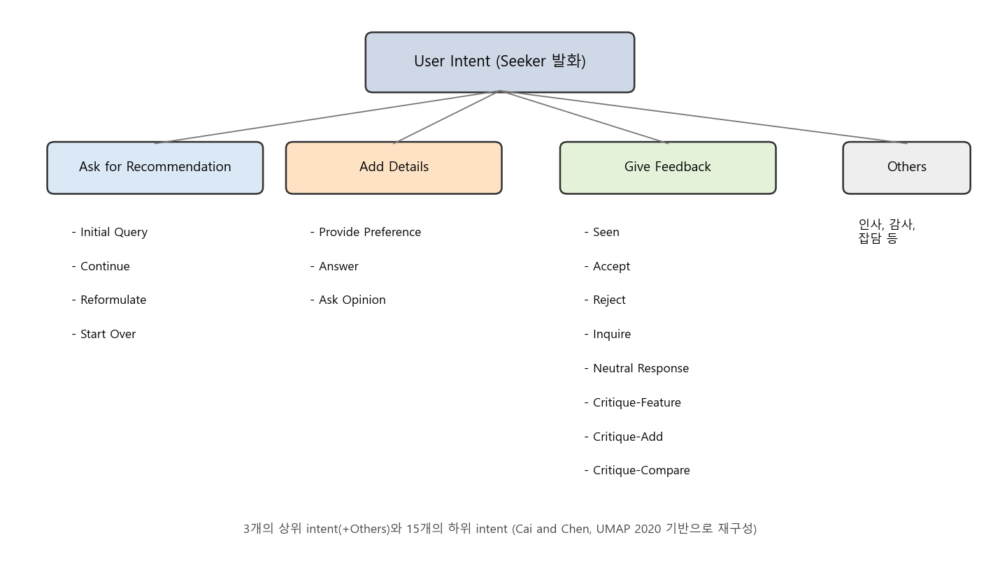

### 대화형 추천 시스템(CRS)에서 사용자가 남기는 피드백, 즉 critiquing을 어떻게 이끌어내고 이해할 수 있는지 알아봅니다.

> 발표: **Understanding User Feedback on Recommendations in Conversational Systems**  
> Dr. Li Chen (Hong Kong Baptist University), CARS 2020 Workshop 초청 발표 (in conjunction with RecSys'20)

 Chen and Pu (2012)의 워크플로우를 바탕으로 직접 그린 그림 
  

 

>  **1. 대화형 추천의 핵심은 유저가 추천 결과에 대해 "이건 좀 더 ~했으면" 하고 비평하는 critiquing임**
>
>  **2. 유저는 처음부터 선호를 알고 있는 것이 아니라, 제시된 선택지를 보고 비평하는 과정에서 선호를 구성(construct)함**
>
>  **3. 챗봇 형태의 음악 추천(MusicBot)에서 유저 주도 critique에 시스템 제안 critique를 더한 hybrid 방식이 유저의 참여(engagement)를 높였음**
>
>  **4. 자유로운 자연어 대화에서는 유저의 의도(intent)와 만족도를 파악하는 것이 새로운 과제가 되며, 이를 위한 intent 분류 체계와 예측 모델이 제안됨**

 

----

**본 포스트는 Li Chen 교수님의 CARS 2020 초청 발표를 보고 정리한 노트입니다.**
발표 자료는 여기에서 보실 수 있습니다. [발표 슬라이드 (PDF)](https://www.comp.hkbu.edu.hk/~lichen/download/CARS20_talk_Chen.pdf)  
발표의 중심이 되는 실험은 [MusicBot 논문 (CIKM'19)](https://wanlingcai.github.io/files/2019/CIKM2019-MusicBot-Paper.pdf)에서 자세히 확인할 수 있습니다.

----
#### Contents

1. [전통적인 대화형 추천 시스템(CRS)](#traditional-crs)
2. [Critiquing 기반 추천의 워크플로우](#critiquing-workflow)
3. [왜 critiquing일까? - Adaptive Decision Theory](#adaptive-decision)
4. [유저 주도 critiquing vs. 하이브리드 critiquing](#hybrid-critiquing)
5. [리뷰를 활용한 Sentiment-based Critiquing](#sentiment-critiquing)
6. [대화 기반 CRS(DCRS)의 등장과 새로운 숙제](#dcrs)
7. [MusicBot: 챗봇에 critiquing을 붙여보자!](#musicbot)
8. [유저의 의도와 만족도는 예측할 수 있을까?](#intent-prediction)
9. [마치며](#conclusion)

 

## 1. 전통적인 대화형 추천 시스템(CRS)

대화형 추천이라고 하면 요즘은 챗봇이나 음성 비서를 먼저 떠올리게 되는데요. 사실 대화형 추천 시스템(Conversational Recommender Systems, CRS)의 역사는 꽤 깁니다.
발표에서는 1990년대 후반의 FindMe(Burke et al., 1997), Dynamic Critiquing(McCarthy et al., 2005), 모바일 환경의 MobyRek(Ricci and Nguyen, 2005), Apartment Finder(Pu and Chen, 2005) 같은 시스템들을 예로 들고 있습니다.

이 시스템들은 자연어로 대화하는 것은 아니지만, 추천을 한 번 던지고 끝나는 것이 아니라 유저와 여러 번 주고받으며 추천을 좁혀간다는 점에서 "대화형"입니다. 몇 가지 예를 보면 감이 오실 겁니다.

- 아파트 추천: "이것보다 더 컸으면", "더 안전한 동네였으면" 같은 옵션을 제공함
- 카메라 추천: 가격/해상도/메모리 중 무엇을 포기할 수 있는지 선택하도록 유도함 (trade-off)
- 레스토랑 추천: 위치, 가격대 등을 대화형으로 하나씩 물어보며 좁혀감

이런 방식은 매우 효과적인 추천 방식으로 알려져 있는데, **특히 유저가 본인의 선호를 잘 모를 때 유용**합니다. 처음 카메라를 사는 사람이 "센서 크기는 APS-C 이상, 무게는 500g 이하" 같은 조건을 처음부터 말할 수 있을 리가 없겠죠.

이러한 시스템의 가장 핵심적인 컴포넌트가 바로 **critiquing(비평하기)** 입니다. 유저는 추천된 아이템을 보고 "이건 좋은데 좀 더 싸면 좋겠다" 처럼 아이템의 속성에 대해 비평하고, 이 과정을 통해 자신의 선호를 점차 구체화(construct)해 나가게 됩니다.

참고로 이런 계열의 시스템은 CRS 외에도 case-based reasoning system, knowledge-based recommender system 등의 이름으로 불리기도 합니다. 아이템을 속성(attribute)의 집합인 "case"로 보고, 유저의 비평에 맞는 다음 case를 찾아준다는 관점입니다.

 

## 2. Critiquing 기반 추천의 워크플로우

Critiquing 기반 추천 시스템은 포스트 상단의 그림처럼 대략 아래의 4단계로 동작합니다. ([Chen and Pu, 2012, UMUAI 서베이](https://doi.org/10.1007/s11257-011-9108-6) 참고)

1. **유저가 초기 선호를 말함**
    - 이 초기 선호는 최종 추천에 바로 쓰이는 것이 아니라, preference model의 출발점 역할을 함
    - 이후 유저가 반복적으로 선호를 표현하게 함으로써 critiquing이 잘 작동하도록 도와줌
2. **시스템이 여러 개(K개)의 예시를 추천함**
    - 전체 후보 공간에서 현재 preference model에 잘 맞는 아이템을 골라 보여줌
3. **유저가 critiquing을 통해 자신의 선호를 수정함**
    - 이 결과가 다시 preference model로 들어가 1)과 같은 역할을 수행하고, 새로운 추천이 도출됨
4. **유저가 최종 결정을 내림**
    - 2~3단계를 만족할 때까지 반복한 뒤, 마음에 드는 아이템을 선택함

이 반복 루프에서 시스템이 얻는 것은 두 가지입니다. 하나는 **feedback elicitation**, 즉 유저로부터 피드백을 이끌어내는 것이고, 다른 하나는 **preference refinement**, 즉 그 피드백으로 선호 모델을 정교하게 다듬는 것입니다.

 

## 3. 왜 critiquing일까? - Adaptive Decision Theory

그렇다면 왜 이렇게 번거롭게 여러 번 주고받는 방식이 효과적일까요? 발표에서는 행동 의사결정 이론, 그 중에서도 **adaptive decision theory**에서 그 근거를 찾습니다.

- **선호는 "구성"되는 것임**
    - 유저는 의사결정 과정에서 맥락(context)에 의존적이고 적응적인(adaptive) 방식으로 선호를 construct함 (Payne et al., 1993)
    - 즉, 머릿속에 완성된 선호표가 있고 그걸 꺼내 쓰는 것이 아님
- **선호는 "침범"당할 때 비로소 드러남**
    - 유저는 제안된 해결책이 자신의 잠재적 선호를 위반(violate)할 때 비로소 그 선호를 인지함 (Pu and Faltings, 2000)
    - 즉, 자신을 만족시키지 못하거나 심지어 선호와 충돌하는 선택지를 받아봐야 "아, 나는 이게 싫구나"를 알게 된다는 것임
- **trade-off를 고민하게 하면 결정의 질이 높아짐**
    - 보상적 의사결정 전략(compensatory decision strategy), 즉 하나를 얻기 위해 다른 하나를 양보하는 trade-off making은 보통 이성적이고 고품질의 결정으로 이어짐 (Frisch and Clemen, 1994)

두 번째 포인트가 특히 재미있는데요. 옷 가게에서 "어떤 스타일 찾으세요?"라는 질문에는 대답을 못 하다가, 점원이 들고 온 옷을 보고서야 "아 이런 건 좀 너무 화려하네요"라고 말하게 되는 경험, 다들 한 번쯤 있으시겠죠. Critiquing은 바로 이 "보고 나서야 아는" 사람의 특성을 시스템 설계에 녹인 것이라고 볼 수 있습니다. 특히 유저에게 낯선 상품 도메인(unfamiliar product domain)일수록 이 효과는 커집니다.

 

## 4. 유저 주도 critiquing vs. 하이브리드 critiquing

 UC와 SC의 차이를 대화 예시로 직접 그린 그림 
  

 

Critiquing은 누가 비평의 방향을 정하느냐에 따라 크게 두 가지로 나눌 수 있습니다.

- **User-initiated Critiquing (UC)**: 유저가 직접 어떤 속성을 어떻게 바꾸고 싶은지 정함
    - 하나의 속성만 비평하는 unit critique ("더 가벼운 것")과 여러 속성을 함께 비평하는 compound critique ("더 가볍고 더 싼 것")가 있음 (Chen and Pu, AAAI'06)
- **System-suggested Critiquing (SC)**: 시스템이 남은 후보 아이템들을 분석해서 유망한 critique 묶음을 먼저 제안함
    - 예) "해상도는 더 높고 가격은 조금 더 비싼 제품들 보기"

그리고 이 둘을 같이 붙인 것이 **Hybrid Critiquing (HC)** 입니다 (Chen and Pu, IUI'07). 유저가 직접 비평할 수도 있고, 시스템이 제안하는 비평을 골라 쓸 수도 있게 하는 방식입니다.

발표에서 소개된 그간의 연구 결과는 다음과 같습니다.

- critiquing 기반 시스템은 non-critiquing 기반 시스템에 비해 유저의 **결정 정확도(decision accuracy)를 최대 57%까지** 개선함
- hybrid critiquing은 유저의 선택 정확도를 개선할 뿐만 아니라, 유저가 원하는 통제감(user control)을 유지하면서도 **인터랙션에 드는 노력(즉, 비용)을 크게 줄여줌**

여기서 결정 정확도란, 유저가 시스템에서 최종 선택한 아이템을 나중에 전체 후보를 다 살펴볼 기회를 줬을 때도 그대로 유지하는지(바꾸지 않는지)로 측정하는 지표입니다. 즉 "정말 나에게 맞는 걸 골랐는가"를 보는 것이죠.

 

## 5. 리뷰를 활용한 Sentiment-based Critiquing

전통적인 critiquing은 가격, 무게, 해상도처럼 정형화된 스펙 속성을 기준으로 이루어집니다. 그런데 유저가 실제로 궁금한 건 "배터리가 오래 가는지", "화질이 실제로 좋은지" 같은 체감 품질인 경우가 많겠죠.

**Sentiment-based critiquing**은 이 부분을 보완합니다.

- 유저가 상품에 달아주는 리뷰에서 피처(feature)와 그에 대한 감성(sentiment)을 뽑아내 critiquing에 활용함
    - 예) "화질"이라는 피처에 대해 리뷰어들의 긍정/부정 의견이 어느 정도인지
- critiquing을 하는 유저가 상품에 대해 더 많은 정보를 얻을 수 있게 해줌
- 실험 결과, sentiment 피처를 critiquing 인터페이스에 통합하면 유저의 **상품 지식(product knowledge)과 선호 확신도(preference certainty)가 개선**됨 (Chen et al., ACM TiiS 2019)
- 이 방식은 GUI뿐 아니라 대화형으로 제공하는 것도 가능함

스펙표만 보고는 판단하기 어려운 부분을 다른 사용자들의 경험으로 채워준다는 점에서, 추천 설명(explanation)의 역할도 함께 하는 셈입니다.

 

## 6. 대화 기반 CRS(DCRS)의 등장과 새로운 숙제

자연어처리 기술이 발달하면서 버튼과 폼이 아닌, 실제 자연어 대화를 처리할 수 있는 **Dialogue-based CRS(DCRS)** 가 등장했습니다. Alexa나 쇼핑몰 챗봇처럼 유저가 말하면, 시스템이 추천하고, 유저가 다시 피드백하는 구조입니다.

DCRS의 가장 큰 장점은 유저가 **자신의 선호를 훨씬 자유롭고 유연하게, 편한 방식으로 표현할 수 있다**는 점입니다. 미리 정해진 속성 버튼 안에서만 비평할 필요가 없으니까요.

그런데 자유에는 대가가 따르는 법이죠. 발표에서는 다음과 같은 문제들을 제기합니다.

1. 이렇게 덜 통제된(less controlled) 상황에서, **어떻게 추천에 대한 유저의 피드백을 이끌어낼 수 있을까?**
2. 유저의 **발화(utterance)에 담긴 의도를 정확하게 추정할 수 있을까?**
3. 추천에 대한 **유저의 만족도를 예측할 수 있을까?**

그리고 이런 문제들을 **multi-turn, mixed-initiative** (시스템과 유저 모두 대화를 주도할 수 있는) 환경에서 다룬 연구는 아직 소수에 불과하다는 것이 문제의식입니다.

이에 따라 연구팀은 다음 세 가지에 초점을 맞춥니다.

- **경험적 연구**: critiquing이 통합된 DCRS에 대해 유저가 어떻게 인지하고 상호작용하는지 확인 (MusicBot, CIKM'19)
- **분류 체계 확보**: 대화 기반 대화형 추천에서 발생하는 유저 의도(intent)의 분류 체계(taxonomy) 구축
- **예측**: 대화 기반 대화형 추천에서 유저의 의도와 만족도를 예측 (UMAP'20)

 

## 7. MusicBot: 챗봇에 critiquing을 붙여보자!

### 대화 시스템에서의 critiquing 워크플로우

MusicBot은 음악을 추천해주는 챗봇으로, 앞서 살펴본 critiquing 루프를 대화 인터페이스 위에 그대로 올린 시스템입니다. 텍스트 입력, 음성 입력, 버튼 클릭을 모두 지원합니다.

1. 시스템이 유저의 초기 선호를 이끌어냄 (좋아하는 아티스트, 장르 등으로 프로필 생성)
2. 시스템이 추천 후보 곡을 제시함
3. 유저가 추천에 대한 critique을 내림 (**user interaction**)
    - user-initiated critique(UC): "좀 더 신나는 곡 없어?" 처럼 직접 말함
    - system-suggested critique(SC): 시스템이 제안한 critique 버튼을 고름
4. (2~3 반복 후) 유저가 추천을 받아들임 (**user perception**)

여기에 더해, 연구팀은 **유저의 개인적 특성이 시스템에 대한 인지와 행동에 어떤 영향을 미치는지**도 함께 조사했습니다. 살펴본 특성은 다음 네 가지입니다.

- 음악적 소양(Musical Sophistication, MS): 음악을 얼마나 깊이 즐기고 아는지
- 통제 욕구(Desire for Control, DFC): 상황을 스스로 통제하고 싶어하는 정도
- 챗봇 경험(Chatbot Experience, CE)
- 기술 친숙도(Tech Savviness, TS)

### 실험 설계

 발표 슬라이드의 실험 절차를 바탕으로 직접 그린 그림 
  

 

- 참가자: 유효 응답 45명 (여성 19명 포함), within-subjects 설계
- 비교 조건: **UC만 제공하는 시스템 vs. Hybrid Critiquing(UC + SC) 시스템**
- 과제: 지하철, 파티라는 두 가지 음악 청취 시나리오에서 마음에 드는 곡 5개를 찾고 평점 매기기
- 평가 기준
    - 주관적 평가: 추천 시스템의 유저 중심 평가 프레임워크인 ResQue(Pu et al., 2011)와 음성 대화 에이전트 평가 프레임워크인 PARADISE(Walker et al., 1997)를 참고한 설문
    - 객관적 행동 지표: 선택된 곡들에 대한 평점, 완료 시간, 대화 턴 수, 들은 곡 수, 버튼 클릭 수, 타이핑/음성 메시지 수, 발화당 단어 수, 시스템이 이해하지 못한 발화 수 등

### 결과

- 선택한 곡의 평점 등 많은 지표에서 두 조건은 **거의 비슷한 결과**를 보임
- 그러나 HC 조건에서는 **들은 곡 수와 소요 시간 등에서 유의미한 차이**가 나타남. 즉, 유저들이 더 오래 머물며 더 많은 곡을 들어봤음
- SC를 사용해 본 유저들은 시스템을 **더 쉽게 쓸 수 있고, 추천이 더 다양하다**고 인지하는 경향이 있었음
- 개인적 특성의 영향
    - **음악적 소양(MS)이 높은 유저**: 관심사 일치도(interest matching), 통제감, 신뢰, 피드백을 주려는 의향과 재사용 의향이 높았음. 즉 선호를 조정하는 과정에서 더 높은 통제감을 느꼈음
    - **통제 욕구(DFC)가 높은 유저**: 통제감과 이해/사용 용이성을 더 높게 평가함

"오래 머물렀다"는 것이 효율 관점에서는 나쁜 신호로 볼 수도 있겠지만, 음악처럼 탐색 자체가 즐거움인 도메인에서는 **engagement가 늘어난 것**으로 해석하는 것이 자연스럽겠죠. 시스템이 제안해주는 critique가 유저 혼자서는 떠올리지 못했을 방향으로 탐색을 넓혀준 셈입니다.

### 결론과 한계

- 결론
    - 대화형 유저 인터페이스에서 UC와 SC를 결합하면 유저의 참여(engagement)와 더 많은(더 다양한) 곡을 찾을 가능성을 높여줌
    - 시스템 설계자는 critiquing 기반 음악 추천을 설계할 때 유저의 음악적 소양과 통제 욕구 같은 개인적 특성을 고려해야 함
- 한계
    - 너무 작은 유저 규모
    - 시스템이 유저의 의도를 파악할 수 있을 만큼 "스마트"하지 않았음

두 번째 한계가 바로 다음 연구로 이어지는 연결고리입니다.

 

## 8. 유저의 의도와 만족도는 예측할 수 있을까?

MusicBot의 한계에서 보듯, 자유로운 대화를 허용하려면 시스템이 **유저가 지금 무슨 말을 하려는 건지** 알아들어야 합니다. 발표의 후반부는 이 문제를 다룬 연구(Cai and Chen, UMAP'20, Best Student Paper)를 간략히 소개합니다.

- **User intent**: 유저가 시스템과 상호작용하며 가지는 목표나 의도
- **User satisfaction**: 유저의 목표가 어느 정도 충족되었는지

이 둘을 알 수 있다면 유저의 선호를 더 정확하게 모델링할 수 있고, 시스템이 다음에 취할 행동(되묻기, 새로 추천하기, 설명하기 등)을 더 적절하게 고를 수 있습니다.

### 피드백 의도의 분류 체계

 IARD 데이터셋 페이지의 taxonomy를 바탕으로 직접 그린 그림 (https://www.comp.hkbu.edu.hk/~lichen/download/IARD_dataset.html) 
  

 

연구팀은 영화 추천을 주제로 사람과 사람이 나눈 대화 데이터셋인 [ReDial](https://redialdata.github.io/website/)에서 대화를 골라, 발화 단위로 유저 의도를 직접 라벨링했습니다. 소수의 대화로 초기 분류 체계를 제안하고, 새로 샘플링한 대화로 라벨링-수정-검증을 반복해 최종 taxonomy를 만들었습니다.

- **Ask for Recommendation**: 첫 추천 요청, 추가 추천 요청, 질의 재구성, 처음부터 다시 요청
- **Add Details**: 선호 제공, 질문에 대한 답변, 추천자의 의견 묻기
- **Give Feedback**: 본 적 있음, 수락, 거절, 추가 정보 문의, 중립 반응, 그리고 세 가지 critique (특정 속성 비평, 조건 추가, 비슷한 것 비교 요청)
- **Others**: 인사, 감사, 잡담 등

전통적인 critiquing의 개념이 Give Feedback 아래의 Critique-Feature / Critique-Add / Critique-Compare로 자연어 대화 속에 그대로 녹아 있는 것을 볼 수 있습니다. 이렇게 라벨링한 데이터는 IARD(Intent Annotation of Recommendation Dialogue) 데이터셋으로 공개되어 있습니다.

### 의도 및 만족도 예측

- **의도 예측**: 하나의 발화에 여러 의도가 섞일 수 있으므로 multi-label 분류 문제로 정의함
    - 예) "그거 봤는데 별로였어요. 근데 80년대 영화는 좋아해요" → Reject + Critique-Add
    - LR, SVM, Naive Bayes, XGBoost, MLP 등 8개 ML 모델과 CNN, Bi-LSTM 2개 DL 모델을 비교함
    - content, sentiment, discourse, context 네 범주의 피처를 함께 쓸 때 XGBoost와 SVM이 가장 좋은 성능을 보였고, 특히 이전 발화 등의 **context 피처가 성능을 끌어올림**
- **만족도 예측**: 대화가 성공적인 추천으로 끝났는지를 맞추는 binary 분류 문제로 정의함
    - 발화 수준 피처보다, **유저 의도와 추천자 행동(dialogue behavior) 피처**가 효과적이었고 MLP가 경쟁력 있는 성능을 보임

라벨링된 데이터가 수천 발화 규모로 작다 보니 딥러닝 모델이 전통적인 ML 모델을 이기지 못했다는 점도 흥미로운데요. 발표에서도 향후 과제로 다른 도메인으로의 일반화, 더 많은 라벨 데이터로 DL 모델 검증, 대화 내 발화의 시간적 순서 활용, 그리고 시스템 제안 critique가 다양한 아이템 탐색을 어떻게 유도할 수 있는지에 대한 연구를 꼽고 있습니다.

 

## 9. 마치며

추천 시스템을 공부하다 보면 자연스럽게 "주어진 로그로 다음 클릭을 얼마나 잘 맞추는가"에 집중하게 됩니다. 그런데 이 발표는 조금 다른 질문을 던집니다. **유저는 애초에 자기가 뭘 원하는지 모를 수 있고, 시스템은 그 선호가 만들어지는 과정을 도와주는 존재여야 한다**는 것이죠.

개인적으로 인상 깊었던 포인트를 정리하면 다음과 같습니다.

- 선호는 꺼내 쓰는 것이 아니라 비평하는 과정에서 만들어지는 것임
- 유저에게 전적으로 맡기는 것(UC)보다, 시스템이 탐색 방향을 살짝 제안해주는 것(SC)을 함께 열어두는 것이 engagement 측면에서 유리했음
- 같은 인터페이스라도 유저의 특성(음악적 소양, 통제 욕구)에 따라 체감이 달라지므로, "평균적인 유저"만 상정한 설계는 위험할 수 있음
- 자유로운 대화일수록 의도 파악이 핵심 과제가 되며, 이를 위해서는 결국 잘 설계된 taxonomy와 라벨 데이터가 필요함

모델 성능 지표만큼이나, 유저가 시스템과 주고받는 "대화의 결"을 들여다보는 HCI 관점의 연구가 추천에서 얼마나 중요한지 다시 한 번 느끼게 해준 발표였습니다. 언젠가 대화형 추천을 직접 만들게 된다면, 버튼 몇 개짜리 system-suggested critique부터 붙여봐야겠다는 생각이 드네요.

----------------

**개선을 위한 여러분의 피드백과 제안을 코멘트로 공유해 주세요.**
**내용에 대한 지적, 혹은 질문을 환영합니다.**  

**출처**  
[Li Chen, Understanding User Feedback on Recommendations in Conversational Systems, CARS 2020 Invited Talk (slides)](https://www.comp.hkbu.edu.hk/~lichen/download/CARS20_talk_Chen.pdf)  
[Yucheng Jin, Wanling Cai, Li Chen, Nyi Nyi Htun, Katrien Verbert. MusicBot: Evaluating Critiquing-Based Music Recommenders with Conversational Interaction. CIKM 2019](https://wanlingcai.github.io/files/2019/CIKM2019-MusicBot-Paper.pdf)  
[Wanling Cai, Li Chen. Predicting User Intents and Satisfaction with Dialogue-based Conversational Recommendations. UMAP 2020](https://doi.org/10.1145/3340631.3394856)  
[Li Chen, Pearl Pu. Critiquing-based Recommenders: Survey and Emerging Trends. UMUAI 2012](https://doi.org/10.1007/s11257-011-9108-6)  
[Intent Annotation of Recommendation Dialogue (IARD) Dataset](https://www.comp.hkbu.edu.hk/~lichen/download/IARD_dataset.html)  
[ReDial Dataset](https://redialdata.github.io/website/)  
