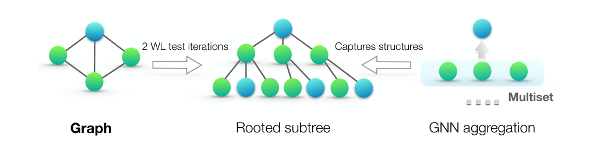
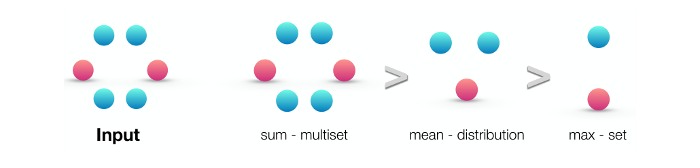
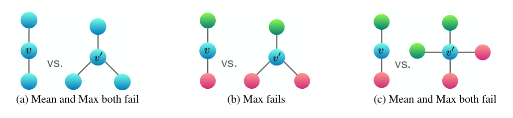
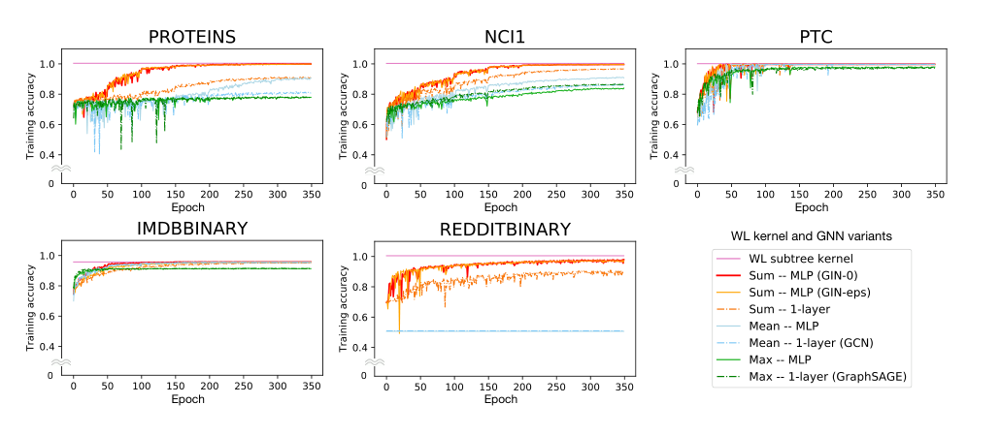

### GNN의 표현력을 WL test로 분석하고, 이론적으로 가장 강력한 GNN 구조인 GIN을 제안한 논문에 대해 알아봅니다.  


> 원제: **How Powerful are Graph Neural Networks?**  
> Keyulu Xu, Weihua Hu, Jure Leskovec, Stefanie Jegelka (ICLR 2019)  

<center></center>   
<font size="2"><center> 출처: Xu et al., How Powerful are Graph Neural Networks? (https://arxiv.org/abs/1810.00826) </center>  </font>   

<br/>

>  **1. GNN은 이웃 노드 정보를 반복적으로 모으는(aggregation) 구조이며, 그 표현력의 상한은 WL(Weisfeiler-Lehman) test임**
>
>  **2. aggregation/readout 함수가 multiset에 대해 injective해야 WL test만큼 강력해질 수 있음. mean, max는 injective하지 않고 sum은 injective함**
>
>  **3. sum aggregation + MLP로 구성한 GIN은 이론적으로 WL test만큼 강력하며, 그래프 분류 벤치마크에서 GCN, GraphSAGE 등을 앞섬**

<br/>

----

**본 포스트는 GIN 논문(How Powerful are Graph Neural Networks?)과 이를 리뷰한 발표 영상을 보고 정리한 노트입니다.**
원문은 여기에서 보실 수 있습니다. [paper](https://arxiv.org/abs/1810.00826), [리뷰 영상](https://youtu.be/0h1oZYcNafY)  

----
#### Contents

1. [Intro - 왜 하필 그래프일까? Relational Inductive Bias](#intro)
2. [GNN 다시 보기: Aggregate, Combine, Readout](#gnn)
3. [WL test - 두 그래프는 같은 그래프일까?](#wl)
4. [GNN은 WL test만큼 강력할 수 있을까?](#theory)
5. [Sum vs Mean vs Max - 어떤 aggregator가 더 강력한가?](#aggregator)
6. [GIN의 구조](#gin)
7. [실험 결과](#experiments)
8. [마치며](#conclusion)
9. [부록: Python GNN 라이브러리 훑어보기](#appendix)
<br />

<a id="intro"></a>
## 1. Intro - 왜 하필 그래프일까? Relational Inductive Bias  

GIN 이야기를 하기 전에, 리뷰 영상에서 짚고 넘어간 개념이 하나 있는데요. 바로 **relational inductive bias**입니다.  
DeepMind의 "Relational inductive biases, deep learning, and graph networks" (Battaglia et al., 2018) 논문에서 정리된 개념으로, 각 네트워크 모델이 내부적으로 entity 사이의 관계(relation)를 어떻게 가정하고 추론하는지를 말합니다.  
relational reasoning 능력을 가진 많은 머신러닝 접근법들은 학습 과정에서 entity들 사이의 관계와 상호작용에 일종의 제약을 거는데, 이 제약이 바로 relational inductive bias입니다.  

모델별로 정리해 보면 다음과 같습니다.  

| 모델 | Entity | Relation | Relational inductive bias |
|---|---|---|---|
| Fully Connected | unit | all-to-all | weak |
| CNN | grid element | local | locality |
| RNN | timestep | sequential | sequentiality |
| GNN | node | edge | arbitrary |

- FCL: 모든 unit이 모든 unit과 연결되므로 특별히 무언가에 집중하지 않음. 즉 bias가 약함  
- CNN: 지역적인 것들만 보는 관계를 가정함. 이것이 강점이자 약점이기도 함  
- RNN: 시간 순서에 따른 순차적 관계를 가정함  
- GNN: 관계가 edge로 명시되므로, 그래프를 어떻게 구성하느냐에 따라 위의 어떤 bias든 흉내낼 수 있음  

MLP, CNN, RNN은 그래프나 집합(set) 같은 구조화된 표현을 자연스럽게 다루지 못하지만, GNN은 구성하기에 따라 이들을 모두 표현할 수 있다는 점에서 매우 일반적인 모델이라고 할 수 있겠습니다.  
그렇다면 자연스럽게 이런 질문이 떠오르죠. **"그래서 GNN은 대체 얼마나 강력한데?"** 오늘 살펴볼 논문이 바로 이 질문에 답하고자 한 연구입니다.  


<a id="gnn"></a>
## 2. GNN 다시 보기: Aggregate, Combine, Readout  

GNN의 기본 아이디어는 이전 포스트들([GCN과 GraphSAGE](https://myeonghak.github.io/graph%20neural%20networks/GNN-GCN%EA%B3%BC-GraphSAGE/), [PinSAGE와 GAT](https://myeonghak.github.io/graph%20neural%20networks/GNN-PinSAGE%EC%99%80-GAT/))에서 다루었듯, **이웃 노드의 정보를 반복적으로 모아서 노드의 표현을 업데이트**하는 것입니다.  
논문은 다양한 GNN variant들을 세 가지 함수로 일반화합니다.  

1) **AGGREGATE**: 이웃 노드들의 피처 벡터를 모아옴  

$$
a_v^{(k)} = \text{AGGREGATE}^{(k)}\left(\{ h_u^{(k-1)} : u \in \mathcal{N}(v) \}\right)
$$

2) **COMBINE**: 자기 자신의 이전 벡터와 앞에서 얻은 이웃 정보를 합침  

$$
h_v^{(k)} = \text{COMBINE}^{(k)}\left(h_v^{(k-1)}, a_v^{(k)}\right)
$$

3) **READOUT**: 노드 표현들을 모아 그래프 전체의 표현을 얻음 (그래프 분류 문제에서 사용)  

$$
h_G = \text{READOUT}\left(\{ h_v^{(K)} : v \in G \}\right)
$$

여기서 READOUT은 노드의 순서와 무관해야 하므로 **permutation invariant**한 함수여야 합니다. 즉 input의 순서가 섞여도 결과값이 똑같아야 한다는 의미인데요, sum, mean, min, max 같은 함수들이 모두 여기에 해당합니다.  

예를 들어 GraphSAGE는 AGGREGATE로 MLP를 거친 뒤 element-wise max-pooling을, COMBINE으로 concat 후 linear 변환을 사용합니다. GCN은 이웃과 자기 자신을 묶어 (degree로 정규화된) mean을 취한 뒤 linear + ReLU를 적용하는 형태로 볼 수 있습니다.  

여기서 핵심 질문은 이것입니다. **이렇게 얻어낸 그래프 표현이 정말 좋은 표현인가?** 구조가 다른 두 그래프를 서로 다른 벡터로 잘 구분해 낼 수 있을까요? 이를 따져보기 위해 논문은 그래프 동형(isomorphism) 판별 문제를 끌어옵니다.  


<a id="wl"></a>
## 3. WL test - 두 그래프는 같은 그래프일까?  

**Graph isomorphism 문제**란 두 그래프가 노드 이름만 바꿨을 뿐 구조적으로 완전히 같은지(isomorphic)를 판별하는 문제입니다. 아직 다항 시간 알고리즘이 알려져 있지 않은 어려운 문제인데요, 대부분의 경우에 잘 동작하는 효율적인 근사 판별법이 바로 **Weisfeiler-Lehman(WL) test**입니다.  

WL test(1-WL, color refinement라고도 부름)의 과정은 다음과 같습니다.  

- 그래프 내의 각 노드가 하나의 라벨(정수, 혹은 색깔)을 가지고 있다고 가정함  
- **Aggregation**: 각 노드에 연결된 이웃 노드들의 라벨을 중심 노드에 모음 (자기 라벨 + 이웃 라벨의 multiset)  
- **Label compression**: 이렇게 모은 (자기 라벨, 이웃 라벨 multiset) 조합을 hash를 통해 새로운 라벨로 치환함. 서로 다른 조합은 반드시 서로 다른 새 라벨을 받음  
- 이 과정을 라벨이 더 이상 변하지 않을 때까지 반복함  
- 두 그래프의 라벨 분포(히스토그램)가 어느 시점에서라도 다르면 -> 두 그래프는 **non-isomorphic**이라고 판정함  

반복 횟수가 $k$라면, 각 노드의 라벨은 그 노드를 루트로 하는 깊이 $k$의 **rooted subtree** 구조를 요약한 것이 됩니다. 맨 위 Figure 1이 바로 이 관계를 보여주고 있죠.  

참고로 WL test는 완벽한 판별기는 아닙니다. 예를 들어 삼각형 두 개로 이루어진 그래프와 육각형 하나로 이루어진 그래프는 모든 노드의 degree가 2로 같아서, WL test로는 구분이 안 됩니다. 하지만 대부분의 그래프에 대해서는 잘 작동하는 강력한 휴리스틱입니다.  

이 아이디어를 그래프 커널로 확장한 것이 **WL subtree kernel** (Shervashidze et al., 2011)입니다. 각 iteration에서 등장한 기존 노드 라벨과 압축된 노드 라벨들의 개수를 쭉 늘어뜨려 하나의 피처 벡터로 만들고, 이 벡터 간의 내적으로 두 그래프의 유사도를 계산합니다.  

자, 그런데 가만히 보면 이 과정, 어디서 많이 본 것 같지 않나요?  
**recursive하게 이웃의 정보를 계속 aggregation해서 자기 자신을 update**하는 방식, 바로 GNN이 하는 일입니다. 그렇다면 GNN도 WL test처럼 할 수 있지 않을까요?  


<a id="theory"></a>
## 4. GNN은 WL test만큼 강력할 수 있을까?  

논문의 main results는 다음과 같이 요약할 수 있습니다.  

1) GNN은 그래프 구조를 구분하는 능력에 있어 **최대 WL test만큼** 강력함 (상한)  
2) 강력한 GNN을 위한 aggregation/readout 함수의 조건을 정립함  
3) GCN, GraphSAGE 등 유명한 GNN variant들이 구분하지 못하는 그래프 구조의 예시를 제시함  
4) 이 variant들을 이길 수 있는 새로운 구조인 GIN을 제안함  

### 상한: GNN ≤ WL test  

먼저 Lemma 2는, aggregation 기반 GNN이 두 그래프를 서로 다른 표현으로 맵핑한다면 WL test도 반드시 두 그래프를 non-isomorphic으로 판정한다는 내용입니다.  
직관적으로 보면, GNN의 노드 표현은 결국 이웃 표현의 multiset으로부터 계산되므로, WL test가 같은 라벨을 준 노드들은 GNN도 같은 벡터를 줄 수밖에 없습니다. 즉 **GNN은 WL test보다 더 강력할 수 없습니다.**  

### 언제 WL test만큼 강력해지는가?  

그럼 상한에 도달하려면 어떤 조건이 필요할까요? Theorem 3에 따르면 다음 조건이 만족되면 GNN은 WL test만큼 강력해집니다.  

- AGGREGATE와 COMBINE이 노드 피처의 **multiset에 대해 injective**한 함수일 것  
- READOUT 역시 노드 표현의 multiset에 대해 injective할 것  

injective(단사)하다는 건 서로 다른 입력은 반드시 서로 다른 출력으로 맵핑된다는 뜻입니다. 우리가 원하는 것은 **isomorphic한 그래프는 같은 표현으로, 그렇지 않은 그래프는 다른 표현으로 맵핑**되는 것인데요, 중간에 어느 한 함수라도 서로 다른 이웃 구성을 같은 벡터로 뭉개버리면 그 정보는 영영 복구할 수 없게 됩니다.  
WL test에서 label compression을 hash로 하는 이유가 바로 이 injectivity 때문이죠. WL test는 hash로 이를 보장하지만, GNN은 이를 **미분 가능한 함수**로 구현해야 한다는 점이 다릅니다.  

여기서 중요한 개념이 **multiset**입니다. multiset은 원소의 중복을 허용하는 집합인데요, 노드의 이웃 피처는 같은 값이 여러 번 나타날 수 있으므로 일반 set이 아닌 multiset으로 다뤄야 합니다.  

문제는, **유명한 GNN variant들의 aggregation scheme은 태생적으로 injective하지 않다**는 점입니다.  


<a id="aggregator"></a>
## 5. Sum vs Mean vs Max - 어떤 aggregator가 더 강력한가?  

논문에서 가장 직관적이고 재미있는 부분입니다. 같은 이웃 multiset을 sum, mean, max로 aggregation했을 때 각각이 얼마나 많은 정보를 보존하는지를 비교합니다.  

<center></center>   
<font size="2"><center> 출처: Xu et al., How Powerful are Graph Neural Networks? (https://arxiv.org/abs/1810.00826) </center>  </font>   

- **sum**: multiset 전체를 포착함. 원소의 종류와 개수를 모두 기억함  
- **mean**: multiset의 **분포(비율)**만 포착함. 원소가 몇 개인지는 잃어버림  
- **max**: multiset의 **underlying set**만 포착함. 어떤 종류가 있었는지만 알고, 개수나 비율은 모두 잃어버림  

그래서 표현력의 순위는 **sum > mean > max**가 됩니다.  
그림의 Input에는 파란 공 4개와 빨간 공 2개가 있는데요, mean은 이를 "파란 공 2 : 빨간 공 1" 비율로만 기억하고, max는 "파란 공과 빨간 공이 있었다" 정도만 기억하는 셈입니다.  

### mean, max가 실패하는 예시  

실제로 서로 다른 그래프 내의 서로 다른 노드임에도 같은 벡터로 맵핑되어 버리는 경우를 보여주는 그림입니다. 노드의 색은 노드 피처를 의미하고, $v$와 $v'$의 표현을 비교합니다.  

<center></center>   
<font size="2"><center> 출처: Xu et al., How Powerful are Graph Neural Networks? (https://arxiv.org/abs/1810.00826) </center>  </font>   

- **(a)** 모든 이웃의 피처가 같은 경우: $v$는 이웃 2개, $v'$은 이웃 3개지만 mean과 max는 모두 같은 값을 냄. sum만 2 vs 3으로 구분 가능함  
- **(b)** $v$의 이웃은 {초록, 빨강}, $v'$의 이웃은 {초록, 빨강, 빨강}: max는 둘 다 {초록, 빨강}만 보므로 실패함. mean은 비율이 1:1 vs 1:2로 달라 구분 가능함  
- **(c)** $v$의 이웃은 {초록, 빨강}, $v'$의 이웃은 {초록, 초록, 빨강, 빨강}: 비율도 1:1로 같으므로 mean, max 모두 실패함  

간단하게 (c)의 경우를 PyTorch로 확인해 보면 다음과 같습니다. 노드 색을 one-hot 피처로 표현했습니다.  

```python
import torch

# 노드 색깔을 one-hot 피처로 표현 (blue, green, red)
blue, green, red = torch.eye(3)

# Figure 3 (c): v의 이웃 = {green, red}, v'의 이웃 = {green, green, red, red}
nbr_v  = torch.stack([green, red])
nbr_v2 = torch.stack([green, green, red, red])

for name, agg in [("sum", lambda x: x.sum(0)),
                  ("mean", lambda x: x.mean(0)),
                  ("max", lambda x: x.max(0).values)]:
    a, b = agg(nbr_v), agg(nbr_v2)
    print(f"{name:>4} | v: {a.tolist()} | v': {b.tolist()} | 구분 가능: {not torch.equal(a, b)}")
```

```
 sum | v: [0.0, 1.0, 1.0] | v': [0.0, 2.0, 2.0] | 구분 가능: True
mean | v: [0.0, 0.5, 0.5] | v': [0.0, 0.5, 0.5] | 구분 가능: False
 max | v: [0.0, 1.0, 1.0] | v': [0.0, 1.0, 1.0] | 구분 가능: False
```

mean을 쓰는 GCN, max-pooling을 쓰는 GraphSAGE는 이런 구조를 원천적으로 구분하지 못한다는 이야기가 되겠죠.  

그렇다고 mean, max가 쓸모없다는 건 아닙니다. 논문에서도 노드 피처가 다양하고 거의 반복되지 않는 경우에는 mean도 sum만큼 정보를 잘 보존할 수 있고, 정확한 구조보다 분포나 대표적인 원소(skeleton)가 중요한 task에서는 mean, max가 오히려 robust하게 잘 작동할 수 있다고 언급합니다. 결국 task에 따라 어떤 정보가 중요한지에 달린 문제인 셈입니다.  


<a id="gin"></a>
## 6. GIN의 구조  

### Aggregation: sum + MLP  

그렇다면 injective한 aggregation은 어떻게 만들 수 있을까요?  
논문의 Lemma 5는, 노드 피처가 countable한 공간에서 온다면 어떤 함수 $f$가 존재해서 $\sum_{x \in X} f(x)$가 각 (크기가 유한한) multiset $X$마다 유일한 값을 가지도록 만들 수 있다고 말합니다. 그리고 multiset에 대한 어떤 함수든 $\phi\left(\sum_{x \in X} f(x)\right)$ 꼴로 분해할 수 있다고 합니다.  
더 나아가 Corollary 6에서는 자기 자신 노드 $c$까지 포함해 $(1+\epsilon) f(c) + \sum_{x \in X} f(x)$ 형태로 쓰면, 무수히 많은 $\epsilon$ 값에 대해 (자기 자신, 이웃 multiset) 쌍마다 유일한 값을 가지게 됩니다.  

문제는 이 "어떤 함수" $f$와 $\phi$에 실제로 무엇을 쓰느냐인데요, 논문의 답은 **MLP**입니다.  
**UAT(Universal Approximation Theorem)**, 즉 hidden layer가 하나만 있는 신경망도 특정 범위의 입력에 대해 어떤 연속 함수든 근사할 수 있다는 정리가 있으니, MLP를 쓰면 이 미지의 함수를 근사해 주겠지! 하는 접근입니다.  
첫 번째 layer에서는 입력 피처가 one-hot이라 $f$가 필요 없고, 이후 layer에서는 $f^{(k+1)} \circ \phi^{(k)}$를 하나의 MLP로 합쳐서 모델링할 수 있습니다. 이렇게 해서 나온 GIN의 노드 업데이트 식은 다음과 같습니다.  

$$
h_v^{(k)} = \text{MLP}^{(k)}\left( \left(1 + \epsilon^{(k)}\right) \cdot h_v^{(k-1)} + \sum_{u \in \mathcal{N}(v)} h_u^{(k-1)} \right)
$$

정리하면,  

- 이웃 노드들의 벡터는 **summation**해 줌 (sum은 multiset에 대해 injective하게 만들 수 있음)  
- 자기 자신의 벡터에 $(1+\epsilon)$을 곱한 값을 더해 줌. 이웃과 자기 자신을 구분하기 위한 장치임  
- 이를 MLP에 태움  
- $\epsilon$은 learnable parameter로 둘 수도 있고(GIN-$\epsilon$), 0으로 고정할 수도 있음(GIN-0)  

여기서 MLP가 single-layer perceptron이면 안 된다는 점도 논문에서 강조합니다(Lemma 7). 1-layer perceptron은 사실상 선형 변환 + 비선형 함수라서, 서로 다른 multiset을 같은 값으로 맵핑해 버리는 경우가 존재합니다. UAT의 혜택을 보려면 hidden layer를 가진 MLP가 필요한 것이죠.  

다만 한 가지 짚고 넘어갈 점이 있습니다. 학습된 MLP가 **실제로 injective하다는 보장은 없습니다.** UAT는 근사가 "가능하다"는 존재성만 이야기할 뿐, 학습을 통해 그 함수에 도달한다는 보장은 하지 않기 때문인데요. 그래서 이 모델에게 WL test는 도달 가능한 **성능의 상한선**이 되는 것입니다.  

### Readout: 모든 layer의 정보를 concat  

그래프 분류를 위한 readout에도 한 가지 아이디어가 들어가 있습니다.  
iteration이 진행될수록 노드 표현은 더 넓은 범위의 subtree 구조를 반영하게 되는데요, 오히려 초반 iteration의 표현이 일반화에 더 유리한 경우도 있습니다. 그래서 GIN은 모든 구조적 정보를 고려하기 위해 **모든 depth/iteration의 정보를 사용**합니다.  

$$
h_G = \text{CONCAT}\left( \text{READOUT}\left(\{ h_v^{(k)} : v \in G \}\right) \;\middle\vert\; k = 0, 1, \ldots, K \right)
$$

보통 마지막 $K$번째 iteration의 정보만 사용하는 것과 달리, 각 $k$에 대한 readout 결과를 모두 concat하는 방식입니다. 이는 JK-Net(Jumping Knowledge Network)의 아이디어와도 닮아 있습니다.  
그리고 READOUT으로 sum을 사용하면, 이 역시 WL test와 WL subtree kernel의 구조를 그대로 일반화한 형태가 됩니다.  


<a id="experiments"></a>
## 7. 실험 결과  

실험은 그래프 분류 벤치마크 9개 데이터셋에서 진행되었습니다.  

- Bioinformatics 데이터셋 4개: MUTAG, PTC, NCI1, PROTEINS  
- Social network 데이터셋 5개: COLLAB, IMDB-BINARY, IMDB-MULTI, REDDIT-BINARY, REDDIT-MULTI5K  

비교 대상은 GIN-$\epsilon$, GIN-0 그리고 aggregator(sum/mean/max)와 MLP/1-layer 조합을 바꾼 variant들(mean + 1-layer가 GCN, max + 1-layer가 GraphSAGE에 대응), 그리고 WL subtree kernel 등의 그래프 커널 방법들입니다.  

### Training accuracy: 표현력을 직접 확인하기  

먼저 학습 데이터에 얼마나 잘 fitting하는지를 통해 모델의 표현력을 확인합니다.  

<center></center>   
<font size="2"><center> 출처: Xu et al., How Powerful are Graph Neural Networks? (https://arxiv.org/abs/1810.00826) </center>  </font>   

- 의도한 대로 결과가 잘 나옴. **sum + MLP** 조합인 GIN이 거의 완벽하게 학습 데이터에 fitting함  
- mean, max aggregator나 1-layer perceptron을 쓴 variant들은 underfitting이 심함. 특히 REDDIT-BINARY에서 mean 계열은 0.5 근처에 머무름  
- 반면 어떤 GNN도 **WL subtree kernel의 training accuracy를 한 번도 넘지 못함**. 이론에서 말한 "GNN의 상한은 WL test"라는 결과와 정확히 맞아떨어짐  

### Test accuracy  

- GIN(특히 GIN-0)이 대부분의 데이터셋에서 GNN variant들과 그래프 커널 대비 state-of-the-art 수준의 성능을 보임  
- 노드 피처가 거의 없는 social network 데이터셋(예: REDDIT)에서 sum 기반 모델과 mean 기반 모델의 격차가 특히 큼  
- 흥미롭게도, $\epsilon$을 learnable parameter로 두는 것보다 **0으로 고정한 GIN-0가 오히려 더 나은 경우**가 있었음. 표현력은 비슷하지만 GIN-0가 더 단순해서 일반화가 조금 더 잘 된 것으로 해석함  

마지막으로 리뷰 영상에서 짚은 포인트가 인상 깊었는데요, WL kernel은 노드의 이산적인 라벨만 쓸 수 있고 연속적인 노드 피처 데이터를 활용하지 못하지만, GNN은 이를 그대로 활용할 수 있습니다. 표현력의 상한은 같더라도 **GNN 쪽에 개선의 여지가 더 많이 남아 있다**는 것이죠.  


<a id="conclusion"></a>
## 8. 마치며  

GIN 논문은 "새로운 모델을 만들었더니 성능이 좋더라"보다는, **"GNN은 원래 어디까지 할 수 있는가?"**라는 질문에 이론적으로 답했다는 점에서 의미가 큰 논문이라고 생각합니다.  
WL test라는 오래된 그래프 이론의 도구를 가져와 GNN의 상한을 정의하고, 그 상한에 도달하기 위한 조건(injectivity)을 끌어낸 다음, 그 조건을 만족하는 가장 단순한 구조(sum + MLP)를 제시하는 흐름이 무척 깔끔합니다.  

개인적으로는 sum, mean, max의 차이를 multiset, distribution, set으로 설명하는 그림이 가장 기억에 남는데요, 그동안 GraphSAGE의 aggregator를 고를 때 별 생각 없이 mean을 쓰곤 했던 게 떠오르면서 살짝 반성하게 되었습니다. 결국 "내 task에서 중요한 정보가 개수인지, 비율인지, 존재 여부인지"를 먼저 생각해보고 aggregator를 고르는 습관을 들여야겠다는 생각이 드네요.  
한편 GNN의 상한이 1-WL test라는 결과는, 반대로 말하면 이를 넘어서기 위한 연구(higher-order WL, 구조적 인코딩을 추가하는 방식 등)의 출발점이 되기도 했습니다. 다음에는 이런 후속 연구들도 정리해 보면 좋겠습니다.  


<a id="appendix"></a>
## 9. 부록: Python GNN 라이브러리 훑어보기  

GIN 같은 모델을 직접 구현해 보려면 결국 라이브러리를 골라야 하는데요, 관련해서 Python GNN 라이브러리들을 비교한 [영상](https://youtu.be/hsxS2IRUzfM)을 보고 정리한 내용을 짧게 덧붙입니다. (스타 수 등은 정리 당시 기준입니다.)  

### PyTorch Geometric (PyG)  

- PyTorch 기반의 그래프 뉴럴넷 라이브러리  
- 그래프를 다양한 속성을 가진 **Data 객체**로 다룸: 노드 피처, 엣지 연결 정보(edge_index), 레이블 등  
- 그 외에도 3차원 좌표, train/test mask, mesh를 위한 face 등을 가질 수 있음  
- 이러한 그래프 객체를 Dataset에 넣고, DataLoader에 넣어 batching과 sampling을 수행함  
- GNN은 PyG에 포함된 다양한 layer(가령 `GCNConv`, `GINConv`)로 구성함. 일반 PyTorch 모델과 거의 유일한 차이점은 GNN layer를 쓴다는 사실 뿐임  
- 2017년 10월에 공개되었고, 정리 당시 약 13k의 GitHub 스타를 가짐  
- GraphGym, multi-GPU 등의 기능 지원  

### DGL (Deep Graph Library)  

- **backend agnostic**하다는 강점이 있음 (PyTorch, TensorFlow, MXNet)  
- 그래프 데이터를 DGLGraph 객체로 표현하며, 노드와 엣지에 `ndata`, `edata`라는 이름으로 새로운 정보를 덧붙일 수 있음 (train/test mask, 노드/엣지 피처 등)  
- 그래프 객체에 대해 query를 날리는 것이 가능함  
- 효율적인 학습을 위한 sampler와 dataloader, 분산 처리, multi-GPU 기능 제공  
- PyG에 비해 Pool/Conv layer 수는 적은 편이며, backend 중에서는 PyTorch 지원이 가장 풍부함  
- 속도와 메모리 측면에서 모델마다 PyG와 편차를 보이지만, 대체로 다소 빠르고 가벼운 편임  

### Spektral  

- Keras, TensorFlow 2 기반 라이브러리  
- 다른 라이브러리와 마찬가지로 데이터셋을 그래프 객체로 정의해 사용함  
- 초심자에게 매우 친절한 documentation을 제공함  
- 비교적 최근에 공개된 라이브러리라 지원하는 기능이 제한적임  

### Graph Nets  

- DeepMind에서 공개한 라이브러리로, TensorFlow와 Sonnet 기반임. 1장에서 소개한 relational inductive bias 논문의 Graph Network 프레임워크를 구현한 것임  
- 비교적 low-level하고 추상적이며, 많은 GNN을 일반화한 형태로 볼 수 있음  
- 그래프 구조 데이터에 적용되는 함수를 정의할 수 있는 프레임워크를 제공함. Graph *Neural* Net이 아니라 Graph Net인 이유는, 그래프 자료구조에 적용될 함수가 신경망일 필요 없이 임의적이기 때문임  
- 데이터는 파이썬 딕셔너리 형태로 정의되며, 방향이 있는 인접 정보는 sender-receiver로 정의됨  
- 그래프 배치는 GraphsTuple 객체로 정의되어 Graph Network 모듈의 입력으로 사용됨  
- 자유도가 매우 높아 리서치에 적합함  

### 기타  

- **DeepChem**: 화학 물질 분석에 유용한 기능 제공  
- **DIG (Dive into Graphs)**: high-level 라이브러리로, 설명가능성(explainability), 그래프 생성 등의 연구 기능 제공  
- **tf2-gnn / ptgnn**: Microsoft에서 개발한 TensorFlow/PyTorch용 GNN 라이브러리  
- **tf_geometric**: TensorFlow용 라이브러리로, 커스텀 레이어 제공  
- **DeepSNAP**: PyG와 비슷한 인터페이스를 제공하면서, 학습 도중 그래프 조작, 전이 학습 등의 확장 기능 제공  

처음 시작한다면 문서와 예제가 풍부한 PyG나 DGL 중 하나를 고르는 것이 무난해 보입니다. 참고로 PyG에는 `GINConv`가, DGL에는 `GINConv` 모듈이 이미 구현되어 있어서 오늘 다룬 GIN을 바로 써볼 수 있습니다.  

----------------


**개선을 위한 여러분의 피드백과 제안을 코멘트로 공유해 주세요.**
**내용에 대한 지적, 혹은 질문을 환영합니다.**  


**출처**  
[How Powerful are Graph Neural Networks? (Xu et al., ICLR 2019)](https://arxiv.org/abs/1810.00826)  
[GIN 논문 리뷰 영상](https://youtu.be/0h1oZYcNafY)  
[GIN 공식 구현 (powerful-gnns)](https://github.com/weihua916/powerful-gnns)  
[Relational inductive biases, deep learning, and graph networks (Battaglia et al., 2018)](https://arxiv.org/abs/1806.01261)  
[Weisfeiler-Lehman Graph Kernels (Shervashidze et al., JMLR 2011)](https://www.jmlr.org/papers/volume12/shervashidze11a/shervashidze11a.pdf)  
[Python GNN 라이브러리 비교 영상](https://youtu.be/hsxS2IRUzfM)  
[PyTorch Geometric](https://github.com/pyg-team/pytorch_geometric)  
[DGL](https://github.com/dmlc/dgl)  
[Spektral](https://github.com/danielegrattarola/spektral)  
[Graph Nets](https://github.com/google-deepmind/graph_nets)  
[DeepSNAP](https://github.com/snap-stanford/deepsnap)  
