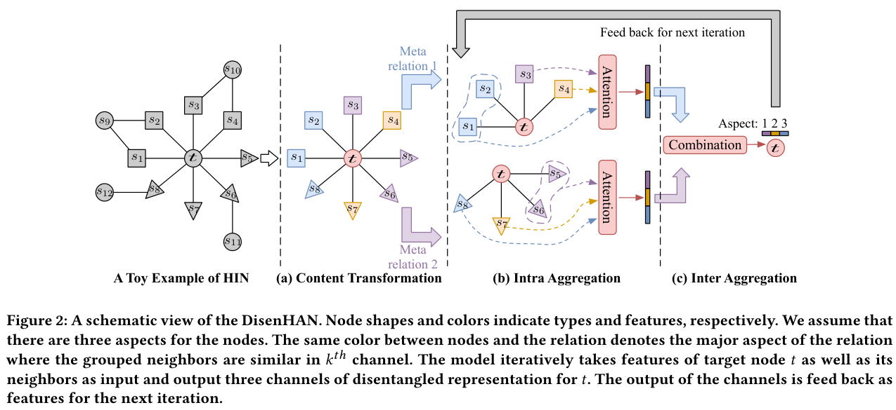
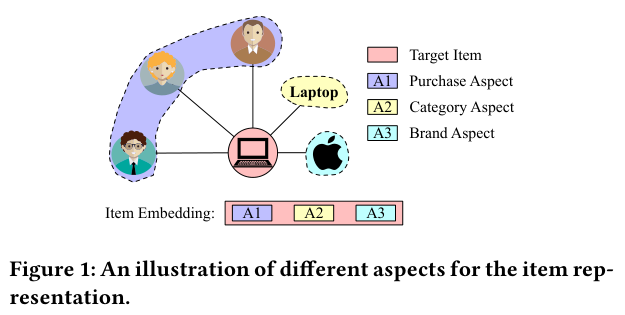
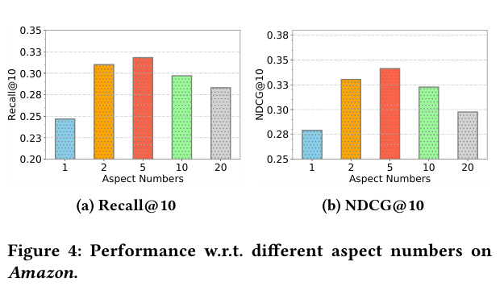
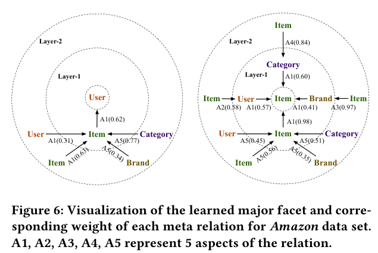

### 이종 그래프(HIN) 위에서 aspect별로 분리된(disentangled) 유저/아이템 임베딩을 학습하는 DisenHAN에 대해 알아봅니다.

> 원제  
> **DisenHAN: Disentangled Heterogeneous Graph Attention Network for Recommendation**  
> Yifan Wang, Suyao Tang, Yuntong Lei, Weiping Song, Sheng Wang, Ming Zhang (Peking Univ., Univ. of Washington)  
> CIKM 2020

<center></center>
<font size="2"><center> 출처: DisenHAN 논문 Figure 2 (https://arxiv.org/abs/2106.10879) </center>  </font>

<br/>

>  **1. 유저가 아이템을 소비하는 이유는 하나가 아님. 함께 산 사람들(CF), 카테고리, 브랜드 등 여러 aspect가 섞여 있음**
>
>  **2. DisenHAN은 노드 임베딩을 K개의 aspect 채널로 쪼개고, meta relation마다 "주로 어떤 aspect와 관련 있는지"를 반복적으로(iterative) 찾아내어 정보를 전파함**
>
>  **3. meta-path를 사람이 직접 설계하지 않고, 1-hop meta relation을 attention으로 쌓아 meta-path를 soft하게 자동 선택함. 그 결과 성능과 해석력을 모두 챙김**

<br/>

----

**본 포스트는 DisenHAN 논문을 읽고 정리한 노트입니다.**
원문은 여기에서 보실 수 있습니다. [arXiv](https://arxiv.org/abs/2106.10879), [ACM DL](https://doi.org/10.1145/3340531.3411996)

----
#### Contents

1. [Intro - 노트북은 왜 샀을까?](#intro)
2. [Disentangled Representation이란?](#disentangled)
3. [추천에서의 HIN과 meta-path의 한계](#hin)
4. [문제 정의: Meta Relation으로 쪼개 보자!](#problem)
5. [DisenHAN의 구조](#model)
6. [실험 결과](#experiments)
7. [마치며](#conclusion)
<br />

<a id="intro"></a>
## 1. Intro - 노트북은 왜 샀을까?

여러분이 노트북을 하나 샀다고 생각해 보겠습니다. 그 노트북을 고른 이유는 무엇이었을까요?  
나와 비슷한 사람들이 많이 샀기 때문일 수도 있고(collaborative한 이유), 마침 업무용 "노트북"이라는 카테고리의 제품이 필요했기 때문일 수도 있고, 아니면 그냥 애플 제품이라서(브랜드) 샀을 수도 있습니다.  
실제로는 이 이유들이 적당히 섞여 있는 경우가 대부분이겠죠.

<center></center>
<font size="2"><center> 출처: DisenHAN 논문 Figure 1 (https://arxiv.org/abs/2106.10879) </center>  </font>

<br/>

위 그림처럼 하나의 아이템(노트북)은 여러 종류의 연결을 갖고 있습니다. 이 노트북을 산 유저들, "Laptop"이라는 카테고리, "Apple"이라는 브랜드가 각각 다른 측면(aspect)의 정보를 제공하는데요.  
그런데 기존의 그래프 기반 추천 모델들은 이 정보를 하나의 벡터 안에 뒤섞어서(entangled) 표현해 왔습니다.  
DisenHAN은 여기서 출발합니다. **"서로 다른 이유들을 임베딩의 서로 다른 부분에 나눠 담으면 어떨까?"** 라는 질문이죠.

논문이 내세우는 contribution을 한 줄씩 요약하면 다음과 같습니다.

- **Disentangled representation**: 이종 그래프 GNN에 분리된 표현 학습을 처음으로 적용함
- **Heterogeneous 상황에서의 embedding**: meta relation 단위로 이웃을 묶고, 각 relation의 주요 aspect를 반복적으로 찾아내는 propagation layer를 제안함
- **meta-path 자동 추출**: 사람이 meta-path를 설계하지 않아도 됨


<a id="disentangled"></a>
## 2. Disentangled Representation이란?

Disentangled representation은 비전 분야에서 InfoGAN, β-VAE 등을 통해 널리 알려진 개념입니다.  
InfoGAN에서 latent code 하나를 바꾸면 숫자의 기울기만 바뀌고, 다른 code를 바꾸면 굵기만 바뀌는 예시를 기억하시는 분들도 계실 텐데요.

- **Distributed (entangled) representation**: 일반적인 임베딩처럼 여러 의미가 모든 차원에 얽혀서 분포된 상태. 한 차원을 바꾸면 여러 의미가 동시에 바뀜
- **Disentangled representation**: 각 차원(혹은 차원 묶음)이 서로 다른 semantic한 의미에 따라 정렬된 상태. feature를 분리된 공간으로 표현하므로, 분리된 각 부분이 직관적인 의미를 내포함

### 왜 추천에 disentangled representation을 쓸까?

앞서 노트북 예시처럼, 구매에 영향을 주는 aspect(협업 신호, 브랜드, 카테고리 등)를 서로 독립적인 것으로 가정하면, 각 aspect가 임베딩의 서로 다른 채널에서 독립적으로 학습되기를 기대할 수 있습니다.  
이렇게 구별해 두면 얻을 수 있는 장점은 크게 세 가지입니다.

**1) 설명력 (Interpretability)**

- 유저와 아이템을 같은 K개의 aspect로 나누어 표현하므로, aspect별 matching score를 따로 볼 수 있음
- "이 유저는 이 아이템의 **브랜드** 측면을 좋아함"처럼 추천 이유를 해석하기 쉬워짐

**2) 일반화 능력 (Generalization)**

- 서로 다른 요인이 분리되어 있으므로, 처음 보는 조합에도 상대적으로 잘 대응할 수 있음

**3) 적대적 공격, noise에 대한 강건성 (Robustness)**

- 추천 데이터에는 실수 클릭, 광고 유입 등 다양한 noise가 섞여 있음
- 고차원의 entangled representation에서는 미세한 변화가 전혀 다른 의미로 이어질 수 있음
- 반면 각 차원 묶음이 캡슐화되어 의미를 갖도록 만들면(CapsNet의 vector-valued neuron과 비슷한 발상) noise의 영향이 특정 aspect에 국한됨

참고로 GAT의 multi-head attention도 여러 subspace에서 정보를 모은다는 점에서 일종의 disentangled representation의 특수한 경우로 볼 수 있다고 논문은 말합니다. 다만 GAT는 모든 head를 동등하게 취급한다는 점이 다르죠.


<a id="hin"></a>
## 3. 추천에서의 HIN과 meta-path의 한계

### side information을 쓰자

interaction 기반의 CF(Matrix Factorization 등)는 데이터가 sparse하거나 신규 유저/아이템이 들어오는 cold start 상황에서 약합니다.  
이를 해결하기 위해 유저, 아이템뿐 아니라 브랜드, 카테고리, 친구 관계 같은 side information을 함께 노드로 표현한 **Heterogeneous Information Network(HIN)** 이 많이 활용되어 왔는데요.  
GNN이 발전하면서 이종 타입의 노드를 다룰 수 있는 방법론들(meta-path 기반의 HAN, MAGNN 등)도 연이어 제안되었습니다.  
HAN은 [이전 포스트](https://myeonghak.github.io/recommender%20systems/RecSys-Heterogeneous-Graph-Attention-Networks-paper-review/)에서, MAGNN은 [이 포스트](https://myeonghak.github.io/graph%20neural%20networks/GNN-MAGNN/)에서 다룬 적이 있으니 함께 보시면 좋겠습니다.

### meta-path 기반 방식의 한계

그런데 meta-path 기반 방식에는 몇 가지 아쉬운 점이 있습니다.

- **도메인 지식이 필요함**: User-Item-Brand-Item 같은 의미 있는 meta-path를 사람이 정의해야 하고, 이를 찾고 추출하는 작업에 시간이 오래 걸림
- **정보 손실**: 정의한 path에 포함되지 않는 노드/엣지 정보는 학습에 사용되지 않음
- **meta-path를 단순화함**: 기존 방법들은 meta-path를 그저 노드 쌍을 잇는 연결 경로 혹은 side info로 취급하여, path가 가진 세부적인 의미(어떤 aspect에 영향을 주는지)를 무시함
- **aspect가 섞여 있음**: 결국 서로 다른 이유에서 비롯된 신호가 하나의 벡터로 뭉뚱그려짐

그래서 DisenHAN의 접근은 이렇습니다. **길이가 긴 meta-path를 미리 정의하지 말고, 1-hop의 노드-엣지 타입 정보(meta relation)를 기준으로 attention을 통해 propagation하자!** 즉, 노드와 엣지 정보로 meta-path를 모델이 직접 찾게 하자는 것이죠.  
그리고 같은 아이템이라도 사람마다 다른 구매 요인이 있다고 가정하고, 이를 disentangled representation으로 구별합니다.


<a id="problem"></a>
## 4. 문제 정의: Meta Relation으로 쪼개 보자!

먼저 용어를 정리해 보겠습니다.

- **HIN**: 그래프 $G=(V, E)$에 노드 타입 매핑 $\phi: V \rightarrow A$와 엣지 타입 매핑 $\psi: E \rightarrow R$이 있고, 노드 타입 수와 엣지 타입 수의 합이 2보다 큰 네트워크
- **Meta path**: $A_1 \xrightarrow{R_1} A_2 \xrightarrow{R_2} \cdots \xrightarrow{R_l} A_{l+1}$ 형태의 복합 관계 (예: User-Item-Brand)
- **Meta relation**: source 노드 $s$에서 target 노드 $t$로 가는 엣지 $e$에 대해 $\langle \phi(s), \psi(e), \phi(t) \rangle$로 정의되는 1-hop 관계 (예: ⟨Brand, has, Item⟩)

핵심은 meta path를 개별 meta relation으로 쪼개고, 이들의 조합으로 meta path를 자동으로 만들어 낸다는 점입니다.

추천 문제 자체는 익숙한 형태입니다.

- 유저 집합 $U$, 아이템 집합 $V$, interaction matrix $Y$가 있고 $y_{uv}=1$이면 상호작용이 있었음을 의미함
- 여기에 유저/아이템의 context 정보(친구 관계, 브랜드, 카테고리 등)를 노드로 추가해 HIN을 구성함
- 목표는 interaction이 0인 user-item 쌍에 대해 interaction 가능성 $\hat{y}_{uv}$를 산출하는 것
- 그래프를 통과한 이후의 유저 임베딩과 아이템 임베딩의 내적으로 score를 산출함 (단, aspect별로!)


<a id="model"></a>
## 5. DisenHAN의 구조

맨 위의 Figure 2를 다시 보면, DisenHAN layer 하나는 세 단계로 구성됩니다. target 노드 $t$의 1-hop 이웃들을 meta relation별로 그룹핑한 뒤,

- **(a) Disentangled Content Transformation**: 노드 feature를 K개의 aspect subspace로 투영함
- **(b) Intra-relation Aggregation**: 같은 meta relation 그룹 안에서 aspect별로 attention 가중합을 함
- **(c) Inter-relation Aggregation**: 각 meta relation이 어떤 aspect와 주로 관련되어 있는지 가중치를 구해 합침

그리고 (c)의 결과를 다시 (b)로 feed back하는 과정을 $I$번 반복합니다. 하나씩 살펴볼까요?

### 5-1. Disentangled Content Transformation

HIN에서는 노드 타입마다 feature 공간이 다르기 때문에, 우선 타입별 변환이 필요합니다.  
target 노드 $t$의 feature $x_t$를 K개의 서로 다른 subspace로 투영하고 L2 정규화합니다.

$$
c_{t,k} = \frac{\sigma(W_{\phi(t),k} \cdot x_t)}{\lVert \sigma(W_{\phi(t),k} \cdot x_t) \rVert_2}
$$

여기서 $W_{\phi(t),k} \in \mathbb{R}^{d_{in} \times \frac{d_{out}}{K}}$는 노드 타입 $\phi(t)$의 k번째 채널 가중치입니다. 이웃 노드 $s$도 같은 방식으로 K개의 채널 $c_{s,k}$로 투영됩니다.  
즉 전체 임베딩 차원 $d_{out}$을 K등분해서, 각 조각이 하나의 aspect를 담당하게 하는 셈입니다.  
또한 가까운 이웃일수록 영향이 크다는 직관에서, layer가 깊어질수록 aspect 수가 줄어들도록 $K^{(1)} \ge K^{(2)} \ge \cdots \ge K^{(L)}$ 제약을 둘 수 있다고 합니다.

### 5-2. Intra-relation Aggregation

다음으로 같은 meta relation $\psi(e)$로 묶인 이웃 그룹 $N_{\psi(e)}$ 안에서 정보를 모읍니다. 같은 타입의 이웃이라도 aspect마다 중요도가 다를 수 있으니 attention을 씁니다.

잠깐 GAT의 aggregation을 복습해 보면, 이웃의 feature를 단순 평균하는 대신 **학습 가능한 attention weight로 가중 평균(weighted mean)** 을 합니다. 이를 통해 어떤 이웃이 나와 유사한지, 어떤 이웃이 나에게 유익한 정보를 주는지를 학습하게 되죠.  
가중치를 구하는 방식은 크게 (1) 인접 행렬로 마스킹한 뒤 feature 간 내적(dot-product)으로 attention score를 구하는 방식과, (2) 두 노드 feature를 concat해 별도의 FC layer(attention vector)를 통과시켜 학습하는 방식이 있고, multi-head로 확장할 수도 있습니다. DisenHAN은 GAT처럼 (2)의 방식을 aspect별로 적용합니다.

aspect $k$에서 이웃 $s$의 중요도는 다음과 같습니다.

$$
e^{k}_{t,s} = \mathrm{ReLU}\left(\alpha_{\psi(e)}^{T} \cdot [z^{(i-1)}_{t,k} \parallel c_{s,k}]\right)
$$

$\alpha_{\psi(e)}$는 meta relation별 attention vector이고, $z^{(0)}_{t,k} = c_{t,k}$로 초기화합니다.  
이를 aspect 가중치 $r_{\psi(e),k}$로 가중합해 노드의 최종 중요도를 구하고, softmax로 정규화한 뒤 aspect별로 이웃 feature를 모읍니다.

$$
e^{\psi(e)}_{t,s} = \sum_{k=1}^{K} r^{(i-1)}_{\psi(e),k} \cdot e^{k}_{t,s}, \quad
\alpha^{\psi(e)}_{t,s} = \mathrm{softmax}_{s \in N_{\psi(e)}}\left(e^{\psi(e)}_{t,s}\right), \quad
z^{\psi(e)}_{t,k} = \sigma\left(\sum_{s \in N_{\psi(e)}} \alpha^{\psi(e)}_{t,s} \cdot c_{s,k}\right)
$$

처음에는 어떤 aspect가 중요한지 모르니 $r^{(0)}_{\psi(e),k} = 1/K$로 균등하게 시작합니다.

### 5-3. Inter-relation Aggregation

이제 여러 meta relation에서 모은 정보를 합칠 차례입니다. 여기가 DisenHAN의 핵심인데요.  
각 meta relation은 특정 aspect에 집중되어 있을 것이므로, aspect $k$를 표현할 때 모든 relation을 똑같이 섞으면 안 됩니다. 예를 들어 ⟨Brand, has, Item⟩ relation은 "브랜드 aspect"에만 주로 기여해야겠죠.

그래서 $r_{\psi(e),k}$를 **"meta relation $\psi(e)$가 aspect $k$ 때문에 target과 연결되었을 확률"** 로 정의하고(합이 1), 다음과 같이 구합니다.

$$
\hat{r}^{(i)}_{\psi(e),k} = q_{\psi(e)}^{T} \cdot \tanh\left(W z^{\psi(e)}_{t,k}\right), \quad
r^{(i)}_{\psi(e),k} = \frac{\exp(\hat{r}^{(i)}_{\psi(e),k})}{\sum_{k'=1}^{K} \exp(\hat{r}^{(i)}_{\psi(e),k'})}
$$

softmax가 relation 축이 아니라 **aspect 축(K)** 으로 걸린다는 점이 HAN의 semantic attention과 다른 부분입니다.  
마지막으로 target 노드 자신의 표현에 relation별 정보를 aspect 가중치만큼 더하고 정규화합니다.

$$
z^{(i)}_{t,k} = \frac{c_{t,k} + \sum_{\psi(e) \in \psi_t} r^{(i)}_{\psi(e),k} W z^{\psi(e)}_{t,k}}{\lVert c_{t,k} + \sum_{\psi(e) \in \psi_t} r^{(i)}_{\psi(e),k} W z^{\psi(e)}_{t,k} \rVert_2}
$$

### 5-4. 반복(iteration)은 왜 할까?

갱신된 $z^{(i)}_{t,k}$와 $r^{(i)}_{\psi(e),k}$는 다시 5-2의 attention 계산에 들어가고, 이를 $I$번 반복합니다(실험에서는 5회).  
논문은 이 과정을 일종의 **클러스터링** 으로 해석합니다. 어떤 meta relation으로 묶인 이웃들이 k번째 subspace에서 서로 비슷하다면(하나의 cluster를 이룬다면) aspect $k$가 그 relation의 주요 aspect일 가능성이 높다는 것이죠.  
반복할수록 가장 큰 cluster에 속한 이웃에 attention이 몰리면서 noise가 걸러지고, 이 과정은 mixture model에 대한 EM 알고리즘과 동치여서 수렴이 보장된다고 설명합니다. CapsNet의 dynamic routing이나 DisenGCN의 neighborhood routing과 비슷한 발상이라고 보시면 됩니다.

### 5-5. meta-path 자동 선택과 CF 효과

layer 하나는 1-hop 이웃만 보지만, layer를 $L$개 쌓으면 여러 hop 떨어진 정보를 aspect별로 모을 수 있습니다.  
각 hop에서 어떤 relation, 어떤 aspect를 얼마나 반영할지 attention이 정해 주므로, 결과적으로 **meta-path를 soft하게 자동 선택** 하는 효과를 냅니다.  
특히 user-item-user-item 구조로 propagation이 일어나면서, 명시적으로 collaborative filtering 신호까지 임베딩에 녹아들게 됩니다.

### 5-6. 추천과 학습

유저와 아이템을 각각 target 노드로 두고 L개 layer를 통과시키면 $\lbrace z_{u,1}, \dots, z_{u,K} \rbrace$, $\lbrace z_{v,1}, \dots, z_{v,K} \rbrace$를 얻습니다.  
최종 score는 **aspect별 내적의 합** 입니다.

$$
s_{uv} = \sum_{k=1}^{K} z_{u,k}^{T} \cdot z_{v,k}, \quad \hat{y}_{uv} = \mathrm{sigmoid}(s_{uv})
$$

학습은 negative sampling을 곁들인 binary cross entropy로 합니다.

$$
\mathcal{L} = -\sum_{(u,v) \in \mathcal{Y}} \log \hat{y}_{uv} - \sum_{(u,v^-) \in \mathcal{Y}^-} \log (1 - \hat{y}_{uv^-})
$$

실무적인 디테일도 하나 있는데요, relation별 이웃 수가 long-tail 분포를 따르기 때문에 mini-batch마다 최대 이웃 수로 padding하면 비용이 너무 커집니다. 그래서 GraphSAGE처럼 고정된 개수의 이웃을 샘플링하고 부족하면 zero padding합니다.

수식이 많았으니 aspect별 score 계산 부분만 간단히 코드로 확인해 보겠습니다. 전체 차원을 K개로 나누어 aspect별 내적을 구하고 합치면, 해석용으로 aspect별 기여도를 그대로 꺼내 볼 수 있습니다.

```python
import torch
import torch.nn.functional as F

torch.manual_seed(0)
K, d = 5, 20                                         # aspect 5개, aspect당 20차원 (논문 설정)
z_u = F.normalize(torch.randn(K, d), dim=-1)         # 유저의 K개 aspect 임베딩
z_v = F.normalize(torch.randn(K, d), dim=-1)         # 아이템의 K개 aspect 임베딩

aspect_scores = (z_u * z_v).sum(-1)                  # aspect별 내적
s_uv = aspect_scores.sum()
print("aspect별 score:", aspect_scores.numpy().round(3))
print("최종 score:", round(s_uv.item(), 3), "/ y_hat:", round(torch.sigmoid(s_uv).item(), 3))
```

```
aspect별 score: [ 0.08  -0.038 -0.127 -0.349 -0.138]
최종 score: -0.572 / y_hat: 0.361
```


<a id="experiments"></a>
## 6. 실험 결과

### 데이터와 세팅

- **Yelp**: User, Business, City, Category 노드 / U-B, U-U(친구), B-Ci, B-Ca 관계
- **Amazon-electricity**: User, Item, Brand, Category 노드 / U-I, I-I, I-Br, I-Ca 관계
- **MovieLens (HetRec)**: User, Movie, Actor, Director, Country, Genre 노드
- 시간순으로 80/10/10 분할, 테스트 시 negative 100개를 샘플링해 Prec@10, Recall@10, NDCG@10으로 평가함
- 임베딩 100차원, layer 2개, layer당 iteration 5회, aspect 5개(aspect당 20차원)

### 성능

BPR-MF, NeuMF 같은 고전 CF부터 FMG, MCRec, NeuACF 같은 HIN 기반 모델, GC-MC, NGCF, HAN 같은 GNN 기반 모델까지 비교했는데요.  
DisenHAN이 세 데이터셋 모든 지표에서 가장 좋은 성능을 보였습니다. 가장 강한 baseline(주로 HAN) 대비 NDCG@10 기준 Yelp 4.6%, Amazon 9.0%, MovieLens 2.1% 개선되었다고 합니다.  
학습 데이터를 20%~80%로 줄여가며 실험한 sparsity 실험에서도 데이터가 적을수록 baseline과의 격차가 커져, cold start 완화에도 효과가 있음을 보였습니다.

### aspect 수의 효과

<center></center>
<font size="2"><center> 출처: DisenHAN 논문 Figure 4 (https://arxiv.org/abs/2106.10879) </center>  </font>

<br/>

- K=1이면 disentangle하지 않은 일반 HIN GNN과 같아지는데, 이때 성능이 가장 낮음
- K=5 근처에서 가장 좋았으며, 이는 Amazon 데이터의 실제 relation 종류 수와 비슷함
- K가 너무 크면(10, 20) 오히려 성능이 떨어짐. 그래프에 비해 너무 복잡한 semantic 구조를 강요하기 때문으로 보임

그 외에 iteration 횟수는 5회 정도면 수렴하고 민감도도 낮았으며, layer는 2개가 가장 좋고 3개부터는 overfitting 경향이 있었다고 합니다. 짧은 meta-path로도 충분하다는 기존 연구 결과와도 맞아떨어지네요.

### 해석 가능성

<center></center>
<font size="2"><center> 출처: DisenHAN 논문 Figure 6 (https://arxiv.org/abs/2106.10879) </center>  </font>

<br/>

제가 개인적으로 가장 흥미로웠던 부분입니다. 각 meta relation이 학습 후 어떤 aspect를 주요 aspect로 갖는지 시각화한 그림인데요.  
Layer-1에서 user-item 상호작용은 A1에 대응되고, matching score 계산을 위해 다른 relation들도 A1에 맞춰집니다. 반면 Layer-2에서는 ⟨Item, interacted by, User⟩는 A2, ⟨Item, has, Brand⟩는 A3, ⟨Item, has, Category⟩는 A4처럼 아이템의 context relation들이 서로 다른 aspect로 나뉘는 것을 볼 수 있습니다.  
모델이 아무도 알려주지 않았는데도 "구매 / 브랜드 / 카테고리"를 알아서 다른 채널로 분리해 낸 셈이죠. t-SNE 시각화에서도 NGCF보다 유저별 관련 아이템이 더 뚜렷하게 군집되는 모습을 보여줍니다.


<a id="conclusion"></a>
## 7. 마치며

DisenHAN을 요약하면 **"meta-path는 모델이 찾게 두고, 임베딩은 aspect별로 쪼개서 담자"** 정도로 정리할 수 있을 것 같습니다.  
HAN이나 MAGNN을 공부하면서 늘 걸렸던 부분이 "그래서 meta-path는 누가, 어떻게 정하지?" 였는데요, 1-hop meta relation과 attention만으로 이를 우회한 점이 실용적으로 느껴졌습니다.  
또 aspect별 내적의 합으로 score를 내는 구조 덕분에, 추천 결과에 대해 "이건 브랜드 때문에 추천됐어요" 같은 설명을 붙이기 좋다는 점도 매력적입니다.

다만 aspect 수 K를 데이터에 맞게 잘 골라야 하고(너무 크면 성능이 떨어짐), 반복 propagation과 relation별 attention 때문에 계산량이 적지 않다는 점은 실제로 적용할 때 고려해야 할 부분으로 보입니다.  
그리고 "aspect 5개가 정말 우리가 생각하는 구매/브랜드/카테고리에 대응되는가"는 결국 사후적으로 해석하는 것이라, 해석력에 대해서는 조금 조심스럽게 받아들이는 편이 좋겠습니다.  
그럼에도 disentangled representation과 이종 그래프를 처음 엮어 낸 시도로서, 이후 나오는 disentangled GNN 추천 연구들을 이해하는 데 좋은 출발점이 되는 논문이라고 생각합니다.

----------------


**개선을 위한 여러분의 피드백과 제안을 코멘트로 공유해 주세요.**
**내용에 대한 지적, 혹은 질문을 환영합니다.**  


**출처**  
[DisenHAN: Disentangled Heterogeneous Graph Attention Network for Recommendation (arXiv)](https://arxiv.org/abs/2106.10879)  
[DisenHAN (CIKM 2020, ACM DL)](https://doi.org/10.1145/3340531.3411996)  
[Heterogeneous Graph Attention Network (HAN)](https://arxiv.org/abs/1903.07293)  
