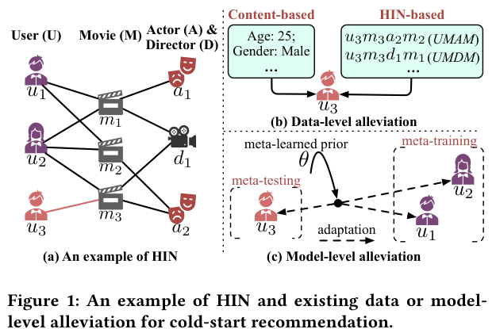
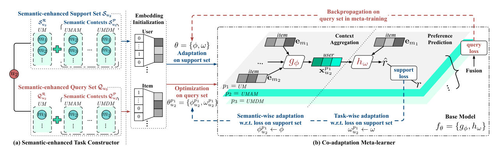
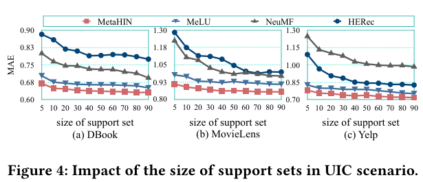
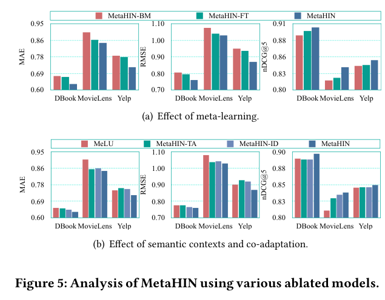

### 메타러닝(MAML)과 HIN의 meta-path를 결합해 cold-start 추천 문제를 데이터와 모델 양쪽에서 풀어낸 MetaHIN에 대해 알아봅니다.

> 원제  
> **Meta-learning on Heterogeneous Information Networks for Cold-start Recommendation**  
> Yuanfu Lu, Yuan Fang, Chuan Shi (KDD 2020)

 출처: Lu et al., KDD 2020 (https://yuanfulu.github.io/publication/KDD-MetaHIN.pdf) 
  

 

>  **1. Cold-start 문제를 "유저 한 명 = 하나의 task"인 few-shot 학습 문제로 보고 MAML 방식의 메타러닝을 적용함**
>
>  **2. 직접 평가한 아이템뿐 아니라 meta-path(유저-영화-감독-영화 등)로 닿는 아이템까지 support/query set에 포함해 부족한 데이터를 보강함**
>
>  **3. meta-path(semantic facet)별, 유저(task)별로 두 단계 adaptation을 수행하는 co-adaptation meta-learner를 제안함**
>
>  **4. 세 가지 cold-start 시나리오와 일반 시나리오 모두에서 MeLU 등 기존 모델 대비 우수한 성능을 보이며, support set이 작아져도 성능 저하가 가장 적음**

 

----

**본 포스트는 MetaHIN 논문을 읽고 정리한 노트입니다.**
원문은 여기에서 보실 수 있습니다. [paper](https://yuanfulu.github.io/publication/KDD-MetaHIN.pdf), [ACM DL](https://dl.acm.org/doi/10.1145/3394486.3403207), [code](https://github.com/rootlu/MetaHIN)

----
#### Contents

1. [Cold-start 문제, 왜 어려울까?](#coldstart)
2. [메타러닝 - learning to learn fast](#metalearning)
3. [HIN과 meta-path](#hin)
4. [MetaHIN의 구조](#metahin)
5. [실험 결과](#experiments)
6. [Ablation Study](#ablation)
7. [마치며](#conclusion)
 

## 1. Cold-start 문제, 왜 어려울까?

추천시스템을 다뤄보신 분들이라면 한 번쯤은 cold-start 문제에 머리를 싸매 보셨을 텐데요.
Cold-start 문제는 특히 기존의 Collaborative Filtering(CF) 계열 방법론에서 두드러지는 문제로, **피드백이 없거나 매우 적은 유저(혹은 아이템)에 대해 예측 능력이 크게 떨어지는 현상**을 말합니다.
CF는 결국 "나와 비슷한 행동을 한 사람"을 찾아야 하는데, 행동 기록 자체가 없으니 비슷한 사람을 찾을 방법이 없는 것이죠.

기존에 주로 사용하던 대응 방법은 크게 두 가지였습니다.

- **인기 아이템 추천**: 대중적으로 인기 있는 상품을 일단 보여줌. 간단하지만 개인화가 전혀 되지 않음
- **메타데이터 활용(content-based)**: 피드백 대신 나이, 성별, 장르 같은 유저/아이템의 부가 정보를 이용해 유저나 아이템을 모사함

위 그림의 (b)를 보면, 논문은 이런 접근을 **데이터 수준의 완화(data-level alleviation)**로 분류합니다.
content 정보를 쓰거나, HIN(Heterogeneous Information Network)의 풍부한 관계 정보를 끌어와 부족한 데이터를 메우는 방식이죠.
한편 (c)는 **모델 수준의 완화(model-level alleviation)**로, 기존 유저들로부터 "새로운 유저에게 빠르게 적응하는 법"을 사전 지식(prior)으로 학습해 두었다가, 새 유저 $u_3$가 나타나면 몇 개 안 되는 평점만으로 빠르게 적응시키는 메타러닝 접근입니다.

MetaHIN의 핵심 아이디어는 아주 단순합니다. **"이 두 가지를 같이 하자!"** 입니다.

 

## 2. 메타러닝 - learning to learn fast

### 메타러닝이란?

메타러닝은 흔히 **learning to learn**, 조금 더 정확히는 **learning to learn fast**라고 부릅니다.
새로운 환경(task)이 주어졌을 때, 적은 수의 training data만으로도 빠르게 학습할 수 있는 모델을 만드는 기법인데요, 대표적인 few-shot learning 접근입니다.

추천에 대입해 보면, **적은 수의 interaction만 있어도 유저의 취향을 빠르게 파악해서 적합한 추천을 제공**하자는 아이디어가 되겠죠.
그래서 추천시스템의 cold-start 상황에 적용하기 좋은 기법으로 주목받아 왔고, MeLU, MetaEmb 같은 다양한 연구가 진행되었습니다.

수식으로 표현하면, 현실 세계의 전체 task 분포 $p(\mathcal{T})$에서 샘플링한 task들에 대해, 각 task의 적은 데이터로 적응한 뒤의 loss를 최소화하는 learner의 파라미터 $\theta$를 찾는 것이 목표입니다.

### Support set과 Query set

메타러닝에서 기억할 만한 슬로건은 **"training in the same way as testing"** 입니다.
데이터셋을 구성할 때 task(여기서는 유저)별 데이터를 다음 두 가지로 나눕니다.

- **Support set**: 실제 learning에 사용하는 데이터. 모델을 해당 task에 적응시키는 입력으로 쓰임 (learning process)
- **Query set**: 적응된 모델을 평가하고, 그 결과로 "적응하는 방법" 자체를 최적화하는 데 쓰임 (learning to learn process)

직관적으로 말하자면, 학습 과정 안에 validation/test set을 함께 넣어 쓰는 셈입니다.
학습하면서 동시에 evaluation을 진행하기 때문에, "잘 학습하는 방법" 자체를 함께 배우게 되는 것이죠.

참고로 일반적인 메타러닝에서는 "개를 분류하는 것"이 하나의 task, "고양이를 분류하는 것"이 또 하나의 task인데요, 추천 문제에서는 **유저 한 명에게 추천하는 것이 하나의 task**가 됩니다.

### 메타러닝의 종류

메타러닝은 보통 세 갈래로 나눠 설명합니다.

1. **Metric-based**: nearest neighbor나 KDE(kernel density estimation)처럼, support set과 query set 샘플 간의 유사도를 나타내는 kernel(metric) 함수를 학습함 (Matching Network, Prototypical Network 등)
2. **Model-based**: 외부 memory storage나 RNN 구조 등을 사용해, 모델 구조 자체가 빠른 학습을 하도록 설계함
3. **Optimization-based**: 적은 gradient step으로 빠르게 적응할 수 있도록 최적화 과정 자체를 학습함 (MAML, Reptile 등). **MetaHIN이 사용하는 방식**

### MAML 간단 정리

MAML(Model-Agnostic Meta-Learning)은 "어떤 task가 와도 gradient step 몇 번이면 잘 맞춰지는 좋은 초기 파라미터 $\theta$"를 찾는 방법입니다.
학습은 두 단계 루프로 이루어집니다.

**1) Local update (inner loop)**

전체 task 중 일부 task $\mathcal{T}_i$를 샘플링하고, 각 task의 support set으로 gradient를 구해 초기 파라미터 $\theta$를 한(혹은 몇) 스텝 업데이트합니다.

$$
\theta_i' = \theta - \alpha \nabla_\theta \mathcal{L}_{\mathcal{T}_i}^{support}(f_\theta)
$$

이렇게 샘플링한 task 수만큼 $\theta_1', \dots, \theta_T'$를 구합니다.

**2) Global update (outer loop)**

이제 각 $\theta_i'$로 만든 모델 $f_{\theta_i'}$에 해당 task의 query set을 넣어 loss를 구하고, 이 loss들의 합을 원래의 global 파라미터 $\theta$에 대해 미분해 업데이트합니다.

$$
\theta \leftarrow \theta - \beta \nabla_\theta \sum_{i} \mathcal{L}_{\mathcal{T}_i}^{query}(f_{\theta_i'})
$$

포인트는 query loss가 $\theta_i'$를 거쳐 계산되지만, 업데이트는 $\theta$에 대해 일어난다는 점입니다.
즉 "적응한 결과가 좋아지도록" 초기값을 옮기는 것이죠.
이렇게 다양한 task(=다양한 유저)에 대해 학습하므로, 처음 보는 유저가 와도 몇 개의 평점만으로 빠르게 적응하는 prior를 얻게 됩니다.

 

## 3. HIN과 meta-path

HIN(Heterogeneous Information Network)은 knowledge graph의 일종으로 볼 수 있는데요, 이 블로그에서는 [HAN 리뷰](https://myeonghak.github.io/recommender%20systems/RecSys-Heterogeneous-Graph-Attention-Networks-paper-review/)와 [DisenHAN 포스트](https://myeonghak.github.io/graph%20neural%20networks/GNN-DisenHAN/)에서도 다룬 바 있습니다.

- **Heterogeneous**: 노드의 종류도 여러 가지이고, 엣지의 종류도 여러 가지임. 유저/영화/감독/배우 등의 노드가 있고, 평점·출연·연출 등의 다양한 관계가 엣지로 존재함
- user-item interaction뿐 아니라 user-user, item-item 관계도 함께 모델링할 수 있음
- 따라서 **직접적인 피드백이 존재하지 않는 user-item 간의 관계**도 잡아낼 수 있음 (예: 내가 좋아한 감독의 다른 영화)

**Meta-path**는 노드 타입의 시퀀스로 정의되는 관계 패턴입니다.
예를 들어 UMAM(User-Movie-Actor-Movie)은 "유저가 본 영화에 출연한 배우가 출연한 다른 영화"를, UMDM(User-Movie-Director-Movie)은 "유저가 본 영화의 감독이 만든 다른 영화"를 의미하죠.
같은 형태를 갖는 path들의 집합이 하나의 semantic, 즉 하나의 관점(facet)을 나타낸다고 볼 수 있습니다.

MetaHIN은 바로 이 meta-path를 이용해 메타러닝의 task를 풍부하게 만드는데요, 논문에서 내세우는 contribution은 다음 두 가지입니다.

1. **Multifaceted semantic contexts**: 직접 연결된 interaction 이외의 관계를 task에 반영함 (내가 본 영화의 감독이 만든 다른 영화와의 관계 등)
2. **Co-adaptation meta-learner**: facet(meta-path)별 학습과 유저(task)별 학습을 함께 수행함. 후자는 기존 메타러닝 추천시스템과 동일한 부분임

 

## 4. MetaHIN의 구조

 출처: Lu et al., KDD 2020 (https://yuanfulu.github.io/publication/KDD-MetaHIN.pdf) 
  

MetaHIN은 크게 두 파트로 구성됩니다.

1. **Semantic-enhanced task constructor**: meta-path를 사용해 support set과 query set을 구성함
2. **Co-adaptation meta-learner**: 유저별로 적응하는 task-wise adaptation(기존에도 있던 접근)에 더해, 각 meta-path별로 적응하는 **semantic-wise adaptation**을 새롭게 도입함. 이로써 유저에 대해 학습할 수 있는 범위를 넓힘

하나씩 살펴볼까요?

### 4.1 Semantic-enhanced Task Constructor

유저 $u$의 task $\mathcal{T}_u = (\mathcal{S}_u, \mathcal{Q}_u)$에서, support set은 다음 두 가지로 구성됩니다.

$$
\mathcal{S}_u = (\mathcal{S}_u^{\mathcal{R}}, \mathcal{S}_u^{\mathcal{P}})
$$

- $\mathcal{S}_u^{\mathcal{R}}$: 유저가 직접 평점을 매긴 아이템의 집합
- $\mathcal{S}_u^{\mathcal{P}}$: meta-path 집합 $\mathcal{P}$에 의해 유도된 **semantic context**

기존에 유저 단위로만 메타러닝을 진행한 MeLU는 $\mathcal{S}_u^{\mathcal{R}}$만을 사용했는데요, MetaHIN은 여기에 meta-path로 추출한 정보를 더해 줍니다.
Cold-start 유저는 $\mathcal{S}_u^{\mathcal{R}}$가 매우 작기 때문에, 상대적으로 $\mathcal{S}_u^{\mathcal{P}}$의 중요성이 커지게 되겠죠.

Semantic context는 유저가 평점을 매긴 아이템에서 출발하는 meta-path로 도달 가능한 아이템들로 만듭니다.
유저-아이템 쌍 $(u, i)$에 대해 meta-path $p$로 유도된 context는

$$
C_{u,i}^{p} = \lbrace j : j \in \text{items reachable along } p \text{ starting from } u\text{-}i \rbrace
$$

이고, 이를 유저가 평가한 모든 아이템에 대해 합쳐 $\mathcal{S}_u^{p} = \bigcup_{i \in \mathcal{S}_u^{\mathcal{R}}} C_{u,i}^{p}$를 얻습니다.
예를 들어 직접 평점을 매기지 않았더라도 $u_1 - m_3 - a_2 - m_7$ 꼴의 UMAM path가 있다면 $m_7$이 $\mathcal{S}_{u_1}^{UMAM}$에 추가되는 것이죠.
최종적으로 $\mathcal{S}_u^{\mathcal{P}} = (\mathcal{S}_u^{p_1}, \dots, \mathcal{S}_u^{p_n})$처럼 meta-path별 facet의 묶음이 됩니다.

Query set $\mathcal{Q}_u = (\mathcal{Q}_u^{\mathcal{R}}, \mathcal{Q}_u^{\mathcal{P}})$도 같은 방식으로 만들며, support와 query의 평점 아이템은 서로 겹치지 않습니다($\mathcal{S}_u^{\mathcal{R}} \cap \mathcal{Q}_u^{\mathcal{R}} = \emptyset$).

### 4.2 Base Model

Co-adaptation meta-learner가 적응시킬 베이스 모델 $f_\theta = \lbrace g_\phi, h_\omega \rbrace$는 두 부분으로 구성됩니다.
먼저 유저/아이템의 피처(없으면 embedding lookup)로부터 초기 임베딩 $e_u$, $e_i$를 뽑아 둡니다.

**1) Context aggregation $g_\phi$**

유저 임베딩 $x_u$를 뽑는 부분입니다. 위의 $e_u$와 다른 점은, **유저가 소비한(혹은 meta-path로 연결된) 아이템들을 기반으로** 만든 임베딩이라는 점입니다.

$$
x_u = g_\phi(u, C_u) = \sigma\left(\text{mean}\left(\lbrace W e_j + b : j \in C_u \rbrace\right)\right)
$$

$C_u$는 유저와 관련된 아이템 집합으로, 앞서 만든 $\mathcal{S}_u^{\mathcal{R}}, \mathcal{S}_u^{\mathcal{P}}, \mathcal{Q}_u^{\mathcal{R}}, \mathcal{Q}_u^{\mathcal{P}}$가 상황에 따라 들어갑니다.
각 아이템 임베딩을 linear layer에 통과시켜 평균을 내고, LeakyReLU($\sigma$)를 태우면 context aggregation된 임베딩 $x_u$가 나옵니다.
유저 피처가 있다면 $e_u$를 concat해서 함께 쓸 수도 있습니다.

**2) Preference prediction $h_\omega$**

뽑아낸 유저 임베딩 $x_u$와 아이템 임베딩 $e_i$를 concat한 뒤 2-layer MLP에 통과시켜 평점을 예측합니다.

$$
\hat{r}_{ui} = h_\omega(x_u, e_i) = \text{mlp}(x_u \oplus e_i), \qquad
\mathcal{L}_u = \frac{1}{\vert R_u \vert} \sum_{i \in R_u} (r_{ui} - \hat{r}_{ui})^2
$$

손실 함수는 실제 평점과의 MSE입니다.
결국 이 베이스 모델의 파라미터 $\theta = \lbrace \phi, \omega \rbrace$가 "HIN의 context로부터 유저 취향을 학습하는 방법"에 대한 prior가 되고, 이를 메타러닝으로 학습하는 구조입니다.

### 4.3 Co-adaptation Meta-learner

이제 핵심인 두 단계 adaptation입니다. 각 task에 여러 semantic facet이 붙어 있으니, prior는 task 간에 공유되는 global 지식을 담는 동시에 task 내부의 facet별로도 적응할 수 있어야 한다는 것이 논문의 문제의식입니다.

**1) Semantic-wise adaptation: $\phi$를 meta-path별로 로컬 업데이트**

먼저 meta-path $p$가 만드는 semantic space에서의 유저 임베딩을 구합니다.

$$
x_u^{p} = g_\phi(u, \mathcal{S}_u^{p})
$$

이 임베딩으로 support set의 평점 아이템 $\mathcal{S}_u^{\mathcal{R}}$에 대한 loss를 계산하고, global context prior $\phi$를 한 스텝 업데이트해 $p$에 특화된 semantic prior $\phi_u^p$를 얻습니다.

$$
\phi_u^{p} = \phi - \alpha \frac{\partial \mathcal{L}_{\mathcal{T}_u}(\omega, x_u^{p}, \mathcal{S}_u^{\mathcal{R}})}{\partial \phi}
$$

**2) Task-wise adaptation: $\omega$를 유저별로 로컬 업데이트**

$\phi_u^p$로 업데이트된 상태에서 support set의 유저 임베딩을 다시 구합니다: $x_u^{p\langle S \rangle} = g_{\phi_u^p}(u, \mathcal{S}_u^p)$.
그리고 global prior $\omega$를 이 semantic space $p$로 transform해 줍니다.

$$
\omega^{p} = \omega \odot \kappa(x_u^{p\langle S \rangle})
$$

여기서 $\kappa$는 fully connected layer로 구현된 변환 함수인데, $x_u^{p\langle S \rangle}$를 linear layer에 넣고 sigmoid를 태워 0~1 사이의 값으로 만든다고 보면 됩니다. 즉 $\omega$를 semantic space $p$에 맞게 **gating**하는 셈이죠.
그 다음 이 $\omega^p$를 support loss로 한 스텝 업데이트합니다.

$$
\omega_u^{p} = \omega^{p} - \beta \frac{\partial \mathcal{L}_{\mathcal{T}_u}(\omega^{p}, x_u^{p\langle S \rangle}, \mathcal{S}_u^{\mathcal{R}})}{\partial \omega^{p}}
$$

이렇게 하면 유저 $u$와 각 meta-path $p$에 대해 로컬 업데이트된 파라미터 $\theta_u^p = \lbrace \phi_u^p, \omega_u^p \rbrace$를 얻게 됩니다.
MAML의 inner loop가 "task별" 한 겹이었다면, MetaHIN은 "meta-path별 + task별" 두 겹이 된 것이라고 이해하면 편합니다.

**3) Optimization: query set으로 global update**

이제 MAML의 outer loop에 해당하는 global update입니다. 유저·semantic context별로 로컬 업데이트한 파라미터를 바탕으로, query set $\mathcal{Q}_u$를 이용해 global prior $\theta = \lbrace \phi, \omega \rbrace$를 업데이트합니다.

$$
\min_\theta \sum_{\mathcal{T}_u \in \mathcal{T}^{tr}} \mathcal{L}_{\mathcal{T}_u}(\omega_u, x_u, \mathcal{Q}_u^{\mathcal{R}})
$$

그런데 여태까지 구한 것은 $\theta_u^p$, 즉 meta-path별 파라미터입니다. 이를 유저 단위 $\theta_u$로 바꾸려면 각 context에 대해 구한 결과를 aggregation해야 하는데, 논문에서는 이를 **fuse**한다고 표현합니다.

$$
\omega_u = \sum_{p \in \mathcal{P}} a_p\, \omega_u^{p}, \quad
x_u = \sum_{p \in \mathcal{P}} a_p\, x_u^{p\langle Q \rangle}, \quad
a_p = \text{softmax}\left(-\mathcal{L}_{\mathcal{T}_u}(\omega_u^{p}, x_u^{p\langle Q \rangle}, \mathcal{Q}_u^{\mathcal{R}})\right)
$$

각 context에서의 query loss에 마이너스를 붙여 softmax를 태우고, 그 값으로 weighted sum을 하는 방식입니다.
loss가 큰 semantic space일수록 가중치가 작아지도록 한, 아주 직관적인 설계죠.

 

## 5. 실험 결과

### 실험 세팅

- **데이터셋**: DBook, MovieLens, Yelp
- 유저/아이템을 가입 시점(혹은 첫 행동 시점)과 아이템 출시 시점을 기준으로 existing / new로 나눔
- meta-training 데이터는 existing 유저의 existing 아이템 평점만 포함하고, 이 중 10%를 validation set으로 사용함
- 나머지 meta-testing 데이터를 세 가지 cold-start 시나리오로 나눔: **UC**(User Cold-start, 새 유저에게 기존 아이템), **IC**(Item Cold-start, 기존 유저에게 새 아이템), **UIC**(새 유저에게 새 아이템). 여기에 일반적인 Non-cold-start 시나리오도 함께 평가함
- MeLU의 세팅을 따라 평점 수가 13~100개인 유저만 남김 (너무 많거나 너무 적은 유저 제외)
- 유저가 평가한 아이템 중 **랜덤으로 10개를 query set**으로, 나머지를 support set으로 사용함
- meta-path는 User-Item으로 시작해 Item으로 끝나는, **길이 3 이하**의 모든 path를 사용함. 그 이상은 경우의 수가 무궁무진해지기 때문에 배제함
- 평가 지표: MAE, RMSE, nDCG@5

### 비교 모델

- **Traditional**: FM, NeuMF, GC-MC(유저-아이템 피드백을 bipartite graph로 표현해 graph autoencoder로 link prediction 수행). MetaHIN과의 공정한 비교를 위해 배우·감독 같은 heterogeneous 정보를 유저/아이템 피처로 넣어 줌 (연결 구조까지는 고려하지 않음)
- **HIN-based**: metapath2vec, HERec. MetaHIN과 동일한 meta-path 구조를 사용함
- **Cold-start**: content 기반의 DropoutNet, 메타러닝 기반의 MeLU, MetaEmb. 여기서도 heterogeneous 정보를 피처로 넣어 줌

### 결과

- Cold-start 세 가지 시나리오뿐 아니라 non-cold-start 상황에서도 MetaHIN이 모든 데이터셋에서 가장 좋은 성능을 보임
- 유저와 아이템 사이에 직접적인 interaction이 없더라도, meta-path로 semantic한 관계를 잡아내 주었기 때문으로 보임
- 일반 시나리오에서도 잘 되는 이유는, 데이터셋 자체가 원래 매우 sparse하기 때문(sparsity 92~99%)임. 다만 cold-start 시나리오에 비하면 개선 폭은 작음
- 성능 향상 폭은 **non-cold-start < UC ≈ IC < UIC** 순으로, 어려운 시나리오일수록 크게 나타남

 출처: Lu et al., KDD 2020 (https://yuanfulu.github.io/publication/KDD-MetaHIN.pdf) 
  

support set의 크기를 5~90 사이로 바꿔 가며 가장 어려운 UIC 시나리오에서 실험한 결과도 흥미로운데요.

- 모든 모델이 support set이 클수록 좋아지지만, **support set이 작아질 때 성능 하락 폭은 MetaHIN이 가장 작음**
- 적은 양의 support set으로도 robust한 학습이 가능함
- "적은 양의 feedback으로도 robust하게 추천을 제공하자"라는 메타러닝 적용의 취지를 잘 달성했다고 볼 수 있음

 

## 6. Ablation Study

 출처: Lu et al., KDD 2020 (https://yuanfulu.github.io/publication/KDD-MetaHIN.pdf) 
  

### 1) 메타러닝은 정말 효과가 있을까?

- **MetaHIN-BM**: 메타러닝 파트를 빼고 베이스 모델 $f_\theta$만 일반적인 방식으로 학습함
- **MetaHIN-FT**: MetaHIN-BM을 학습한 뒤, meta-test 데이터의 support set으로 추가 fine-tuning을 진행함

결과를 보면 BM에 fine-tuning을 얹어도 개선 폭이 미미한 반면(특히 DBook, Yelp), MetaHIN은 모든 지표에서 확실히 앞섭니다.
새 유저/아이템의 예시 평점이 워낙 적어서 단순 fine-tuning만으로는 부족하고, 메타러닝으로 학습한 prior가 그 차이를 만든다는 해석입니다.

### 2) Semantic context와 co-adaptation의 효과는?

$\phi$에 대한 업데이트(semantic-wise)나 global prior의 공유를 빼면 어떻게 될까요?

- **MetaHIN-TA**: 유저별(task-wise) 메타러닝만 적용함. semantic context는 사용하지만 facet을 구분하지 않고 하나로 합쳐 버림. MeLU와 유사한 구조
- **MetaHIN-ID**: meta-path별로 task-wise adaptation을 독립적으로 수행함. 여러 semantic facet이 공유하는 global prior 없이, 각 facet마다 prior를 따로 학습함

- MetaHIN-TA가 MeLU보다 대체로 좋음 → HIN의 semantic context 자체가 cold-start 완화에 도움이 됨
- 그래도 MetaHIN에는 못 미침 → semantic context를 그냥 뭉쳐 넣는 것만으로는 부족하고, facet별 세분화된 적응(semantic-wise adaptation)이 중요함
- MetaHIN-ID도 MetaHIN보다 낮음 → facet 간에 공유되는 global prior가 있어야 HIN 위의 context로 학습하는 일반적인 지식을 잃지 않음

참고로 파라미터 분석에서는 semantic-wise, task-wise adaptation step을 각각 1번만 해도(s = t = 1) 성능이 충분히 안정적이었다고 합니다. 온라인 추천에서 효율을 생각하면 반가운 결과죠.

 

## 7. 마치며

MetaHIN은 cold-start 문제를 **데이터 수준(HIN의 meta-path로 task 보강)**과 **모델 수준(MAML 기반 co-adaptation)**에서 동시에 풀고자 한 논문입니다.
MeLU가 "유저 = task"라는 틀을 만들었다면, MetaHIN은 그 task 안을 meta-path라는 여러 관점(facet)으로 쪼개서 각 관점마다 따로 적응시키고, 마지막에 query loss 기반으로 다시 합치는 구조라고 요약할 수 있겠습니다.

읽으면서 들었던 의문과 아쉬운 점도 정리해 두겠습니다.

- **어떤 meta-path가 추천 결과에 중요한 역할을 하는가?** 에 대한 분석은 없음. 일정 길이(3) 이내의 모든 meta-path에 대해 학습을 수행할 뿐임. fuse 가중치 $a_p$를 들여다보면 어느 정도 해석이 가능할 것 같은데 아쉬움
- **Explicit feedback(평점)에 대해서만 실험됨.** 실무에서 더 흔한 implicit feedback(click, dwell time 등)에서는 어떤 결과가 나올지 궁금함
- **계산 비용.** 메타러닝은 meta-path 수 × 유저 수만큼 inner loop를 돌고, 2차 미분까지 필요할 수 있어 무거움. 1-step adaptation으로 충분하다고는 하지만, 실제 서빙 속도 조건을 만족할 수 있을지는 따져봐야 함

개인적으로는 "적은 데이터로 빠르게 적응한다"는 메타러닝의 철학과, "직접 연결이 없어도 관계를 타고 정보를 끌어온다"는 HIN의 철학이 cold-start라는 문제 위에서 자연스럽게 만난다는 점이 인상 깊었습니다.
이전에 살펴본 [HAN](https://myeonghak.github.io/recommender%20systems/RecSys-Heterogeneous-Graph-Attention-Networks-paper-review/)이나 [MAGNN](https://myeonghak.github.io/graph%20neural%20networks/GNN-MAGNN/)이 meta-path를 "어떻게 잘 aggregation할까"에 집중했다면, MetaHIN은 meta-path를 "학습 task를 어떻게 구성할까"의 재료로 썼다는 점에서 관점이 신선하네요.

----------------

**개선을 위한 여러분의 피드백과 제안을 코멘트로 공유해 주세요.**
**내용에 대한 지적, 혹은 질문을 환영합니다.**  

**출처**  
[Lu, Fang & Shi, Meta-learning on Heterogeneous Information Networks for Cold-start Recommendation, KDD 2020 (PDF)](https://yuanfulu.github.io/publication/KDD-MetaHIN.pdf)  
[ACM Digital Library](https://dl.acm.org/doi/10.1145/3394486.3403207)  
[MetaHIN 공식 코드 (GitHub)](https://github.com/rootlu/MetaHIN)  
[Finn et al., Model-Agnostic Meta-Learning for Fast Adaptation of Deep Networks, ICML 2017](https://arxiv.org/abs/1703.03400)  
[Lee et al., MeLU: Meta-Learned User Preference Estimator for Cold-Start Recommendation, KDD 2019](https://arxiv.org/abs/1908.00413)  
