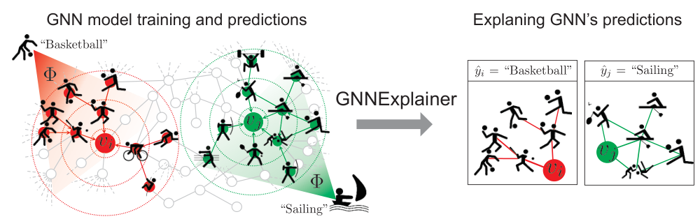
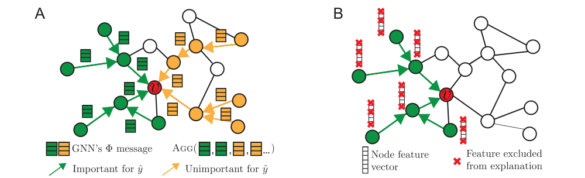
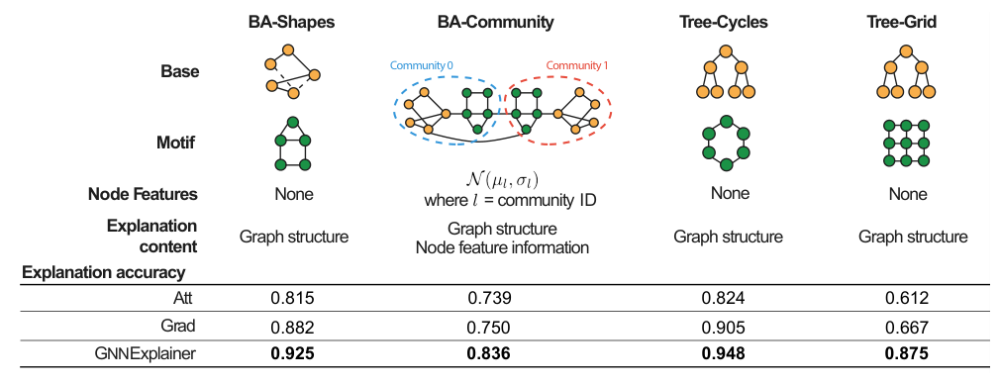
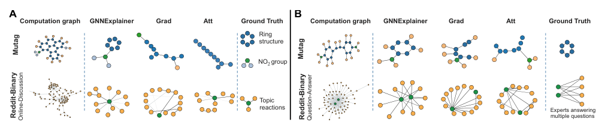

### GNN은 왜 이 노드를 이렇게 분류했을까? GNN의 예측을 subgraph와 node feature로 설명하는 GNNExplainer에 대해 알아봅니다.  


> 원제  
> **GNNExplainer**: Generating Explanations for Graph Neural Networks  
> Rex Ying, Dylan Bourgeois, Jiaxuan You, Marinka Zitnik, Jure Leskovec (NeurIPS 2019)  

<center></center>   

<font size="2"><center> 출처: Ying et al., GNNExplainer: Generating Explanations for Graph Neural Networks (https://arxiv.org/abs/1903.03894) </center>  </font>   

<br/>


>  **1. LIME, SHAP 같은 기존 model-agnostic XAI는 feature 단위 중요도만 알려줄 뿐, 그래프의 핵심인 "관계(어떤 이웃이 중요했는가)"를 설명하지 못함**
>
>  **2. GNNExplainer는 학습된 GNN의 예측과 mutual information이 최대가 되는 작은 subgraph와 node feature 부분집합을 찾아 이를 설명으로 제시함**
>
>  **3. 이산적인 subgraph 탐색을 edge mask / feature mask의 연속 최적화 문제로 완화(relaxation)하여 gradient descent로 풀고, 어떤 GNN 구조에도 적용 가능함 (model-agnostic)**

<br/>

----

**본 포스트는 GNNExplainer 논문과 DSBA 연구실의 논문 리뷰 영상을 보고 정리한 노트입니다.**
원문은 여기에서 보실 수 있습니다. [paper](https://arxiv.org/abs/1903.03894), [video](https://www.youtube.com/watch?v=PrNwfNOge8o)  

----
#### Contents  

1. [Intro - XAI 다시 짚어보기](#intro)  
2. [LIME과 SHAP, 그리고 그 한계](#lime_shap)  
3. [그래프 데이터와 GNN은 무엇이 다를까?](#gnn)  
4. [Graph XAI는 무엇을 설명해야 할까?](#graph_xai)  
5. [GNNExplainer: 예측을 가장 잘 설명하는 subgraph를 찾아보자!](#gnnexplainer)  
6. [실험 결과](#experiments)  
7. [PyG로 써보기](#code)  
8. [마치며](#conclusion)  
<br />

<a id="intro"></a>
## 1. Intro - XAI 다시 짚어보기  

이전에 [LIME](https://myeonghak.github.io/xai/XAI-LIME%28Local-Interpretable-Model-agnostic-Explanation%29-%EC%95%8C%EA%B3%A0%EB%A6%AC%EC%A6%98/)과 [SHAP](https://myeonghak.github.io/xai/XAI-SHAP/) 포스트에서 XAI를 다룬 적이 있는데요. 최근 GNN을 공부하다 보니 자연스럽게 이런 궁금증이 생겼습니다. "그래서 GNN은 **왜** 이 노드를 이렇게 분류한 걸까?"  
오늘은 이 질문에 답하기 위해 제안된 대표적인 방법인 GNNExplainer를 정리해 보겠습니다. 본론에 들어가기 전에 XAI의 기본 개념부터 가볍게 짚고 넘어가겠습니다.  

**XAI(Explainable AI)** 는 구축한 모델의 판단을 사람이 이해할 수 있도록 설명하는 기술입니다.  

- **Blackbox model**: 내부 메커니즘이나 판단 근거를 알기 어려운 모델 (딥러닝 등)  
- **Whitebox model**: 계수나 분기 규칙 등을 통해 판단 근거를 해석할 수 있는 모델 (선형 회귀, 의사결정나무 등)  
- XAI는 결국 Blackbox model을 Whitebox model처럼 들여다볼 수 있게 만들기 위한 기술이라고 볼 수 있음  

그럼 왜 굳이 설명이 필요할까요? 크게 두 가지 이유가 있습니다.  

1. **Trustworthy**: 모델이 "그럴듯한 근거"로 판단하는지 확인해야 신뢰하고 현업에 적용할 수 있음  
2. **Debugging**: 모델이 이상한 결과를 낼 때, 그 원인이 되는 입력을 찾아 고칠 수 있음  

XAI 기법은 보통 두 가지 축으로 분류합니다.  

**1) 어떤 모델에 쓸 수 있는가?**  
- **Model-specific**: 특정 모델 구조에서만 쓸 수 있는 설명 기법 (예: Random Forest의 impurity 기반 feature importance, 선형 회귀의 계수)  
- **Model-agnostic**: 모델 구조와 무관하게 입력-출력만으로 설명하는 기법 (예: LIME, SHAP)  

**2) 설명에 어떤 범위의 데이터를 쓰는가?**  
- **Global**: 전체 데이터를 활용해 모델 전반의 동작을 설명 (예: Permutation Feature Importance, PDP)  
- **Local**: 설명하려는 개별 샘플과 그 주변 데이터를 통해 해당 예측 하나를 설명 (예: LIME, SHAP, Saliency Map)  

참고로 ICE(Individual Conditional Expectation)는 개별 샘플 단위의 곡선을 그린다는 점에서 local 쪽에 가깝고, 이를 평균 낸 것이 global 기법인 PDP입니다.  

<a id="lime_shap"></a>
## 2. LIME과 SHAP, 그리고 그 한계  

### LIME (Local Interpretable Model-agnostic Explanations)  

- 복잡한 모델의 결정 경계 전체를 해석하는 것(global interpretation)은 어려움  
- 대신 설명하려는 샘플 주변에서 입력을 perturbation하여 데이터를 만들고, 그 근방에서만 원래 모델을 흉내내는 간단한 **surrogate model**(주로 선형 모델)을 학습함  
- 이 지역적 선형 모델의 가중치를 해당 예측에 대한 설명으로 사용함  

### SHAP (SHapley Additive exPlanations)  

- LIME처럼 additive한 설명 모델을 구성하되, 협력 게임 이론의 **Shapley value**를 이용해 LIME의 임의성(kernel, 샘플링에 따라 설명이 흔들리는 문제 등)을 이론적으로 보완함  
- 직관적으로 feature $i$의 기여도는 "$i$가 있을 때의 출력 - $i$가 없을 때의 출력"이고, 이 한계 기여를 가능한 모든 feature 부분집합(참여 순서)에 대해 가중 평균한 값이 Shapley value임  

$$
\phi_i = \sum_{S \subseteq F \setminus \{i\}} \frac{\vert S \vert ! \, (\vert F \vert - \vert S \vert - 1)!}{\vert F \vert !} \left[ f(S \cup \{i\}) - f(S) \right]
$$

정리하면 LIME과 SHAP 모두 **입력을 perturbation해 보고, surrogate model로 기여도를 계산**하는 계열의 local, model-agnostic XAI라고 할 수 있겠습니다.  

### 그럼 GNN에도 그냥 LIME, SHAP을 쓰면 안 될까?  

안타깝게도 그대로 쓰기에는 한계가 뚜렷합니다.  

- LIME, SHAP은 기본적으로 **"어떤 feature가 중요했는가"** 를 답하는 도구임  
- 그런데 GNN의 예측은 노드 자신의 feature뿐만 아니라 **이웃 노드들과의 연결 구조**를 통해 전달된 정보에 크게 의존함  
- 그래프의 가장 큰 강점인 관계(edge) 정보를 설명에 반영할 수 없고, "어떤 이웃 노드가, 어떤 연결을 통해 영향을 줬는가"를 판단할 수 없음  
- 또한 feature를 독립적으로 끄고 켜는 방식은 노드들이 서로 얽혀 있는 그래프 구조와 잘 맞지 않음  

바로 이 지점이 GNNExplainer가 등장하게 된 계기입니다.  

<a id="gnn"></a>
## 3. 그래프 데이터와 GNN은 무엇이 다를까?  

### 그래프 데이터가 특별한 이유  

- **Dependence**: 일반적인 tabular 데이터 모델링에서는 각 샘플이 서로 독립(i.i.d.)이라고 가정하는 경우가 많음  
- 하지만 실제 데이터는 구성 요소 간의 의존성이 있고(친구 관계, 분자 결합, 논문 인용 등), 이를 반영해 학습하는 것이 중요한 경우가 많음  
- 그래프는 이 의존성을 **adjacency matrix** $A$로 명시적으로 표현함  

### 그래프 데이터로 푸는 문제들  

1. **Node classification**: 이 노드의 label은? (예: 이 유저는 어떤 커뮤니티에 속할까?)  
2. **Link (edge) prediction**: 두 노드가 연결되어 있을까? 연결된다면 그 edge의 값은?  
3. **Graph classification**: 이런 구조의 그래프는 어떤 분자일까? (예: 이 분자는 돌연변이를 유발할까?)  

### GNN의 기본 연산  

대부분의 GNN은 레이어마다 다음 세 단계를 반복합니다. (이 프레임워크에 대해서는 [GIN 포스트](https://myeonghak.github.io/graph%20neural%20networks/GNN-GIN/)에서도 자세히 다룬 바 있습니다.)  

1. **Message**: 이웃 노드가 중심 노드에게 전달하는 정보를 계산함, $m_{ij}^{l} = \text{MSG}(h_i^{l-1}, h_j^{l-1}, r_{ij})$  
2. **Aggregate**: 이웃들로부터 받은 message를 취합함, $M_i^{l} = \text{AGG}(\lbrace m_{ij}^{l} : v_j \in \mathcal{N}_{v_i} \rbrace)$  
3. **Update**: 취합된 이웃 정보와 자신의 이전 임베딩을 합쳐 임베딩을 갱신함, $h_i^{l} = \text{UPDATE}(M_i^{l}, h_i^{l-1})$  

여기서 중요한 관찰이 하나 있는데요. $L$개 레이어를 가진 GNN이 노드 $v$의 예측을 만들 때 실제로 사용하는 정보는 **$v$의 $L$-hop 이웃까지로 한정**됩니다. 논문에서는 이를 노드 $v$의 **computation graph** $G_c(v)$라고 부르고, 이에 해당하는 adjacency matrix를 $A_c(v)$, feature 집합을 $X_c(v)$로 표기합니다. 즉, GNN 모델 $\Phi$는 $P_\Phi(Y \mid G_c, X_c)$라는 조건부 분포를 학습한다고 볼 수 있습니다.  
설명을 찾을 공간이 그래프 전체가 아니라 이 computation graph 안으로 좁혀진다는 점이 이후 논의의 출발점이 됩니다.  

<a id="graph_xai"></a>
## 4. Graph XAI는 무엇을 설명해야 할까?  

그래프 관련 task와 모델에 대한 연구는 빠르게 발전해 왔지만, 그 예측을 설명하는 Graph XAI 연구는 상대적으로 최근에 시작되었습니다. GNNExplainer는 GNN을 위한 범용 설명 기법으로는 사실상 첫 번째 시도라고 할 수 있습니다.  

Graph XAI가 답하고자 하는 질문은 크게 두 가지입니다.  

- **Node embedding을 만들 때 어떤 이웃(어떤 message 경로)들이 중요하게 활용되었는가?** (구조적 설명)  
- **어떤 node feature가 output에 영향을 주었는가?** (feature 설명)  

<center></center>   

<font size="2"><center> 출처: Ying et al., GNNExplainer: Generating Explanations for Graph Neural Networks (https://arxiv.org/abs/1903.03894) </center>  </font>   

<br/>

위 그림을 보면 감이 오실 텐데요. 빨간 노드 $v$의 예측 $\hat{y}$에 대해,  

- **(A)** GNN은 이웃들의 message를 모두 aggregation하지만, 그 중 실제로 예측에 중요한 것은 초록색 경로뿐이고 주황색 경로는 별 영향이 없음  
- **(B)** 중요한 초록색 노드들 안에서도 모든 feature 차원이 중요한 것은 아니며, 일부 차원(빨간 X 표시)은 설명에서 제외할 수 있음  

즉, 사전 학습된 모델의 예측이 주어졌을 때 GNNExplainer가 내놓는 설명은 다음과 같습니다.  

- **Explanation = 예측에 큰 영향을 미친 노드와 edge로 구성된 작은 subgraph $G_S$ + 중요한 feature 부분집합 $X_S^F$**  
- 이를 위해 computation graph 안에서 중요한 노드/edge와 그렇지 않은 것을 구분해 내야 함  

맨 위의 개요 그림에서도, 농구(Basketball)로 분류된 노드는 주변의 농구하는 친구들과의 연결이, 요트(Sailing)로 분류된 노드는 수상 스포츠를 하는 친구들과의 연결이 설명으로 추출된 것을 볼 수 있습니다.  
그렇다면 이 subgraph는 어떻게 찾을 수 있을까요?  

<a id="gnnexplainer"></a>
## 5. GNNExplainer: 예측을 가장 잘 설명하는 subgraph를 찾아보자!  

### 목적 함수: Mutual Information 최대화  

GNNExplainer는 "좋은 설명"을 **모델의 예측과 정보를 가장 많이 공유하는 subgraph**로 정의합니다. 이를 mutual information(MI)으로 표현하면 다음과 같습니다.  

$$
\max_{G_S} MI(Y, (G_S, X_S)) = H(Y) - H(Y \mid G = G_S, X = X_S)
$$

여기서 $G_S \subseteq G_c$는 computation graph의 부분 그래프이고, $X_S$는 $G_S$에 속한 노드들의 feature입니다.  

- GNN 모델 $\Phi$는 이미 학습이 끝나 고정되어 있으므로 $H(Y)$는 상수임  
- 따라서 MI를 최대화하는 것은 **조건부 엔트로피 $H(Y \mid G = G_S, X = X_S)$를 최소화**하는 것과 같음  
- 직관적으로, "이 subgraph만 남겨 두어도 모델이 원래의 예측을 확신을 가지고 내릴 수 있다면" 좋은 설명이라는 뜻임  
- 반대로 어떤 edge를 제거했을 때 예측 확률이 크게 떨어진다면, 그 edge는 예측에 중요한 counterfactual 근거라고 볼 수 있음  

다만 $G_S = G_c$로 두면 trivial하게 최적이 되어 버리겠죠. 그래서 설명의 크기를 $\vert G_S \vert \le K_M$으로 제한해, 작고 간결한(compact) subgraph만 찾도록 합니다. 일종의 denoising 효과도 있습니다.  

### 이산 최적화를 연속 최적화로: Edge Mask  

문제는 가능한 subgraph의 개수가 지수적으로 많아서 직접 탐색하는 것이 불가능하다는 점입니다. GNNExplainer는 여기서 꽤 영리한 우회로를 택합니다.  

- $G_S$를 하나의 정해진 그래프가 아니라 **확률 변수 $\mathcal{G}$** 로 보고, 기대값 $\min_{\mathcal{G}} \mathbb{E}_{G_S \sim \mathcal{G}} H(Y \mid G = G_S, X = X_S)$를 최소화함  
- 각 edge가 독립적으로 포함될 확률을 갖는다고 보는 mean-field 근사를 사용함  
- 이 기대값을 직접 계산하는 대신 GNN에 기대 adjacency를 넣어 근사함 (Jensen 부등식 기반의 근사로, GNN이 non-convex라 엄밀한 보장은 없지만 실험적으로 잘 작동한다고 함)  
- 결과적으로 학습 대상은 edge별 실수 값 mask $M \in \mathbb{R}^{n \times n}$이며, 실제로 GNN에 넣는 adjacency는 $A_c \odot \sigma(M)$이 됨  

multi-class 분류에서 원래 예측 label $c$에 대해 정리하면 최적화 목적 함수는 다음과 같습니다.  

$$
\min_M - \sum_{c=1}^{C} \mathbb{1}[y = c] \log P_\Phi \left(Y = y \mid G = A_c \odot \sigma(M), X = X_c \right)
$$

결국 **"mask를 씌운 그래프를 넣어도 모델이 원래 예측한 class의 확률을 높게 유지하도록"** mask를 gradient descent로 학습하는 것입니다. 모델 파라미터는 건드리지 않고, 설명할 예측 하나마다 mask만 새로 학습한다는 점이 특징입니다.  
학습이 끝나면 $\sigma(M)$의 값이 작은 edge들을 thresholding으로 잘라내어 최종 설명 $G_S$를 얻습니다.  

여기에 실제 구현에서는 몇 가지 regularization이 더해집니다.  

- **Size regularization**: mask 값의 합에 penalty를 주어 작은 subgraph를 선호하게 함 ($\vert G_S \vert \le K_M$ 제약의 완화)  
- **Entropy regularization**: mask의 element-wise entropy에 penalty를 주어 mask 값이 0 또는 1에 가깝게, 즉 이산적으로 수렴하도록 함  
- 그 밖에 (선택적으로) 설명이 연결된 subgraph가 되도록 하는 제약 등을 추가할 수 있음  

### Node Feature도 함께 설명하기: Feature Mask  

구조뿐 아니라 어떤 feature 차원이 중요한지도 함께 찾습니다. 이를 위해 feature 차원에 대한 mask $F \in \lbrace 0, 1 \rbrace^d$를 도입하고, $G_S$에 속한 모든 노드에 같은 mask를 적용합니다.  

$$
X_S^F = \lbrace x_j^F \mid v_j \in G_S \rbrace, \quad x_j^F = [x_{j, t_1}, \dots, x_{j, t_k}] \text{ for } F_{t_i} = 1
$$

그리고 목적 함수를 $\max_{G_S, F} MI(Y, (G_S, F))$로 확장해 edge mask와 feature mask를 **jointly** 학습합니다.  

여기서 한 가지 함정이 있는데요. 어떤 feature를 단순히 0으로 지워 버리면, 원래 값이 0이었던 중요한 feature는 지워도 예측이 바뀌지 않아 중요하지 않다고 잘못 판단될 수 있습니다. 이를 피하기 위해 논문에서는 다음과 같이 처리합니다.  

- 지워진 feature 자리를 0이 아니라 **empirical marginal distribution에서 샘플링한 값 $Z$** 로 채움 (Monte Carlo 근사)  
- $X = Z + (X_S - Z) \odot F$ 형태의 reparameterization trick으로 feature mask $F$까지 gradient를 흘려 보냄  
- 이때 $\sum_j F_j$에 대한 penalty를 함께 걸어, 모든 feature를 다 켜 두는 trivial한 해를 막음  

### 여러 예측을 한 번에 설명하기, 그리고 다른 task로의 확장  

- **Multi-instance explanation**: "왜 이 class의 노드들은 모두 이렇게 분류되었나?"를 설명하기 위해, 같은 class의 여러 노드에 대한 개별 설명들을 정렬(alignment)하고 집계하여 하나의 **prototype** 설명으로 요약할 수 있음  
- **Link prediction**: 두 끝 노드 각각의 computation graph를 고려해 설명을 찾음  
- **Graph classification**: 그래프의 모든 노드의 computation graph를 합친(union) adjacency 위에서 mask를 학습하여, 그래프 label에 중요한 subgraph를 찾음  

GNNExplainer는 GNN의 forward를 마음대로 호출하고 gradient만 받을 수 있으면 되므로, GCN, GraphSAGE, GIN, GAT 등 **message passing을 따르는 어떤 GNN에도 그대로 적용**할 수 있습니다. 앞서 본 LIME/SHAP과 마찬가지로 "입력을 가려 보면서 예측의 변화를 관찰한다"는 철학을 공유하지만, 가리는 대상이 feature에서 **edge와 feature 차원**으로 확장되었고, 랜덤 perturbation 대신 **mask를 직접 최적화**한다는 점이 다르다고 볼 수 있겠습니다.  

<a id="experiments"></a>
## 6. 실험 결과  

### Synthetic 데이터: 정답 설명이 있는 그래프  

설명 기법을 평가할 때 가장 어려운 점은 "정답 설명"이 무엇인지 모른다는 것입니다. 그래서 논문에서는 정답을 알고 있는 synthetic 그래프를 만들어 평가합니다.  

- Barabasi-Albert(BA) 그래프나 balanced tree 같은 base 그래프에, house, cycle, grid 모양의 **motif**를 붙임  
- 노드의 label은 해당 노드가 motif의 어느 위치에 속하는지에 따라 결정됨 → 모델이 올바르게 예측하려면 motif 구조를 봐야 하므로, motif가 곧 정답 설명이 됨  
- 설명 기법이 각 edge에 매긴 중요도 점수를 예측 점수로, 정답 motif에 속하는지 여부를 label로 보고 이진 분류처럼 **explanation accuracy**를 계산함  
- 비교 대상은 gradient 기반 saliency(**Grad**)와 GAT의 attention 가중치(**Att**)임  

<center></center>   

<font size="2"><center> 출처: Ying et al., GNNExplainer: Generating Explanations for Graph Neural Networks (https://arxiv.org/abs/1903.03894) </center>  </font>   

<br/>

네 데이터셋 모두에서 GNNExplainer가 가장 높은 정확도를 보였고, 평균적으로 baseline 대비 17.1% 높았으며, 가장 어려운 Tree-Grid에서는 최대 43.0% 높은 정확도를 기록했습니다. 특히 BA-Community는 구조와 node feature가 모두 label에 관여하도록 설계된 데이터인데, 여기서도 GNNExplainer가 구조와 중요한 feature를 함께 잡아냈다고 합니다.  
Att가 생각보다 낮게 나오는 점도 흥미로운데요. attention 가중치는 모든 레이어에서 같은 edge에 같은 값을 주는 것이 아니고, 예측에 대한 "기여도"를 직접 나타내도록 학습된 것도 아니라서 설명으로 쓰기에는 한계가 있다는 해석입니다.  

### 실제 데이터: MUTAG과 Reddit-Binary  

<center></center>   

<font size="2"><center> 출처: Ying et al., GNNExplainer: Generating Explanations for Graph Neural Networks (https://arxiv.org/abs/1903.03894) </center>  </font>   

<br/>

실제 그래프 분류 데이터에서는 정량적인 정답이 없으므로 정성적으로 비교합니다.  

- **MUTAG** (분자의 돌연변이 유발성 분류): GNNExplainer는 화학적으로 돌연변이 유발과 관련이 있다고 알려진 **탄소 고리 구조와 $NO_2$ 작용기**를 정확히 설명으로 뽑아냄. 반면 Grad와 Att는 의미가 불분명한 사슬 형태를 뽑는 경우가 많았음  
- **Reddit-Binary** (스레드가 Q&A형인지 토론형인지 분류): Q&A 스레드에서는 소수의 전문가가 여러 질문에 답하는 star 형태의 구조를, 토론형 스레드에서는 하나의 주제에 대한 반응이 이어지는 구조를 설명으로 잡아냄  

도메인 지식과 맞아떨어지는 설명이 나온다는 점에서, 실제 활용 가능성을 잘 보여주는 결과라고 생각합니다.  

<a id="code"></a>
## 7. PyG로 써보기  

GNNExplainer는 PyTorch Geometric(PyG)에 구현되어 있어서 바로 써 볼 수 있습니다. 아래는 이미 학습된 node classification 모델 `model`(log softmax를 출력)과 그래프 `data`가 있다고 가정한 예시입니다. (PyG 2.0 기준이며, 이후 버전에서는 `torch_geometric.explain` 모듈의 `Explainer` 인터페이스로 옮겨졌습니다.)  

```python
from torch_geometric.nn import GNNExplainer

explainer = GNNExplainer(model, epochs=200, return_type='log_prob')

node_idx = 10  # 설명하고 싶은 노드
node_feat_mask, edge_mask = explainer.explain_node(node_idx, data.x, data.edge_index)

# edge_mask 값이 큰 edge들로 구성된 subgraph 시각화
ax, G = explainer.visualize_subgraph(node_idx, data.edge_index, edge_mask, y=data.y)
```

`node_feat_mask`는 feature 차원별 중요도, `edge_mask`는 edge별 중요도($\sigma(M)$)에 해당합니다. 하나의 노드를 설명할 때마다 mask를 새로 최적화하므로, 설명할 노드가 많다면 그만큼 시간이 든다는 점은 염두에 두어야 합니다.  

<a id="conclusion"></a>
## 8. 마치며  

GNNExplainer의 핵심을 한 줄로 정리하면 **"예측을 유지하는 데 꼭 필요한 최소한의 edge와 feature만 남기는 mask를 학습한다"** 라고 할 수 있겠습니다.  

- 장점: model-agnostic하고, 구조와 feature를 함께 설명하며, 아이디어가 직관적이고 구현도 간단함  
- 한계: 예측 하나마다 최적화를 새로 돌려야 해서 느리고, 설명이 각 인스턴스에 국한된 local 설명임. 또 mask를 씌운 그래프가 학습 분포와 다를 수 있다는(out-of-distribution) 지적도 있음  
- 이후 PGExplainer(mask를 생성하는 네트워크를 학습해 귀납적으로 설명), SubgraphX(Shapley value와 MCTS로 subgraph 탐색) 등 후속 연구들이 이런 한계를 보완하는 방향으로 이어짐  

개인적으로는 LIME, SHAP을 공부할 때 "그래프에서는 대체 무엇을 가려 봐야 하지?"라는 의문이 있었는데, 그 대상을 edge로 두고 mask를 직접 최적화한다는 발상이 깔끔하게 다가왔습니다. 추천 시스템처럼 GNN을 실제 서비스에 적용할 때 "왜 이 아이템을 추천했는가?"를 설명해야 하는 상황이 점점 많아질 텐데, 그때 가장 먼저 꺼내 볼 만한 도구가 아닐까 싶네요.  

----------------


**개선을 위한 여러분의 피드백과 제안을 코멘트로 공유해 주세요.**
**내용에 대한 지적, 혹은 질문을 환영합니다.**  


**출처**  
[Ying et al., GNNExplainer: Generating Explanations for Graph Neural Networks (NeurIPS 2019)](https://arxiv.org/abs/1903.03894)  
[[Paper Review] GNNExplainer: Generating Explanations for Graph Neural Networks - DSBA 연구실 (YouTube)](https://www.youtube.com/watch?v=PrNwfNOge8o)  
[PyTorch Geometric - GNNExplainer](https://pytorch-geometric.readthedocs.io/)  
