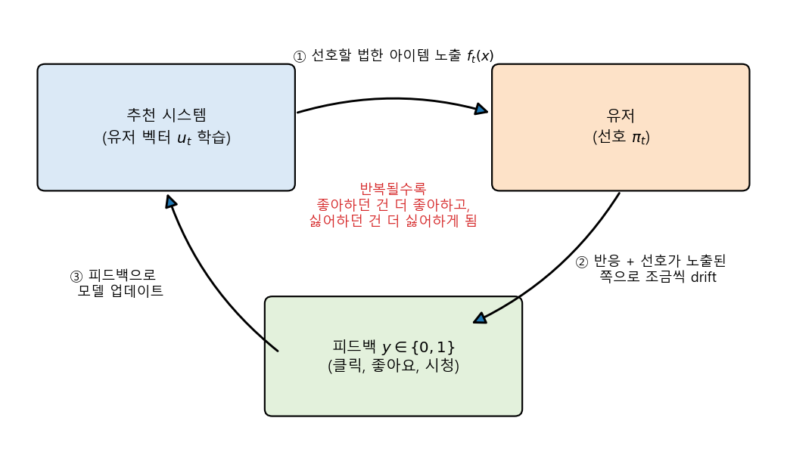
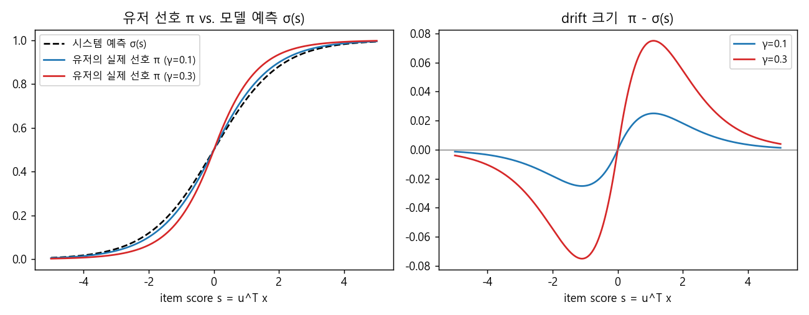
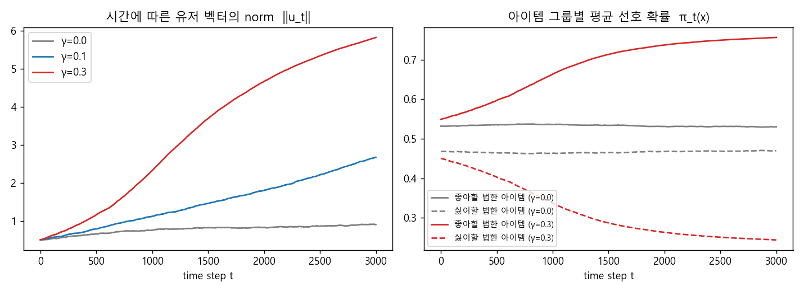
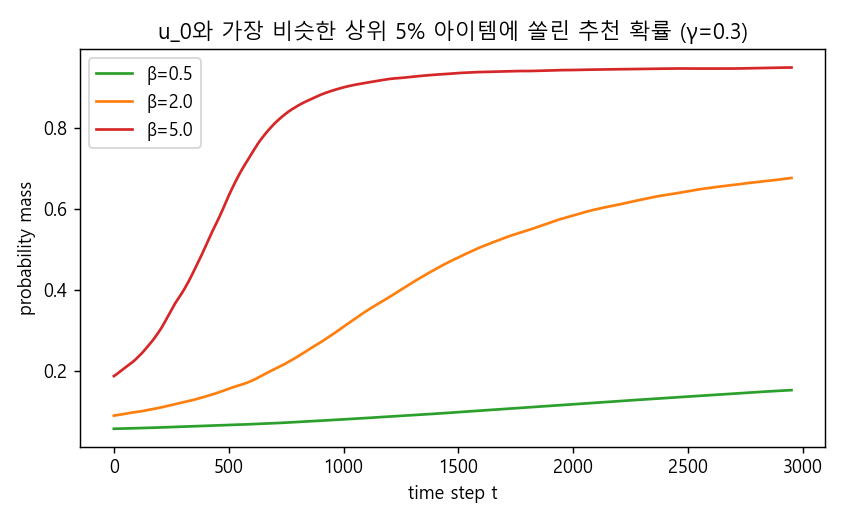

### 추천과 피드백이 반복될수록 유저의 취향이 점점 극단으로 치닫는 현상, 선호 증폭에 대해 알아봅니다.

> **Preference Amplification in Recommender Systems**  
> Dimitris Kalimeris (Harvard), Smriti Bhagat, Shankar Kalyanaraman, Udi Weinsberg (Facebook), KDD 2021  
> 발표: 딥러닝논문읽기모임 유튜브 채널

<center></center>

<br/>

>  **1. 추천 -> 유저 피드백 -> 피드백으로 모델 업데이트로 이어지는 feedback loop는 유저의 선택 자체에 영향을 주며, 좋아하던 것은 더 좋아하고 싫어하던 것은 더 싫어하게 만드는 선호 증폭을 일으킴**
>
>  **2. 논문은 stochastic MF 추천 모델과 "추천받은 쪽으로 조금씩 기우는" 유저 모델을 가정하고, 아이템 피처가 충분히 다양하면(XX^T full rank) 영벡터 외의 fixed point가 존재하지 않음을, 즉 echo chamber가 필연적으로 생김을 수학적으로 보임**
>
>  **3. 유저 벡터의 norm은 계속 커지고, 각 아이템 score는 부호를 유지한 채 절댓값만 커지며, 처음부터 유저와 비슷했던 아이템에 추천 확률이 점점 쏠리게 됨 (직접 해본 간단한 시뮬레이션에서도 동일한 경향 확인)**

<br/>

----

**본 포스트는 딥러닝논문읽기모임의 논문 리뷰 영상을 보고, 원 논문의 내용을 보충하여 정리한 노트입니다.**
논문은 [여기](https://doi.org/10.1145/3447548.3467298)에서, 발표 영상은 [여기](https://youtu.be/dM3kDjpSzBk)에서 보실 수 있습니다.

----
#### Contents

1. [Intro - 추천이 취향을 만든다?](#intro)
2. [문제 설정: Stochastic MF 추천 모델](#setting)
3. [이상적인 추천 시스템의 조건, Fixed Point](#fixed-point)
4. [유저는 어떻게 행동하는가?](#user-behavior)
5. [Echo Chamber는 피할 수 없다 - Lemma 1, 2, 3](#lemmas)
6. [직접 시뮬레이션 해보자!](#simulation)
7. [마치며](#conclusion)
<br />

<a id="intro"></a>
## 1. Intro - 추천이 취향을 만든다?

추천 시스템의 기본 구조를 떠올려 보면, 대략 이런 사이클이 무한히 반복되는데요.

- 시스템이 유저에게 아이템을 추천함
- 유저가 추천된 아이템에 대해 클릭, 좋아요, 시청 등의 피드백을 남김
- 시스템은 이 피드백으로 모델을 다시 학습(fine-tuning)함

문제는 이 **feedback loop가 단순히 유저의 취향을 "측정"하는 데에서 끝나지 않고, 유저의 선택 자체에 영향을 준다**는 점입니다. 유저 입장에서는 결국 추천된 것들 중에서 고르게 되니까요.

유저 피드백을 기반으로 추천하다 보면, 해당 유저가 좋아하는 아이템만 계속 보여주게 됩니다. 그러면 정확도(CTR 등)는 높게 나오고, 모델은 그 방향으로 더 학습하게 되죠. 이 과정이 반복되면 유저의 성향은 점점 강화되고, 다른 성향이나 다른 카테고리의 아이템은 추천받지도, 소비하지도 못하는 상황이 벌어집니다. 우리가 흔히 **Echo Chamber(반향실)** 혹은 **Filter Bubble**이라고 부르는 현상인데요. 정치 성향 같은 민감한 주제에서는 사회적 갈등을 키우기도 하고, 장기적으로는 추천 품질 자체를 떨어뜨리는 결과로 이어지기도 합니다.

이 논문은 이렇게 추천이 반복되며 유저의 관심이 추천된 쪽으로 좁아지는 현상을 **선호 증폭(Preference Amplification)** 이라고 부르고, 이를 이론적으로 분석합니다. 논문의 contribution은 크게 세 가지입니다.

- 유저와 추천 시스템 사이의 상호작용(interaction)을 이론적으로 특징화/개념화함
- Matrix Factorization 기반 추천 시스템에서 유저 선호의 분기(divergence)와 echo chamber의 존재를 수학적으로 증명함
- 이를 바탕으로 추천 시스템의 echo chamber를 완화하기 위한 전략을 제시함

"필터 버블이 있다더라"는 이야기는 많이 들어봤지만, 이걸 수식으로 증명하려는 시도는 흔치 않아서 꽤 흥미롭게 봤던 논문입니다. 하나씩 살펴보겠습니다.


<a id="setting"></a>
## 2. 문제 설정: Stochastic MF 추천 모델

### 기본 세팅

- 추천할 아이템은 총 $m$개이고, 각 아이템은 $d$차원 벡터 $x \in \mathbb{R}^d$로 표현됨. 이를 모아 $X \in \mathbb{R}^{d \times m}$으로 씀
- 유저는 $d$차원 벡터 $u_t$로 표현됨
- timestamp $t$마다 유저는 시스템이 고른 아이템에 노출되고, binary 피드백 $y \in \{0, 1\}$을 제공함 (좋아요, 시청, 클릭 등)
- 여러 추천 모델 중 **stochastic MF 모델**만을 고려함
- **아이템 피처는 static(시간에 따라 변하지 않음), 유저 피처는 dynamic(시간에 따라 변함)** 이라고 가정함

유저 $u_t$와 아이템 $x$가 주어졌을 때, 아이템의 score와 모델이 예측하는 "좋아할 확률"은 다음과 같습니다.

$$
s_t^x = u_t^\top x, \qquad \hat{p}_t(x) = \sigma(s_t^x)
$$

### Stochastic Recommendation

실제 서비스에서는 score가 가장 높은 아이템만 딱 잘라 보여주기보다는, 어느 정도 확률적으로 노출하는 경우가 많은데요. 논문도 item score에 softmax를 태워 확률값처럼 변환한 뒤, 이 분포에서 top-k개를 뽑아 추천한다고 가정합니다.

$$
f_t(x) = \frac{\exp(\beta s_t^x)}{\sum_{x'} \exp(\beta s_t^{x'})}
$$

여기서 $\beta$는 **sensitivity parameter**입니다.

- $\beta \to \infty$: 매우 민감해져서 정확히 score 1등만 노출하는 top-1 recommendation이 됨
- $\beta \to 0$: 모든 아이템의 노출 확률이 uniform distribution이 됨 (사실상 랜덤 추천)

softmax의 temperature를 생각하시면 이해가 쉽습니다. $\beta$가 클수록 exploitation, 작을수록 exploration에 가까워지는 셈이죠.

### System Update

시스템은 유저의 정확한 선호를 맞추기 위해 학습합니다. 즉 CTR, AUC, nDCG 같은 지표를 높이고자 하는 것이고, 손실함수는 binary classification과 동일한 logistic loss 형태입니다. 유저 피처 업데이트를 gradient descent로 쓰면 다음과 같습니다.

$$
u_{t+1} = u_t - \eta \, \mathbb{E}_{x \sim f_t,\; y \sim \pi_t(x)} \left[ \nabla_u \ell\big(y, \sigma(u_t^\top x)\big) \right]
$$

여기서 $\pi_t(x)$는 유저가 **실제로** 아이템 $x$를 좋아할 확률(뒤에서 다룰 preference function)입니다.

그런데 여기서 일반적인 ML 학습과 결정적으로 다른 점이 하나 있는데요. **기댓값을 취하는 아이템 분포 $f_t$ 자체가 $u_t$에 의존한다**는 것입니다. 일반적인 지도학습에서는 데이터 분포가 모델과 무관하게 고정되어 있어서 기댓값과 gradient를 독립적으로 다룰 수 있지만, 여기서는 "모델이 보여준 데이터로 모델을 다시 학습"하기 때문에 식을 그렇게 단순하게 만들 수가 없습니다. 모델이 데이터를 만들고, 그 데이터가 다시 모델을 만드는 동적인 반복 구조인 것이죠.

참고로 logistic loss의 gradient는 $(\sigma(s) - y)\,x$이므로, $y$에 대한 기댓값을 먼저 취하면 업데이트 식은 아래처럼 정리됩니다. 뒤에서 계속 쓰게 될 식이니 기억해 두시면 좋습니다.

$$
u_{t+1} = u_t + \eta \sum_{x} f_t(x)\,\big(\pi_t(x) - \sigma(s_t^x)\big)\, x
$$

즉 **유저의 실제 선호 $\pi_t$와 모델의 예측 $\sigma(s_t^x)$ 사이의 차이**만큼 유저 벡터가 움직이게 됩니다.


<a id="fixed-point"></a>
## 3. 이상적인 추천 시스템의 조건, Fixed Point

그렇다면 이상적인 추천 시스템이 되려면 어떻게 되어야 할까요? 모델이 유저의 선호를 완벽하게 맞추고 있다면, **더 이상 업데이트가 필요하지 않아야** 할 것입니다. 즉 $u_{t+1} = u_t$가 되는 지점이 추천 시스템의 자연스러운 해이고, 이를 **fixed point**라고 부릅니다. 유저와 시스템 사이의 일종의 균형(equilibrium) 상태라고 볼 수 있겠죠.

장기적인 행동 관점에서 fixed point $u^*$는 다음과 같이 구분할 수 있습니다.

1. **stable**: $u^*$ 근처에서 시작하면, 모든 $t$에 대해 $u^*$ 근처를 맴돎
2. **attracting**: $u^*$ 근처에서 시작하면, 결국 $u^*$로 수렴(converge)함
3. **asymptotically stable**: stable + attracting

### Fixed Point와 Filter Bubble은 양립할 수 없다

여기서 재밌는 관점이 하나 나오는데요. **fixed point와 filter bubble은 양립할 수 없는 개념**입니다. fixed point에 도달했다면 유저 표현 $u_t$가 고정되므로, "유저의 성향이 꾸준히 극단(polarization)으로 강화되어 간다"는 filter bubble의 개념이 성립할 수 없기 때문입니다.

따라서 echo chamber가 존재하는지를 확인하려면 다음 질문에 답하면 됩니다.

> **"유저-시스템 상호작용에 asymptotically stable한 fixed point가 존재하는가?"**

- 의미 있는 fixed point가 있다면 -> 시스템이 균형에 도달하므로 echo chamber가 없음
- 없다면 -> 유저 벡터가 계속 한 방향으로 움직이므로 echo chamber가 존재함

그런데 이 질문에 답하려면, 유저의 실제 선호 $\pi_t$가 어떻게 변하는지, 즉 **user preference function에 대한 추가적인 가정**이 필요합니다.


<a id="user-behavior"></a>
## 4. 유저는 어떻게 행동하는가?

유저의 행동은 preference function $\pi_t$로 표현합니다. $d$차원의 아이템 벡터를 받아 0~1 사이의 실수 값(좋아할 확률)을 뱉어주는 함수인데요. 시간이 흐르면서 시스템과 유저 사이에 interaction이 쌓이기 때문에 $t$에 따라 변하는 함수입니다. 논문은 이 함수에 대해 두 가지 가정을 둡니다.

### 가정 1. 유저는 자신의 의견을 강화하는 쪽으로 기운다

유저가 특정 아이템에 반응할 likelihood는 그 아이템의 score $s_t^x$에 영향을 받습니다. 그리고 유저는 원래 가지고 있던 의견을 동조, 강화하는 방향으로 기울게 됩니다. score가 양수(좋아할 법한 아이템)면 실제로는 모델 예측보다 조금 더 좋아하고, 음수면 조금 더 싫어하게 되는 것이죠.

$$
\text{sign}\big(\pi_t(x) - \sigma(s_t^x)\big) = \text{sign}(s_t^x)
$$

논문은 이런 user behavior를 drift function으로 표현하는데, 이 함수는 처음에는 의견을 강화하는 폭이 크다가 갈수록 줄어드는 형태를 띱니다. 초반에는 유저가 새로운 자극을 크게 받아들이지만, 어느 정도 polarize된 사람은 이미 고착화되어 더 이상 크게 변하지 않는다는 직관을 담은 것입니다.

### 가정 2. 추천이 유저에게 줄 수 있는 영향에는 한계가 있다

유저가 아무리 추천에 휘둘린다고 해도, 무한정 휘둘리지는 않겠죠. 그래서 **sensitivity $\gamma$** 를 도입해 변동 폭(bound of deviation)을 제한합니다.

$$
\big\vert \pi_t(x) - \sigma(s_t^x) \big\vert \le \gamma
$$

즉 유저의 실제 선호 $\pi_t$는 모델의 예측 $\sigma(s_t^x)$를 기준으로 움직이되, 그 폭이 $\gamma$를 넘지 않는다는 것입니다. $\gamma$가 클수록 추천에 쉽게 영향을 받는 유저, 작을수록 자기 주관이 뚜렷한 유저라고 해석할 수 있습니다.

아래 그림은 이 두 가정을 만족하도록 제가 임의로 만든 간단한 drift 함수입니다. (논문의 drift function과 정확히 같은 식은 아니고, 직관을 보여주기 위한 예시입니다.)

<center></center>

<br/>

오른쪽 그래프를 보면 score가 양수인 쪽은 위로, 음수인 쪽은 아래로 밀려나고, score의 절댓값이 아주 커지면(이미 극단에 가까우면) drift 폭이 다시 줄어드는 것을 볼 수 있습니다.


<a id="lemmas"></a>
## 5. Echo Chamber는 피할 수 없다 - Lemma 1, 2, 3

이제 준비가 끝났으니 앞서 던진 질문에 답해볼까요?

### Lemma 1. 의미 있는 fixed point는 존재하지 않는다

> 아이템 피처의 공분산 꼴인 $XX^\top$이 full rank라면, $u^* = 0$이 유일한 fixed point임

fixed point가 된다는 것은 $u_{t+1} = u_t$, 즉 앞서 정리한 업데이트 항의 기댓값이 0이 되어야 한다는 의미입니다.

$$
\sum_{x} f_t(x)\,\big(\pi_t(x) - \sigma(s_t^x)\big)\, x = 0
$$

가정 1에 의해 $\pi_t(x) - \sigma(s_t^x)$는 항상 $s_t^x = u_t^\top x$와 같은 부호를 가지므로, 이를 $c_x \, s_t^x$ ($c_x > 0$) 꼴로 쓸 수 있습니다. 그러면 위 식은

$$
X C X^\top u_t = 0, \qquad C = \text{diag}\big(f_t(x)\, c_x\big)
$$

꼴이 됩니다. 여기서 $C$는 대각 원소가 무조건 양수일 수밖에 없는 구조이고, $XX^\top$이 full rank라면 $XCX^\top$은 **positive definite**가 됩니다. positive definite 행렬은 영벡터가 아닌 어떤 벡터를 곱해도 0이 될 수 없으므로, 위 식을 만족하는 유일한 경우의 수는 $u_t = 0$뿐이라는 결론이 나옵니다.

풀어서 말하면, 아이템들이 $d$차원 공간을 충분히 다양하게 채우고 있다면(서로 full rank를 만족할 만큼 independent하다면), **유저가 아무 취향도 없는 상태($u=0$)를 제외하면 시스템은 절대 균형에 도달하지 못한다**는 뜻입니다.

### Lemma 2. 유저 벡터의 크기는 계속 커진다

> $XX^\top$이 full rank이고 $u_0 \neq 0$이라면, $\lVert u_t \rVert$는 시간이 지남에 따라 커짐

업데이트 식을 다시 보면 $u_{t+1} = u_t + \eta X C X^\top u_t$ 꼴인데, 양변에 $u_t$를 내적해 보면 $u_t^\top X C X^\top u_t > 0$이므로 유저 벡터는 매 스텝 자기 자신과 같은 방향의 성분을 계속 더해가게 됩니다. 결국 norm이 점점 커지게 되죠.

$s_t^x = u_t^\top x$에서 $X$는 고정값이므로, $u_t$가 커지면 score의 절댓값도 자연스럽게 커집니다. score가 커진다는 것은 $\sigma(s_t^x)$가 0 또는 1에 가까워진다는 것, 즉 **모델이 이 유저의 호불호를 점점 더 확신하게 된다**는 의미입니다.

### Lemma 3. 좋아하는 건 더 좋아하고, 싫어하는 건 더 싫어하게 된다

> 아이템 피처 간 correlation이 아예 없다면, 즉 $XX^\top = I_d$라면, $s_0^x \neq 0$인 각 아이템의 score는 **부호는 그대로 유지한 채** 절댓값이 시간에 따라 커짐

이게 바로 echo chamber의 정의 그 자체입니다. 처음에 살짝 좋아했던 아이템은 점점 더 좋아하게 되고, 살짝 싫어했던 아이템은 점점 더 싫어하게 되며, 그 방향이 뒤집히는 일은 일어나지 않습니다. **따라서 이 모델 하에서 echo chamber는 필연적으로 존재할 수밖에 없습니다.**

물론 현실에서는 아이템 피처 간의 correlation이 아예 없을 수는 없으니 $XX^\top = I_d$는 다소 비현실적인 가정입니다. 다만 논문에서는 이 가정을 만족하지 않는 경우에도 시뮬레이션 결과 echo chamber가 존재하는 방향으로 결과가 나왔다고 합니다. (정확한 조건과 증명은 원문을 참고해 주세요.)


<a id="simulation"></a>
## 6. 직접 시뮬레이션 해보자!

논문은 다음 세 가지 지표로 시뮬레이션 결과를 확인합니다.

1. **norm of $u_t$**: Lemma 2에 따라 시간이 지날수록 norm이 점점 커질 것으로 예상됨
2. **Average probability per item type**: 초기 score $s^x$가 0보다 크면 선호할 법한 아이템, 0보다 작으면 선호하지 않을 법한 아이템으로 나누고, 각 그룹의 평균 $\pi_t(x)$(유저가 $t$ 시점에 실제로 아이템 $x$를 좋아할 확률)를 측정함. 이 값이 시간에 따라 강화되는지 확인함
3. **Probability mass on items correlating well with $u_0$**: 초기 유저 벡터와 cosine similarity가 가장 높은 상위 5% 아이템을 뽑고, 이 아이템들이 $f_t$에 의해 배정받는 추천 확률의 합을 확인함

논문 결과를 그대로 옮기는 것보다는, 직접 돌려보는 게 이해에 더 도움이 될 것 같아서 numpy로 간단히 재현해 보았습니다. 세팅은 $d=10$, $m=1000$, 매 스텝 $k=10$개를 $f_t$에서 샘플링해 노출하고, 유저의 실제 선호는 앞의 4장 그림에서 본 drift 함수를 따른다고 가정했습니다. 노이즈를 줄이기 위해 유저 20명(seed 20개)의 평균을 냈습니다.

```python
def drift_pi(s, gamma):
    p = sigmoid(s); a = 2*p - 1
    return p + gamma*a*(1 - np.abs(a))   # 선호 방향으로 기울되, 이미 극단이면 덜 기움

def simulate(gamma=0.3, beta=2.0, d=10, m=1000, k=10, T=3000, lr=0.01, seed=0):
    rng = np.random.default_rng(seed)
    X = rng.normal(size=(m, d)); X /= np.linalg.norm(X, axis=1, keepdims=True)
    u0 = rng.normal(size=d); u0 = u0/np.linalg.norm(u0)*0.5
    u = u0.copy()
    top = np.argsort(-(X@u0))[:int(0.05*m)]       # u_0와 cos sim 상위 5% 아이템
    pos, neg = (X@u0) > 0, (X@u0) <= 0
    log = {"norm":[], "pi_pos":[], "pi_neg":[], "mass_top":[]}
    for t in range(T):
        s = X@u
        f = np.exp(beta*(s - s.max())); f /= f.sum()             # stochastic recommendation
        rec = rng.choice(m, size=k, replace=False, p=f)          # k개 노출
        pi = drift_pi(s, gamma)                                  # 유저의 실제 선호
        y = rng.random(k) < pi[rec]                              # binary feedback
        grad = ((sigmoid(s[rec]) - y)[:, None]*X[rec]).sum(0)    # logistic loss gradient
        u = u - lr*grad
        log["norm"].append(np.linalg.norm(u))
        log["pi_pos"].append(pi[pos].mean()); log["pi_neg"].append(pi[neg].mean())
        log["mass_top"].append(f[top].sum())
    return {k_: np.array(v) for k_, v in log.items()}
```

$\gamma$(유저가 추천에 휘둘리는 정도)와 $\beta$(추천의 민감도)를 바꿔가며 돌린 결과는 아래와 같습니다. (20명 평균, 첫 스텝 -> 3000 스텝)

```
gamma=0.0: |u| 0.50 -> 0.90 | pi(liked) 0.532 -> 0.530 | pi(disliked) 0.468 -> 0.470 | top5% mass 0.089 -> 0.088
gamma=0.1: |u| 0.50 -> 2.67 | pi(liked) 0.538 -> 0.625 | pi(disliked) 0.462 -> 0.373 | top5% mass 0.089 -> 0.269
gamma=0.3: |u| 0.50 -> 5.83 | pi(liked) 0.549 -> 0.756 | pi(disliked) 0.450 -> 0.244 | top5% mass 0.089 -> 0.678
beta=0.5: top5% mass 0.058 -> 0.155, |u| -> 5.24
beta=2.0: top5% mass 0.089 -> 0.678, |u| -> 5.83
beta=5.0: top5% mass 0.179 -> 0.948, |u| -> 5.77
```

<center></center>

<br/>

- **왼쪽 (norm of $u_t$)**: 유저가 추천에 영향을 받지 않는 경우($\gamma=0$)에는 피드백 노이즈 때문에 살짝 흔들리는 정도에 그치지만, $\gamma > 0$이면 Lemma 2대로 norm이 꾸준히 커지며, $\gamma$가 클수록 그 속도가 빨라짐
- **오른쪽 (average $\pi_t$)**: $\gamma=0.3$일 때 좋아할 법한 아이템을 좋아할 확률은 0.55 -> 0.76으로, 싫어할 법한 아이템은 0.45 -> 0.24로 벌어짐. 처음에는 "그럭저럭 괜찮은데?" 수준이던 호불호가 확실한 취향으로 굳어진 셈임. $\gamma=0$이면 거의 변화가 없음

<center></center>

<br/>

- **상위 5% 아이템의 probability mass**: 전체 아이템의 5%에 불과한, 처음부터 유저와 비슷했던 아이템들이 $\beta=2$일 때 추천 확률의 약 68%, $\beta=5$일 때는 약 95%를 가져감. 사실상 이 아이템들만 보게 되는 것임
- 반대로 $\beta=0.5$로 추천을 덜 민감하게(더 랜덤하게) 만들면 같은 기간 동안 쏠림이 0.06 -> 0.16 정도로 훨씬 완만함. 다만 이 경우에도 norm은 계속 커지므로, 증폭을 **늦출 뿐 없애지는 못한다**는 점이 흥미로움

정리하면 제 장난감 시뮬레이션에서도 논문이 보고한 결과와 같은 세 가지 경향을 확인할 수 있었습니다.

- fixed point에 도달하지 못함 (norm이 계속 커짐)
- likable한 아이템은 more likable, unlikable한 아이템은 more unlikable하게 변함
- 초기 유저와 연관이 있던 아이템들은 시간이 흐를수록 추천 확률 비중(probability mass)이 커짐

### 그럼 어떻게 완화할 수 있을까?

논문은 이 프레임워크를 바탕으로 선호 증폭을 완화하기 위한 개입(intervention) 전략도 제안하고 검증하는데요. 아쉽게도 제 노트에는 이 부분이 자세히 정리되어 있지 않아서, 자세한 내용은 원문을 참고해 주시면 좋겠습니다.

다만 위 시뮬레이션만 봐도 몇 가지 힌트를 얻을 수 있습니다. $\beta$를 낮춰 exploration을 늘리면 쏠림 속도가 확실히 느려지는데요. 실무에서는 추천 결과에 다양성(diversity) 제약을 걸거나, 일정 비율을 탐색용 슬롯으로 할당하거나, [Multi-Armed Bandit](https://myeonghak.github.io/recommender%20systems/RecSys-Multi-Armed-Bandits%28MAB%29/) 같은 explore-exploit 전략을 섞는 방식으로 비슷한 효과를 노려볼 수 있을 것입니다. 물론 그만큼 단기적인 CTR은 희생해야 하겠죠.


<a id="conclusion"></a>
## 7. 마치며

추천 시스템의 echo chamber 문제는 워낙 자주 언급되어서 "그런 게 있겠지" 하고 넘어가기 쉬운 주제인데요. 이 논문은 아주 단순한 MF 모델과 "유저는 추천받은 쪽으로 조금씩 기운다"는 소박한 가정만으로도, **아이템이 충분히 다양하기만 하면 균형점이 존재하지 않고 선호가 계속 증폭될 수밖에 없다**는 것을 보여준다는 점에서 인상적이었습니다.

개인적으로 가장 와닿았던 부분은 "모델이 보여준 데이터로 모델을 다시 학습한다"는 점이 일반적인 ML과 근본적으로 다르다는 지적이었습니다. 오프라인 지표만 보면 정확도가 계속 올라가니 모델이 잘 학습되고 있는 것처럼 보이지만, 사실은 모델이 유저를 자신의 예측에 맞게 바꿔놓고 있는 것일 수도 있다는 거죠. 직접 시뮬레이션을 돌려보니, 처음엔 0.55 정도였던 미지근한 호감이 3000 스텝 뒤에 0.76까지 올라가는 걸 보면서 조금 섬뜩하기도 했습니다.

추천 시스템을 설계할 때 정확도(accuracy)만이 아니라 다양성, 탐색, 그리고 장기적인 유저 경험까지 함께 고민해야 하는 이유를 수식으로 납득하게 해준 논문이었습니다.

----------------


**개선을 위한 여러분의 피드백과 제안을 코멘트로 공유해 주세요.**
**내용에 대한 지적, 혹은 질문을 환영합니다.**  


**출처**  
[Kalimeris et al., Preference Amplification in Recommender Systems, KDD 2021](https://doi.org/10.1145/3447548.3467298)  
[딥러닝논문읽기모임 - Preference Amplification in Recommender Systems 리뷰 영상](https://youtu.be/dM3kDjpSzBk)  
