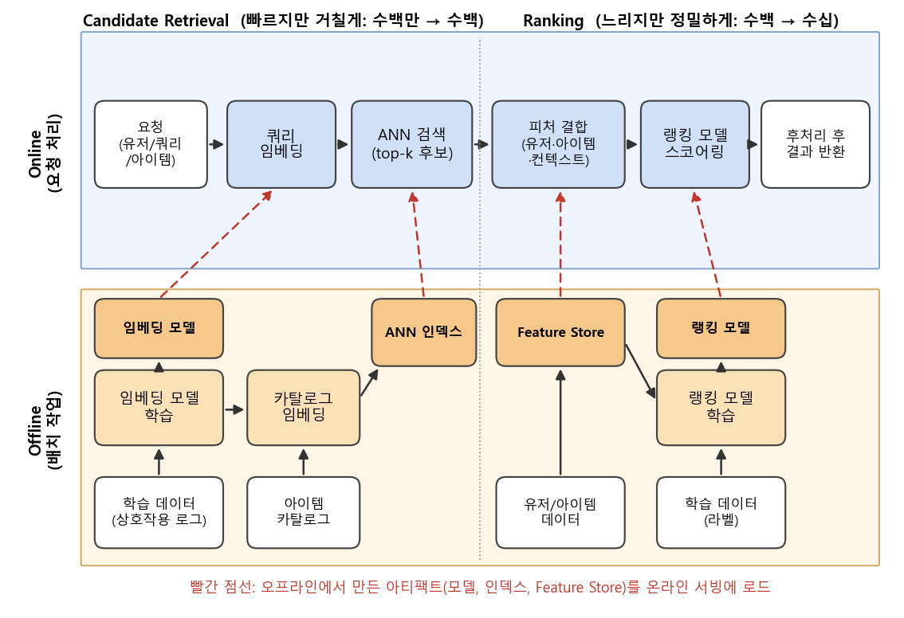
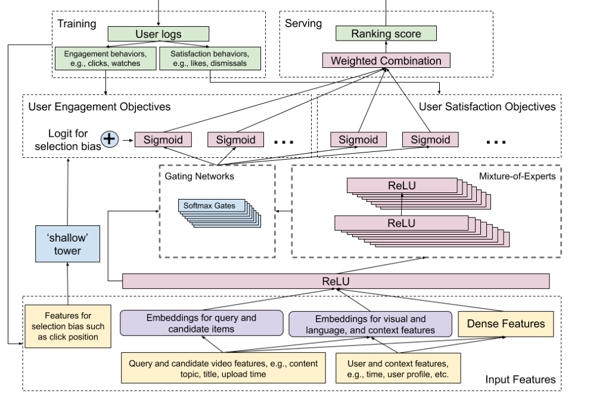
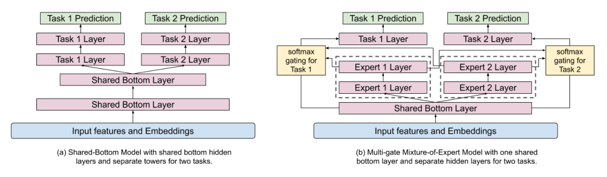
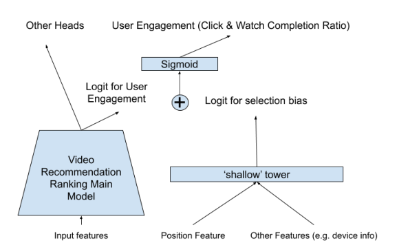

### 산업용 추천/검색 시스템이 공통적으로 따르는 설계 패턴과, 그 랭킹 단계를 YouTube가 멀티태스크로 풀어낸 방법을 알아봅니다.

> **System Design for Recommendations and Search** (Eugene Yan, eugeneyan.com, 2021)  
> **Recommending What Video to Watch Next: A Multitask Ranking System** (Zhao et al., RecSys 2019)

<center></center>

<font size="2"><center> Eugene Yan의 2x2 구분을 바탕으로 직접 그린 추천/검색 시스템 구조도 </center>  </font>

<br/>

>  **1. 대부분의 산업용 추천/검색 시스템은 offline vs. online 환경, candidate retrieval vs. ranking 단계라는 2x2 구조로 정리할 수 있음**
>
>  **2. retrieval은 빠르지만 거칠게 수백만 개를 수백 개로 줄이고, ranking은 느리지만 풍부한 피처로 수백 개를 정밀하게 정렬함. 오프라인은 이 둘에 필요한 아티팩트(임베딩 모델, ANN 인덱스, Feature Store, 랭킹 모델)를 만들어 줌**
>
>  **3. YouTube는 랭킹 단계에서 engagement와 satisfaction이라는 경합하는 여러 목적을 MMoE로 함께 학습하고, shallow tower로 position bias를 분리해 실서비스 지표를 개선함**

<br/>

----

**본 포스트는 Eugene Yan의 블로그 글과 YouTube의 멀티태스크 랭킹 논문을 읽고 정리한 노트입니다.**
원문은 여기에서 보실 수 있습니다. [Eugene Yan - System Design for Recommendations and Search](https://eugeneyan.com/writing/system-design-for-discovery/), [Zhao et al., 2019 (Google Research)](https://research.google/pubs/recommending-what-video-to-watch-next-a-multitask-ranking-system/)

----
#### Contents

1. [들어가며 - 모델 말고 시스템은?](#intro)
2. [Batch vs. Real-time, 왜 고민해야 할까?](#batch-realtime)
3. [Offline과 Online 환경](#offline-online)
4. [Candidate Retrieval과 Ranking](#retrieval-ranking)
5. [각 단계의 오프라인 프로세스와 아티팩트](#offline-process)
6. [랭킹을 더 깊게 - YouTube의 Multitask Ranking System](#youtube-mmoe)
7. [마치며](#conclusion)

<br />

<a id="intro"></a>
## 1. 들어가며 - 모델 말고 시스템은?

추천시스템 논문을 읽다 보면 대부분의 지면은 모델 구조, 학습 데이터, loss function에 할애되어 있습니다. 그런데 막상 "그래서 이걸 실제 서비스에서는 어떻게 돌리는데?"라는 질문을 던지면 답을 찾기가 꽤 어려운데요. 시스템 디자인은 회사마다 사정이 다르고, 공개되는 경우도 드물기 때문입니다.

Eugene Yan은 Alibaba, Facebook, JD, DoorDash, LinkedIn 등이 공개한 논문과 테크 블로그를 모아 읽고, 이들이 놀라울 만큼 **비슷한 패러다임**을 따른다는 점을 정리했습니다. 바로 **offline vs. online**, 그리고 **candidate retrieval vs. ranking**이라는 두 축입니다. 예전에 정리했던 [쿠팡 추천시스템 변천사](https://myeonghak.github.io/recommender%20systems/RecSys-%EC%BF%A0%ED%8C%A1-%EC%B6%94%EC%B2%9C%EC%8B%9C%EC%8A%A4%ED%85%9C-%EB%B3%80%EC%B2%9C%EC%82%AC/)나 [Criteo의 대용량 광고 추천](https://myeonghak.github.io/recommender%20systems/RecSys-%EB%8C%80%EC%9A%A9%EB%9F%89-%EA%B4%91%EA%B3%A0-%EC%B6%94%EC%B2%9C-by-Criteo/) 사례도, 이 틀에 대입해 보면 훨씬 깔끔하게 이해가 됩니다.

이번 포스트에서는 먼저 이 큰 그림을 정리하고, 후반부에서는 그중 **ranking** 단계를 YouTube가 어떻게 설계했는지를 논문 한 편으로 조금 더 깊게 들여다보겠습니다.

<br />

<a id="batch-realtime"></a>
## 2. Batch vs. Real-time, 왜 고민해야 할까?

시스템 구조를 보기 전에, 추천을 **언제 계산하느냐**부터 짚고 넘어가겠습니다. 크게 batch와 real-time 두 가지 방식이 있습니다. (이 부분은 Eugene Yan의 [Real-time Machine Learning For Recommendations](https://eugeneyan.com/writing/real-time-recommendations/) 글에서 함께 다뤄진 내용입니다.)

**Batch 추천**

- 흐름: 데이터 포인트 → DB 적재 → 일정 주기(가령 하루, 이틀)마다 분석 엔진이 일괄 계산 → 결과를 key-value 형태의 추천 DB에 저장 → 요청 시 조회만 함
- 장점
  - 이미 계산되어(pre-computed) 있으므로 서빙이 단순하고 빠름
  - 컴퓨팅과 서빙이 분리됨
  - 운영 부하가 낮음
- 단점: 계산 주기 사이에 일어난 유저 행동은 반영하지 못함

**Real-time 추천**

- 흐름: 데이터 포인트가 DB와 분석 엔진에 동시에 실시간으로 전달 → REST/gRPC로 호출되는 실시간 추천 모델이 즉시 결과를 반환함
- 장점
  - 시간에 민감한 컨텍스트(방금 본 상품, 방금 검색한 여행지)에 바로 대응할 수 있음
  - 방문하지 않는 고객의 추천을 미리 계산해 둘 필요가 없어, 그만큼 계산 비용이 줄어듦
- 단점: 인프라와 운영 부하가 큼

어떤 경우에 real-time이 꼭 필요할까요? 예를 들어 e-commerce에서 유저의 니즈는 세션 안에서도 빠르게 바뀌고, 여행 서비스에서 유저가 방금 고른 여행지는 지난번 여행지와 거의 상관이 없겠죠. YouTube에서 다음 볼 영상을 추천하는 것 역시 "지금 보고 있는 영상"이라는 최신 컨텍스트가 매우 중요합니다. 이렇게 **최신성이 곧 품질인 도메인**일수록 real-time 쪽으로 무게가 실립니다.

물론 현실에서는 둘 중 하나만 고르기보다는, 무거운 계산(임베딩 학습, 인덱스 빌드)은 batch로, 가벼운 계산(최근 행동 기반 후보 생성, 랭킹)은 요청 시점에 하는 식으로 섞어 쓰는 경우가 대부분인데요. 이 "섞는 방식"을 정리한 것이 바로 다음에 볼 offline/online 구분입니다.

<br />

<a id="offline-online"></a>
## 3. Offline과 Online 환경

**Offline 환경**은 주로 배치 작업을 담당합니다.

- 모델 학습 (representation learning, 랭킹 모델 학습)
- 카탈로그 아이템의 임베딩 생성
- 유사 아이템 검색을 위한 ANN(Approximate Nearest Neighbors) 인덱스 혹은 그래프 빌드
- 아이템/유저 데이터를 Feature Store에 적재

**Online 환경**은 오프라인에서 만들어진 **아티팩트(artifact)** 를 가져다 개별 요청에 응답합니다.

- 입력(아이템, 검색 쿼리, 유저)을 임베딩으로 변환
- candidate retrieval과 ranking 수행
- 그 밖에 전처리(쿼리 정규화, 토크나이징, 오타 교정)와 후처리(부적절한 아이템 필터링, 비즈니스 로직) 수행

핵심은 **무겁고 느린 것은 오프라인으로 밀어내고, 온라인에는 미리 만들어 둔 결과물을 빠르게 조회하는 일만 남긴다**는 것입니다. 상단의 구조도에서 빨간 점선이 바로 이 "오프라인 → 온라인" 아티팩트 전달을 나타냅니다.

<br />

<a id="retrieval-ranking"></a>
## 4. Candidate Retrieval과 Ranking

두 번째 축은 요청 하나를 처리하는 **2단계 구조**입니다. 수백만, 수억 개의 아이템 전체에 무거운 모델을 돌리는 것은 latency 측면에서 불가능하니, 깔때기(funnel)처럼 단계적으로 좁혀 나가는 것이죠.

| | Candidate Retrieval | Ranking |
|---|---|---|
| 성격 | 빠르지만 거침(coarse) | 느리지만 정밀함 |
| 규모 | 수백만 → 수백 개 | 수백 개 → 최종 순위 |
| 목표 | 놓치지 않기 (recall) | 잘 줄 세우기 (precision) |
| 주요 기법 | 임베딩 + ANN, 그래프, co-visitation, 규칙 기반 | 분류(classification) 또는 learning to rank |
| 사용 피처 | 주로 임베딩 하나 | 유저, 아이템, 컨텍스트 등 풍부한 피처 |

**Candidate retrieval**은 정확한 추천을 주는 것이 목적이 아닙니다. 다운스트림인 ranking이 감당할 수 있는 수준으로 탐색 공간을 빠르게 줄이는 것이 목적입니다. 수백만에서 수백으로 줄이면 99.99%를 걸러내는 셈이니, 약간의 정밀도를 포기하고 효율을 얻는 트레이드오프를 하는 것이죠. 최근에는 입력을 임베딩으로 바꾼 뒤 ANN으로 가까운 아이템을 찾는 방식이 대세이고, DoorDash처럼 그래프를 쓰거나 LinkedIn처럼 트리 기반 모델을 쓰는 사례도 있습니다.

**Ranking**은 처리할 아이템이 수백 개로 줄었기 때문에, retrieval 단계에서는 연산량과 latency 때문에 엄두를 못 냈던 피처(유저 프로필, 아이템 속성, 시간/디바이스 같은 컨텍스트)를 마음껏 붙이고, 레이어도 더 깊게 쌓을 수 있습니다. 문제 정의는 learning to rank로 할 수도 있지만, 실무에서는 "이 유저가 이 아이템을 클릭/구매할 확률"을 sigmoid로 예측하는 **pointwise 분류**가 더 흔하게 보입니다. (뒤에서 볼 YouTube도 마찬가지입니다.)

<br />

<a id="offline-process"></a>
## 5. 각 단계의 오프라인 프로세스와 아티팩트

이제 2x2의 아래 칸, 즉 오프라인에서 retrieval과 ranking을 위해 각각 무엇을 준비하는지 보겠습니다. 상단 구조도에서 오프라인 영역은 아래에서 위로 데이터가 흐르고, 온라인 영역은 왼쪽에서 오른쪽으로 요청이 흐릅니다.

**Retrieval을 위한 오프라인 프로세스**

1. 학습 데이터(유저-아이템 상호작용 로그)로 임베딩 모델(예: two-tower, word2vec 계열)을 학습함
2. 학습된 모델과 아이템 데이터를 결합해 카탈로그 전체 아이템의 임베딩을 생성함
3. 이 임베딩으로 ANN 인덱스를 빌드함 (예: Faiss, ScaNN, HNSW)

- 결과 아티팩트: **임베딩 모델**, **ANN 인덱스**
- 온라인에서는 임베딩 모델로 입력 쿼리/아이템을 임베딩하고, ANN 인덱스에서 top-k 후보를 조회함

**Ranking을 위한 오프라인 프로세스**

1. 아이템/유저 데이터를 적재해 Feature Store(유저 FS, 아이템 FS)를 만듦
2. Feature Store의 (과거 시점) 피처를 학습 데이터에 붙여 랭킹 모델을 학습함

- 결과 아티팩트: **Feature Store**, **랭킹 모델**
- 온라인에서는 후보에 Feature Store의 피처를 붙인 뒤 랭킹 모델로 스코어링함

여기서 눈여겨볼 점은 **오프라인 학습과 온라인 서빙이 같은 Feature Store를 쓴다**는 것입니다. 학습할 때와 서빙할 때 피처를 다르게 계산하면 train-serve skew가 생기고, 오프라인 지표는 좋은데 온라인 성능은 엉망인 상황이 벌어지기 쉽기 때문입니다. 학습 데이터를 만들 때는 각 이벤트 시점 기준의 피처 값을 가져와야(이른바 time travel) 미래 정보가 새어 들어가지 않는다는 점도 함께 기억해 둘 만합니다.

원문에서는 이 틀을 바탕으로 Alibaba(세션 그래프 + random walk로 아이템 임베딩 → i2i 유사도 맵), Facebook(two-tower 기반 embedding-based retrieval + Faiss), JD(two-tower 시맨틱 검색) 등 여러 회사의 사례를 하나씩 대입해 보여주는데요. 회사마다 이름과 디테일은 달라도, 결국 **"오프라인에서 아티팩트를 만들고, 온라인에서 retrieval → ranking"** 이라는 뼈대는 같다는 것이 이 글의 가장 큰 메시지입니다. 사례별 디테일은 원문을 직접 읽어 보시기를 추천합니다.

<br />

<a id="youtube-mmoe"></a>
## 6. 랭킹을 더 깊게 - YouTube의 Multitask Ranking System

큰 그림을 봤으니, 이번에는 ranking 단계 하나를 확대해 보겠습니다. YouTube의 "다음에 볼 영상(watch next)" 추천을 다룬 Zhao et al.(RecSys 2019) 논문입니다.

### 6.1 문제 설정 - 2단계 구조 그대로

이 논문의 시스템도 앞서 본 2단계 구조를 그대로 따릅니다.

- **Candidate generation**: 여러 개의 후보 생성 알고리즘이 각자 다른 관점의 유사도로 후보를 뽑음 (쿼리 영상과 토픽이 맞는 영상, 함께 시청된 빈도가 높은 영상, 유저 시청 이력 기반 시퀀스 모델 등). 이들을 합쳐 수백 개의 후보 풀을 만듦
- **Ranking**: 이 수백 개 후보 각각에 점수를 매겨 최종 순서를 정함. 논문은 이 ranking 단계에 집중함

랭킹 문제를 정의할 때 pairwise/listwise 대신 **pointwise**를 택했다는 점이 인상적인데요. pairwise/listwise가 다양성 측면에서 이점이 있을 수 있지만, 후보 쌍이나 리스트를 여러 번 스코어링해야 해서 서빙 스케일이 안 나온다는 이유입니다. 앞에서 말한 "시스템 제약이 모델 선택을 결정한다"는 이야기가 여기서도 반복되네요.

논문이 짚는 실세계의 어려움은 크게 두 가지입니다.

- **여러 개의 경합하는 목적(multiple competing objectives)**: 유저가 클릭할 영상과, 다 보고 나서 만족할 영상은 다를 수 있음. 클릭만 최적화하면 낚시성 썸네일이 올라오기 쉬움
- **Implicit feedback의 selection bias**: 유저는 상단에 노출된 영상을 더 많이 클릭함. 그 클릭이 "좋아서"인지 "위에 있어서"인지 구분되지 않은 채 다시 학습 데이터가 되면, 현재 시스템의 편향이 계속 강화되는 feedback loop가 생김

논문은 첫 번째 문제를 **MMoE(Multi-gate Mixture-of-Experts)** 로, 두 번째 문제를 **Wide & Deep 스타일의 shallow tower**로 풉니다. 전체 구조는 다음과 같습니다.

<center></center>

<font size="2"><center> 출처: Zhao et al., Recommending What Video to Watch Next: A Multitask Ranking System, Figure 1 (https://daiwk.github.io/assets/youtube-multitask.pdf) </center>  </font>

<br/>

### 6.2 랭킹 목적 - Engagement와 Satisfaction

학습 라벨은 유저 행동 로그에서 나오며, 두 범주로 나뉩니다.

- **Engagement objectives**: 클릭, 시청 등. 클릭 여부는 이진 분류(cross entropy), 시청 시간 등은 회귀(squared loss)로 정의함
- **Satisfaction objectives**: 좋아요, 싫어요/추천 제외(dismissal), 평점 등. 마찬가지로 분류 또는 회귀로 정의함

모델은 후보 하나에 대해 이 여러 행동을 동시에 예측하고, 서빙 시에는 각 예측값을 **가중 곱(weighted multiplication) 형태의 결합 함수**로 합쳐 최종 랭킹 점수를 만듭니다. 이 가중치는 학습되는 값이 아니라 engagement와 satisfaction 지표를 모두 보면서 **사람이 직접 튜닝**한다는 점도 현실적인 디테일입니다.

### 6.3 MMoE - 태스크 간 충돌을 부드럽게

여러 목적을 한 모델로 학습할 때 가장 흔한 방식은 **shared-bottom** 구조입니다. 아래 레이어를 모든 태스크가 공유하고 위에 태스크별 타워만 따로 두는 hard parameter sharing인데요. 태스크 간 상관관계가 낮으면, 공유 레이어에서 서로의 학습을 방해(negative transfer)하는 문제가 생깁니다. 클릭과 만족도처럼 방향이 다를 수 있는 목적이라면 더욱 그렇겠죠.

MMoE(Ma et al., KDD 2018)는 이를 **soft parameter sharing**으로 완화합니다. 공유 레이어 자리에 여러 개의 expert 네트워크를 두고, **태스크마다 별도의 gating network**를 두어 각 태스크가 expert들을 서로 다른 비율로 섞어 쓰게 하는 것입니다.

<center></center>

<font size="2"><center> 출처: Zhao et al., 2019, Figure 2 - (a) Shared-Bottom, (b) MMoE (https://daiwk.github.io/assets/youtube-multitask.pdf) </center>  </font>

<br/>

태스크 $k$의 예측은 다음과 같이 쓸 수 있습니다. $x$는 공유 hidden layer의 출력, $f_i$는 $i$번째 expert(ReLU MLP), $h^k$는 태스크 $k$의 타워입니다.

$$
y_k = h^k\left(f^k(x)\right), \quad f^k(x) = \sum_{i=1}^{n} g^k_{(i)}(x)\, f_i(x)
$$

$$
g^k(x) = \mathrm{softmax}(W_{g^k} x), \quad W_{g^k} \in \mathbb{R}^{n \times d}
$$

즉 gating network는 입력의 단순 선형 변환에 softmax를 씌운 것일 뿐인데, 이 가중치가 태스크마다 다르기 때문에 "클릭 태스크는 expert 1, 2를 주로 쓰고, 만족도 태스크는 expert 3을 주로 쓰는" 식의 분업이 자연스럽게 생깁니다. 이해를 돕기 위해 PyTorch로 아주 단순하게 구현해 보면 다음과 같습니다.

```python
import torch, torch.nn as nn
torch.manual_seed(0)

class MMoE(nn.Module):
    def __init__(self, d_in, d_expert, n_experts, n_tasks):
        super().__init__()
        self.experts = nn.ModuleList([nn.Sequential(nn.Linear(d_in, d_expert), nn.ReLU()) for _ in range(n_experts)])
        self.gates = nn.ModuleList([nn.Linear(d_in, n_experts) for _ in range(n_tasks)])
        self.towers = nn.ModuleList([nn.Linear(d_expert, 1) for _ in range(n_tasks)])

    def forward(self, x):
        E = torch.stack([e(x) for e in self.experts], dim=1)   # (B, n_experts, d_expert)
        outs = []
        for gate, tower in zip(self.gates, self.towers):
            g = torch.softmax(gate(x), dim=-1).unsqueeze(-1)    # (B, n_experts, 1)
            outs.append(tower((g * E).sum(dim=1)))              # (B, 1)
        return outs

model = MMoE(d_in=32, d_expert=16, n_experts=4, n_tasks=2)
click_logit, like_logit = model(torch.randn(8, 32))
print(click_logit.shape, like_logit.shape)
print(torch.softmax(model.gates[0](torch.randn(1, 32)), dim=-1))
```

```
torch.Size([8, 1]) torch.Size([8, 1])
tensor([[0.2943, 0.2916, 0.1785, 0.2356]], grad_fn=<SoftmaxBackward0>)
```

학습 전이라 gate가 거의 고르게 나눠져 있지만, 학습이 진행되면 태스크별로 선호하는 expert가 달라지게 됩니다.

YouTube 버전의 몇 가지 디테일도 정리해 보면 다음과 같습니다.

- **입력층 바로 위가 아니라 shared hidden layer 위에 MoE를 얹음**: 입력층은 차원이 매우 커서, 그 위에 expert를 바로 두면 학습/서빙 비용이 크게 늘어나기 때문임. gate 입력을 입력층으로 바꿔 봤지만 온라인 실험에서 유의미한 차이는 없었다고 함
- **Expert 수는 적게(4~8개)**: 수천 개 expert 중 top-k만 쓰는 sparse gating(Shazeer et al.)과 달리, 소수의 expert를 여러 gate가 공유하도록 설계함
- **Gating network polarization 문제**: 분산 학습 시 약 20% 확률로 gate가 일부 expert에만 쏠리고 나머지 utilization이 0이 되는 현상이 관찰됨. gate 출력에 10% 확률로 expert를 0으로 만들고 재정규화하는 **dropout을 적용해 해결**함

온라인 실험 결과(곱셈 연산 수로 모델 복잡도를 맞춘 비교)는 다음과 같습니다. 같은 연산량이라면 shared-bottom을 키우는 것보다 MMoE가 두 지표 모두에서 낫다는 것을 보여줍니다.

| 모델 | 곱셈 연산 수 | Engagement | Satisfaction |
|---|---|---|---|
| Shared-Bottom (baseline) | 3.7M | - | - |
| Shared-Bottom | 6.1M | +0.1% | +1.89% |
| MMoE (4 experts) | 3.7M | +0.20% | +1.22% |
| MMoE (8 experts) | 6.1M | +0.45% | +3.07% |

숫자만 보면 0.45%가 작아 보이지만, YouTube 규모에서 engagement 0.45%는 어마어마한 시청 시간이라는 점을 감안해야겠죠.

### 6.4 Shallow Tower - "위에 있어서 클릭한 것"을 분리하기

두 번째 문제인 selection bias, 그중에서도 **position bias**는 Wide & Deep에서 아이디어를 빌려 해결합니다.

<center></center>

<font size="2"><center> 출처: Zhao et al., 2019, Figure 3 (https://daiwk.github.io/assets/youtube-multitask.pdf) </center>  </font>

<br/>

- **Main model(Deep 파트)**: 영상/유저/컨텍스트 피처로 유저 효용(user utility)에 해당하는 logit을 예측함
- **Shallow tower(Wide 파트)**: 노출 위치(position), 디바이스 정보 등 편향에 기여하는 피처만 받아 selection bias logit을 예측함
- 두 logit을 **더한 뒤** sigmoid를 씌워 실제 클릭(engagement)을 맞추도록 함께 학습함
- **서빙 시에는 position 피처를 missing으로 처리**해 bias 성분을 빼고, 순수한 유저 효용만으로 랭킹함
- 학습 시 position 피처에 10% dropout을 걸어, 모델이 position에 과도하게 의존하지 않게 함
- 디바이스 피처를 함께 넣는 이유는 디바이스마다 화면 구성이 달라 position bias 양상도 다르기 때문임

결국 라벨을 "유저가 진짜 좋아하는 정도"와 "위치 때문에 생긴 성향(propensity)"으로 분해하는 셈인데요. 별도의 무작위 노출 실험(randomization) 없이 propensity를 모델이 직접 학습한다는 점이 실용적입니다. 온라인 실험에서 position을 그냥 입력 피처로 넣는 방식은 engagement가 -0.07%, adversarial loss로 position 의존성을 제거하는 방식은 +0.01%에 그친 반면, shallow tower는 **+0.24%** 를 기록했습니다.

### 6.5 논문이 남긴 교훈

논문의 Discussion 섹션에는 현업 감각이 묻어나는 이야기가 많습니다.

- NLP의 multi-head attention, CV의 CNN 같은 구조를 그대로 가져오는 것은 추천에 잘 맞지 않는 경우가 많음. 멀티모달 피처, 다중 목적, 노이즈 많고 희소한 데이터, 대규모 분산 학습이라는 제약이 있기 때문임
- 너무 복잡한 모델은 latency를 늘려 오히려 유저 만족과 온라인 지표를 떨어뜨림. 그래서 더 단순한 구조를 선호함
- implicit feedback 기반이라 오프라인 지표와 온라인 지표가 어긋나는 일이 잦음. 이 역시 단순한 모델을 택하는 이유가 됨

<br />

<a id="conclusion"></a>
## 7. 마치며

Eugene Yan의 글은 "추천 시스템"이라는 막연한 덩어리를 **offline/online × retrieval/ranking**이라는 네 칸으로 쪼개서 볼 수 있게 해 준다는 점에서, 개인적으로 머릿속 지도 역할을 해 주는 글이었습니다. 새로운 회사의 추천 사례를 읽을 때도 "이건 어느 칸의 이야기지?", "여기서 만들어지는 아티팩트는 뭐지?"를 먼저 묻게 되더라고요.

YouTube 논문은 그 네 칸 중 하나인 ranking을 얼마나 깊게 고민할 수 있는지 보여주는 좋은 예시입니다. 그런데 흥미롭게도, 논문이 가장 강조하는 것은 화려한 구조가 아니라 **서빙 효율, 단순함, 그리고 학습 데이터의 편향**이었습니다. pointwise를 택한 이유도, expert 수를 적게 둔 이유도, 결국 시스템이 감당할 수 있는가의 문제였죠. 쿠팡 발표에서 느꼈던 "모델보다 시스템과 피처"라는 교훈이 여기서도 똑같이 반복된다는 점이 인상 깊었습니다.

한 가지 덧붙이자면, MMoE에서 관찰된 gate 쏠림(polarization) 문제는 이후 대형 언어 모델의 MoE에서 expert load balancing이라는 이름으로 다시 중요한 주제가 되는데요. 추천에서 먼저 마주친 문제가 다른 분야에서 또 등장하는 걸 보면, 좋은 아이디어와 그 부작용은 도메인을 가리지 않는 것 같습니다.

----------------


**개선을 위한 여러분의 피드백과 제안을 코멘트로 공유해 주세요.**
**내용에 대한 지적, 혹은 질문을 환영합니다.**  


**출처**  
[Eugene Yan, System Design for Recommendations and Search (2021)](https://eugeneyan.com/writing/system-design-for-discovery/)  
[Eugene Yan, Real-time Machine Learning For Recommendations (2021)](https://eugeneyan.com/writing/real-time-recommendations/)  
[Zhao et al., Recommending What Video to Watch Next: A Multitask Ranking System, RecSys 2019 (Google Research)](https://research.google/pubs/recommending-what-video-to-watch-next-a-multitask-ranking-system/)  
[Zhao et al., 2019 논문 PDF](https://daiwk.github.io/assets/youtube-multitask.pdf)  
[Ma et al., Modeling Task Relationships in Multi-task Learning with Multi-gate Mixture-of-Experts, KDD 2018](https://dl.acm.org/doi/10.1145/3219819.3220007)  
[Cheng et al., Wide & Deep Learning for Recommender Systems, 2016](https://arxiv.org/abs/1606.07792)  
