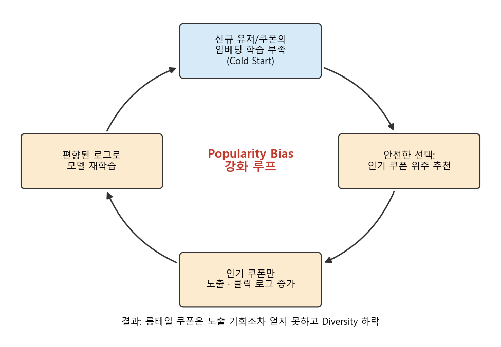
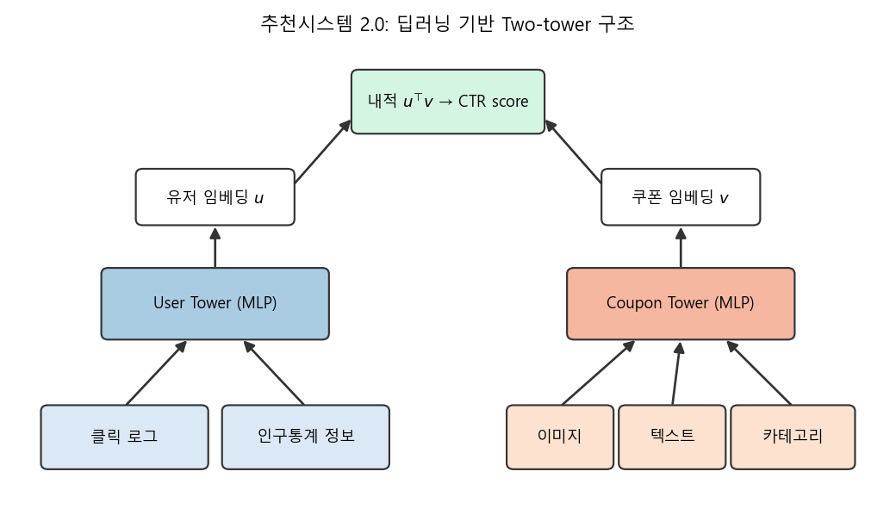
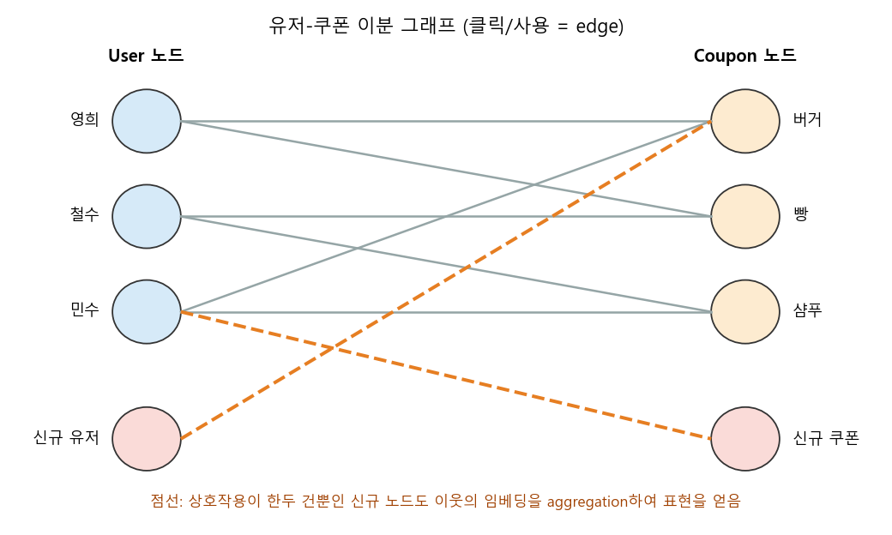
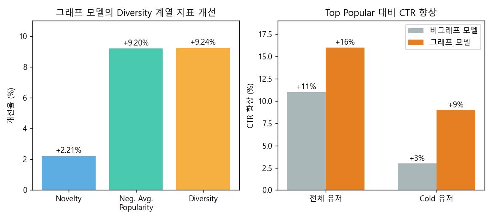
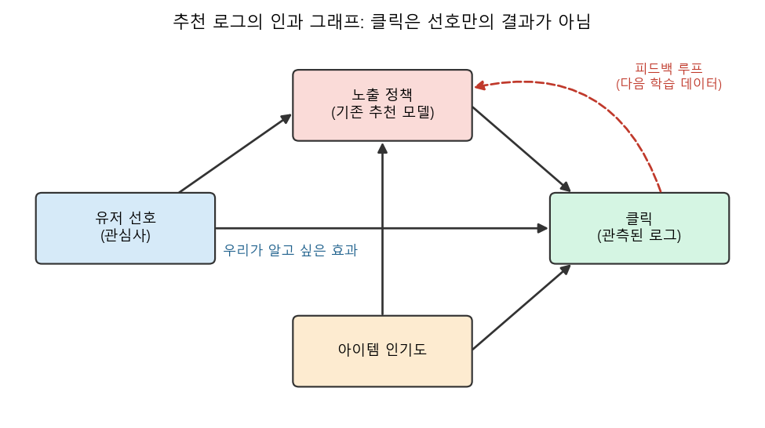

### 딥러닝 기반 추천(2.0)의 한계를 넘어, 그래프와 바이어스, 인과관계로 나아가는 추천시스템 3.0에 대해 알아봅니다.

> **추천시스템 3.0: 딥러닝 후기시대에서 바이어스, 그래프, 그리고 인과관계의 중요성**  
> 김경민, 곽하녹, 박영진, 김민규 (NAVER CLOVA) / NAVER DEVIEW 2020

   

 

>  **1. 딥러닝 기반 추천(추천시스템 2.0)은 대규모 로그와 멀티모달 정보를 잘 활용하지만, 정보가 부족한 신규 유저/아이템(cold start)에는 취약함**
>
>  **2. cold start가 반복되면 인기 아이템만 반복 추천되는 popularity bias의 악순환이 생기고, 이는 Diversity 하락으로 이어짐**
>
>  **3. LINE 쿠폰 추천에서는 유저-쿠폰 로그를 그래프로 엮고 GNN으로 이웃 정보를 활용함으로써, CTR과 Diversity를 동시에 개선함 (Top Popular 대비 CTR +16%, cold 유저 +9%)**

 

----

**본 포스트는 NAVER DEVIEW 2020의 "추천시스템 3.0" 발표 영상을 보고 정리한 노트입니다.**
영상은 [여기](https://tv.naver.com/v/16970750)에서, 세션 소개는 [여기](https://deview.kr/2020/sessions/356)에서 보실 수 있습니다.

----
#### Contents

1. [들어가며 - 추천시스템 3.0이란?](#intro)
2. [LINE 쿠폰과 추천시스템 2.0](#background)
3. [딥러닝 추천의 난제: Cold Start와 Popularity Bias](#problem)
4. [그래프로 모든 로그를 엮자!](#gnn)
5. [온라인 테스트 결과](#result)
6. [바이어스와 인과관계, 그래프 다음의 이야기](#causal)
7. [마치며](#conclusion)
 

## 1. 들어가며 - 추천시스템 3.0이란?

DEVIEW 2020에서 NAVER CLOVA 팀이 발표한 세션의 제목은 꽤 도발적입니다. "딥러닝 **후기**시대"라니요. 딥러닝이 추천 성능을 크게 끌어올린 것은 맞지만, 그것만으로는 풀리지 않는 문제들이 분명히 존재한다는 이야기인데요.

발표자들은 대략 다음과 같이 추천시스템의 세대를 나눕니다.

- **추천시스템 1.0**: 인기 아이템 추천, 협업 필터링(CF), Matrix Factorization 등 고전적인 방법론
- **추천시스템 2.0**: CNN, RNN, MLP 등 딥러닝을 이용해 대규모 로그와 이미지/텍스트 같은 부가 정보를 함께 학습하는 방법론
- **추천시스템 3.0**: 2.0의 한계를 넘기 위해 **바이어스(bias), 그래프(graph), 인과관계(causality)** 를 본격적으로 고려하는 방법론

세션 소개에 따르면 발표는 LINE Wallet의 추천 사례를 중심으로 세 파트로 구성되는데, (1) Wallet 탭 UI 추천에서의 bias reduction, (2) LINE 쿠폰 추천에서의 GNN 활용, (3) 온라인 지표를 오프라인에서 추정하기 위한 인과추론(counterfactual evaluation)이 그것입니다.

이번 포스트는 제가 가장 꼼꼼히 노트를 남긴 **두 번째 파트, GNN 기반 쿠폰 추천**을 중심으로 정리하고, 바이어스와 인과관계 이야기는 마지막에 간단히 연결해 보겠습니다.

 

## 2. LINE 쿠폰과 추천시스템 2.0

### LINE 쿠폰은 어떤 서비스일까?

- 라인 유저들에게 맥도날드, 롯데리아 같은 음식이나 샴푸 같은 생필품의 할인 쿠폰을 제공하는 서비스임
- 매일 약 500개의 쿠폰, 30여 개 이상의 브랜드가 제공됨
- 쿠폰은 유효기간이 있으므로, 아이템이 계속 새로 생기고 사라지는 매우 동적인 환경임

### 초창기 추천: 모두에게 같은 쿠폰을

초창기에는 **가장 인기가 많았던 쿠폰을 모든 유저에게 동일하게** 보여주었다고 합니다. 이른바 Top Popular 추천인데요, 단순하지만 의외로 강력한 baseline이라 지금도 많은 서비스의 fallback으로 쓰이죠.

이후 2020년 5월부터 CLOVA에서 개발한 개인화 추천 시스템을 본격적으로 도입했고, 발표 시점 기준 **약 6,000만 명의 라인 사용자에게 각 10여 개의 쿠폰**을 추천하고 있다고 합니다.

### 개인화 추천과 딥러닝

개인화 추천의 목표는 간단합니다. 유저의 과거 기록을 바탕으로, 그 유저가 다음에(혹은 내일) 좋아할 것으로 예상되는 쿠폰을 추천하는 것입니다. 버거를 좋아하는 영희에게는 버거 쿠폰을, 빵돌이 철수에게는 빵 쿠폰을 보여주는 식이죠.

최근 많은 온라인 서비스가 딥러닝 기반 추천을 시도하는 이유는 다음과 같습니다.

- 대규모 사용자 로그를 효과적으로 활용할 수 있음
- 유저/아이템의 멀티미디어 데이터(이미지, 카테고리, 텍스트 등)를 함께 사용할 수 있음

발표에서 소개한 기본 아키텍처는 흔히 말하는 **Two-tower** 구조입니다.

- 클릭 정보, 인구통계 정보를 이용해 **유저 임베딩** $u$를 얻음
- 쿠폰의 이미지, 텍스트, 카테고리 등으로 **쿠폰 임베딩** $v$를 얻음
- 두 임베딩을 내적해 유사도를 구하고, 이를 CTR score로 사용함

$$
\hat{y}_{uv} = \sigma\left(u^\top v\right)
$$

여기까지가 이른바 추천시스템 2.0의 전형적인 모습입니다. 그렇다면 무엇이 문제일까요?

 

## 3. 딥러닝 추천의 난제: Cold Start와 Popularity Bias

### Cold Start Problem

추천시스템의 영원한 숙제, **cold start**입니다. 새로운 개체(유저, 아이템)에 대한 정보가 충분하지 않은 상황을 말하는데요.

- 기존 딥러닝 기반 추천시스템은 각 개체의 정보가 부족할 때 학습이 잘 이루어지지 않음
- **신규 유저**의 임베딩이 잘 학습되지 않으면, 엉뚱한 쿠폰이 추천될 수 있음
- **신규 쿠폰**의 임베딩이 잘 학습되지 않으면, 그 쿠폰을 좋아할 만한 고객에게 적절히 노출되지 않아 CTR이 떨어짐

특히 쿠폰처럼 매일 새 아이템이 생기고 만료되는 도메인이라면, cold start는 가끔 생기는 예외가 아니라 **매일 마주치는 일상**이 됩니다.

### 악순환: 인기 쿠폰만 계속 추천된다

진짜 문제는 이 상황이 반복될 때 생깁니다. 위 그림의 루프를 따라가 볼까요?

1. 신규 유저/쿠폰의 임베딩이 부정확함
2. 모델 입장에서 가장 "안전한" 선택은 이미 많이 클릭된 인기 쿠폰임
3. 인기 쿠폰만 노출되니, 로그에도 인기 쿠폰의 클릭만 쌓임
4. 이렇게 편향된 로그로 다시 학습하면 모델은 인기 쿠폰을 더 선호하게 됨

결국 과거의 popular item만 반복해서 추천하게 되고, 이는 **Diversity를 손상**시키는 결과로 이어집니다. 롱테일 쿠폰은 실력(?)을 보여줄 기회조차 얻지 못하는 셈이죠. 이렇게 추천 결과가 다시 학습 데이터가 되면서 편향이 증폭되는 현상은 [Preference Amplification 포스트](https://myeonghak.github.io/recommender%20systems/RecSys-Preference-Amplification/)에서 다룬 feedback loop 문제와도 맞닿아 있습니다.

 

## 4. 그래프로 모든 로그를 엮자!

CLOVA 팀의 목표는 **CTR과 Diversity, 두 마리 토끼를 모두 잡는 것**이었습니다. 이를 위해 택한 방법이 바로 그래프입니다.

### 유저-쿠폰 그래프 만들기

- 각 유저와 쿠폰을 **노드**로 표현함
- 특정 유저가 특정 쿠폰을 클릭/사용했다면 두 노드 사이에 **엣지**가 있는 것으로 간주함

이렇게 만들면 유저와 쿠폰이 양쪽으로 나뉜 **이분 그래프(bipartite graph)** 가 됩니다.

### 그래프 기반 추천 시스템의 구조

발표에서 소개한 구조는 기존 2.0의 자산을 버리지 않고, 그 위에 그래프를 얹는 방식입니다.

1. MLP 기반으로 유저/쿠폰 임베딩을 학습함 (앞의 two-tower와 동일)
2. 이 임베딩을 바로 예측에 쓰지 않고, **그래프 노드의 초기 벡터값**으로 사용함
3. 로그(클릭/사용) 정보를 노드 간의 관계로 사용하여, 노드 임베딩을 업데이트할 때 **이웃 노드의 정보가 활용**되게 함

3번을 조금 더 구체적으로 써 보면, 일반적인 GNN의 message passing은 다음과 같은 형태입니다. (발표에서 구체적인 레이어 수식을 공개하지는 않았기 때문에, 이해를 돕기 위해 표준적인 형태로 적어 보았습니다.)

$$
h_u^{(0)} = \mathrm{MLP}_{user}(x_u), \qquad h_v^{(0)} = \mathrm{MLP}_{coupon}(x_v)
$$

$$
h_u^{(l+1)} = \phi\left(h_u^{(l)},\ \sum_{v \in \mathcal{N}(u)} \alpha_{uv}\, W^{(l)} h_v^{(l)}\right)
$$

여기서 $\mathcal{N}(u)$는 유저 $u$가 클릭/사용한 쿠폰 집합, $\alpha_{uv}$는 이웃별 가중치(attention 등)입니다. 최종 점수는 마지막 레이어의 $h_u^{(L)}$, $h_v^{(L)}$를 내적해서 구하게 되죠.

### "연결"을 학습한다는 것의 의미

발표에서 강조한 차이는 다음과 같습니다.

- 기존 딥러닝: 각 개체의 임베딩 벡터가 **그 개체에 주어진 데이터만으로** 학습됨
- GNN: **연결 정보를 바탕으로 주변 이웃의 정보를 선택적으로** 학습함

이 차이가 cold start에서 결정적인데요. 쿠폰 서비스에서는 시간이 흐르면서 새로운 유저가 등장/탈퇴하고, 새로운 쿠폰이 생성되고 만료됩니다.

- 기존 딥러닝 구조라면 이런 변화를 반영하기 위해 **매일 모델 파라미터를 재학습**해야 했음
- 게다가 재학습을 하더라도 해당 개체의 interaction이 일정량 쌓이기 전까지는 적절한 임베딩을 얻을 수 없었음
- GNN에서는 신규 유저가 쿠폰 하나만 눌러도, 그 쿠폰과 연결된 다른 유저들의 정보까지 aggregation해 임베딩을 보정할 수 있음
- 즉, **연결 정보만으로 신규 유저/아이템의 표현을 효과적으로 얻을 수 있어** cold start 문제를 완화함

위 그림의 "신규 유저"는 버거 쿠폰 하나만 클릭했지만, 버거 쿠폰을 거쳐 영희, 민수의 취향 정보까지 전달받을 수 있습니다. "친구를 보면 그 사람을 안다"는 말을 그대로 모델로 옮긴 셈이죠. 또한 새 쿠폰이 추가되더라도 그래프에 노드와 엣지를 붙이면 되니, inductive하게 새로운 노드를 다루기에도 유리합니다.

GNN 기반 추천의 다른 사례가 궁금하신 분은 [우버 이츠가 GNN으로 메뉴 추천 하는 방법](https://myeonghak.github.io/recommender%20systems/RecSys-%EC%9A%B0%EB%B2%84-%EC%9D%B4%EC%B8%A0%EA%B0%80-GNN%EC%9C%BC%EB%A1%9C-%EB%A9%94%EB%89%B4-%EC%B6%94%EC%B2%9C-%ED%95%98%EB%8A%94-%EB%B0%A9%EB%B2%95/)과 [HAN(Heterogeneous Graph Attention Networks) 리뷰](https://myeonghak.github.io/recommender%20systems/RecSys-Heterogeneous-Graph-Attention-Networks-paper-review/)도 함께 보시면 좋겠습니다.

 

## 5. 온라인 테스트 결과

결과는 온라인 테스트 기준으로 공개되었습니다.

### 추천 비율의 변화

- 비그래프 모델에 비해, 그래프 모델의 추천 결과에서 **popular item이 차지하는 비중이 줄어듦**

### Diversity 계열 지표

| 지표 | 의미 | 그래프 모델 개선율 |
| --- | --- | --- |
| Novelty | 유저에게 얼마나 새로운(덜 알려진) 아이템을 추천했는가 | +2.21% |
| Negative Average Popularity | 추천 아이템 평균 인기도의 음수 (높을수록 덜 인기 위주) | +9.20% |
| Diversity | 추천 리스트가 얼마나 다양한 아이템으로 구성되는가 | +9.24% |

### CTR

| 비교 (Top Popular 대비 CTR 향상) | 비그래프 모델 | 그래프 모델 |
| --- | --- | --- |
| 전체 유저 | +11% | **+16%** |
| Cold 유저 | +3% | **+9%** |

개인적으로 가장 인상적인 숫자는 **cold 유저**입니다. 비그래프 모델은 cold 유저에게 Top Popular보다 겨우 3% 나은 수준이었는데요, 정보가 없으니 사실상 인기 추천과 비슷하게 동작했다고 볼 수 있겠죠. 반면 그래프 모델은 9%로 세 배 가까운 개선을 보였습니다.

보통 Diversity를 올리면 CTR은 손해를 보는 trade-off가 있다고 생각하기 쉬운데, 이 사례에서는 **cold start를 제대로 풀었더니 두 지표가 함께 좋아졌다**는 점이 핵심입니다. 인기 쿠폰으로 "도망가던" 추천이 줄어들면서, 다양성과 정확성이 동시에 올라간 것이죠.

 

## 6. 바이어스와 인과관계, 그래프 다음의 이야기

이 부분은 제 노트가 상대적으로 빈약한 파트라, 발표의 문제의식을 바탕으로 제 이해를 덧붙여 정리해 보겠습니다.

그래프로 cold start를 완화했다고 해서 바이어스 문제가 모두 사라지는 것은 아닙니다. 추천 로그는 근본적으로 **"보여준 것"에 대한 반응**만 기록하기 때문인데요. 클릭이 일어나는 과정을 인과 그래프로 그려 보면 아래와 같습니다.

- 우리가 알고 싶은 것은 **유저 선호 → 클릭**의 효과임
- 그러나 실제 클릭은 노출 정책(기존 추천 모델)과 아이템 인기도의 영향을 함께 받음
- 노출 정책 자체가 유저 선호와 인기도에 의존하므로, 관측된 클릭과 선호 사이에는 **confounding**이 존재함
- 게다가 클릭 로그는 다시 다음 모델의 학습 데이터가 되어 루프를 형성함

그래서 "많이 클릭됐다 = 좋아한다"라고 단순히 해석하면 **exposure bias, position bias, popularity bias** 등을 그대로 학습하게 됩니다. 상관관계와 인과관계를 구분해야 하는 이유는 [상관관계와 인과관계 포스트](https://myeonghak.github.io/causal%20inference/Causal-Inference-%EC%83%81%EA%B4%80%EA%B4%80%EA%B3%84%EC%99%80-%EC%9D%B8%EA%B3%BC%EA%B4%80%EA%B3%84/)에서 정리한 바 있습니다.

이를 다루는 대표적인 접근은 다음과 같습니다.

- **Bias reduction**: 노출 확률(propensity)로 관측 데이터를 재가중하는 IPS(Inverse Propensity Scoring) 등으로 학습 데이터의 편향을 보정함
- **Counterfactual evaluation**: "만약 새 모델로 추천했다면 어떤 결과가 나왔을까?"를 기존 정책의 로그만으로 추정함 (off-policy evaluation). 온라인 A/B 테스트 전에 오프라인에서 온라인 성능을 가늠하는 데 쓰임
- **Exploration**: [MAB](https://myeonghak.github.io/recommender%20systems/RecSys-Multi-Armed-Bandits%28MAB%29/)처럼 일부 트래픽을 탐색에 써서, 애초에 편향되지 않은 데이터를 확보함

예를 들어 IPS 추정량은 기존 정책 $\pi_0$ 하에서 수집한 로그로 새 정책 $\pi$의 기대 보상을 다음과 같이 추정합니다.

$$
\hat{V}(\pi) = \frac{1}{n}\sum_{i=1}^{n} \frac{\pi(a_i \mid x_i)}{\pi_0(a_i \mid x_i)}\, r_i
$$

자주 노출된 아이템은 작은 가중치를, 드물게 노출된 아이템은 큰 가중치를 받게 되어 "노출 기회의 차이"를 보정하는 원리입니다.

결국 추천시스템 3.0이 말하는 바는, 더 깊은 네트워크보다 **데이터가 어떻게 만들어졌는지(bias), 개체들이 어떻게 연결되어 있는지(graph), 추천이 실제로 어떤 효과를 냈는지(causality)** 를 이해하는 것이 다음 단계라는 것으로 정리할 수 있겠습니다.

 

## 7. 마치며

발표의 GNN 파트를 요약하면 다음과 같습니다.

- GNN 기반 개인화 추천 시스템을 LINE 쿠폰에 적용함
- 유저-쿠폰 로그를 그래프로 엮어 이웃 정보를 활용함으로써 cold start 문제를 완화함
- 그 결과 CTR과 Diversity를 동시에 개선함 (특히 cold 유저 CTR에서 큰 개선)

[쿠팡 추천시스템 발표](https://myeonghak.github.io/recommender%20systems/RecSys-%EC%BF%A0%ED%8C%A1-%EC%B6%94%EC%B2%9C%EC%8B%9C%EC%8A%A4%ED%85%9C-%EB%B3%80%EC%B2%9C%EC%82%AC/)가 "복잡한 모델보다 시스템과 피처가 중요하다"는 교훈을 줬다면, 이 발표는 "모델을 키우기 전에 **데이터가 어떻게 생겨먹었는지**부터 보라"는 교훈을 준 것 같습니다. 인기 쿠폰만 도는 추천 결과를 보면서 "역시 사람들은 맥도날드를 좋아하는구나" 하고 넘어가기 쉬운데, 사실은 우리 모델이 맥도날드만 보여줬기 때문일 수도 있다는 것이죠.

개인적으로는 2.0의 two-tower 임베딩을 버리지 않고 그래프 노드의 초기값으로 재활용한 설계가 실무적으로 매우 현명해 보였습니다. 이미 잘 돌아가는 시스템 위에 그래프를 한 층 얹는 방식이라, 기존 자산을 살리면서 점진적으로 개선할 수 있으니까요. 다음에는 발표의 나머지 파트인 bias reduction과 counterfactual evaluation도 조금 더 깊게 공부해 보고 싶습니다.

----------------

**개선을 위한 여러분의 피드백과 제안을 코멘트로 공유해 주세요.**
**내용에 대한 지적, 혹은 질문을 환영합니다.**  

**출처**  
[NAVER DEVIEW 2020, 추천시스템 3.0: 딥러닝 후기시대에서 바이어스, 그래프, 그리고 인과관계의 중요성 (발표 영상)](https://tv.naver.com/v/16970750)  
[DEVIEW 2020 세션 소개](https://deview.kr/2020/sessions/356)  
