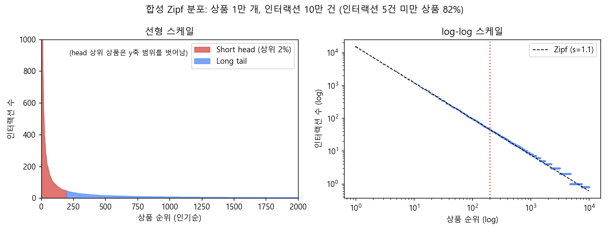
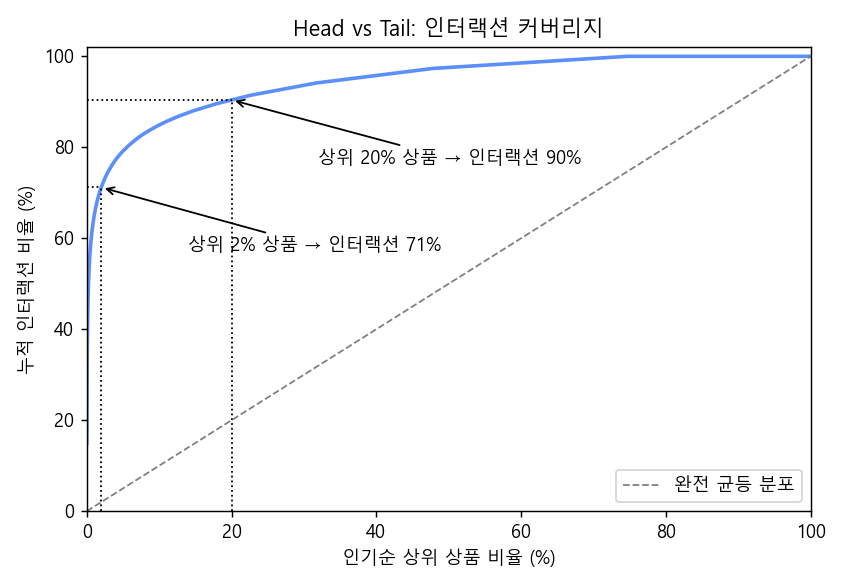
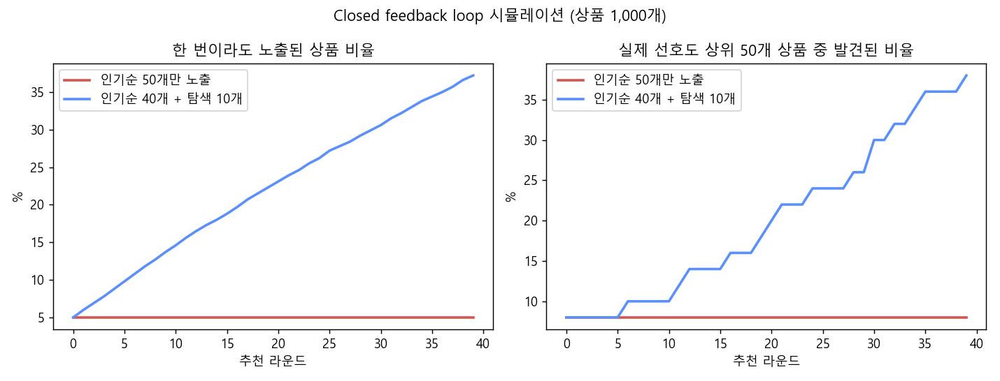
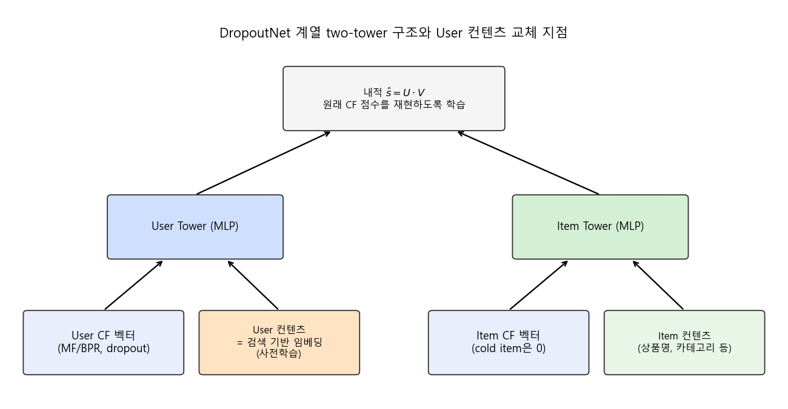

### 이력이 없는 롱테일 상품을 어떻게 추천할 수 있을까? 네이버 쇼핑의 cold item 추천 사례를 알아봅니다.


> [Commerce AI] Deep Dive into Longtail E-commerce Recommendation  
> 김충기, 김동현 (NAVER), 네이버 검색 콜로키움 2022 Commerce AI 세션 발표

<center></center>   

<br/>


>  **1. 이커머스 상품의 대부분은 이력이 거의 없는 long tail에 속하고, 이력 기반 추천은 closed feedback loop를 통해 이 쏠림을 더욱 강화함**
>
>  **2. Item2Item에서는 상품 쌍의 관계를 BERT의 entailment(문장쌍 분류) 문제로 바꾸고, 10분 내 함께 조회된 상품으로 만든 pos/neg 쌍에 이력 정보를 녹여 Meta-Prod2Vec 대비 큰 개선을 얻음**
>
>  **3. User2Item에서는 DropoutNet 계열 two-tower 모델의 빈약한 user 컨텐츠 피처를 검색 이력 기반 user 임베딩으로 교체해 6~8% 수준의 성능 개선을 얻음**

<br/>

----

**본 포스트는 네이버 검색 콜로키움 2022의 발표 영상을 보고 정리한 노트입니다.**
영상은 여기에서 보실 수 있습니다. [link](https://tv.naver.com/v/26687146)

----
#### Contents

1. [들어가며](#intro)
2. [왜 롱테일 상품은 추천되지 않을까?](#longtail)
3. [Cold-start를 푸는 기존의 방법과 현실의 벽](#coldstart)
4. [Item2Item: 상품 쌍을 문장 쌍처럼 다뤄보자!](#item2item)
5. [Item2Item의 핵심은 결국 데이터셋](#dataset)
6. [User2Item: cold item을 사용자에게 추천하기](#user2item)
7. [검색 이력으로 더 나은 User 정보 만들기](#userinfo)
8. [마치며](#conclusion)
<br />

<a id="intro"></a>
## 1. 들어가며

예전에 [쿠팡 추천시스템 변천사](https://myeonghak.github.io/recommender%20systems/RecSys-%EC%BF%A0%ED%8C%A1-%EC%B6%94%EC%B2%9C%EC%8B%9C%EC%8A%A4%ED%85%9C-%EB%B3%80%EC%B2%9C%EC%82%AC/)를 정리하면서, 대규모 커머스의 추천은 화려한 모델보다 스케일과 피처의 싸움이라는 이야기를 한 적이 있는데요. 이번에 정리할 발표 역시 그 연장선에 있는 내용입니다. 네이버 쇼핑처럼 사용자가 천만 단위, 상품이 백만 단위를 넘어가는 환경에서 **"이력이 없는 상품(cold item)을 어떻게 추천할 것인가"** 라는, 추천을 해 본 사람이라면 누구나 한 번쯤 머리를 싸맸을 문제를 다룹니다.

발표는 크게 두 파트로 구성되어 있습니다.

- **Item2Item**: 특정 상품과 연관된 상품을 찾아주는 모델 (상품 상세 페이지의 "이 상품과 함께 본 상품" 같은 지면)
- **User2Item**: 사용자에게 cold item을 직접 추천하는 모델

논문 수준의 아이디어를 실서비스 규모에 적용할 때 어떤 일이 벌어지는지, 그리고 그 과정에서 어떤 선택을 했는지를 엿볼 수 있는 좋은 발표였습니다. 추천시스템의 큰 흐름 속에서 이 문제가 어디쯤 위치하는지 궁금하신 분은 [추천시스템 3.0](https://myeonghak.github.io/recommender%20systems/RecSys-%EC%B6%94%EC%B2%9C%EC%8B%9C%EC%8A%A4%ED%85%9C-3.0/) 포스트도 함께 보시면 좋겠습니다.

<br/>

<a id="longtail"></a>
## 2. 왜 롱테일 상품은 추천되지 않을까?

추천 모델은 기본적으로 **과거의 기록**을 이용합니다. 협업 필터링(CF)이든 시퀀스 모델이든, 충분한 수의 클릭/구매 이력이 쌓여야 그 상품의 임베딩을 제대로 학습할 수 있죠. 문제는 이커머스의 상품 인기도가 극단적으로 치우쳐 있다는 점입니다.

맨 위의 그림은 순위 $r$인 상품의 인기도가 $p(r) \propto r^{-s}$를 따르는 Zipf 분포($s=1.1$)에서 상품 1만 개에 인터랙션 10만 건을 뿌려 본 합성 데이터인데요. 선형 스케일에서 보면 소수의 head 상품이 인터랙션을 휩쓸고, 나머지는 바닥에 납작하게 깔려 있습니다. 이 합성 데이터에서는 **전체 상품의 82%가 인터랙션 5건 미만**이었습니다. 이 정도 이력으로는 CF 임베딩을 학습하기가 사실상 어렵겠죠.

<center></center>   

<br/>

누적 커버리지로 다시 보면 더 극명합니다. 상위 2%의 상품이 전체 인터랙션의 71%를, 상위 20%가 90%를 차지하고 있습니다. 흔히 말하는 파레토 법칙보다도 더 가파른 모양인데요, 실제 커머스 로그에서도 이런 모양은 흔하게 관찰됩니다.

- **Short head & long tail**: 소수의 인기 상품(head)이 대부분의 인터랙션을 차지하고, 대다수 상품(tail)은 이력이 거의 없음
- **Closed feedback loop**: 이력이 있는 상품만 추천되고, 사용자는 추천된 상품만 소비하기 때문에 다시 그 상품의 이력만 쌓이는 악순환이 반복됨. 결과적으로 신규 상품의 노출 기회가 구조적으로 제한됨

closed feedback loop가 얼마나 무서운지 간단한 시뮬레이션으로 확인해 보았습니다. 상품 1,000개 중 50개에만 초기 이력이 있는 상태에서, 매 라운드 "클릭 수 상위 50개"만 노출하는 정책과 "상위 40개 + 무작위 탐색 10개"를 노출하는 정책을 비교한 것입니다.

<center></center>   

<br/>

인기순으로만 노출하면 40라운드가 지나도 노출되는 상품은 처음 그 5%에서 한 발짝도 벗어나지 못하고, 실제로 사용자가 가장 좋아할 상위 50개 상품 중 8%만 발견됩니다. 반면 약간의 탐색만 섞어도 커버리지와 "숨은 명품"의 발견 비율이 꾸준히 올라가죠. 물론 무작위 탐색은 그만큼 단기 성과를 깎아 먹기 때문에, **이력 없이도 "이 상품이 괜찮을지"를 예측할 수 있는 모델**이 필요해집니다. 이것이 바로 cold-start 추천의 출발점입니다.

<br/>

<a id="coldstart"></a>
## 3. Cold-start를 푸는 기존의 방법과 현실의 벽

학계에서 많이 쓰이는 cold-start 해법의 큰 틀은 다음과 같습니다.

- 충분한 이력을 가진 유저/아이템에 대해 CF 임베딩을 먼저 학습함
- 상품의 컨텐츠 정보(상품명, 이미지, 카테고리 등)를 인코더에 통과시켜 새로운 임베딩을 생성함
- **컨텐츠로 만든 임베딩이 이력으로 만든 CF 임베딩과 같아지도록** 최적화함
- 학습이 끝나면, 이력이 없는 아이템도 컨텐츠 정보만으로 "CF 임베딩 비슷한 것"을 얻을 수 있어 추천이 가능해짐

일종의 knowledge distillation처럼 CF 공간으로 컨텐츠를 매핑하는 아이디어인데요. 깔끔하지만 실제로 적용하려니 벽에 부딪혔다고 합니다.

- 연구 논문에서는 보통 수만~수십만 건의 인터랙션을 사용하는 반면, 네이버 쇼핑은 유저가 1,000만 명, 아이템이 100만 개를 훌쩍 넘음
- 이 규모에서는 GPU 메모리에 올리는 것부터 쉽지 않고, 학습 시간도 서비스 주기에 맞추기 어려움

논문의 표에 찍힌 숫자와 서비스 환경 사이의 간극, 실무를 해 보신 분들이라면 크게 공감하실 부분입니다.

<br/>

<a id="item2item"></a>
## 4. Item2Item: 상품 쌍을 문장 쌍처럼 다뤄보자!

### AS-IS: Meta-Prod2Vec

기존 Item2Item 모델은 [Meta-Prod2Vec](https://arxiv.org/abs/1607.07326)(Vasile et al., RecSys 2016)을 적용한 형태였습니다.

- Prod2Vec은 사용자의 상품 시퀀스를 "문장"으로 보고 word2vec(skip-gram)을 적용해 상품 임베딩을 학습하는 방식임
- Meta-Prod2Vec은 여기에 상품명, 브랜드, 카테고리 같은 메타 정보를 side-information으로 추가해 하나의 임베딩을 만듦
- 함께 클릭된 상품끼리 cosine similarity가 높아지도록 최적화함

### 개선하고 싶었던 점

1. **임베딩 방식의 한계**
	- word2vec 기반이라 BERT처럼 문맥에 따라 달라지는(context-sensitive) 표현을 학습할 수 없음
	- 상품명 토큰의 임베딩이 "연관 상품 찾기"라는 목적 task에 맞게 학습되지 않음
2. **Cold item에는 CF 임베딩이 없음**
	- 결국 cold item은 컨텐츠 정보만으로 임베딩을 만들고, 컨텐츠 간 유사도만으로 추천하게 됨
	- 즉 사용자 이력이 담고 있는 "사람들이 실제로 무엇을 함께 보는가"라는 정보를 cold item에서는 활용하지 못함
	- 그래서 컨텐츠 정보만 입력받더라도 **이력의 패턴을 내재화**한 모델을 만들고자 함

### Entailment task에서 착안하기

여기서 나온 아이디어가 재밌는데요, 두 상품의 연관성을 판단하는 문제를 NLP의 **entailment task**로 바꿔 본 것입니다.

- Entailment(NLI) task: 전제(premise) 문장이 주어졌을 때 가설(hypothesis) 문장이 함의(entail)되는지, 모순(contradict)되는지를 분류하는 문제
- BERT는 사전학습 단계에서 NSP(Next Sentence Prediction), 즉 두 문장의 관계를 판단하는 과제를 수행하기 때문에 문장쌍 사이의 유효한 context를 잘 뽑아냄
- 상품명도 결국 여러 토큰으로 구성된 자연어 시퀀스임
- 따라서 `[CLS] 상품A 정보 [SEP] 상품B 정보 [SEP]` 형태로 입력하면, BERT가 두 상품의 연관성을 잘 분류할 수 있을 것이라 기대함

두 상품을 각각 따로 인코딩해서 내적하는 bi-encoder가 아니라, 두 상품을 한 번에 넣고 토큰 수준에서 서로를 attend하게 하는 cross-encoder 방식이라고 볼 수 있겠습니다. "나이키 에어맥스 270"과 "나이키 운동화 끈"처럼 토큰은 많이 겹치지만 관계가 전혀 다른 쌍을 구분하는 데 확실히 유리하겠죠. 다만 cross-encoder는 모든 상품 쌍을 다 계산할 수 없으니, 실서비스에서는 후보를 먼저 추린 뒤 재정렬(re-ranking)하는 식으로 쓰는 것이 일반적입니다. 이 부분은 발표에서 자세히 다루지는 않았습니다.

<br/>

<a id="dataset"></a>
## 5. Item2Item의 핵심은 결국 데이터셋

개인적으로 이 발표에서 가장 와닿았던 부분인데요. 발표자분들도 이렇게 강조합니다.

> 실무에서 ML 모델을 실험하다 보면, 모델 자체의 튜닝보다 **데이터셋의 튜닝에서 더 큰 차이**가 나는 경우가 흔하다. 다른 모델로 바꾸는 것보다 pos/neg 비중을 조절하는 것이 더 큰 성능 차이를 만들었다.

그럼 데이터셋은 어떻게 만들었을까요?

**Positive pair**
- 각 유저가 **10분 이내에 함께 조회한 상품**을 positive pair로 간주함
- 이 10분이라는 기준은 구매전환율, 카테고리 변화 등을 분석해 산정함 (너무 길면 쇼핑 의도가 바뀐 상품까지 엮이고, 너무 짧으면 쌍이 부족해짐)
- 어뷰징 유저, 카테고리별 상품 분포 차이, 과도한 인기 상품처럼 "진짜" positive를 오염시키는 요소가 있어 카테고리 제한, 노출 편향(exposure bias) 제거 등을 추가로 적용함

**Negative pair**
- positive pair의 seed 상품을 기준으로, 10분 내 함께 클릭되지 않은 상품 중 **노출은 많이 된 상품**을 선택함
- 노출이 많았는데도 클릭되지 않았다는 것은 "보여줬는데 선택받지 못했다"는 신호이므로, 무작위 negative보다 훨씬 informative한 hard negative에 가까움

**이력 정보 녹이기**
- 같은 seed 상품에 대해 여러 개의 pos/neg pair를 구성함
- 이렇게 하면 모델이 상품 텍스트만 보더라도 "이 seed와 사람들이 함께 보는 상품은 이런 특성을 가진다"는, CF처럼 이력에 숨은 피처를 학습하게 됨

cold item이라도 상품명과 카테고리는 있으니, 학습된 모델에 넣기만 하면 이력 기반 연관성을 흉내 낸 점수를 얻을 수 있다는 것이 핵심 포인트입니다.

positive pair를 만드는 로직을 아주 단순화하면 아래와 같은 모습이 됩니다. (실제로는 위에서 말한 필터링이 잔뜩 붙겠죠)

```python
import pandas as pd

logs = pd.DataFrame({
    "user": ["u1", "u1", "u1", "u1", "u2", "u2", "u2"],
    "item": ["A", "B", "C", "D", "A", "B", "E"],
    "ts": pd.to_datetime(["10:00", "10:04", "10:09", "10:30",
                          "21:00", "21:02", "21:15"], format="%H:%M"),
})

window = pd.Timedelta(minutes=10)
pairs = logs.merge(logs, on="user", suffixes=("_seed", "_pos"))
pairs = pairs[(pairs.item_seed != pairs.item_pos)
              & (pairs.ts_pos > pairs.ts_seed)
              & (pairs.ts_pos - pairs.ts_seed <= window)]
print(pairs[["user", "item_seed", "item_pos"]].to_string(index=False))
```

```
user item_seed item_pos
  u1         A        B
  u1         A        C
  u1         B        C
  u2         A        B
```

u1이 30분에 본 D, u2가 15분 뒤에 본 E는 10분 window를 벗어나 쌍에서 빠진 것을 볼 수 있습니다. A-B 쌍처럼 여러 유저에게서 반복해서 등장하는 쌍이 바로 이력이 말해주는 강한 연관성이고, 이런 빈도를 가중치나 샘플링 비율로 활용할 수도 있겠습니다.

### 결과

- 정량 평가에서 MPV(Meta-Prod2Vec) 대비 큰 폭의 성능 개선을 얻음
- 내부 데모를 통한 정성 평가에서도 entailment 기반 모델이 사용자의 의도를 더 잘 반영한 결과를 보여줌

<br/>

<a id="user2item"></a>
## 6. User2Item: cold item을 사용자에게 추천하기

이제 상품-상품이 아니라 **사용자에게 cold item을 바로 추천**하는 문제입니다. 이력이 전혀 없는 아이템에 대해 쓸 수 있는 거의 유일한 정보는 사용자와 아이템의 side-information이죠. 발표에서 검토한 대표적인 모델은 다음 두 가지입니다.

- **[DropoutNet](https://papers.nips.cc/paper/2017/hash/dbd22ba3bd0df8f385bdac3e9f8be207-Abstract.html)** (Volkovs et al., NeurIPS 2017)
	- 유저 tower와 아이템 tower에 각각 [CF 벡터, 컨텐츠 피처]를 넣는 two-tower 구조
	- 학습 시 CF 벡터 입력을 일정 확률로 0으로 지워버리는(dropout) 것이 핵심. 그러면 모델은 CF 벡터가 없을 때 컨텐츠만으로 원래의 CF 점수를 재현하도록 학습됨
	- 이렇게 학습된 모델은 cold item이 들어오면 CF 벡터 자리를 0으로 두고 컨텐츠만으로 추천할 수 있음
- **[SharedReps](https://raminraziperchikolaei.github.io/Ramin_files/RecSys21.pdf)** (Raziperchikolaei et al., RecSys 2021, "Shared Neural Item Representations for Completely Cold Start Problem")
	- two-branch 구조에서는 아이템 표현이 아이템 네트워크의 출력과 유저 네트워크 내부(상호작용 벡터의 가중치)에 이중으로 학습된다는 점을 지적함
	- 이를 하나로 통일(weight share)해 구조를 단순화하고, 더 빠르게 수렴하면서 recall도 개선함

여기서도 현실의 벽이 등장합니다. 데이터 규모가 커지면 대부분의 모델이 제대로 학습되지 않았고, GNN 계열 모델은 scalability 문제로 아예 후보에서 제외했다고 합니다. 결국 상대적으로 단순하고 확장성이 좋은 two-tower 모델을 택했습니다.

<center></center>   

<br/>

### 대규모 데이터셋에 적용해 보기

두 가지 실제 데이터셋으로 실험했습니다.

| 데이터셋 | 유저 수 | 아이템 수 | cold item |
|---|---|---|---|
| Shopping (Fashion) | 1M | 1M | 1만 |
| Shopping (All) | 3M | 4M | 1만 |

- 학습 단계에서 MF/BPR 등으로 만든 CF 벡터가 필요하기 때문에, 이 벡터가 의미 있게 학습될 만큼 일정 수 이상의 인터랙션을 가진 유저/아이템만 선정함
- cold item 1만 개는 기존 아이템의 인터랙션을 모두 삭제해 만든 "가상의" cold item임 (정답을 알고 있는 상태에서 cold-start 상황을 재현하는 일반적인 평가 방식)
- 이 정도 규모에서도 모델들이 적정 수준의 recall에 도달하는 것을 확인해, 학계 벤치마크보다 훨씬 큰 데이터셋에서도 유효함을 검증함

<br/>

<a id="userinfo"></a>
## 7. 검색 이력으로 더 나은 User 정보 만들기

실험을 하면서 눈에 띈 불균형이 하나 있었는데요. **아이템은 쓸 수 있는 컨텐츠 정보가 풍부한 반면, 유저 피처는 성별과 연령 정도로 굉장히 빈약**했다는 점입니다. two-tower 구조에서 한쪽 tower가 이렇게 굶고 있으면 cold item에 대한 매칭 품질도 떨어질 수밖에 없겠죠.

이를 보충하기 위해 꺼내 든 카드가 **검색 데이터**입니다. 포털이 가진 고유한 자산이니 차별점을 만들기에도 좋은 선택이죠.

- "general user representation"이라는 키워드로, 특정 task에 묶이지 않고 사용자 자체를 잘 표현하려는 연구들이 다수 존재함
- 사용자의 과거 검색 내역으로 사용자 임베딩을 만들고, 이 임베딩으로 **미래의 검색어를 맞히도록** 학습함
- 미래 행동을 예측하도록 학습된 표현이므로, 사용자의 관심사가 압축되어 담기게 됨

그리고 이렇게 사전학습한 user 임베딩을 DropoutNet의 **user 컨텐츠 입력 자리에 그대로 교체**했습니다. 위 그림에서 주황색 박스에 해당하는 부분입니다.

- 각 데이터셋에서 **6~8% 수준의 성능 개선**을 얻음
- 학습 시간도 소폭 감소함
- 한계: 검색을 거의 하지 않은 cold user는 커버하기 어려움. 다만 이번 과제의 목표는 cold item 추천 성능 향상이었으므로 cold user 문제는 향후 과제로 남겨 둠

모델 구조는 거의 건드리지 않고 **입력 피처 하나를 바꿨을 뿐인데** 의미 있는 개선이 나왔다는 점이 인상적입니다. Item2Item 파트의 "데이터셋 튜닝이 모델 튜닝보다 크다"는 교훈과도 일맥상통하는 결과네요.

<br/>

<a id="conclusion"></a>
## 8. 마치며

발표의 결론을 정리하면 다음과 같습니다.

- 콜드 아이템을 잘 추천하기 위해 Item2Item, User2Item 양쪽에서 여러 방법을 검토하고 개선해 나가고 있음
- 공개된 모델을 큰 데이터셋에 적용하거나, scalable한 모델을 새로 만드는 일은 매우 challenging함
- 앞으로도 모델 경량화, 통합 모델 개발 등의 과제가 남아 있음

개인적으로는 두 가지가 기억에 남습니다. 첫째, entailment라는 NLP의 문제 정의를 빌려와 상품 연관성 문제를 다시 정의한 발상입니다. 새로운 모델을 만드는 것보다 **기존에 잘 풀리는 문제의 모양으로 내 문제를 바꾸는 것**이 훨씬 효율적일 때가 많다는 걸 다시 느꼈습니다. 둘째, 두 파트 모두 결정적인 개선이 모델 구조가 아니라 **데이터(pos/neg 구성, 검색 기반 유저 피처)**에서 나왔다는 점입니다. 쿠팡 발표에서 얻었던 교훈을 다른 회사의 사례로 한 번 더 확인한 셈이네요.

롱테일 문제는 결국 "보여주지 않으면 데이터가 생기지 않고, 데이터가 없으면 보여줄 수 없다"는 닭과 달걀의 문제입니다. 컨텐츠 기반 cold-start 모델은 이 고리를 끊는 하나의 방법이고, 탐색(exploration)이나 노출 편향 보정 같은 방법과 함께 쓸 때 더 큰 힘을 발휘하리라 생각합니다.

----------------


**개선을 위한 여러분의 피드백과 제안을 코멘트로 공유해 주세요.**
**내용에 대한 지적, 혹은 질문을 환영합니다.**  


**출처**  
[[Commerce AI] Deep Dive into Longtail E-commerce Recommendation / 김충기, 김동현 (NAVER TV)](https://tv.naver.com/v/26687146)  
[Vasile et al., Meta-Prod2Vec: Product Embeddings Using Side-Information for Recommendation (RecSys 2016)](https://arxiv.org/abs/1607.07326)  
[Volkovs et al., DropoutNet: Addressing Cold Start in Recommender Systems (NeurIPS 2017)](https://papers.nips.cc/paper/2017/hash/dbd22ba3bd0df8f385bdac3e9f8be207-Abstract.html)  
[Raziperchikolaei et al., Shared Neural Item Representations for Completely Cold Start Problem (RecSys 2021)](https://raminraziperchikolaei.github.io/Ramin_files/RecSys21.pdf)  
[Devlin et al., BERT: Pre-training of Deep Bidirectional Transformers for Language Understanding (NAACL 2019)](https://arxiv.org/abs/1810.04805)  
