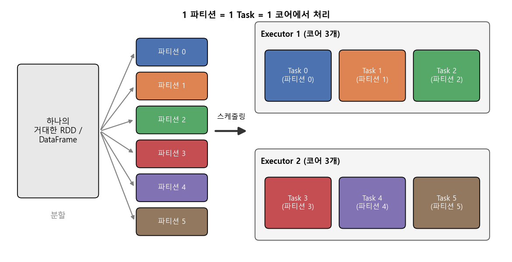
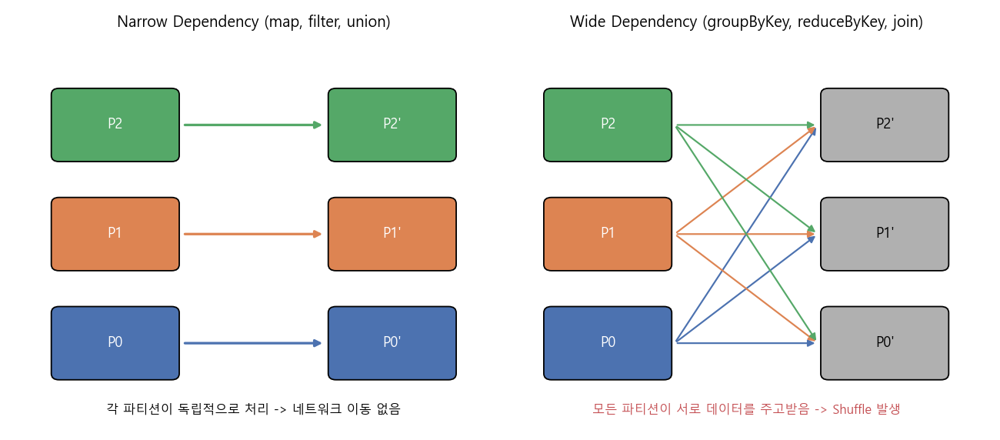
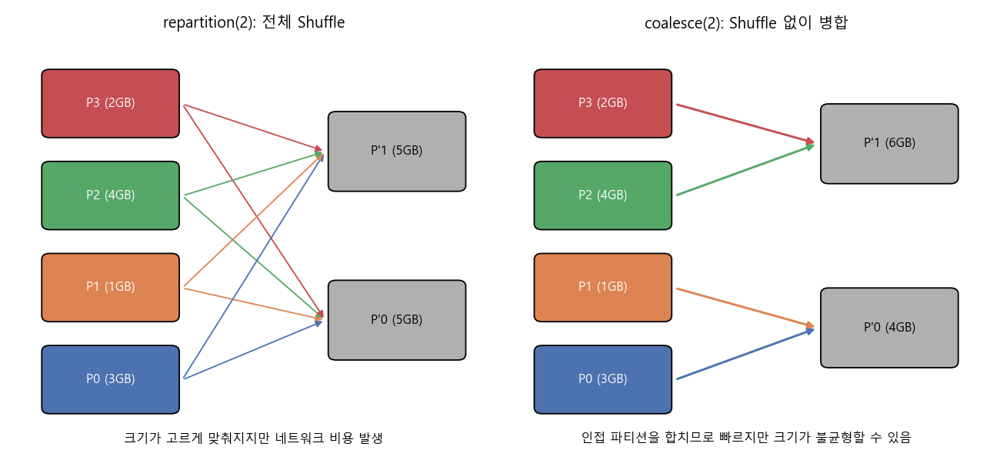
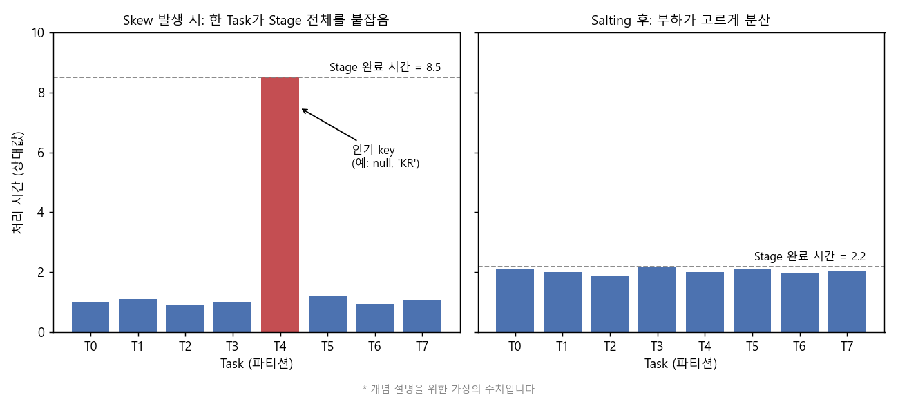

### Spark 병렬 처리의 기본 단위인 파티션과, 이를 잘 다루기 위한 repartition, coalesce, partitionBy, 그리고 Skew 대처법에 대해 알아봅니다.  


> **How Data Partitioning in Spark helps achieve more Parallelism?** (ProjectPro)  
> **빅데이터 051 인메모리 데이터 처리 기반 SW의 등장 외** (BigData Koo, YouTube 강의)  
> **Scaling Factorization Machines on Spark Using Parameter Servers** (Nick Pentreath, Spark Summit)  

<center></center>   

<br/>


>  **1. Spark에서 파티션은 병렬 처리의 원자 단위임. 파티션 1개가 Task 1개가 되어 코어 1개에서 처리되므로, 파티션의 개수와 크기가 곧 병렬화 수준을 결정함**
>
>  **2. 클러스터 환경에서 가장 비싼 비용은 네트워크를 타는 Shuffle임. 같은 key를 같은 파티션에 모아두면(partitionBy, co-partitioning) 이후의 join, groupBy에서 Shuffle을 줄일 수 있음**
>
>  **3. 파티션 수를 늘릴 땐 repartition, 줄일 땐 coalesce가 기본이며, 특정 key에 데이터가 몰리는 Skew는 salting, broadcast join, AQE 등으로 대처함**

<br/>

----

**본 포스트는 ProjectPro의 아티클과 빅데이터 강의, Spark Summit 발표를 보고 정리한 노트에 Spark 공식 문서의 내용을 보충한 글입니다.**
원문은 여기에서 보실 수 있습니다. [아티클](https://www.projectpro.io/article/how-data-partitioning-in-spark-helps-achieve-more-parallelism/297), [강의](https://www.youtube.com/watch?v=O35dLfyklm0), [발표](https://www.youtube.com/watch?v=91JLflBHvGs)

----
#### Contents

1. [들어가며 - 왜 내 Spark 잡은 느릴까?](#intro)
2. [파티션이란 무엇인가?](#partition)
3. [Shuffle - 병렬화의 가장 큰 적](#shuffle)
4. [파티션 수 조절하기: repartition vs coalesce](#repartition)
5. [같은 key는 같은 곳에: partitionBy](#partitionby)
6. [한 놈만 느리다: Data Skew](#skew)
7. [사례: Spark 위에서 Factorization Machine 스케일링하기](#fm)
8. [마치며](#conclusion)
<br />

<a id="intro"></a>
## 1. 들어가며 - 왜 내 Spark 잡은 느릴까?  

지난 [Pyspark 튜토리얼 포스트](https://myeonghak.github.io/big%20data/BigData-Pyspark-%ED%8A%9C%ED%86%A0%EB%A6%AC%EC%96%BC/)에서는 드라이버/워커 노드의 구조, 인메모리 컴퓨팅, 그리고 DataFrame을 Pandas처럼 다루는 기본적인 방법을 살펴봤는데요.  
막상 Pyspark에 조금 익숙해지고 나면 곧바로 다음 벽을 만나게 됩니다. 분명 클러스터에 코어가 수백 개 있는데, Spark UI를 열어보면 Task 몇 개만 하염없이 돌고 있다거나, 200개의 Task 중 199개는 몇 초 만에 끝났는데 마지막 1개가 30분째 끝나지 않는다거나 하는 상황이죠.  

이런 문제의 상당수는 **파티셔닝**에서 비롯됩니다. 오늘은 Spark가 데이터를 어떻게 쪼개서 병렬로 처리하는지, 그리고 그 쪼개는 방식을 어떻게 조절하면 병렬화를 개선할 수 있는지 알아보겠습니다. 마지막에는 응용 사례로, Factorization Machine을 Spark 위에서 대규모로 학습시키는 이야기도 짧게 다뤄보겠습니다.  


<a id="partition"></a>
## 2. 파티션이란 무엇인가?  

### RDD와 파티션  

Spark의 기본 데이터 구조는 RDD(Resilient Distributed Dataset)입니다. DataFrame도 결국 내부적으로는 RDD 위에서 동작하는데요. 강의에서는 RDD의 특징을 **"Immutable, Partitioned Collections of Records"** 라고 요약합니다.  

- **Immutable**: 한 번 만들어진 RDD는 바뀌지 않음 -> 어떻게 만들었는지(계보, lineage)만 알면 언제든 다시 만들 수 있음 -> 장애 복구(fault tolerance)의 근간  
- **Partitioned**: 하나의 노드에 담기에는 너무 큰 데이터를 잘게 잘라 여러 노드에 분산함  

여기서 잘라낸 조각 하나하나가 바로 **파티션(partition)** 입니다. 파티션은 클러스터의 한 노드에 저장되는 데이터의 논리적인 덩어리이며, Spark가 병렬 처리를 수행하는 원자 단위라고 할 수 있습니다.  

### 1 파티션 = 1 Task = 1 코어  

맨 위의 그림이 이 관계를 보여주는데요. Spark는 하나의 Stage를 실행할 때 **파티션마다 하나의 Task**를 만들고, 각 Task는 Executor의 코어 하나를 점유해 실행됩니다. 여기서 두 가지 중요한 사실이 따라옵니다.  

**1) 파티션 수가 코어 수보다 적으면, 남는 코어는 논다**  
- 코어가 100개인 클러스터에서 파티션이 10개뿐이라면, 90개의 코어는 아무 일도 하지 않음  
- 예를 들어 압축된 gzip 파일 하나를 읽으면 분할이 불가능해서 파티션이 1개로 잡히는 경우가 있는데, 이 상태로 무거운 연산을 하면 사실상 단일 코어 작업이 되어버림  

**2) 파티션 수가 너무 많아도 문제다**  
- Task마다 스케줄링, 직렬화 등의 고정 오버헤드가 있으므로, 수 KB짜리 파티션이 수십만 개 있으면 실제 연산보다 관리 비용이 더 커짐  
- 출력 시 작은 파일이 대량으로 생기는 small file 문제로 이어지기도 함  

그래서 흔히 쓰이는 경험칙은 아래와 같습니다.  

- Spark 공식 튜닝 가이드: **클러스터의 CPU 코어당 2~3개의 Task** 정도가 적당함  
- 파티션 하나의 크기는 대략 **100~200MB 내외** (파일을 읽을 때의 기본값인 `spark.sql.files.maxPartitionBytes`가 128MB임)  

### 파티션 수는 어디서 정해질까?  

| 상황 | 파티션 수를 결정하는 요소 |
|---|---|
| 파일 읽기 (parquet, csv 등) | 파일 크기와 `spark.sql.files.maxPartitionBytes` (기본 128MB) |
| RDD 생성 (`parallelize`) | `spark.default.parallelism` (보통 전체 코어 수) |
| DataFrame의 Shuffle 이후 (groupBy, join 등) | `spark.sql.shuffle.partitions` (기본 200) |
| 명시적으로 조절 | `repartition`, `coalesce` |

현재 파티션 수는 `df.rdd.getNumPartitions()`로 확인할 수 있습니다. 특히 `spark.sql.shuffle.partitions`의 기본값 200은 데이터가 수 MB든 수 TB든 똑같이 적용되기 때문에, 데이터 규모에 맞게 조정해 주는 것이 좋습니다. (Spark 3.x의 AQE가 이 부분을 상당히 덜어주는데요, 뒤에서 다시 다루겠습니다.)  


<a id="shuffle"></a>
## 3. Shuffle - 병렬화의 가장 큰 적  

### Narrow vs Wide Dependency  

아티클에서는 "클러스터 컴퓨팅에서 네트워크 트래픽을 줄이는 것이 가장 까다로운 일"이라고 강조합니다. 이 네트워크 트래픽이 어디서 생기는지 이해하려면, 강의에서 다룬 **Dependency 타입**을 짚고 넘어가야 합니다.  

<center></center>   

<br/>

**Narrow Dependency**  
- 부모 파티션 하나가 자식 파티션 하나(혹은 소수)로만 이어지는 변환  
- `map`, `filter`, `union`, 그리고 이미 같은 방식으로 파티셔닝된(co-partitioned) 입력끼리의 `join`  
- 한 노드 안에서 처리가 끝나므로 네트워크를 쓰지 않음, 여러 연산을 하나의 Stage로 묶어(pipelining) 한 번에 처리할 수 있음  
- 파티션 하나가 유실되어도 그 부모 파티션만 다시 계산하면 되므로 복구가 저렴함  

**Wide Dependency**  
- 자식 파티션 하나를 만들기 위해 여러 부모 파티션의 데이터가 필요한 변환  
- `groupByKey`, `reduceByKey`, `distinct`, co-partitioning 되지 않은 입력 간의 `join` 등  
- 같은 key를 가진 레코드를 한 곳에 모아야 하므로 노드 간에 데이터를 재분배하는 **Shuffle**이 발생함  
- Shuffle 경계에서 Stage가 나뉘고, 중간 결과를 디스크에 쓰고 네트워크로 읽어오는 비용이 듦  

### Shuffle은 왜 비쌀까?  

Shuffle 한 번에는 아래 비용이 한꺼번에 들어갑니다.  

- 각 Task가 출력 데이터를 key 기준으로 나눠 **직렬화 후 로컬 디스크에 기록** (shuffle write)  
- 다음 Stage의 Task들이 여러 노드에서 자기 몫의 데이터를 **네트워크로 가져옴** (shuffle read)  
- 이전 Stage의 모든 Task가 끝나야 다음 Stage를 시작할 수 있음 (동기화 지점)  

인메모리 처리가 Spark의 장점이라고 했는데, Shuffle은 바로 그 장점을 깎아먹는 지점인 셈입니다. 아티클이 말하는 **데이터 지역성(data locality)**, 즉 "워커는 가능하면 자기 가까이에 있는 데이터를 처리한다"는 원칙이 무너지는 순간이기도 하고요.  

그래서 파티셔닝 튜닝의 핵심 목표는 크게 두 가지로 정리할 수 있습니다.  

1. **불필요한 Shuffle을 줄이거나 Shuffle되는 데이터 양 자체를 줄이기**  
2. **Shuffle이 어쩔 수 없이 일어난다면, 그 결과가 적당한 크기로 고르게 나뉘도록 하기**  

참고로 1번의 가장 손쉬운 예가 RDD API에서 `groupByKey` 대신 `reduceByKey`를 쓰는 것입니다. `reduceByKey`는 Shuffle 전에 각 파티션 안에서 먼저 부분 합계를 내기(map-side combine) 때문에, 네트워크를 타는 데이터 양이 크게 줄어듭니다. DataFrame의 `groupBy().agg()`는 옵티마이저가 알아서 이렇게 처리해 줍니다.  


<a id="repartition"></a>
## 4. 파티션 수 조절하기: repartition vs coalesce  

파티션 수를 직접 조절하는 대표적인 두 메서드가 `repartition`과 `coalesce`입니다. 이름은 비슷하지만 동작 방식은 꽤 다른데요.  

<center></center>   

<br/>

**repartition(n)**  
- 전체 데이터를 **Shuffle**해서 n개의 파티션으로 다시 나눔 (wide 변환)  
- 컬럼 없이 호출하면 round-robin 방식으로 고르게 분배, `repartition(n, "col")`처럼 컬럼을 주면 해당 컬럼의 hash 기준으로 분배  
- 파티션 수를 **늘릴 때**, 혹은 크기가 들쭉날쭉한 파티션을 **고르게 맞추고 싶을 때** 사용  

**coalesce(n)**  
- Shuffle 없이 **이웃한 파티션들을 합쳐서** 파티션 수를 줄임 (narrow 변환)  
- 네트워크 이동이 없으므로 빠르지만, 원래 파티션 크기가 불균형했다면 합친 결과도 불균형할 수 있음  
- 기본적으로 파티션 수를 **줄이는 용도**로만 쓸 수 있음 (DataFrame의 `coalesce`는 현재보다 큰 수를 주면 그냥 무시됨)  

```python
df = spark.read.parquet("events/")          # 예: 파일 크기 기준으로 1,000개 파티션
print(df.rdd.getNumPartitions())

# 1) 파티션이 너무 적어 코어가 놀고 있다면 -> 늘리기 (Shuffle 발생)
df_wide = df.repartition(400)

# 2) 이후 join/groupBy가 user_id 기준이라면 -> 미리 같은 key끼리 모으기
df_by_user = df.repartition(400, "user_id")

# 3) filter로 데이터가 크게 줄어든 뒤 저장할 때 -> 줄이기 (Shuffle 없음)
df.filter("event_date = '2022-11-01'").coalesce(16).write.parquet("out/")
```

### coalesce(1)의 함정  

결과를 파일 하나로 저장하고 싶어서 `coalesce(1)`을 쓰는 경우가 많은데요, 여기에 함정이 하나 있습니다. `coalesce`는 narrow 변환이라 앞의 연산들과 같은 Stage로 묶이는데, 그러다 보니 **앞단의 무거운 연산까지 전부 파티션 1개, 즉 코어 1개에서 수행**될 수 있습니다. Spark 공식 문서에서도 이렇게 급격하게 줄이는 경우에는 `repartition`을 쓰라고 권장하고 있습니다.  

- 앞단 연산이 무겁다면 `repartition(1)`: Shuffle 비용은 들지만, 앞단은 기존 병렬도로 계산되고 마지막에만 하나로 모임  
- 앞단 연산이 가볍고 데이터가 작다면 `coalesce(1)`로 충분함  

결국 "Shuffle을 피하는 것"이 항상 정답은 아니고, Shuffle 비용과 병렬도 사이의 trade-off를 따져봐야 한다는 이야기입니다.  


<a id="partitionby"></a>
## 5. 같은 key는 같은 곳에: partitionBy  

아티클의 핵심 주장은 이것입니다. **데이터가 key-value 형태라면 파티셔닝은 필수적이다.** 같은 key(혹은 비슷한 범위의 key)가 같은 파티션에 모여 있으면, 이후 key 기반 연산에서 Shuffle이 최소화되기 때문입니다. `partitionBy`라는 이름은 RDD와 DataFrame 쪽에서 조금 다른 의미로 쓰이니 나눠서 살펴보겠습니다.  

### RDD의 partitionBy: 메모리 상의 파티셔닝  

pair RDD에서는 `partitionBy`로 key 기준 파티셔너를 지정할 수 있습니다. 강의에서 언급된 것처럼 Spark는 기본적으로 두 가지 파티셔너를 제공합니다.  

- **HashPartitioner**: `hash(key) % numPartitions`로 파티션을 결정. 가장 일반적인 방식  
- **RangePartitioner**: key를 정렬 가능한 범위로 나눠서 분배. `sortByKey`가 내부적으로 사용  
- 그 외 사용자 정의 파티셔너도 사용 가능 (Scala/Java 기준. PySpark에서는 `partitionFunc` 인자로 함수를 넘김)  

이게 진짜 힘을 발휘하는 건 **같은 RDD를 반복해서 join할 때**입니다.  

```python
# 크고 자주 쓰이는 user 정보: 한 번만 파티셔닝하고 메모리에 고정
users = sc.pickleFile("users/").partitionBy(100).persist()

# 매일 들어오는 작은 이벤트 데이터와 반복해서 join
for day in days:
    events = sc.pickleFile(f"events/{day}/")
    joined = users.join(events)    # users는 이미 파티셔닝되어 있으므로 Shuffle되지 않음
```

`users`는 이미 파티셔너가 정해져 있으므로, join 시에는 `events`만 같은 규칙으로 재배치되면 됩니다. 큰 쪽 데이터는 매번 네트워크를 타지 않는 거죠. 여기서 `persist()`를 빼먹으면 매번 lineage를 따라 다시 계산하면서 파티셔닝도 다시 하게 되니 주의해야 합니다. 또한 `map`처럼 key를 바꿀 수 있는 변환을 거치면 파티셔너 정보가 사라지므로, value만 바꿀 때는 `mapValues`를 쓰는 것이 좋습니다.  

DataFrame 세계에서 이에 대응하는 것은 `repartition(n, "key")` 후 `cache()`하는 방법이나, 테이블로 저장할 때 `bucketBy`를 써서 join key 기준으로 미리 버킷팅해 두는 방법입니다.  

### DataFrameWriter의 partitionBy: 디스크 상의 파티셔닝  

반면 `df.write.partitionBy("col")`은 저장할 때 **컬럼 값별로 디렉터리를 나누는** 기능입니다.  

```python
(df.write
   .partitionBy("event_date")
   .mode("overwrite")
   .parquet("events/"))
# events/event_date=2022-11-01/part-....parquet
# events/event_date=2022-11-02/part-....parquet
```

이렇게 저장해 두면, 나중에 `filter("event_date = '2022-11-01'")`로 읽을 때 해당 디렉터리만 읽는 **partition pruning**이 일어나 I/O가 크게 줄어듭니다. 다만 이 기능은 병렬도와는 다른 이야기이고, 아래 두 가지를 주의해야 합니다.  

- 사용자 ID처럼 **카디널리티가 높은 컬럼**으로 나누면 디렉터리와 작은 파일이 폭발적으로 늘어남 -> 날짜, 국가처럼 적당한 수의 값을 가지면서 자주 필터링되는 컬럼이 적합  
- 각 Task가 자기가 가진 모든 값에 대해 파일을 하나씩 쓰므로, 파일 수가 대략 (Task 수 x 컬럼 값 수)까지 늘어날 수 있음 -> 쓰기 전에 `repartition("event_date")`를 해주면 값별로 파일 수를 줄일 수 있음  


<a id="skew"></a>
## 6. 한 놈만 느리다: Data Skew  

파티셔닝을 열심히 했는데도 느리다면, 십중팔구 **Skew(쏠림)** 문제입니다. Hash 파티셔닝은 같은 key를 같은 파티션으로 보내는데, 만약 특정 key 하나에 데이터의 절반이 몰려 있다면 어떻게 될까요?  

<center></center>   

<br/>

Stage는 **가장 느린 Task가 끝나야** 완료됩니다. 나머지 Task들이 아무리 빨리 끝나도, 데이터가 몰린 Task 하나가 전체 Stage를 붙잡고 있는 셈이죠. 심하면 그 Task 하나만 메모리가 부족해서 OOM이나 disk spill이 발생하기도 합니다. 실무에서는 null, 빈 문자열, 'unknown' 같은 기본값이나 대형 고객/인기 상품 같은 key가 흔한 범인입니다.  

### 대처법 1: Salting  

가장 고전적인 방법은 쏠린 key에 랜덤한 접미사(salt)를 붙여 여러 파티션으로 흩어놓는 것입니다. pyspark 없이도 아이디어를 확인할 수 있도록, 순수 파이썬으로 hash 파티셔닝을 흉내 내 보겠습니다.  

```python
import random, zlib
from collections import Counter

random.seed(42)
N_PART = 8
# 100만 건 중 60%가 'KR' 한 key에 몰린 데이터
keys = ['KR'] * 600_000 + [f'C{random.randint(0, 999)}' for _ in range(400_000)]

def partition_of(key):
    return zlib.crc32(key.encode()) % N_PART      # Spark의 HashPartitioner와 같은 아이디어

before = Counter(partition_of(k) for k in keys)
after = Counter(partition_of(f'{k}_{random.randint(0, 7)}') for k in keys)   # salt 0~7 부착

print('before:', [before[p] for p in range(N_PART)])
print('after :', [after[p] for p in range(N_PART)])
```

```
before: [49628, 650519, 50413, 49743, 50162, 49750, 49721, 50064]
after : [125771, 124968, 124645, 124617, 124850, 124630, 125312, 125207]
```

salt를 붙이기 전에는 1번 파티션 하나가 65만 건을 떠안고 있었는데, salt를 붙인 뒤에는 8개 파티션이 약 12.5만 건씩 고르게 나눠 갖는 것을 볼 수 있습니다.  
물론 공짜는 아닙니다. 집계라면 `(key, salt)` 단위로 1차 집계 후 salt를 떼고 key 단위로 2차 집계를 한 번 더 해야 하고, join이라면 반대편 테이블을 salt 개수만큼 복제(explode)해야 합니다.  

### 대처법 2: Broadcast Join  

join의 한쪽 테이블이 충분히 작다면, 아예 Shuffle을 하지 않는 방법이 있습니다. 작은 테이블을 모든 Executor에 통째로 복사(broadcast)해 두면, 큰 테이블은 제자리에서 그대로 join할 수 있죠.  

```python
from pyspark.sql.functions import broadcast
result = big_df.join(broadcast(small_df), "country")
```

Spark는 `spark.sql.autoBroadcastJoinThreshold`(기본 10MB)보다 작은 테이블은 자동으로 broadcast하는데요, 통계 정보가 부정확할 때는 위처럼 힌트를 직접 주는 것이 확실합니다.  

### 대처법 3: AQE (Adaptive Query Execution)  

Spark 3.0에서 도입되어 3.2부터 기본으로 켜진 AQE는, 실행 도중에 수집한 Shuffle 통계를 바탕으로 실행 계획을 다시 최적화합니다. 파티셔닝과 관련된 기능은 크게 세 가지입니다.  

- **파티션 병합** (`spark.sql.adaptive.coalescePartitions.enabled`): Shuffle 후 너무 작은 파티션들을 자동으로 합쳐줌 -> 200개 기본값 문제를 상당 부분 해결  
- **Skew join 최적화** (`spark.sql.adaptive.skewJoin.enabled`): 중앙값보다 지나치게 큰 파티션을 감지해 여러 조각으로 쪼개서 처리  
- **join 전략 변경**: 실행 중에 한쪽 테이블이 작다는 것이 밝혀지면 sort-merge join을 broadcast join으로 전환  

Spark 3.x를 쓰고 있다면 수동 salting을 하기 전에 AQE가 켜져 있는지부터 확인해 보는 것을 추천드립니다. 다만 AQE의 skew 처리는 join에 초점이 맞춰져 있어서, groupBy 집계에서의 쏠림은 여전히 salting 같은 방법이 필요할 수 있습니다.  


<a id="fm"></a>
## 7. 사례: Spark 위에서 Factorization Machine 스케일링하기  

마지막으로, 파티셔닝과 데이터 이동 비용에 대한 고민이 실제 머신러닝 모델 학습에서 어떻게 드러나는지, Nick Pentreath의 Spark Summit 발표 **"Scaling Factorization Machines on Spark Using Parameter Servers"** 를 통해 짧게 살펴보겠습니다.  

### 왜 Factorization Machine인가?  

FM은 **카테고리 변수가 많고, 그 카테고리 피처 간의 상호작용이 중요할 때** 좋은 성능을 보이는 모델입니다. 광고 CTR 예측이나 추천처럼 유저 ID, 아이템 ID, 지면, 시간대 같은 피처를 one-hot으로 펼치면 수백만~수억 차원의 희소 벡터가 되는 문제가 대표적이죠. (FM의 확장인 FFM과 NFFM은 [이전 포스트](https://myeonghak.github.io/recommender%20systems/RecSys-%EC%98%A8%EB%9D%BC%EC%9D%B8-%ED%96%89%EB%8F%99-%EC%98%88%EC%B8%A1%EC%9D%84-%EC%9C%84%ED%95%9C-Neural-network-Field-aware-Factorization-Machine/)에서 다룬 적이 있습니다.)  

발표에서는 FM이 등장한 맥락을 이렇게 설명합니다.  

- **Linear 모델**: 충분히 expressive하지 않음. 유저와 아이템 각각에 대한 가중치(평균적인 평점 경향)만 학습할 뿐, 유저-아이템 간의 interaction은 잡지 못함  
- **Polynomial regression**: 유저 x 아이템 조합 피처를 추가하면 interaction을 잡을 수 있지만, 유저와 아이템이 수백만 단위가 되면 파라미터 수가 폭발해 scalable하지 않음. 또한 학습 데이터에서 한 번도 같이 등장하지 않은 조합(unseen feature)에는 일반화할 수 없음  
- **FM**: Matrix Factorization의 성공에 이어, linear 모델의 일반화 성능과 polynomial의 상호작용 학습을 결합하려는 시도. 조합마다 가중치를 따로 두는 대신, 각 피처의 잠재 벡터 내적으로 **factorized interaction term**을 만듦  

$$
\hat{y}(\mathbf{x}) = w_0 + \sum_{i=1}^{n} w_i x_i + \sum_{i=1}^{n} \sum_{j=i+1}^{n} \langle \mathbf{v}_i, \mathbf{v}_j \rangle x_i x_j
$$

조합 $(i, j)$의 가중치를 $\langle \mathbf{v}_i, \mathbf{v}_j \rangle$로 분해했기 때문에, 한 번도 같이 등장하지 않은 조합이라도 각 피처의 잠재 벡터 $\mathbf{v}_i$, $\mathbf{v}_j$가 다른 조합에서 학습되어 있다면 상호작용을 추정할 수 있습니다. 또한 2차항은 $O(kn)$ 시간에 계산할 수 있도록 다시 쓸 수 있고, 희소 입력에서는 0이 아닌 피처 수에만 비례하는 비용으로 계산됩니다. ($k$는 잠재 벡터의 차원)  

### Spark에서 FM을 학습할 때의 병목  

Spark MLlib 스타일로 FM을 학습하면 보통 아래와 같은 흐름이 됩니다.  

1. 드라이버가 전체 모델 파라미터를 모든 Executor에 broadcast  
2. 각 Executor는 자기 파티션의 데이터로 gradient를 계산  
3. `treeAggregate`로 gradient를 드라이버까지 모아 합산 후 파라미터 업데이트  
4. 반복  

데이터는 파티션 단위로 잘 병렬화되지만, **모델**은 그렇지 않다는 게 문제입니다. 피처가 수억 개이고 각 피처마다 $k$차원 벡터가 붙으면, 모델 크기가 매 iteration마다 broadcast하고 aggregate하기 버거운 수준이 됩니다. 드라이버 메모리가 병목이 되고, 매번 모델 전체 크기만큼의 데이터가 네트워크를 오가게 되죠. 앞에서 이야기한 "데이터 이동 비용"이 이번에는 데이터가 아니라 모델 쪽에서 터지는 셈입니다.  

### 해법: Parameter Server  

발표의 제목처럼, 해법은 **Parameter Server**로 모델 자체를 여러 서버에 파티셔닝하는 것입니다. 발표에서는 Spark와 연동되는 비동기 parameter server인 [Glint](https://github.com/rjagerman/glint)를 사용했습니다.  

- 모델 파라미터를 여러 parameter server 노드에 나누어 저장 (모델의 파티셔닝)  
- 각 Executor는 자기 미니배치에 **실제로 등장하는 피처의 파라미터만 pull** 해서 gradient를 계산하고, 업데이트분만 push  
- 데이터가 희소할수록 한 미니배치에 등장하는 피처는 전체의 극히 일부이므로, 통신량이 모델 크기가 아니라 **배치 내 활성 피처 수**에 비례하게 됨  
- 드라이버를 거치지 않으므로 드라이버 병목이 사라짐  

데이터 파티셔닝이 "연산을 데이터 가까이로" 보내는 아이디어였다면, parameter server는 "필요한 파라미터만 연산 가까이로" 가져오는 아이디어라고 볼 수 있겠습니다. 참고로 이후 Spark 3.0부터는 MLlib에도 `FMClassifier`, `FMRegressor`가 기본으로 포함되었는데, 이는 일반적인 MLlib 방식으로 학습되므로 피처 수가 아주 큰 경우에는 여전히 위의 고민이 유효합니다.  


<a id="conclusion"></a>
## 8. 마치며  

정리하자면, Spark의 병렬화는 결국 **"데이터를 얼마나 잘 쪼개고, 얼마나 덜 옮기느냐"** 의 문제로 귀결되는 것 같습니다.  

- 파티션은 병렬 처리의 원자 단위이므로, 코어 수와 데이터 크기에 맞는 파티션 수를 유지할 것  
- Shuffle은 가장 비싼 연산이므로, key 기반 연산이 반복된다면 미리 같은 key끼리 모아둘 것  
- 늘릴 땐 repartition, 줄일 땐 coalesce. 단, coalesce(1)은 앞단까지 직렬화할 수 있음을 기억할 것  
- Stage가 꼬리를 끈다면 Skew를 의심하고, AQE, broadcast join, salting을 차례로 검토할 것  

처음 Pyspark를 배울 때는 문법만 익히면 될 줄 알았는데, 조금 큰 데이터를 다루기 시작하니 결국 Spark UI의 Stage 탭과 Task별 처리 시간을 들여다보는 시간이 훨씬 길어지더라구요. 개인적으로는 FM 발표에서 "데이터를 파티셔닝하던 고민이 모델을 파티셔닝하는 고민으로 이어진다"는 점이 흥미로웠습니다. 결국 분산 처리에서 성능을 좌우하는 건 연산 그 자체보다, 무엇을 어디에 두고 얼마나 옮기느냐인 것 같습니다.  

----------------


**개선을 위한 여러분의 피드백과 제안을 코멘트로 공유해 주세요.**
**내용에 대한 지적, 혹은 질문을 환영합니다.**  


**출처**  
[How Data Partitioning in Spark helps achieve more Parallelism? (ProjectPro)](https://www.projectpro.io/article/how-data-partitioning-in-spark-helps-achieve-more-parallelism/297)  
[빅데이터 051 인메모리 데이터 처리 기반 SW의 등장 (BigData Koo)](https://www.youtube.com/watch?v=O35dLfyklm0)  
[Scaling Factorization Machines on Spark Using Parameter Servers (Nick Pentreath, Spark Summit)](https://www.youtube.com/watch?v=91JLflBHvGs)  
[Spark RDD Programming Guide](https://spark.apache.org/docs/latest/rdd-programming-guide.html)  
[Spark SQL Performance Tuning](https://spark.apache.org/docs/latest/sql-performance-tuning.html)  
[pyspark.sql.DataFrame.coalesce](https://spark.apache.org/docs/latest/api/python/reference/pyspark.sql/api/pyspark.sql.DataFrame.coalesce.html)  
[Rendle, Factorization Machines (ICDM 2010)](https://ieeexplore.ieee.org/document/5694074)  
[Glint: Asynchronous parameter server for Spark](https://github.com/rjagerman/glint)  
