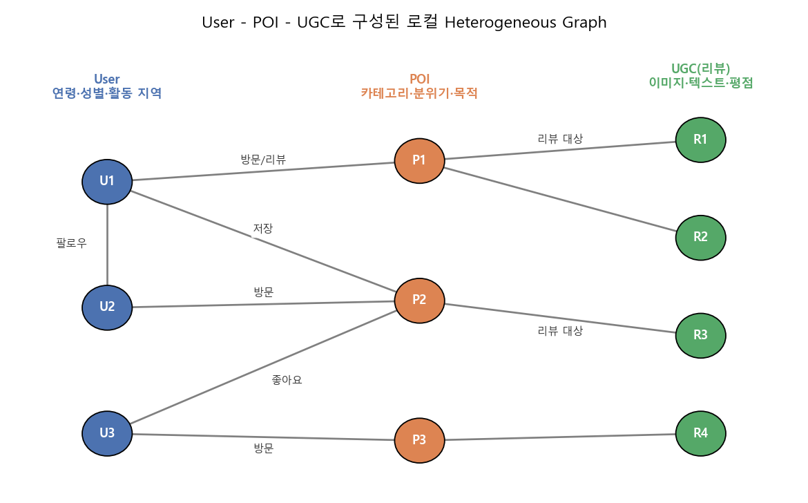
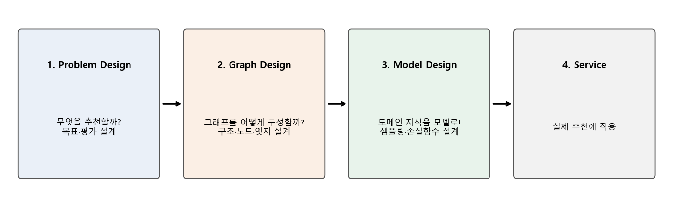
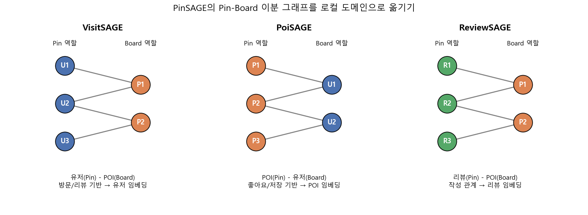
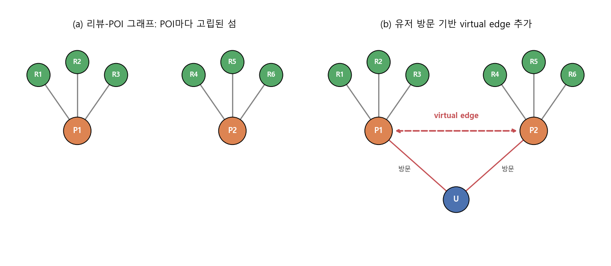

### 사용자, 장소(POI), 리뷰(UGC)로 이루어진 로컬 그래프 위에서 PinSAGE 계열 모델로 추천을 만드는 방법을 알아봅니다.


> **[Commerce AI] USER/POI/UGC Recommendation using Graph Neural Network**  
> 발표: 전영환, 김준형, 이준걸 (NAVER Search), 2022  

<center></center>   

<br/>


>  **1. 로컬(지역) 서비스는 User, POI, UGC라는 세 컴포넌트로 구성되며, 이들은 자연스럽게 하나의 heterogeneous knowledge graph를 이룸**
>
>  **2. PinSAGE의 Pin-Board 이분 그래프 구조를 로컬 도메인에 맞게 재해석해, 유저(VisitSAGE), POI(PoiSAGE), 리뷰(ReviewSAGE) 임베딩을 각각 학습함. 핵심은 도메인 지식을 담은 negative sampling과 가중치가 들어간 손실함수임**
>
>  **3. 정확도(Precision)뿐 아니라 소상공인 노출(SME), 다양성(Diversity)까지 함께 평가하며, 단일 모델의 한계는 앙상블/joint representation과 virtual edge 같은 그래프 설계로 보완함**

<br/>

----

**본 포스트는 NAVER Search의 전영환, 김준형, 이준걸 님의 발표 영상을 보고 정리한 노트입니다.**
[영상은 여기에서 보실 수 있습니다.](https://tv.naver.com/v/26687071)  
발표의 뼈대가 되는 PinSAGE 논문은 [여기](https://arxiv.org/abs/1806.01973)에서 보실 수 있습니다.  

----
#### Contents

1. [로컬을 구성하는 세 가지: User, POI, UGC](#intro)
2. [GNN 추천 모델을 만드는 4단계](#process)
3. [베이스라인: PinSAGE를 로컬 도메인으로](#baseline)
4. [유저 추천: VisitSAGE와 친구들](#visitsage)
5. [POI 추천: 소상공인까지 챙기는 PoiSAGE](#poisage)
6. [UGC 추천: 리뷰를 임베딩하는 ReviewSAGE](#reviewsage)
7. [마치며](#conclusion)

<br />

<a id="intro"></a>
## 1. 로컬을 구성하는 세 가지: User, POI, UGC

지도 앱이나 맛집 플랫폼을 떠올려 보면, 서비스를 이루는 요소는 생각보다 단순합니다. 장소를 찾고 방문하는 **사용자(User)**, 식당/카페/관광지 같은 **관심 장소(POI, Point of Interest)**, 그리고 사용자가 방문 후 남기는 리뷰나 사진 같은 **UGC(User Generated Contents)** 이렇게 세 가지인데요.

발표에서는 여기에 **HyperLocal**이라는 관점을 더합니다. 단순히 "강남역 근처"라는 위치 정보만 보는 것이 아니라, 시간, 날씨, 사용자의 탐색 맥락처럼 더 세밀한(hyper) 디테일까지 반영해 지역을 이해하자는 것입니다.

- 지역을 구성하는 요소를 확장하고, 그들 사이의 relation을 새롭게 정의함
- 이 관점으로 사용자의 취향을 깊이 이해해 추천하고, 설명(explanation)을 곁들여 더 의미 있는 추천을 제공하려 함
- 위치뿐 아니라 시간, 날씨, 탐색 행동 등의 맥락을 반영함

위 그림처럼 User, POI, UGC는 방문, 저장, 좋아요, 팔로우, 리뷰 작성 등의 관계로 얽혀 있어서, 굳이 억지로 만들지 않아도 이미 **heterogeneous knowledge graph**의 모양을 하고 있습니다. 발표에서는 이를 **HyperLocal Knowledge Graph**라고 부르고, 이 그래프 위에서 GNN으로 추천을 하겠다는 것이 전체 이야기의 출발점입니다.

<br/>

<a id="process"></a>
## 2. GNN 추천 모델을 만드는 4단계

발표자들은 그래프 기반 추천 모델을 만드는 과정을 다음 네 단계로 정리했습니다. 개인적으로 이 발표에서 가장 실용적이라고 느낀 부분이기도 합니다.

<center></center>   

<br/>

1. **Problem Design**: 어떤 종류의 추천을 제공하고 싶은가?
	- 목표 설계, 평가 설계
2. **Graph Design**: 복잡한 knowledge graph를 문제에 맞게 어떻게 재구성할까?
	- 그래프 구조, 노드, 엣지 설계
3. **Model Design**: 도메인 지식과 문제를 어떻게 모델로 옮길까?
	- 그래프 특성에 맞는 모델 구성, 샘플링 기법 설계, 손실함수 설계
4. **Recommendation Service**: 실제 추천에 적용

GNN 논문을 읽다 보면 대부분 3번(새로운 aggregation, 새로운 attention...)에 집중하게 되는데요. 실무에서는 오히려 **2번, 즉 "그래프를 어떻게 그릴 것인가"가 성능을 좌우하는 경우가 많다**는 점이 이 발표 전체에 걸쳐 반복해서 드러납니다. 뒤에서 볼 ReviewSAGE의 virtual edge가 대표적인 예시입니다.

<br/>

<a id="baseline"></a>
## 3. 베이스라인: PinSAGE를 로컬 도메인으로

### 3-1. 왜 PinSAGE인가?

모델 아키텍처를 고를 때의 요구사항은 다음과 같았습니다.

- **Heterogeneous Graph & Bipartite Graph**
	- 다양한 노드 타입(User, POI, UGC)을 반영해야 하므로 heterogeneous graph를 사용함
	- 동시에, 노드 간의 관계를 직관적으로 이해하기 쉬운 bipartite(이분) graph 형태로 문제를 쪼갬
- **도메인 지식을 쉽게 넣을 수 있어야 함**
	- 노드 피처(연령, 카테고리, 이미지, 텍스트 등)를 사용할 수 있어야 함
	- 다양한 샘플링 로직을 끼워 넣을 수 있어야 함

이 조건에 잘 맞는 것이 Pinterest의 [PinSAGE (Ying et al., KDD 2018)](https://arxiv.org/abs/1806.01973)입니다. PinSAGE는 Pin(이미지)과 Board(Pin을 모아둔 보드)로 이루어진 이분 그래프 위에서 동작하는 GraphSAGE 계열 모델로, 핵심 아이디어를 간단히 정리하면 다음과 같습니다.

- **Random-walk 기반 이웃 샘플링**: 모든 이웃을 다 보는 대신 Pin → Board → Pin으로 짧은 random walk를 여러 번 돌려, 방문 빈도가 높은 상위 $T$개의 Pin을 "중요한 이웃"으로 삼음
- **Importance pooling**: 이렇게 얻은 방문 빈도를 가중치로 이웃 임베딩을 가중 평균함
- **Max-margin ranking loss + hard negative**: 쿼리 $q$와 positive 아이템 $i$의 점수가 negative 아이템 $n_k$보다 margin $\Delta$ 이상 크도록 학습함

$$
J(z_q, z_i) = \mathbb{E}_{n_k \sim P_n(q)} \max\left(0,\; z_q \cdot z_{n_k} - z_q \cdot z_i + \Delta\right)
$$

발표에서는 이 PinSAGE를 기반으로 로컬 도메인에 맞게 변형한 모델 패밀리를 **HyperLocalSAGE**라고 부릅니다. 저는 개인적으로 [우버 이츠가 GraphSAGE로 메뉴를 추천하는 사례](https://myeonghak.github.io/recommender%20systems/RecSys-%EC%9A%B0%EB%B2%84-%EC%9D%B4%EC%B8%A0%EA%B0%80-GNN%EC%9C%BC%EB%A1%9C-%EB%A9%94%EB%89%B4-%EC%B6%94%EC%B2%9C-%ED%95%98%EB%8A%94-%EB%B0%A9%EB%B2%95/)와 비교하면서 보니 더 재미있었는데요. 두 사례 모두 "유저-가게-메뉴(혹은 리뷰)"라는 비슷한 구조를 갖고 있어서, 함께 보시면 이해에 도움이 될 것 같습니다.

### 3-2. 손실함수: 관계에 가중치를 주자

발표에서는 **Low-rank Positive Loss**라는 이름의 손실함수를 사용했다고 소개합니다. 정확한 수식이 공개되지는 않았지만, 핵심 아이디어는 분명합니다.

- 노드 간의 관계를 있다/없다의 **binary가 아닌 weighted relation**으로 봄
- 중요한 관계(예: 여러 번 방문, 저장까지 한 장소)는 더 중요하게, 덜 중요한 관계는 덜 중요하게 학습에 반영함

PinSAGE가 random walk 방문 빈도로 이웃의 중요도를 매기는 것처럼, positive 관계에도 중요도 차이를 두어 손실에 반영한 형태로 이해하면 될 것 같습니다. 아이디어를 감 잡기 위해 max-margin loss에 관계 가중치와 margin을 얹은 아주 간단한 예시를 만들어 보았습니다.

```python
import torch
import torch.nn.functional as F

torch.manual_seed(0)
B, D = 4, 16
q   = F.normalize(torch.randn(B, D), dim=-1)            # 쿼리 노드(예: 유저) 임베딩
pos = F.normalize(q + 0.5 * torch.randn(B, D), dim=-1)  # 실제로 방문한 POI
neg = F.normalize(torch.randn(B, D), dim=-1)            # 같은 지역/카테고리에서 뽑은 hard negative

w = torch.tensor([3., 1., 1., 5.])                      # 관계 강도(방문 횟수, 저장 여부 등)
w = w / w.mean()
margin = torch.tensor([0.5, 0.5, 0.7, 0.5])             # SME POI(3번째)는 margin을 키워 보정

pos_score = (q * pos).sum(-1)
neg_score = (q * neg).sum(-1)
loss_each = F.relu(neg_score - pos_score + margin)
print("per-pair loss  :", [round(v, 3) for v in loss_each.tolist()])
print("unweighted loss:", round(loss_each.mean().item(), 4))
print("weighted loss  :", round((w * loss_each).mean().item(), 4))
```

```
per-pair loss  : [0.236, 0.345, 0.46, 0.141]
unweighted loss: 0.2956
weighted loss  : 0.2218
```

같은 pair라도 관계 강도 $w$에 따라 gradient에 기여하는 정도가 달라지고, margin을 키운 pair(3번째)는 더 큰 손실을 받는 것을 볼 수 있습니다. 실제 모델의 구현은 다르겠지만, "관계의 무게"와 "보정용 margin"이라는 두 손잡이를 손실함수에 달아둔다는 감각은 이런 느낌입니다.

### 3-3. 무엇을 평가할까? Precision, SME, Diversity

로컬 추천에서 중요하게 본 지표는 세 가지입니다.

1. **Precision**: 얼마나 정확하게 추천했는가?
2. **SME (Small and Medium Enterprise)**: 소상공인(중소 규모 가게)을 얼마나 추천했는가? 일종의 coverage 관점의 지표임
3. **Diversity**: 얼마나 다양하게 추천했는가?

정확도만 보면 결국 리뷰 많고 유명한 대형 가게만 추천하게 되기 쉽겠죠. 플랫폼 입장에서는 롱테일에 있는 작은 가게들도 노출되어야 생태계가 건강해지기 때문에, SME를 별도 지표로 둔 점이 인상적이었습니다.

<br/>

<a id="visitsage"></a>
## 4. 유저 추천: VisitSAGE와 친구들

첫 번째 문제는 **나와 취향이 비슷한 유저를 추천**하는 것입니다. 그런데 "취향이 비슷하다"는 건 대체 무엇일까요? 발표에서는 세 가지 가정을 세웁니다.

1. 비슷한 취향을 가진 유저들은 **같은 장소를 방문**할 것이다
2. 비슷한 취향을 가진 유저들은 **팔로우 관계**를 맺고 있을 것이다
3. 비슷한 취향을 가진 유저들은 **비슷한 기록(history)**을 가질 것이다

그리고 각 가정마다 서로 다른 그래프와 모델을 만듭니다.

<center></center>   

<br/>

### 4-1. VisitSAGE: 같은 장소를 방문했다면

- **그래프**: 유저의 방문(리뷰 작성 등) 정보를 이용해 **Pin을 유저로, Board를 POI로** 정의한 User-POI 이분 그래프
- **노드 피처**
	- 유저: 연령, 성별, 활동 지역 등
	- POI: 카테고리, 분위기, 방문 목적 등
- **로컬 도메인의 negative sampling**: 같은 AoA(Area of Activity, 활동 지역) 안의 유저들 중 가장 유사성이 떨어지는 유저를 negative로 뽑음
- **손실함수**: POI에 대한 유저의 선호 강도를 반영한 Low-rank Positive Loss

negative sampling 부분이 특히 좋은 아이디어라고 생각하는데요. 랜덤하게 뽑은 negative는 대부분 "서울 사는 유저 vs 부산 사는 유저"처럼 너무 쉬운 예제라서, 모델이 결국 지역만 구분하는 법을 배우게 됩니다. **같은 지역 안에서** 취향이 다른 유저를 negative로 주면, 모델은 지역이 아닌 취향 자체를 구분하도록 강제되겠죠. 전형적인 hard negative mining을 도메인 지식으로 구현한 셈입니다.

### 4-2. FollowSAGE와 History2Vec

- **FollowSAGE**: 유저 간 팔로우 관계를 반영한 user-user **homogeneous graph**
- **History2Vec**: 유저의 방문 히스토리를 시퀀스로 보고 학습하는 sequential 모델 (user-history graph)

### 4-3. 평가와 "취향 유사도에는 정답이 없다"

평가는 다양성, 카테고리/지역 기준의 Jaccard 유사도, 정확성 등을 함께 보았습니다. 특히 **지역 유사도 측면에서 VisitSAGE가 2배 가까운 성능**을 보였다고 하는데, 방문 기반 그래프이니 같은 동네를 다니는 유저를 잘 찾는 것은 어찌 보면 자연스러운 결과입니다.

흥미로웠던 건 발표자들의 결론입니다.

- 비슷한 취향이라는 건 모델러가 가설을 세워 유저에게 제공하는 것이므로, **정답이 없음**
- 그래서 하나의 global 모델로 끝내기보다, 유저의 클릭/팔로우 액션에 따라 컬렉션을 최적화하는 방향을 택함
- 다양성과 참신성을 위해 VisitSAGE, FollowSAGE, History2Vec을 **앙상블**함
- 추후에는 [MAB(Multi-Armed Bandit)](https://myeonghak.github.io/recommender%20systems/RecSys-Multi-Armed-Bandits%28MAB%29/)를 적용해, 로그 데이터를 기반으로 어떤 모델의 추천이 잘 먹히는지 찾아 개인화된 추천 컬렉션을 만들 계획이라고 함

오프라인 메트릭으로 승자를 하나 정하기 어려운 문제에서 "여러 가설을 모델로 만들어 두고, 온라인에서 bandit으로 고르게 하자"는 접근은 실무적으로 꽤 설득력 있는 선택이라고 느꼈습니다.

<br/>

<a id="poisage"></a>
## 5. POI 추천: 소상공인까지 챙기는 PoiSAGE

두 번째 문제는 **유저에게 POI(가게)를 추천**하는 것입니다. 여기서는 Precision, Diversity와 함께 **소상공인 추천(SME)이 잘 이루어지는지**가 특히 중요했다고 합니다.

### 5-1. PoiSAGE의 설계

- **그래프**: 유저의 좋아요, 저장 등 **취향(preference) 데이터**를 기반으로 User-POI 이분 그래프를 구성함. 방문 기반이었던 VisitSAGE와 달리 "취향에 강한" 그래프를 만든 것이 포인트임 (이번에는 임베딩의 주인공이 POI이므로, 위 그림에서는 POI를 Pin 자리에 두었음)
- **노드 피처**: VisitSAGE와 마찬가지로 유저(연령, 성별, 활동 지역), POI(카테고리, 분위기, 목적) 피처를 붙임
- **Negative sampling**: **동일 카테고리 내에서** 가장 유사도가 떨어지는 POI를 negative로 뽑음
- **SME 보정**: 소상공인 POI는 메타데이터가 부족한 경향이 있어 불리하므로, 손실에 **margin을 붙여 보정**함
- **손실함수**: POI에 대한 유저 취향을 반영한 Low-rank Positive Loss

메타데이터가 빈약한 노드는 피처만으로는 표현력이 떨어져 임베딩 공간에서 제대로 자리를 잡기 어렵습니다. margin을 조절해 이런 노드들을 학습에서 더 신경 쓰도록 만드는 것은 일종의 cold-start/롱테일 보정이라고 볼 수 있겠습니다.

### 5-2. 비교 베이스라인

PoiSAGE의 성능을 비교하기 위해 다른 그래프 모델도 만들었습니다.

- **POIMeta2Vec**: POI와 그 메타데이터를 노드로 사용한 그래프
- **POI2Vec**: POI-POI를 노드로 갖는 세션 그래프 (같은 세션에서 함께 본 POI를 연결)

### 5-3. 결과: 잘하는 게 다르다

- **SME 측면에서는 PoiSAGE가 가장 높은 성능**을 기록함
- 리뷰 수가 적고 메타데이터가 부족해도 유저 취향을 강하게 반영하기 때문에 serendipity(뜻밖의 발견)가 높았음
- 하지만 **Diversity, Precision 측면에서는 가장 좋은 모델이 아니었음**

그래서 마지막 단계로 **Joint Representation Learning**을 시도합니다. 각 모델(PoiSAGE, POIMeta2Vec, POI2Vec)이 만든 임베딩을 함께 활용해 하나의 global 모델을 학습했고, 그 결과 **모든 지표에서 우세한 global model**을 얻을 수 있었다고 합니다. 각 그래프가 서로 다른 관점(취향, 메타데이터, 세션)의 정보를 담고 있으니, 이를 합치면 서로의 약점을 메워주는 구조가 되는 것이죠.

<br/>

<a id="reviewsage"></a>
## 6. UGC 추천: 리뷰를 임베딩하는 ReviewSAGE

### 6-1. UGC라는 multi-modal 데이터

UGC는 유저가 직접 만든, 글과 사진으로 구성된 콘텐츠입니다. 이미지, 텍스트, 숫자(평점 등)가 섞여 있는 **multi-modal** 데이터라서, 이를 하나의 벡터로 잘 임베딩해 두면 추천뿐 아니라 다른 downstream task에도 두루 쓸 수 있습니다.

또 UGC는 항상 어떤 POI에 대한 것이므로, 리뷰 내용뿐 아니라 POI와의 관계까지 함께 담아내기 위해 knowledge graph 기반의 **ReviewSAGE**를 구성했습니다.

### 6-2. 첫 번째 ReviewSAGE

- **그래프**: 리뷰 데이터를 이용해 **Pin을 리뷰로, Board를 POI로** 구성함
- **노드 피처**
	- 리뷰: 이미지, 텍스트, 정형 피처 등
	- POI: 총 리뷰 수, 총 공유 수, 전체 평점 등
- **Negative sampling**: 다양한 POI 카테고리 내에서 가장 비슷하지 않은 리뷰를 negative로 뽑음
- 학습 후 리뷰 임베딩 행렬을 추출함

그런데 이 설계에는 두 가지 문제가 있었습니다.

1. 리뷰는 반드시 하나의 POI에만 연결되므로, **같은 POI의 리뷰 임베딩끼리만 가까워지는** 문제가 생김
2. UGC를 생산한 주체인 **유저의 정보가 반영되지 않음**

아래 그림 (a)를 보면 바로 이해가 되실 텐데요. 리뷰-POI 그래프는 사실상 POI를 중심으로 한 별(star) 모양의 고립된 섬들로 쪼개져 있습니다. 이런 그래프에서는 아무리 message passing을 해도 정보가 섬 밖으로 나갈 수 없겠죠.

<center></center>   

<br/>

### 6-3. 개선: 유저 방문으로 virtual edge 놓기

해결책은 그래프 설계, 즉 2단계로 돌아가는 것이었습니다.

- User, UGC, POI 세 노드를 모두 활용하는 유기적인 그래프 디자인을 시도함
- **유저의 방문 정보를 활용한 virtual edge**를 추가함. 같은 유저가 방문한 POI들끼리 연결하는 식으로, 유저 방문 기반의 review-POI heterogeneous graph를 구성함
- 그 결과 유저 방문으로 연결된 POI들끼리 정보를 공유할 수 있게 되고, **global한 정보가 반영된 review embedding**을 만들 수 있게 됨

모델 구조는 그대로 두고 엣지 하나를 추가하는 것만으로 두 문제(고립된 섬, 유저 정보 부재)를 동시에 해결한 셈입니다.

### 6-4. 평가

비교한 UGC 임베딩 베이스라인은 다음과 같습니다.

1. 이미지 또는 텍스트만 고려한 **unimodal** 모델
2. 이미지와 텍스트를 동시에 고려한 **multi-modal** 모델
3. **ReviewSAGE**

평가 지표로는 SME와 함께 **유저 관점의 Precision**을 사용했는데, 측정 방식이 재미있습니다.

- 유저의 **과거 리뷰** 임베딩 근처에 있는 리뷰들로 일정한 영역을 만들고
- 유저의 **미래 리뷰**가 그 영역 안에 들어오는지를 측정함
- 즉, 가장 가까운 리뷰 $k$개를 추천했을 때 몇 개나 맞추는지를 봄

두 지표 모두에서 **ReviewSAGE가 가장 높은 성능**을 보였고, 이는 virtual edge를 만들어준 방식의 효용성을 보여준다고 합니다. 이미지와 텍스트를 아무리 잘 섞어도, "누가 어디를 다녔는가"라는 그래프 정보가 주는 신호를 대체하긴 어렵다는 이야기로 읽혔습니다.

<br/>

<a id="conclusion"></a>
## 7. 마치며

발표의 결론을 정리하면 다음과 같습니다.

- 로컬의 핵심 3요소인 User/POI/UGC를 고려한 representation learning 모델을 개발함
- PinSAGE 기반의 HyperLocalSAGE로 유저, POI, 리뷰 추천이라는 여러 application을 만듦
- PoiSAGE에서는 여러 모델의 앙상블/joint representation으로 더 나은 성능을 얻음
- ReviewSAGE에서는 multi-modal 특성과 그래프 특성(virtual edge)을 함께 반영해 문제를 해결함

개인적으로 가장 크게 남은 교훈은 **"모델보다 그래프 디자인"**이었습니다. 이 발표에 등장하는 모델들은 사실 모두 같은 PinSAGE 뼈대를 쓰고 있는데요. 성능 차이를 만든 것은 새로운 레이어가 아니라 Pin과 Board에 무엇을 놓을지, negative를 어느 범위(같은 지역, 같은 카테고리)에서 뽑을지, 어떤 엣지를 추가할지 같은 **도메인 지식을 그래프와 샘플링에 녹이는 작업**이었습니다. HAN처럼 화려한 [heterogeneous GNN 모델](https://myeonghak.github.io/recommender%20systems/RecSys-Heterogeneous-Graph-Attention-Networks-paper-review/)도 좋지만, 실무에서는 단순한 모델 위에 잘 설계된 그래프가 더 큰 힘을 발휘한다는 걸 다시 한 번 확인할 수 있었습니다.

또 하나, 정확도 하나로 줄 세우지 않고 SME와 Diversity를 함께 보며 "취향에는 정답이 없다"고 인정하는 태도도 인상적이었습니다. 추천 모델링이 결국 비즈니스와 생태계를 함께 설계하는 일이라는 점을 잘 보여주는 발표였습니다.

----------------


**개선을 위한 여러분의 피드백과 제안을 코멘트로 공유해 주세요.**
**내용에 대한 지적, 혹은 질문을 환영합니다.**  


**출처**  
[[Commerce AI] USER/POI/UGC Recommendation using Graph Neural Network / 전영환, 김준형, 이준걸 (NAVER TV)](https://tv.naver.com/v/26687071)  
[Ying et al., Graph Convolutional Neural Networks for Web-Scale Recommender Systems (PinSAGE), KDD 2018](https://arxiv.org/abs/1806.01973)  
[Hamilton et al., Inductive Representation Learning on Large Graphs (GraphSAGE), NeurIPS 2017](https://arxiv.org/abs/1706.02216)  
