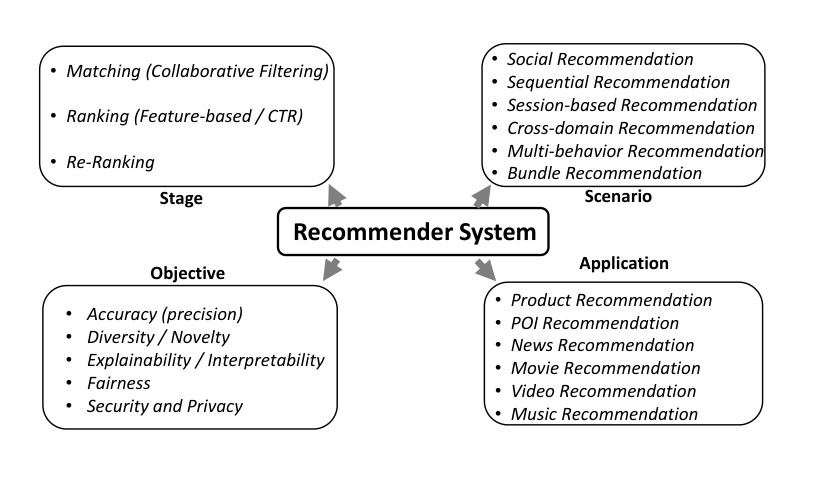
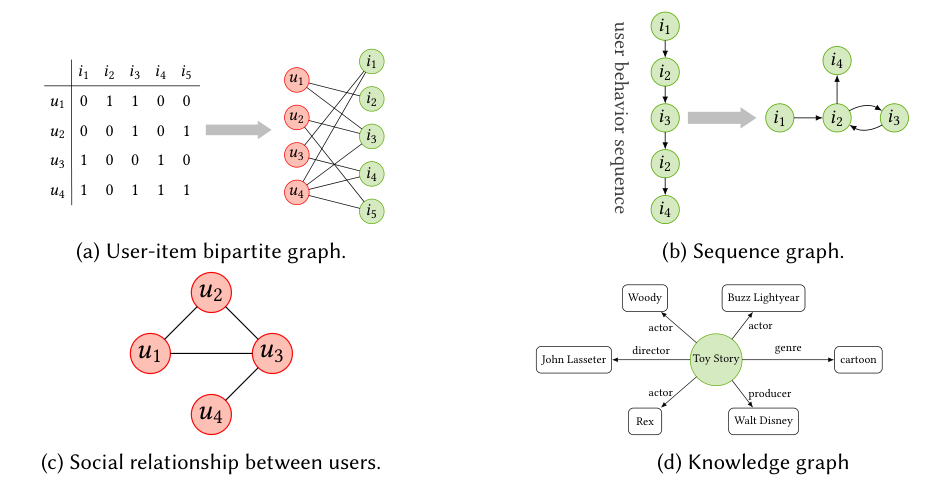
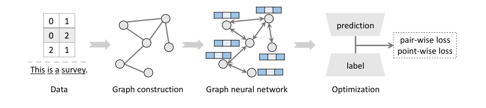
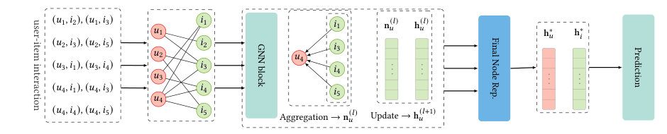

### 추천 시스템에 GNN을 어떻게, 그리고 왜 적용하는지 두 편의 서베이 논문을 통해 정리해 봅니다.  


> 다루는 논문  
> **Graph Neural Networks in Recommender Systems: A Survey** (Shiwen Wu, Fei Sun, Wentao Zhang, Xu Xie, Bin Cui, ACM Computing Surveys 2022)  
> **A Survey of Graph Neural Networks for Recommender Systems: Challenges, Methods, and Directions** (Chen Gao, Yu Zheng, Nian Li et al., ACM Transactions on Recommender Systems 2023)  

<center></center>   

<font size="2"><center> 출처: Gao et al., A Survey of Graph Neural Networks for Recommender Systems (https://arxiv.org/abs/2109.12843) </center>  </font>   

<br/>


>  **1. 추천 데이터는 본질적으로 그래프임. 유저-아이템 상호작용은 bipartite graph, 행동 시퀀스는 sequence graph, 부가 정보는 social graph / knowledge graph로 자연스럽게 표현됨**
>
>  **2. GNN은 기존 CF 모델이 암묵적으로만 다루던 협업 신호(collaborative signal)와 고계 연결성(high-order connectivity)을 명시적으로 인코딩할 수 있다는 점이 강점임**
>
>  **3. 다만 그래프 구축, 네트워크 디자인, 모델 최적화, 연산 효율성이라는 4가지 난제가 있으며, matching / ranking / re-ranking 각 stage마다 요구 사항이 다르므로 이에 맞는 설계가 필요함**

<br/>

----

**본 포스트는 GNN 기반 추천시스템에 대한 두 편의 서베이 논문(Wu et al., Gao et al.)을 읽고 정리한 노트입니다.**
원문은 여기에서 보실 수 있습니다.  
[Wu et al. (arXiv 2011.02260)](https://arxiv.org/abs/2011.02260), [Gao et al. (arXiv 2109.12843)](https://arxiv.org/abs/2109.12843)  

----
#### Contents  

1. [Intro - 왜 GNN 추천 서베이를 두 편이나?](#intro)  
2. [추천 시스템을 바라보는 네 가지 관점](#background)  
3. [추천은 왜 그래프 문제일까?](#why-gnn)  
4. [GNN 기초 다시 보기](#gnn-basics)  
5. [GNN을 추천에 적용할 때의 4가지 난제](#challenges)  
6. [Stage 별 GNN 모델: Matching, Ranking, Re-ranking](#stage)  
7. [정보 종류에 따른 분류: 일반 추천 vs 시퀀셜 추천](#taxonomy-wu)  
8. [열려 있는 문제들](#future)  
9. [마치며](#conclusion)  
<br />

<a id="intro"></a>
## 1. Intro - 왜 GNN 추천 서베이를 두 편이나?  

예전에 [뉴럴넷 기반 추천시스템 서베이 페이퍼 리뷰](https://myeonghak.github.io/recommender%20systems/RecSys-%EB%89%B4%EB%9F%B4%EB%84%B7-%EA%B8%B0%EB%B0%98-%EC%B6%94%EC%B2%9C%EC%8B%9C%EC%8A%A4%ED%85%9C-%EC%84%9C%EB%B2%A0%EC%9D%B4-%ED%8E%98%EC%9D%B4%ED%8D%BC-%EB%A6%AC%EB%B7%B0/) 포스트에서 CF, 콘텐츠 기반, 시퀀셜 모델로 이어지는 딥러닝 추천의 큰 흐름을 정리한 적이 있는데요.  
그 서베이에서 GNN은 여러 도구 중 하나로 짧게 등장할 뿐이었습니다. 그런데 [우버 이츠가 GNN으로 메뉴 추천 하는 방법](https://myeonghak.github.io/recommender%20systems/RecSys-%EC%9A%B0%EB%B2%84-%EC%9D%B4%EC%B8%A0%EA%B0%80-GNN%EC%9C%BC%EB%A1%9C-%EB%A9%94%EB%89%B4-%EC%B6%94%EC%B2%9C-%ED%95%98%EB%8A%94-%EB%B0%A9%EB%B2%95/)에서 본 것처럼, 실제 서비스에서도 GNN이 추천의 주력 엔진으로 쓰이는 사례가 점점 늘어나고 있습니다.  
그래서 이번에는 아예 "GNN x 추천"에 초점을 맞춘 서베이를 읽어 보기로 했습니다.  

이번 포스트에서는 성격이 조금 다른 두 편의 서베이를 함께 다룹니다.  

- **Wu et al. (2020, ACM CSUR)**: 사용하는 **정보의 종류**(유저-아이템 상호작용, 소셜 그래프, 지식 그래프, 시퀀스)와 **추천 유형**(일반 추천 vs 시퀀셜 추천)을 기준으로 방법론을 분류함. 모델링 관점의 정리에 강점이 있음  
- **Gao et al. (2021, ACM TORS)**: 추천 시스템을 **stage, scenario, objective, application** 네 가지 관점으로 쪼개고, 각 관점에서 GNN이 어떻게 쓰이는지 정리함. 산업 파이프라인(matching - ranking - re-ranking) 관점이 들어가 있어 실무자에게 특히 친절함  

두 논문의 내용이 겹치는 부분(GNN 기초, 왜 GNN인가)은 합쳐서 정리하고, 각 논문 고유의 분류 체계는 따로 살펴보겠습니다.  


<a id="background"></a>
## 2. 추천 시스템을 바라보는 네 가지 관점  

먼저 Gao et al.이 제시한 추천 시스템의 지도부터 보겠습니다. 위의 대표 그림이 바로 그것인데요, 추천 시스템을 네 가지 축으로 나누어 봅니다.  

### 2.1 Stage: 수백만에서 수십 개로  

산업 환경에서는 수백만 개의 아이템을 매 요청마다 정교한 모델로 채점할 수 없기 때문에, 보통 깔때기(funnel) 형태의 3단계로 나뉩니다.  

- **Matching (후보 생성)**: 수백만 개의 아이템을 수백 개 수준으로 추려내는 단계. 유관성과 **효율성**이 가장 중요함. 임베딩 매칭, 지역 기반 필터 등이 쓰이며 모델은 대개 가벼움  
- **Ranking**: 수백 개의 후보를 유저와의 연관도에 따라 정밀하게 채점해 노출 슬롯(보통 수십 개)만큼만 남기는 단계. **정확도**가 최우선이며, 복잡한 피처 간 상호작용(feature interaction)을 잡아내는 것이 핵심임  
- **Re-ranking**: ranking이 연관도만을 기준으로 줄을 세운다면, re-ranking은 신선도, 다양성, 공정성 같은 비즈니스 요구사항을 반영해 순서를 재조정함. 너무 비슷하거나 서로 대체 가능한 아이템이 상위에 몰리지 않게 하는 작업 등이 포함됨  

### 2.2 Scenario: 어떤 상황에서 추천하는가  

- **소셜 추천**: 친구의 행동이 나에게 영향을 주고(social influence), 비슷한 취향끼리 친구가 되는(social homophily) 특성을 반영해야 함  
- **시퀀셜 추천**: 시간 순서대로 쌓인 행동에서 다음 아이템을 예측. 시퀀스가 길어질수록 동적인 관심사를 잡기 어렵고, 한 유저가 여러 시퀀스를 만든다는 점도 난점임  
- **세션 기반 추천**: 유저 식별 정보 없이 짧은 세션 내 행동만으로 다음 행동을 예측해야 하는 상황  
- **번들 추천**: 플레이리스트, 코디(outfit), 약 조합처럼 아이템의 **조합 자체**를 추천. 번들을 새로 구성하는 것도 과제임  
- **크로스 도메인 추천**: 서비스 A에서 쌓인 데이터로 서비스 B의 추천을 개선. cold-start와 data sparsity 완화 수단으로 주목받음  
- **복수 행동(multi-behavior) 추천**: 클릭, 장바구니, 구매 등 여러 행동을 함께 다룸. 행동끼리 서로 영향을 주고 그 정도가 유저마다 다르며, 행동마다 담긴 선호가 달라 통합된 아이템 임베딩을 얻기 어려움  

### 2.3 Objective: 정확도만이 전부는 아니다  

- **다양성(Diversity)**: 한 유저가 비슷한 아이템만 받는 낮은 *개인 수준 다양성*과, 모든 유저가 인기 아이템만 받는 낮은 *시스템 수준 다양성*으로 나뉨. 롱테일 아이템은 학습 신호 자체가 약하고, 다양성과 정확도가 서로 충돌하는 딜레마가 있음  
- **설명가능성(Explainability)**: 추천 근거를 제시하면 유저 신뢰도가 오르고, 엔지니어 입장에서도 디버깅이 쉬워짐. 그래프 구조, 특히 지식 그래프의 경로(path)는 설명의 좋은 재료가 됨  
- **공정성(Fairness)**: 특정 유저 집단을 차별하지 않는 *유저 공정성*과, 인기도에 따라 노출이 쏠리지 않게 하는 *아이템 공정성*이 있음. 학습 중에 직접 debiasing하거나, 결과를 후처리(re-ranking)하는 두 갈래로 접근함  

### 2.4 Application  

상품 추천(장바구니, 구매 등 다양한 행동과 상품 속성으로 heterogeneous graph 구성), POI 추천(지리적 요소 + 시간적 요소, Yelp/Gowalla 데이터셋), 뉴스 추천(텍스트 이해와 빠르게 바뀌는 후보군 대응, MIND 데이터셋), 영화 추천(Netflix Prize 이후 평점 예측에서 implicit feedback 예측으로 이동) 등이 대표적이며, 그 외에 비디오, 음악, 일자리, 음식 추천 등이 있습니다.  


<a id="why-gnn"></a>
## 3. 추천은 왜 그래프 문제일까?  

### 3.1 패러다임의 변화  

Wu et al.은 추천 모델링의 큰 흐름을 이렇게 정리합니다.  

1. **이웃 기반 방법론**: 유저가 과거에 상호작용한 아이템과 비슷한 아이템을 직접 추천(item-based CF). 단순하고 효율적이라 초창기 실서비스에서 큰 성공을 거둠  
2. **표현 학습 기반 방법론**: 유저와 아이템을 같은 공간의 벡터(임베딩)로 인코딩해 직접 비교. Netflix Prize에서 Matrix Factorization이 두각을 나타낸 뒤 본격화되었고, 이후 비선형 관계를 잡고 텍스트/이미지 같은 다양한 정보를 결합하기 쉬운 딥러닝 모델이 주류가 됨  
3. **GNN**: 추천 데이터가 원래 가진 그래프 구조 위에서 직접 학습  

### 3.2 추천 데이터 속의 그래프들  

<center></center>   

<font size="2"><center> 출처: Wu et al., Graph Neural Networks in Recommender Systems: A Survey (https://arxiv.org/abs/2011.02260) </center>  </font>   

<br/>

조금만 들여다보면 추천 데이터는 거의 다 그래프입니다.  

- **(a) 유저-아이템 이분 그래프**: 상호작용 행렬의 1을 엣지로 바꾸면 그대로 bipartite graph가 됨  
- **(b) 시퀀스 그래프**: $i_1 \to i_2 \to i_3 \to i_2 \to i_4$ 처럼 같은 아이템을 다시 보는 행동이 그래프에서는 사이클로 표현됨. 엄격한 시간 순서를 따르는 시퀀스보다 유연한 아이템 간 전이 관계를 담을 수 있음  
- **(c) 소셜 그래프**와 **(d) 지식 그래프**: 부가 정보 자체가 처음부터 그래프 구조를 가짐  

### 3.3 GNN이 주는 세 가지 이점  

Gao et al.은 GNN이 추천에서 성공적인 이유를 세 가지로 요약합니다.  

- **구조적 데이터의 통합**: 상호작용, 유저 프로필, 아이템 속성 등 형태가 제각각인 데이터를 모두 노드와 엣지로 표현해 한 번에 활용할 수 있음  
- **고계 연결성(High-order connectivity)**: 기존 모델이 "이 유저가 이 아이템을 샀다"는 1계 연결만 학습 신호로 썼다면, GNN은 레이어를 쌓아 "나와 같은 아이템을 산 사람이 산 다른 아이템" 같은 multi-hop 관계를 표현에 직접 녹여냄  
- **지도 신호(Supervision signal) 보강**: 검색, 장바구니 등 다양한 연결 관계를 함께 그래프에 넣어 희소한 상호작용 데이터를 보완할 수 있음  

Wu et al.의 설명도 같은 맥락인데요, 사실 기존 CF 모델들도 이웃 정보를 쓰긴 했습니다. SVD++는 유저가 상호작용한 아이템(1-hop 이웃)의 임베딩을 모아 유저 표현을 보강했고, ItemRank는 아이템-아이템 그래프 위에서 random walk를 돌려 2-hop 이웃까지 활용했죠. GNN은 이런 아이디어를 **임의의 hop까지 체계적으로 확장한 일반화된 틀**이라고 볼 수 있습니다. 기존 모델이 상호작용을 학습용 정답 신호로만 *암묵적*으로 쓴 데 비해, GNN은 협업 신호(그래프의 위상 구조)를 표현 안에 *명시적*으로 인코딩한다는 점이 차이입니다.  


<a id="gnn-basics"></a>
## 4. GNN 기초 다시 보기  

### 4.1 Aggregation과 Update  

GNN의 핵심 아이디어는 한 문장으로 요약됩니다. **이웃의 정보를 모으고(aggregate), 그것으로 내 표현을 갱신한다(update).** 이 과정을 레이어 수만큼 반복하면 $L$-hop 떨어진 노드의 정보까지 흘러 들어오게 됩니다.  

$$
\mathbf{n}_v^{(l)} = \text{Aggregator}_l\left(\left\{\mathbf{h}_u^{(l)} : u \in \mathcal{N}_v\right\}\right), \qquad
\mathbf{h}_v^{(l+1)} = \text{Updater}_l\left(\mathbf{h}_v^{(l)}, \mathbf{n}_v^{(l)}\right)
$$

- Aggregation: 이웃을 mean pooling으로 동등하게 다루거나, attention으로 이웃마다 중요도를 다르게 줌  
- Update: 중심 노드 표현과 이웃 정보를 sum, concatenation + 비선형 변환, GRU 등으로 결합함  

아키텍처 관점에서는 RecGNN(모든 레이어가 파라미터 공유), ConvGNN(레이어마다 다른 파라미터), STGNN(시공간 그래프), GAE(비지도 그래프 오토인코더)로 나뉘는데, **추천에서 쓰이는 GNN은 대부분 ConvGNN 계열**입니다. 또 다른 구분으로는 그래프 푸리에 변환을 이용해 spectral domain에서 필터링하는 *spectral* 모델과, CNN처럼 이웃을 직접 가중합하는 *spatial* 모델이 있는데, 접근은 달라도 "이웃 정보를 반복적으로 모은다"는 원칙은 같습니다.  

### 4.2 추천에서 자주 쓰이는 GNN 프레임워크  

- **GCN**: 대칭 정규화된 인접행렬로 이웃을 가중 평균하는 대표적인 모델. spectral 방법을 1차 근사해 단순화한 형태임  
- **GraphSAGE**: 이웃을 **SA**mple하고 aggre**G**at**E**한 뒤 자기 임베딩과 concat하여 갱신. 학습 때 보지 못한 노드에도 적용 가능한 inductive 모델이자 spatial GNN의 대표 주자임  
- **GAT**: attention으로 이웃마다 다른 가중치를 학습해 정보를 받아옴  
- **GGNN**: update 단계에 GRU를 사용. 세션 기반 추천의 SR-GNN이 이 구조를 채택함  
- **HetGNN / HAN**: 여러 타입의 노드와 엣지를 갖는 heterogeneous graph용 모델. 타입별로 이웃을 나눠 모은 뒤 attention으로 결합함 (HAN은 [HAN 리뷰 포스트](https://myeonghak.github.io/recommender%20systems/RecSys-Heterogeneous-Graph-Attention-Networks-paper-review/)에서 다룬 바 있습니다)  
- **HGNN**: 하나의 엣지가 여러 노드를 잇는 hypergraph용 spectral 모델  

GCN, GraphSAGE, GAT, PinSAGE에 대해서는 이전 포스트인 [GCN과 GraphSAGE](https://myeonghak.github.io/graph%20neural%20networks/GNN-GCN%EA%B3%BC-GraphSAGE/), [PinSAGE와 GAT](https://myeonghak.github.io/graph%20neural%20networks/GNN-PinSAGE%EC%99%80-GAT/)에서 자세히 다뤘으니 함께 참고하시면 좋겠습니다.  

참고로 GNN은 보통 레이어를 4개 이하로만 쌓는데, 너무 깊게 쌓으면 모든 노드 표현이 비슷해져 버리는 **over-smoothing** 현상이 발생하기 때문입니다.  

### 4.3 전체 파이프라인과 손실 함수  

<center></center>   

<font size="2"><center> 출처: Gao et al., A Survey of Graph Neural Networks for Recommender Systems (https://arxiv.org/abs/2109.12843) </center>  </font>   

<br/>

GNN 모델을 만드는 과정은 위 그림처럼 **그래프 구축 -> 네트워크 디자인 -> 모델 최적화**의 세 단계로 볼 수 있습니다.  

그래프 구축 단계에서는 원본 데이터(테이블, 텍스트 등)에서 노드와 엣지를 추상화합니다. 그래프는 크게 노드/엣지 타입이 하나인 homogeneous graph, 여러 타입이 섞인 heterogeneous graph, 엣지가 2개 이상의 노드를 잇는 hypergraph로 나뉘고, 개체(entity)와 관계(relation)로 이루어진 지식 그래프는 heterogeneous graph의 대표적인 예입니다.  

추천에서 최적화 목표는 보통 **link prediction**, 즉 유저 노드와 아이템 노드 사이에 엣지가 생길지를 예측하는 것입니다. 손실 함수는 크게 두 가지입니다.  

- **Point-wise loss**: 개별 상호작용의 레이블을 직접 맞춤 (MSE, cross-entropy 등)  
- **Pair-wise loss**: positive 아이템이 negative 아이템보다 높은 점수를 받도록 학습. 대표적으로 BPR loss가 있음  

$$
\mathcal{L}_{BPR} = -\sum_{(u, i, j)} \ln \sigma\left(\hat{y}_{ui} - \hat{y}_{uj}\right) + \lambda \lVert \Theta \rVert_2^2
$$

여기서 $i$는 유저 $u$가 상호작용한 아이템, $j$는 샘플링된 negative 아이템입니다.  


<a id="challenges"></a>
## 5. GNN을 추천에 적용할 때의 4가지 난제  

좋은 점만 있으면 다들 진작 썼겠죠? Gao et al.은 GNN을 추천에 적용할 때 마주치는 문제를 네 가지로 정리합니다.  

**1) 그래프 구축 (Graph Construction): 어떤 그래프를 만들 것인가?**  
- 입력 데이터를 그래프로 바꾸고, 추천 문제를 그래프 위의 태스크로 재정의해야 함  
- **노드 정의**: GNN의 목표는 결국 노드 표현 학습임(엣지 임베딩은 대개 노드 임베딩으로 계산됨). 노드 타입이 많아지면 이를 구분하는 것이 문제이고, 가격 같은 연속형 변수는 구간화(bucketize)해 몇 개의 노드로 나누는 식으로 처리함  
- **엣지 정의**: 엣지는 정보 전파 경로를 결정하므로 그래프 품질에 직결됨. 너무 빽빽하게 연결하면 차수가 높아지고 over-smoothing이 생기기 쉬워 sampling, filtering, pruning 등이 도입됨  

**2) 네트워크 디자인 (Network Design): 정보를 어떻게 전파하고 모을 것인가?**  
- 고계 유사도를 잘 담을 수 있는 전파 경로 선택이 중요함  
- aggregation 함수(mean pooling, LSTM, max/min 등)의 선택은 성능뿐 아니라 연산 효율에도 영향을 줌  

**3) 모델 최적화 (Model Optimization): 어떻게 학습시킬 것인가?**  
- BPR 같은 pair-wise loss는 어떤 positive/negative 샘플을 뽑느냐에 따라 성능이 크게 달라짐  
- 여러 종류의 엣지(행동)를 함께 예측해야 할 때는 태스크 간 균형을 맞추는 문제가 생김  

**4) 연산 효율성 (Computation Efficiency): 학습과 추론을 감당할 수 있는가?**  
- GNN은 NCF, FM 같은 모델에 비해 연산 비용이 매우 높고, 레이어를 쌓을수록 이웃 수가 기하급수적으로 늘어남  
- 그럼에도 PinSAGE처럼 random walk 기반 이웃 샘플링으로 수십억 규모의 그래프에 성공적으로 적용한 산업 사례가 있음  


<a id="stage"></a>
## 6. Stage 별 GNN 모델: Matching, Ranking, Re-ranking  

### 6.1 Matching을 위한 GNN  

<center></center>   

<font size="2"><center> 출처: Wu et al., Graph Neural Networks in Recommender Systems: A Survey (https://arxiv.org/abs/2011.02260) </center>  </font>   

<br/>

Matching 단계에서 GNN은 사실상 **임베딩 매칭 모델**입니다. 유저-아이템 bipartite graph 위에서 유저/아이템 임베딩을 학습하고, 내적이 큰 아이템을 ANN 검색 등으로 빠르게 뽑아내는 구조죠. 효율성이 최우선이라 피처는 상호작용 위주로 쓰고, 나이나 가격 같은 부가 피처는 제한적으로 도입합니다.  

대표 모델들을 살펴보면 다음과 같습니다.  

- **GC-MC**: 평점 값마다 다른 엣지 타입을 두고, 타입별 변환을 거친 이웃 메시지를 sum으로 모음  
- **NGCF**: 이웃 임베딩에 유저-아이템 간 element-wise 곱 항을 추가해 협업 신호를 명시적으로 전파. MF, NCF 같은 전통 CF 대비 우수한 성능을 보임  
- **LightGCN**: NGCF에서 feature transformation과 비선형 활성화를 걷어내도 성능이 오히려 좋아진다는 것을 보임. 남은 것은 정규화된 이웃 합과 레이어별 임베딩의 가중합뿐임  
- **NIA-GCN**: sum/mean/max 같은 aggregation은 이웃끼리의 관계 정보를 담지 못한다며 neighbor interaction-aware convolution을 제안  
- **DGCF**: 유저의 여러 의도(intent)를 분리(disentangle)해 표현을 학습  
- **IMP-GCN**: 모든 이웃이 아니라 관심사가 비슷한 유저 하위 그룹 안에서만 임베딩을 전파해 over-smoothing을 완화  
- **SGL**: 노드/엣지 dropout 등으로 그래프를 변형한 뒤 contrastive learning을 결합해 표현 학습을 보조  
- **PinSAGE**: GraphSAGE에 random walk 기반 중요 이웃 샘플링을 결합해 Pinterest 규모의 아이템-아이템 그래프에서 임베딩을 학습  

LightGCN의 전파 규칙은 놀라울 만큼 단순합니다.  

$$
\mathbf{e}_u^{(k+1)} = \sum_{i \in \mathcal{N}_u} \frac{1}{\sqrt{\vert\mathcal{N}_u\vert}\sqrt{\vert\mathcal{N}_i\vert}} \mathbf{e}_i^{(k)}, \qquad
\mathbf{e}_u = \sum_{k=0}^{K} \alpha_k \mathbf{e}_u^{(k)}
$$

이게 정말 고계 연결성을 잡아주는지 위 그림의 4명 x 5개 아이템 예시로 직접 돌려 보았습니다.  

```python
import numpy as np
np.random.seed(0)
R = np.array([[0,1,1,0,0],
              [0,0,1,0,1],
              [1,0,0,1,0],
              [1,0,1,1,1]], dtype=float)
n_u, n_i = R.shape
A = np.zeros((n_u+n_i, n_u+n_i))
A[:n_u, n_u:] = R
A[n_u:, :n_u] = R.T
deg = A.sum(1)
D_inv_sqrt = np.diag(1/np.sqrt(deg))
A_hat = D_inv_sqrt @ A @ D_inv_sqrt

E0 = np.random.randn(n_u+n_i, 8) * 0.1
layers = [E0]
for _ in range(3):
    layers.append(A_hat @ layers[-1])
E = np.mean(layers, axis=0)   # alpha_k = 1/(K+1)

scores = E[:n_u] @ E[n_u:].T
scores[R > 0] = -np.inf       # 이미 본 아이템 제외
print("u1 추천 순위:", ["i%d" % (j+1) for j in np.argsort(-scores[0])[:3]])
print("A_hat^2에서 u1-u2 연결 강도: %.3f" % (A_hat @ A_hat)[0, 1])
print("A_hat^2에서 u1-u3 연결 강도: %.3f" % (A_hat @ A_hat)[0, 2])
```

```
u1 추천 순위: ['i5', 'i1', 'i4']
A_hat^2에서 u1-u2 연결 강도: 0.167
A_hat^2에서 u1-u3 연결 강도: 0.000
```

임베딩은 랜덤 초기값 그대로인데도, $u_1$에게는 $u_1$과 $i_3$을 함께 본 $u_2$, $u_4$가 상호작용한 $i_5$가 1순위로 올라왔습니다. 2-hop 행렬에서 아이템을 공유하는 $u_1$-$u_2$는 연결 강도가 0보다 크고, 공유 아이템이 없는 $u_1$-$u_3$는 0인 것도 확인할 수 있습니다. 학습을 하기 전부터 그래프 구조 자체가 "비슷한 사람이 본 것"을 끌어오는 셈인데요, 이것이 GNN 기반 CF가 말하는 협업 신호의 명시적 인코딩입니다.  

서베이에서 정리한 각 모델의 장단점도 짚어볼 만합니다.  
- PinSAGE의 샘플링은 대규모 그래프에 적용 가능하고, 특히 아이템-아이템 관계처럼 엣지가 빽빽한 그래프에 잘 맞음  
- LightGCN은 비선형 연산을 제거해 성능을 끌어올렸지만, 데이터셋에 따라서는 비선형 연산이 있는 모델이 더 나은 경우도 있었음  
- 전반적으로 GNN은 후보 생성 단계에서 효율과 정확도 사이의 균형을 잘 잡아낼 수 있음  

### 6.2 Ranking을 위한 GNN  

Ranking 단계에서는 후보가 수백 개로 줄어든 만큼 더 무거운 모델과 더 많은 피처를 씁니다. 전통적인 CTR 모델은 sparse 피처를 원핫 인코딩 -> dense 임베딩으로 바꾼 뒤 이를 concat해 DNN이나 FM 계열 모델에 넣는 구조였죠.  

GNN을 ranking에 쓸 때 핵심 난점은 **피처 상호작용을 잡아낼 구조를 어떻게 설계하느냐**입니다. 보통 GNN 기반 랭킹 모델은 **encoder**와 **predictor** 두 부분으로 이루어지며, 피처 상호작용을 양쪽 중 어디서(혹은 양쪽 모두에서) 처리하느냐에 따라 설계가 갈립니다.  

| 모델 | 그래프 | Encoder | Predictor | 특징 |
|---|---|---|---|---|
| Fi-GNN | 피처 간 fully-connected | GAT + GRU | attention | 모든 필드를 노드로 둔 feature graph |
| PUP | 사전 정의 (가격 노드 포함) | GCN | two-branch FM | 가격 피처의 영향을 명시적으로 모델링 |
| L0-SIGN | 학습된 그래프 | SIGN | graph classification | L0 정규화로 유용한 피처 상호작용 엣지만 남김 |
| DG-ENN | 사전 정의 (attribute + collaborative) | LightGCN | DNN | 듀얼 그래프로 필드 임베딩 정제 |
| SHCF / GCM | 사전 정의 | HGAT / context GCN | 내적 / FM | 아이템 속성, 컨텍스트를 노드/엣지 특성으로 도입 |
| A2-GCN | 사전 정의 | attentive GCN | 내적 | 아이템 속성 엣지 활용 |

서베이의 결론은, 현재의 GNN 기반 랭킹 모델은 **전통적인 피처 상호작용 모델 + GNN 표현 학습의 결합**에 가깝고, 따라서 성능도 결국 피처 상호작용 부분에 의해 제약된다는 것입니다. 고계 경로 같은 그래프 구조를 고계 피처 상호작용 추출에 제대로 활용하는 모델이 앞으로의 숙제라고 하네요.  

### 6.3 Re-ranking을 위한 GNN  

Re-ranking에서는 두 가지가 고려되어야 합니다.  
- 아이템끼리 대체재/보완재 같은 관계로 서로 영향을 줌  
- 유저마다 선호가 다르므로 re-ranking 역시 개인화되어야 함  

GNN은 아이템 관계와 유저 선호를 하나의 그래프 인코딩으로 통합할 수 있다는 점에서 잘 맞습니다. 대표 사례인 **IRGPR**(Personalized Re-ranking with Item Relationships for E-commerce)은 아이템 관계 그래프와, 초기 랭킹 점수를 담은 유저-아이템 스코어링 그래프를 하나의 heterogeneous graph로 묶습니다. 여러 message passing layer를 통해 전역적인 아이템 관계와 개인화된 의도를 전파하고, 마지막에 FFN으로 최종 순서를 만듭니다.  

다만 아직 소수의 re-ranking 목표만 다루고 있어서, 다양성/공정성 같은 여러 목표를 동시에 녹여내는 것은 열려 있는 연구 주제입니다.  


<a id="taxonomy-wu"></a>
## 7. 정보 종류에 따른 분류: 일반 추천 vs 시퀀셜 추천  

이번에는 Wu et al.의 분류 체계를 보겠습니다. 기준은 두 가지입니다.  

1. 정보의 종류가 다르면 그래프 구조가 다르고, 그에 맞는 GNN 전략이 필요함  
2. 일반 추천은 유저 선호가 **정적**이라고 가정하고, 시퀀셜 추천은 **동적**이라고 가정함  

### 7.1 일반 추천 (General Recommendation)  

- **유저-아이템 상호작용만 있을 때**: bipartite graph 위에서 그래프 구축 -> 이웃 통합 -> 정보 업데이트 -> 최종 노드 표현(마지막 레이어만 쓸지, 레이어별 표현을 concat/가중합할지)의 순서로 설계함. 앞서 본 NGCF, LightGCN 등이 여기에 속함  
- **소셜 그래프가 추가될 때**: 친구들의 영향력을 어떻게 반영할지(친구마다 영향력을 다르게 줄지), 그리고 상호작용에서 얻은 선호와 소셜 관계에서 얻은 선호를 어떻게 통합할지가 핵심. 두 그래프를 따로 학습해 합치거나, 하나로 합친 그래프에서 함께 전파하는 두 전략이 있음 (DiffNet, GraphRec 등)  
- **지식 그래프가 추가될 때**: 아이템-아이템 관계로 아이템 표현을 풍부하게 만듦. 관계 타입에 따라 이웃의 중요도를 달리 주는 relation-aware aggregation이 핵심임 (KGCN, KGAT 등)  

### 7.2 시퀀셜 추천 (Sequential Recommendation)  

시퀀셜 추천은 Markov chain -> RNN -> attention -> Transformer(SASRec, BERT4Rec)로 발전해 왔는데, 최근에는 GNN으로 복잡한 아이템 전이 패턴을 잡으려는 시도가 인기를 끌고 있습니다. 세션 기반 추천은 익명 세션을 다루는 시퀀셜 추천의 하위 유형으로 보고, 서베이에서는 둘을 크게 구분하지 않습니다.  

- **그래프 구축**: 시퀀스를 아이템 전이 그래프로 바꿈. 연속된 아이템끼리 엣지를 잇는 것이 기본이고, 그래프가 너무 희소하면 다른 시퀀스의 정보나 추가 엣지를 더하기도 함  
- **정보 통합**: GGNN 계열로 세션 그래프 위에서 아이템 표현을 학습 (SR-GNN, GC-SAN 등)  
- **시퀀셜 선호 추출**: 학습된 아이템 표현들을 attention pooling 등으로 묶어 하나의 시퀀스 표현을 만들어냄. 일반 추천의 목표가 *노드 표현*이라면, 시퀀셜 추천의 목표는 *그래프(시퀀스) 표현*인 셈임  

여기에도 소셜 네트워크나 지식 그래프를 추가로 결합하는 연구들이 정리되어 있습니다.  

### 7.3 기타 추천 태스크  

CTR 예측, POI 추천, 그룹 추천, 번들 추천 등 다른 태스크에도 GNN이 활발히 적용되고 있습니다. Gao et al.의 scenario 분류와 상당 부분 겹치는 내용이네요.  


<a id="future"></a>
## 8. 열려 있는 문제들  

두 서베이가 공통적으로 꼽는 향후 연구 방향을 묶어보면 다음과 같습니다.  

- **Heterogeneous graph**: 실제 서비스 데이터는 노드/엣지 타입이 매우 다양함. 이를 효과적으로 다루는 GNN 설계가 필요함  
- **다양하고 불확실한 표현**: 유저의 관심사는 여러 갈래이고 불확실함. 하나의 점 벡터 대신 다중 벡터나 분포로 표현하는 방향  
- **확장성(Scalability)**: 수십억 노드 규모에서의 학습과 추론. 샘플링, 그래프 분할, 사전 계산 등  
- **동적 그래프**: 새로운 유저, 아이템, 상호작용이 끊임없이 추가되는 그래프를 매번 재학습 없이 다루는 문제  
- **Graph adversarial learning**: 노이즈나 악의적 조작이 섞인 엣지에 대한 강건성  
- **Receptive field**: 노드마다 적절한 이웃 범위(hop 수)가 다름. 차수가 큰 노드와 작은 노드에 같은 깊이를 적용하는 것이 최선인지에 대한 문제  


<a id="conclusion"></a>
## 9. 마치며  

두 서베이를 정리하며 느낀 점을 개조식으로 남겨 봅니다.  

- Wu et al.은 "어떤 정보를 어떤 그래프로 만들어 어떻게 전파하나"에, Gao et al.은 "추천 파이프라인의 어느 단계에서 무엇을 위해 쓰나"에 초점이 있어 서로 보완적임  
- 실무 관점에서 GNN이 가장 쉽게 효과를 볼 수 있는 곳은 여전히 matching 단계의 임베딩 생성으로 보임. ranking과 re-ranking은 아직 기존 피처 상호작용 모델에 GNN을 덧붙이는 수준에 가까움  
- LightGCN이 보여준 것처럼, 추천에서는 화려한 비선형 변환보다 **그래프 구조 자체**가 성능의 핵심인 경우가 많음  

개인적으로는 "모델 구조보다 그래프를 어떻게 만드느냐가 더 중요하다"는 메시지가 가장 크게 남았습니다. 서베이에서도 첫 번째 난제로 그래프 구축을 꼽고 있는데요, 결국 좋은 노드와 엣지를 정의하는 일은 도메인을 얼마나 잘 이해하고 있느냐의 문제이기도 합니다. (모델보다 데이터가 먼저라는 이야기는 GNN에서도 예외가 아닌 것 같네요.) 다음에는 서베이에서 짧게 지나간 LightGCN이나 SR-GNN 같은 개별 모델을 하나씩 깊게 파 보려고 합니다.  

----------------


**개선을 위한 여러분의 피드백과 제안을 코멘트로 공유해 주세요.**
**내용에 대한 지적, 혹은 질문을 환영합니다.**  


**출처**  
[Wu et al., Graph Neural Networks in Recommender Systems: A Survey (arXiv 2011.02260)](https://arxiv.org/abs/2011.02260)  
[Gao et al., A Survey of Graph Neural Networks for Recommender Systems: Challenges, Methods, and Directions (arXiv 2109.12843)](https://arxiv.org/abs/2109.12843)  
[He et al., LightGCN: Simplifying and Powering Graph Convolution Network for Recommendation (arXiv 2002.02126)](https://arxiv.org/abs/2002.02126)  
[Ying et al., Graph Convolutional Neural Networks for Web-Scale Recommender Systems (PinSAGE, arXiv 1806.01973)](https://arxiv.org/abs/1806.01973)  
