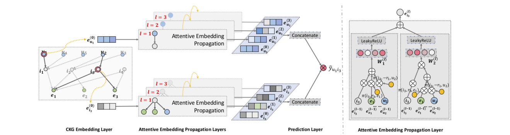
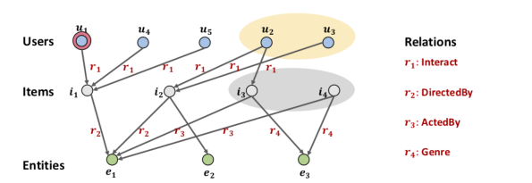
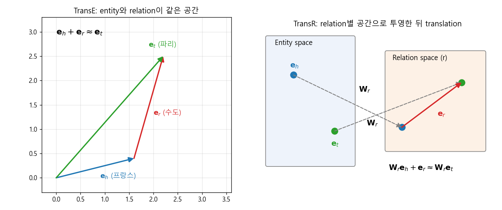
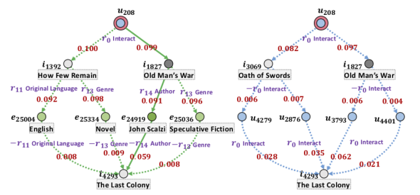

### 유저-아이템 그래프와 지식 그래프를 하나로 합쳐, 고차 연결성(high-order connectivity)을 어텐션으로 학습하는 KGAT에 대해 알아봅니다.  


> 원제  
> **KGAT: Knowledge Graph Attention Network for Recommendation**  
> Xiang Wang, Xiangnan He, Yixin Cao, Meng Liu, Tat-Seng Chua (KDD 2019)  

<center></center>   

<font size="2"><center> 출처: Wang et al., KGAT: Knowledge Graph Attention Network for Recommendation (https://arxiv.org/abs/1905.07854) </center>  </font>   

<br/>


>  **1. FM 류의 지도학습 모델은 각 interaction을 독립적인 샘플로 취급해, 아이템의 속성을 매개로 이어지는 협업 신호(collaborative signal)를 놓침**
>
>  **2. KGAT는 유저-아이템 그래프와 지식 그래프를 합친 Collaborative Knowledge Graph(CKG) 위에서, TransR 임베딩 + relation 기반 attention propagation으로 고차 연결성을 end-to-end로 학습함**
>
>  **3. 어텐션 가중치를 따라가면 "왜 이 아이템을 추천했는지"를 경로 형태로 설명할 수 있음**

<br/>

----

**본 포스트는 KGAT 논문을 읽고 정리한 노트입니다.**
원문은 여기에서 보실 수 있습니다. [paper](https://arxiv.org/abs/1905.07854), [official code](https://github.com/xiangwang1223/knowledge_graph_attention_network)   

----
#### Contents  

1. [Intro - interaction은 정말 서로 독립일까?](#intro)  
2. [Collaborative Knowledge Graph와 고차 연결성](#ckg)  
3. [사전 지식: Knowledge Graph Embedding (TransE에서 TransR까지)](#kge)  
4. [KGAT 모델 구조](#model)  
5. [실험 결과](#experiment)  
6. [어텐션으로 추천 이유 설명하기](#explain)  
7. [실무에 적용한다면?](#apply)  
8. [마치며](#conclusion)  
<br />

<a id="intro"></a>
## 1. Intro - interaction은 정말 서로 독립일까?  

추천을 더 정확하고, 다양하고, 설명 가능하게 만들려면 유저-아이템 interaction만 보는 것으로는 부족합니다.  
아이템의 속성이나 유저의 프로필 같은 **사이드 정보(side information)**를 함께 써야 하는데요.  

순수한 CF(Collaborative Filtering) 모델은 이 사이드 정보를 담을 자리가 마땅치 않습니다.  
그래서 흔히 쓰는 방법이 FM(Factorization Machine), NFM, Wide&Deep 처럼 문제를 **지도학습(supervised learning)**으로 바꾸는 것입니다.  
interaction 하나를 "유저 ID + 아이템 ID + 각종 속성"으로 이루어진 feature 벡터로 만들고, 클릭/구매 여부를 맞추는 식이죠.  

그런데 여기에는 숨은 가정이 하나 있습니다. **각 interaction이 서로 독립인 샘플**이라는 가정인데요.  
실제 세계의 아이템들은 서로 얽혀 있습니다. 어떤 영화의 감독이 다른 영화에서는 배우로 출연하기도 하고, 같은 감독의 영화들은 장르나 분위기를 공유하기도 하죠.  
interaction을 독립 샘플로 쪼개버리면 이런 아이템 간의 관계, 그리고 이를 매개로 한 유저들의 집합적인 행동 패턴(collaborative signal)을 뽑아내기 어렵습니다.  

- 사이드 정보를 쓰는 기존 지도학습 모델은 interaction을 독립 인스턴스로 간주함  
- 그 결과 **속성을 매개로 한 협업 신호**를 포착하지 못함  
    - 예) 내가 본 영화와 **같은 감독**의 영화, 혹은 그 감독이 **배우로 출연**한 영화를 추천해주지 못함  
- 또한 여러 단계를 건너 이어지는 **고차 연결성(high-order connectivity)**을 고려할 수 없음  

KGAT는 이 독립 가정을 깨기 위해 **지식 그래프(Knowledge Graph, KG)**를 가져옵니다.  
아이템을 속성으로 연결해 하나의 그래프로 만들고, 그 위에서 GNN으로 정보를 전파하자는 것이죠.  


<a id="ckg"></a>
## 2. Collaborative Knowledge Graph와 고차 연결성  

### Collaborative Knowledge Graph (CKG)  

논문은 두 종류의 그래프를 하나로 합칩니다.  

- **유저-아이템 bipartite 그래프**: 유저가 아이템과 상호작용했으면 `Interact`라는 relation으로 연결  
- **지식 그래프**: (head, relation, tail) 형태의 triplet 집합. 예) (영화 A, DirectedBy, 감독 B)  

아이템과 KG의 entity를 매칭(item-entity alignment)하면, 유저-아이템 interaction 역시 $(u, \text{Interact}, i)$라는 triplet으로 표현할 수 있게 됩니다.  
이렇게 두 그래프를 하나로 묶은 것을 **Collaborative Knowledge Graph(CKG)**라고 부릅니다.  

<center></center>   

<font size="2"><center> 출처: Wang et al., KGAT (https://arxiv.org/abs/1905.07854), Figure 1 </center>  </font>   

<br/>

### 고차 연결성은 왜 중요할까?  

위 그림에서 추천 대상 유저 $u_1$의 입장에서 생각해 볼까요?  

- $u_1 \xrightarrow{r_1} i_1 \xrightarrow{-r_1} u_2 \xrightarrow{r_1} i_2$ : 같은 아이템을 본 다른 유저가 본 아이템. 전통적인 CF가 잡아내는 신호임  
- $u_1 \xrightarrow{r_1} i_1 \xrightarrow{r_2} e_1 \xrightarrow{-r_2} i_2$ : $u_1$이 본 영화 $i_1$과 **같은 감독** $e_1$의 영화 $i_2$  
- $u_1 \xrightarrow{r_1} i_1 \xrightarrow{r_2} e_1 \xrightarrow{-r_3} i_3$ : $i_1$의 감독 $e_1$이 **배우로 출연**한 영화 $i_3$  

두 번째, 세 번째 경로처럼 서로 다른 relation을 건너 이어지는 신호는 FM 같은 모델이 볼 수 없는 정보입니다.  
그림의 노란 영역($u_2, u_3$)과 회색 영역($i_3, i_4$)이 바로 $u_1$과 고차(high-order)로 연결된 노드들인데요, 이걸 잘 활용하는 것이 KGAT의 핵심입니다.  

### 그런데 문제가 있습니다  

1. **연산량 폭발**: 경로 길이가 길어질수록 고려해야 할 노드 수가 기하급수적으로 늘어남  
2. **불균등한 기여도**: 모든 고차 연결이 예측에 똑같이 중요하지 않음. 어떤 경로에 가중치를 줄지 잘 골라야 함  

기존 KG 기반 추천은 크게 두 갈래로 이 문제에 접근해 왔습니다.  

- **Path-based** (PER, MCRec, KPRN 등): 메타패스를 정의하거나 경로를 샘플링해 모델 입력으로 사용함. 경로 선택이 성능을 크게 좌우하고, 메타패스 설계에 도메인 지식과 노동이 필요함  
- **Regularization-based** (CKE, CFKG 등): KG 임베딩 학습을 추가 loss로 붙여 아이템 표현을 정규화함. 고차 연결성을 **명시적으로** 다루지 않고 암묵적으로만 반영함  

그래서 저자들은 효율적이고, 명시적이며, end-to-end로 고차 연결 정보를 쓸 수 있는 방법이 필요하다고 주장하고, 그 답으로 GNN 기반의 KGAT를 제안합니다.  


<a id="kge"></a>
## 3. 사전 지식: Knowledge Graph Embedding (TransE에서 TransR까지)  

KGAT의 첫 번째 레이어는 KG 임베딩, 그중에서도 TransR을 사용합니다. 모델로 들어가기 전에 짧게 짚고 넘어가겠습니다.  

### Knowledge Graph란?  

실제 세계를 구성하는 개체들과 그들 사이의 관계를 네트워크로 나타낸 것입니다.  

- **노드(node, entity)**: 네트워크를 구성하는 개체 혹은 개념. 예) 유저, 영화, 감독, 장르  
- **엣지(edge, relation)**: 개체 간의 관계. 예) 친구, 팔로우, 감독함, 출연함  
- **라벨(label)**: 노드와 엣지의 종류를 구분하는 이름  

KG의 엣지 하나는 triplet $(h, r, t)$로 표현됩니다.  

- $h$: head. 출발점이자 우리가 관심 있는 노드  
- $r$: relation. 노드 간의 관계  
- $t$: tail. 관계의 대상이 되는 노드  

### KG Embedding  

KG embedding은 이 entity와 relation을 수치 벡터로 바꾸는 작업입니다.  
"프랑스의 수도는?" 이라는 질문에 대해 $\mathbf{e}_{\text{프랑스}} + \mathbf{e}_{\text{수도}} \approx \mathbf{e}_{\text{파리}}$가 되도록 학습하는 식이죠.  
의미적인 개념이 벡터 공간에 잘 녹아 있다면, 그래프에 직접 입력되지 않은 사실(링크)도 추론할 수 있게 됩니다.  

TransE, TransH, TransR, DistMult, ComplEx, RotatE 등 다양한 방법이 제안되어 왔는데요, 관계에는 여러 성질이 있어서 이를 모두 깔끔하게 표현하는 것은 꽤 어렵습니다.  

- **대칭(Symmetric)**: 나와 친구 관계인 사람의 친구 목록에는 나도 있음  
- **비대칭(Antisymmetric)**: 상위어/하위어 관계  
- **역관계(Inverse)**: 팔로우 / 팔로잉  
- **조합(Composition)**: 우리 엄마의 남편은 우리 아빠  
- **1대다(1-to-N)**: 한 교수에게 여러 명의 제자가 있음  

### TransE / TransH / TransR  

<center></center>   

<br/>

**TransE**는 가장 직관적입니다. entity와 relation을 같은 공간에 두고 $\mathbf{e}_h + \mathbf{e}_r \approx \mathbf{e}_t$가 되도록 학습합니다.  
하지만 대칭 관계와 1대다 관계에서 문제가 생기는데요.  

- 대칭: A + 친구 = B 이고 B + 친구 = A 가 동시에 성립하려면 $\mathbf{e}_{\text{친구}} \approx 0$이 되어버림  
- 1대다: 나에게 친구 A, B, C가 있으면 $\mathbf{e}_{나} + \mathbf{e}_{\text{친구}}$ 하나의 점에 A, B, C가 모두 모여야 하므로 셋의 임베딩이 구분되지 않음  

**TransH**는 relation마다 고유한 hyperplane을 두고, head와 tail을 그 평면에 projection한 뒤 translation을 수행합니다. 같은 entity라도 relation에 따라 다른 모습으로 표현될 수 있게 된 것이죠.  

**TransR**은 한 발 더 나아가, entity와 relation은 성질이 다른 객체이므로 같은 공간에 두면 의미가 왜곡된다고 봅니다.  
그래서 relation마다 별도의 **relation space**를 두고, 투영 행렬 $\mathbf{W}_r$로 entity를 그 공간으로 보낸 뒤 translation을 합니다.  

$$
g(h, r, t) = \lVert \mathbf{W}_r \mathbf{e}_h + \mathbf{e}_r - \mathbf{W}_r \mathbf{e}_t \rVert_2^2
$$

- $\mathbf{W}_r \in \mathbb{R}^{k \times d}$: entity 공간($d$차원)을 relation $r$의 공간($k$차원)으로 보내는 행렬  
- $g$가 낮을수록 해당 triplet이 그럴듯하다(plausible)고 해석함  
    - 예) "유저1"을 `Interact` 공간으로 보낸 뒤 relation 벡터를 더한 결과가 "아이템7"의 투영과 가깝다면, 실제로 유저1이 아이템7과 상호작용했을 가능성이 높다는 뜻임  
- relation마다 독립된 공간을 가지므로 표현의 자유도가 높아, TransE가 어려워하던 대칭/1대다 관계를 훨씬 유연하게 표현할 수 있음  

물론 앞서 나열한 모든 관계 성질을 완벽히 만족하는 방법은 아직 없고, TransR도 조합(composition) 같은 관계에는 한계가 있습니다.  
그래도 relation 종류가 많은 추천용 CKG에서는 이 유연성이 큰 장점이라 KGAT에서 채택되었습니다.  


<a id="model"></a>
## 4. KGAT 모델 구조  

맨 위의 그림을 다시 보면 KGAT는 크게 세 단계로 이루어집니다.  

1. **CKG Embedding Layer**: TransR로 entity와 relation 임베딩을 학습  
2. **Attentive Embedding Propagation Layers**: 이웃으로부터 중요도(attention)에 따라 정보를 전파받고, 이를 여러 층 쌓아 고차 연결성을 포착  
3. **Prediction Layer**: 각 층의 표현을 이어 붙여 유저-아이템 선호도를 예측  

직관적으로 요약하면 이렇습니다.  

- CKG 안의 다양한 관계를 사용해 유저/아이템/entity의 구조적, 의미적 정보를 담은 임베딩을 만들고  
- 연결된 이웃으로부터 **중요도에 따라** 정보를 전달받는데, 이 중요도는 **relation space 안에서의 거리**로 정해지며 (가까울수록 더 중요)  
- 자기 자신(head)의 벡터와 이웃(neighbor)의 벡터를 결합해 다음 층의 표현을 만듦  

### 4-1. CKG Embedding Layer  

앞에서 본 TransR의 점수 함수 $g(h,r,t)$를 그대로 사용하고, 실제 triplet과 tail을 무작위로 바꾼 가짜 triplet을 구분하도록 pairwise ranking loss를 줍니다.  

$$
\mathcal{L}_{KG} = \sum_{(h,r,t,t') \in \mathcal{T}} -\ln \sigma \big( g(h,r,t') - g(h,r,t) \big)
$$

진짜 triplet의 점수(거리)는 낮게, 가짜 triplet의 점수는 높게 만드는 BPR 스타일의 목적함수입니다.  

### 4-2. Attentive Embedding Propagation Layer  

GCN 계열 모델처럼 이웃의 정보를 모아 자신의 표현을 업데이트하는 레이어입니다. 세 부분으로 나눠 볼 수 있습니다.  

**(1) Information Propagation**  

entity $h$를 head로 하는 triplet 집합, 즉 $h$의 ego-network를 $\mathcal{N}_h = \lbrace (h,r,t) \mid (h,r,t) \in \mathcal{G} \rbrace$ 라고 하면, 이웃 정보는 tail 임베딩의 가중합으로 표현됩니다.  

$$
\mathbf{e}_{\mathcal{N}_h} = \sum_{(h,r,t) \in \mathcal{N}_h} \pi(h,r,t)\, \mathbf{e}_t
$$

**(2) Knowledge-aware Attention**  

핵심은 가중치 $\pi(h,r,t)$를 어떻게 정하느냐입니다.  

$$
\pi(h,r,t) = (\mathbf{W}_r \mathbf{e}_t)^\top \tanh\big(\mathbf{W}_r \mathbf{e}_h + \mathbf{e}_r\big)
$$

그리고 $h$의 모든 이웃에 대해 softmax로 정규화합니다.  

$$
\pi(h,r,t) = \frac{\exp(\pi(h,r,t))}{\sum_{(h,r',t') \in \mathcal{N}_h} \exp(\pi(h,r',t'))}
$$

TransR과 같은 relation space 안에서, "head를 relation만큼 이동시킨 위치"와 tail이 얼마나 가까운지(내적이 큰지)로 중요도를 매기는 셈입니다.  
[GAT](https://myeonghak.github.io/graph%20neural%20networks/GNN-PinSAGE%EC%99%80-GAT/)가 노드 임베딩만으로 attention을 계산했다면, KGAT는 **relation $r$까지 attention 계산에 넣었다**는 점이 다릅니다. 같은 이웃이라도 어떤 관계로 연결되었느냐에 따라 중요도가 달라지는 것이죠.  

GraphSAGE의 mean aggregator처럼 이웃을 균등하게 평균내는 방식과 비교하면 장점이 분명합니다.  

- 중요한 이웃의 정보에 더 큰 가중치를 주어 더 나은 표현을 학습할 수 있음  
    - 예) 어떤 유저가 우연히 딱 한 번 방문한 가게보다, 꾸준히 비슷한 성격의 가게를 방문해온 패턴에 더 큰 가중치를 부여  
- 예측 시 어떤 이웃을 중요하게 보았는지 확인할 수 있어 해석이 쉬움 (mean aggregation에서는 파악하기 어려웠던 부분)  

**(3) Information Aggregation**  

마지막으로 자기 자신의 표현 $\mathbf{e}_h$와 이웃 표현 $\mathbf{e}_{\mathcal{N}_h}$를 합쳐 새 표현을 만듭니다. 논문은 세 가지 aggregator를 비교합니다.  

- **GCN Aggregator**: $f = \text{LeakyReLU}\big(\mathbf{W}(\mathbf{e}_h + \mathbf{e}_{\mathcal{N}_h})\big)$  
- **GraphSAGE Aggregator**: $f = \text{LeakyReLU}\big(\mathbf{W}(\mathbf{e}_h \parallel \mathbf{e}_{\mathcal{N}_h})\big)$  
- **Bi-Interaction Aggregator**:  

$$
f = \text{LeakyReLU}\big(\mathbf{W}_1(\mathbf{e}_h + \mathbf{e}_{\mathcal{N}_h})\big) + \text{LeakyReLU}\big(\mathbf{W}_2(\mathbf{e}_h \odot \mathbf{e}_{\mathcal{N}_h})\big)
$$

Bi-Interaction은 덧셈 항에 더해 element-wise 곱 항을 추가해, 자신과 이웃 사이의 **feature interaction**을 명시적으로 반영합니다. (NFM의 Bi-Interaction pooling과 같은 아이디어입니다.) 실험에서도 이 방식이 가장 좋았습니다.  

**High-order Propagation**  

이 레이어를 $L$번 쌓으면 $L$-hop 떨어진 이웃의 정보까지 전파받을 수 있습니다.  

$$
\mathbf{e}_h^{(l)} = f\big(\mathbf{e}_h^{(l-1)}, \mathbf{e}_{\mathcal{N}_h}^{(l-1)}\big), \quad
\mathbf{e}_{\mathcal{N}_h}^{(l-1)} = \sum_{(h,r,t) \in \mathcal{N}_h} \pi(h,r,t)\, \mathbf{e}_t^{(l-1)}
$$

경로를 일일이 샘플링하거나 메타패스를 정의하지 않고도, 레이어를 쌓는 것만으로 고차 연결성을 **명시적으로** 모델링할 수 있게 된 것입니다.  

감을 잡기 위해 attention과 Bi-Interaction을 아주 작게 구현해 보면 이렇습니다. (head 노드 하나와 이웃 4개만 있는 toy 예제입니다.)  

```python
import torch
import torch.nn as nn
import torch.nn.functional as F

torch.manual_seed(0)
d, k = 8, 8                      # entity / relation 임베딩 차원
n_entity, n_relation = 6, 3

ent = nn.Embedding(n_entity, d)
rel = nn.Embedding(n_relation, k)
W_r = nn.Parameter(torch.randn(n_relation, d, k) * 0.1)  # relation별 투영 행렬

# head 0번 노드의 ego-network: (relation, tail) 목록
h = torch.tensor([0, 0, 0, 0])
r = torch.tensor([0, 0, 1, 2])
t = torch.tensor([1, 2, 3, 4])

# 1) knowledge-aware attention: pi(h,r,t) = (W_r e_t)^T tanh(W_r e_h + e_r)
Wh = torch.bmm(ent(h).unsqueeze(1), W_r[r]).squeeze(1)
Wt = torch.bmm(ent(t).unsqueeze(1), W_r[r]).squeeze(1)
score = (Wt * torch.tanh(Wh + rel(r))).sum(-1)
pi = F.softmax(score, dim=0)     # head의 이웃들 사이에서 정규화
print("attention:", pi.detach().numpy().round(3))

# 2) 이웃 정보 합치기 + Bi-Interaction aggregator
e_h = ent(torch.tensor(0))
e_N = (pi.unsqueeze(-1) * ent(t)).sum(0)
W1, W2 = nn.Linear(d, 4), nn.Linear(d, 4)
e_h_new = F.leaky_relu(W1(e_h + e_N)) + F.leaky_relu(W2(e_h * e_N))
print("next-layer embedding shape:", tuple(e_h_new.shape))
```

```
attention: [0.233 0.166 0.345 0.256]
next-layer embedding shape: (4,)
```

### 4-3. Prediction Layer  

$L$개 층을 지나면 유저 $u$는 $\lbrace \mathbf{e}_u^{(0)}, \dots, \mathbf{e}_u^{(L)} \rbrace$, 아이템 $i$는 $\lbrace \mathbf{e}_i^{(0)}, \dots, \mathbf{e}_i^{(L)} \rbrace$ 라는 여러 표현을 갖게 됩니다.  
층마다 담고 있는 hop의 범위가 다르므로, 이를 모두 이어 붙여(concatenate) 최종 표현을 만들고 내적으로 점수를 냅니다.  

$$
\mathbf{e}_u^{*} = \mathbf{e}_u^{(0)} \parallel \cdots \parallel \mathbf{e}_u^{(L)}, \quad
\mathbf{e}_i^{*} = \mathbf{e}_i^{(0)} \parallel \cdots \parallel \mathbf{e}_i^{(L)}, \quad
\hat{y}(u,i) = {\mathbf{e}_u^{*}}^\top \mathbf{e}_i^{*}
$$

### 4-4. 학습  

추천 쪽 loss로는 관측된 interaction의 점수가 관측되지 않은 것보다 높도록 하는 BPR loss를 씁니다.  

$$
\mathcal{L}_{CF} = \sum_{(u,i,j) \in O} -\ln \sigma\big(\hat{y}(u,i) - \hat{y}(u,j)\big)
$$

최종 목적함수는 두 loss와 L2 정규화를 더한 형태입니다.  

$$
\mathcal{L}_{KGAT} = \mathcal{L}_{KG} + \mathcal{L}_{CF} + \lambda \lVert \Theta \rVert_2^2
$$

실제 학습은 $\mathcal{L}_{KG}$와 $\mathcal{L}_{CF}$를 **번갈아가며(alternative)** mini-batch로 최적화합니다. TransR로 임베딩을 다듬고, 그 임베딩을 바탕으로 attention propagation과 추천 loss를 업데이트하는 과정을 반복하는 것이죠.  


<a id="experiment"></a>
## 5. 실험 결과  

### 데이터셋  

| | Amazon-book | Last-FM | Yelp2018 |
|---|---|---|---|
| #Users | 70,679 | 23,566 | 45,919 |
| #Items | 24,915 | 48,123 | 45,538 |
| #Interactions | 847,733 | 3,034,796 | 1,185,068 |
| #Entities | 88,572 | 58,266 | 90,961 |
| #Relations | 39 | 9 | 42 |
| #Triplets | 2,557,746 | 464,567 | 1,853,704 |

- **Last-FM**: 음악 청취 데이터셋. 2015년 1월~6월 데이터를 사용함  
- **Yelp2018**: 레스토랑, 바 같은 지역 상점이 아이템인 데이터셋. 상점 카테고리, 위치, 특징 등을 item knowledge로 추출함  
- 데이터 품질을 위해 모든 데이터셋에서 최소 10개의 interaction을 가진 유저와 아이템만 남김 (10-core setting)  
- user-item interaction뿐 아니라 item knowledge도 구성해야 하는데, Amazon-book과 Last-FM은 Freebase에 아이템을 매핑하고 아이템의 **two-hop 이웃까지** 포함하는 triplet을 사용함  

### 전체 성능 (recall@20 / ndcg@20)  

| Model | Amazon-Book | Last-FM | Yelp2018 |
|---|---|---|---|
| FM | 0.1345 / 0.0886 | 0.0778 / 0.1181 | 0.0627 / 0.0768 |
| NFM | 0.1366 / 0.0913 | 0.0829 / 0.1214 | 0.0660 / 0.0810 |
| CKE | 0.1343 / 0.0885 | 0.0736 / 0.1184 | 0.0657 / 0.0805 |
| RippleNet | 0.1336 / 0.0910 | 0.0791 / 0.1238 | 0.0664 / 0.0822 |
| GC-MC | 0.1316 / 0.0874 | 0.0818 / 0.1253 | 0.0659 / 0.0790 |
| **KGAT** | **0.1489 / 0.1006** | **0.0870 / 0.1325** | **0.0712 / 0.0867** |

KGAT는 모든 데이터셋에서 가장 좋은 성능을 보였고, 가장 강한 baseline 대비 recall@20 기준으로 Amazon-book 8.95%, Last-FM 4.93%, Yelp2018 7.18% 개선되었습니다.  
또 interaction 수가 적은 **sparse한 유저 그룹**일수록 개선 폭이 컸는데, interaction이 부족한 유저일수록 KG를 통한 고차 연결 정보가 표현 학습에 도움을 준다는 해석입니다.  

### Ablation에서 눈여겨볼 점  

- **레이어 깊이**: KGAT-1 -> 2 -> 3으로 쌓을수록 성능이 꾸준히 오르고, KGAT-4는 소폭 개선에 그침. 3차(third-order) 관계 정도면 충분히 정보를 담는다는 의미임  
- **Aggregator**: (KGAT-1 기준) Bi-Interaction > GCN > GraphSAGE. GraphSAGE는 $\mathbf{e}_h$와 $\mathbf{e}_{\mathcal{N}_h}$의 상호작용을 포기하기 때문이라고 분석함  
- **KGE와 Attention 제거**: TransR 학습(KGE)을 빼거나 attention을 빼면 모두 성능이 떨어지고, 둘 다 빼면 가장 크게 떨어짐 (Amazon-book recall 0.1393 -> 0.1367)  


<a id="explain"></a>
## 6. 어텐션으로 추천 이유 설명하기  

attention 기반 모델의 큰 매력은 **예측 시 어떤 이웃에 큰 가중치를 두었는지** 들여다볼 수 있다는 점입니다.  
게다가 KG는 entity와 relation 자체에 의미가 있으므로, 어텐션이 높은 경로를 따라가면 사람이 읽을 수 있는 설명이 됩니다.  

<center></center>   

<font size="2"><center> 출처: Wang et al., KGAT (https://arxiv.org/abs/1905.07854), Figure 4 </center>  </font>   

<br/>

Amazon-Book에서 유저 $u_{208}$에게 《The Last Colony》를 추천한 사례입니다. (왼쪽 초록색은 KG를 통한 경로, 오른쪽 파란색은 유저-아이템 interaction을 통한 경로)  
attention 점수가 가장 높은 경로를 따라가면 $u_{208} \xrightarrow{\text{Interact}} \text{Old Man's War} \xrightarrow{\text{Author}} \text{John Scalzi} \xrightarrow{-\text{Author}} \text{The Last Colony}$ 입니다.  
즉, "당신이 읽은 《Old Man's War》를 쓴 **John Scalzi**의 책이라서 추천합니다" 라는 설명을 만들 수 있는 것이죠.  
메타패스를 사람이 미리 정해주지 않았는데도 모델이 스스로 의미 있는 경로를 찾아냈다는 점이 인상적입니다.  


<a id="apply"></a>
## 7. 실무에 적용한다면?  

논문을 읽으며 실제 서비스에 적용한다면 어떤 점을 고민해야 할지도 정리해 보았습니다.  

### 장점  

- **이질적인 그래프를 자연스럽게 담을 수 있음**: 실제 서비스는 유저/아이템/브랜드/콘텐츠 등 다수의 노드 타입과 구매, 구독, 신청 같은 다양한 연결 관계를 가지는 heterogeneous graph인 경우가 많음. 이를 KG로 구성하면 구조적 정보를 활용한 정밀한 추천이 가능함  
- **확장성**: KG의 특성상 새로운 노드 타입과 relation이 추가되어도 유연하게 확장 가능함  
- **임베딩 재활용**: 학습된 KG 임베딩은 단순한 feature가 아니라 행동 패턴이 반영된 벡터이므로, 추천 이외에도 고객 클러스터링/프로파일링, 위치 기반(POI) 추천 등 다른 애플리케이션에 활용 가능함  

### 고민할 점  

- **Heterogeneous setting**: 논문은 사실상 "아이템의 메타 정보 entity"라는 구조를 가정함. 유저 쪽에도 여러 종류의 이웃 노드가 붙는 구조라면, 추천 대상이 아닌 노드를 entity 자리에 대치하는 식으로 적용할 수 있음  
- **Triplet 샘플링 비율**: 특정 relation의 엣지가 압도적으로 dense한 경우(예: 빈번한 거래 로그 vs 드문 목표 interaction), 이 엣지를 모두 쓰면 늘어난 연산량 대비 성능 향상을 기대하기 어려움. 우리가 실제로 잘 맞추고 싶은 relation을 중심으로 비율을 조절해야 함  
- **Aggregation 확장**: 이질적인 입력 차원을 갖는 여러 종류의 이웃으로부터 정보를 받아야 한다면, Bi-Interaction aggregator를 노드 타입별로 확장하는 설계가 필요함. 이 부분은 [HAN](https://myeonghak.github.io/recommender%20systems/RecSys-Heterogeneous-Graph-Attention-Networks-paper-review/) 같은 heterogeneous GNN의 아이디어를 참고할 만함  
- **확장성(scalability)**: 전체 CKG에 대해 attention을 계산하므로, 그래프가 커지면 이웃 샘플링 같은 추가 장치가 필요할 수 있음  

GNN 기반 추천 모델 전반의 흐름이 궁금하시다면 [GNN 기반 추천시스템 서베이](https://myeonghak.github.io/graph%20neural%20networks/GNN-GNN-%EA%B8%B0%EB%B0%98-%EC%B6%94%EC%B2%9C%EC%8B%9C%EC%8A%A4%ED%85%9C-%EC%84%9C%EB%B2%A0%EC%9D%B4/) 포스트도 함께 보시면 좋겠습니다.  


<a id="conclusion"></a>
## 8. 마치며  

KGAT를 한 줄로 요약하면 **"KG 임베딩(TransR)으로 relation의 의미를 배우고, 그 relation space 위에서 GAT 스타일로 이웃 정보를 전파하는 모델"** 이라고 할 수 있겠습니다.  

- interaction을 독립 샘플로 보는 FM 류 모델의 한계를 CKG라는 하나의 그래프로 풀어냄  
- 메타패스 설계 없이 레이어를 쌓는 것만으로 고차 연결성을 명시적으로 모델링함  
- relation을 고려한 attention 덕분에 성능과 설명 가능성을 함께 챙김  

개인적으로는 TransR과 attention이 "같은 relation space"를 공유하도록 설계한 부분이 가장 깔끔하다고 느꼈습니다. 임베딩 학습과 이웃의 중요도 판단이 같은 기하학적 직관 위에서 움직이니까요.  
반대로 실무에서는 결국 "어떤 엔티티와 관계로 그래프를 구성하느냐"가 성능의 대부분을 결정할 것 같다는 생각도 듭니다. 좋은 모델보다 좋은 그래프가 먼저라는, 어쩌면 당연한 이야기겠죠.  

<br>

----------------


**개선을 위한 여러분의 피드백과 제안을 코멘트로 공유해 주세요.**
**내용에 대한 지적, 혹은 질문을 환영합니다.**  


**출처**  
[Wang et al., KGAT: Knowledge Graph Attention Network for Recommendation (KDD 2019)](https://arxiv.org/abs/1905.07854)  
[KGAT official code (GitHub)](https://github.com/xiangwang1223/knowledge_graph_attention_network)  
[Lin et al., Learning Entity and Relation Embeddings for Knowledge Graph Completion (TransR, AAAI 2015)](https://ojs.aaai.org/index.php/AAAI/article/view/9491)  
