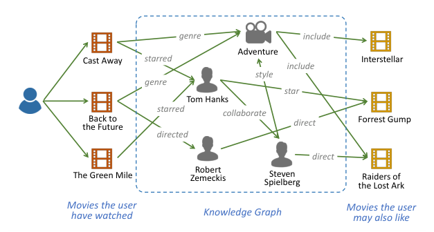
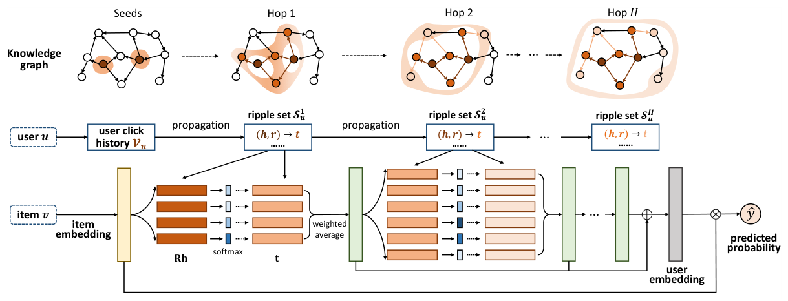
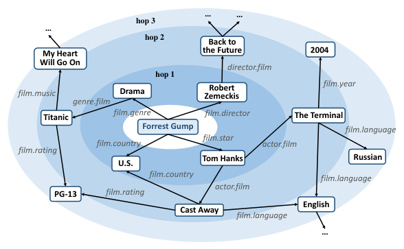

### 수면에 떨어진 물방울처럼, 유저의 클릭 기록에서 시작된 선호가 지식 그래프 위로 퍼져나가는 RippleNet에 대해 알아봅니다.  


> 원제  
> **RippleNet: Propagating User Preferences on the Knowledge Graph for Recommender Systems**  
> Hongwei Wang, Fuzheng Zhang, Jialin Wang, Miao Zhao, Wenjie Li, Xing Xie, Minyi Guo (CIKM 2018)  

<center></center>   

<font size="2"><center> 출처: Wang et al., RippleNet: Propagating User Preferences on the Knowledge Graph for Recommender Systems (https://arxiv.org/abs/1803.03467) </center>  </font>   

<br/>


>  **1. 기존 KG 기반 추천은 embedding 기반(in-graph task에 더 적합)과 path 기반(meta-path를 사람이 설계해야 함)으로 나뉘며, 각각 한계가 있음**
>
>  **2. RippleNet은 유저의 클릭 기록을 seed로 삼아 KG 위에서 hop 단위의 ripple set을 만들고, 후보 아이템과의 연관 확률(relevance probability)로 가중합하며 선호를 전파(preference propagation)함**
>
>  **3. 전파 과정에서 높은 연관 확률을 따라가면 "왜 이 아이템인지"를 경로로 설명할 수 있으며, meta-path 설계 없이 end-to-end로 학습됨**

<br/>

----

**본 포스트는 RippleNet 논문을 읽고 정리한 노트입니다.**
원문은 여기에서 보실 수 있습니다. [paper](https://arxiv.org/abs/1803.03467), [official code](https://github.com/hwwang55/RippleNet)   

----
#### Contents  

1. [Intro - 지식 그래프, 어떻게 추천에 녹일까?](#intro)  
2. [전체 프레임워크](#framework)  
3. [Ripple Set: 꼬리에 꼬리를 무는 연관 개체들](#rippleset)  
4. [Preference Propagation: 선호는 어떻게 퍼져나갈까?](#propagation)  
5. [학습 알고리즘](#learning)  
6. [설명 가능성과 Ripple Superposition](#discussion)  
7. [실험 결과](#experiments)  
8. [KGAT와 비교해보기](#kgat)  
9. [마치며](#conclusion)  
<br />

<a id="intro"></a>
## 1. Intro - 지식 그래프, 어떻게 추천에 녹일까?  

협업 필터링(CF) 기반의 추천 모델은 오랫동안 추천 시스템의 주인공이었지만, 고질적인 두 가지 문제에 시달려 왔습니다. 바로 **sparsity**와 **cold-start** 문제인데요.  
유저-아이템 상호작용 행렬은 대부분이 비어 있고, 새로 들어온 유저나 아이템은 기록 자체가 없으니 CF 만으로는 할 수 있는 게 많지 않습니다.  

그래서 많은 연구자들이 소셜 네트워크, 아이템 속성 같은 **side information**을 끌어오는 방향을 택했는데, 그 중에서도 가장 풍부한 정보원이 바로 **지식 그래프(Knowledge Graph, KG)** 입니다.  
영화를 예로 들면 "포레스트 검프 -감독-> 로버트 저메키스", "포레스트 검프 -주연-> 톰 행크스"와 같은 (head, relation, tail) 형태의 triple이 수없이 연결되어 있는 그래프죠.  
위 그림처럼, 유저가 본 영화들과 아직 보지 않은 영화들이 배우, 감독, 장르 같은 개체(entity)를 통해 이어져 있다면 이를 추천에 활용하지 않을 이유가 없겠죠.  

기존의 KG-aware 추천 방법론은 크게 두 갈래로 나뉩니다.  

- **Embedding 기반**: TransE, TransR 등의 KGE(Knowledge Graph Embedding) 기법으로 개체 임베딩을 학습한 뒤 추천 모델에 넣어줌 (CKE, DKN 등)
  - 그런데 KGE 기법은 본래 link prediction 같은 **in-graph application**을 위해 설계된 것이라, 추천에 꼭 맞는 표현을 학습한다고 보기 어려움
- **Path 기반**: KG 내의 개체 간 연결 패턴(meta-path)을 추출해 추천에 활용함 (PER 등)
  - 하지만 meta-path를 **사람이 수작업으로 설계**해야 하고, 도메인 지식이 많이 필요하며 최적이라는 보장도 없음

RippleNet은 이 두 갈래의 한계를 동시에 극복하고자 고안된 **CTR prediction을 위한 end-to-end 프레임워크**입니다.  
기존 방법론과 구별되는 포인트는 크게 두 가지입니다.  

1. **Preference propagation**: KGE를 따로 떼어 쓰는 대신, 유저의 선호 자체를 KG 위에서 전파시키며 유저 표현을 만듦
2. **자동 path 발견**: 유저의 과거 기록에서 출발해 유의미한 경로를 모델이 스스로 찾아냄 (meta-path 설계 불필요)

이름의 유래도 재미있는데요, ripple은 우리말로 **파문(물결)** 이라는 뜻입니다.  
수면에 물방울이 떨어지면 동그란 물결이 퍼져나가듯, 아이템과 그 특성들로 이루어진 KG라는 수면 위에 "유저의 interaction"이라는 물방울이 떨어졌을 때 유저의 선호가 어떻게 퍼져나가는지를 모델링한다는 의미를 담고 있습니다.  


<a id="framework"></a>
## 2. 전체 프레임워크  

먼저 큰 그림부터 보고 들어가 보겠습니다.  

<center></center>   

<font size="2"><center> 출처: Wang et al., RippleNet: Propagating User Preferences on the Knowledge Graph for Recommender Systems (https://arxiv.org/abs/1803.03467) </center>  </font>   

<br/>

RippleNet의 동작을 순서대로 정리하면 다음과 같습니다.  

- 유저 $u$와 아이템 $v$를 입력으로 받아, 유저가 아이템을 클릭할 확률 $\hat{y}_{uv}$를 예측함
- 유저 $u$가 과거에 클릭했던 아이템 집합 $\mathcal{V}_u$를 **seed**로 간주함
- seed로부터 hop 별로 여러 개의 **ripple set** $\mathcal{S}^k_u$를 생성함. 이는 seed로부터 $k$-hop 떨어진 knowledge triple(즉, KG의 edge)들의 집합임
- ripple set들이 아이템 임베딩과 반복적으로 상호작용하면서, **아이템 $v$의 관점에서 본 유저 $u$의 응답**을 hop마다 얻어냄
- 이 응답들을 합쳐 최종 유저 임베딩을 만들고, 아이템 임베딩과 내적해 클릭 확률을 계산함

그림 윗부분의 KG를 보면 seed에서 출발한 주황색 영역이 hop이 늘어날수록 점점 넓고 옅게 퍼져나가는 것을 볼 수 있는데요, 이것이 바로 "ripple"의 시각화입니다.  
아랫부분은 이 과정을 실제 연산으로 옮긴 것으로, $\mathbf{Rh}$와 아이템 임베딩을 비교해 softmax를 취하고 이를 가중치로 $\mathbf{t}$를 weighted average 하는 블록이 hop 수만큼 반복됩니다.  


<a id="rippleset"></a>
## 3. Ripple Set: 꼬리에 꼬리를 무는 연관 개체들  

### 정의 1: 유관 개체 (Relevant Entity)  

KG $\mathcal{G}$와 유저의 클릭 기록이 주어졌을 때, 유저 $u$의 $k$-hop 유관 개체 집합은 다음과 같이 정의됩니다.  

$$
\mathcal{E}^k_u = \{ t \mid (h, r, t) \in \mathcal{G} \ \text{and} \ h \in \mathcal{E}^{k-1}_u \}, \quad k = 1, 2, \dots, H
$$

$$
\mathcal{E}^0_u = \mathcal{V}_u = \{ v \mid y_{uv} = 1 \}
$$

즉, 0-hop은 유저가 클릭한 아이템 그 자체이고, $k$-hop 유관 개체는 $(k-1)$-hop 개체들에서 edge 하나를 타고 도달할 수 있는 tail 개체들입니다.  
KG의 관점에서 보면 **유저의 과거 관심사를 자연스럽게 확장한 것**으로 볼 수 있겠습니다.  

### 정의 2: Ripple Set  

유저 $u$의 $k$-hop ripple set은 $\mathcal{E}^{k-1}_u$에서 출발하는 knowledge triple의 집합으로 정의됩니다.  

$$
\mathcal{S}^k_u = \{ (h, r, t) \mid (h, r, t) \in \mathcal{G} \ \text{and} \ h \in \mathcal{E}^{k-1}_u \}, \quad k = 1, 2, \dots, H
$$

정의 1이 "노드"의 집합이라면, 정의 2는 바로 전 단계의 유관 개체에서 출발하는 "edge"의 집합이라는 차이가 있습니다.  

조금 더 직관적으로 말하면, ripple set은 **내가 클릭한 아이템으로부터 꼬리에 꼬리를 무는 경로의 일부가 될 수 있는 triple의 모음**입니다.  
"원숭이 엉덩이는 빨개 - 빨가면 사과 - 사과는 맛있어..." 같은 연상 게임을 떠올리시면 되는데요.  
가령 어떤 유저가 마라탕 가게에서 주문을 했다면, "마라탕 가게 -음식 종류-> 매운 음식", "마라탕 가게 -업종-> 중식" 같은 triple이 1-hop ripple set이 되고, 그 다음엔 "매운 음식 -> 불족발 가게", "중식 -> 짜장면 가게" 같은 triple이 2-hop ripple set이 되는 식입니다.  

<center></center>   

<font size="2"><center> 출처: Wang et al., RippleNet: Propagating User Preferences on the Knowledge Graph for Recommender Systems (https://arxiv.org/abs/1803.03467) </center>  </font>   

<br/>

논문의 그림은 "포레스트 검프"를 중심으로 한 ripple set을 보여줍니다. 1-hop에는 드라마(장르), 로버트 저메키스(감독), 톰 행크스(주연) 등이 있고, 2-hop으로 가면 백 투 더 퓨처, 터미널, 캐스트 어웨이 같은 영화들이 등장합니다.  
바깥으로 갈수록 파란색이 옅어지는 것은 **중심과의 연관성이 약해진다**는 의미이고, 실제로는 서로 다른 hop의 ripple set이 겹칠 수도 있습니다 (캐스트 어웨이가 톰 행크스를 통해서도, 미국(U.S.)을 통해서도 도달 가능한 것처럼요).  

### Ripple이라는 이름의 두 가지 의미  

- **활성화와 전파**: 여러 빗방울이 만드는 실제 물결처럼, 개체에 대한 유저의 잠재적 관심은 과거 선호 기록에 의해 활성화되고, KG의 link를 따라 가까운 곳에서 먼 곳으로 층층이 퍼져나감
- **감쇠**: hop 수 $k$가 커질수록 ripple set 내의 잠재적 선호는 약해짐. 실제 물결이 멀어질수록 잦아드는 것과 같은 성질임

### Ripple Set이 너무 커지면 어떡하지?  

눈치채셨겠지만, hop이 하나 늘 때마다 ripple set의 크기는 기하급수적으로 커질 수 있습니다. 논문은 이에 대해 다음 네 가지를 짚습니다.  

1. **Sink entity**: 실제 KG의 상당수 개체는 밖으로 나가는 링크가 없는 sink entity라서 생각보다 폭발적으로 늘지 않음
2. **관계 제한**: 영화나 책 추천처럼 시나리오가 정해져 있으면, 시나리오와 관련된 카테고리의 관계만 남겨 ripple set을 줄일 수 있음. 덤으로 개체 간 연관성도 높아짐
3. **작은 $H$**: 너무 먼 개체에서 오는 신호는 긍정적인 시그널보다 노이즈가 많을 것이므로, 실제로 최대 hop $H$는 크지 않게 설정함 (실험에서 2~3)
4. **샘플링**: 전체 ripple set을 쓰지 않고 **고정된 개수의 이웃만 샘플링**해서 사용함

실제 공식 구현에서도 각 hop마다 고정 크기(n_memory)만큼 triple을 샘플링해 두고 쓰는데요, 덕분에 배치 연산이 깔끔해지는 효과도 있습니다.  


<a id="propagation"></a>
## 4. Preference Propagation: 선호는 어떻게 퍼져나갈까?  

기존 CF 기반 방법은 유저 표현과 아이템 표현에 내적 같은 함수를 직접 적용해 점수를 만들었습니다.  
RippleNet은 유저와 아이템의 관계를 조금 더 정교하게 모델링하기 위해, 유저를 독립된 벡터로 두는 대신 **ripple set 내의 잠재적 관심을 탐색해 유저를 표현**합니다.  
수많은 꼬리 물기 경로 중에서 추천에 정말 도움이 되는 경로를 잡아내도록 정보를 흘려보내는 방법이라고 볼 수 있겠습니다.  

### 연관 확률 (Relevance Probability)  

각 아이템 $v$는 $d$차원 임베딩 $\mathbf{v} \in \mathbb{R}^d$를 가집니다. 이 임베딩에는 아이템의 ID뿐 아니라 속성, 텍스트, 컨텍스트 정보 등을 담을 수 있습니다.  
1-hop ripple set $\mathcal{S}^1_u$의 각 triple $(h_i, r_i, t_i)$에 대해, 아이템 $\mathbf{v}$와 head $\mathbf{h}_i$, 그리고 관계 $\mathbf{R}_i$를 비교해 연관 확률 $p_i$를 구합니다.  

$$
p_i = \text{softmax}(\mathbf{v}^\top \mathbf{R}_i \mathbf{h}_i) = \frac{\exp(\mathbf{v}^\top \mathbf{R}_i \mathbf{h}_i)}{\sum_{(h, r, t) \in \mathcal{S}^1_u} \exp(\mathbf{v}^\top \mathbf{R} \mathbf{h})}
$$

여기서 $\mathbf{R}_i \in \mathbb{R}^{d \times d}$는 관계 $r_i$의 임베딩 행렬, $\mathbf{h}_i \in \mathbb{R}^d$는 head 개체의 임베딩입니다.  
$p_i$는 **관계 $r_i$의 공간에서 측정한 아이템 $v$와 개체 $h_i$의 유사도**라고 해석할 수 있는데요.  
굳이 관계 행렬 $\mathbf{R}_i$를 끼워 넣는 이유는, 같은 아이템-개체 쌍이라도 **어떤 관계로 엮여 있느냐에 따라 유사도가 달라질 수 있기 때문**입니다.  
예를 들어 "포레스트 검프"와 "톰 행크스"는 '주연' 관계로 보면 아주 가깝지만, '감독' 관계로 보면 별 상관이 없겠죠.  

이 연관 확률은 결국 연결된 triple 중 **후보 아이템 입장에서 더 중요한 정보를 차등적으로 받아들이는 장치**이므로, 일종의 attention으로 볼 수 있습니다. (실제로 논문도 3.6절에서 attention 메커니즘과의 연관성을 언급합니다.)  

### 1-hop 응답과 반복 전파  

연관 확률을 구했으면, 이를 가중치로 tail 임베딩을 가중합합니다.  

$$
\mathbf{o}^1_u = \sum_{(h_i, r_i, t_i) \in \mathcal{S}^1_u} p_i \mathbf{t}_i, \quad \mathbf{t}_i \in \mathbb{R}^d
$$

$\mathbf{o}^1_u$는 아이템 $v$에 대한, 유저 $u$의 클릭 기록 $\mathcal{V}_u$의 **1차 응답(first-order response)** 입니다.  
이 구조는 item 기반 CF와도 닮아 있는데요, 유저를 별도의 feature 벡터로 두지 않고 **유저와 관련된 아이템(개체)들로 표현**한다는 점에서 그렇습니다. 덕분에 유저 임베딩 파라미터가 필요 없어 파라미터 수도 줄어듭니다.  
이렇게 유저의 관심이 $\mathcal{V}_u$에서 $\mathcal{S}^1_u$의 링크를 따라 1-hop 유관 개체 $\mathcal{E}^1_u$로 옮겨가는 것, 이것이 RippleNet의 **선호 전파**입니다.  

이제 위 softmax 식의 $\mathbf{v}$를 $\mathbf{o}^1_u$로 바꿔서 $\mathcal{S}^2_u$에 같은 연산을 하면 2차 응답 $\mathbf{o}^2_u$를 얻을 수 있습니다.  
이를 반복하면 유저의 선호는 클릭 기록에서부터 총 $H$ hop에 걸쳐 전파되고, 여러 차수의 응답 $\mathbf{o}^1_u, \mathbf{o}^2_u, \dots, \mathbf{o}^H_u$가 만들어집니다.  
최종 유저 임베딩은 이 응답들을 모두 더해서 구합니다.  

$$
\mathbf{u} = \mathbf{o}^1_u + \mathbf{o}^2_u + \dots + \mathbf{o}^H_u
$$

이론적으로는 마지막 hop의 응답 $\mathbf{o}^H_u$가 이전 hop의 정보를 모두 품고 있을 테지만, 여러 번 전파되면서 **가까운 hop의 정보가 희석**되었을 수 있기 때문에 작은 $k$의 응답들도 함께 더해 줍니다. ResNet의 skip connection과 비슷한 발상이라고 볼 수 있겠네요.  

마지막으로 유저 임베딩과 아이템 임베딩을 내적한 뒤 sigmoid를 취해 클릭 확률을 예측합니다.  

$$
\hat{y}_{uv} = \sigma(\mathbf{u}^\top \mathbf{v}), \quad \sigma(x) = \frac{1}{1 + \exp(-x)}
$$

중요한 점은 **유저 임베딩 $\mathbf{u}$가 후보 아이템 $v$에 따라 달라진다**는 것입니다. 같은 유저라도 어떤 아이템을 후보로 놓느냐에 따라 ripple set 내에서 주목하는 triple이 달라지니까요.  

감을 잡기 위해 1-hop 전파를 numpy로 아주 간단히 써 보면 다음과 같습니다.  

```python
import numpy as np
np.random.seed(42)
d, n = 4, 5                            # 임베딩 차원, 1-hop ripple set 크기
v = np.random.randn(d) * 0.5           # 후보 아이템 임베딩
R = np.random.randn(n, d, d) * 0.5     # 각 triple의 relation 행렬
h = np.random.randn(n, d) * 0.5        # head 임베딩
t = np.random.randn(n, d) * 0.5        # tail 임베딩

scores = np.einsum('i,nij,nj->n', v, R, h)   # v^T R_i h_i
p = np.exp(scores - scores.max()); p /= p.sum()
o1 = (p[:, None] * t).sum(0)                 # 1-hop 응답
print("relevance prob:", p.round(3))
print("o_u^1:", o1.round(3))
```

```
relevance prob: [0.187 0.147 0.241 0.215 0.21 ]
o_u^1: [ 0.09   0.109  0.282 -0.016]
```

여기서 `v` 자리에 `o1`을 넣고 2-hop의 `R, h, t`로 같은 연산을 반복하면 $\mathbf{o}^2_u$가 되는 식입니다.  


<a id="learning"></a>
## 5. 학습 알고리즘  

RippleNet의 loss는 크게 세 부분으로 구성됩니다.  

- KG 임베딩을 학습하는 부분 (KGE 항)
- 학습된 임베딩으로 클릭을 예측하는 부분 (CTR 항)
- 정규화 항

이 세 부분이 어디서 나왔는지, 베이즈 관점에서 차근차근 유도해 보겠습니다.  

### 사후 확률 최대화  

RippleNet은 KG $\mathcal{G}$와 암묵적 피드백 행렬 $Y$를 관찰했을 때, 모델 파라미터 $\Theta$의 사후 확률을 최대화하는 것을 목표로 합니다.  
$\Theta$에는 모든 개체, 관계, 아이템의 임베딩이 포함됩니다.  

$$
\max \ p(\Theta \mid \mathcal{G}, Y)
$$

베이즈 정리에 의해 이는 다음과 같이 세 항의 곱으로 바꿔 쓸 수 있습니다.  

$$
p(\Theta \mid \mathcal{G}, Y) = \frac{p(\Theta, \mathcal{G}, Y)}{p(\mathcal{G}, Y)} \propto p(\Theta) \cdot p(\mathcal{G} \mid \Theta) \cdot p(Y \mid \Theta, \mathcal{G})
$$

**1) 사전 확률 $p(\Theta)$**: 평균 0, 대각 공분산을 갖는 정규분포로 둡니다.  

$$
p(\Theta) = \mathcal{N}(0, \lambda_1^{-1} \mathbf{I})
$$

**2) KG 우도 $p(\mathcal{G} \mid \Theta)$**: three-way tensor factorization 방식으로 정의합니다. $I_{h,r,t}$는 triple $(h, r, t)$가 KG에 존재하면 1, 아니면 0인 indicator입니다.  

$$
p(\mathcal{G} \mid \Theta) = \prod_{(h,r,t) \in \mathcal{E} \times \mathcal{R} \times \mathcal{E}} \mathcal{N}\left(I_{h,r,t} - \mathbf{h}^\top \mathbf{R} \mathbf{t}, \ \lambda_2^{-1}\right)
$$

**3) 피드백 우도 $p(Y \mid \Theta, \mathcal{G})$**: 각 유저-아이템 쌍이 $\sigma(\mathbf{u}^\top \mathbf{v})$를 성공 확률로 갖는 베르누이 분포를 따른다고 보고, 이들의 곱으로 정의합니다.  

$$
p(Y \mid \Theta, \mathcal{G}) = \prod_{(u,v) \in Y} \sigma(\mathbf{u}^\top \mathbf{v})^{y_{uv}} \cdot \left(1 - \sigma(\mathbf{u}^\top \mathbf{v})\right)^{1 - y_{uv}}
$$

### 최종 손실 함수  

위 식에 negative log를 취하면 RippleNet의 손실 함수가 됩니다.  

$$
\begin{aligned}
\min \mathcal{L} = & -\log \left( p(Y \mid \Theta, \mathcal{G}) \cdot p(\mathcal{G} \mid \Theta) \cdot p(\Theta) \right) \\
= & \sum_{(u,v) \in Y} -\left( y_{uv} \log \sigma(\mathbf{u}^\top \mathbf{v}) + (1 - y_{uv}) \log (1 - \sigma(\mathbf{u}^\top \mathbf{v})) \right) \\
& + \frac{\lambda_2}{2} \sum_{r \in \mathcal{R}} \lVert \mathbf{I}_r - \mathbf{E}^\top \mathbf{R} \mathbf{E} \rVert_2^2 + \frac{\lambda_1}{2} \left( \lVert \mathbf{V} \rVert_2^2 + \lVert \mathbf{E} \rVert_2^2 + \sum_{r \in \mathcal{R}} \lVert \mathbf{R} \rVert_2^2 \right)
\end{aligned}
$$

여기서 $\mathbf{V}$와 $\mathbf{E}$는 모든 아이템과 개체의 임베딩 행렬이고, $\mathbf{I}_r$은 indicator tensor $\mathbf{I}$에서 관계 $r$에 해당하는 slice입니다.  

- **첫 번째 항**: 실제 interaction $Y$와 RippleNet 예측값 사이의 cross-entropy loss임. 모델이 예측한 클릭과 실제 클릭이 얼마나 다른지를 손실로 받아들임
- **두 번째 항**: 재구성된 indicator 행렬 $\mathbf{E}^\top \mathbf{R} \mathbf{E}$와 실제 $\mathbf{I}_r$ 사이의 제곱 오차임. 즉, 관계 공간으로 매핑한 개체 간 유사도가 실제 KG의 연결 여부를 잘 재현하도록 만듦
- **세 번째 항**: overfitting을 막기 위한 L2 정규화 항임

### 학습 전략  

위 목적함수를 한 번에 풀기는 어렵기 때문에, SGD로 반복 최적화합니다.  

- 학습 시작 전에 각 유저의 ripple set $\{\mathcal{S}^k_u\}_{k=1}^{H}$를 미리 계산해 둠
- 매 iteration마다 $Y$에서 positive/negative interaction을, $\mathcal{G}$에서 true/false triple을 미니배치로 샘플링함
- 샘플링 전략은 word2vec 논문(Distributed Representations of Words and Phrases and their Compositionality)의 negative sampling 방식을 따름
- 미니배치에 대한 gradient를 계산해 역전파로 파라미터를 업데이트함

KGE 항이 별도의 사전학습 단계가 아니라 **CTR loss와 함께 동시에 최적화**된다는 점이 end-to-end라는 말의 핵심입니다.  


<a id="discussion"></a>
## 6. 설명 가능성과 Ripple Superposition  

### 설명 가능성 (Explainability)  

RippleNet은 KG 위에서 유저의 관심을 탐색하기 때문에, **높은 연관 확률을 가진 경로를 역추적**하면 추천 이유를 설명할 수 있습니다.  
예를 들어 어떤 유저에게 "백 투 더 퓨처"를 추천했을 때, 1-hop ripple set에서는 "포레스트 검프"가, 2-hop ripple set에서는 "로버트 저메키스"가 높은 연관 확률을 보였다면 다음과 같은 경로로 설명할 수 있습니다.  

> 유저 -시청-> 포레스트 검프 -감독-> 로버트 저메키스 -연출-> 백 투 더 퓨처  

앞서 들었던 음식 예시로 바꿔 말하면 "마라탕 가게를 주문함 -> 매운 음식을 좋아함 -> 그래서 불족발 가게를 추천함" 같은 스토리가 되겠죠.  
path 기반 방법이 meta-path 패턴을 사람이 미리 정해줘야 했던 것과 달리, RippleNet은 연관 확률에 따라 **설명 경로를 자동으로 발견**한다는 점이 차별점입니다.  

### Ripple Superposition  

hop이 늘어날수록 ripple set이 커지면서 유저의 잠재적 관심이 희석되는 문제가 있다고 했었는데요.  
그런데 저자들은 흥미로운 현상을 관찰합니다. 한 유저의 클릭 기록 속 여러 아이템의 유관 개체들이 **상당히 겹친다**는 것입니다. 즉, 하나의 개체에 KG 상의 여러 경로로 도달할 수 있다는 거죠.  

논문의 예시를 보면, "터미널", "쥬라기 공원", "브레이브하트"를 본 유저는 각각 배우 "톰 행크스", 감독 "스티븐 스필버그", 장르 "전쟁"을 통해 "라이언 일병 구하기"와 연결됩니다.  
이렇게 평행한 여러 경로가 한 개체로 모이면 그 개체에 대한 유저의 관심이 크게 증폭되는데, 이를 물리학의 간섭(interference) 현상에 빗대어 **ripple superposition**이라고 부릅니다. 두 파동이 겹쳐서 특정 영역에서 더 큰 진폭을 만들어내는 것처럼요.  
2장의 프레임워크 그림에서 Hop 1 KG의 아래쪽 가운데 개체들 주변이 더 진한 붉은색으로 칠해져 있는 것이 바로 이 현상을 표현한 것입니다.  


<a id="experiments"></a>
## 7. 실험 결과  

논문은 영화(MovieLens-1M), 책(Book-Crossing), 뉴스(Bing-News) 세 가지 데이터셋에서 CTR prediction과 top-K 추천을 평가했습니다.  
explicit rating 데이터는 implicit feedback으로 변환하고, 유저마다 같은 수의 negative 샘플을 뽑아 사용했습니다. 하이퍼파라미터는 MovieLens-1M에서 $d=16, H=2$, 나머지 두 데이터셋에서는 $H=3$을 사용했습니다.  

| Model | MovieLens-1M AUC / ACC | Book-Crossing AUC / ACC | Bing-News AUC / ACC |
|---|---|---|---|
| **RippleNet** | **0.921 / 0.844** | **0.729 / 0.662** | **0.678 / 0.632** |
| CKE | 0.796 / 0.739 | 0.674 / 0.635 | 0.560 / 0.517 |
| SHINE | 0.778 / 0.732 | 0.668 / 0.631 | 0.554 / 0.537 |
| DKN | 0.655 / 0.589 | 0.621 / 0.598 | 0.661 / 0.604 |
| PER | 0.712 / 0.667 | 0.623 / 0.588 | - |
| LibFM | 0.892 / 0.812 | 0.685 / 0.639 | 0.644 / 0.588 |
| Wide&Deep | 0.903 / 0.822 | 0.711 / 0.623 | 0.654 / 0.595 |

<font size="2"><center> 논문 Table 3의 CTR prediction 결과를 옮겨 적음 </center>  </font>   

몇 가지 눈여겨볼 점을 정리하면 다음과 같습니다.  

- RippleNet이 세 데이터셋 모두에서 가장 좋은 AUC/ACC를 기록함
- CKE는 이미지/텍스트 없이 구조적 지식만 쓰는 설정이라 성능이 낮았음
- DKN은 뉴스에서는 강하지만, 영화/책 제목은 너무 짧고 모호해서 성능이 떨어짐
- PER은 사람이 정의한 meta-path가 최적이기 어려워 성능이 낮고, 뉴스처럼 개체 유형이 복잡한 도메인에는 적용 자체가 어려움

meta-path 기반 PER과의 격차를 보면, "경로를 사람이 정하지 말고 모델이 찾게 하자"는 RippleNet의 주장이 꽤 설득력을 갖는 것 같습니다.  


<a id="kgat"></a>
## 8. KGAT와 비교해보기  

이전 포스트에서 다룬 [KGAT](https://myeonghak.github.io/recommender%20systems/RecSys-KGAT/)도 KG를 활용해 고차 연결성을 학습하는 모델이었는데요, 두 모델은 문제의식은 비슷하지만 접근 방식이 꽤 다릅니다.  

- **그래프 구성**: RippleNet은 유저를 노드로 두지 않고, 유저의 클릭 기록을 seed로 KG 위에 ripple set을 만듦. 반면 KGAT는 유저-아이템 그래프와 KG를 합친 **Collaborative Knowledge Graph(CKG)** 를 만들어 유저도 하나의 노드로 다룸
- **전파 방식**: RippleNet은 seed에서 바깥으로 **선호를 전파(propagation)** 하며, 연관 확률은 **후보 아이템**을 기준으로 계산됨 (아이템마다 유저 표현이 달라짐). KGAT는 GNN처럼 모든 노드가 이웃 정보를 **relation-aware attention으로 aggregation** 하며 layer를 쌓음
- **표현 대상**: RippleNet은 사실상 유저 쪽 표현만 KG로 풍부하게 만들고 아이템은 자기 임베딩을 그대로 씀. KGAT는 유저와 아이템 양쪽 모두 고차 이웃 정보를 반영한 표현을 얻음
- **KGE 결합**: RippleNet은 three-way tensor factorization 기반 KGE 항을 CTR loss와 함께 최적화하고, KGAT는 TransR loss와 추천 loss(BPR)를 번갈아 최적화함

실제로 KGAT 논문의 실험에서도 RippleNet은 주요 베이스라인으로 비교되는데요, 유저-아이템 간 협업 신호를 CKG 안에서 함께 전파한 KGAT가 대체로 앞서는 결과를 보입니다.  
RippleNet이 "유저의 기록에서 출발한 물결"이라는 직관적인 아이디어로 KG 전파의 문을 열었다면, KGAT는 이를 GNN의 message passing 틀 안에서 좀 더 일반화한 흐름으로 볼 수 있겠습니다.  


<a id="conclusion"></a>
## 9. 마치며  

RippleNet은 "물방울이 떨어지면 물결이 퍼진다"는 아주 직관적인 비유를 그대로 모델 구조로 옮긴 논문이라 읽는 재미가 있었는데요.  
수식만 놓고 보면 결국 **후보 아이템을 query로 한 hop 단위의 attention + 가중합**이지만, 그 위에 ripple set, superposition 같은 개념을 얹으면서 KG 위에서 선호가 어떻게 흘러가는지를 머릿속에 그릴 수 있게 해 줍니다.  

개인적으로는 meta-path를 손으로 설계하지 않고도 "포레스트 검프 -> 로버트 저메키스 -> 백 투 더 퓨처" 같은 설명 경로가 자연스럽게 나온다는 점이 가장 매력적이었습니다.  
추천 결과에 대한 설명을 요구받는 일이 점점 많아지는 요즘, 성능과 설명 가능성을 함께 챙길 수 있는 구조라는 점에서 한 번쯤 직접 구현해 볼 만한 모델이라고 생각합니다.  
다만 ripple set을 유저별로 미리 샘플링해 둬야 하고 KG 품질에 크게 의존한다는 점은 실무 적용 시 꼭 고려해야 할 부분이겠습니다.  

----------------


**개선을 위한 여러분의 피드백과 제안을 코멘트로 공유해 주세요.**
**내용에 대한 지적, 혹은 질문을 환영합니다.**  


**출처**  
[RippleNet: Propagating User Preferences on the Knowledge Graph for Recommender Systems (arXiv)](https://arxiv.org/abs/1803.03467)  
[RippleNet official code (GitHub)](https://github.com/hwwang55/RippleNet)  
[KGAT: Knowledge Graph Attention Network for Recommendation](https://arxiv.org/abs/1905.07854)  
