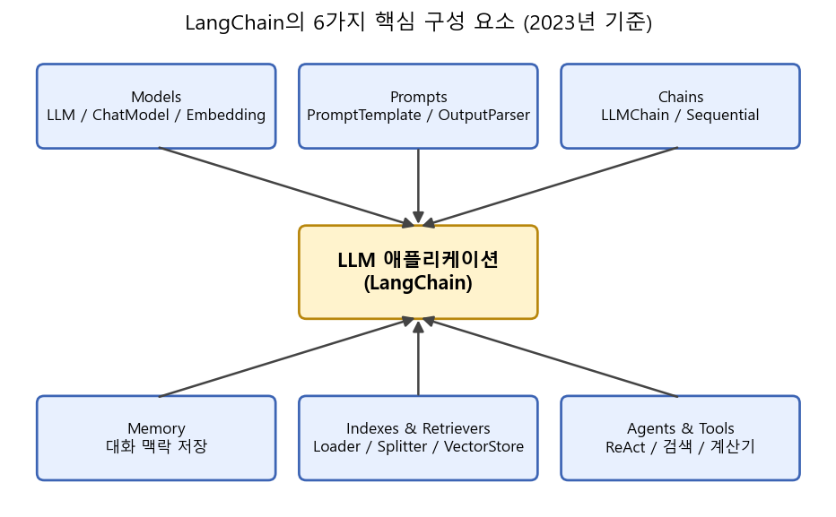
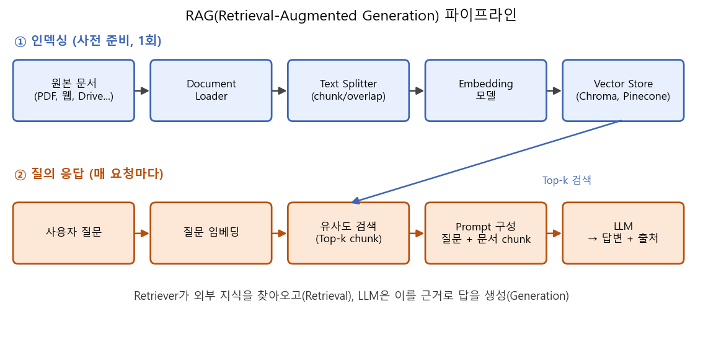
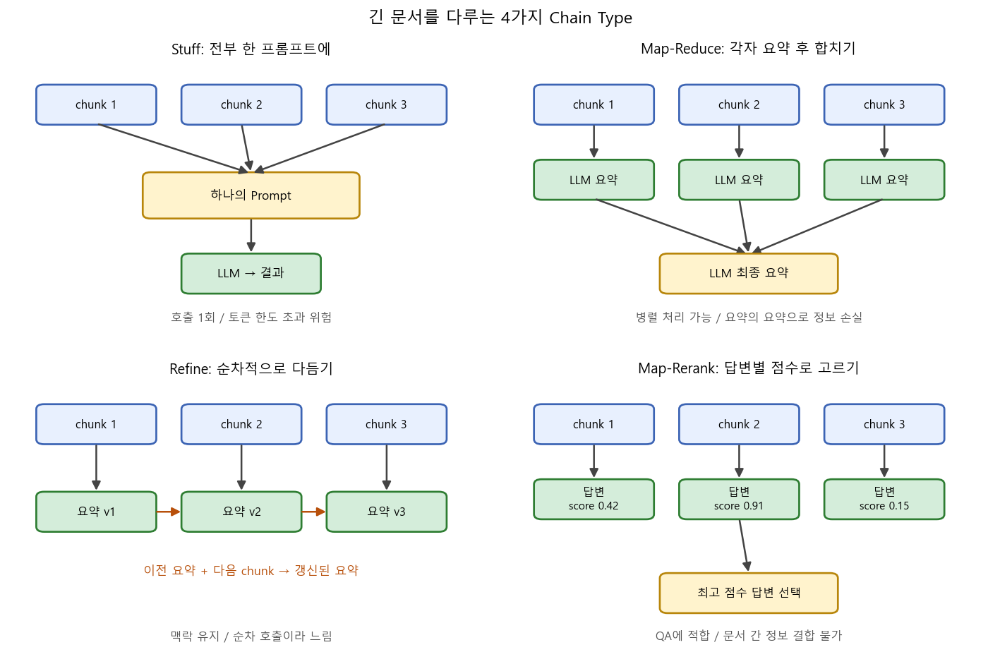
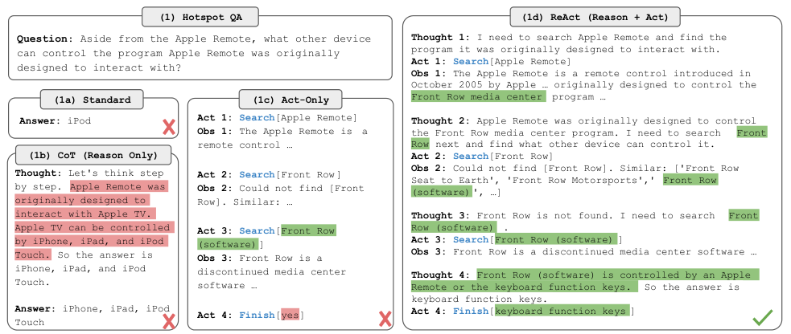
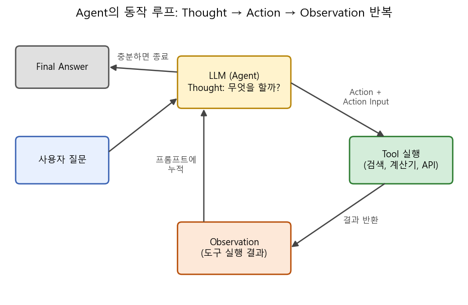

### LLM을 외부 데이터, 도구와 엮어 하나의 애플리케이션으로 만들어주는 프레임워크, LangChain의 핵심 구성 요소에 대해 알아봅니다.  


> 다루는 자료  
> **LangChain Tutorials** (YouTube 시리즈), Greg Kamradt (Data Independent), 2023  
> **LangChain Python Documentation** (v0.0.2xx 기준), LangChain, 2023  
> **ReAct**: Synergizing Reasoning and Acting in Language Models (Yao et al., ICLR 2023)  

<center></center>   

<br/>


>  **1. LangChain은 LLM 호출 자체보다는, LLM을 프롬프트 / 외부 데이터 / 도구 / 메모리와 "연결(chain)"하는 접착제 역할을 하는 프레임워크임**
>
>  **2. 사내 문서, 책, 유튜브 자막처럼 모델이 모르는 데이터는 Loader → Splitter → Embedding → VectorStore로 인덱싱한 뒤, 질문 시 관련 chunk만 찾아 프롬프트에 넣는 RAG 방식으로 다룸**
>
>  **3. Agent는 ReAct 논문의 Thought → Action → Observation 루프를 구현한 것으로, LLM이 스스로 어떤 도구(검색, 계산기, API)를 쓸지 결정함**

<br/>

----

**본 포스트는 Greg Kamradt의 LangChain 튜토리얼 시리즈를 보며 정리한 스터디 노트에, LangChain 공식 문서와 ReAct 논문 내용을 보충한 것입니다.**
원문은 여기에서 보실 수 있습니다. [LangChain Tutorials (YouTube)](https://www.youtube.com/playlist?list=PLqZXAkvF1bPNQER9mLmDbntNfSpzdDIU5), [튜토리얼 코드 (GitHub)](https://github.com/gkamradt/langchain-tutorials)  

----
#### Contents  

1. [Intro - LangChain은 왜 필요할까?](#intro)  
2. [Models와 Prompts: LLM과 대화하는 기본 단위](#models)  
3. [Chains와 Memory: 호출을 엮고, 기억하게 하기](#chains)  
4. [Indexes와 Retrieval: 내 문서에 질문하기 (RAG)](#rag)  
5. [토큰 제한을 우회하는 4가지 Chain Type](#chaintype)  
6. [Agents: LLM에게 도구를 쥐여 주자!](#agents)  
7. [튜토리얼에서 다룬 활용 사례들](#usecases)  
8. [마치며](#conclusion)  
<br />

<a id="intro"></a>
## 1. Intro - LangChain은 왜 필요할까?  

ChatGPT가 등장한 이후, 누구나 API 한 줄로 꽤 똑똑한 언어 모델을 호출할 수 있게 되었습니다. 그런데 막상 서비스를 만들어 보려고 하면 금방 벽에 부딪히는데요.  

- 모델은 **학습 시점 이후의 정보**나 **내 개인/사내 문서**를 알지 못함  
- 한 번에 넣을 수 있는 **토큰 수에 제한**이 있음 (당시 gpt-3.5 기준 약 4K 토큰)  
- 모델 혼자서는 **검색, 계산, 외부 API 호출** 같은 행동을 할 수 없음  
- API는 stateless라서, 이전 대화를 **기억하지 못함**  

결국 실제 애플리케이션을 만들려면 프롬프트를 관리하고, 외부 데이터를 붙이고, 여러 번의 호출을 이어 붙이는 "배관 공사"가 필요합니다.  
LangChain은 바로 이 배관 공사를 표준화된 인터페이스로 묶어 놓은 오픈소스 프레임워크입니다. 이름 그대로 LLM 호출을 다른 컴포넌트들과 **체인(chain)처럼 연결**하는 것이 핵심 아이디어이죠.  

튜토리얼의 저자는 첫 영상에서 흥미로운 이야기를 하는데요, OpenAI 같은 모델 제공자는 "모델의 API"로 남고 싶어 할 뿐 Google Drive나 Notion 같은 수많은 서비스와의 통합을 직접 만들 생각은 없을 것이라는 겁니다. 그 빈자리, 즉 **모델과 외부 세계를 연결하는 계층**을 LangChain 같은 도구가 채우게 된다는 거죠. 2023년 중반 기준 LangChain은 OpenAI, Hugging Face 등 다양한 모델 제공자와 수십 종의 문서 로더, 벡터 DB를 지원하고 있습니다.  

2023년 중반의 공식 문서는 LangChain의 모듈을 크게 다음과 같이 나눕니다. (문서 개편 과정에서 Indexes가 Data connection(Retrieval)으로 이름이 바뀌는 등 용어가 조금씩 변하고 있습니다.)  

| 모듈 | 역할 |
|---|---|
| Models | LLM, Chat Model, Embedding 모델에 대한 공통 인터페이스 |
| Prompts | 프롬프트 템플릿, few-shot 예시, 출력 파서 |
| Chains | 여러 컴포넌트/호출을 하나의 파이프라인으로 연결 |
| Memory | 대화 이력 등 상태를 체인 호출 사이에 유지 |
| Indexes (Data connection) | 문서 로딩, 분할, 임베딩, 벡터 저장소, Retriever |
| Agents | LLM이 도구 사용 여부와 순서를 스스로 결정 |

이제 하나씩 살펴볼까요?  


<a id="models"></a>
## 2. Models와 Prompts: LLM과 대화하는 기본 단위  

### Models  

LangChain에서 "모델"은 세 종류로 나뉩니다.  

- **LLM**: 문자열을 받아 문자열을 반환하는 텍스트 완성 모델 (예: `text-davinci-003`)  
- **Chat Model**: System / Human / AI 메시지의 리스트를 받아 메시지를 반환하는 모델 (예: `gpt-3.5-turbo`, `gpt-4`)  
- **Text Embedding Model**: 텍스트를 벡터로 바꿔주는 모델 (예: `text-embedding-ada-002`)  

모델을 생성할 때 자주 만지는 파라미터가 `temperature`입니다. 퀵스타트 영상에서는 휴가지 추천처럼 창의적인 답이 필요한 경우 0.9로, 에이전트나 정보 추출처럼 결정론적인 답이 필요한 경우 0으로 설정합니다. 인터뷰 녹취록 분석 영상에서도 "모델이 너무 창의적이지 않도록" temperature를 0으로 두라고 조언하는데요, 사실을 다루는 작업에서는 거의 기본값처럼 쓰인다고 보시면 되겠습니다.  

### Prompts  

매번 프롬프트 문자열을 손으로 조립하는 것은 관리하기도 어렵고 재사용도 힘듭니다. 그래서 등장한 것이 **PromptTemplate**입니다. 변하는 부분을 변수로 빼 두고, 실행 시점에 값을 채워 넣는 방식이죠.  

```python
# langchain 0.0.2xx (2023년 중반) 기준 API
from langchain.llms import OpenAI
from langchain.prompts import PromptTemplate
from langchain.chains import LLMChain

llm = OpenAI(temperature=0.9)

prompt = PromptTemplate(
    input_variables=["food"],
    template="{food}를 좋아하는 사람이 가 볼 만한 휴가지 5곳을 추천해 줘.",
)

chain = LLMChain(llm=llm, prompt=prompt)
answer = chain.run("디저트")
```

이 템플릿 개념은 생각보다 훨씬 강력한데요, 튜토리얼 후반부의 실전 영상들은 대부분 "좋은 템플릿을 어떻게 만들 것인가"의 문제로 귀결됩니다. 몇 가지 팁을 정리하면 다음과 같습니다.  

- **역할을 구체적으로 지정**할 것: "통화 내용에 없는 정보는 절대 지어내지 말 것"처럼 제약을 명시함  
- **사용자에게 프롬프트를 직접 쓰게 하지 말 것**: 자유 입력 대신 라디오 버튼, 슬라이더 같은 UI로 옵션(한 문장 / 글머리 기호 / 긴 요약 등)을 받고, 내부에서 템플릿에 끼워 넣음  
- **예시(few-shot)를 함께 줄 것**: 특정 어조나 문체를 흉내 내게 할 때는 설명보다 예시가 효과적임  

### Output Parser  

LLM의 출력은 결국 문자열이기 때문에, 이를 프로그램에서 쓰려면 구조화가 필요합니다. LangChain의 **OutputParser**는 "이런 JSON 스키마로 답해라"라는 포맷 지시문을 프롬프트에 자동으로 넣어 주고, 응답을 파싱까지 해줍니다.  
튜토리얼에서는 `ResponseSchema`와 `StructuredOutputParser`로 지저분한 산업군 이름을 표준 산업 목록에 매칭하는 예제를 보여주는데요, 단순 문자열 유사도가 아니라 **의미적으로 가장 가까운 항목**을 고를 수 있다는 점이 포인트입니다. 비용 절감을 위해 한 번 매칭한 결과는 자체 DB에 쌓아 두고, 처음 보는 값에 대해서만 API를 호출하라는 실용적인 조언도 덧붙입니다.  

한편 2023년 6월, OpenAI가 Chat Completions API에 **function calling** 기능을 추가하면서 구조화된 출력을 얻는 방법이 한층 깔끔해졌습니다. 함수의 이름과 파라미터를 JSON Schema로 정의해 주면, 모델이 필요할 때 해당 함수를 호출하기 위한 인자를 JSON으로 만들어 돌려주는 방식입니다. LangChain도 발표 직후 이를 지원하기 시작했습니다.  


<a id="chains"></a>
## 3. Chains와 Memory: 호출을 엮고, 기억하게 하기  

### Chains  

위 예제의 `LLMChain`은 가장 기본적인 체인으로, **PromptTemplate + LLM (+ OutputParser)** 를 묶은 것입니다. 실제 애플리케이션에서는 한 번의 호출로 끝나지 않는 경우가 많은데요,  

- `SimpleSequentialChain`: 앞 체인의 출력을 다음 체인의 입력으로 그대로 넘김 (예: 지역을 받아 대표 요리를 고르고 → 그 요리의 레시피를 생성)  
- `SequentialChain`: 여러 입력/출력 변수를 이름으로 주고받는 일반화된 버전  
- `RetrievalQA`, `load_summarize_chain` 등: 자주 쓰는 패턴을 미리 조립해 둔 완성형 체인  

처럼 레고 블록을 쌓듯 조립할 수 있습니다. 덕분에 LLM 호출 사이사이에 프롬프트 포맷팅, 파싱, 검색 같은 로직을 끼워 넣는 코드가 꽤 정돈됩니다.  

### Memory  

LLM API는 기본적으로 stateless입니다. "아까 내가 처음에 뭐라고 했지?"라고 물으면 모델은 알 길이 없죠. 챗봇이 대화를 이어가는 것처럼 보이는 이유는, 사실 **이전 대화를 매번 프롬프트에 다시 넣어주기 때문**입니다. LangChain의 Memory 모듈이 이 작업을 대신해 줍니다.  

- `ConversationBufferMemory`: 대화 전체를 그대로 저장해 프롬프트에 붙임 (가장 단순하지만 대화가 길어지면 토큰이 폭발함)  
- `ConversationBufferWindowMemory`: 최근 k턴만 유지  
- `ConversationSummaryMemory`: 지난 대화를 LLM으로 요약해 압축 저장  

퀵스타트 영상에서는 `ConversationChain`으로 챗봇에게 첫 문장을 기억하는지 물어보고, 같은 문장을 다르게 표현해 달라고 요청하며 메모리가 잘 동작하는지 확인합니다. 결국 메모리 전략은 "얼마나 기억할 것인가"와 "토큰 비용" 사이의 트레이드오프라고 할 수 있겠습니다.  


<a id="rag"></a>
## 4. Indexes와 Retrieval: 내 문서에 질문하기 (RAG)  

튜토리얼 시리즈에서 가장 많은 영상이 할애된 주제가 바로 이것입니다. Paul Graham의 에세이, Google Drive 문서, YouTube 자막, 300페이지짜리 책까지, 소재만 바뀔 뿐 구조는 모두 동일한데요. 모델이 학습하지 않은 **나만의 데이터에 대해 질문하기**입니다.  

문서 전체를 프롬프트에 넣으면 좋겠지만 토큰 제한 때문에 불가능합니다. 그래서 사용하는 방법이 **RAG(Retrieval-Augmented Generation)** 입니다. 질문과 관련된 부분만 찾아서(Retrieval) 프롬프트에 넣고, 이를 근거로 답을 생성(Generation)하는 것이죠. RAG라는 용어 자체는 Lewis et al. (2020)의 논문에서 유래했는데, 거기서는 retriever와 generator를 함께 학습시켰다면, LangChain식 RAG는 학습 없이 **기성 임베딩 모델 + 벡터 DB + 프롬프트**로 조립한다는 점이 다릅니다.  

<center></center>   

<br/>

파이프라인은 크게 두 단계로 나뉩니다.  

**① 인덱싱 (미리 한 번)**  

1. **Document Loader**: PDF, 웹 페이지, Google Drive, YouTube 자막, Notion 등 다양한 소스를 `Document` 객체(본문 `page_content` + `metadata`)로 불러옴  
2. **Text Splitter**: 긴 문서를 chunk로 자름. 튜토리얼에서는 `RecursiveCharacterTextSplitter`를 주로 쓰며, `chunk_size=2000`, `chunk_overlap=250` 정도를 사용함 (단, 최적값은 문서 특성과 용도에 따라 다름)  
3. **Embedding**: 각 chunk를 OpenAI 임베딩 등으로 벡터화함. 임베딩은 문서의 의미를 담은 숫자 리스트라고 보면 됨  
4. **Vector Store**: 벡터를 Chroma(로컬), Pinecone(관리형 클라우드) 같은 벡터 저장소에 저장함  

**② 질의 응답 (매 요청마다)**  

1. 사용자 질문을 같은 임베딩 모델로 벡터화함  
2. 벡터 저장소에서 코사인 유사도 기준 Top-k chunk를 찾음  
3. 질문 + 검색된 chunk를 프롬프트에 넣고 LLM이 답변을 생성함  

여기서 `RecursiveCharacterTextSplitter`가 "recursive"인 이유가 궁금하실 수 있는데요, 문단(`\n\n`) → 줄바꿈(`\n`) → 공백 → 글자 순으로 구분자를 바꿔가며 chunk가 지정 크기 이하가 될 때까지 재귀적으로 쪼개기 때문입니다. 덕분에 가능한 한 의미 단위(문단, 문장)를 보존하면서 자를 수 있습니다. overlap을 주는 이유는 chunk 경계에서 문맥이 끊기는 것을 완화하기 위함이고요.  

코드로 보면 다음과 같은 흐름입니다.  

```python
# langchain 0.0.2xx (2023년 중반) 기준 API
from langchain.document_loaders import TextLoader
from langchain.text_splitter import RecursiveCharacterTextSplitter
from langchain.embeddings import OpenAIEmbeddings
from langchain.vectorstores import Chroma
from langchain.chains import RetrievalQA
from langchain.llms import OpenAI

docs = TextLoader("paul_graham_essays.txt").load()
splitter = RecursiveCharacterTextSplitter(chunk_size=2000, chunk_overlap=250)
chunks = splitter.split_documents(docs)

vectordb = Chroma.from_documents(chunks, OpenAIEmbeddings())

qa = RetrievalQA.from_chain_type(
    llm=OpenAI(temperature=0),
    chain_type="stuff",
    retriever=vectordb.as_retriever(search_kwargs={"k": 4}),
    return_source_documents=True,
)
result = qa({"query": "McCarthy는 Lisp를 어떻게 만들었나?"})
```

`return_source_documents=True` 옵션에 주목해 주세요. 튜토리얼 저자가 반복해서 강조하는 부분인데요, **답변에 사용된 출처 chunk를 함께 돌려받아** 사용자가 근거를 확인할 수 있게 하는 것이 중요하다는 겁니다. LLM이 그럴듯하게 지어내는(hallucination) 문제를 완전히 막을 수는 없지만, 적어도 검증 가능한 형태로 만들 수 있기 때문이죠.  

Google Drive 영상에서는 여러 문서(제품 문서 + 사용자 인터뷰)를 함께 로드한 뒤 질문하는데, 특정 문서를 빼고 싶을 때 `metadata`로 어떤 문서인지 확인하라는 팁도 나옵니다. 메타데이터는 이후 필터링 검색에도 쓰이기 때문에 로딩 시점부터 잘 챙겨두는 것이 좋습니다.  


<a id="chaintype"></a>
## 5. 토큰 제한을 우회하는 4가지 Chain Type  

RAG로 관련 chunk만 고른다 해도, 검색된 chunk가 많거나 **문서 전체를 요약**해야 하는 경우에는 여전히 토큰 제한에 걸립니다. LangChain은 이를 위해 여러 문서를 LLM에 넘기는 4가지 전략(`chain_type`)을 제공합니다.  

<center></center>   

<br/>

**1) Stuff**  
- 모든 chunk를 하나의 프롬프트에 "쑤셔 넣음(stuff)"  
- LLM 호출 1회로 가장 빠르고 단순하며, 모든 정보를 한 번에 봄  
- 문서가 크면 토큰 한도를 넘어 에러가 남  

**2) Map-Reduce**  
- 각 chunk를 개별 호출로 요약(map)한 뒤, 요약들을 모아 다시 요약(reduce)함  
- map 단계는 서로 독립이라 병렬 처리가 가능하고, 큰 문서도 다룰 수 있음  
- "요약의 요약"이라 정보 손실이 생길 수 있고, 호출 횟수가 많음  

**3) Refine**  
- 첫 chunk로 초기 답을 만들고, 다음 chunk를 볼 때마다 "기존 답 + 새 chunk"로 답을 다듬어 나감  
- 문서 전반의 맥락이 이어지므로 결과가 비교적 풍부함  
- 이전 결과가 필요해 순차적(동기) 호출만 가능하므로 느림  

**4) Map-Rerank**  
- 각 chunk에 질문을 던져 답변과 함께 신뢰도 점수(score)를 받고, 가장 높은 점수의 답을 선택함  
- 요약보다는 답이 한 곳에 있는 단답형 QA에 적합함  
- 여러 문서에 흩어진 정보를 결합하지는 못함  

정리하면, 문서가 작으면 Stuff, 큰 문서 요약은 Map-Reduce(속도) 혹은 Refine(품질), 사실 확인형 QA는 Map-Rerank 정도로 기억해 두면 좋겠습니다.  

YouTube 자막 요약 영상에서는 1시간 넘는 영상의 자막을 Map-Reduce로 요약하고, 책 한 권을 요약하는 영상(5 Levels of Summarization)에서는 한 걸음 더 나아가 **임베딩 + 클러스터링**을 사용합니다. 책을 chunk로 나눠 임베딩한 뒤 K-means로 군집화하고, 각 군집의 중심에 가장 가까운 chunk만 골라 요약하는 방식인데요, 비슷한 내용을 반복해서 요약하지 않아도 되니 비용을 크게 줄이면서도 책 전체의 주제를 골고루 커버할 수 있습니다. 개인적으로 추천시스템에서 대표 아이템을 뽑는 방식과도 닮아서 재밌게 봤습니다.  


<a id="agents"></a>
## 6. Agents: LLM에게 도구를 쥐여 주자!  

지금까지의 체인은 **실행 순서가 코드로 고정**되어 있었습니다. 하지만 "현재 일본 총리의 나이보다 작은 가장 큰 소수는?" 같은 질문은 어떨까요? 먼저 검색으로 총리가 누군지 찾고, 다시 나이를 찾고, 그다음 계산을 해야 합니다. 어떤 순서로 무엇을 할지가 질문마다 다르죠.  

이렇게 **LLM이 스스로 다음 행동을 결정**하게 하는 것이 Agent입니다. 튜토리얼에서는 Agent를 이해하기 위한 세 가지 개념을 꼽습니다.  

- **Tool**: 에이전트가 사용할 수 있는 기능. 구글 검색(SerpAPI), 계산기(llm-math), Wolfram Alpha, Wikipedia, Python REPL 등이 있음  
- **LLM**: 추론과 의사결정을 담당하는 두뇌  
- **Agent type**: 도구를 고르는 방식. 대표적으로 `zero-shot-react-description`은 각 도구의 **설명(description)만 보고** 어떤 도구를 쓸지 결정함  

### ReAct: 생각하고, 행동하고, 관찰하라  

`zero-shot-react-description`의 "react"는 Yao et al.의 ReAct 논문에서 온 이름입니다. ReAct는 추론(Reasoning)과 행동(Acting)을 번갈아 수행하게 하는 프롬프팅 기법인데요, 논문의 그림을 보면 차이가 확연합니다.  

<center></center>   
<font size="2"><center> 출처: Yao et al., ReAct: Synergizing Reasoning and Acting in Language Models (https://arxiv.org/abs/2210.03629) </center>  </font>   

<br/>

- **(1a) Standard**: 바로 답을 내놓다가 틀림  
- **(1b) CoT (Reason only)**: 단계적으로 생각하지만, 외부 정보 없이 내부 지식에만 의존하다 보니 사실과 다른 추론(hallucination)을 함  
- **(1c) Act-only**: 검색은 하지만 중간에 "왜 이걸 찾는지"에 대한 생각이 없어 방향을 잃음  
- **(1d) ReAct**: Thought로 계획을 세우고, Action으로 검색하고, Observation을 보고 다시 생각하는 과정을 반복해 정답에 도달함  

즉 **추론은 행동의 방향을 잡아주고, 행동은 추론에 필요한 사실을 공급**하는 상호 보완 관계라는 것이 논문의 핵심 메시지입니다.  

LangChain의 Agent는 이 루프를 그대로 구현합니다.  

<center></center>   

<br/>

1. 프롬프트에 사용 가능한 도구 목록과 설명, 그리고 `Thought / Action / Action Input / Observation` 형식을 지시함  
2. LLM이 Thought와 함께 사용할 Action(도구 이름)과 Action Input을 텍스트로 출력함  
3. LangChain이 이를 파싱해 실제 도구를 실행하고, 결과를 Observation으로 프롬프트 뒤에 덧붙임  
4. LLM이 "Final Answer"를 출력할 때까지 2~3을 반복함  

`verbose=True`로 실행하면 이 중간 과정이 모두 출력되는데, 처음 보면 꽤 신기합니다. 모델이 "검색해 봐야겠다", "이제 계산기를 써야겠다"라고 혼잣말을 하며 일하는 모습을 볼 수 있거든요. 다만 프롬프트에 Observation이 계속 누적되는 구조라 반복이 길어지면 토큰 비용이 늘고, 모델이 형식을 어기면 파싱 에러가 나는 등 아직은 불안정한 면도 있습니다. 그래서 temperature를 0으로 두는 것이 일반적입니다.  

### 도구의 확장: Zapier NLA와 Function Calling  

도구는 얼마든지 늘릴 수 있습니다. 튜토리얼에서는 Zapier의 Natural Language Actions(NLA)를 연결해 5,000개 이상의 앱과 상호작용하는 예제를 보여주는데요,  

- 특정 발신자의 최근 이메일을 요약해 Slack 채널로 전송  
- 이메일을 요약해 트윗으로 게시  
- 이메일을 읽고 Gmail에 답장 초안 작성  

같은 작업을 자연어 한 줄로 시킵니다. 흥미로운 점은 "이메일 의도에 맞는 GIF를 찾아 Slack에 보내라" 같은 요청은 지시가 모호해 실패했다는 것입니다. 에이전트도 결국 **명확한 지시와 잘 설명된 도구**가 있어야 제 몫을 한다는 걸 보여주는 사례라고 생각합니다.  

앞서 언급한 OpenAI의 function calling도 에이전트 관점에서 중요한 변화입니다. 텍스트로 "Action: Search"를 출력하게 하고 정규식으로 파싱하던 방식 대신, 모델이 **어떤 함수를 어떤 인자로 호출할지 구조화된 JSON으로** 알려주기 때문에 파싱 에러가 크게 줄어듭니다. 튜토리얼에서도 여러 함수를 정의해 두고, 하나의 질문 안에 담긴 여러 요청에 대해 모델이 적절한 함수를 골라 쓰거나, 함수가 필요 없을 때는 그냥 자연어로 답하는 모습을 보여줍니다.  


<a id="usecases"></a>
## 7. 튜토리얼에서 다룬 활용 사례들  

튜토리얼의 "Cookbook" 편에서는 LangChain의 대표 활용 사례를 9가지로 정리합니다. 요약, 문서 기반 QA, 정보 추출, 평가, 표 형식 데이터 쿼리, 코드 이해, API 상호작용, 챗봇, 에이전트가 그것인데요. 이 중 인상 깊었던 몇 가지를 정리해 보겠습니다.  

**요약의 5단계**  
- Level 1~2 (몇 문장~몇 문단): 프롬프트 하나로 충분함. "5살 아이도 이해할 수 있게"처럼 지시만 바꿔도 결과가 달라짐  
- Level 3 (몇 페이지): chunk로 나눈 뒤 Map-Reduce  
- Level 4 (책 한 권): 임베딩 + 클러스터링으로 대표 chunk만 골라 요약 ("best representation vectors")  
- Level 5 (분량을 알 수 없음): 에이전트가 Wikipedia 등을 검색하며 필요한 만큼 정보를 모아 요약  

**정보 추출 (Extraction)**  
- 비정형 텍스트에서 정형 데이터를 뽑아내는 작업. Kor 라이브러리로 스키마(필드, 설명, 예시)를 정의하면 LLM이 이에 맞춰 추출함  
- 채용 공고에서 회사가 사용하는 기술 스택, 연봉 정보를 뽑는 예제가 나옴  
- 비용을 줄이려면 LLM에 넘기는 텍스트(특히 HTML)를 최대한 줄이라는 조언이 핵심임  

**토픽 추출과 구조화**  
- 팟캐스트 녹취록에서 주제명과 한 줄 설명을 뽑고(GPT-4) → 스키마에 맞춰 구조화하고(function calling) → 주제별로 상세 요약과 타임스탬프를 추가함(GPT-3.5)  
- 추론이 많이 필요한 단계와 단순 반복 단계에 서로 다른 모델을 쓰는 것이 비용 측면에서 현실적인 선택임  

**문체 / 어조 제어**  
- 파인튜닝 없이 프롬프트만으로 특정인의 문체를 흉내 내는 세 가지 방법: (1) LLM에게 예시 글의 어조를 설명하게 하기, (2) 비슷한 문체의 유명 작가를 물어보기, (3) 예시 글을 few-shot으로 주기  
- 이 셋을 합친 프롬프트가 가장 좋은 결과를 냄  

**간단한 웹 앱 / 봇 만들기**  
- Streamlit으로 이메일을 원하는 어조와 영어 방언(미국식/영국식)으로 다듬어주는 앱을 만들고 배포하는 예제, Twitter 멘션에 응답하는 봇을 만드는 예제도 다룸  
- 실제 배포 시에는 rate limit과 API 비용을 꼭 챙기라고 당부함  

그 외에 SQL DB나 CSV 같은 표 형식 데이터에 자연어로 질문하는 체인, 질문-정답 쌍으로 체인의 성능을 평가하는 방법 등도 소개되는데요, 전체적으로 "LLM 호출 하나"보다 **LLM 호출을 둘러싼 전처리, 검색, 후처리 설계**가 품질을 좌우한다는 인상을 받았습니다.  


<a id="conclusion"></a>
## 8. 마치며  

LangChain을 공부하면서 가장 크게 느낀 점은, LLM 애플리케이션 개발이 생각보다 **고전적인 소프트웨어 엔지니어링과 정보 검색의 문제**라는 것이었습니다. 문서를 어떻게 자를지, 어떤 기준으로 검색할지, 토큰 한도 안에서 어떻게 정보를 압축할지, 출력을 어떻게 구조화할지 같은 고민들은 모델이 아무리 좋아져도 사라지지 않을 것 같습니다.  

한편으로 LangChain은 아직 매우 빠르게 변하고 있는 라이브러리입니다. 몇 주 사이에 모듈 이름과 import 경로가 바뀌고, 추상화가 너무 깊어 내부에서 어떤 프롬프트가 실제로 날아가는지 파악하기 어렵다는 비판도 있습니다. 그래서 개인적으로는 LangChain을 "그대로 가져다 쓰는 도구"라기보다는, **LLM 애플리케이션의 설계 패턴을 배우는 교과서**로 활용하는 것이 좋겠다는 생각이 들었습니다. 프롬프트 템플릿, RAG, chain type, ReAct 에이전트라는 개념만 확실히 잡아두면, 프레임워크가 바뀌어도 금방 적응할 수 있을 테니까요.  

다음에는 오픈소스 LLM을 직접 파인튜닝하는 방법에 대해서도 정리해 보겠습니다.  

----------------


**개선을 위한 여러분의 피드백과 제안을 코멘트로 공유해 주세요.**
**내용에 대한 지적, 혹은 질문을 환영합니다.**  


**출처**  
[Greg Kamradt, LangChain Tutorials (YouTube Playlist)](https://www.youtube.com/playlist?list=PLqZXAkvF1bPNQER9mLmDbntNfSpzdDIU5)  
[Greg Kamradt, langchain-tutorials (GitHub)](https://github.com/gkamradt/langchain-tutorials)  
[Greg Kamradt, Workaround OpenAI's Token Limit With Chain Types (YouTube)](https://www.youtube.com/watch?v=f9_BWhCI4Zo)  
[LangChain Python Documentation](https://python.langchain.com/docs/)  
[LangChain GitHub Repository](https://github.com/langchain-ai/langchain)  
[Yao et al., ReAct: Synergizing Reasoning and Acting in Language Models (arXiv:2210.03629)](https://arxiv.org/abs/2210.03629)  
[Lewis et al., Retrieval-Augmented Generation for Knowledge-Intensive NLP Tasks (arXiv:2005.11401)](https://arxiv.org/abs/2005.11401)  
[OpenAI, Function calling and other API updates (2023.06)](https://openai.com/blog/function-calling-and-other-api-updates)  
