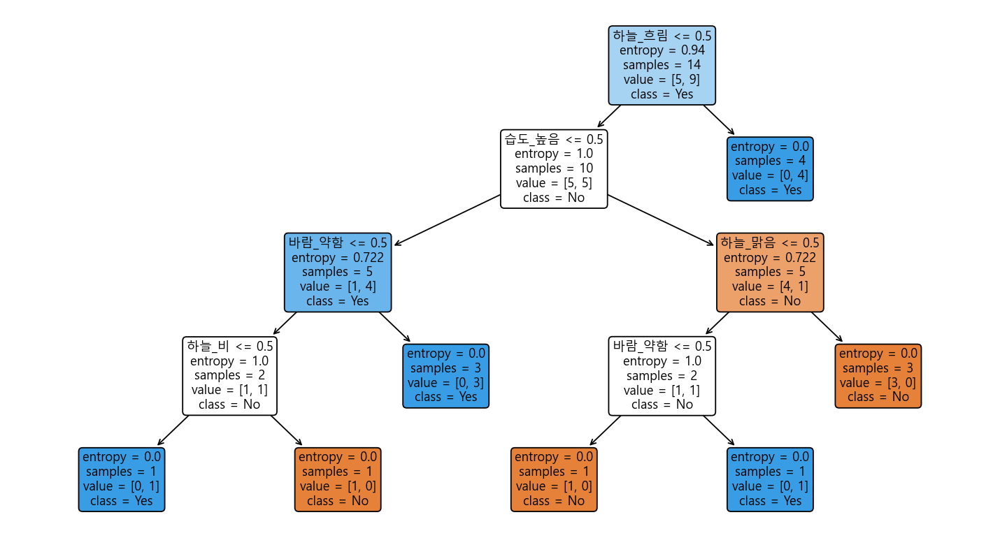
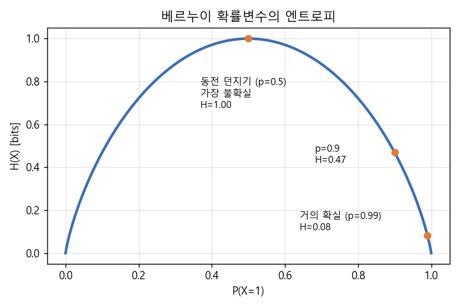
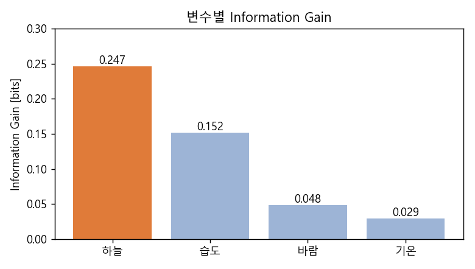
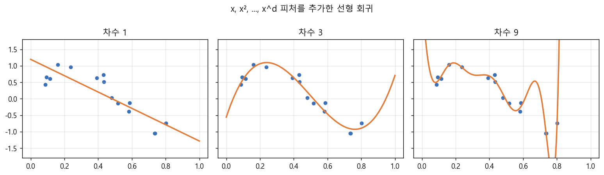

### 룰 기반 학습, Decision Tree와 엔트로피, 그리고 선형 회귀


> 머신러닝을 "함수 근사(Function Approximation)"의 관점에서 바라보고, 룰 기반 학습에서 출발해 Decision Tree와 선형 회귀로 나아가는 과정을 살펴봅니다.  


<br>

<center></center>    


<br/>


>  **1. 머신러닝은 입력 X를 출력 Y로 잘 맵핑하는 함수, 즉 target function을 근사하는 과정이다**
>
>  **2. 룰 기반 학습은 노이즈가 없는 "완벽한 세계"에서만 잘 동작하며, 현실의 노이즈에 더 강건한 대안으로 Decision Tree가 등장했다. Decision Tree는 엔트로피를 가장 많이 줄여주는(Information Gain이 가장 큰) 변수부터 분기한다**
>
>  **3. 선형 회귀는 가설을 룰이 아닌 함수의 형태로 정의하는 통계적 접근으로, 오차가 정규분포를 따른다고 가정하면 최소제곱법의 해는 곧 MLE가 된다**


<br/>

----

#### Contents

<br/>

1.	[머신러닝은 함수 근사다](#function-approximation)
2.	[룰 기반 학습: Find-S와 Candidate Elimination](#rule-based)
3.  [Decision Tree의 등장](#decision-tree)
4.  [엔트로피와 Information Gain](#entropy)
5.  [통계적 접근: 선형 회귀](#linear-regression)

<br />

[지난 포스트](https://myeonghak.github.io/general%20machine%20learning/General-ML-train-set-batch-2.-%ED%99%95%EB%A5%A0%EA%B3%BC-%EB%B6%84%ED%8F%AC/)에서는 머신러닝을 위한 확률과 분포의 기초를 살펴보았습니다. 이번 시간부터는 본격적으로 머신러닝 알고리즘에 대해 알아보려고 하는데요. 가장 단순한 형태인 룰 기반 학습에서 출발해, Decision Tree를 거쳐 선형 회귀까지 이어지는 흐름을 따라가 보겠습니다.  


<a id="function-approximation"></a>
### 1. 머신러닝은 함수 근사다  

#### 완벽한 세계(Perfect World)를 가정해 보자  

먼저 아주 비현실적인, 그러나 설명하기 좋은 세계를 하나 가정해 보겠습니다. 이 세계는 다음과 같은 특성을 갖습니다.  

1) **관측 오차가 없다**: 학습 데이터에 오차나 노이즈, 일관되지 않은 관측치가 전혀 없음  
2) **확률적인 요소가 없다**: 관측 대상이 deterministic하게 동작함. 같은 입력이 들어오면 항상 같은 결과가 나옴  
3) **모든 정보를 갖고 있다**: 결과를 설명하는 데 필요한 변수를 데이터셋이 전부 포함하고 있음. 즉, 데이터에 없는 다른 변수의 영향은 없음  

#### Function Approximation  

이러한 세계에서 머신러닝이 하는 일을 한 마디로 표현하면 **함수 근사(Function Approximation)** 입니다. 입력이 주어졌을 때 실제를 잘 나타내는 출력을 만들어내는 함수를 찾아가는 과정이지요. 이를 구성하는 요소는 다음과 같습니다.  

- **Instance $X$**: 피처와 라벨로 이루어진 하나의 관측치  
- **Training Dataset $D$**: 인스턴스에 대한 관측의 집합  
- **Hypothesis $H$**: $X$를 $Y$로 맵핑할 수 있는, 잠재적으로 가능한 함수. (예: "우리 애는 비만 안 오면 무조건 나가 놀아!") 이런 가설은 수없이 많이 존재할 수 있음  
- **Target Function $C$**: 우리가 알지 못하는, 실제로 $X$를 $Y$로 맵핑하는 함수  

결국 머신러닝의 목표는 수많은 가설 $H$ 중에서 target function $C$에 최대한 가까운 것을 찾아내는 것이라고 볼 수 있겠습니다.  

인스턴스들이 놓인 공간 위에서 보면, 각 가설은 일종의 **decision boundary**를 그리게 됩니다. 그 경계 안쪽에 들어오면 true, 바깥이면 false가 되는 식이죠. 이 때 가설은 general한 것부터 specific한 것까지 정도를 나눌 수 있는데요, general한 가설일수록 instance space 내에서 더 넓은 영역을 차지하게 됩니다. "날씨가 어떻든 나가 논다"는 가장 general한 가설이고, "맑고, 따뜻하고, 바람이 약할 때만 나가 논다"는 꽤 specific한 가설입니다.  


<a id="rule-based"></a>
### 2. 룰 기반 학습: Find-S와 Candidate Elimination  

#### 예제 데이터  

설명을 위해 아이가 밖에 나가 놀지 말지를 결정하는 아래의 날씨 데이터를 사용하겠습니다. (Quinlan의 고전적인 PlayTennis 데이터를 옮겨온 것입니다.)  

| # | 하늘 | 기온 | 습도 | 바람 | 외출 |
|---|---|---|---|---|---|
| 1 | 맑음 | 더움 | 높음 | 약함 | No |
| 2 | 맑음 | 더움 | 높음 | 강함 | No |
| 3 | 흐림 | 더움 | 높음 | 약함 | Yes |
| 4 | 비 | 온화 | 높음 | 약함 | Yes |
| 5 | 비 | 추움 | 보통 | 약함 | Yes |
| 6 | 비 | 추움 | 보통 | 강함 | No |
| 7 | 흐림 | 추움 | 보통 | 강함 | Yes |
| 8 | 맑음 | 온화 | 높음 | 약함 | No |
| 9 | 맑음 | 추움 | 보통 | 약함 | Yes |
| 10 | 비 | 온화 | 보통 | 약함 | Yes |
| 11 | 맑음 | 온화 | 보통 | 강함 | Yes |
| 12 | 흐림 | 온화 | 높음 | 강함 | Yes |
| 13 | 흐림 | 더움 | 보통 | 약함 | Yes |
| 14 | 비 | 온화 | 높음 | 강함 | No |

#### Find-S 알고리즘  

가장 단순한 룰 기반 학습 알고리즘인 Find-S는 다음과 같이 동작합니다.  

- 모든 피처에 대해 아무것도 허용하지 않는 가장 specific한 가설 $\langle \varnothing, \varnothing, \varnothing, \varnothing \rangle$ 에서 출발  
- positive 인스턴스(외출=Yes)를 만날 때마다, 현재 가설과 인스턴스를 합집합하는 방향으로 가설을 일반화  
- 두 값이 다르면 그 피처는 "don't care", 즉 `?`로 바꿔줌  

위 데이터에 실제로 적용해 보면 이렇게 됩니다.  

```
3번 (Yes) 이후: <흐림, 더움, 높음, 약함>
4번 (Yes) 이후: <?,    ?,    높음, 약함>
5번 (Yes) 이후: <?,    ?,    ?,    약함>
7번 (Yes) 이후: <?,    ?,    ?,    ?   >
```

positive 인스턴스를 단 4개 봤을 뿐인데, 가설이 **"날씨가 어떻든 무조건 나가 논다"** 로 무너져 버렸습니다. 데이터에는 No가 5개나 있는데도 말이죠.  
Find-S는 가장 specific한 가설에서 출발해 general한 방향으로만 움직이고, negative 인스턴스는 아예 보지 않기 때문에 생기는 일입니다. 게다가 이렇게 가능한 수많은 가설 중 하나를 콕 집어 결정하는 것이 과연 타당한가에 대한 의문도 남습니다.  

#### Version Space와 Candidate Elimination  

그래서 등장한 개념이 **Version Space**입니다. 하나의 가설로 결정하는 대신, 데이터와 모순되지 않는 **가능한 가설의 집합**을 관리하자는 것인데요.  

- **Specific boundary $S$**: 가설 집합이 가질 수 있는 가장 상세한 성질의 한도  
- **General boundary $G$**: 가설 집합이 가질 수 있는 가장 일반적인 성질의 한도  
- Version Space는 이 두 바운더리 사이에 존재하는, 너무 상세하지도 너무 일반적이지도 않은 가설들의 집합  

이 Version Space를 관리하는 방법이 **Candidate Elimination 알고리즘**입니다.  

- positive 인스턴스가 들어오면: Find-S처럼 $S$를 일반화하는 방향으로 수정  
- negative 인스턴스가 들어오면: 반대로 $G$를 조금 더 specific하게 수정. 이 때 $S$와 논리적으로 대조하며 수정하므로 여러 개의 가설이 나올 수 있음  
- 이렇게 양쪽에서 범위를 좁혀가며 원하는 가설 집합을 찾아감  

#### 그런데, 잘 작동할까?  

Candidate Elimination 알고리즘이 올바른 가설에 수렴할지 물어본다면, 완벽한 세계에서는 **yes** 입니다. 데이터가 계속 들어오면 하나의 가설로 수렴(converge)하고, 그 가설은 참(correct)이 됩니다.  

하지만 우리는 완벽한 세계에 살고 있지 않죠.  

- 실제 데이터에는 항상 노이즈가 존재함  
- 우리가 사용한 변수 외에도 결과에 영향을 주는 다른 요인(decision factor)이 존재함 (예: 아이의 그날 기분, 숙제 여부...)  

노이즈가 섞인 인스턴스 하나 때문에 올바른 가설이 Version Space에서 지워져 버릴 수도 있습니다. 결국 현실에서는 이 질문에 자신있게 yes라고 답할 수 없게 됩니다.  


<a id="decision-tree"></a>
### 3. Decision Tree의 등장  

룰 기반 학습의 한계를 극복하기 위해서는 두 가지가 필요했습니다.  

1) 에러가 존재하는 상황에서도 **강건하게(robust)** 학습할 수 있는 방법  
2) 가설을 더욱 **간결하게** 표현할 수 있는 방법  

그 대안 중 하나가 바로 **Decision Tree**입니다. 강좌에서는 credit approval 데이터셋으로 이진 분류를 수행하는 예시를 보여주는데요, 변수 하나만 기준으로 분류하면 그다지 좋은 성과를 얻지 못한다는 것을 확인할 수 있습니다. 여러 변수를 순서대로 조합해 나가야 하는 것이죠.  

그렇다면 자연스럽게 이런 질문이 생깁니다. **"어떤 변수부터 먼저 물어봐야 할까?"**  
스무고개를 할 때 "동물인가요?"처럼 답의 범위를 크게 줄여주는 질문을 먼저 하는 것처럼, Decision Tree도 **불확실성을 가장 크게 줄여주는 변수**를 먼저 선택합니다. 그리고 이 불확실성을 측정하는 척도가 바로 **엔트로피**입니다.  


<a id="entropy"></a>
### 4. 엔트로피와 Information Gain  

#### 엔트로피(Entropy)  

데이터셋의 각 피처는 일종의 확률변수(random variable)로 볼 수 있습니다. 데이터를 받아보는 입장에서는 각 변수가 특정 분포를 따르고, 그 분포에서 생성된 값을 하나씩 받아보는 것과 같기 때문이죠. 이 확률변수가 얼마나 불확실한지를 나타내는 값이 엔트로피입니다.  

$$
H(X) = -\sum_{x} P(X=x) \log_b P(X=x)
$$

- $x$는 확률변수가 가질 수 있는 각각의 값  
- 연속형 분포를 따를 경우 $\sum$이 $\int$로 바뀜  
- 밑 $b$로 2를 쓰면 단위가 bit가 됨  

<br>

<center></center>    

<br>

동전 던지기로 생각해 보면 직관적입니다. 100% 앞면만 나오는 동전이라면 결과가 뻔하니 불확실성이 0이고, 앞뒤가 50:50으로 나오는 동전이라면 불확실성이 가장 큽니다. 이처럼 **dominant한 케이스가 있으면 엔트로피가 낮고, 여러 사건이 비슷한 확률로 발생하면 엔트로피가 높아집니다.**  

#### 정보량의 관점에서 보면  

엔트로피를 "정보의 양"으로 이해할 수도 있는데요, 기상청 예보로 생각해 보겠습니다.  

- 내일 날씨가 맑음/흐림 두 가지이고 각각 50%라면, 기상청이 알려줘야 하는 정보는 1 bit (0 또는 1)  
- 균등한 확률의 날씨가 8가지라면, $\log_2 8 = 3$ bit가 필요 (000부터 111까지)  
- 그런데 맑음이 75%, 흐림이 25%라면? 기상청이 "내일 흐림"이라고 알려주면 나의 불확실성은 4배(=1/0.25)만큼 줄어들고, 이는 $-\log_2 0.25 = 2$ bit의 정보에 해당함  
- 반대로 "내일 맑음"이라는 예보는 원래 그럴 거라 예상했으니 정보가 별로 없음: $-\log_2 0.75 \approx 0.41$ bit  

엔트로피는 이 정보량의 **기댓값**, 즉 $0.75 \times 0.41 + 0.25 \times 2 \approx 0.81$ bit입니다. 사막 한가운데 산다면 날씨 예보의 엔트로피는 아주 낮겠지만, 날씨가 변덕스러운 지역이라면 엔트로피가 크겠죠.  

#### 조건부 엔트로피와 Information Gain  

이제 "어떤 변수를 알게 되었을 때 불확실성이 얼마나 줄어드는지"를 측정해 보겠습니다. 이를 위해 **조건부 엔트로피**를 정의합니다.  

$$
H(Y \mid X) = \sum_{x} P(X=x) \, H(Y \mid X=x)
$$

$X$의 각 값으로 데이터를 나눈 뒤, 나뉜 그룹 각각의 엔트로피를 그룹의 비율로 가중평균한 것입니다. (y에 대한 루프가 안쪽, x에 대한 루프가 바깥쪽에 있다고 생각하시면 됩니다.)  

그리고 변수 $A$를 알게 됨으로써 줄어든 엔트로피가 **Information Gain**입니다.  

$$
IG(Y, A) = H(Y) - H(Y \mid A)
$$

앞의 날씨 데이터로 직접 계산해 보겠습니다.  

```python
import numpy as np
import pandas as pd

def entropy(s):
    p = s.value_counts(normalize=True)
    return -(p * np.log2(p)).sum()

def information_gain(df, feature, target='외출'):
    cond_entropy = sum(len(g) / len(df) * entropy(g[target]) for _, g in df.groupby(feature))
    return entropy(df[target]) - cond_entropy

print('H(외출) =', round(entropy(df['외출']), 3))
for col in ['하늘', '기온', '습도', '바람']:
    print(col, round(information_gain(df, col), 3))
```

```
H(외출) = 0.94
하늘 0.247
기온 0.029
습도 0.152
바람 0.048
```

<center></center>    

<br>

"하늘"의 Information Gain이 가장 크므로, 첫 번째 질문은 "하늘이 어때?"가 됩니다. 실제로 하늘이 흐린 날은 4번 모두 나가 놀았기 때문에, 이 질문 하나로 불확실성이 크게 줄어드는 것이죠. 맨 위의 트리 그림에서도 첫 분기가 `하늘_흐림`인 것을 확인할 수 있습니다. (sklearn은 범주형 변수를 one-hot으로 펼쳐서 이진 분기를 하기 때문에 모양이 조금 다르긴 합니다.)  

#### ID3 알고리즘  

Decision Tree를 학습하는 알고리즘은 ID3, C4.5, CART 등 다양한데요, 여기서는 가장 기본적인 ID3를 살펴보겠습니다.  

1) 모든 인스턴스를 담은 초기 노드(root)를 생성  
2) Information Gain이 가장 큰 변수를 선택해, 그 변수의 값에 따라 인스턴스를 나눔  
3) 나뉜 각 노드에 대해 같은 과정을 반복. 노드의 인스턴스가 모두 같은 클래스가 되면(엔트로피 0) 멈춤  

#### Decision Tree의 문제점  

문제가 복잡해질수록 트리를 더 크고 깊게 만들면 학습 데이터는 완벽하게 맞출 수 있습니다. 그런데 실제 현장에 적용하면 잘 작동하지 않는 경우가 많은데요, 현실 세계에는 노이즈와 비일관성이 가득하기 때문입니다. 학습 데이터에 맞추어 모델의 복잡도를 키우면 노이즈까지 외워버리는, 이른바 **오버피팅**의 위험이 있습니다.  
이를 막기 위해 가지치기(pruning)나 트리 깊이에 페널티를 주는 등의 장치를 적용합니다. 오버피팅에 대해서는 이후 "학습, 검증과 정규화" 편에서 더 자세히 다룰 예정입니다.  

#### 덤: Cross Entropy와 KL Divergence  

엔트로피 이야기가 나온 김에, 딥러닝에서 가장 흔히 쓰이는 loss인 Cross Entropy도 짚고 넘어가겠습니다.  

앞의 기상청 예시에서, 날씨가 8가지라고 해서 항상 3 bit를 쓰는 것은 비효율적입니다. 자주 일어나는 날씨에는 짧은 코드를, 드문 날씨에는 긴 코드를 주면 평균적으로 더 적은 bit로 보낼 수 있겠죠. 그런데 이렇게 코드를 설계한다는 것은, 사실 날씨의 분포 $q$를 **암묵적으로 예측**하는 것과 같습니다. 맑음에 2 bit 코드를 줬다면 "맑음은 $2^{-2}=25\%$ 확률로 일어날 것이다"라고 가정한 셈이니까요.  

이 예측 분포 $q$로 실제 분포 $p$를 인코딩했을 때의 평균 bit 수가 **Cross Entropy**입니다.  

$$
H(p, q) = -\sum_{x} p(x) \log q(x)
$$

예측이 실제와 완전히 같다면 Cross Entropy는 엔트로피와 같아지고, 다르다면 엔트로피보다 조금 더 커집니다. 이 **초과분**을 relative entropy, 더 흔하게는 **KL Divergence**라고 부릅니다.  

$$
H(p, q) = H(p) + D_{KL}(p \parallel q)
$$

분류 문제에서 정답 분포 $p$(예: `[0, 0, 0, 1, 0, 0]`)의 엔트로피 $H(p)$는 모델과 무관한 상수이므로, **Cross Entropy를 최소화하는 것은 곧 KL Divergence를 최소화하는 것**, 즉 모델의 예측 분포를 정답 분포에 가깝게 만드는 것과 같습니다. 딥러닝에서는 보통 밑이 2인 로그 대신 자연로그를 쓰는데, $\log_2 x = \ln x / \ln 2$이므로 상수배 차이일 뿐 본질은 같습니다.  


<a id="linear-regression"></a>
### 5. 통계적 접근: 선형 회귀  

Decision Tree까지가 룰 기반의 접근이었다면, 이제부터는 **통계적인 접근**을 살펴보겠습니다. 강좌에서는 housing 데이터셋으로 집값을 예측하는 회귀 문제를 다룹니다. 여기서도 머신러닝은 function approximation의 과정이라는 점을 기억해 주세요. 다만 이번에는 가설이 룰이 아닌 **함수의 형태**로 정의됩니다.  

#### 가설 정의  

종속변수가 각 독립변수와 그 가중치 $\theta$의 선형 결합으로 결정된다고 가정합니다. 이 가정이 곧 우리의 가설입니다.  

$$
\hat{f}(x; \theta) = \sum_{i=0}^{n} \theta_i x_i \quad \Rightarrow \quad \hat{f} = X\theta
$$

절편 $\theta_0$에 대응하는 $x_0 = 1$을 데이터에 추가해 주면, 위처럼 행렬 곱의 형태로 간결하게 표현할 수 있습니다. 실제 관측값에는 오차가 섞여 있으므로 다음과 같이 쓸 수 있죠.  

$$
Y = X\theta + e
$$

$X$는 주어진 데이터이므로 고정된 값입니다. 따라서 목표는 **오차 $e$를 가장 작게 만드는 $\theta$를 잘 추정하는 것**이 됩니다. 이렇게 추정한 값을 $\hat{\theta}$라고 쓰는데, 모자(hat)에는 "이 값도 진짜는 아닐 거야"라는 의미가 함축되어 있습니다.  

#### 최적의 $\theta$ 찾기  

오차의 제곱합을 최소화하는 $\theta$를 찾아보겠습니다.  

$$
\hat{\theta} = \underset{\theta}{\arg\min} \, (Y - X\theta)^T (Y - X\theta) = \underset{\theta}{\arg\min} \, \left( Y^TY - 2\theta^T X^T Y + \theta^T X^T X \theta \right)
$$

$\theta$와 무관한 $Y^TY$는 제외하고, $\theta$에 대해 미분해서 0이 되는 지점을 찾으면  

$$
-2X^TY + 2X^TX\theta = 0 \quad \Rightarrow \quad \hat{\theta} = (X^TX)^{-1}X^TY
$$

라는 깔끔한 식이 나옵니다. 이를 **정규 방정식(normal equation)** 이라고 부릅니다.  

#### 왜 이게 MLE일까?  

강좌를 들으며 적어둔 메모에 "에러가 정규분포를 따른다면 MLE가 됨 (왜?)"라는 물음표가 남아 있었는데요, 이번 기회에 채워보겠습니다. [batch 1](https://myeonghak.github.io/general%20machine%20learning/General-ML-train-set-batch-1.-MLE%EC%99%80-MAP/)에서 다룬 MLE를 떠올려 보면 금방 풀립니다.  

오차가 $e_i \sim \mathcal{N}(0, \sigma^2)$를 따른다고 가정하면, 관측값 $y_i$는 평균이 $\theta^T x_i$인 정규분포를 따릅니다. 이 때 전체 데이터의 log-likelihood는 다음과 같습니다.  

$$
\log L(\theta) = \sum_{i=1}^{N} \log \mathcal{N}(y_i \mid \theta^T x_i, \sigma^2) = -\frac{N}{2}\log(2\pi\sigma^2) - \frac{1}{2\sigma^2} \sum_{i=1}^{N} (y_i - \theta^T x_i)^2
$$

첫 번째 항은 $\theta$와 무관한 상수이고, 두 번째 항에는 마이너스가 붙어 있습니다. 즉, **likelihood를 최대화하는 것은 오차 제곱합을 최소화하는 것과 정확히 같은 문제**입니다. 우리가 아무 생각 없이 써왔던 최소제곱법(MSE loss)에는 사실 "오차는 정규분포를 따른다"는 가정이 숨어 있었던 것이죠.  

#### 더 복잡한 모델을 원한다면  

$x$에 대한 직선 외에도 $x^2, x^3, \dots$ 같은 피처를 새로 만들어 차원을 늘리면, 여전히 "선형" 회귀이면서도 곡선 형태의 모델을 피팅할 수 있습니다. ($\theta$에 대해서는 여전히 선형이기 때문입니다.)  

<br>

<center></center>    

<br>

차수 1은 데이터의 곡선 패턴을 전혀 잡지 못하고(underfitting), 차수 3은 꽤 그럴듯하게 맞춥니다. 그런데 차수 9가 되면 학습 데이터는 거의 다 지나가지만, 데이터가 없는 구간에서는 말도 안 되게 요동치는 것을 볼 수 있는데요. 앞서 Decision Tree에서 이야기한 오버피팅이 회귀에서도 똑같이 나타나는 셈입니다. 모델의 복잡도를 어떻게 조절할지는 이후 편에서 더 자세히 다루겠습니다.  


<br>

----------------

<a id="conclusion"></a>
### 닫으며  

지금까지 룰 기반 학습에서 출발해 Decision Tree와 엔트로피, 그리고 선형 회귀까지 살펴보았습니다. 완벽한 세계를 가정한 룰 기반 학습이 현실의 노이즈 앞에서 무너지는 모습을 보면서, 왜 이후의 머신러닝이 확률과 통계의 언어로 쓰이게 되었는지를 조금은 느낄 수 있었던 것 같습니다.  
다음 포스트에서는 확률적 접근의 대표 주자인 **나이브 베이즈 분류기**를 알아보겠습니다.  

**개선을 위한 여러분의 피드백과 제안을 코멘트로 공유해 주세요.**
**내용에 대한 지적, 혹은 질문을 환영합니다.**  

해당 포스트는 카이스트 문일철 교수님의 동의를 얻고, 강좌 내용과 자료, 그리고 reference의 자료를 참고하여 작성되었습니다. 원 강좌는 [여기](https://www.youtube.com/playlist?list=PLbhbGI_ppZISMV4tAWHlytBqNq1-lb8bz)에서 보실 수 있습니다.

**자료 공유를 허락해 주신 문일철 교수님께 감사의 말씀을 전합니다.**
