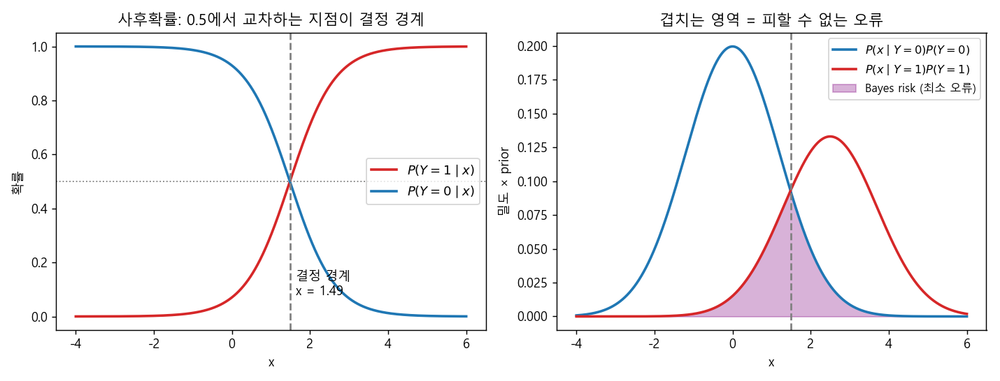
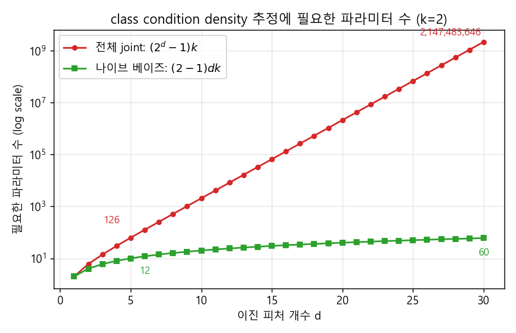
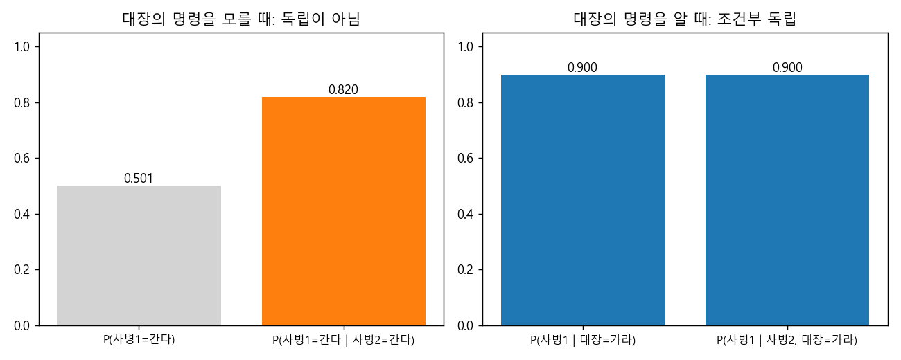
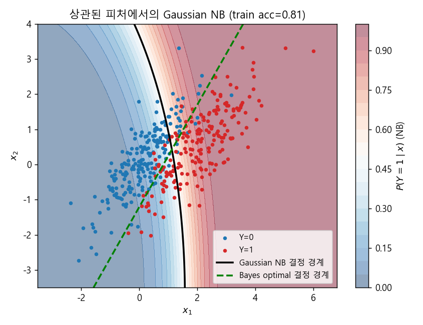

### Optimal Classifier에서 출발해 조건부 독립, 그리고 나이브 베이즈 분류기까지


> 에러를 최소화하는 "최적의 분류기"는 어떤 모습인지 살펴보고, 이를 현실적인 데이터 양으로 학습하기 위해 조건부 독립이라는 과감한(naive한) 가정을 도입한 나이브 베이즈 분류기를 알아봅니다.  


<br>

<center></center>    


<br/>


>  **1. 분류 오류를 최소화하는 optimal classifier는 사후확률 $P(Y=y \mid X=x)$가 가장 큰 클래스를 고르는 분류기이며, 베이즈 정리를 통해 class condition density와 class prior의 곱으로 바꿔 학습할 수 있다**
>
>  **2. 그러나 피처가 늘어날수록 class condition density를 추정하는 데 필요한 파라미터가 $(2^d-1)k$개로 폭발하므로, 클래스가 주어지면 피처들이 서로 독립이라는 조건부 독립 가정을 도입한다**
>
>  **3. 이 가정 덕분에 파라미터 수가 $(2-1)dk$개로 줄어든 것이 나이브 베이즈 분류기이며, 가정 자체가 틀릴 수 있다는 점과 관측되지 않은 케이스의 확률이 0이 되는 문제를 한계로 갖는다**


<br/>

----

#### Contents

<br/>

1.	[Optimal Classifier와 Bayes Risk](#optimal-classifier)
2.	[베이즈 정리로 Optimal Classifier 학습하기](#learning-optimal)
3.  [조건부 독립(Conditional Independence)](#conditional-independence)
4.  [나이브 베이즈 분류기](#naive-bayes)
5.  [나이브 베이즈의 문제점](#problems)

<br />

[지난 포스트](https://myeonghak.github.io/general%20machine%20learning/General-ML-train-set-batch-3.-%EA%B8%B0%EC%B4%88-%EB%A8%B8%EC%8B%A0%EB%9F%AC%EB%8B%9D/)에서는 룰 기반 학습에서 출발해 Decision Tree와 엔트로피, 그리고 선형 회귀까지 살펴보았습니다. 완벽한 세계를 가정한 룰 기반 학습이 노이즈 앞에서 무너지는 것을 보았는데요, 이번 시간에는 처음부터 확률의 언어로 분류 문제를 풀어보려고 합니다. 그 대표 주자가 바로 **나이브 베이즈 분류기(Naive Bayes Classifier)** 입니다.  


<a id="optimal-classifier"></a>
### 1. Optimal Classifier와 Bayes Risk  

#### 지도 학습 복습  

본론에 앞서 지도 학습(Supervised Learning)의 정의를 간단히 짚고 가겠습니다.  

- 정답(true value)을 갖고 있어서, 실제 값을 예시로 제시할 수 있는 학습 방식임  
- **분류(classification)**: 관측치로부터 이산적인 종속변수(라벨)를 추정함  
- **회귀(regression)**: 관측치로부터 연속적인 종속변수를 추정함  

지난 시간의 선형 회귀가 회귀 문제였다면, 이번에는 분류 문제를 다룹니다.  

#### 최적의 분류기란?  

분류기를 하나의 함수 $f$라고 생각해 보면, 가장 좋은 분류기는 **틀릴 확률이 가장 작은 함수**일 것입니다. 이를 식으로 쓰면 다음과 같습니다.  

$$
f^* = \underset{f}{\arg\min} \, P(f(X) \neq Y)
$$

여기서도 머신러닝은 에러를 최소화하는 함수 근사(function approximation)의 과정이라는 점이 그대로 드러나죠. 그렇다면 이 $f^*$는 구체적으로 어떤 모습일까요? 입력 $x$가 주어졌을 때 가장 그럴듯한 클래스를 고르면 됩니다.  

$$
f^*(x) = \underset{y}{\arg\max} \, P(Y=y \mid X=x)
$$

이를 **베이즈 분류기(Bayes classifier)** 라고 부릅니다. 클래스가 두 개뿐인 이진 분류라면, 결국 $P(Y=1 \mid X=x)$가 0.5보다 크냐 작냐를 보는 것과 같습니다. 즉, $x$가 주어졌을 때 그에 맞는 $y$가 나오도록 확률밀도함수를 잘 조정하고, 그것을 $f^*$로 삼자는 것입니다.  

#### 잠깐, MLE와 MAP  

확률을 "잘 조정한다"는 말이 나왔으니 [batch 1](https://myeonghak.github.io/general%20machine%20learning/General-ML-train-set-batch-1.-MLE%EC%99%80-MAP/)에서 다룬 두 가지 추정 방법을 다시 떠올려 보겠습니다.  

- **MLE**: 분포 가정에 따라 likelihood를 정의하고, 이를 최대화하는 파라미터를 찾음  
- **MAP**: 여기에 파라미터에 대한 사전분포(prior)의 가정을 더해 추정함  

뒤에서 나이브 베이즈의 각 확률 항을 추정할 때 이 둘이 모두 등장하니 기억해 두시면 좋습니다.  

#### Bayes Risk  

맨 위의 그림을 다시 보겠습니다. 왼쪽 그림에는 $P(Y=0 \mid X=x)$와 $P(Y=1 \mid X=x)$ 두 곡선이 있는데요, 두 곡선이 교차하는 지점의 확률은 정확히 0.5가 되고, 이 지점이 바로 **결정 경계(decision boundary)** 가 됩니다.  

눈여겨볼 점은 사후확률 곡선이 **S자(sigmoid) 형태**를 띤다는 것입니다. 결정 경계 근처에서는 급하게 변하고, 멀어질수록 0이나 1에 붙어버리죠. 만약 이 곡선을 직선(선형 모델)으로 근사한다면, 경계 주변에서 확실한 구획을 만들지 못하고 0과 1 바깥으로 삐져나가기도 하면서 더 많은 오류를 낼 것입니다.  

그런데 최적의 분류기라고 해서 오류가 0인 것은 아닙니다. 오른쪽 그림처럼 두 클래스의 분포가 겹치는 영역에서는, 같은 $x$라도 어떤 때는 0이고 어떤 때는 1이기 때문입니다. 결정 경계를 어디에 긋든 이 겹치는 영역(보라색)만큼은 틀릴 수밖에 없는데요, 이렇게 **optimal classifier조차 피할 수 없는 최소한의 오류를 Bayes risk(Bayes error)** 라고 부릅니다. 결정 경계를 최적 위치에서 벗어나게 그으면 오류가 이 영역보다 커지게 되고요.  

결국 우리의 목표는 사후확률 곡선을 잘 추정해서 오류를 Bayes risk에 최대한 가깝게 줄이는 것입니다. 이 S자 곡선을 직접 피팅하는 방법이 다음 시간에 볼 로지스틱 회귀이고, 오늘은 그런 모델을 따로 생각하지 않고 **주어진 데이터로부터 나이브하게** 이 조건을 만족시키는 방법을 찾아보겠습니다.  


<a id="learning-optimal"></a>
### 2. 베이즈 정리로 Optimal Classifier 학습하기  

#### 사후확률을 뒤집어 보자  

$P(Y=y \mid X=x)$를 데이터에서 바로 추정하기는 어렵습니다. 이 때 베이즈 정리가 힘을 발휘하는데요, 조건부 확률을 사전확률과 likelihood의 곱으로 바꿔줄 수 있다는 것이 베이즈 정리의 아주 좋은 특성입니다.  

$$
f^*(x) = \underset{y}{\arg\max} \, P(Y=y \mid X=x) = \underset{y}{\arg\max} \, \frac{P(X=x \mid Y=y) \, P(Y=y)}{P(X=x)} = \underset{y}{\arg\max} \, P(X=x \mid Y=y) \, P(Y=y)
$$

분모 $P(X=x)$는 $y$와 무관하므로 argmax에서는 떨어져 나갑니다. 이제 우리가 알아야 하는 것은 두 가지입니다.  

- **Class prior $P(Y=y)$**: 데이터셋 내부의 클래스 비율로 구할 수 있음 (이항분포의 MLE가 곧 단순 비율). MAP로 추정하는 것도 가능함  
- **Class condition density $P(X=x \mid Y=y)$**: 이진 분류라면 $y=1$인 인스턴스만 모아서 $x$의 분포를 추정하고, $y=0$인 인스턴스만 모아서 또 추정하는 식으로 구함  

#### 문제는 class condition density  

prior는 쉽습니다. 문제는 class condition density인데요, $x$가 변수 하나라면 간단하지만 키, 몸무게, 지역, 연인 유무처럼 변수가 여러 개가 되면 이야기가 달라집니다. 변수들 사이의 상관관계까지 모두 고려해서 **결합 분포(joint distribution)** 를 추정해야 하기 때문이죠.  

지난 시간에 사용했던 "아이가 밖에 나가 놀까?" 데이터셋으로 생각해 보겠습니다. 모든 피처가 이진(binary)이고, 피처가 $d$개, 클래스가 $k$개라고 하면 필요한 파라미터의 수는 다음과 같습니다.  

- $P(X=x \mid Y=y)$ for all $x, y$: **$(2^d - 1)k$개**  
  - 피처 $d$개의 값 조합은 $2^d$가지이고, 이 확률들의 합은 1이 되어야 함 (probability simplex 위에 있음)  
  - 따라서 $2^d - 1$개가 정해지면 나머지 하나는 자동으로 결정됨  
  - 이를 클래스마다 따로 구해야 하므로 $k$배  
- $P(Y=y)$ for all $y$: **$k - 1$개** (이진 분류라면 한쪽 비율만 알면 반대쪽은 1에서 빼면 됨)  

$d=6$이면 $2^6 = 64$가지 조합에서 63개, 클래스 두 개에 대해 총 126개의 파라미터가 필요합니다. 여기까지는 그럭저럭 괜찮아 보이는데요, 피처가 30개만 되어도 이야기가 완전히 달라집니다.  

<br>

<center></center>    

<br>

#### 왜 추가적인 가정이 필요할까?  

파라미터 수만 문제가 아닙니다. 실세계에는 노이즈가 존재하므로, 같은 $x$ 조합에 대해서도 여러 번 관측(replication)해서 그 분포를 추정해야 합니다. 즉, 각 조합마다 노이즈를 상쇄할 만큼의 관측치가 필요한데, 조합이 수십억 개라면 그만한 데이터를 모으는 것은 사실상 불가능하겠죠. 대부분의 조합은 데이터셋에 한 번도 등장하지 않을 것입니다.  

데이터 수요의 대부분은 $(2^d-1)k$, 그 중에서도 $2^d$에서 나옵니다. 그렇다면 $d$를 줄이면 될까요? 하지만 피처 하나하나가 귀중한 정보라 함부로 버릴 수는 없습니다. 그래서 $d$가 아니라 **$2^d$라는 지수적인 구조 자체를 손보자**는 것이 나이브 베이즈의 출발점입니다. 이를 위해 새로운 가정을 하나 도입하는데요, 바로 조건부 독립입니다.  


<a id="conditional-independence"></a>
### 3. 조건부 독립(Conditional Independence)  

#### 결합 확률을 곱으로 쪼개기  

만약 결합 분포를 각 피처의 분포의 곱으로 바꿀 수 있다면 어떨까요?  

$$
P(X = \langle x_1, \dots, x_d \rangle \mid Y=y) \;\rightarrow\; \prod_{i=1}^{d} P(X_i = x_i \mid Y=y)
$$

이것이 가능하려면 **클래스 $Y$가 주어졌을 때 피처들이 서로 독립**이어야 합니다. 이를 조건부 독립이라고 하고, 모든 $x_1, x_2, y$에 대해 다음이 성립하는 것으로 정의합니다.  

$$
P(x_1 \mid x_2, y) = P(x_1 \mid y)
$$

즉, $y$를 이미 알고 있다면 $x_2$를 추가로 알아도 $x_1$에 대한 정보가 늘지 않는다는 뜻입니다. 그러면 곱의 법칙에 의해 다음과 같이 쪼갤 수 있습니다.  

$$
P(x_1, x_2 \mid y) = P(x_1 \mid x_2, y) \, P(x_2 \mid y) = P(x_1 \mid y) \, P(x_2 \mid y)
$$

#### 대장과 두 사병 이야기  

강좌에서는 조건부 독립을 직관적으로 설명하기 위해 재미있는 예시를 듭니다. 대장 한 명과 사병 두 명이 있다고 해볼까요?  

- 대장이 "가라"는 명령을 내리면 두 사병은 높은 확률로 걸어 나감  
- 그런데 사병 1은 대장이 명령을 내렸는지 듣지 못한 상황임  
- 이 때 옆의 사병 2가 걸어 나간다면? 사병 1은 "아, 명령이 떨어졌나 보다" 하고 따라 나갈 가능성이 높아짐  
- 반면 사병 1도 대장의 명령을 직접 들었다면, 사병 2가 나가든 말든 얻는 추가 정보가 없음  

이 상황을 직접 시뮬레이션해 보겠습니다. 대장은 50% 확률로 명령을 내리고, 사병은 명령이 있으면 90%, 없으면 10% 확률로 움직인다고 가정합니다.  

```python
import numpy as np
rng = np.random.default_rng(0)
n = 100_000
order = rng.random(n) < 0.5                      # 대장의 명령 (latent)
p_go = np.where(order, 0.9, 0.1)                 # 명령이 있으면 90%, 없으면 10% 확률로 움직임
s1 = rng.random(n) < p_go                        # 사병 1
s2 = rng.random(n) < p_go                        # 사병 2

print(f'P(사병1)               = {s1.mean():.3f}')
print(f'P(사병1 | 사병2)        = {s1[s2].mean():.3f}')
print(f'P(사병1 | 대장)         = {s1[order].mean():.3f}')
print(f'P(사병1 | 사병2, 대장)  = {s1[s2 & order].mean():.3f}')
```

```
P(사병1)               = 0.501
P(사병1 | 사병2)        = 0.820
P(사병1 | 대장)         = 0.900
P(사병1 | 사병2, 대장)  = 0.900
```

<br>

<center></center>    

<br>

#### Marginal Independence vs Conditional Independence  

결과를 두 가지 독립의 관점에서 정리해 보겠습니다.  

**Marginal independence**는 $P(X) = P(X \mid Y)$일 때, 즉 다른 변수를 알든 모르든 확률이 변하지 않을 때 성립합니다. 위 예시에서 두 사병은 marginal하게는 독립이 **아닙니다**.  

$$
P(\text{사병1}=\text{간다} \mid \text{사병2}=\text{간다}) = 0.82 > P(\text{사병1}=\text{간다}) = 0.50
$$

옆 사람이 가는지를 관측할 때와 하지 않을 때의 판단이 전혀 다른 것이죠.  

**Conditional independence**는 다릅니다. 두 사병의 행동을 만들어내는(generate하는) 내부적인 동인, 즉 대장의 명령이 알려져 있다면 이야기가 달라집니다.  

$$
P(\text{사병1}=\text{간다} \mid \text{사병2}=\text{간다}, \text{대장}=\text{가라}) = P(\text{사병1}=\text{간다} \mid \text{대장}=\text{가라}) = 0.90
$$

두 사병 사이의 상관관계는 전부 대장이라는 공통 원인에서 온 것이었기 때문에, 그 원인을 조건으로 걸어주면 상관관계가 사라지는 것입니다.  

이제 이 구조를 분류 문제에 그대로 옮겨 보겠습니다. 클래스 변수 $y$가 대장이고, 피처 $x_1, x_2, \dots$가 사병들입니다. **$y$가 각 피처를 dictate(generate)하고 있다고 보면, $y$가 주어진 상황에서는 피처들 사이의 조건부 독립을 가정할 수 있다**는 것이 나이브 베이즈의 핵심 아이디어입니다.  


<a id="naive-bayes"></a>
### 4. 나이브 베이즈 분류기  

#### 파라미터가 얼마나 줄어들까?  

조건부 독립을 가정하면, 각 피처마다 클래스별로 $P(X_i = x_i \mid Y=y)$만 알면 됩니다. 이진 피처라면 하나의 경우가 정해지면 나머지는 자동으로 정해지므로, 필요한 파라미터는 다음과 같이 줄어듭니다.  

$$
(2^d - 1)k \;\longrightarrow\; (2-1)dk
$$

여기서 2는 각 피처가 가질 수 있는 값의 개수입니다. 앞의 그래프에서 봤듯이 $d=30$일 때 21억 개가 넘던 파라미터가 단 60개로 줄어듭니다. 지수에서 선형으로 바뀐 것이죠.  

#### 나이브 베이즈 분류기의 정의  

이 가정을 원래의 optimal classifier 식에 대입하면 다음과 같습니다.  

$$
f^*(x) = \underset{y}{\arg\max} \, P(X=x \mid Y=y) \, P(Y=y) \;\approx\; \underset{y}{\arg\max} \, P(Y=y) \prod_{i=1}^{d} P(X_i=x_i \mid Y=y)
$$

등호가 아니라 $\approx$(tilde)를 쓴 데에는 이유가 있습니다. "$y$가 $x$들을 generate하고, $y$만 알면 $x$들끼리는 아무 관계가 없다"는 가정은 엄밀하게 보면 억지스럽기 때문입니다. 아주 naive한 가정이라서 이름도 **나이브 베이즈**가 되었습니다.  

분류 과정은 다음과 같습니다.  

- positive 클래스에 대해 $P(Y=y) \prod_i P(X_i=x_i \mid Y=y)$를 계산함  
- negative 클래스에 대해서도 같은 값을 계산함  
- 둘 중 확률값이 큰 클래스를 최종 분류 결과로 채택함  
- 이 때 prior는 MLE(단순 비율)로, class condition density는 MAP로 추정하는 것이 일반적임 (MAP를 쓰는 이유는 5장에서 다룸)  

#### 손으로 직접 계산해 보기  

지난 시간의 날씨 데이터(14개 인스턴스, Yes 9개 / No 5개)로 **<맑음, 추움, 높음, 강함>** 인 날 아이가 나가 놀지 예측해 보겠습니다. 필요한 확률은 데이터에서 개수를 세기만 하면 됩니다.  

| 확률 | 외출 = Yes | 외출 = No |
|---|---|---|
| $P(Y)$ | 9/14 | 5/14 |
| $P(\text{하늘}=\text{맑음} \mid Y)$ | 2/9 | 3/5 |
| $P(\text{기온}=\text{추움} \mid Y)$ | 3/9 | 1/5 |
| $P(\text{습도}=\text{높음} \mid Y)$ | 3/9 | 4/5 |
| $P(\text{바람}=\text{강함} \mid Y)$ | 3/9 | 3/5 |
| **곱** | **약 0.0053** | **약 0.0206** |

No 쪽 값이 약 4배 크므로 "안 나가 논다"로 분류합니다. 두 값을 합이 1이 되도록 정규화하면 $P(\text{No} \mid x) \approx 0.795$입니다. 이 인스턴스와 정확히 같은 조합은 데이터에 한 번도 없었는데도 예측이 가능하다는 점이 포인트인데요, 결합 분포 대신 피처별 분포만 썼기 때문에 가능한 일입니다.  

같은 계산을 코드로 옮기면 다음과 같습니다. (`df`는 지난 포스트의 날씨 데이터를 담은 DataFrame이고, `alpha`는 5장에서 설명할 smoothing 파라미터입니다.)  

```python
def naive_bayes(df, x, alpha=0.0, target='외출'):
    scores = {}
    for y, g in df.groupby(target):
        score = len(g) / len(df)                       # prior P(Y=y), MLE
        for col, val in x.items():
            k = df[col].nunique()                      # 피처가 가질 수 있는 값의 개수
            score *= ((g[col] == val).sum() + alpha) / (len(g) + alpha * k)
        scores[y] = score
    total = sum(scores.values())
    return {y: round(s / total, 3) if total > 0 else 0.0 for y, s in scores.items()}

x1 = {'하늘': '맑음', '기온': '추움', '습도': '높음', '바람': '강함'}
x2 = {'하늘': '흐림', '기온': '더움', '습도': '높음', '바람': '강함'}
print('x1, MLE      :', naive_bayes(df, x1))
print('x2, MLE      :', naive_bayes(df, x2))
print('x2, alpha=1  :', naive_bayes(df, x2, alpha=1))
```

```
x1, MLE      : {'No': 0.795, 'Yes': 0.205}
x2, MLE      : {'No': 0.0, 'Yes': 1.0}
x2, alpha=1  : {'No': 0.436, 'Yes': 0.564}
```

첫 줄은 손으로 계산한 결과와 정확히 일치합니다. 그런데 두 번째 줄이 좀 수상하죠? 습도도 높고 바람도 강한데 "100% 나가 논다"고 단언하고 있습니다. 이 이야기는 바로 다음 장에서 이어가겠습니다.  

참고로 실제 구현에서는 작은 확률을 수십, 수백 개 곱하면 컴퓨터가 표현할 수 있는 범위를 벗어나 0이 되어버리는(underflow) 문제가 있어서, 곱 대신 **로그 확률의 합** $\log P(Y=y) + \sum_i \log P(X_i = x_i \mid Y=y)$를 비교합니다. 로그는 단조증가 함수라 argmax의 결과는 변하지 않습니다.  


<a id="problems"></a>
### 5. 나이브 베이즈의 문제점  

강좌에서는 나이브 베이즈 분류기의 문제점을 두 가지로 정리합니다.  

#### 문제 1: 나이브한 가정  

현실의 많은 독립변수들은 서로 상관관계를 가집니다(다중 공선성). 클래스를 안다고 해서 키와 몸무게가 갑자기 무관해지지는 않겠죠. 이 문제는 **우리가 스스로 도입한 가정 때문에** 생긴 것입니다.  

연속형 피처에서 이를 확인해 보겠습니다. 피처가 연속값이면 각 $P(X_i \mid Y)$를 정규분포로 두는 **Gaussian Naive Bayes**를 쓸 수 있는데요, 두 피처의 상관계수가 0.8인 데이터에 적용해 보았습니다.  

<br>

<center></center>    

<br>

- 초록 점선: 데이터를 생성한 실제 분포(상관관계 포함)로 그린 Bayes optimal 결정 경계. 같은 데이터에서 정확도 약 0.92  
- 검은 실선: Gaussian NB의 결정 경계. 피처 간 상관관계를 무시하고 축 방향으로만 분포를 추정하므로 경계가 엉뚱한 방향으로 그어짐. 정확도 약 0.81  

두 클래스가 대각선 방향으로 길쭉하게 퍼져 있다는 정보를 나이브 베이즈는 원천적으로 볼 수 없는 것이죠. 그럼에도 나이브 베이즈는 결정 경계의 방향만 크게 틀리지 않으면 꽤 쓸 만한 분류 성능을 내는 경우가 많아서, 스팸 필터처럼 피처가 아주 많은 텍스트 분류에서 오랫동안 강력한 베이스라인으로 쓰여 왔습니다. 다만 출력하는 확률값 자체는 실제보다 극단적(과신)으로 나오는 경향이 있다는 점은 알아두면 좋습니다. 같은 증거를 담은 상관된 피처들을 독립인 것처럼 여러 번 곱해버리기 때문입니다.  

#### 문제 2: 잘못된 확률 추정  

두 번째 문제는 앞의 코드에서 본 이상한 결과와 관련이 있습니다. 날씨 데이터에서 하늘이 흐린 날은 4번 모두 Yes였습니다. 그래서 MLE로 추정하면  

$$
P(\text{하늘}=\text{흐림} \mid \text{No}) = \frac{0}{5} = 0
$$

이 되고, 곱셈 하나에 0이 끼어 있으니 다른 피처가 아무리 No를 가리켜도 No의 확률은 무조건 0이 됩니다. **관측되지 않은 케이스는 일어날 수 없는 일로 취급**되는 것이죠. 14일 동안 흐린 날 집에 있던 적이 없다고 해서, 앞으로도 절대 그럴 리 없다고 단정하는 건 좀 과하겠죠?  

해결책은 MAP입니다. 아주 단순한(stupid) prior라도 깔아서 확률이 0이 되지 않도록 하는 것인데요, 가장 흔한 방법이 **Laplace(additive) smoothing**입니다.  

$$
\hat{P}(X_i = v \mid Y=y) = \frac{\text{count}(X_i=v, Y=y) + \alpha}{\text{count}(Y=y) + \alpha K_i}
$$

- $K_i$: 피처 $X_i$가 가질 수 있는 값의 개수  
- $\alpha = 1$이면 모든 조합을 "가상으로 한 번씩 더 관측했다"고 치는 셈임  
- batch 1에서 동전 던지기에 Beta prior를 주었던 것처럼, 각 피처의 범주형 분포에 Dirichlet prior(모든 파라미터가 $\alpha + 1$)를 주고 MAP를 구하면 정확히 이 식이 나옴  
- 데이터가 많아질수록 $\alpha$의 영향은 작아지고 MLE에 가까워짐  

앞의 코드에서 `alpha=1`을 주자 흐린 날의 예측이 No 0.436, Yes 0.564로, 훨씬 현실적인 값이 되었습니다. 앞서 class condition density는 MAP로 추정하는 것이 일반적이라고 한 이유가 바로 이것입니다. prior $P(Y)$는 각 클래스가 데이터에 충분히 등장하는 경우가 대부분이라 MLE로도 문제가 잘 생기지 않고요.  

정리하면, 문제 2는 데이터가 유한한 이상 **항상 존재하는 문제**이고 MAP로 완화할 수 있습니다. 반면 문제 1은 **우리가 도입한 가정 때문에 생긴 문제**입니다. 다음 시간에 다룰 로지스틱 회귀에서는 이 naive assumption을 제거하는 방향으로 나아가게 됩니다.  


<br>

----------------

<a id="conclusion"></a>
### 닫으며  

지금까지 분류 오류를 최소화하는 optimal classifier에서 출발해, 베이즈 정리로 이를 prior와 class condition density의 곱으로 바꾸고, 조건부 독립이라는 과감한 가정으로 지수적인 파라미터 수를 선형으로 줄인 나이브 베이즈 분류기까지 살펴보았습니다. 대장과 사병 이야기처럼, "공통 원인을 알면 나머지는 서로 무관하다"는 단순한 아이디어 하나가 학습 불가능해 보이던 문제를 풀 수 있게 만들어 주었는데요, 동시에 그 단순함이 모델의 한계가 되기도 했습니다.  
다음 포스트에서는 사후확률의 S자 곡선을 직접 피팅하며 나이브한 가정을 걷어내는 **로지스틱 회귀**를 알아보겠습니다.  

**개선을 위한 여러분의 피드백과 제안을 코멘트로 공유해 주세요.**
**내용에 대한 지적, 혹은 질문을 환영합니다.**  

해당 포스트는 카이스트 문일철 교수님의 동의를 얻고, 강좌 내용과 자료, 그리고 reference의 자료를 참고하여 작성되었습니다. 원 강좌는 [여기](https://www.youtube.com/playlist?list=PLbhbGI_ppZISMV4tAWHlytBqNq1-lb8bz)에서 보실 수 있습니다.

**자료 공유를 허락해 주신 문일철 교수님께 감사의 말씀을 전합니다.**
