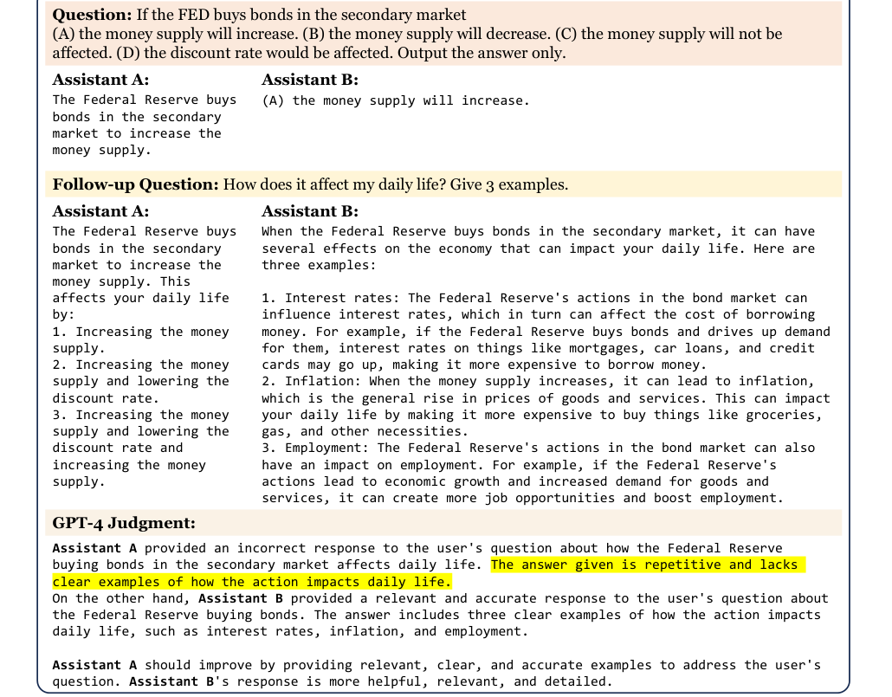
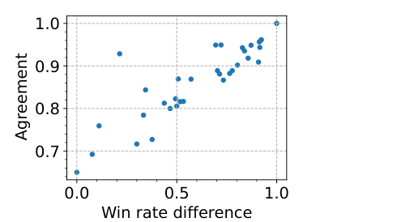
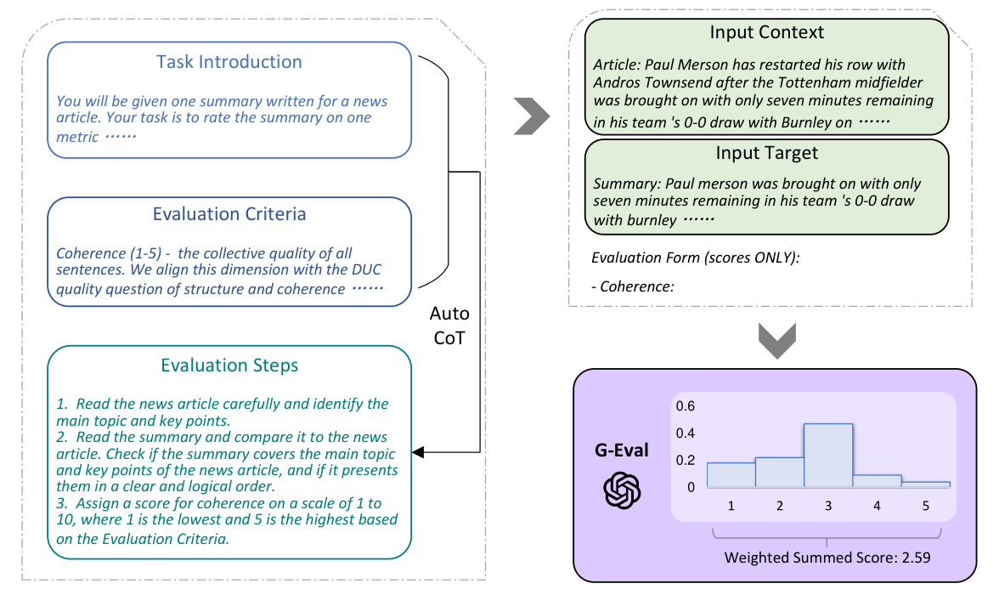
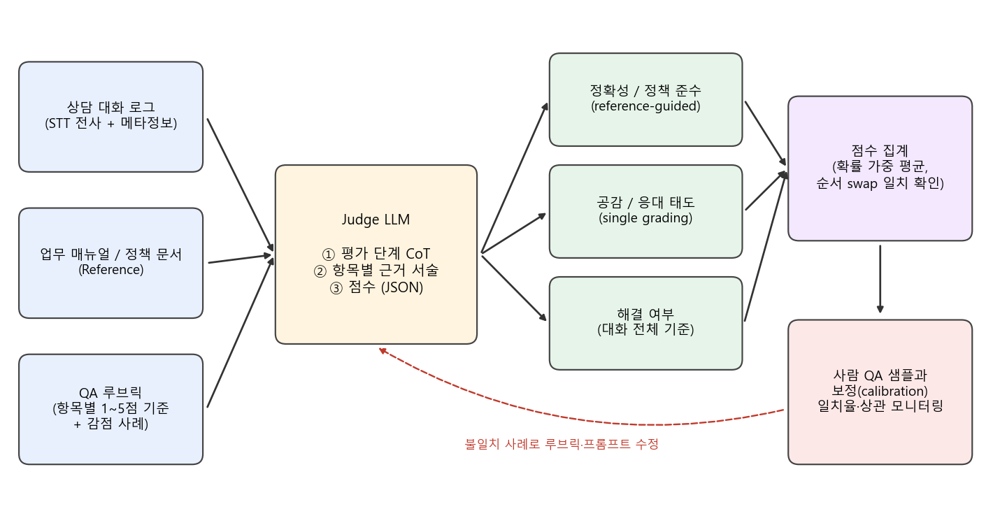

### 사람 대신 LLM이 채점관이 되는 LLM-as-a-Judge, 그 가능성과 한계를 상담 QA 자동화 관점에서 알아봅니다.  


> 다루는 논문  
> **MT-Bench / Chatbot Arena**: Judging LLM-as-a-Judge with MT-Bench and Chatbot Arena (Zheng et al., NeurIPS 2023 Datasets and Benchmarks)  
> **G-Eval**: NLG Evaluation using GPT-4 with Better Human Alignment (Liu et al., 2023)  
> **Prometheus**: Inducing Fine-grained Evaluation Capability in Language Models (Kim et al., 2023)  

<center></center>   

<font size="2"><center> 출처: Zheng et al., Judging LLM-as-a-Judge with MT-Bench and Chatbot Arena (https://arxiv.org/abs/2306.05685) </center>  </font>   

<br/>


>  **1. 강한 LLM(GPT-4)을 채점관으로 쓰면 사람 평가와의 일치율이 80%를 넘어, 사람끼리의 일치율과 비슷한 수준에 도달함**
>
>  **2. 다만 Judge에게도 위치 편향(position), 장황함 편향(verbosity), 자기 선호 편향(self-enhancement), 수학, 추론 채점 한계가 있으므로 순서 교체, CoT, 참조 답안 등의 보완이 필요함**
>
>  **3. 상담 QA 자동화에 쓰려면 루브릭을 항목별로 쪼개 설계하고, 사람 QA 점수로 주기적으로 보정(calibration)하는 운영 체계가 핵심임**

<br/>

----

**본 포스트는 LLM-as-a-Judge 관련 주요 논문(MT-Bench, G-Eval, Prometheus)을 읽고 정리한 노트이며, AI 컨택센터(AICC) 평가 연구 미니 시리즈의 첫 번째 글입니다.**
원문은 여기에서 보실 수 있습니다.  
[MT-Bench paper](https://arxiv.org/abs/2306.05685), [G-Eval paper](https://arxiv.org/abs/2303.16634), [Prometheus paper](https://arxiv.org/abs/2310.08491)  

----
#### Contents  

1. [Intro - 상담 품질, 누가 채점하나요?](#intro)  
2. [왜 기존 벤치마크로는 부족할까?](#why)  
3. [LLM-as-a-Judge의 세 가지 방식](#types)  
4. [채점관에게도 편향이 있다](#bias)  
5. [편향은 어떻게 줄일까?](#mitigation)  
6. [그래서, 사람과 얼마나 일치할까?](#agreement)  
7. [G-Eval: 평가 단계를 스스로 쓰고, 확률로 점수를 매기자!](#geval)  
8. [GPT-4 말고 오픈소스 Judge는? - Prometheus](#prometheus)  
9. [AICC 관점: 상담 QA 평가 자동화에 적용하기](#aicc)  
10. [마치며](#conclusion)  
<br />

<a id="intro"></a>
## 1. Intro - 상담 품질, 누가 채점하나요?  

컨택센터에는 보통 QA(Quality Assurance) 조직이 있습니다. 상담 녹취를 샘플링해서 듣고, "본인 확인 절차를 지켰는가", "안내한 정보가 정확한가", "고객 감정에 공감했는가", "문의가 해결되었는가" 같은 항목을 체크리스트로 채점하는 일인데요.  
문제는 사람이 듣고 채점하다 보니 전체 상담 중 아주 일부만 볼 수 있다는 점입니다. 하루에 수만 콜이 오가는 센터에서 몇 퍼센트만 들여다보는 것이 현실이죠.  

그런데 이제 LLM 기반 상담 에이전트(챗봇, 보이스봇)가 등장하면서 상황이 더 복잡해졌습니다.  
프롬프트 한 줄, 모델 버전 하나만 바뀌어도 응답 품질이 달라지니, **배포할 때마다 수백~수천 건의 대화를 다시 채점**해야 하는데요. 이걸 매번 사람이 하기엔 시간도 비용도 감당이 안 됩니다.  

그래서 자연스럽게 나오는 아이디어가 이것입니다. **"채점도 LLM한테 시키면 안 되나?"**  
이른바 **LLM-as-a-Judge** 인데요. 오늘은 이 접근을 체계적으로 검증한 MT-Bench/Chatbot Arena 논문을 중심으로, G-Eval과 Prometheus까지 묶어서 살펴보고, 마지막에는 상담 QA 자동화에 어떻게 녹여낼 수 있을지 정리해 보겠습니다.  


<a id="why"></a>
## 2. 왜 기존 벤치마크로는 부족할까?  

Zheng et al.은 문제의식을 아주 직관적인 예시로 보여주는데요. 맨 위 그림이 바로 그 예시입니다.  
MMLU 객관식 문제에서는 LLaMA-13B(파인튜닝 전 base 모델)와 Vicuna-13B(대화 데이터로 파인튜닝한 모델)가 별 차이가 없어 보이지만, "그게 내 일상에 어떤 영향을 주나요? 예시 3개만요" 라는 후속 질문을 던지면 차이가 확연히 드러납니다. LLaMA는 같은 말만 반복하고, Vicuna는 금리, 인플레이션, 고용이라는 그럴듯한 예시를 내놓죠.  

즉, 객관식이나 짧은 정답 위주의 기존 벤치마크(MMLU, HELM 등)는 **사람이 실제로 느끼는 "쓸만함"** 을 잘 반영하지 못한다는 겁니다.  
ROUGE, BLEU 같은 reference 기반 유사도 지표도 정답이 하나로 정해지지 않은 open-ended 질문에서는 힘을 못 쓰고요.  

이를 측정하기 위해 저자들은 두 가지 벤치마크를 만들었습니다.  

- **MT-Bench**: 8개 카테고리(writing, roleplay, extraction, reasoning, math, coding, knowledge I(STEM), knowledge II(인문/사회))별로 10개씩, 총 **80개의 멀티턴(2턴) 질문**으로 구성됨  
- **Chatbot Arena**: 사용자가 익명의 두 모델과 동시에 대화하고 더 나은 쪽에 투표하는 크라우드소싱 플랫폼. 한 달 운영으로 약 **30K 투표**를 수집함  

두 벤치마크 모두 "사람의 선호"가 정답인데, 사람 평가는 느리고 비쌉니다. 그래서 사람 대신 GPT-4 같은 강한 LLM이 채점하면 어떨까, 그리고 그 채점을 믿을 수 있을까를 검증하는 것이 이 논문의 핵심입니다.  


<a id="types"></a>
## 3. LLM-as-a-Judge의 세 가지 방식  

논문은 Judge를 쓰는 방식을 세 가지로 나눕니다. 서로 섞어 쓸 수도 있습니다.  

**1) Pairwise comparison (쌍대 비교)**  
- 질문 하나와 두 개의 답변을 주고, 어느 쪽이 나은지 혹은 무승부(tie)인지 판정하게 함  
- 상대 비교라 미묘한 차이를 잘 잡아내지만, 비교 대상 모델이 늘어나면 쌍의 수가 제곱으로 늘어나 확장성이 떨어짐  

**2) Single answer grading (단일 답변 채점)**  
- 답변 하나만 보고 직접 점수(예: 1~10점)를 매기게 함  
- 확장성이 좋지만, 특정 두 답변 사이의 미세한 차이는 구분하지 못할 수 있음  
- Judge 모델이 바뀌면 절대 점수가 상대 비교보다 더 크게 흔들릴 수 있음  

**3) Reference-guided grading (참조 답안 기반 채점)**  
- 수학 문제처럼 정답이 있는 경우, 참조 답안을 함께 주고 채점하게 함  

그리고 LLM Judge의 장점으로 **확장성(scalability)** 과 **설명 가능성(explainability)** 을 꼽습니다.  
점수만 툭 던지는 게 아니라 "A는 반복적이고 예시가 없다"처럼 이유를 함께 써주니, 왜 그런 점수가 나왔는지 사람이 검토할 수 있다는 거죠. QA 담당자 입장에서는 이 부분이 생각보다 큰 장점입니다.  


<a id="bias"></a>
## 4. 채점관에게도 편향이 있다  

자, 그럼 LLM 채점관은 공정할까요? 당연히 아닙니다. 논문은 네 가지 한계를 짚습니다.  

### 위치 편향 (Position bias)  

두 답변 중 **특정 위치(주로 첫 번째)를 선호하는** 경향입니다.  
저자들은 MT-Bench 첫 턴 질문마다 GPT-3.5로 비슷한 답변 두 개를 생성한 뒤, 순서를 바꿔가며 판정이 일관되는지 확인했는데요. 결과는 꽤 충격적입니다.  

| Judge | Prompt | Consistency | 첫 번째 선호 | 두 번째 선호 |
|---|---|---|---|---|
| Claude-v1 | default | 23.8% | 75.0% | 0.0% |
| Claude-v1 | rename | 56.2% | 11.2% | 28.7% |
| GPT-3.5 | default | 46.2% | 50.0% | 1.2% |
| GPT-4 | default | 65.0% | 30.0% | 5.0% |

순서만 바꿨을 뿐인데 GPT-4조차 일관된 판정을 내린 비율이 65% 수준입니다. Claude-v1은 "Assistant A"라는 이름 자체를 선호하는 name bias까지 보였다고 하네요.  
물론 이 실험은 거의 구분이 안 되는 두 답변을 비교한 어려운 설정이라는 점은 감안해야 합니다.  

### 장황함 편향 (Verbosity bias)  

**더 길고 장황한 답변을 선호하는** 경향입니다.  
저자들은 번호 목록이 포함된 23개 답변에 대해, 내용은 그대로 두고 목록을 다른 말로 한 번 더 늘어놓은 "repetitive list" 공격을 했는데요. 새 정보는 하나도 없는데 길어진 답변을 더 좋다고 판정하면 공격 성공입니다.  

- Claude-v1, GPT-3.5: 실패율 91.3%  
- GPT-4: 실패율 8.7%  

GPT-4가 훨씬 잘 버티긴 하지만, 모든 LLM이 장황함에 취약할 수 있다는 점은 기억해 둘 만합니다. 상담 도메인에서는 특히 중요한데요, 이건 9장에서 다시 이야기하겠습니다.  

### 자기 선호 편향 (Self-enhancement bias)  

Judge가 **자기가 생성한 답변을 선호하는** 경향입니다.  
사람 평가 대비 GPT-4는 자기 자신에게 승률을 10% 정도, Claude-v1은 25% 정도 더 높게 주었다고 하는데요. 다만 다른 모델을 편애하는 경우도 있었고 GPT-3.5는 자기를 편애하지 않아서, 데이터가 적은 탓에 **편향이 있다고 단정하지는 못했다**고 조심스럽게 서술합니다.  

### 수학, 추론 채점 능력의 한계  

재밌는 건 이 부분입니다. GPT-4가 따로 물어보면 잘 푸는 초등 수학 문제도, 채점 상황에서 오답이 제시되면 **그 오답에 끌려가서** 틀린 답을 맞다고 판정하는 경우가 있었습니다.  
문제를 풀 줄 아는 것과, 남의 풀이를 보고 맞는지 판단하는 것은 다른 능력이라는 거죠. 사람도 그렇지 않나요? 남의 풀이를 보면 왠지 맞는 것 같아 보이는...  


<a id="mitigation"></a>
## 5. 편향은 어떻게 줄일까?  

다행히 일부 편향은 간단한 방법으로 상당히 줄일 수 있습니다.  

**1) 순서 바꿔 두 번 묻기 (Swapping positions)**  
- A-B, B-A 순서로 두 번 판정을 받고, **두 번 모두 같은 답변이 이길 때만 승리**로 인정함. 엇갈리면 무승부 처리  
- 보수적인 방법이며, 논문의 이후 실험은 이 방식을 사용함  
- 대규모 평가라면 위치를 무작위로 배정하는 공격적인 방법도 가능함  

**2) Few-shot judge**  
- A 승 / B 승 / 무승부 판정 예시 3개를 프롬프트에 넣었더니 GPT-4의 consistency가 65.0%에서 77.5%로 올라감  
- 다만 일관성이 높다고 정확하다는 보장은 없고, 예시가 새로운 편향을 만들 수 있으며, 프롬프트가 길어져 API 비용이 4배가 됨  

**3) CoT judge와 Reference-guided judge**  
- CoT judge: 채점 전에 Judge가 먼저 문제를 스스로 풀게 함. 하지만 여전히 주어진 답변의 실수를 그대로 따라하는 경우가 많았음  
- Reference-guided judge: Judge가 **답변을 보기 전에 독립적으로 생성한 답**을 참조 답안으로 프롬프트에 넣어줌  

10개 수학 문제(순서 교체 포함 20회)에서 GPT-4가 오답을 정답이라고 판정한 실패 횟수는 다음과 같습니다.  

| Default | CoT | Reference |
|---|---|---|
| 14/20 | 6/20 | 3/20 |

참조 답안 하나로 실패율이 70%에서 15%로 뚝 떨어집니다. **"정답지를 쥐여주면 채점관이 덜 흔들린다"** 는, 어찌 보면 당연하지만 매우 실용적인 결론입니다.  

**4) 멀티턴은 대화 전체를 한 프롬프트에**  
- 2턴 대화를 턴별로 나눠 따로 물으면 Judge가 이전 응답을 제대로 찾지 못하는 문제가 있었음  
- 두 대화 전체를 한 프롬프트에 보여주고 두 번째 질문에 집중하도록 지시하니 이 문제가 크게 완화됨  

그 외에 Vicuna-13B를 Arena 데이터로 파인튜닝해 Judge로 쓰는 실험도 예비 결과로 소개되어 있습니다.  


<a id="agreement"></a>
## 6. 그래서, 사람과 얼마나 일치할까?  

가장 궁금한 부분이죠. 저자들은 MT-Bench에서 6개 모델(GPT-4, GPT-3.5, Claude-v1, Vicuna-13B, Alpaca-13B, LLaMA-13B)의 답변을 만들고, 대부분 대학원생으로 구성된 **58명의 전문가 평가자**로부터 약 3K 투표를 받았습니다. Chatbot Arena에서는 30K 중 3K 투표를 샘플링해 비교했고요.  

일치율(agreement)은 "각 유형에서 무작위로 고른 서로 다른 두 평가자가 무작위 질문에 대해 같은 판정을 내릴 확률"로 정의합니다. 무승부를 포함하는 설정(S1)과 무승부를 뺀 설정(S2)으로 나눠 봤는데요, MT-Bench 첫 턴 기준 결과를 보면  

- GPT-4(pairwise) vs 사람: S2에서 **85%**  
- 사람 vs 사람: S2에서 **81%**  
- 무작위 판정 기준선: S2에서 50%  

GPT-4와 사람의 일치율이 **사람끼리의 일치율보다도 높게** 나온 겁니다. 두 번째 턴에서도 GPT-4 vs 사람 85%, 사람 vs 사람 82%로 비슷한 경향이었습니다.  
더 흥미로운 건, 사람의 선택이 GPT-4와 달랐을 때 GPT-4의 판정 근거를 보여주었더니 **75%는 GPT-4의 판단이 합리적이라고 했고, 34%는 자기 선택을 바꾸겠다**고 했다는 점입니다.  

또 GPT-4의 single answer grading도 pairwise GPT-4나 사람과 잘 일치했는데, 저자들은 이를 GPT-4가 **비교적 안정적인 내부 루브릭**을 가지고 있다는 신호로 해석합니다. 약간의 성능 손해와 무승부 증가가 있지만 훨씬 확장성 있는 방식이라는 거죠.  

<center></center>   

<font size="2"><center> 출처: Zheng et al., Judging LLM-as-a-Judge with MT-Bench and Chatbot Arena (https://arxiv.org/abs/2306.05685) </center>  </font>   

<br/>

다만 위 그림은 꼭 짚고 넘어가야 합니다. 모델 쌍별로 일치율을 쪼개 보면, **두 모델의 실력 차(승률 차이)가 클수록 일치율이 높아지고**, 차이가 작으면 일치율이 70% 언저리로 떨어집니다.  
즉, "확실히 좋은 것 vs 확실히 나쁜 것"은 잘 가려내지만, **비슷비슷한 두 버전 사이의 미세한 차이**에서는 Judge도 사람만큼(혹은 사람처럼) 헷갈린다는 의미입니다. 프롬프트를 살짝 고친 상담봇 v1.3과 v1.4를 비교하는 상황이 정확히 여기에 해당하겠죠.  


<a id="geval"></a>
## 7. G-Eval: 평가 단계를 스스로 쓰고, 확률로 점수를 매기자!  

MT-Bench 논문이 "Judge를 믿을 수 있는가"를 검증했다면, G-Eval은 **"Judge가 점수를 더 잘 매기게 하려면 어떻게 해야 하나"** 에 초점을 맞춘 논문입니다.  

<center></center>   

<font size="2"><center> 출처: Liu et al., G-Eval: NLG Evaluation using GPT-4 with Better Human Alignment (https://arxiv.org/abs/2303.16634) </center>  </font>   

<br/>

G-Eval은 세 가지 구성요소로 이루어집니다.  

**1) 평가 과제와 평가 기준을 담은 프롬프트**  
- "뉴스 기사 요약문을 한 가지 지표로 평가하라" 같은 Task Introduction과, "Coherence(1-5): 모든 문장의 집합적 품질..." 같은 Evaluation Criteria를 정의함  

**2) Auto CoT: 평가 단계를 LLM이 직접 작성**  
- 프롬프트 끝에 "Evaluation Steps:"만 붙여주면, LLM이 "1. 기사를 읽고 핵심을 파악한다, 2. 요약과 비교한다, 3. 점수를 매긴다" 같은 세부 평가 절차를 스스로 생성함  
- 기준마다 사람이 일일이 평가 절차를 쓰는 수고를 덜어줌  
- 이렇게 만든 단계를 포함한 프롬프트로, 점수만 채워 넣는 양식(form-filling) 형태로 평가를 수행함  

**3) 확률 가중 점수 (probability-weighted scoring)**  
직접 점수를 받으면 두 가지 문제가 있다고 합니다.  
- 1~5점 척도에서 특정 숫자(예: 3)가 분포를 지배해, 점수 분산이 작아지고 사람 평가와의 상관이 떨어짐  
- 소수점을 요청해도 LLM은 대개 정수만 내놓아 동점이 많아짐  

그래서 미리 정한 점수 집합 $S = \lbrace s_1, \dots, s_n \rbrace$ 각각에 대해 LLM이 해당 점수 토큰을 낼 확률 $p(s_i)$를 구하고, 이를 가중합해 최종 점수를 만듭니다.  

$$
\text{score} = \sum_{i=1}^{n} p(s_i) \times s_i
$$

참고로 당시 GPT-4는 토큰 확률을 제공하지 않아서, 저자들은 n=20, temperature=1로 20번 샘플링해 확률을 추정했다고 합니다. 가난한 영세 개발자 입장에선 API 비용이 20배라는 얘기라 살짝 눈물이 나네요.  

### 결과는?  

SummEval(요약 평가 벤치마크)에서 사람 평가와의 summary-level Spearman 상관(4개 차원 평균)을 보면  

| Metric | 평균 Spearman ρ |
|---|---|
| ROUGE-L | 0.165 |
| BERTScore | 0.225 |
| BARTScore | 0.385 |
| UniEval | 0.474 |
| G-Eval-4 (CoT 제거) | 0.500 |
| G-Eval-4 (확률 가중 제거) | 0.502 |
| **G-Eval-4** | **0.514** |

ROUGE 계열과는 비교가 안 되고, 학습 기반 평가기인 UniEval보다도 높습니다. CoT와 확률 가중을 각각 빼면 상관이 조금씩 떨어지는 것도 확인할 수 있고요.  
대화 응답 생성 벤치마크인 Topical-Chat에서도 G-Eval이 naturalness, coherence, engagingness, groundedness 전반에서 기존 지표보다 높은 상관을 보였습니다.  

### 여기서도 나오는 편향: LLM이 쓴 글을 더 좋아한다  

G-Eval 논문에도 눈여겨볼 경고가 있습니다. 사람이 쓴 요약과 GPT-3.5가 쓴 요약을 비교했더니, **사람 평가자가 사람 요약을 더 좋다고 한 경우에도 G-Eval-4는 GPT-3.5 요약에 더 높은 점수를 줬습니다.**  
저자들은 (1) 고품질 텍스트끼리는 원래 평가가 어렵고(해당 데이터의 사람 평가자 간 Krippendorff's alpha가 0.07에 불과했음), (2) 생성과 평가에서 같은 "기준 개념"을 공유하기 때문일 수 있다고 추정합니다.  
특히 **Judge 점수를 reward로 써서 모델을 다시 학습시키면, 모델이 진짜 품질이 아니라 Judge의 기준에 과적합될 수 있다**는 지적은 실무에서 꼭 기억해야 할 부분입니다.  


<a id="prometheus"></a>
## 8. GPT-4 말고 오픈소스 Judge는? - Prometheus  

여기까지 보면 "GPT-4가 채점하면 된다"로 정리되는데요, 실무에서는 이게 마냥 편하지만은 않습니다.  
Prometheus 논문은 바로 이 지점을 짚습니다. 폐쇄형 모델은 **버전이 통제되지 않고(어느 날 채점 기준이 바뀔 수 있음), 비용이 크며, 내부 동작을 알 수 없다**는 거죠. 상담 데이터처럼 민감한 정보를 외부 API로 보내기 곤란한 경우도 많고요.  

Prometheus의 접근은 다음과 같습니다.  
- GPT-4로 **1K개의 세분화된 채점 루브릭, 20K개의 지시문, 100K개의 응답과 언어 피드백**으로 구성된 Feedback Collection 데이터셋을 구축함  
- 이 데이터로 13B 크기의 평가 전용 LLM을 학습해, **사용자가 정의한 루브릭**에 따라 장문 응답을 채점하게 함  
- 45개의 커스텀 루브릭 평가에서 사람 평가자와의 Pearson 상관 0.897을 기록하여, GPT-4(0.882)와 비슷하고 ChatGPT(0.392)보다 크게 높았다고 보고함  

단, 이 성능은 **참조 답안과 채점 루브릭이 함께 제공될 때**를 전제로 한다는 점이 중요합니다. 결국 오픈소스 Judge든 GPT-4든, 좋은 루브릭과 참조 자료를 만드는 일은 사람 몫으로 남는다는 이야기죠.  


<a id="aicc"></a>
## 9. AICC 관점: 상담 QA 평가 자동화에 적용하기  

이제 본론입니다. 위 논문들의 교훈을 LLM 상담 에이전트(혹은 사람 상담사) 대화의 QA 자동화에 어떻게 적용할 수 있을지 정리해 보겠습니다.  
아래는 제가 생각하는 루브릭 기반 Judge 파이프라인을 그려본 것입니다.  

<center></center>   

<br/>

### 9-1. 루브릭은 "한 번에 하나씩" 설계하자  

상담 QA를 "이 상담 몇 점?" 하고 한 번에 물으면, 장황한 응답이 이기고 근거도 흐릿해집니다. G-Eval처럼 **평가 항목을 쪼개고, 항목마다 척도의 의미를 명시**하는 편이 좋습니다. 예를 들면 다음과 같습니다.  

| 항목 | 평가 질문 | 권장 방식 |
|---|---|---|
| 정확성 | 안내한 요금, 절차, 기한이 업무 매뉴얼과 일치하는가? | Reference-guided (관련 매뉴얼 조각 첨부) |
| 정책 준수 | 본인 확인, 개인정보 고지, 금지 표현 회피 등 필수 절차를 지켰는가? | 체크리스트형 Yes/No + 근거 발화 인용 |
| 공감, 응대 태도 | 고객 감정을 인지하고 적절히 반응했는가? 과하지는 않은가? | Single grading 1~5점, 점수별 예시 대화 첨부 |
| 해결 여부 | 대화 종료 시점에 고객의 원래 문의가 해결되었는가? | 대화 전체를 한 프롬프트에 넣고 판정 |

몇 가지 포인트를 덧붙이면  
- **정확성, 정책 준수는 참조 자료 없이 채점시키지 않음**: MT-Bench에서 수학 채점 실패율이 참조 답안으로 70%에서 15%로 떨어졌듯, 상담에서도 "환불은 7일 이내" 같은 사실은 매뉴얼을 주지 않으면 Judge가 그럴듯한 오답에 끌려감  
- **정책 준수는 점수보다 판정 + 근거 발화**: 1~5점보다는 "위반/준수 + 해당 발화 인용"이 사람 QA가 검증하기 쉬움  
- **해결 여부는 대화 전체를 보고 판정**: 턴을 쪼개 물으면 Judge가 앞 맥락을 놓친다는 MT-Bench의 멀티턴 교훈과 같음  
- **공감 항목은 장황함 편향을 경계**: "불편을 드려 정말 대단히 죄송합니다"를 세 번 반복한 응답이 높은 점수를 받으면 안 되므로, 루브릭에 "불필요한 반복, 과잉 사과는 감점"을 명시하고 감점 예시를 넣어줌  

### 9-2. 점수는 확률로, 판정은 근거와 함께  

G-Eval의 확률 가중 점수는 상담 QA에서도 유용합니다. 공감 항목처럼 3점, 4점 사이에서 애매한 경우가 많은데, 정수 점수만 쓰면 버전 간 차이가 동점에 묻혀버리거든요.  
아래는 확률 가중 점수와, 5장의 순서 교체(swap) 판정 규칙을 간단히 구현해 본 예시입니다.  

```python
import numpy as np

def weighted_score(token_probs):
    """G-Eval식 확률 가중 점수: sum p(s_i) * s_i"""
    scores = np.array(list(token_probs.keys()), dtype=float)
    probs = np.array(list(token_probs.values()))
    probs = probs / probs.sum()  # 점수 토큰 외 확률 질량은 버리고 재정규화
    return float((scores * probs).sum())

def swap_consistent_verdict(judge_ab, judge_ba):
    """A,B 순서를 바꿔 두 번 물어보고, 둘 다 같은 쪽을 고를 때만 승리 인정"""
    flipped = {"A": "B", "B": "A", "tie": "tie"}[judge_ba]
    return judge_ab if judge_ab == flipped else "tie"

# 공감 항목에 대한 judge의 점수 토큰 확률 (예시 값)
empathy = {1: 0.02, 2: 0.08, 3: 0.45, 4: 0.40, 5: 0.05}
print("argmax 점수:", max(empathy, key=empathy.get))
print("가중 점수 :", round(weighted_score(empathy), 2))

print(swap_consistent_verdict("A", "B"))  # 두 순서 모두 같은 응답을 선택
print(swap_consistent_verdict("A", "A"))  # 순서에 따라 판정이 뒤집힘 -> 무승부
```

```
argmax 점수: 3
가중 점수 : 3.38
A
tie
```

argmax로는 그냥 3점이지만, 가중 점수로 보면 "4점에 꽤 가까운 3점"이라는 정보가 살아납니다. 두 번째 함수는 두 버전의 상담봇 응답을 비교할 때 위치 편향을 걸러내는 가장 단순한 장치입니다.  

### 9-3. Judge도 "보정"해야 한다: 사람 QA 점수와의 calibration  

논문에서 GPT-4와 사람의 일치율이 85%였다고 해서, 우리 센터의 우리 루브릭에서도 그렇다는 보장은 전혀 없습니다. Judge를 도입할 때는 **Judge 자체를 평가하는 단계**가 반드시 필요합니다.  

- **골드셋 구축**: 숙련 QA 담당자 2명 이상이 같은 대화 수백 건을 독립 채점하고, 사람 간 일치율을 먼저 측정함. 이것이 Judge가 넘어야 할 현실적인 상한선임 (MT-Bench에서도 사람끼리 81% 수준이었음)  
- **항목별 일치도 측정**: 전체 점수가 아니라 정확성, 정책 준수, 공감, 해결 여부 **항목별로** 사람 점수와의 일치율, 상관을 봄. 공감 항목은 잘 맞는데 정책 준수는 엉망인 식의 편차가 흔함  
- **불일치 사례 리뷰**: Judge의 근거 서술을 읽어보면, 루브릭이 모호해서 생긴 불일치인지 Judge가 틀린 것인지 구분할 수 있음. MT-Bench에서 사람이 GPT-4 근거를 보고 34%나 선택을 바꿨듯, 사람 쪽 기준이 흔들린 것일 수도 있음  
- **비슷한 버전 비교는 더 조심**: 승률 차이가 작을수록 일치율이 떨어지므로, 미세한 프롬프트 변경의 A/B 비교는 표본을 늘리거나 사람 검수 비율을 높여야 함  
- **Judge 모델, 프롬프트 버전 고정**: Judge가 바뀌면 절대 점수가 흔들림. Judge를 교체할 때는 골드셋으로 재보정하고, 그 전후 점수를 직접 비교하지 않음  

### 9-4. 편향 완화 체크리스트  

마지막으로, 상담 QA Judge를 운영할 때 점검할 항목을 개조식으로 정리해 봤습니다.  

- [ ] **위치 편향**: 두 응답 비교 시 A/B 순서를 바꿔 두 번 판정하고, 엇갈리면 무승부 처리했는가?  
- [ ] **이름 편향**: "상담봇 v2", "GPT-4 응답" 같은 정체가 드러나는 라벨을 지우고 중립적인 이름을 썼는가?  
- [ ] **장황함 편향**: 루브릭에 "길이 자체는 가점 요소가 아님"을 명시했는가? 응답 길이와 점수의 상관을 모니터링하는가?  
- [ ] **자기 선호 편향**: 상담봇과 Judge가 같은 모델 계열이라면, 다른 계열 Judge로 교차 검증했는가?  
- [ ] **참조 자료**: 사실 정확성, 정책 준수 항목에 매뉴얼/정책 원문을 함께 제공했는가?  
- [ ] **CoT 후 점수**: 근거를 먼저 쓰고 점수를 나중에 내도록 출력 형식을 고정했는가?  
- [ ] **멀티턴 맥락**: 대화 전체를 한 번에 넣었는가? 긴 통화라면 요약이 핵심 정보를 빠뜨리지 않는가?  
- [ ] **Reward 과적합**: Judge 점수를 학습 reward로 쓴다면, 사람 QA 샘플로 주기적으로 실제 품질을 확인하고 있는가?  


<a id="conclusion"></a>
## 10. 마치며  

정리하면, LLM-as-a-Judge는 **"사람만큼은 맞히지만, 사람처럼 틀리기도 하는"** 채점관입니다.  
GPT-4급 Judge는 사람끼리의 일치율에 준하는 수준으로 선호를 맞히고, 근거까지 써주니 QA 업무의 규모를 몇 배로 늘려줄 수 있는 도구임이 분명합니다. 하지만 순서를 바꾸면 판정이 뒤집히기도 하고, 길게 쓴 답을 좋아하고, 오답 풀이에 끌려가기도 합니다.  

개인적으로 가장 와닿았던 부분은 **참조 답안 하나로 실패율이 70%에서 15%로 떨어지는** 결과였습니다. 결국 Judge의 성능은 모델 자체보다도 **루브릭과 참조 자료를 얼마나 잘 설계했느냐**에 크게 좌우된다는 뜻이고, 이건 기존 QA 조직이 오랫동안 쌓아온 평가 기준과 노하우가 LLM 시대에도 여전히 핵심 자산이라는 의미이기도 합니다. "채점을 LLM에 맡긴다"기보다는 "QA 담당자의 기준을 LLM에 이식하고, 그 이식이 잘 됐는지 계속 검증한다"에 가깝다고 보는 게 맞겠네요.  

한편 오늘 다룬 연구들은 대부분 **한 번의 응답(또는 짧은 멀티턴)의 품질**을 평가합니다. 실제 상담 에이전트는 고객과 여러 턴을 주고받으며 DB를 조회하고, 정책에 맞게 예약을 바꾸거나 환불을 처리해야 하죠. 이렇게 **도구를 쓰며 일을 처리하는 에이전트를 어떻게 평가할 것인가**는 또 다른 문제인데요, 다음 글에서는 이 질문에 답하려는 벤치마크를 살펴보겠습니다.  

----------------


**개선을 위한 여러분의 피드백과 제안을 코멘트로 공유해 주세요.**
**내용에 대한 지적, 혹은 질문을 환영합니다.**  


**출처**  
[Zheng et al., Judging LLM-as-a-Judge with MT-Bench and Chatbot Arena (arXiv:2306.05685)](https://arxiv.org/abs/2306.05685)  
[FastChat llm_judge (MT-Bench 공식 코드)](https://github.com/lm-sys/FastChat/tree/main/fastchat/llm_judge)  
[Liu et al., G-Eval: NLG Evaluation using GPT-4 with Better Human Alignment (arXiv:2303.16634)](https://arxiv.org/abs/2303.16634)  
[G-Eval GitHub](https://github.com/nlpyang/geval)  
[Kim et al., Prometheus: Inducing Fine-grained Evaluation Capability in Language Models (arXiv:2310.08491)](https://arxiv.org/abs/2310.08491)  
