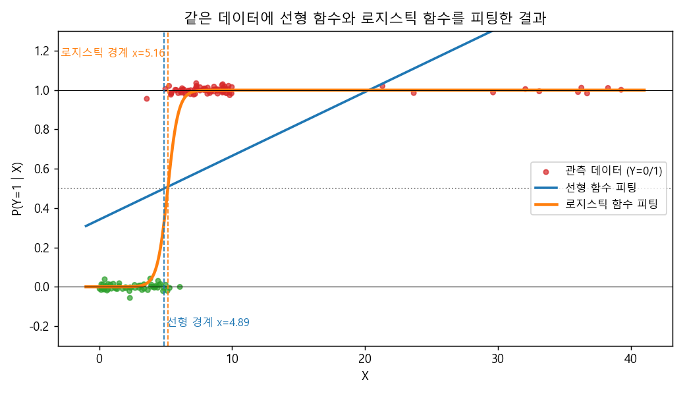
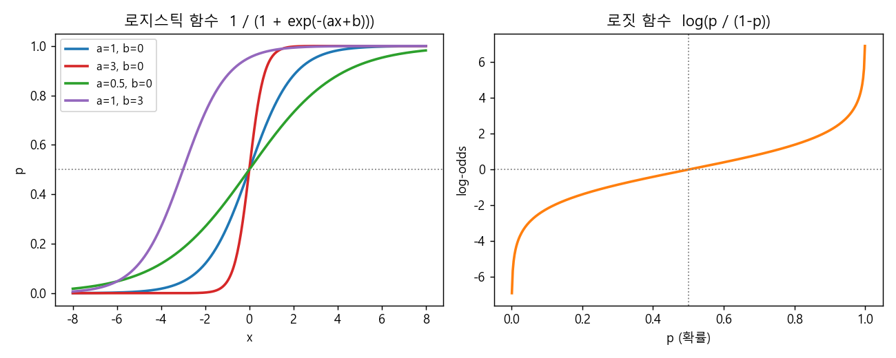
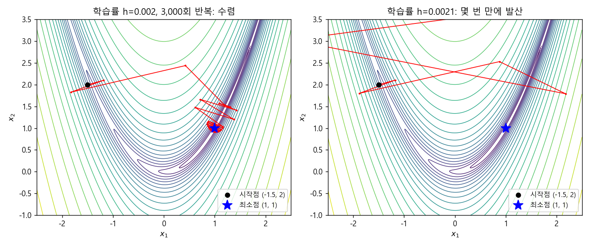
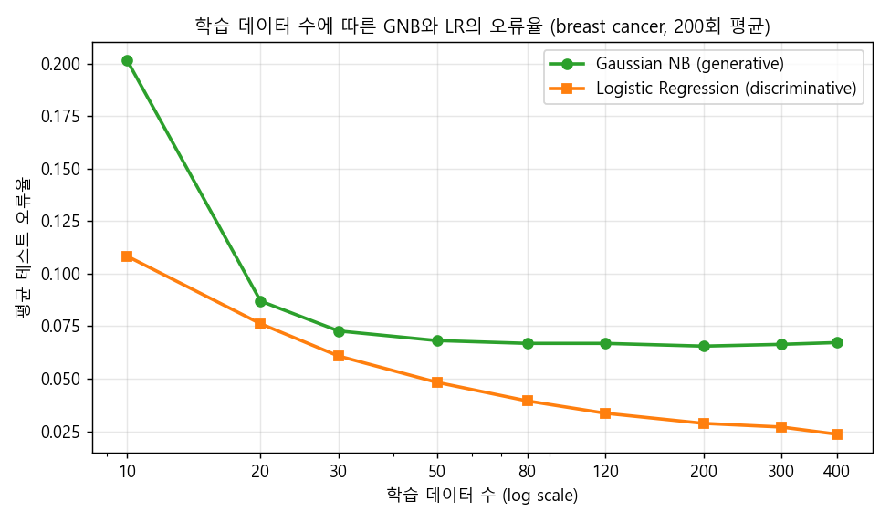

### 결정 경계와 로지스틱 함수, Gradient Method, 그리고 나이브 베이즈와의 관계


> 나이브 가정 없이 조건부 확률 $P(Y \mid X)$를 직접 모델링하는 로지스틱 회귀를 알아보고, 닫힌 해가 없는 파라미터를 Gradient Method로 찾아가는 과정과 나이브 베이즈와의 generative/discriminative 관계를 살펴봅니다.  


<br>

<center></center>    


<br/>


>  **1. 로지스틱 회귀는 log-odds가 입력의 선형 결합이라고 가정하고, 조건부 확률 $P(Y \mid X)$를 로지스틱 함수에 직접 피팅하는 확률적 분류 모델이다**
>
>  **2. 조건부 우도를 최대화하는 파라미터는 닫힌 해(closed form)가 없기 때문에, 테일러 전개에서 유도되는 Gradient Ascent/Descent로 반복적으로 근사한다**
>
>  **3. Gaussian 나이브 베이즈에 등분산 가정을 더하면 로지스틱 회귀와 같은 형태가 되며, 둘은 generative/discriminative pair의 관계에 있다**


<br/>

----

#### Contents

<br/>

1.	[결정 경계와 Bayes Risk](#decision-boundary)
2.	[로지스틱 함수와 로짓 함수](#logistic-function)
3.  [파라미터 추정: Maximum Conditional Likelihood](#parameter-estimation)
4.  [Gradient Method](#gradient-method)
5.  [Gradient Ascent로 θ 찾기](#gradient-ascent)
6.  [나이브 베이즈에서 로지스틱 회귀로](#naive-to-logistic)
7.  [나이브 베이즈 vs 로지스틱 회귀](#nb-vs-lr)

<br />

[지난 포스트](https://myeonghak.github.io/general%20machine%20learning/General-ML-train-set-batch-4.-%EB%82%98%EC%9D%B4%EB%B8%8C-%EB%B2%A0%EC%9D%B4%EC%A6%88/)에서는 피처 간의 조건부 독립이라는 "나이브한" 가정을 통해 파라미터 수를 확 줄인 나이브 베이즈 분류기를 살펴보았습니다. 그런데 이런 질문이 자연스럽게 떠오르는데요. **나이브 가정을 쓰지 않고도, 조건부 확률을 사용하는 분류 모델을 만들 수는 없을까?** 이번 포스트의 주인공인 로지스틱 회귀(Logistic Regression)가 바로 그 대답입니다.  


<a id="decision-boundary"></a>
### 1. 결정 경계와 Bayes Risk  

#### 최적의 분류기와 Bayes risk  

두 개의 클래스(녹색, 빨강)가 있다고 해 보겠습니다. 입력 $X$가 주어졌을 때 $P(Y=\text{녹색} \mid X)$와 $P(Y=\text{빨강} \mid X)$ 중 더 큰 쪽을 고르는 것이 가장 오류가 적은 분류기(Bayes optimal classifier)이고, 이 분류기조차 피할 수 없는 오류를 **Bayes risk**라고 부릅니다. 두 확률 곡선이 교차하는 지점이 곧 결정 경계(decision boundary)가 되겠죠.  

이 두 조건부 확률을 함수로 근사하는 방법으로 크게 두 가지를 떠올릴 수 있습니다.  

- **직선 형태**: 두 확률을 직선으로 근사해서 X자 모양으로 교차시키는 방법  
- **곡선(sigmoid) 형태**: 두 확률을 S자 곡선으로 근사해서 교차시키는 방법  

이 중 Bayes risk를 줄이는 쪽은 후자입니다. 직선 형태의 함수는 두 가지 문제를 가지는데요.  

- 함수 값이 0~1 사이를 벗어날 수 있음. 즉, 확률의 정의역을 지키지 못함  
- 실제 확률 곡선과 모양이 달라, 넓이로 표현하면 반달 모양만큼의 추가적인 손실이 생김. 즉, risk 최적화 관점에서 Bayes risk까지 내려가지 못함  

그렇다면 이 S자 곡선은 어떤 함수로 표현해야 할까요? 정답은 **sigmoid** 입니다.  

#### 변수 하나로 분류하기  

강의에서는 credit 데이터셋에서 연속형 변수 A15 하나만으로 클래스 C를 예측하는 예제를 다룹니다. X축에 변수 값을, Y축에 $P(Y \mid X)$를 찍어 보면 어딘가에 결정 경계가 있다는 것을 직관적으로 알 수 있는데요. 이 경계를 어떻게 찾을 수 있을까요?  

참고로 A15처럼 값이 지수적으로 넓게 퍼진 변수는 log를 취해 스케일링하면, 한쪽에 밀집된 데이터 포인트를 고르게 펼쳐 볼 수 있습니다. exponential한 값의 변화를 linear하게 바꾸어 주는 셈이죠.  

#### 선형 함수 vs 비선형 함수  

맨 위의 그림은 비슷한 상황을 합성 데이터로 재현한 것입니다. 0과 1로 이루어진 라벨에 선형 함수(파랑)와 로지스틱 함수(주황)를 각각 피팅했고, 오른쪽 멀리 극단적인 양성 데이터 몇 개를 섞어 두었습니다. 선형 함수를 피팅했을 때의 문제점은 다음과 같습니다.  

1) **확률의 공리를 위반함**: X가 커지면 예측 값이 1을 훌쩍 넘어감 (그림에서 X=40 부근의 값은 약 1.67)  
2) **결정 경계 주변에서 반응이 느림**: 경계 근처에서 X를 움직여도 예측 값이 빠르게 바뀌지 않음  
3) **극단적인 데이터 포인트에 민감함**: 멀리 떨어진 양성 샘플 몇 개 때문에 기울기가 눕고, 결정 경계가 왼쪽(4.89)으로 끌려감  
4) 강의의 예제에서는 precision은 높지만 recall은 낮게 잡힘  

반면 로지스틱 함수는 확률의 공리를 지키면서, 결정 경계 근처에서는 빠르게 0에서 1로 넘어갑니다. 극단값이 이미 1에 붙어 있는 영역에 있으니 경계(5.16)에도 거의 영향을 주지 않고요. 이제 이 로지스틱 함수를 자세히 들여다보겠습니다.  


<a id="logistic-function"></a>
### 2. 로지스틱 함수와 로짓 함수  

#### Sigmoid와 로지스틱 함수  

sigmoid 함수는 다음과 같은 특성을 갖는 S자 함수들을 통칭합니다.  

- **bounded**: 출력 구간이 정해져 있음  
- **미분 가능함**  
- **실수 함수임**  
- **모든 실수 입력에 대해 양의 미분값을 가짐**: 즉, 단조증가함  

하이퍼볼릭 탄젠트, 아크탄젠트처럼 딥러닝의 activation function으로 익숙한 함수들도 모두 sigmoid의 일종인데요. 그중 로지스틱 회귀에서 사용하는 것은 **로지스틱 함수**입니다. 원래는 인구 증가 모델에서 유래한 함수이기도 합니다.  

$$
f(x) = \frac{1}{1 + e^{-x}}
$$

출력이 0~1 사이에 정의되니 확률을 표현하기에 딱 좋고, 무엇보다 **미분이 쉽다**는 장점이 있습니다. 실제로 미분해 보면 자기 자신으로 표현되는데요.  

$$
f'(x) = \frac{e^{-x}}{(1+e^{-x})^2} = f(x)\,\bigl(1 - f(x)\bigr)
$$

이 성질 덕분에 뒤에서 할 gradient 계산이 아주 깔끔해집니다.  

로지스틱 함수의 역함수는 **로짓(logit) 함수**입니다. 확률 $p$를 받아 log-odds를 돌려주는 함수죠.  

$$
\text{logit}(p) = \log\frac{p}{1-p}
$$

<br>

<center></center>    

<br>

#### 로짓에서 로지스틱 회귀로  

이제 로짓 함수에서 출발해 로지스틱 회귀 모델을 만들어 보겠습니다.  

먼저 지난 시간에 배운 선형 회귀로 $P(Y \mid X)$를 근사하면 어떨까요? $X\theta = P(Y \mid X)$로 두는 것인데, 앞에서 본 것처럼 확률의 공리를 지키지 못합니다. 그래서 확률 그 자체가 아니라 **확률의 로짓을 선형 함수로 근사**하는 방향으로 틀어봅니다.  

1) 로짓 함수 $f(x) = \log\frac{x}{1-x}$에서 입력 $x$는 확률임. X와 Y를 뒤바꾸면 로지스틱 함수가 됨  
2) 확률임을 명시하기 위해 $x = \log\frac{p}{1-p}$로 표기함  
3) 더 나은 피팅을 위해 linear shift를 적용해 $ax + b = \log\frac{p}{1-p}$로 변형함. $a$는 곡선을 얼마나 squeeze할지, $b$는 곡선의 위치를 조정함 (위 그림 왼쪽 참고)  
4) 선형 회귀처럼 dummy 피처(상수 1)를 포함한 $X$와 가중치 $\theta$로 $ax+b$를 표현함  

$$
X\theta = \log\frac{P(Y \mid X)}{1 - P(Y \mid X)}
$$

이를 $P(Y \mid X)$에 대해 풀면 우리가 원하는 형태가 나옵니다.  

$$
P(Y=1 \mid X) = \mu(X) = \frac{e^{X\theta}}{1 + e^{X\theta}} = \frac{1}{1 + e^{-X\theta}}
$$

정리하면, **로지스틱 회귀는 이항(혹은 다항) 분포를 따르는 라벨을 예측하는 확률적 분류 모델**이고, 조건부 확률을 로지스틱 함수에 피팅함으로써 이를 달성합니다. 이름에 "회귀"가 들어가 있지만 실제로 하는 일은 분류라는 점, 헷갈리기 쉬운 포인트죠. 이제 남은 일은 파라미터 $\theta$를 학습하고, 이를 이용해 inference하는 것입니다.  


<a id="parameter-estimation"></a>
### 3. 파라미터 추정: Maximum Conditional Likelihood  

#### MLE에서 MCLE로  

[batch 1](https://myeonghak.github.io/general%20machine%20learning/General-ML-train-set-batch-1.-MLE%EC%99%80-MAP/)에서 MLE는 관측된 데이터의 확률을 극대화하는 파라미터를 고르는 것이라고 배웠습니다.  

$$
\hat{\theta} = \underset{\theta}{\operatorname{argmax}}\ P(D \mid \theta)
$$

그런데 로지스틱 회귀는 $X$의 분포에는 관심이 없고 $P(Y \mid X)$만 모델링하므로, 여기서 극대화해야 하는 것은 **조건부 우도**입니다. 그래서 이 문제를 MCLE(Maximum Conditional Likelihood Estimation)라고 부릅니다. 샘플들이 독립이라고 보면 곱의 형태가 되고, 계산 편의를 위해 단조증가 함수인 log를 씌우면 곱이 합으로 바뀝니다.  

$$
\hat{\theta} = \underset{\theta}{\operatorname{argmax}} \prod_{i=1}^{N} P(Y_i \mid X_i; \theta) = \underset{\theta}{\operatorname{argmax}} \sum_{i=1}^{N} \log P(Y_i \mid X_i; \theta)
$$

#### 이항분포로 다시 쓰기  

이대로는 전개가 어려우니 $P(Y_i \mid X_i; \theta)$를 다시 정의해 보겠습니다. $Y_i$는 0 또는 1이므로 베르누이(이항) 분포를 따르고, 성공 확률은 앞에서 정의한 $\mu(X_i)$입니다.  

$$
P(Y_i \mid X_i; \theta) = \mu(X_i)^{Y_i}\bigl(1 - \mu(X_i)\bigr)^{1 - Y_i}
$$

log를 취하고, $Y_i$로 묶고, 앞에서 정리해 둔 $X\theta = \log\frac{\mu}{1-\mu}$를 응용하면 식이 쭉 풀립니다.  

$$
\begin{aligned}
\log P(Y_i \mid X_i; \theta) &= Y_i \log \mu(X_i) + (1 - Y_i)\log\bigl(1 - \mu(X_i)\bigr) \\
&= Y_i \log\frac{\mu(X_i)}{1 - \mu(X_i)} + \log\bigl(1 - \mu(X_i)\bigr) \\
&= Y_i X_i\theta - \log\bigl(1 + e^{X_i\theta}\bigr)
\end{aligned}
$$

마지막 줄은 $1 - \mu(X_i) = \frac{1}{1 + e^{X_i\theta}}$이기 때문입니다. 따라서 최종 목적식은 다음과 같습니다.  

$$
\hat{\theta} = \underset{\theta}{\operatorname{argmax}} \sum_{i=1}^{N} \Bigl( Y_i X_i\theta - \log\bigl(1 + e^{X_i\theta}\bigr) \Bigr)
$$

굳이 이렇게까지 하는 이유는 뭘까요? 우리가 inference하려는 대상은 결국 $\theta$입니다. $\theta$를 잘 최적화해야 function approximation이 잘 되고, 그래야 더 강한 hypothesis, 결과적으로 더 강한 classifier를 얻을 수 있기 때문이죠.  

#### 닫힌 해가 없다  

이제 $\theta$의 $j$번째 원소에 대해 편미분해서 0으로 두어 보겠습니다.  

$$
\frac{\partial}{\partial \theta_j} \sum_{i=1}^{N} \Bigl( Y_i X_i\theta - \log\bigl(1 + e^{X_i\theta}\bigr) \Bigr) = \sum_{i=1}^{N} X_{i,j}\Bigl( Y_i - \frac{e^{X_i\theta}}{1 + e^{X_i\theta}} \Bigr) = \sum_{i=1}^{N} X_{i,j}\bigl( Y_i - \mu(X_i) \bigr) = 0
$$

식 자체는 꽤 예쁜데요, "정답과 예측 확률의 차이(오차)를 피처로 가중합한 것"이라는 해석이 가능합니다. 문제는 $\mu(X_i)$ 안에 $\theta$가 로지스틱 함수로 감싸져 있어서, 선형 회귀의 정규방정식처럼 "$\theta$는 이걸로 딱 정하면 되겠다!" 하는 **닫힌 해(closed form solution)가 존재하지 않는다**는 점입니다. 결국 열린 형태(open form)로 남으므로, 반복적으로 **근사(approximation)** 해야 합니다. 여기서 Gradient Method가 등장합니다.  


<a id="gradient-method"></a>
### 4. Gradient Method  

#### 테일러 전개  

Gradient Method를 이해하려면 먼저 테일러 급수(Taylor series)를 짚고 넘어가야 합니다. 테일러 급수는 함수의 한 가지 representation으로, 고정된 한 점 $a$에서의 도함수 값들로 계산한 항을 무한히 더한 것입니다.  

$$
f(x) = f(a) + \frac{f'(a)}{1!}(x-a) + \frac{f''(a)}{2!}(x-a)^2 + \cdots + \frac{f^{(n)}(a)}{n!}(x-a)^n + \cdots
$$

- $a$는 x축 위의 한 지점을 의미하는 상수임  
- $a$에서 무한히 미분 가능한 함수일 때 정의됨  
- 테일러 전개는 이 급수를 구하는 과정이며, 무한히 전개하면 원래 함수를 정확히 얻음  
- 현실적으로는 일부 차수까지만 전개해도 원래 함수와 상당히 유사하게 근사할 수 있음  

#### Gradient Ascent/Descent  

Gradient Descent(Ascent)는 미분 가능한 함수 $f(x)$와 시작점 $x_1$이 주어졌을 때, 기울기의 음(양)의 방향을 따라 파라미터를 $f$가 더 낮은(높은) 쪽으로 반복적으로 옮기는 방법입니다. 아주 넓은 parameter space 위에서 초기점 하나를 조금씩 움직이는 셈인데요. 이동하려면 **방향**과 **속력**이 필요하고, 이 중 핵심은 방향입니다. Gradient Method가 하는 일은 바로 이 방향을 알려 주는 것이고, 속력(학습률)은 사용자가 하이퍼파라미터로 정합니다.  

테일러 전개를 1차 항까지만 쓰고 나머지를 Big-O로 묶어 보겠습니다. Big-O는 그 이후 항들의 크기가 괄호 안의 크기 정도로 묶여(confine) 있다는 뜻입니다.  

$$
f(x) = f(a) + f'(a)(x-a) + O\bigl(\lVert x-a \rVert^2\bigr)
$$

여기서 $a$를 현재 위치 $x_1$로, $x$를 다음 위치 $x_1 + hu$로 둡니다. $u$는 이동 방향을 나타내는 단위 벡터(unit direction vector), $h$는 속력입니다.  

$$
f(x_1 + hu) = f(x_1) + h f'(x_1)u + h^2 O(1)
$$

#### 방향 벡터 u 정하기  

$h$를 0.01처럼 충분히 작게 잡으면 $h^2$ 항은 무시할 수 있으므로 다음과 같이 근사할 수 있습니다.  

$$
f(x_1 + hu) - f(x_1) \approx h f'(x_1)u
$$

"항상" 성립하는 것은 아니고, $h$를 잘 골랐을 때만 성립한다는 점이 중요합니다. 학습률을 왜 0.001 같은 작은 값으로 두는지에 대한 대답이 바로 여기 있는 셈이죠.  

Gradient Descent라면 함수 값이 가장 많이 줄어드는 $u$를 골라야 합니다.  

$$
u^{*} = \underset{u}{\operatorname{argmin}}\ \bigl(f(x_1 + hu) - f(x_1)\bigr) = \underset{u}{\operatorname{argmin}}\ h f'(x_1)u = -\frac{f'(x_1)}{\lVert f'(x_1) \rVert}
$$

$f'(x_1)u$는 내적이므로 $\lVert f'(x_1) \rVert \lVert u \rVert \cos\alpha$로 쓸 수 있고, 이를 가장 작게 만드는 각도는 $\alpha = \pi$(180도), 즉 기울기의 **정반대 방향**입니다. 분모의 norm은 단위 벡터로 만들기 위해 붙었습니다. 결과적으로 업데이트 식은 다음과 같고, 다음 루프에서는 갱신된 값이 $x_1$ 자리에 들어갑니다.  

$$
x_{t+1} \leftarrow x_t + h u^{*} = x_t - h\frac{f'(x_t)}{\lVert f'(x_t) \rVert}
$$

Gradient Ascent는 부호만 $-$에서 $+$로 바꿔 주면 됩니다. 참고로 실무에서는 정규화(norm으로 나누기)를 생략하고 $x_{t+1} = x_t - h f'(x_t)$처럼 기울기 크기까지 그대로 쓰는 경우가 대부분인데요. 이 경우 최적점에 가까워져 기울기가 작아질수록 보폭도 자연스럽게 줄어드는 효과가 있습니다.  

#### Rosenbrock 함수로 확인해 보기  

Gradient Method가 실제로 어떻게 움직이는지 Rosenbrock 함수로 확인해 보겠습니다.  

$$
f(x_1, x_2) = (1 - x_1)^2 + 100\,(x_2 - x_1^2)^2
$$

$(1, 1)$에서 global minimum을 갖는 함수로, 해석적으로 풀면 trivial하지만 바나나 모양의 좁은 계곡 때문에 최적화 알고리즘의 테스트용으로 자주 쓰입니다. $(-1.5, 2)$에서 출발해 Gradient Descent를 돌려 보았습니다.  

<br>

<center></center>    

<br>

왼쪽($h=0.002$)은 처음 몇 스텝 크게 출렁이다가 계곡에 들어선 뒤, 충분한 iteration을 거쳐 $(0.997, 0.994)$ 부근의 극소점에 도달합니다. 오른쪽은 학습률을 고작 $0.0021$로 0.0001 올렸을 뿐인데, 몇 번 만에 그림 밖으로 튕겨 나가 발산해 버립니다. 학습률을 키우면 앞에서 무시했던 Big-O 항을 더 이상 무시할 수 없게 되기 때문입니다. 학습률은 신중하게 골라야 한다는 교훈을 꽤 극적으로 보여 주는 예시죠.  


<a id="gradient-ascent"></a>
### 5. Gradient Ascent로 θ 찾기  

#### 로지스틱 회귀에 적용하기  

이제 3장에서 구한 미분식을 Gradient Ascent의 업데이트 식에 대입하면 됩니다. 우리는 로그 우도를 **최대화**하고 싶으므로 ascent입니다.  

$$
\theta_j^{t+1} \leftarrow \theta_j^{t} + h \sum_{i=1}^{N} X_{i,j}\bigl( Y_i - \mu(X_i; \theta^{t}) \bigr)
$$

(위에서처럼 단위 벡터로 정규화한 버전을 써도 되고, 여기서는 정규화하지 않은 형태로 적었습니다.) 다행히 로지스틱 회귀의 로그 우도는 오목(concave) 함수이기 때문에, 학습률만 적절하면 local optimum에 갇힐 걱정 없이 global optimum으로 수렴합니다.  

numpy로 직접 구현해서 scikit-learn의 결과와 비교해 보겠습니다.  

```python
import numpy as np
from sklearn.linear_model import LogisticRegression

rng = np.random.default_rng(42)
N = 500
X = rng.normal(size=(N, 2))
true_theta = np.array([-0.5, 2.0, -1.0])            # [bias, w1, w2]
Xb = np.hstack([np.ones((N, 1)), X])                # 더미 피처(1)를 앞에 붙임
Y = (rng.uniform(size=N) < 1 / (1 + np.exp(-Xb @ true_theta))).astype(int)

def sigmoid(z):
    return 1 / (1 + np.exp(-z))

def log_likelihood(theta):
    z = Xb @ theta
    return np.sum(Y * z - np.log1p(np.exp(z)))

theta = np.zeros(3)
h = 0.001
for t in range(1001):
    grad = Xb.T @ (Y - sigmoid(Xb @ theta))         # 로그 우도의 gradient
    theta = theta + h * grad                         # gradient ascent
    if t % 200 == 0:
        print(f'iter {t:4d}  logL = {log_likelihood(theta):.3f}')

print('gradient ascent :', theta.round(3))
sk = LogisticRegression(C=1e10).fit(X, Y)            # 사실상 규제 없음
print('scikit-learn    :', np.r_[sk.intercept_, sk.coef_[0]].round(3))
```

```
iter    0  logL = -324.805
iter  200  logL = -208.387
iter  400  logL = -208.381
iter  600  logL = -208.381
iter  800  logL = -208.381
iter 1000  logL = -208.381
gradient ascent : [-0.518  2.249 -1.177]
scikit-learn    : [-0.518  2.249 -1.177]
```

로그 우도가 꾸준히 올라가다 수렴하고, 최종 $\theta$가 scikit-learn과 소수점 셋째 자리까지 일치합니다. $\theta$를 구하고 나면 $P(Y \mid X)$라는 계산식이 완성된 형태로 손에 들어오니, 이로써 "학습이 이루어졌다"고 말할 수 있겠습니다.  

#### 선형 회귀 다시 보기  

지난번에 닫힌 해 $\hat{\theta} = (X^TX)^{-1}X^TY$로 풀었던 선형 회귀도, 사실 같은 방식으로 열린 형태로 최적화할 수 있습니다. 오차 제곱합을 $\theta$에 대해 미분하면 다음과 같은 Gradient Descent 업데이트를 얻습니다. (상수 2는 학습률에 흡수)  

$$
\theta_j^{t+1} \leftarrow \theta_j^{t} + h \sum_{i=1}^{N} X_{i,j}\bigl( Y_i - X_i\theta^{t} \bigr)
$$

로지스틱 회귀의 업데이트 식과 $\mu(X_i)$ 자리에 $X_i\theta$가 들어간 것만 빼면 똑같은 모양이라는 점이 재미있습니다. 닫힌 해가 있는데 왜 굳이 근사를 하냐고요?  

- 피처 수 $d$가 너무 많을 때: $X^TX$의 역행렬 계산에 $O(d^3)$ 수준의 큰 overhead가 듦  
- 데이터 수 $N$이 너무 많을 때: 전체 데이터를 한 번에 메모리에 올려 행렬 연산을 하기 부담스러움  

이런 경우에는 closed form 계산이 매우 비효율적일 수 있어, 반복적으로 근사하는 쪽이 더 좋은 접근이 됩니다.  


<a id="naive-to-logistic"></a>
### 6. 나이브 베이즈에서 로지스틱 회귀로  

#### Generative / Discriminative pair  

정리하면 로지스틱 회귀는 하나의 hypothesis framework로, 조건부 우도를 극대화하기 위해 Gradient Ascent를 사용합니다. 그런데 지난 시간의 나이브 베이즈와는 어떤 관계일까요? 둘은 **generative/discriminative pair**의 관계에 있습니다.  

- **Discriminative model**: 로지스틱 회귀처럼, 다른 가정 없이 $P(Y \mid X)$가 특정 함수(로지스틱 함수)의 형태를 따른다고 보고 이를 바로 모델링함  
- **Generative model**: 베이즈 정리를 적용해 $P(Y \mid X) = \frac{P(X \mid Y)P(Y)}{P(X)}$로 전개함. $P(X)$는 $Y$와 무관한 상수이므로 비례 기호를 대가로 날려 버리고, likelihood × prior의 형태로 모델링해 파라미터를 추정함  

강의에서는 이를 두고 LR은 MLE(정확히는 조건부 우도)의 형식을, 나이브 베이즈는 likelihood × prior를 다루는 MAP의 형식을 따른다고 표현합니다.  

#### Gaussian Naive Bayes  

다만 비교를 하려면 준비가 필요합니다. 지난 시간의 나이브 베이즈는 범주형 변수만 다뤘으니, 연속형 입력을 받는 로지스틱 회귀와 compatible하도록 바꿔 줘야 하는데요. 그래서 각 피처가 정규분포를 따른다고 가정한 **Gaussian Naive Bayes(GNB)** 를 사용합니다. (다른 분포를 가정할 수도 있습니다.) 즉, $X$ 값들이 클래스별 평균 $\mu$와 표준편차 $\sigma$를 갖는 정규분포에서 샘플링된 결과물이라고 보는 것이죠.  

#### 식 전개  

$P(X \mid Y)$를 그대로 추정하면 피처 수가 늘어날수록 필요한 파라미터 수가 기하급수적으로 늘어났었죠. 그래서 피처 간 조건부 독립(나이브 가정)으로 곱의 형태로 바꿔 줍니다. 클래스를 $Y \in \lbrace 1, 2 \rbrace$, $P(Y=1) = \pi$라 하고, 각 $P(X_i \mid Y=y)$에 정규분포의 pdf를 넣으면 다음과 같습니다. 이 때 $\mu$, $\sigma$는 피처 $i$마다, 그리고 $y$ 값에 따라 다르게 정의됩니다.  

$$
P(Y=1 \mid X) = \frac{\pi \prod_{i} \frac{1}{\sigma_1^i \sqrt{2\pi}} \exp\Bigl(-\frac{(X_i - \mu_1^i)^2}{2(\sigma_1^i)^2}\Bigr)}{\pi \prod_{i} \frac{1}{\sigma_1^i \sqrt{2\pi}} \exp\Bigl(-\frac{(X_i - \mu_1^i)^2}{2(\sigma_1^i)^2}\Bigr) + (1-\pi) \prod_{i} \frac{1}{\sigma_2^i \sqrt{2\pi}} \exp\Bigl(-\frac{(X_i - \mu_2^i)^2}{2(\sigma_2^i)^2}\Bigr)}
$$

여기서 핵심 가정을 하나 더합니다. **같은 피처 안에서는 클래스와 관계없이 분산이 같다**, 즉 $\sigma_1^i = \sigma_2^i = \sigma^i$라는 등분산 가정입니다. 그러면 정규화 상수가 약분되고, 분자와 분모를 분자로 나누면 다음과 같이 정리됩니다.  

$$
P(Y=1 \mid X) = \frac{1}{1 + \frac{1-\pi}{\pi}\exp\Bigl(\sum_i \frac{(X_i - \mu_1^i)^2 - (X_i - \mu_2^i)^2}{2(\sigma^i)^2}\Bigr)}
$$

지수 안의 제곱을 풀면 $X_i^2$ 항이 서로 소거되고, $X_i$에 대한 **1차식**만 남습니다.  

$$
P(Y=1 \mid X) = \frac{1}{1 + \exp\Bigl(-\bigl(\theta_0 + \sum_i \theta_i X_i\bigr)\Bigr)}, \quad \theta_i = \frac{\mu_1^i - \mu_2^i}{(\sigma^i)^2}, \quad \theta_0 = \log\frac{\pi}{1-\pi} + \sum_i \frac{(\mu_2^i)^2 - (\mu_1^i)^2}{2(\sigma^i)^2}
$$

바로 로지스틱 회귀의 형태입니다! (강의 노트에서는 $\frac{1}{1+\exp(X\theta)}$ 꼴로 적혀 있는데, 부호는 $\theta$에 흡수되므로 같은 이야기입니다.) 즉, **나이브 가정과 등분산 가정을 더하면 GNB는 로지스틱 회귀와 같은 형태의 분류기**가 됩니다. 반대로 등분산 가정을 빼면 $X_i^2$ 항이 살아남아 결정 경계가 2차 곡선이 됩니다.  

정말 그런지 숫자로 확인해 보겠습니다. GNB 파라미터를 추정한 뒤 위 공식으로 $\theta$를 만들어 로지스틱 함수에 넣은 값과, 베이즈 정리로 직접 계산한 사후확률을 비교합니다.  

```python
import numpy as np

rng = np.random.default_rng(0)
N, d = 1000, 3
Y = (rng.uniform(size=N) < 0.4).astype(int)
mu = {1: np.array([1.0, -0.5, 2.0]), 0: np.array([-1.0, 0.5, 0.0])}
sigma = np.array([1.0, 2.0, 1.5])                    # 클래스와 무관한 공통 분산
X = np.array([rng.normal(mu[y], sigma) for y in Y])

# 1) Gaussian Naive Bayes 파라미터 추정 (공통 분산 가정)
pi = Y.mean()
m1, m0 = X[Y == 1].mean(0), X[Y == 0].mean(0)
var = np.concatenate([X[Y == 1] - m1, X[Y == 0] - m0]).var(0)

# 2) 유도한 식으로 로지스틱 회귀의 theta로 변환
w = (m1 - m0) / var
b = np.log(pi / (1 - pi)) + np.sum((m0**2 - m1**2) / (2 * var))

x_new = X[:5]
p_gnb_formula = 1 / (1 + np.exp(-(x_new @ w + b)))

# 비교: 베이즈 정리로 직접 계산한 GNB 사후확률
def gauss(x, m, v):
    return np.exp(-(x - m)**2 / (2 * v)) / np.sqrt(2 * np.pi * v)
num = pi * gauss(x_new, m1, var).prod(1)
den = num + (1 - pi) * gauss(x_new, m0, var).prod(1)

print('theta (w):', w.round(3), ' bias:', round(b, 3))
print('logistic 형태 :', p_gnb_formula.round(4))
print('베이즈 정리   :', (num / den).round(4))
```

```
theta (w): [ 1.93  -0.221  0.956]  bias: -1.542
logistic 형태 : [0.3416 0.653  0.6295 0.9792 0.001 ]
베이즈 정리   : [0.3416 0.653  0.6295 0.9792 0.001 ]
```

두 값이 정확히 일치합니다. 같은 모양의 함수인데 파라미터를 구하는 길만 다른 셈이죠.  


<a id="nb-vs-lr"></a>
### 7. 나이브 베이즈 vs 로지스틱 회귀  

#### 가정과 파라미터 수  

같은 모양이라면 무엇이 다를까요? 먼저 각 모델이 깔고 있는 가정입니다.  

- **GNB (LR 형태로 정리한 경우)**: 나이브 베이즈 가정 + 클래스 간 등분산 가정, $P(X \mid Y)$에 대한 가우시안 분포, $P(Y)$에 대한 베르누이 분포  
- **로지스틱 회귀**: $P(Y \mid X)$가 로지스틱 함수에 피팅된다는 가정 하나  

추정해야 할 파라미터 수도 다릅니다. 피처 수를 $d$라고 하면 다음과 같습니다. prior는 하나만 알면 나머지 클래스의 확률이 정해지므로 1개입니다.  

| 구분 | 평균 | 분산 | prior / bias | 합계 |
|:---:|:---:|:---:|:---:|:---:|
| GNB (등분산 가정 없음) | $2d$ | $2d$ | 1 | $4d+1$ |
| GNB (등분산 가정) | $2d$ | $d$ | 1 | $3d+1$ |
| 로지스틱 회귀 | - | - | 1 | $d+1$ |

#### 누가 승자일까?  

정답은 **알 수 없다** 입니다. 다만 몇 가지 경향은 알려져 있습니다.  

- 같은 수준으로 파라미터 최적화를 한다면 LR이 더 좋은 성능을 보인다는 것이 중론이며, 이를 주장하는 논문도 존재함  
- LR은 데이터의 분포에 대한 가정이 적어 덜 biased됨. GNB의 가정(독립, 등분산, 가우시안)이 틀리면 그만큼 성능에 손해를 봄  
- 반면 PAC(Probably Approximately Correct) learning 관점에서 NB는 학습이 더 빨리 이루어짐. 즉, 적은 데이터로도 자신의 점근 성능에 빨리 도달함  
- 나이브 베이즈는 prior를 통해 사전 정보를 반영할 수 있는 여지가 더 많음  

이 부분의 대표적인 연구로는 Ng & Jordan(2002)의 "On Discriminative vs. Generative Classifiers"가 자주 인용되는데요. 직접 실험해 보면 어떨까요? scikit-learn의 breast cancer 데이터(피처 30개)에서 학습 데이터 수를 늘려 가며 두 모델의 테스트 오류율을 200번씩 평균 내어 보았습니다.  

<br>

<center></center>    

<br>

GNB는 50개 정도의 데이터에서 이미 오류율 약 6.7%에 도달한 뒤 더 이상 좋아지지 않습니다. 반면 LR은 데이터가 늘어날수록 꾸준히 내려가 400개에서 약 2.4%까지 떨어지죠. "NB는 빨리 수렴하지만 점근 성능이 낮고, LR은 덜 biased되어 데이터가 많을수록 유리하다"는 이야기와 잘 맞아떨어집니다. 다만 이 데이터에서는 아주 적은 데이터 구간에서도 LR이 앞섰는데요(scikit-learn의 LR에는 기본 L2 규제가 걸려 있다는 점도 한몫했을 겁니다). 데이터와 설정에 따라 결과는 얼마든지 달라질 수 있으니, 역시 "누가 승자인지는 알 수 없다"가 정답인 것 같습니다.  

#### Generative vs Discriminative 정리  

마지막으로 두 모델 계열의 특징을 정리하겠습니다.  

- **Generative model**  
  - $P(Y \mid X)$를 (굳이) 베이즈 정리로 전개한 형태를 띰  
  - 모든 변수에 대한 full probabilistic model로, $P(Y)$와 $P(X \mid Y)$의 파라미터를 데이터로부터 추정함  
  - 특징: 베이지안, 사전확률 활용, joint probability를 모델링함  
- **Discriminative model**  
  - 관측된 변수 $X$의 분포를 모델링할 필요가 없음  
  - 사후확률 $P(Y \mid X)$를 직접 모델링해 파라미터를 추정함  
  - 특징: 조건부 확률을 모델링함  

비유하자면 generative model은 "고양이와 강아지가 각각 어떻게 생겼는지"를 통째로 공부한 뒤 새 사진이 어느 쪽 그림에 더 가까운지 따져 보는 학생이고, discriminative model은 "둘을 가르는 기준선"만 집중적으로 공부하는 학생이라고 할 수 있겠습니다. 시험(분류)만 놓고 보면 후자가 효율적일 때가 많지만, 전자는 그림을 직접 그려낼(데이터를 생성할) 수도 있다는 장점이 있죠.  


<br>

----------------

<a id="conclusion"></a>
### 닫으며  

지금까지 결정 경계와 Bayes risk에서 출발해 로지스틱 함수와 로짓, 조건부 우도를 이용한 파라미터 추정, 그리고 닫힌 해가 없는 문제를 풀기 위한 Gradient Method까지 살펴보았습니다. 마지막으로 Gaussian 나이브 베이즈에 등분산 가정을 더하면 로지스틱 회귀와 같은 형태가 된다는 것을 확인하면서, generative/discriminative pair라는 큰 그림도 그려 보았습니다. 이번에 다룬 Gradient Method는 이후 신경망을 비롯한 거의 모든 모델의 학습에 쓰이는 도구이니, 꼭 익혀 두시면 좋겠습니다.  
다음 포스트에서는 모델을 어떻게 **학습하고, 검증하며, 정규화**하는지에 대해 알아보겠습니다.  

**개선을 위한 여러분의 피드백과 제안을 코멘트로 공유해 주세요.**
**내용에 대한 지적, 혹은 질문을 환영합니다.**  

해당 포스트는 카이스트 문일철 교수님의 동의를 얻고, 강좌 내용과 자료, 그리고 reference의 자료를 참고하여 작성되었습니다. 원 강좌는 [여기](https://www.youtube.com/playlist?list=PLbhbGI_ppZISMV4tAWHlytBqNq1-lb8bz)에서 보실 수 있습니다.

**자료 공유를 허락해 주신 문일철 교수님께 감사의 말씀을 전합니다.**
