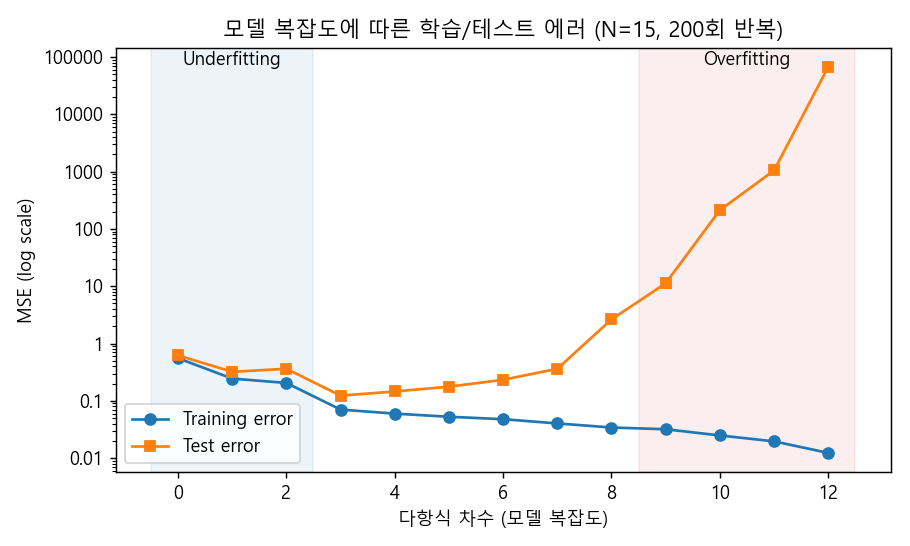
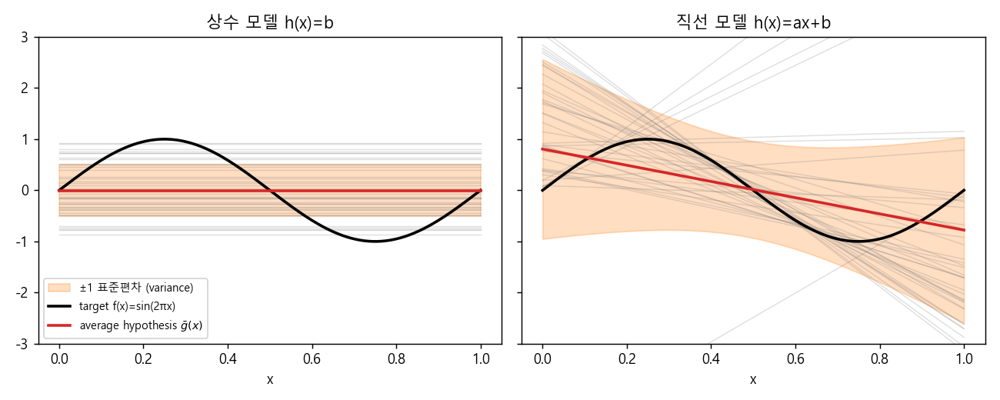
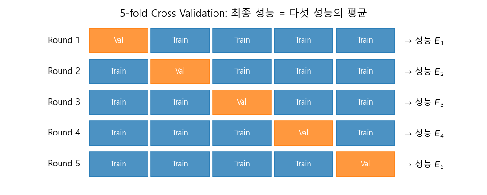
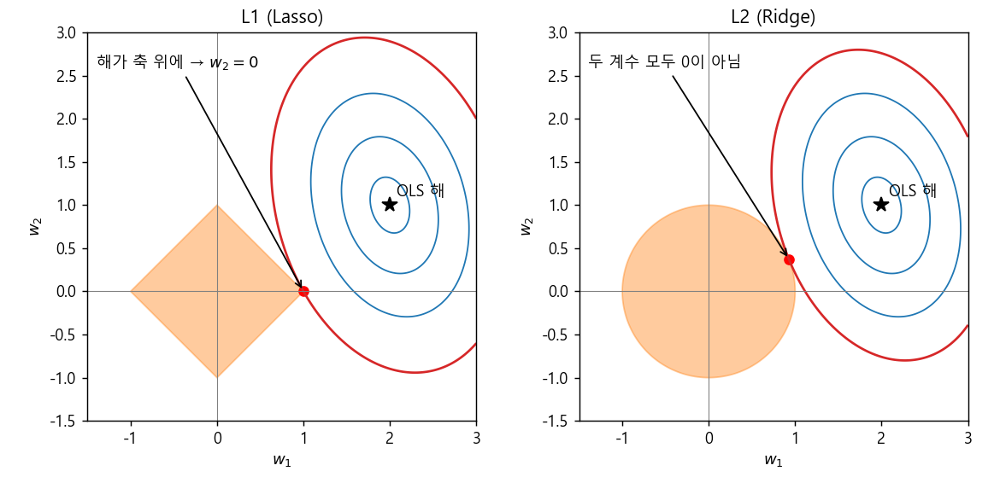
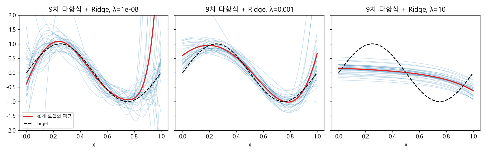

### 오버피팅, Bias-Variance Trade-off, 교차 검증과 정규화


> 학습 데이터를 잘 맞추는 것과 미래의 데이터를 잘 맞추는 것은 다른 문제입니다. 오버피팅이 왜 생기는지 Bias와 Variance로 분해해 보고, 이를 측정하는 교차 검증과 제어하는 정규화까지 살펴봅니다.  


<br>

<center></center>    


<br/>


>  **1. 모델의 기대 에러는 Bias(모델 자체의 한계)와 Variance(유한한 데이터에 대한 민감도)로 분해되며, 모델이 복잡해질수록 Bias는 줄고 Variance는 커지는 trade-off 관계에 있다**
>
>  **2. 현실에서는 target function도, 무한한 데이터도 없기 때문에 Bias와 Variance를 직접 계산할 수 없다. 대신 k-fold Cross Validation으로 "미래의 데이터"를 모사하고, 목적에 맞는 precision, recall, F-measure 등의 지표로 성능을 평가한다**
>
>  **3. 정규화는 "training error 최소화"에 파라미터 크기에 대한 제약을 추가하는 것으로, 약간의 Bias 증가를 감수하고 Variance를 크게 줄인다. L2(Ridge)는 계수를 고르게 줄이고, L1(Lasso)은 일부 계수를 정확히 0으로 만든다**


<br/>

----

#### Contents

<br/>

1.	[학습과 테스트, 그리고 오버피팅](#overfitting)
2.	[Bias와 Variance](#bias-variance)
3.  [오컴의 면도날](#occams-razor)
4.  [교차 검증 (Cross Validation)](#cross-validation)
5.  [성능 지표 (Performance Metrics)](#metrics)
6.  [정규화 (Regularization)](#regularization)
7.  [정규화의 적용](#regularization-app)

<br />

[지난 포스트](https://myeonghak.github.io/general%20machine%20learning/General-ML-train-set-batch-5.-%EB%A1%9C%EC%A7%80%EC%8A%A4%ED%8B%B1-%ED%9A%8C%EA%B7%80/)에서는 로지스틱 회귀를 살펴보았습니다. 지금까지는 "어떻게 하면 주어진 데이터에 모델을 잘 맞출 수 있을까"에 집중해 왔는데요, 이번 시간에는 한 발 물러서서 "잘 맞췄다는 것이 정말 좋은 것인가?"를 질문해 보려고 합니다. [batch 3](https://myeonghak.github.io/general%20machine%20learning/General-ML-train-set-batch-3.-%EA%B8%B0%EC%B4%88-%EB%A8%B8%EC%8B%A0%EB%9F%AC%EB%8B%9D/)에서 예고했던 오버피팅 이야기를 본격적으로 풀어보겠습니다.  


<a id="overfitting"></a>
### 1. 학습과 테스트, 그리고 오버피팅  

#### Training: 과거의 경험으로 세운 가설  

학습(training)은 결국 **파라미터를 추론하는 절차**입니다. 그런데 여기서 쓰이는 학습 데이터는 어디까지나 과거의 경험이자 사전적인 지식일 뿐인데요. 과거의 데이터로 세운 가설이 미래에도 유효하다는 보장은 사실 어디에도 없습니다. 이것이 머신러닝의 가장 치명적인 약점이라고 할 수 있습니다.  

- 머신러닝 모델은 **미래의 분포가 지금과 변하지 않는다**는 가정(static and stable dataset) 하에서만 유효함  
- 실제로 배포한 모델이 잘 동작하지 않는 이유는 대개 두 가지임  
  - 도메인 자체가 변화함 (예: 코로나 이전 데이터로 학습한 여행 수요 예측 모델)  
  - 현재 가진 데이터가 도메인의 다양성(분산)을 충분히 담고 있지 않음  

#### Testing: 미래를 흉내 내기  

그래서 우리는 관측치의 일부를 학습에 쓰지 않고 따로 치워 둡니다. 이것이 테스트셋인데요, 학습 데이터와 무관한 새로운 데이터로 학습된 모델과 추론된 파라미터를 평가함으로써 **미래의 샘플을 모사**하는 것입니다.  

예를 들어 학습 데이터에 이상치(outlier)가 몇 개 섞여 있어서 decision boundary가 그쪽으로 끌려가 버렸다고 해보겠습니다. 학습 데이터만 보면 전부 잘 맞추고 있으니 알 길이 없지만, 테스트셋에서는 성능이 뚝 떨어지겠죠. train/test split은 바로 이런 상황을 잡아내기 위한 장치입니다.  

#### Overfitting과 Underfitting  

$N$개의 학습 데이터에 다항 회귀 모델 $Y = F(x)$를 적합한다고 해 봅시다. 이 때 $F(x)$의 차수는 아직 정해지지 않았습니다. 데이터가 실제로는 2차 곡선 모양으로 퍼져 있다면,  

- **1차 직선**으로 피팅: 못 맞추는 점이 너무 많음 → **Underfitting**  
- **2차 곡선**으로 피팅: 데이터의 패턴을 적절히 잡아냄 → 알맞은 상황  
- **8차 곡선**으로 피팅: 모든 점을 거의 다 지나갈 만큼 너무 꼭 맞음 → **Overfitting**  

batch 3에서 차수 9의 다항식이 데이터가 없는 구간에서 말도 안 되게 요동치던 그림을 기억하실 텐데요, 그것이 바로 오버피팅입니다.  

맨 위의 대표 그림은 $\sin(2\pi x)$에 노이즈를 더한 데이터 15개로 차수를 0부터 12까지 바꿔가며 학습/테스트 에러를 그려본 것입니다. 차수를 높일수록 training error는 꾸준히 줄어들지만, test error는 차수 3 근처에서 바닥을 찍고 다시 치솟습니다(로그 스케일이라는 점에 주목해 주세요). 즉, **복잡도(complexity)와 일반성(generality) 사이에는 trade-off가 있습니다.**  

- 너무 단순한 모델: 현재의 학습 데이터조차 잘 못 맞추므로, 같은 분포에서 올 미래의 데이터에도 잘 맞지 않을 것임  
- 너무 복잡한 모델: 학습 데이터는 잘 맞추지만, 미래의 데이터에 대한 예측 성능을 장담할 수 없음  

그렇다면 모델의 복잡도를 키워 나갈 때, 대체 어디서 멈춰야 할까요? 이 질문에 답하기 위해 에러를 분해해 보겠습니다.  


<a id="bias-variance"></a>
### 2. Bias와 Variance  

#### 에러의 두 가지 원천  

머신러닝 모델의 에러는 크게 **근사(Approximation)**와 **일반화(Generalization)** 두 가지에서 비롯됩니다. 학습 이론에서는 이를 다음과 같은 부등식으로 표현하곤 합니다.  

$$
E_{out} \le E_{in} + \Omega
$$

- $E_{out}$: 한 번도 보지 못한 데이터에서의 에러(out-of-sample error). 우리가 진짜 줄이고 싶은 값  
- $E_{in}$: 학습 데이터에서의 에러(in-sample error). 모델이 학습 데이터를 얼마나 잘 근사했는지를 나타냄  
- $\Omega$: 일반화에 따른 페널티. 모델이 복잡할수록, 데이터가 적을수록 커짐. 테스트 시점에 학습 때 보지 못한 변동이 등장하면서 생기는 차이라고 볼 수 있음  

복잡한 모델은 $E_{in}$을 줄여주지만 $\Omega$를 키우고, 단순한 모델은 그 반대입니다. 이 관계를 좀 더 구체적으로 들여다보기 위해 기호를 몇 개 정의하겠습니다.  

#### 기호 정의  

- $f$: 학습하고자 하는 target function  
- $g$: 머신러닝 알고리즘이 학습하는 함수  
- $D$: 실세계에서 뽑혀 나온, 우리가 사용 가능한 데이터셋  
- $g^{(D)}$: 데이터셋 $D$로 학습된 함수. 가설의 한 인스턴스  
- $\bar{g}$: 무한히 많은 데이터셋이 주어졌을 때의 **average hypothesis**. $\bar{g}(x) = E_D\left[g^{(D)}(x)\right]$  

$\bar{g}$가 조금 생소할 수 있는데요, 같은 분포에서 데이터셋 $D$를 계속 새로 뽑아 모델을 무한히 학습시킨 뒤 그 예측을 평균 낸 "가상의 모델"이라고 생각하면 됩니다.  

#### Bias-Variance 분해  

데이터셋 $D$로 학습한 모델의 out-of-sample error는 $E_{out}(g^{(D)}) = E_x\left[(g^{(D)}(x) - f(x))^2\right]$입니다. 이 값은 어떤 데이터셋을 뽑았느냐에 따라 달라지므로, 데이터셋에 대한 기댓값을 취해 보겠습니다. 핵심은 중간에 $\bar{g}(x)$를 더하고 빼는 것입니다.  

$$
E_D\left[(g^{(D)}(x) - f(x))^2\right] = E_D\left[(g^{(D)}(x) - \bar{g}(x) + \bar{g}(x) - f(x))^2\right]
$$

$$
= E_D\left[(g^{(D)}(x) - \bar{g}(x))^2\right] + (\bar{g}(x) - f(x))^2 + 2(\bar{g}(x) - f(x))\,E_D\left[g^{(D)}(x) - \bar{g}(x)\right]
$$

$\bar{g}$의 정의에 의해 $E_D[g^{(D)}(x)] = \bar{g}(x)$이므로 마지막 교차항은 0이 됩니다. 따라서,  

$$
E_D\left[E_{out}(g^{(D)})\right] = E_x\Big[\underbrace{E_D\left[(g^{(D)}(x) - \bar{g}(x))^2\right]}_{\text{Variance}} + \underbrace{(\bar{g}(x) - f(x))^2}_{\text{Bias}^2}\Big]
$$

1) **Variance**: "우리가 가진 데이터셋으로만 만든 모델"과 "무한한 데이터셋을 전부 봤을 때 만들어질 모델"의 차이임. 모델이 현재 데이터셋에 지나치게 specialize되어 미래 데이터의 변동을 cover하지 못해서 생기는, 일반화 관점의 에러. **데이터셋의 한계**에서 비롯됨  
2) **Bias**: "무한한 데이터를 전부 봤을 때의 모델"과 "실제 함수"의 차이임. 데이터를 아무리 많이 줘도 모델의 형태 자체가 실제 함수를 표현하지 못해서 생기는 에러. **모델 복잡도의 한계**에서 비롯됨  

참고로 관측값에 노이즈가 섞여 있다면($y = f(x) + \epsilon$, $\text{Var}(\epsilon) = \sigma^2$) 여기에 어떤 모델로도 줄일 수 없는 $\sigma^2$ 항이 더해집니다.  

#### Bias-Variance Trade-off  

- **Bias를 줄이려면**: 데이터가 대충 직선처럼 보인다고 선형 모델을 쓰면, 실제 분포와의 차이만큼 bias가 생김. 더 복잡한 모델을 고안하면 bias를 줄일 수 있음  
- **Variance를 줄이려면**: 더 많은 데이터를 학습에 사용하면 됨  
- 데이터의 양이 고정된 상황에서 모델 복잡도를 높이면 bias는 줄지만 variance는 커짐. 하나를 줄이면 다른 하나가 커지는 시소 관계임  

과녁 맞히기에 비유하자면, bias는 "조준점 자체가 과녁 중심에서 벗어난 정도", variance는 "총알이 얼마나 넓게 흩어지는지"라고 할 수 있겠습니다.  


<a id="occams-razor"></a>
### 3. 오컴의 면도날  

#### 실험으로 확인하는 Bias-Variance  

말로만 하면 감이 잘 오지 않으니, 직접 실험해 보겠습니다. target function을 $f(x) = \sin(2\pi x)$, $x \in [0, 1]$로 정하고, **샘플이 단 2개만** 주어지는 상황을 가정합니다. 이 2개의 점에 피팅할 수 있는 모델로 두 가지를 비교해 보겠습니다.  

1) 상수 모델 $h(x) = b$ (0차)  
2) 직선 모델 $h(x) = ax + b$ (1차)  

<br>

<center></center>    

<br>

회색 선은 매번 새로 뽑은 2개의 점으로 학습한 개별 가설 $g^{(D)}$, 빨간 선은 그 평균인 $\bar{g}$, 주황색 띠는 가설들이 흩어진 정도입니다. 상수 모델은 평균이 사인 곡선과 꽤 동떨어져 있지만(높은 bias) 가설들이 얌전하게 모여 있습니다(낮은 variance). 반면 직선 모델은 평균적으로는 사인 곡선의 추세를 더 잘 따라가지만, 두 점이 가까이 붙어 뽑히면 기울기가 하늘로 치솟는 등 가설들이 미친 듯이 흩어집니다. 실제 수치로 계산해 보면 다음과 같습니다.  

```python
import numpy as np

rng = np.random.default_rng(42)
f = lambda x: np.sin(2 * np.pi * x)
xs = np.linspace(0, 1, 1000)          # E_x를 근사하기 위한 x 격자

for deg, name in [(0, "constant"), (1, "linear")]:
    # 데이터셋 D(샘플 2개)를 10만 번 새로 뽑아 각각 가설 g^(D)를 학습
    preds = []
    for _ in range(100_000):
        x = rng.uniform(0, 1, 2)
        w = np.polyfit(x, f(x), deg)
        preds.append(np.polyval(w, xs))
    preds = np.array(preds)
    g_bar = preds.mean(axis=0)                    # average hypothesis
    bias = np.mean((g_bar - f(xs)) ** 2)
    var = np.mean(preds.var(axis=0))
    print(f"{name:8s} bias={bias:.2f}  variance={var:.2f}  E_out={bias + var:.2f}")
```

```
constant bias=0.50  variance=0.25  E_out=0.75
linear   bias=0.21  variance=1.66  E_out=1.87
```

bias만 보면 직선 모델이 낫지만, variance까지 합친 기대 에러는 오히려 상수 모델이 절반도 안 됩니다. 데이터가 2개뿐인 상황에서는 "더 표현력 있는 모델"이 독이 되는 셈이죠.  

- 단순한 모델: bias는 높지만 미래의 데이터에 대해 안정적인 예측을 내놓음 (low variance)  
- 복잡한 모델: bias는 상대적으로 낮지만 미래의 데이터에 대해 불안정함 (high variance)  
- 따라서 조건부 분포 $P(y \mid X)$에 대한 정보(샘플)가 충분하지 않다면, 상수 모델이나 선형 회귀 같은 단순한 모델을 쓰는 편이 유리할 수 있음  

#### Occam's Razor  

이 결론은 아주 오래된 원칙 하나와 맞닿아 있습니다. 바로 **오컴의 면도날(Occam's razor)** 인데요, "경쟁하는 여러 가설 중에서는 가장 적은 가정을 취하는 가설을 선택해야 한다"는 원칙입니다. 머신러닝의 언어로 옮기면 이렇습니다.  

- competing hypotheses: 예측에서 비슷한 수준의 에러를 내는 모델들  
- fewest assumptions: 덜 복잡한 모델  
- 즉, **비슷한 에러를 갖는 모델이라면 덜 복잡한 모델을 선택하라**는 것이며, 이는 Bias-Variance trade-off를 그대로 반영함  

그런데 여기서 의문이 하나 생깁니다. 위 실험은 target function $f$를 우리가 알고 있었고, 데이터셋을 10만 번이나 새로 뽑을 수 있었기에 가능했습니다. **실세계에서 bias와 variance를 계산하는 것이 과연 가능할까요?**  


<a id="cross-validation"></a>
### 4. 교차 검증 (Cross Validation)  

#### 무한한 샘플링을 흉내 내기  

현실에서는 true function을 알 방법이 없고, target function에서 관측된 무한한 수의 샘플도 존재하지 않습니다. 앞의 실험에서는 true function을 직접 만들고, 무한한 데이터를 만들 수 없으니 2개씩 반복해서 뽑아 가설을 여러 번 생성했었죠.  

현실에서 이를 흉내 내는 방법이 바로 **교차 검증(Cross Validation, CV)** 입니다. 가진 데이터를 쪼개 "미래에 새로운 샘플이 등장했을 때 모델이 어떻게 반응하는가"를 시뮬레이션하는 것인데요. 무한 번 해야 할 샘플링을 $k$번만이라도 해보자는 발상입니다. 이를 통해 average hypothesis에 가까운 것을 구하고, 성능의 분산과 신뢰구간까지 가늠해 볼 수 있습니다.  

#### k-fold Cross Validation  

<br>

<center></center>    

<br>

- 주어진 데이터셋을 $k$개의 상호배제적인(mutually exclusive) 서브셋(fold)으로 나눔  
- $k-1$개의 fold로 모델을 학습하고, 남은 1개의 fold로 성능을 측정함  
- 즉 "지금까지는 $k-1$개 분량의 데이터만 관측했고, 나머지 1개는 미래의 데이터다"라고 가정하는 것임  
- 검증용 fold를 바꿔가며 $k$번 반복하고, $k$개 성능의 평균(과 표준편차)을 최종 성능으로 삼음  

$$
\text{CV}(k) = \frac{1}{k} \sum_{i=1}^{k} E_i
$$

#### LOOCV  

**LOOCV(Leave-One-Out Cross Validation)** 는 $k = N$인 극단적인 경우입니다. 샘플 하나만 빼고 나머지 전부로 학습한 뒤 빠진 하나를 예측하는 과정을 $N$번 반복합니다. 학습 데이터를 최대한 활용할 수 있지만 모델을 $N$번 학습해야 하므로 계산 비용이 크고, 학습셋끼리 거의 겹치기 때문에 추정치 자체의 분산이 커질 수 있다는 점도 알려져 있습니다. 실무에서는 $k = 5$나 $10$을 많이 사용합니다.  

실용적인 측면에서는, 이렇게 얻은 CV 성능으로 **하이퍼파라미터나 모델을 선택**하거나, $k$개의 모델을 묶어 **앙상블**로 활용할 수도 있습니다. 이때 CV로 모델을 고르는 데 쓴 데이터와 최종 성능을 보고하는 테스트셋은 분리해 두어야, 테스트셋까지 "학습"해 버리는 실수를 피할 수 있습니다.  


<a id="metrics"></a>
### 5. 성능 지표 (Performance Metrics)  

#### Bias/Variance 대신 무엇으로 평가할까  

다시 정리하면, target function $f(x)$도 모르고 average hypothesis $\bar{g}(x)$도 계산할 수 없으니, 현실에서 모델 성능을 bias와 variance로 직접 평가할 수는 없습니다. 그래서 대신 쓰는 지표들이 Accuracy, Precision/Recall, F-measure, ROC curve 등입니다. 이진 분류의 결과는 다음과 같은 confusion matrix로 정리할 수 있습니다.  

| | 실제 Positive | 실제 Negative |
|---|---|---|
| **예측 Positive** | TP (True Positive) | FP (False Positive) |
| **예측 Negative** | FN (False Negative) | TN (True Negative) |

$$
\text{Accuracy} = \frac{TP + TN}{TP + FP + FN + TN}, \quad \text{Precision} = \frac{TP}{TP + FP}, \quad \text{Recall} = \frac{TP}{TP + FN}
$$

Accuracy는 직관적이지만, 양성이 1%뿐인 데이터에서는 "전부 음성"이라고만 외쳐도 99%가 나오는 함정이 있습니다.  

#### Precision과 Recall  

두 가지 사용 사례를 생각해 보겠습니다.  

1) **스팸 필터링**: 정상 메일을 스팸으로 분류하는 것(False Positive)이 치명적임. 중요한 업무 메일이 스팸함으로 가버리면 곤란하겠죠. → **Precision**이 높아야 함  
2) **CRM(고객 관리)**: 실제로 이탈할(혹은 구매할) 고객인데 아니라고 분류하는 것(False Negative)의 위험이 더 큼. 놓친 고객은 다시 돌아오지 않으니까요. → **Recall**이 높아야 함  

같은 모델이라도 목적에 따라 좋은 모델의 기준이 달라지는 것입니다.  

#### F-measure  

다만 precision과 recall은 각각 혼자서는 쉽게 "속일" 수 있다는 문제가 있습니다.  

- Precision: 가장 확실한 몇 개만 Positive로 예측하고 나머지는 전부 Negative로 두면 FP가 거의 생기지 않아 precision이 매우 높아짐 (대신 recall은 바닥)  
- Recall: 전부 Positive로 예측하면 FN이 0이 되어 recall이 1이 됨 (대신 precision은 바닥)  

그래서 두 지표의 균형을 잡아주는 지표가 필요한데요, 그것이 **F-measure**입니다. 일반형은 다음과 같습니다.  

$$
F_\beta = (1 + \beta^2) \cdot \frac{\text{Precision} \cdot \text{Recall}}{\beta^2 \cdot \text{Precision} + \text{Recall}}
$$

$\beta = 1$이면 둘의 조화평균인 $F_1 = \frac{2 \cdot \text{Precision} \cdot \text{Recall}}{\text{Precision} + \text{Recall}}$이 됩니다. $\beta$는 "recall을 precision보다 몇 배 중요하게 볼 것인가"를 나타내므로,  

- $F_{0.5}$: **precision**을 더 강조함 (스팸 필터링 같은 경우)  
- $F_2$: **recall**을 더 강조함 (CRM, 질병 진단 같은 경우)  

예를 들어 Precision = 0.9, Recall = 0.3인 모델이라면 $F_1 = 0.45$, $F_{0.5} \approx 0.64$, $F_2 \approx 0.35$가 됩니다. precision이 높은 모델이니 $F_{0.5}$에서 후한 점수를 받는 것이죠. 산술평균(0.6)이 아니라 조화평균을 쓰기 때문에 한쪽이 극단적으로 낮으면 점수가 크게 깎인다는 점도 눈여겨볼 만합니다.  

이 밖에 ROC curve는 분류 threshold를 바꿔가며 TPR(=Recall)과 FPR($\frac{FP}{FP + TN}$)의 변화를 그린 곡선으로, 곡선 아래 면적(AUC)을 이용해 threshold와 무관하게 모델을 비교할 때 사용합니다.  


<a id="regularization"></a>
### 6. 정규화 (Regularization)  

#### 정규화의 개념  

이제 variance가 너무 커서 문제가 되는 상황, 즉 오버피팅을 어떻게 다룰지 이야기해 보겠습니다. 오버피팅을 막는 방법은 크게 두 가지입니다.  

1) 애초에 복잡한 모델을 사용하지 않음  
2) 복잡한 모델을 사용하되, 주어진 데이터에 **둔감하게** 피팅되도록 만듦  

정규화는 2번에 해당합니다. 정규화를 하면,  

- 주어진 데이터에 대한 최고의 적합(perfect fit)을 일부러 포기함 → training accuracy가 다소 감소함  
- 대신 테스트셋, 즉 미래 데이터에 대한 잠재적인 적합도를 높임  
- 모델의 실질적인 복잡도를 낮추는 것이므로 bias는 다소 증가하지만, variance는 크게 감소함  

결국 정규화는 모델에 가해지는 **또 하나의 제약**입니다. 원래 존재하던 제약이 "training error를 최소화하라" 하나였다면, 여기에 "단, 파라미터는 너무 크지 않게"라는 조건이 추가되는 것이죠. 시험 문제를 통째로 외우려는 학생에게 "요점 노트는 한 장으로만 만들어라"라고 제한을 거는 것과 비슷합니다.  

#### 정규화의 형식적 정의  

선형 회귀에서는 원래 $(y - X\theta)^2$ 형태로 추정 오차만을 최소화했습니다. 정규화를 적용하면 여기에 파라미터의 크기에 대한 항을 더해, 두 항을 동시에 최적화하도록 모델에 강요합니다.  

$$
E(w) = \frac{1}{2} \sum_{i=1}^{N} (y_i - w^T x_i)^2 + \frac{\lambda}{2} \sum_{j=1}^{d} \vert w_j \vert^q
$$

$\lambda$는 정규화를 얼마나 강하게 걸지 정하는 하이퍼파라미터이고, 제약식의 차수 $q$에 따라 loss function의 모양이 달라집니다.  

1) **L1 정규화 (Lasso, $q = 1$)**: $\lambda \lVert w \rVert_1 = \lambda \sum_j \vert w_j \vert$. 몇몇 피처에 대해서만 0이 아닌 파라미터가 남음(sparse). 절댓값 함수는 0에서 미분이 불가능하므로 closed form 해가 없고, 유도와 최적화가 조금 더 까다로움  
2) **L2 정규화 (Ridge, $q = 2$)**: $\lambda \lVert w \rVert_2^2 = \lambda \sum_j w_j^2$. 가장 많이 쓰임. 모든 파라미터가 0에 가깝게, 조금씩 값을 갖게 됨. 미분이 쉬워 유도가 간단함  

왜 L1은 계수를 정확히 0으로 만들고 L2는 그러지 않는지는 기하학적으로 보면 바로 이해됩니다. 정규화 문제는 "$\lVert w \rVert_q \le t$라는 영역 안에서 오차를 최소화하는 문제"와 동치인데요, 오차의 등고선이 이 영역에 처음 닿는 지점이 해가 됩니다.  

<br>

<center></center>    

<br>

L1의 제약 영역은 마름모라서 뾰족한 꼭짓점이 축 위에 있고, 등고선은 이 꼭짓점에 먼저 닿기 쉽습니다. 꼭짓점에서는 한 좌표가 정확히 0이죠. 반면 L2의 원형 영역에는 모서리가 없으니 접점이 축 위에 놓일 일이 거의 없습니다.  

덧붙여 [batch 1](https://myeonghak.github.io/general%20machine%20learning/General-ML-train-set-batch-1.-MLE%EC%99%80-MAP/)에서 다룬 MAP의 관점에서 보면, L2 정규화는 파라미터에 정규분포 prior를, L1 정규화는 라플라스 분포 prior를 준 것과 같습니다. "파라미터는 0 근처에 있을 것"이라는 사전 믿음을 주입하는 셈입니다.  


<a id="regularization-app"></a>
### 7. 정규화의 적용  

#### 선형 회귀 + L2 정규화 (Ridge Regression)  

L2 정규화를 붙인 선형 회귀의 해는 closed form으로 구할 수 있습니다. 행렬 형태로 쓰면,  

$$
E(w) = \frac{1}{2} (y - Xw)^T (y - Xw) + \frac{\lambda}{2} w^T w
$$

$w$에 대해 편미분하여 0으로 두면,  

$$
\frac{\partial E}{\partial w} = -X^T (y - Xw) + \lambda w = 0 \;\Rightarrow\; (X^T X + \lambda I) w = X^T y
$$

$$
w = (X^T X + \lambda I)^{-1} X^T y
$$

기존 선형 회귀의 해 $w = (X^T X)^{-1} X^T y$와 비교하면 $\lambda I$가 추가된 형태입니다. 부수적인 장점으로, $X^T X$가 역행렬을 갖지 않는(피처가 많거나 서로 강하게 상관된) 경우에도 $\lambda I$ 덕분에 항상 역행렬이 존재하게 됩니다. 실무에서는 보통 절편(bias term)에는 정규화를 걸지 않습니다.  

#### 정규화의 효과와 λ 고르기  

9차 다항식이라는 꽤 복잡한 모델에, 노이즈 섞인 15개의 점을 30번 새로 뽑아 학습시켜 보았습니다. 왼쪽부터 $\lambda$를 키워 가며 30개의 모델(파란 선)과 그 평균(빨간 선)을 그린 것입니다.  

<br>

<center></center>    

<br>

- $\lambda$가 너무 작으면(왼쪽): 사실상 정규화가 없는 상태로, 평균은 target과 비슷하지만 개별 모델이 사방으로 튐 → **variance가 너무 큼**  
- $\lambda$가 적당하면(가운데): bias가 약간 증가하는 대신 variance가 눈에 띄게 줄어듦  
- $\lambda$가 너무 크면(오른쪽): 모델들은 아주 안정적이지만 거의 평평한 선이 되어 버림 → **bias가 너무 큼**. 파라미터가 모두 0으로 눌리면서 모델 파라미터 추론이 의미를 잃고, 선형 회귀가 constant function에 가까워짐  

그렇다면 적절한 $\lambda$는 어떻게 찾을까요? 정답을 알려주는 공식은 없고, 여러 값을 시험해 봐야 합니다. 바로 앞에서 배운 교차 검증이 여기서 쓰입니다. sklearn으로 12개의 점에 9차 다항식 + Ridge를 적합하면서 5-fold CV로 $\lambda$를 비교해 보겠습니다. (sklearn의 `alpha`가 여기서의 $\lambda$에 해당하며, 피처를 표준화했기 때문에 위 그림과는 $\lambda$의 스케일이 다릅니다.)  

```python
import numpy as np
from sklearn.linear_model import Ridge
from sklearn.model_selection import KFold, cross_val_score
from sklearn.pipeline import make_pipeline
from sklearn.preprocessing import PolynomialFeatures, StandardScaler

rng = np.random.default_rng(1)
x = rng.uniform(0, 1, 12)
y = np.sin(2 * np.pi * x) + rng.normal(0, 0.3, 12)
X = x.reshape(-1, 1)

cv = KFold(n_splits=5, shuffle=True, random_state=0)
for lam in [1e-6, 1e-4, 1e-2, 1, 100]:
    model = make_pipeline(PolynomialFeatures(9), StandardScaler(), Ridge(alpha=lam))
    mse = -cross_val_score(model, X, y, cv=cv, scoring="neg_mean_squared_error")
    print(f"lambda={lam:<6g} CV MSE={mse.mean():.3f} (+/- {mse.std():.3f})")
```

```
lambda=1e-06  CV MSE=0.345 (+/- 0.388)
lambda=0.0001 CV MSE=0.172 (+/- 0.134)
lambda=0.01   CV MSE=0.114 (+/- 0.060)
lambda=1      CV MSE=0.192 (+/- 0.180)
lambda=100    CV MSE=0.223 (+/- 0.212)
```

$\lambda$가 너무 작을 때와 너무 클 때 모두 CV 에러가 커지고, $\lambda = 0.01$ 근처에서 가장 낮아집니다. 맨 위 그림의 U자 곡선이 정규화 강도 축에서도 똑같이 나타나는 것이죠. fold 간 표준편차도 작은 $\lambda$에서 훨씬 크게 나타나는데, 이것이 바로 variance가 크다는 신호입니다.  

#### 로지스틱 회귀의 정규화  

[지난 포스트](https://myeonghak.github.io/general%20machine%20learning/General-ML-train-set-batch-5.-%EB%A1%9C%EC%A7%80%EC%8A%A4%ED%8B%B1-%ED%9A%8C%EA%B7%80/)의 로지스틱 회귀에도 똑같이 적용할 수 있습니다. log-likelihood를 최대화하는 argmax 식에 정규화 항 $-\alpha R(\theta)$를 더해 주기만 하면 됩니다.  

$$
\hat{\theta} = \arg\max_\theta \sum_{i=1}^{N} \log P(y_i \mid x_i; \theta) - \alpha R(\theta), \quad R(\theta) = \lVert \theta \rVert_2^2 \;\text{또는}\; \lVert \theta \rVert_1
$$

최대화 문제이므로 부호가 마이너스라는 점만 다를 뿐, "데이터를 잘 설명하되 파라미터는 작게"라는 의미는 같습니다. 특히 데이터가 선형 분리 가능한 경우 정규화가 없으면 likelihood를 높이기 위해 $\theta$가 무한히 커지려 하는데, 정규화가 이를 막아 줍니다.  

#### SVM의 정규화  

SVM에서도 soft margin의 $C$를 조절하면 decision boundary가 변합니다. soft margin SVM의 목적함수를 보면,  

$$
\min_{w, b, \xi} \; \frac{1}{2} \lVert w \rVert^2 + C \sum_{i=1}^{N} \xi_i
$$

마진 위반에 대한 페널티 $\sum \xi_i$가 일종의 training error 역할을, $\frac{1}{2}\lVert w \rVert^2$가 L2 정규화 항 역할을 합니다. 즉, **soft margin을 도입한 순간부터 이미 정규화가 적용되고 있었던 것**입니다. 다만 $C$는 training error 쪽에 곱해지므로 $\lambda$와는 반대로, $C$가 클수록 정규화가 약해지고(오버피팅 쪽) 작을수록 강해집니다.  


<br>

----------------

<a id="conclusion"></a>
### 닫으며  

지금까지 오버피팅과 언더피팅에서 출발해, 에러를 Bias와 Variance로 분해하고, 오컴의 면도날이 왜 합리적인지를 실험으로 확인해 보았습니다. 이어서 현실에서 이를 측정하기 위한 교차 검증과 성능 지표, 그리고 variance를 다스리는 정규화까지 살펴보았는데요. "학습 데이터를 완벽하게 맞추는 것"이 목표가 아니라 "보지 못한 데이터에서 잘 동작하는 것"이 목표라는 점이 이번 포스트의 핵심이라고 할 수 있겠습니다.  
다음 포스트에서는 변수들 사이의 확률적 관계를 그래프로 표현하는 **베이지안 네트워크**를 알아보겠습니다.  

**개선을 위한 여러분의 피드백과 제안을 코멘트로 공유해 주세요.**
**내용에 대한 지적, 혹은 질문을 환영합니다.**  

해당 포스트는 카이스트 문일철 교수님의 동의를 얻고, 강좌 내용과 자료, 그리고 reference의 자료를 참고하여 작성되었습니다. 원 강좌는 [여기](https://www.youtube.com/playlist?list=PLbhbGI_ppZISMV4tAWHlytBqNq1-lb8bz)에서 보실 수 있습니다.

**자료 공유를 허락해 주신 문일철 교수님께 감사의 말씀을 전합니다.**
