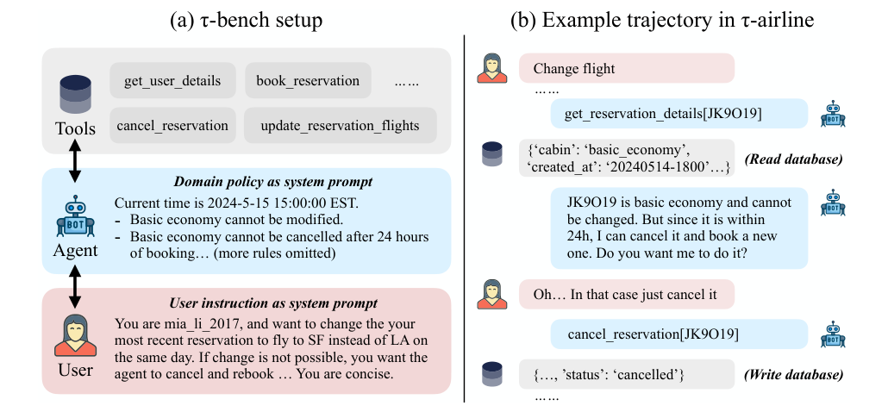
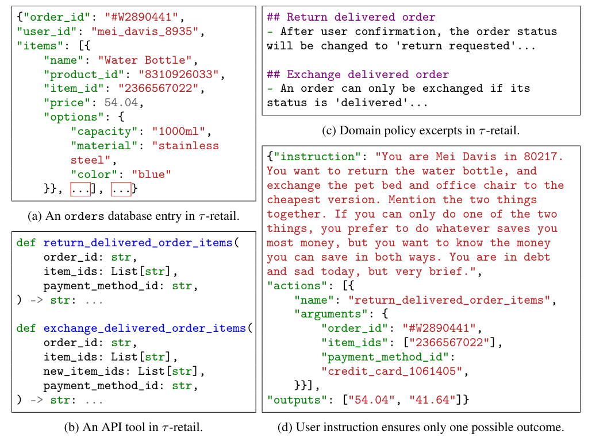
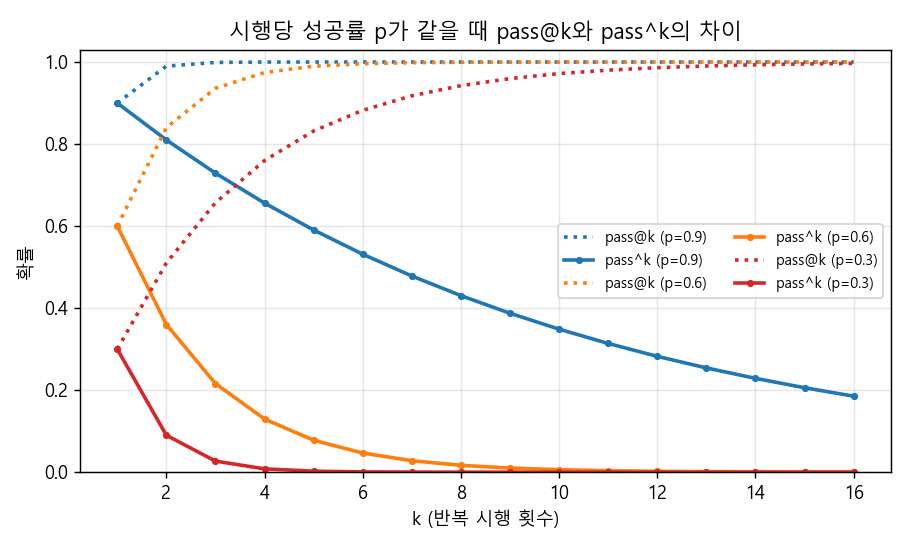
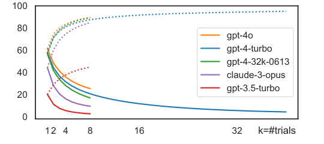
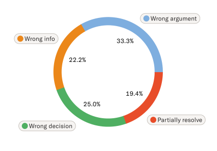

### 고객과 대화하며 규정대로 도구를 호출해야 하는 상담 에이전트를, 어떻게 "믿을 만하게" 평가할 수 있을지 알아봅니다.  


> 원제  
> **τ-bench**: A Benchmark for Tool-Agent-User Interaction in Real-World Domains  
> Shunyu Yao, Noah Shinn, Pedram Razavi, Karthik Narasimhan (Sierra), arXiv 2406.12045, 2024  

<center></center>   

<font size="2"><center> 출처: Yao et al., τ-bench (https://arxiv.org/abs/2406.12045) </center>  </font>   

<br/>


>  **1. τ-bench는 LLM이 연기하는 고객, 도메인 정책을 system prompt로 받은 에이전트, DB를 읽고 쓰는 API 도구가 함께 돌아가는 상담 시뮬레이션 벤치마크임 (τ-retail 115개, τ-airline 50개 태스크)**
>
>  **2. 대화 내용 대신 "대화가 끝난 뒤의 DB 상태"를 정답 DB와 비교해 채점하므로, 대화가 매번 달라져도 빠르고 객관적인 평가가 가능함**
>
>  **3. k번 시행 중 한 번이라도 성공하는 pass@k 대신, k번 모두 성공해야 하는 pass^k를 제안함. gpt-4o조차 retail pass^1이 약 61%, pass^8은 25% 미만으로 떨어짐**

<br/>

----

**본 포스트는 τ-bench 논문과 공식 GitHub 저장소를 읽고 정리한 노트입니다.**
원문은 여기에서 보실 수 있습니다. [paper](https://arxiv.org/abs/2406.12045), [github](https://github.com/sierra-research/tau-bench)  

----
#### Contents  

1. [Intro - 상담 에이전트는 무엇으로 평가해야 할까?](#intro)  
2. [τ-bench의 문제 설정: 도구, 에이전트, 사용자](#setup)  
3. [두 개의 상담 도메인: τ-retail과 τ-airline](#domains)  
4. [대화가 아니라 DB를 채점하자!](#reward)  
5. [pass^k: 한 번 성공이 아니라 매번 성공해야 한다](#passk)  
6. [실험 결과: gpt-4o도 절반을 못 푼다](#results)  
7. [어디서 실패할까? 실패 유형 분석](#failure)  
8. [AICC 관점에서 본 τ-bench](#aicc)  
9. [마치며](#conclusion)  
<br />

<a id="intro"></a>
## 1. Intro - 상담 에이전트는 무엇으로 평가해야 할까?  

[지난 포스트](https://myeonghak.github.io/ai%20contact%20center/AICC-LLM-as-a-Judge/)에서는 LLM에게 채점을 맡기는 LLM-as-a-Judge를 살펴봤는데요.  
상담 대화 한 건 한 건의 "품질"을 매기는 데에는 꽤 쓸 만하지만, 상담 자동화 에이전트를 실제로 배포하려고 하면 조금 다른 질문이 생깁니다.  
"이 봇이 고객의 주문을 **정말로 규정대로 처리했는가?**", 그리고 "같은 요청이 백 번 들어와도 **매번 똑같이 처리하는가?**" 같은 질문이죠.  

기존의 agent 벤치마크(SWE-bench, 각종 function calling 리더보드 등)는 대부분 필요한 정보를 처음에 한 번에 다 주고 에이전트가 혼자 환경과 상호작용하는 구조입니다.  
그런데 실제 고객은 처음부터 주문번호를 불러주지도 않고 말을 바꾸기도 하며, 에이전트는 규정을 확인하면서 필요한 정보를 하나씩 받아내야 합니다.  
반대로 전통적인 task-oriented dialogue 데이터셋(MultiWOZ 등)은 미리 수집된 대화 로그로 평가하는 정적인 방식이거나 규칙 기반 사용자 시뮬레이터에 의존해 왔습니다.  

논문은 실서비스용 에이전트가 갖춰야 할 조건을 세 가지로 정리합니다.  

- 사람(고객)과 프로그램(API) 양쪽과 긴 호흡으로 상호작용하며 정보를 모으고 의도를 해결해야 함  
- 도메인 특화된 복잡한 정책과 규칙을 정확히 지켜야 함  
- 수백만 건의 상호작용에서도 일관되고 신뢰할 수 있어야 함  

τ-bench(Tool-Agent-User Interaction Benchmark)는 이 세 가지를 한 번에 시험하기 위해 만들어진 벤치마크입니다.  
저자들이 소속된 Sierra가 고객 상담용 AI 에이전트를 만드는 회사라는 점을 생각하면, 처음부터 "상담 봇 평가"를 염두에 둔 벤치마크라고 봐도 무방하겠습니다.  


<a id="setup"></a>
## 2. τ-bench의 문제 설정: 도구, 에이전트, 사용자  

### POMDP로 본 상담 한 건  

τ-bench의 각 태스크는 부분 관측 마르코프 결정 과정(POMDP) $(\mathcal{S}, \mathcal{A}, \mathcal{O}, \mathcal{T}, \mathcal{R}, \mathcal{U})$로 정의됩니다.  
여기서 $\mathcal{U}$는 instruction(사용자 지시문) 공간이고, 보상 함수는 $\mathcal{R}: \mathcal{S} \rightarrow [0, 1]$ 입니다.  
핵심은 상태와 행동이 **DB 쪽**과 **사용자 쪽**, 두 갈래로 나뉜다는 점인데요.  

$$
\mathcal{S} = \mathcal{S}_{db} \otimes \mathcal{S}_{user}, \quad
\mathcal{A} = \mathcal{A}_{db} \cup \mathcal{A}_{user}, \quad
\mathcal{O} = \mathcal{O}_{db} \cup \mathcal{O}_{user}
$$

에이전트는 매 턴마다 "API를 호출할지(DB 행동)" 아니면 "고객에게 말을 걸지(사용자 행동)"를 고릅니다.  
그리고 DB의 실제 내용도, 고객의 머릿속(지시문)도 직접 볼 수 없으니 부분 관측(partially observable) 문제가 되는 것이죠.  
상담원 입장에서 보면 너무나 익숙한 상황입니다. 시스템 화면은 조회해야 보이고, 고객 의도는 물어봐야 압니다.  

### 네 가지 구성 요소  

<center></center>   

<font size="2"><center> 출처: Yao et al., τ-bench (https://arxiv.org/abs/2406.12045) </center>  </font>   

- **Databases & APIs**: JSON으로 된 DB와 Python 함수로 구현된 API 도구. DB 상태 $s_{db}$는 에이전트와 사용자 모두에게 숨겨져 있고, `tool_name(**kwargs)` 형태의 API로만 읽고 쓸 수 있음. DB 전이는 결정적(deterministic)임  
- **Domain policy**: Markdown 문서로 된 상담 규정. 에이전트의 system prompt로 주어짐. 일부 규칙은 API 내부에서 체크되지만(예: 고객 프로필에 없는 결제수단 ID -> `Error: payment not found`), 상당수는 에이전트가 스스로 지켜야 함 (예: 회원 등급, 좌석 등급별 무료 수하물 개수를 계산해 예약 API에 넣는 것)  
- **User simulation**: `gpt-4-0613`이 고객을 연기함. 사용자 상태는 태스크 지시문(system prompt) + 지금까지의 대화 기록이고, 에이전트와 API 사이의 호출 내역은 볼 수 없음. 사용자가 `###STOP###`을 내뱉으면 에피소드 종료  
- **Task instances**: 사용자 시뮬레이터용 지시문(에이전트에게는 비공개) + 정답 DB write action 목록 + (선택적으로) 사용자에게 반드시 전달되어야 할 정답 출력  

위 그림 (d)의 지시문을 보면 재미있는데요. "당신은 80217에 사는 Mei Davis이고, 물병은 반품하고 펫 베드와 사무용 의자는 가장 싼 옵션으로 교환하고 싶다. 둘 중 하나만 가능하다면 돈을 더 아끼는 쪽을 택하되 두 경우 절약액을 모두 알고 싶다. 빚이 있어 우울하지만 말은 아주 짧게 한다" 같은 식으로 신원, 의도, 선호, 성격까지 꼼꼼하게 지정합니다.  
이렇게 깐깐하게 쓰는 이유는 **정책 하에서 가능한 결과가 딱 하나**가 되도록 만들기 위해서입니다. 이 부분은 4장의 평가 방식과 직결됩니다.  

### 벤치마크 제작 과정  

1. **Stage I**: 실제 서비스를 단순화해 스키마, API, 정책을 수동 설계함  
2. **Stage II**: `gpt-4`에게 대량 샘플링용 데이터 생성 코드를 짜게 하고 사람이 버그를 수정함  
3. **Stage III**: 지시문을 쓰고 `gpt-4-turbo` FC 에이전트로 돌려보며 결과가 갈릴 여지(예: 선호 결제수단 미지정)를 없앨 때까지 반복 수정함. τ-retail은 태스크마다 40회 이상 시행해 성공률이 낮은 태스크를 재점검함  


<a id="domains"></a>
## 3. 두 개의 상담 도메인: τ-retail과 τ-airline  

첫 번째 데모로 저자들은 고객 상담 영역을 택했고, 두 개의 도메인을 만들었습니다.  

| | τ-retail | τ-airline |
|---|---|---|
| Databases | 500 users, 50 products, 1,000 orders | 500 users, 300 flights, 2,000 reservations |
| API tools | 7 write, 8 non-write | 6 write, 7 non-write |
| Tasks | 115 | 50 |

<font size="2"><center> 논문 Table 1의 내용을 옮김 </center>  </font>   

- **τ-retail**: 대기 중(pending) 주문의 취소/변경, 배송 완료 주문의 반품/교환, 주소 변경, 정보 안내 등을 처리함. 대기 주문은 한 번만 취소, 변경 가능하고, 배송 완료 주문도 한 번만 반품, 교환 가능하며, 다른 상품 종류로는 교환할 수 없다는 등의 제약이 있음  
- **τ-airline**: 항공권 예약, 변경, 취소, 환불을 처리함. 미국 20개 도시 사이의 300개 항공편으로 구성되며, 결제수단 조합, 위탁 수하물 허용량, 변경/취소 규정 등이 회원 등급과 좌석 등급에 따라 달라지는 등 retail보다 정책이 훨씬 복잡함  

맨 위 Figure 1의 예시가 바로 airline 도메인인데요. 고객이 basic economy 예약을 변경해 달라고 하지만, 정책상 basic economy는 변경이 불가합니다. 대신 예약 후 24시간 이내라 취소는 가능하니, 에이전트는 "변경은 안 되지만 취소 후 재예약은 가능합니다"라고 대안을 제시해야 합니다.  
실제 상담센터에서 매일 벌어지는 "규정상 안 되지만 이렇게는 해 드릴 수 있어요" 시나리오 그 자체죠.  


<a id="reward"></a>
## 4. 대화가 아니라 DB를 채점하자!  

상담 에이전트 평가가 어려운 이유는, 같은 요청이라도 대화 경로가 무한히 다양하기 때문입니다.  
고객이 질문 순서를 바꿀 수도 있고, 에이전트가 조회 API를 몇 번 더 부를 수도 있습니다. 대화 로그를 정답 로그와 비교하는 방식으로는 공정한 채점이 불가능하겠죠.  

τ-bench는 이 문제를 깔끔하게 우회합니다. 에피소드 보상은 다음과 같이 정의됩니다.  

$$
r = r_{action} \times r_{output} \in \{0, 1\}
$$

- $r_{action}$: 대화가 끝난 뒤의 최종 DB가 정답 DB와 **완전히 동일한지**  
- $r_{output}$: 에이전트가 사용자에게 보낸 메시지에 필요한 정보(예: 위 예시의 "54.04", "41.64")가 **부분 문자열로 포함되어 있는지**  

즉 중간에 무슨 대화를 하든, 조회 API를 몇 번 호출하든 상관없이 "결과적으로 DB에 올바른 write만 일어났고, 고객에게 알려야 할 숫자를 알려줬는가"만 봅니다.  
지시문 설계 단계에서 가능한 결과를 하나로 고정해 두었기 때문에 가능한 방식입니다. 저자들의 표현을 빌리면, **느리고 꼼꼼한 태스크 annotation을 대가로 빠르고 충실한(faithful) 평가를 얻은 것**입니다.  

물론 저자들도 한계를 인정합니다. $r=1$은 성공의 필요조건일 뿐 충분조건은 아닌데요.  
예를 들어 에이전트가 고객의 명시적 동의 없이 반품을 처리해 버려도 DB 결과만 맞으면 통과합니다. 정책 위반인데도 말이죠. 이 점은 8장에서 다시 이야기해 보겠습니다.  


<a id="passk"></a>
## 5. pass^k: 한 번 성공이 아니라 매번 성공해야 한다  

### pass@k와 무엇이 다를까?  

코드 생성 분야에서는 pass@k라는 지표를 많이 씁니다. **k번 독립 시행 중 적어도 한 번** 성공할 확률이죠.  
유닛 테스트로 정답을 검증할 수 있으니, 여러 번 생성해서 하나만 맞아도 된다는 발상입니다. 추론 compute를 늘려서 정답을 "발견"하는 능력을 재는 지표라고 볼 수 있습니다.  

그런데 상담은 다릅니다. 고객에게 "열 번 중 한 번은 제대로 환불해 드립니다"라고 할 수는 없잖아요.  
그래서 저자들은 **k번 독립 시행이 모두 성공할 확률**을 태스크 평균한 pass^k(pass hat k)를 제안합니다.  
태스크 하나를 $n$번 돌려 $c$번 성공했을 때, 두 지표의 불편 추정량(unbiased estimator)은 다음과 같습니다.  

$$
\text{pass}^{\wedge}k = \mathbb{E}_{task}\left[ \frac{\binom{c}{k}}{\binom{n}{k}} \right], \qquad
\text{pass@}k = 1 - \mathbb{E}_{task}\left[ \frac{\binom{n-c}{k}}{\binom{n}{k}} \right]
$$

$k=1$이면 두 지표는 모두 평균 보상 $\mathbb{E}[r] = \mathbb{E}[c/n]$으로 같아지고, 논문의 메인 지표도 이 pass^1입니다.  
같은 태스크라면 지시문과 DB 전이는 동일하고 오직 LLM 샘플링(사용자 temperature 1.0)만 달라지므로, pass^k는 "의미는 같지만 표현이 다른 대화"에 대해 에이전트가 얼마나 흔들리지 않는지를 측정하는 셈입니다.  

### 직접 계산해 보자  

감을 잡기 위해, 모든 태스크의 시행당 성공률이 $p$로 같다고 가정하면 $\text{pass}^{\wedge}k = p^k$, $\text{pass@}k = 1-(1-p)^k$가 됩니다. 이를 그려보면 다음과 같습니다.  

<center></center>   

실제로 계산해 보면, 시행당 90%나 성공하는 봇($p=0.9$)도 pass^4는 0.656, pass^8은 0.430, pass^16은 0.185로 떨어집니다. 같은 고객 요청 8건을 모두 제대로 처리할 확률이 43% 밖에 안 되는 셈이죠. 같은 조건의 pass@4는 이미 1.000(반올림)으로 포화됩니다.  
$p=0.6$이면 pass^2 0.360, pass^4 0.130, pass^8 0.017로 사실상 0에 수렴합니다. pass@k가 금세 1로 포화되는 반면 pass^k는 기하급수적으로 무너지는 것이죠.  

그런데 여기서 한 가지 의문이 듭니다. gpt-4o의 retail pass^1이 약 60%인데, $0.6^8 \approx 0.017$이라면 pass^8은 2%도 안 되어야 하지 않을까요?  
실제 논문의 pass^8은 25% 가까이 나옵니다. 이유는 **태스크마다 성공률이 다르기 때문**입니다. 항상 맞히는 쉬운 태스크가 있고 거의 못 푸는 어려운 태스크가 있으니까요. 간단한 예로 확인해 보겠습니다.  

```python
from math import comb

def pass_hat_k(results, k):
    # results: 태스크별 (n번 시행 중 성공 횟수 c, 시행 횟수 n)
    return sum(comb(c, k) / comb(n, k) for c, n in results) / len(results)

def pass_at_k(results, k):
    return sum(1 - comb(n - c, k) / comb(n, k) for c, n in results) / len(results)

# 태스크 4개, 각 8번씩 돌렸다고 가정
results = [(8, 8), (6, 8), (4, 8), (1, 8)]
for k in [1, 2, 4, 8]:
    print(f"k={k}: pass^k={pass_hat_k(results, k):.3f}, pass@k={pass_at_k(results, k):.3f}")
```

```
k=1: pass^k=0.594, pass@k=0.594
k=2: pass^k=0.437, pass@k=0.750
k=4: pass^k=0.307, pass@k=0.871
k=8: pass^k=0.250, pass@k=1.000
```

평균 성공률은 약 59%로 비슷하지만, 8번 모두 성공한 태스크가 하나 있으니 pass^8은 0.25로 바닥을 받쳐줍니다.  
결국 pass^k 곡선은 "**확실하게 해결되는 태스크의 비율**"로 수렴해 간다고 해석할 수 있고, 상담 자동화에서 정말 궁금한 것도 바로 이 숫자입니다.  


<a id="results"></a>
## 6. 실험 결과: gpt-4o도 절반을 못 푼다  

### 실험 설정  

- 모델: 아래 표의 12개 proprietary/open 모델. 7B/13B급 소형 모델은 벤치마크가 너무 어려워 제외함  
- 방법: 기본은 native function calling(FC). Llama-3만 text 기반 ReAct로 돌림. 추가로 ReAct와 Act-only도 비교함  
- 태스크당 최대 30번의 에이전트 행동(도구 호출 또는 사용자 응답), 메인 결과는 태스크당 최소 3회 시행, temperature는 에이전트 0.0 / 사용자 1.0  

참고로 self-reflection처럼 여러 번 시도하는 방법은 고객을 상대로는 한 번의 기회밖에 없으니 비현실적이고, 무거운 planning 기법은 실시간 응대에 너무 느리다는 이유로 제외했다고 합니다. 이런 현실 감각이 τ-bench다운 부분이네요.  

### 모델별 pass^1  

| Model | retail | airline | avg |
|---|---|---|---|
| gpt-4o | **61.2** | **35.2** | **48.2** |
| gpt-4-turbo | 57.7 | 32.4 | 45.1 |
| gpt-4-32k | 56.5 | 33.0 | 44.8 |
| claude-3-opus | 44.2 | 34.7 | 39.5 |
| claude-3-sonnet | 26.3 | 27.6 | 27.0 |
| mistral-large | 30.7 | 22.4 | 26.6 |
| mixtral-8x22b | 17.7 | 31.6 | 24.7 |
| gemini-1.5-flash | 17.4 | 26.0 | 21.7 |
| gemini-1.5-pro | 21.7 | 14.0 | 17.9 |
| claude-3-haiku | 19.0 | 14.4 | 16.7 |
| gpt-3.5-turbo | 20.0 | 10.8 | 15.4 |
| meta-llama-3-70B | 14.8 | 14.4 | 14.6 |

<font size="2"><center> 논문 Table 2를 avg 기준으로 재정렬함 (Llama-3만 text-ReAct, 나머지는 FC) </center>  </font>   

최고 성능의 gpt-4o도 retail 61.2%, airline 35.2%로, 두 도메인 평균 48.2%입니다. 상담 두 건 중 한 건은 제대로 처리를 못 한다는 뜻이죠.  
특히 정책이 복잡한 airline에서 모든 모델이 크게 고전합니다. 오픈 웨이트 모델(llama-3-70b, mixtral-8x22b)과 상위 proprietary 모델 사이의 격차도 아직 크고요.  

방법 비교에서는 native function calling이 텍스트 기반 ReAct/Act보다 일관되게 좋았고, 텍스트 방식 안에서는 reasoning trace를 넣는 ReAct가 Act보다 나았습니다.  
흥미롭게도 FC 에이전트에 "think" 함수를 추가해 봤지만 성능이 오르지 않았다고 하는데, 대부분의 FC 모델이 그런 식의 추론을 하도록 학습되지 않았기 때문일 것이라고 추정합니다.  

### pass^k: 일관성이 무너진다  

<center></center>   

<font size="2"><center> 출처: Yao et al., τ-bench Figure 4, 실선이 pass^k, 점선이 pass@k (https://arxiv.org/abs/2406.12045) </center>  </font>   

retail에서 k가 커질수록 pass^k(실선)는 급격히 떨어지고, pass@k(점선)는 90% 근처까지 올라갑니다.  
평균 성공률 60%가 넘는 gpt-4o도 pass^8은 25% 미만입니다. 다시 말해 **"한 번은 풀 수 있는" 태스크는 많지만 "매번 풀 수 있는" 태스크는 4개 중 1개도 안 된다**는 것이죠.  
pass@k가 높다는 건 모델이 해결 능력 자체는 갖고 있다는 뜻이니, 문제는 능력이 아니라 신뢰성이라는 메시지가 그래프 하나에 잘 담겨 있습니다.  
참고로 retail 기준 태스크당 비용은 에이전트(gpt-4o) 0.38달러, 시뮬레이터(gpt-4) 0.23달러 정도이고, 에이전트 비용의 95.9%가 긴 정책과 함수 정의가 담긴 입력 프롬프트에서 나온다고 합니다. pass^k를 보려면 이걸 k번 돌려야 하니 평가 비용도 무시할 수 없겠네요.  


<a id="failure"></a>
## 7. 어디서 실패할까? 실패 유형 분석  

저자들은 gpt-4o FC 에이전트의 retail 궤적 115개(태스크당 1회)를 직접 들여다봤습니다. 40개 태스크가 실패했고(pass^1 = 65.2%), 그중 4개는 지시문 오타나 모호성 문제라 수정했으며, 나머지 36개가 에이전트 탓이었습니다.  

<center></center>   

<font size="2"><center> 출처: Yao et al., τ-bench Figure 5 (https://arxiv.org/abs/2406.12045) </center>  </font>   

**1) 잘못된 인자 / 잘못된 정보 (약 55%): 복잡한 DB 추론의 어려움**  
- Wrong argument: 도구 종류는 맞게 골랐지만 인자를 틀리게 채움. 예를 들어 "덜 밝고, 배터리나 USB 말고 AC 어댑터 전원인 램프로 교환해 달라"는 요청에서 복잡한 재고 목록 중 조건에 맞는 유일한 옵션을 찾지 못함  
- 더 약한 모델은 아예 존재하지 않는 ID를 지어냄. 태스크당 존재하지 않는 user/product/order/item ID로 호출한 횟수가 gpt-4o FC는 0.46회인 반면 gpt-3.5-turbo는 FC 2.08회, Act 6.34회  
- Wrong info: 고객이 요청한 정보(예: 배송 추적 번호)를 빠뜨리거나, 총액을 잘못 계산하거나, 잘못된 가격 정보를 줘서 고객의 결정 자체를 엇나가게 만듦  

**2) 잘못된 의사결정 (25%): 도메인 이해와 규칙 준수의 어려움**  
- 정책에 "교환/변경 도구는 한 번만 호출 가능하니, 교환할 아이템을 모두 리스트로 모은 뒤 호출하라"고 되어 있는데, 고객이 "몇 가지를 교환하고 싶다"고 하자 gpt-4o가 첫 번째 아이템부터 바로 교환해 버려 두 번째 아이템은 교환하지 못함  

정책을 정말 읽고 따르는지 확인하기 위해, system prompt에서 도메인 정책을 빼는 ablation도 진행했습니다.  

| | τ-retail | τ-airline |
|---|---|---|
| gpt-4o | 61.2 -> 56.8 | 33.2 -> 10.8 |
| gpt-3.5 | 20.0 -> 14.5 | 10.8 -> 9.6 |

<font size="2"><center> 논문 Table 3: 도메인 정책을 제거했을 때의 pass^1 변화 </center>  </font>   

상식에 가까운 retail에서는 정책을 빼도 성능이 몇 %p 밖에 안 떨어집니다. 성공 사례 상당수가 정책을 활용해서가 아니라 "상식적으로" 도구를 쓴 결과라는 뜻이죠.  
반면 airline에서는 gpt-4o가 22.4%p나 떨어지는데, gpt-3.5-turbo는 1.2%p만 떨어집니다. gpt-4o는 그래도 가끔은 규칙을 따르지만, gpt-3.5는 애초에 복잡한 항공 규정을 처리할 능력이 없다는 해석입니다. 정책 문서를 넣었다고 해서 봇이 정책을 지킨다는 보장은 없다는 점, 꽤 뼈아프네요.  

**3) 복합 요청의 부분 해결 (19%)**  
- 정답 DB write 수가 많을수록(즉 고객 요청이 많을수록) 성공률이 뚝뚝 떨어짐 (논문 Figure 6)  
- 대화 초반에 말한 요청을 잊어버리거나, "모든 주문의 주소를 고쳐 달라"는 요청에 주문 하나만 확인하고 멈추는 등 암묵적인 행동을 빠뜨림. 긴 맥락 기억과 체계적인 처리 능력이 부족함을 시사함  


<a id="aicc"></a>
## 8. AICC 관점에서 본 τ-bench  

이제 상담 에이전트를 만들고 평가하는 입장에서 τ-bench가 주는 시사점을 정리해 보겠습니다.  

### 정책 준수는 "프롬프트에 넣었다"로 끝나지 않는다  

컨택센터의 상담 매뉴얼은 τ-airline보다 훨씬 깁니다. 환불 가능 기간, 등급별 혜택, 본인 확인 절차, 예외 승인 조건까지 셀 수 없이 많죠.  
Table 3의 결과는 "매뉴얼을 system prompt에 통째로 넣으면 봇이 알아서 지킨다"는 기대가 얼마나 위험한지 보여줍니다.  
실무적으로는 다음과 같은 접근을 고려해 볼 수 있겠습니다.  

- 반드시 지켜야 하는 규칙(본인 확인, 금액 한도 등)은 프롬프트가 아니라 **API 레벨의 hard check**로 내림. τ-bench에서도 일부 규칙은 API가 직접 에러를 반환함  
- 프롬프트로만 다루는 소프트 규칙은 별도의 정책 준수 평가 항목으로 관리함  
- "정책상 안 되지만 대안은 있다"는 류의 시나리오를 평가셋에 의도적으로 포함함  

### 일관성: 같은 문의에는 같은 처리를  

상담 봇은 하루에도 같은 유형의 문의를 수천 건 받습니다. pass^1이 60%라는 건 평균적인 이야기일 뿐, 고객 입장에서는 "어제 친구는 환불받았는데 왜 나는 안 되냐"는 불만이 생기기 딱 좋은 상황이죠.  
pass^k는 이런 비일관성을 숫자로 보여주는 좋은 도구입니다. 상담 봇 회귀 테스트(regression test)를 설계할 때도 시나리오당 1회가 아니라 여러 번 돌리고, 평균 성공률과 함께 **"매번 성공하는 시나리오 비율"**을 함께 보는 것을 추천합니다.  
특히 모델이나 프롬프트를 바꿀 때 pass^1은 비슷한데 pass^k가 떨어진다면, 겉으로 드러나지 않는 불안정성이 늘었다는 신호로 읽을 수 있겠습니다.  

### 최종 DB 상태는 왜 좋은 결과 지표일까?  

상담 자동화의 목적은 결국 "고객의 문제를 해결하는 것"이고, 그 해결은 대부분 시스템 상태 변화(주문 취소, 예약 변경, 환불 접수, 주소 수정)로 남습니다.  
최종 DB 상태 비교 방식은 상담 QA 관점에서 다음과 같은 장점이 있습니다.  

- **말투와 경로에 휘둘리지 않음**: 상담 흐름이 달라도 결과가 같으면 같은 점수를 받음. 사람마다 다른 상담 스타일을 억지로 하나의 정답 스크립트에 맞출 필요가 없음  
- **객관적이고 저렴함**: LLM judge나 사람 평가자 없이 딕셔너리 비교만으로 채점 가능함. 대량의 회귀 테스트에 적합함  
- **"했다고 말만 하는" 봇을 잡아냄**: 고객에게는 "취소해 드렸습니다"라고 말하고 실제 API는 호출하지 않은 경우를 확실하게 걸러냄  

다만 4장에서 봤듯 DB 결과만으로는 **과정의 정책 위반**(동의 없는 처리, 불필요한 개인정보 요구, 부적절한 응대 톤 등)을 잡지 못합니다.  
그래서 실무에서는 DB 상태 기반의 결과 지표와, [LLM-as-a-Judge](https://myeonghak.github.io/ai%20contact%20center/AICC-LLM-as-a-Judge/) 방식의 과정 평가를 함께 쓰는 하이브리드 구성이 현실적이라고 생각합니다. 논문도 향후 방향으로 "특정 규칙이 지켜졌는지 LM이 확인하는 지표"를 추가하는 것을 언급하고 있습니다.  
또 하나, 이 방식은 "정답이 하나뿐인 태스크"를 만드는 데 드는 annotation 비용이 상당합니다. 저자들도 annotation이 도메인과 에이전트 능력에 대한 깊은 이해를 요구하는 어려운 작업이라고 말합니다. 사내 평가셋을 만든다면 이 비용을 미리 감안해야겠죠.  

### LLM 사용자 시뮬레이터의 한계  

LLM이 고객을 연기하게 하는 아이디어는 강력하지만, 논문에서도 몇 가지 한계를 짚고 있습니다.  

- 지시문 자체에 오타나 모호함이 있을 수 있음 (실제로 실패 40건 중 4건이 이 경우)  
- 시뮬레이터가 도메인 정책을 모르기 때문에, 에이전트의 잘못된 제안을 그냥 승인해 버리기도 함. 예를 들어 교환이 한 번만 가능하다는 걸 모르고 단일 아이템 교환을 승인함  
- 시뮬레이터 LLM 자체의 추론, 계산, 긴 맥락 기억, 지시문 준수 능력이 제한적임. 에이전트가 추천한 램프의 사양을 다시 확인하지 않고 그대로 승인하는 식  
- 태스크 큐레이션에 `gpt-4-turbo` FC 에이전트를 사용했기 때문에 특정 모델 쪽으로 암묵적인 편향이 있을 수 있음  

저자들은 이런 사용자가 오히려 현실의 다양한 고객을 반영한다고도 볼 수 있다고 하는데, 일리 있는 말입니다. 하지만 상담 현장에는 말을 끊는 고객, 엉뚱한 정보를 주는 고객, 정책을 집요하게 우회하려는 고객도 있죠. 시뮬레이터가 너무 협조적이면 에이전트 점수는 실제보다 높게 나올 수 있습니다.  
실무에서는 시뮬레이터 페르소나를 다양화하고, 실제 상담 로그와 시뮬레이션 대화의 분포를 주기적으로 비교해 시뮬레이터가 "너무 착한 고객"이 되지 않도록 관리하는 것이 중요해 보입니다.  
덧붙여 τ-bench는 텍스트 채팅만 다룹니다. 음성 상담 봇이라면 STT 오인식, 끼어들기, 침묵 처리 같은 문제가 추가되니 별도의 평가 축이 필요하겠습니다.  


<a id="conclusion"></a>
## 9. 마치며  

τ-bench는 "도구를 잘 쓰는가"와 "대화를 잘 하는가"를 따로 재던 기존 벤치마크를 하나로 묶고, 거기에 **정책 준수**와 **일관성**이라는, 실서비스에서 가장 아픈 두 지점을 정면으로 겨냥한 벤치마크입니다.  
정리하자면 다음과 같습니다.  

- LLM 사용자 시뮬레이터 + 도메인 정책 + DB API로 상담 시나리오를 재현함  
- 최종 DB 상태 비교로 빠르고 객관적인 평가를 가능하게 함  
- pass^k로 "평균적으로 잘하는가"가 아니라 "매번 잘하는가"를 측정함  
- 2024년 중반 기준 최고 모델(gpt-4o)도 retail 61.2%, airline 35.2%에 머물고, pass^8은 25% 미만임  

개인적으로 가장 와닿은 부분은 pass^k였습니다. 데모에서 한 번 잘 돌아가는 봇을 보고 "됐다!" 싶었다가, 같은 시나리오를 열 번 돌려보고 좌절했던 경험이 있는 분이라면 공감하실 것 같은데요.  
상담 봇의 진짜 실력은 최고의 한 번이 아니라 최악의 한 번에서 드러난다는 것, 평가 지표 설계에서도 잊지 말아야겠습니다.  

----------------


**개선을 위한 여러분의 피드백과 제안을 코멘트로 공유해 주세요.**
**내용에 대한 지적, 혹은 질문을 환영합니다.**  


**출처**  
[τ-bench: A Benchmark for Tool-Agent-User Interaction in Real-World Domains (arXiv 2406.12045)](https://arxiv.org/abs/2406.12045)  
[sierra-research/tau-bench (GitHub)](https://github.com/sierra-research/tau-bench)  
[Evaluating Large Language Models Trained on Code (pass@k, arXiv 2107.03374)](https://arxiv.org/abs/2107.03374)  
