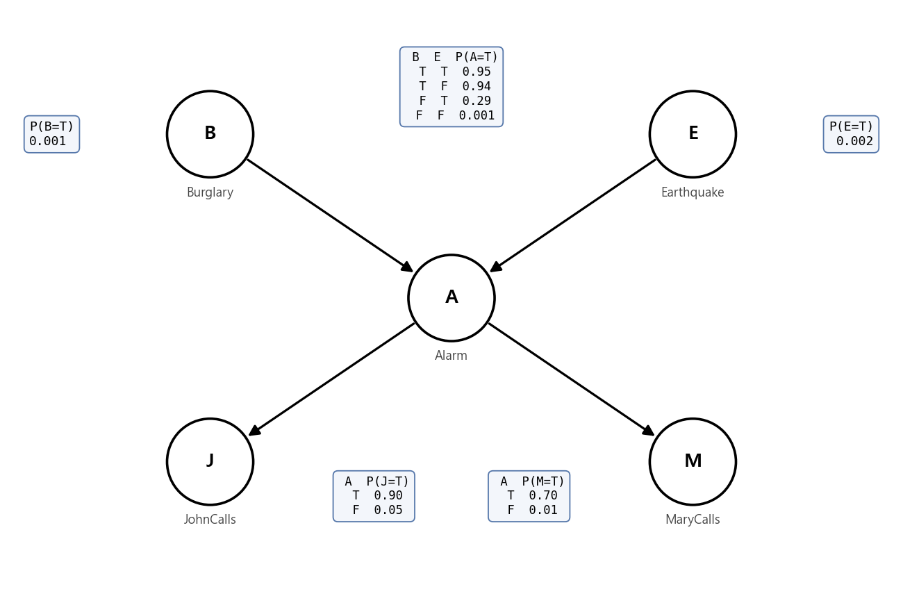
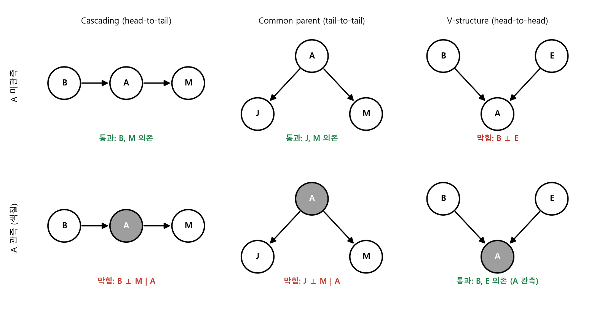
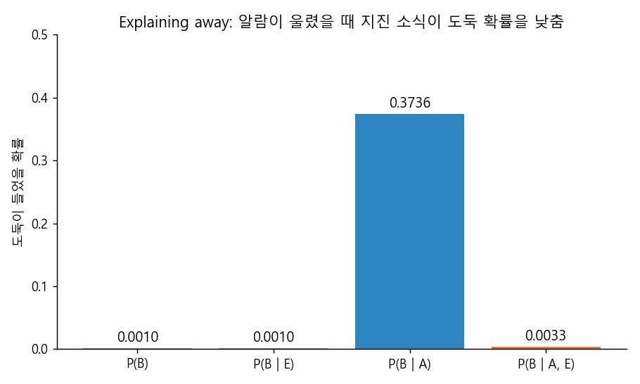
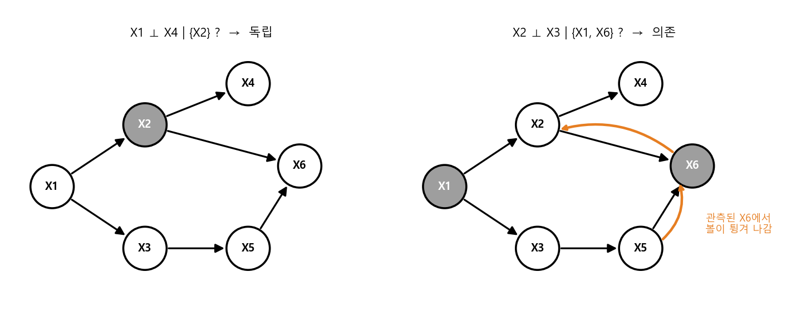
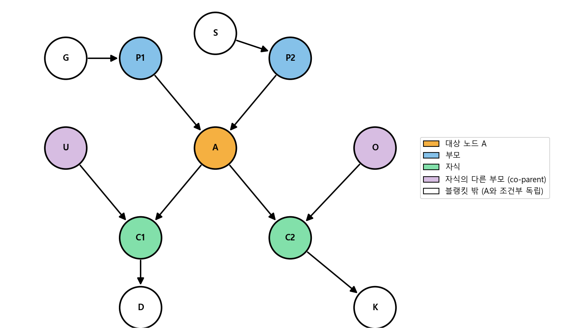

### 확률의 기본 정리부터 베이지안 네트워크의 해석, 그리고 Bayes Ball 알고리즘까지


> 확률변수 사이의 관계를 그래프로 표현하는 베이지안 네트워크를 소개하고, 그래프만 보고 조건부 독립을 판별하는 Bayes Ball 알고리즘을 살펴봅니다.  


<br>

<center></center>    


<br/>


>  **1. Joint probability를 알면 marginalization과 조건부 확률 계산으로 무엇이든 구할 수 있지만, 변수가 늘어날수록 필요한 파라미터 수가 지수적으로 늘어난다**
>
>  **2. 베이지안 네트워크는 확률변수와 조건부 독립 가정을 DAG로 표현해, full joint distribution을 compact하게 나타내는 graphical notation이다**
>
>  **3. Cascading, common parent, V-structure라는 세 가지 local structure를 조합한 Bayes Ball 알고리즘으로 그래프만 보고 조건부 독립(D-separation)을 판별할 수 있으며, Markov blanket은 부모, 자식, 자식의 다른 부모로 이루어진다**


<br/>

----

#### Contents

<br/>

1.	[확률 개념 다시 보기](#probability-concepts)
2.	[확률의 기본 정리: Marginalization과 Chain Rule](#probability-theorems)
3.  [독립과 조건부 독립](#independence)
4.  [베이지안 네트워크의 해석](#bayesian-network)
5.  [세 가지 Local Structure](#local-structures)
6.  [Bayes Ball 알고리즘과 D-separation](#bayes-ball)
7.  [Markov Blanket](#markov-blanket)

<br />

[지난 포스트](https://myeonghak.github.io/general%20machine%20learning/General-ML-train-set-batch-6.-%ED%95%99%EC%8A%B5-%EA%B2%80%EC%A6%9D%EA%B3%BC-%EC%A0%95%EA%B7%9C%ED%99%94/)에서는 학습, 검증과 정규화를 통해 모델의 복잡도를 다루는 방법을 살펴보았습니다. 이번 시간부터는 두 편에 걸쳐 **베이지안 네트워크(Bayesian Network)** 를 알아보려고 하는데요. 나이브 베이즈 편에서 "변수들이 서로 독립이라고 강제로 가정"했던 것, 기억하시나요? 베이지안 네트워크는 이 독립 가정을 훨씬 유연하게, 그리고 그림으로 표현할 수 있게 해주는 도구입니다. 이번 편에서는 그 토대가 되는 확률 개념과 그래프의 해석, 그리고 Bayes Ball 알고리즘까지 다뤄보겠습니다.  


<a id="probability-concepts"></a>
### 1. 확률 개념 다시 보기  

베이지안 네트워크를 한 줄로 정의하면 **확률변수 간의 관계를 나타내는 그래프**입니다. 확률변수 사이의 관계를 이야기하려면 먼저 확률 자체를 짚고 넘어가야겠죠.  

- $P(A=\text{true})$는 $A$가 참일 확률을 나타냄  
- 확률이란, 비슷한 조건 하에서 매우 많은 수의 시행을 반복했을 때 얻어지는 **상대적 빈도**임. "상대적"이라는 말이 붙는 이유는 빈도 그 자체로는 확률이 될 수 없기 때문 (100번 중 30번과 1000번 중 30번은 전혀 다른 이야기죠)  
- 사건을 입력으로 받아 0과 1 사이의 값을 돌려주는 일종의 **함수**로 생각할 수도 있음  

#### 조건부 확률  

조건부 확률 $P(A=\text{true} \mid B=\text{true})$는 **B가 참인 경우들 중에서, A도 참인 경우의 비율**입니다. 다르게 말하면 B가 주어졌을 때 A가 참일 확률이죠.  

$$
P(A \mid B) = \frac{P(A, B)}{P(B)}
$$

벤 다이어그램으로 생각하면, 전체 공간을 $B$라는 영역으로 축소한 뒤 그 안에서 $A$가 차지하는 비율을 보는 것입니다. "비가 온 날 중에서 우산을 챙긴 날의 비율"처럼 말이죠.  


<a id="probability-theorems"></a>
### 2. 확률의 기본 정리: Marginalization과 Chain Rule  

#### Law of Total Probability  

$b$가 가질 수 있는 모든 값에 대해 $a$와의 joint probability를 더하면, $a$의 확률이 됩니다.  

$$
P(a) = \sum_{b} P(a, b) = \sum_{b} P(a \mid b) P(b)
$$

이렇게 다른 변수를 더해서 없애는 것을 **summing out**, 혹은 **marginalization**이라고 부릅니다. 두 번째 등호처럼 $P(a, b) = P(a \mid b)P(b)$로 바꿔 쓰면, 조건부 확률과 $b$의 분포만 알아도 개별 확률변수 $a$에 대해 알 수 있다는 뜻이 됩니다.  

변수가 더 많아도 마찬가지입니다. $P(a, b, c, d)$가 주어졌을 때 $P(b)$가 궁금하다면 나머지 변수를 전부 summing out하면 됩니다.  

$$
P(b) = \sum_{a} \sum_{c} \sum_{d} P(a, b, c, d)
$$

#### Joint로부터 조건부 확률 구하기  

Joint probability가 주어지면 **어떤 조건부 확률이든** 구할 수 있습니다. 예를 들어 $P(c \mid b)$는 이렇게 계산됩니다.  

$$
P(c \mid b) = \sum_{a} \sum_{d} P(a, c, d \mid b) = \frac{1}{P(b)} \sum_{a} \sum_{d} P(a, b, c, d)
$$

여기서 $1/P(b)$는 $c$와 무관하므로 단순한 **normalization constant**에 불과합니다. 일단 분자만 계산해두고, 나중에 $c$의 모든 값에 대한 합이 1이 되도록 나눠주기만 하면 되는 것이죠.  

#### Joint Probability의 힘과 부담  

Joint probability distribution은 모든 변수 값 조합 각각이 얼마의 확률로 발생하는지를 알려주는 표입니다. 이 표의 모든 값을 더하면 당연히 1이 되어야 하고요. 앞서 본 것처럼 이 표 하나만 있으면 개별 확률도, 조건부 확률도 전부 구할 수 있으니 아주 강력한 정보입니다.  

그런데 문제는 **크기**입니다.  

- binary 변수 $n$개의 joint는 $2^n$개의 조합을 가짐  
- 합이 1이라는 제약이 있으니, 자유 파라미터는 $2^n - 1$개  
- 변수가 30개만 되어도 약 10억 개의 확률값을 알아야 함  

나이브 베이즈를 다룰 때 마주쳤던 것과 똑같은 고민이죠. 이 부담을 어떻게 줄일지가 이번 시리즈 전체를 관통하는 질문입니다.  

#### Chain Rule (Factorization)  

조건부 확률의 정의에 의해 joint probability는 항상 다음과 같이 쪼갤 수 있습니다.  

$$
P(a, b, c, \dots, z) = P(a \mid b, c, \dots, z) \, P(b, c, \dots, z)
$$

이 아이디어를 뒤쪽의 joint에 반복해서 적용하면 다음과 같이 전개됩니다.  

$$
P(a, b, c, \dots, z) = P(a \mid b, c, \dots, z) \, P(b \mid c, \dots, z) \cdots P(z)
$$

이를 **chain rule**, 혹은 **factorization**이라고 부릅니다. 이 식은 아무 가정 없이 항상 성립하기 때문에, 그 자체로는 파라미터 수를 하나도 줄여주지 않습니다. 맨 앞의 $P(a \mid b, c, \dots, z)$만 해도 조건이 $n-1$개라 거대한 표가 필요하니까요. 그런데 만약 **독립성**에 대한 정보가 있다면, 각 항의 조건 부분에서 필요 없는 변수를 지워버릴 수 있습니다. 바로 여기서 독립이 등장합니다.  


<a id="independence"></a>
### 3. 독립과 조건부 독립  

#### Independence  

두 확률변수 $A$, $B$가 독립이라면 다음이 성립합니다.  

$$
P(A \mid B) = P(A), \qquad P(A, B) = P(A) P(B)
$$

$B$의 결과를 아는 것이 $A$에 대해 아무런 정보도 주지 않는다는 뜻입니다. 동전 $n$개를 던지는 상황을 생각해 보면 독립의 위력이 잘 드러나는데요.  

- 독립성이 보장되지 않는다면: $2^n$개 결과 각각의 확률, 즉 $2^n - 1$개의 값을 알아야 함  
- 모두 독립이고 같은 동전이라면: 앞면이 나올 확률 **단 1개**만 알면 됨  

#### Marginal Independence vs Conditional Independence  

강좌에서는 군인 두 명과 지휘관(Commander)의 예시로 두 개념을 구분합니다.  

**Marginal independence**: 아무 조건 없이 두 사건이 서로 영향을 주지 않는 것입니다. 그런데 군인 A와 군인 B를 생각해 보면, B가 진격(Go)하는 걸 봤을 때 A도 진격했을 확률이 높아질 것 같죠.  

$$
P(\text{A=Go} \mid \text{B=Go}) > P(\text{A=Go})
$$

이런 경우 A와 B는 **marginally independent하지 않다**고 말합니다.  

**Conditional independence**: 다음이 성립하면 $A$는 $C$가 주어졌을 때 $B$와 조건부 독립입니다.  

$$
P(A \mid B, C) = P(A \mid C) \quad \Leftrightarrow \quad A \perp B \mid C
$$

군인 예시에 대입하면 직관적인데요. 두 군인이 같이 움직였던 이유는 사실 **같은 지휘관의 명령**을 들었기 때문입니다. 지휘관이 "진격!"이라고 외친 것을 내가 이미 들었다면, 군인 B가 진격했는지를 추가로 봐도 군인 A에 대해 새로 알게 되는 정보는 없습니다. 즉, **지휘관이라는 조건이 주어지면 A와 B는 독립**이 됩니다. 

정리하면, 두 군인은 marginally dependent하지만 지휘관이 주어지면 conditionally independent합니다. 이 "조건이 주어지면 독립이 된다(혹은 깨진다)"는 성질이 베이지안 네트워크의 핵심입니다.  


<a id="bayesian-network"></a>
### 4. 베이지안 네트워크의 해석  

#### 복습: 나이브 베이즈의 그래프 표현  

나이브 베이즈는 다음 재료로 구성됩니다.  

1) class prior $P(Y)$  
2) $Y$가 주어졌을 때 서로 조건부 독립인 변수 $X_i$들  
3) 각 $X_i$에 대한 우도 $P(X_i \mid Y)$  

이를 그림으로 그리면 $Y$에서 각 $X_i$로 화살표가 뻗어나가는 모양이 됩니다. 사실 이것이 가장 단순한 형태의 베이지안 네트워크입니다. 앞서 본 지휘관(Y)과 군인들(X)의 관계와 똑같은 구조이기도 하고요.  

#### 베이지안 네트워크의 정의  

베이지안 네트워크는 다음을 표현하는 **graphical notation**입니다.  

1) 확률변수  
2) 조건부 독립 관계  
3) 이를 통해 full joint distribution의 compact한 표현을 얻음  

문법(syntax)은 단순합니다.  

- **노드(node)**: 확률변수. 각 노드는 부모 노드가 주어졌을 때의 조건부 확률 $P(X_i \mid \text{parents}(X_i))$를 가짐. 부모가 없는 노드는 그냥 사전확률 $P(X_i)$를 가짐  
- **링크(link)**: 부모 노드가 자식 노드에 미치는 **직접적인(direct) 영향**  
- 반드시 **비순환(acyclic), 유방향(directed) 그래프**, 즉 DAG여야 함. 순환이 있거나 방향이 없는 그래프는 베이지안 네트워크가 아님  

#### 그래프는 독립에 대한 주장이다  

네트워크의 구조(topology)는 **조건부 독립에 대한 가정(assertion)을 encoding**합니다. 보통 이 구조는 도메인 전문가가 "무엇이 무엇과 어떻게 연관되어 있는지"를 그림으로 도식화해서 만듭니다.  

강좌의 치과 예시를 보면, 날씨(Weather), 충치(Cavity), 치통(Toothache), 구취(Catch) 네 변수가 있고 충치에서 치통과 구취로 화살표가 나가는 그래프가 있습니다. 이 그래프는 다음과 같이 해석됩니다.  

- 날씨는 다른 변수들과 독립임 (연결된 링크가 없음)  
- 충치는 치통과 구취의 확률에 영향을 미침  
- 치통과 구취는 충치라는 정보가 주어지면 서로 조건부 독립임  

#### 도둑, 지진, 그리고 알람  

조금 더 그럴듯한 예제를 보겠습니다. 베이지안 네트워크의 대표 예제인데요.  

> 회사에 있는데 이웃 존(John)이 집 알람이 울린다고 전화를 했습니다. 다른 이웃인 메리(Mary)는 전화가 없었습니다. 그런데 이 알람은 도둑이 들 때뿐만 아니라 자잘한 지진에도 울리곤 합니다. 과연 도둑이 들었을까요?  

변수는 Burglary(B), Earthquake(E), Alarm(A), JohnCalls(J), MaryCalls(M) 다섯 개이고, 그래프는 맨 위의 그림과 같습니다. 이 토폴로지는 **인과적(causal) 지식**을 반영합니다.  

- 도둑이 들면 알람이 울림  
- 지진이 나면 알람이 울림  
- 알람이 울리면 존이 전화함  
- 알람이 울리면 메리가 전화함  

#### 질적 요소와 양적 요소  

베이지안 네트워크는 두 종류의 구성요소로 이루어집니다.  

- **질적 요소(qualitative component)**: 그래프 구조 그 자체. 인과 관계에 대한 사전 지식, 데이터로부터 배운 지식, 자주 쓰이는 구조 등으로부터 얻음  
- **양적 요소(quantitative component)**: 각 노드에 붙은 조건부 확률 테이블(CPT), 즉 노드별 확률 분포  

확률 계산은 이 두 요소 모두와 관련되어 있습니다. 맨 위 그림의 CPT 값(Russell & Norvig 교재에서 널리 쓰이는 수치입니다)을 세어 보면 B 1개, E 1개, A 4개, J 2개, M 2개로 **총 10개**의 파라미터면 충분합니다. 다섯 변수의 full joint를 그대로 저장하려면 $2^5 - 1 = 31$개가 필요했던 것과 비교되죠. 변수가 많아질수록 이 차이는 지수적으로 벌어집니다.  

그래프가 말해주는 대로 joint를 쪼개면 $P(B, E, A, J, M) = P(B)P(E)P(A \mid B, E)P(J \mid A)P(M \mid A)$가 되는데요, 이 식이 왜 성립하는지는 다음 편의 factorization에서 자세히 다루겠습니다. 여기서는 일단 이 식으로 joint를 만들고 "존과 메리가 둘 다 전화했을 때 도둑이 들었을 확률"을 직접 계산해 보겠습니다.  

```python
import itertools

p_B, p_E = 0.001, 0.002
p_A = {(1, 1): 0.95, (1, 0): 0.94, (0, 1): 0.29, (0, 0): 0.001}
p_J = {1: 0.90, 0: 0.05}
p_M = {1: 0.70, 0: 0.01}

def bern(p, x):
    return p if x else 1 - p

# P(B,E,A,J,M) = P(B)P(E)P(A|B,E)P(J|A)P(M|A)
joint = {}
for b, e, a, j, m in itertools.product([0, 1], repeat=5):
    joint[(b, e, a, j, m)] = (bern(p_B, b) * bern(p_E, e) * bern(p_A[(b, e)], a)
                              * bern(p_J[a], j) * bern(p_M[a], m))

def P(query, evidence={}):
    idx = dict(zip('BEAJM', range(5)))
    match = lambda k, cond: all(k[idx[v]] == x for v, x in cond.items())
    den = sum(p for k, p in joint.items() if match(k, evidence))
    num = sum(p for k, p in joint.items() if match(k, {**evidence, **query}))
    return num / den

print('합계          :', round(sum(joint.values()), 6))
print('P(B)          :', round(P({'B': 1}), 6))
print('P(B | J, M)   :', round(P({'B': 1}, {'J': 1, 'M': 1}), 4))
```

```
합계          : 1.0
P(B)          : 0.001
P(B | J, M)   : 0.2842
```

`P` 함수가 하는 일이 바로 2장에서 본 marginalization(조건에 맞는 항을 summing out)과 normalization(분모로 나누기)입니다. 두 이웃이 모두 전화했다면 도둑 확률이 0.1%에서 약 28%로 뛰어오르네요. 그래도 72%는 "도둑이 아닐 수도 있다"는 것이니, 너무 당황하지 말고 일단 메리에게 다시 전화해 봐야겠습니다.  


<a id="local-structures"></a>
### 5. 세 가지 Local Structure  

큰 그래프도 쪼개 보면 결국 세 노드짜리 작은 구조들의 조합입니다. 각 구조에서 가운데 노드가 관측되었을 때 양 끝 노드가 독립이 되는지를 아는 것이 중요한데요, 나중에 joint probability를 factorize할 때 바로 이 독립 정보가 필요하기 때문입니다.  

<br>

<center></center>    

<br>

#### Common Parent (tail-to-tail)  

Alarm에서 JohnCalls와 MaryCalls가 갈라져 나오는 구조입니다.  

- $A$가 주어지면 $J$와 $M$은 독립: $J \perp M \mid A$  
- 즉, $P(J, M \mid A) = P(J \mid A) P(M \mid A)$  
- 알람이 울렸다는 걸 이미 안다면, 메리가 전화했는지는 존이 전화할지에 대해 추가 정보를 주지 않음  
- 반대로 $A$를 모르면 $J$와 $M$은 의존적임. 메리의 전화는 "알람이 울렸을 수도 있다"는 증거가 되고, 이것이 다시 존의 전화 확률을 높이기 때문 (군인과 지휘관 예시와 같은 구조)  

#### Cascading (head-to-tail)  

Burglary -> Alarm -> MaryCalls처럼 순차적으로 이어진 구조입니다.  

- $A$가 주어지면 $B$와 $M$은 독립: $B \perp M \mid A$  
- 즉, $P(M \mid B, A) = P(M \mid A)$  
- 알람이 울린 이상, 그 원인이 도둑이었는지는 메리가 전화하는 데 영향을 주지 않음. 메리는 알람 소리를 듣고 전화할 뿐, 도둑을 직접 보는 게 아니니까요  
- 달리 말해, 직접 영향을 주는 노드가 주어지면 그 이전 노드의 영향은 차단됨  

#### V-structure (head-to-head)  

Burglary와 Earthquake가 함께 Alarm을 가리키는 구조입니다. 이 구조만 **반대로** 동작합니다.  

- $A$를 모를 때 $B$와 $E$는 독립: 도둑이 드는 것과 지진이 나는 것은 아무 상관이 없음  
- 그런데 $A$가 주어지는 순간 독립이 깨짐: $\neg(B \perp E \mid A)$  
- 알람이 울렸는데 지진이 났다는 뉴스를 들으면, "아, 지진 때문에 울렸구나" 하고 도둑일 가능성이 줄어듦. 반대로 지진이 없었다면 도둑일 가능성이 커짐  

이런 현상을 **explaining away**라고 부릅니다. 하나의 원인이 결과를 설명해 버리면, 다른 원인의 가능성이 낮아지는 것이죠. 앞의 코드로 각 구조의 독립성을 실제로 확인해 보겠습니다.  

```python
print('P(J|M)  vs P(J)   :', round(P({'J': 1}, {'M': 1}), 4), round(P({'J': 1}), 4))
print('P(J|M,A) vs P(J|A):', round(P({'J': 1}, {'M': 1, 'A': 1}), 4), round(P({'J': 1}, {'A': 1}), 4))
print('P(B|E)  vs P(B)   :', round(P({'B': 1}, {'E': 1}), 4), round(P({'B': 1}), 4))
print('P(B|A,E) vs P(B|A):', round(P({'B': 1}, {'A': 1, 'E': 1}), 4), round(P({'B': 1}, {'A': 1}), 4))
```

```
P(J|M)  vs P(J)   : 0.1776 0.0521
P(J|M,A) vs P(J|A): 0.9 0.9
P(B|E)  vs P(B)   : 0.001 0.001
P(B|A,E) vs P(B|A): 0.0033 0.3736
```

- Common parent: $A$를 모르면 메리의 전화가 존의 전화 확률을 5.2%에서 17.8%로 끌어올리지만, $A$가 주어지면 둘 다 0.9로 같아짐  
- V-structure: $A$를 모를 때는 지진 소식이 도둑 확률에 아무 영향이 없지만, $A$가 주어지면 37.4%였던 도둑 확률이 지진 소식 하나로 0.33%까지 떨어짐  

<br>

<center></center>    

<br>

한 가지 덧붙이면, V-structure에서는 가운데 노드 자체뿐 아니라 **그 자손(descendant)이 관측되어도** 독립이 깨집니다. 알람 소리를 직접 듣지 않았어도, 존의 전화를 받았다면 알람에 대한 간접 증거가 생기기 때문입니다.  


<a id="bayes-ball"></a>
### 6. Bayes Ball 알고리즘과 D-separation  

#### 알고리즘의 아이디어  

Bayes Ball 알고리즘의 목적은 $X_A \perp X_B \mid X_C$, 즉 **$X_C$가 주어졌을 때 $X_A$와 $X_B$가 독립인지**를 그래프만 보고 판별하는 것입니다. 방법은 이름 그대로 공을 굴려보는 것인데요.  

- 관측된 변수 $X_C$에 해당하는 노드를 색칠함  
- $X_A$에서 공을 굴려, 그래프의 링크를 따라 $X_B$까지 도달할 수 있는지 확인  
- 공은 일종의 "영향(정보)의 흐름"을 상징함. 도달할 수 있으면 dependent, 어떤 경로로도 도달할 수 없으면 independent  
- 공이 각 노드를 지날 때는 앞에서 본 local structure의 규칙을 따름. 화살표 방향과는 상관없이 링크를 따라 양방향으로 굴러갈 수 있음  

공이 지나가는 규칙을 정리하면 다음과 같습니다.  

| 구조 | 가운데 노드 미관측 | 가운데 노드(또는 자손) 관측 |
|---|---|---|
| Cascading (head-to-tail) | 통과 | 막힘 |
| Common parent (tail-to-tail) | 통과 | 막힘 |
| V-structure (head-to-head) | 막힘 | 통과 (튕겨 나감) |

#### Exercise  

강좌에서는 여러 노드로 이루어진 그래프에서 $X_1 \perp X_4 \mid \{X_2\}$ 같은 질문을 확인하는 연습을 하는데요. 핵심은 **큰 구조를 작은 local structure로 쪼개서** 각 지점에서 공이 지나갈 수 있는지 판단하는 것입니다. 아래 그래프로 직접 해보겠습니다.  

<br>

<center></center>    

<br>

**Q1. $X_1 \perp X_4 \mid \{X_2\}$ ?**  

- 경로 $X_1 \to X_2 \to X_4$: $X_2$에서 cascading이고 $X_2$가 관측되었으므로 막힘  
- 경로 $X_1 \to X_3 \to X_5 \to X_6 \leftarrow X_2 \to X_4$: $X_6$이 V-structure의 가운데인데 관측되지 않았으므로 막힘  
- 모든 경로가 막혔으므로 **독립**  

**Q2. $X_2 \perp X_3 \mid \{X_1, X_6\}$ ?**  

- 경로 $X_2 \leftarrow X_1 \to X_3$: common parent $X_1$이 관측되었으므로 막힘  
- 경로 $X_2 \to X_6 \leftarrow X_5 \leftarrow X_3$: $X_6$은 관측된 V-structure의 가운데라 통과, $X_5$는 관측되지 않은 cascading이라 통과  
- 공이 도달하는 경로가 하나라도 있으므로 **의존**  

Q2에서 $X_6$을 조건에서 빼면 어떻게 될까요? 그러면 두 번째 경로도 막혀서 $X_2 \perp X_3 \mid X_1$이 됩니다. 이렇게 관측을 하나 추가했는데 오히려 독립이 깨지는 것이 V-structure의 묘미이자 함정입니다. 손으로 따져본 결과는 networkx의 d-separation 함수로도 확인할 수 있습니다.  

```python
import networkx as nx

G = nx.DiGraph([('X1', 'X2'), ('X1', 'X3'), ('X2', 'X4'),
                ('X3', 'X5'), ('X2', 'X6'), ('X5', 'X6')])

print(nx.d_separated(G, {'X1'}, {'X4'}, {'X2'}))         # X1 ⊥ X4 | X2 ?
print(nx.d_separated(G, {'X2'}, {'X3'}, {'X1', 'X6'}))   # X2 ⊥ X3 | X1, X6 ?
print(nx.d_separated(G, {'X2'}, {'X3'}, {'X1'}))         # X2 ⊥ X3 | X1 ?
```

```
True
False
True
```

(networkx 3.3부터는 같은 기능이 `nx.is_d_separator`라는 이름으로 바뀌었습니다.)  

#### D-separation  

이제 용어를 하나 정리할 수 있습니다. $Y$가 주어졌을 때 $X$와 $Z$가 **D-separated**되었다는 것은, Bayes Ball 알고리즘으로 **어떤 경로를 써도 $X$에서 $Z$로 공을 보낼 수 없다**는 뜻입니다. 여기서 D는 directed를 의미하며, 결과적으로 다음과 같습니다.  

$$
X \perp Z \mid Y
$$

D-separation은 그래프 위의 순수한 구조적 판단인데요, 그래프가 joint distribution을 올바르게 표현하고 있다면 D-separated된 변수들은 실제 확률 분포에서도 조건부 독립이 보장됩니다. 확률 계산을 한 줄도 하지 않고 그림만 보고 독립을 알 수 있다는 점이 베이지안 네트워크의 큰 매력입니다.  


<a id="markov-blanket"></a>
### 7. Markov Blanket  

마지막으로 이런 질문을 던져 보겠습니다. 네트워크 위의 특정 확률변수 $A$를 **나머지 모든 변수와 조건부 독립으로 만들어주는 조건**은 무엇일까요?  

예를 들어 $A$ 이외의 변수가 11개 있는데, 그 중 5개만 알면 나머지 6개와는 조건부 독립이 된다고 해봅시다. 그러면 이 5개의 변수 집합이 $A$의 **Markov blanket**입니다. 이름 그대로 $A$를 담요처럼 감싸서 바깥 세상의 영향을 차단해 주는 것이죠.  

$$
P(A \mid \text{Blanket}, B) = P(A \mid \text{Blanket}) \quad \Leftrightarrow \quad A \perp B \mid \text{Blanket}
$$

Bayes Ball의 규칙을 생각하면 블랭킷의 구성이 자연스럽게 도출됩니다.  

- **부모(parents)**: 위쪽에서 들어오는 cascading과 common parent 경로를 막아줌  
- **자식(children)**: 아래쪽으로 흘러가는 cascading 경로를 막아줌  
- **자식의 다른 부모(co-parents)**: 자식을 관측하는 순간 자식이 V-structure의 가운데가 되어 공이 튕겨 나감. 이 공이 자식의 다른 부모로 흘러가므로, 그 다른 부모까지 관측해야 경로가 막힘  

<br>

<center></center>    

<br>

위 그림에서 $A$의 블랭킷은 $\{P_1, P_2, C_1, C_2, U, O\}$입니다. 블랭킷만 알면 조부모 $G$, $S$나 손자 $D$, $K$는 $A$에 대해 더 이상 아무런 정보를 주지 못합니다. 알람 네트워크로 보면 Alarm의 블랭킷은 부모인 B, E와 자식인 J, M이 되고요. 이 성질은 나중에 Gibbs sampling처럼 한 변수씩 샘플링하는 방법에서, "블랭킷만 보면 된다"는 계산상의 큰 이점으로 이어집니다.  


<br>

----------------

<a id="conclusion"></a>
### 닫으며  

지금까지 확률의 기본 개념과 정리에서 출발해, 베이지안 네트워크가 조건부 독립 가정을 그래프로 표현하는 방식, 그리고 세 가지 local structure를 조합한 Bayes Ball 알고리즘과 Markov blanket까지 살펴보았습니다. 관측 하나가 독립을 만들기도 하고 깨기도 한다는 점, 특히 V-structure의 explaining away는 한 번 이해하고 나면 일상에서도 자주 보이는 현상인 것 같습니다.  
다음 포스트에서는 **베이지안 네트워크 2 - Factorization과 추론** 편으로, 이번에 배운 독립 정보를 이용해 joint probability를 factorize하고, variable elimination 등으로 실제 추론 질문에 답하는 방법을 알아보겠습니다.  

**개선을 위한 여러분의 피드백과 제안을 코멘트로 공유해 주세요.**
**내용에 대한 지적, 혹은 질문을 환영합니다.**  

해당 포스트는 카이스트 문일철 교수님의 동의를 얻고, 강좌 내용과 자료, 그리고 reference의 자료를 참고하여 작성되었습니다. 원 강좌는 [여기](https://www.youtube.com/playlist?list=PLbhbGI_ppZISMV4tAWHlytBqNq1-lb8bz)에서 보실 수 있습니다.

**자료 공유를 허락해 주신 문일철 교수님께 감사의 말씀을 전합니다.**
