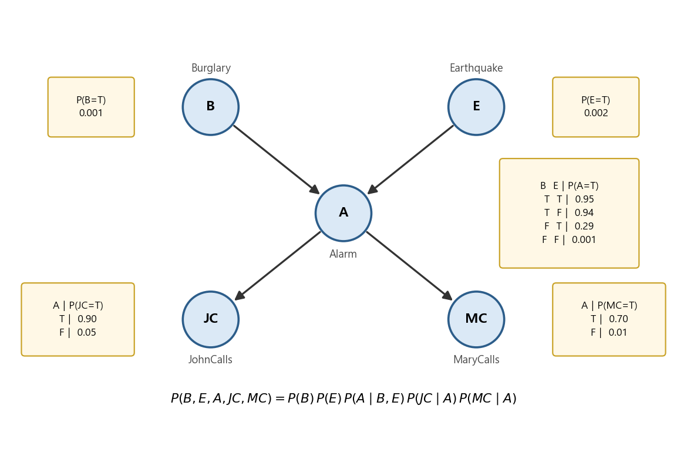
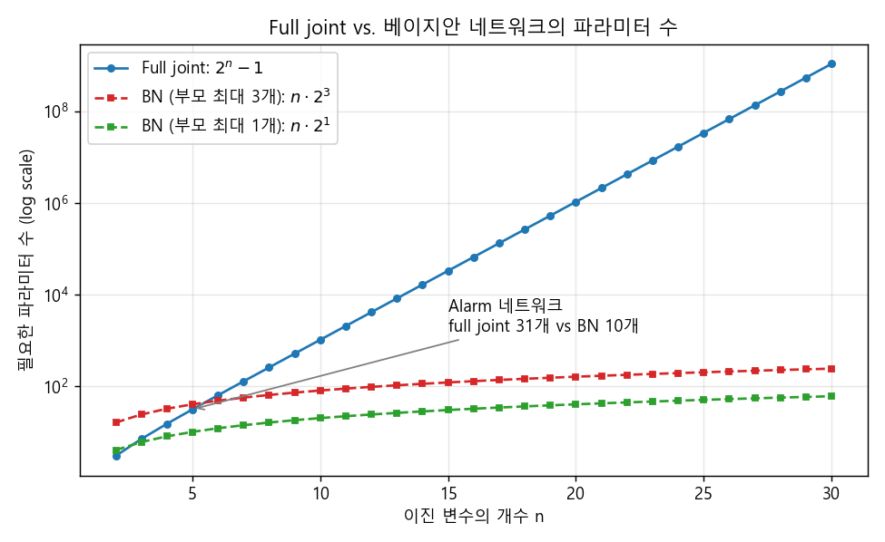
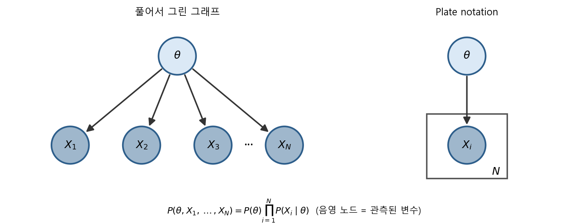
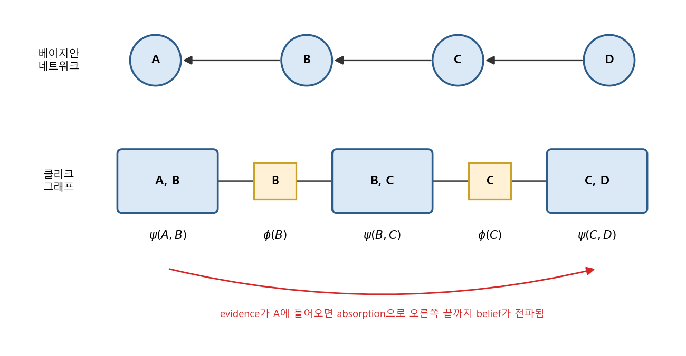

### Factorization, 추론 질문, Variable Elimination, 그리고 Clique Graph와 Belief Propagation


> 베이지안 네트워크가 joint probability를 어떻게 간결하게 쪼개 주는지 살펴보고, 그 구조 위에서 조건부 확률과 가장 그럴듯한 설명을 효율적으로 계산하는 방법을 알아봅니다.  


<br>

<center></center>    


<br/>


>  **1. 베이지안 네트워크는 joint probability를 "부모가 주어졌을 때 각 노드의 조건부 확률"의 곱으로 factorize하며, 이 덕분에 필요한 파라미터 수가 지수적으로 줄어든다**
>
>  **2. 베이지안 네트워크에 던지는 추론 질문(조건부 확률, Most Probable Assignment)은 결국 full joint를 만들고 hidden variable을 marginalize하는 문제이며, Variable Elimination은 합과 곱의 순서를 재배치해 이 계산량을 크게 줄인다**
>
>  **3. Potential function과 clique graph를 도입하면, evidence의 영향을 absorption rule로 이웃 클리크에 전파(belief propagation)할 수 있고, local consistency가 유지될 때까지 전파하면 원하는 확률을 얻을 수 있다**


<br/>

----

#### Contents

<br/>

1.	[Joint probability의 파라미터 폭발과 Factorization](#factorization)
2.	[Factorization Theorem과 Plate Notation](#factorization-theorem)
3.  [베이지안 네트워크에 던지는 추론 질문](#inference-question)
4.  [Variable Elimination](#variable-elimination)
5.  [Potential Function과 Clique Graph](#clique-graph)
6.  [Absorption과 Belief Propagation](#belief-propagation)

<br />

[지난 포스트](https://myeonghak.github.io/general%20machine%20learning/General-ML-train-set-batch-7.-%EB%B2%A0%EC%9D%B4%EC%A7%80%EC%95%88-%EB%84%A4%ED%8A%B8%EC%9B%8C%ED%81%AC-1/)에서는 확률의 기본 개념과 정리, 베이지안 네트워크의 해석, 그리고 d-separation과 Bayes ball 알고리즘을 살펴보았습니다. 그래프를 보고 "어떤 변수들이 서로 독립인가"를 읽어내는 방법을 배운 셈인데요. 이번 포스트에서는 그 독립 관계를 실제 계산에 써먹어 보겠습니다. 베이지안 네트워크가 joint probability를 어떻게 쪼개 주는지(factorization), 그리고 그 위에서 원하는 확률을 어떻게 효율적으로 계산하는지(inference)가 이번 편의 주제입니다.  

예시로는 지난 편에서도 등장했던 도둑(Burglary), 지진(Earthquake), 알람(Alarm), 그리고 알람을 듣고 전화를 거는 John과 Mary(JohnCalls, MaryCalls)의 네트워크를 계속 사용하겠습니다. 위 그림의 확률값은 Russell & Norvig의 교과서에서 널리 쓰이는 값을 가져왔습니다.  


<a id="factorization"></a>
### 1. Joint probability의 파라미터 폭발과 Factorization  

#### Joint만 있으면 무엇이든 계산할 수 있다  

모든 확률 변수에 대한 joint probability가 알려져 있다면, 사실상 우리가 궁금한 모든 확률을 계산할 수 있습니다. 개별 변수의 확률은 나머지 변수를 marginalize하면 되고, 조건부 확률은 joint를 marginal로 나눠주면 되기 때문이죠.  

$$
P(x_1) = \sum_{x_2}\sum_{x_3} P(x_1, x_2, x_3), \qquad P(x_1 \mid x_2) = \frac{P(x_1, x_2)}{P(x_2)}
$$

#### 문제는 파라미터의 개수  

그런데 joint probability에는 치명적인 문제가 있습니다. 변수가 늘어날수록 표현해야 할 경우의 수가 급속도로 많아진다는 것인데요. 이진 변수 $n$개의 joint를 테이블로 표현하려면 $2^n - 1$개의 파라미터가 필요합니다. 변수 30개면 약 10억 개의 숫자를 적어야 하는 셈이죠. 데이터로 이걸 다 추정하는 건 사실상 불가능합니다.  

이 문제를 푸는 열쇠가 바로 **독립 관계에 대한 정보**입니다. chain rule로 joint를 풀어 써 보겠습니다.  

$$
P(x_1, x_2, x_3) = P(x_1 \mid x_2, x_3)\, P(x_2 \mid x_3)\, P(x_3)
$$

여기서 만약 $x_2$가 주어졌을 때 $x_1 \perp x_3$ (조건부 독립)이라는 사실을 알고 있다면, 첫 번째 항이 간결해집니다.  

$$
P(x_1 \mid x_2, x_3) = P(x_1 \mid x_2) \quad\Rightarrow\quad P(x_1, x_2, x_3) = P(x_1 \mid x_2)\, P(x_2 \mid x_3)\, P(x_3)
$$

이진 변수 기준으로 $P(x_1 \mid x_2, x_3)$는 4개의 파라미터가 필요하지만 $P(x_1 \mid x_2)$는 2개면 충분합니다. 변수 3개에서는 별것 아닌 차이 같지만, 변수가 많아지면 이야기가 완전히 달라집니다.  

<br>

<center></center>    

<br>

각 노드의 부모 수가 최대 $k$개로 제한되어 있다면, 베이지안 네트워크의 파라미터 수는 $n \cdot 2^k$ 수준으로 변수 개수에 **선형**으로만 증가합니다. 알람 네트워크만 해도 full joint는 $2^5 - 1 = 31$개의 파라미터가 필요하지만, 네트워크 구조를 이용하면 $1 + 1 + 4 + 2 + 2 = 10$개면 충분합니다.  


<a id="factorization-theorem"></a>
### 2. Factorization Theorem과 Plate Notation  

#### Factorization Theorem  

베이지안 네트워크가 주어졌을 때, 그 네트워크에 인코딩된 조건부 독립 관계와 일관된 확률 분포의 가장 일반적인 형태는 다음과 같습니다.  

$$
P(X) = \prod_{i} P(X_i \mid X_{\pi_i})
$$

- $X_{\pi_i}$: $X_i$의 부모 노드의 집합  
- 즉, 각 노드를 "부모가 주어졌을 때의 조건부 확률"로 factorize함  
- 부모가 없는 노드는 그냥 prior $P(X_i)$가 됨  

이게 성립하는 이유는 지난 편의 내용과 연결됩니다. 변수들을 topological order(부모가 항상 자식보다 앞서는 순서)로 나열하고 chain rule을 적용하면, 각 변수는 자신보다 앞선 변수 전체에 조건부로 걸리는데요. 베이지안 네트워크에서는 부모가 주어지면 나머지 non-descendant와 독립이므로, 조건부의 대상이 부모만 남게 됩니다. 알람 네트워크에 적용하면 다음과 같습니다.  

$$
P(B, E, A, JC, MC) = P(B)\, P(E)\, P(A \mid B, E)\, P(JC \mid A)\, P(MC \mid A)
$$

#### Plate Notation  

베이지안 네트워크에는 노드와 링크 외에도 **plate**라는 네모 박스 문법이 있습니다. 하나의 노드가 $X_1, X_2, \dots, X_N$처럼 같은 구조의 여러 노드에 연결되어 있을 때, 이걸 일일이 그리는 대신 박스 하나로 묶고 반복 횟수 $N$을 적어 주는 방식입니다. 프로그래밍으로 치면 for loop 같은 역할이죠.  

<br>

<center></center>    

<br>

동전 던지기에서 앞면 확률 $\theta$가 주어지면 $N$번의 결과가 서로 독립이라는, batch 1에서 다룬 MLE/MAP의 설정이 바로 이 그림입니다. 앞으로 다룰 Gaussian Mixture Model이나 토픽 모델 같은 복잡한 모델도 plate 덕분에 한눈에 들어오는 그림으로 표현할 수 있습니다.  


<a id="inference-question"></a>
### 3. 베이지안 네트워크에 던지는 추론 질문  

구조와 확률표를 갖췄으니 이제 네트워크에 질문을 던져 볼 차례입니다. 가장 기본적인 질문은 "관측된 일부 변수들의 joint(likelihood)는 얼마인가?"인데요. 이건 full joint를 만든 다음 관측되지 않은 변수를 marginalize하면 됩니다. 여기서 한 걸음 더 나아가 보겠습니다.  

#### 변수의 분류: evidence와 hidden  

추론 문제에서 변수 $X$는 크게 두 종류로 나뉩니다.  

- **$X_V$ (evidence)**: 이미 관측된 변수. 예를 들어 $B = \text{True}$처럼 빼도 박도 못하게 값이 정해져 있음  
- **$X_H$ (hidden)**: 값을 알 수 없는 변수. 다시 둘로 나뉨  
  - **$Y$**: 관측은 안 됐지만 관심이 있는 변수  
  - **$Z$**: 관측도 안 됐고 관심도 없는 변수 (계산 과정에서 marginalize out될 대상)  

#### 질문 1: 조건부 확률  

우리가 구하고 싶은 것은 evidence가 주어졌을 때 관심 변수의 확률, $P(Y \mid X_V)$입니다. 예를 들면 "도둑이 들었고 Mary가 전화했을 때 알람이 울렸을 확률" $P(A \mid B = T, MC = T)$ 같은 것이죠. 그런데 우리 손에 있는 건 factorization된 full joint뿐입니다. 그래서 full joint에서 출발해 다음처럼 계산합니다.  

$$
P(Y \mid X_V) = \frac{P(Y, X_V)}{P(X_V)} = \frac{\sum_{Z} P(Y, Z, X_V)}{\sum_{Y}\sum_{Z} P(Y, Z, X_V)}
$$

분자는 $Z$만, 분모는 $Y$와 $Z$를 모두 marginalize out한 것입니다. 결국 앞서 일부 변수의 joint를 구하던 방법을 그대로 응용하면 조건부 확률도 얻을 수 있다는 것이죠. 분모는 $Y$에 의존하지 않는 상수이므로, 실전에서는 분자만 $Y$의 모든 값에 대해 계산한 뒤 합이 1이 되도록 정규화하는 경우가 많습니다.  

#### 질문 2: Most Probable Assignment  

evidence가 주어졌을 때, 관심 변수들의 어떤 조합이 가장 그럴듯한 설명인지를 묻는 질문도 있습니다. 이를 **Most Probable Assignment(MPA)** 라고 합니다.  

$$
y^{*} = \arg\max_{y} P(Y = y \mid X_V)
$$

configuration $Y$에 대한 Maximum a Posteriori를 구하는 셈이고, 질문 1의 조건부 확률을 구할 줄 알면 그중 가장 큰 것을 고르기만 하면 됩니다. 활용 방향은 크게 두 가지입니다.  

- **Prediction**: 원인이 주어졌을 때 결과를 예측함. 예) $B, E$가 주어졌을 때 $A$가 True일지 False일지: $P(A \mid B, E)$  
- **Diagnosis**: 결과가 주어졌을 때 원인을 추정함. 예) $A$가 주어졌을 때 $(B, E)$의 4가지 조합 각각의 확률 $P(B, E \mid A)$를 구하고 가장 큰 것을 선택함  

기계의 고장 원인 진단이나 증상으로부터의 질병 진단처럼, 결과를 보고 원인을 거슬러 추론하는 문제에 베이지안 네트워크가 잘 쓰이는 이유가 여기에 있습니다.  

#### 직접 계산해 보기  

John과 Mary가 둘 다 전화를 했을 때, 도둑이 들었을 확률과 $(B, E)$의 MPA를 계산해 보겠습니다. 아래 코드의 `enum`은 full joint를 그대로 합산하는 방식이고, `ve`는 다음 절에서 다룰 Variable Elimination 방식입니다.  

```python
import itertools

P_B = {True: 0.001, False: 0.999}
P_E = {True: 0.002, False: 0.998}
P_A = {(True, True): 0.95, (True, False): 0.94,
       (False, True): 0.29, (False, False): 0.001}   # P(A=T | B, E)
P_J = {True: 0.90, False: 0.05}                     # P(JC=T | A)
P_M = {True: 0.70, False: 0.01}                     # P(MC=T | A)
bern = lambda p, v: p if v else 1 - p
TF = [True, False]

def joint(b, e, a, j, m):   # factorization theorem
    return (P_B[b] * P_E[e] * bern(P_A[(b, e)], a)
            * bern(P_J[a], j) * bern(P_M[a], m))

# 1) Enumeration: sum_E sum_A P(b, E, A, j, m)
def enum(b):
    return sum(joint(b, e, a, True, True) for e in TF for a in TF)

# 2) Variable elimination: P(b) * sum_E P(E) * sum_A P(A|b,E) * f_A(A)
f_A = {a: bern(P_J[a], True) * bern(P_M[a], True) for a in TF}
def ve(b):
    return P_B[b] * sum(P_E[e] * sum(bern(P_A[(b, e)], a) * f_A[a] for a in TF)
                        for e in TF)

for name, f in [("enumeration", enum), ("variable elimination", ve)]:
    un = {b: f(b) for b in TF}
    print(f"{name:20s}: P(B=T | jc, mc) = {un[True] / sum(un.values()):.4f}")

# 3) Most probable assignment of (B, E) given jc, mc
post = {(b, e): sum(joint(b, e, a, True, True) for a in TF) for b in TF for e in TF}
Z = sum(post.values())
for k, v in sorted(post.items(), key=lambda kv: -kv[1]):
    print(f"P(B={k[0]!s:5}, E={k[1]!s:5} | jc, mc) = {v / Z:.4f}")
```

```
enumeration         : P(B=T | jc, mc) = 0.2842
variable elimination: P(B=T | jc, mc) = 0.2842
P(B=False, E=False | jc, mc) = 0.5403
P(B=True , E=False | jc, mc) = 0.2836
P(B=False, E=True  | jc, mc) = 0.1755
P(B=True , E=True  | jc, mc) = 0.0006
```

두 사람이 모두 전화했는데도 도둑이 들었을 확률은 약 28%에 불과합니다. prior $P(B) = 0.001$이 워낙 작기 때문인데요. 그래도 사전확률에 비하면 280배 넘게 올라간 셈이니, John과 Mary의 전화가 꽤 강력한 evidence이긴 합니다. 그리고 $(B, E)$의 MPA는 "도둑도 지진도 없었다"입니다. 알람의 오작동(0.001)이나 John과 Mary의 착각이 겹친 경우가 여전히 가장 그럴듯한 설명이라는 뜻이죠. 한 가지 재미있는 점은, MPA는 변수 각각의 marginal에서 가장 큰 값을 따로 고르는 것과 일반적으로 같지 않다는 것입니다. 관심 변수를 묶어서 조합 단위로 판단해야 합니다.  


<a id="variable-elimination"></a>
### 4. Variable Elimination  

#### 핵심은 joint 계산, 그런데 너무 비싸다  

지금까지의 풀이 흐름을 정리하면 항상 같았습니다.  

- full joint를 만듦 -> 원하는 부분 joint가 되도록 hidden variable을 marginalize함 -> 조건부 확률을 계산함 -> 라벨(assignment)을 결정함  

따라서 계산의 핵심은 joint probability를 구하는 일이고, 여기에는 아주 많은 곱셈과 덧셈이 필요합니다. 예를 들어 5개 변수 중 3개($a, b, mc$)만 관측된 상황에서 partial joint를 구해 보겠습니다.  

$$
P(a, b, mc) = \sum_{JC}\sum_{E} P(a, b, E, JC, mc) = \sum_{JC}\sum_{E} P(JC \mid a)\, P(mc \mid a)\, P(a \mid b, E)\, P(b)\, P(E)
$$

- 가장 왼쪽: 구하고 싶은 evidence의 partial joint  
- 가운데: full joint를 만들고 hidden variable($JC, E$)에 대해 marginalize함  
- 오른쪽: factorization theorem으로 full joint를 조건부 확률표(CPT)의 곱으로 바꿈  

이 방식을 그대로(brute force) 수행하면, hidden variable이 $h$개이고 각각 $k$개의 값을 가질 때 $k^h$개의 항을 더해야 하고, 각 항마다 $n - 1$번의 곱셈이 들어갑니다. 즉 $O(n \cdot k^h)$로, hidden variable 수에 지수적인 비용이 듭니다.  

#### 더 나은 방법: 시그마 안쪽으로 밀어 넣기  

식을 다시 보면, 많은 항이 시그마의 인덱스와 무관합니다. 이런 항들을 시그마 밖으로 빼내 보겠습니다.  

$$
P(a, b, mc) = P(b)\, P(mc \mid a) \sum_{JC} P(JC \mid a) \sum_{E} P(a \mid b, E)\, P(E)
$$

이렇게 정리(move around)만 해도 연산량이 크게 줄어듭니다. 게다가 $\sum_{JC} P(JC \mid a) = 1$이므로 $JC$에 관한 합은 계산할 필요조차 없습니다. 관측되지도 않았고 관심도 없는 "자손" 노드는 통째로 날아가는 것이죠. 결국 남는 계산은 $E$에 대한 합(곱셈 2번, 덧셈 1번)과 바깥의 곱셈 두어 번뿐입니다. brute force가 4개 항 각각에 곱셈 4번씩을 하던 것과 비교하면 꽤 큰 차이입니다.  

#### 이 과정을 체계화하기  

이처럼 변수를 하나씩 소거하는 과정을 체계화한 것이 **Variable Elimination**입니다. 먼저 조건부 확률을 joint로 바꿔 생각합니다.  

$$
P(e \mid jc, mc) = \alpha\, P(e, jc, mc), \qquad \alpha = \frac{1}{P(jc, mc)}
$$

$\alpha$는 normalizing constant이므로, joint만 구하고 나중에 합이 1이 되도록 나눠주면 됩니다. 그리고 joint는 full joint $P(e, jc, mc, A, B)$를 marginalize해서 얻습니다. 절차는 다음과 같습니다.  

1) full joint를 factorization하고, 각 항을 topological order로 정렬함  
2) 각 확률 분포를 변수들에 대한 **함수(factor)** 로 간주함. 예) $P(A \mid B, E)$는 $(A, B, E)$를 받아 숫자를 돌려주는 테이블 $f(A, B, E)$  
3) 오른쪽(가장 안쪽)의 시그마부터, 그 변수를 포함하는 factor들만 곱한 뒤 합해서 새로운 factor를 만듦  
4) 소거할 변수가 없어질 때까지 반복하고, 마지막에 정규화함  

앞의 코드에서 $P(B \mid jc, mc)$를 구한 `ve` 함수가 정확히 이 순서를 따릅니다.  

$$
P(B \mid jc, mc) = \alpha\, P(B) \sum_{E} P(E) \underbrace{\sum_{A} P(A \mid B, E)\, \underbrace{P(jc \mid A)\, P(mc \mid A)}_{f_{1}(A)}}_{f_{2}(B, E)}
$$

$A$를 소거하면 $f_2(B, E)$라는 작은 테이블이 남고, 다시 $E$를 소거하면 $B$에 대한 테이블만 남습니다. 결과는 enumeration과 똑같은 0.2842였습니다. 다만 소거 순서에 따라 중간에 생기는 factor의 크기가 달라지므로, 순서를 잘 고르는 것이 계산량을 좌우합니다. (일반적인 그래프에서 최적의 순서를 찾는 것 자체는 NP-hard 문제로 알려져 있습니다.)  


<a id="clique-graph"></a>
### 5. Potential Function과 Clique Graph  

Variable Elimination은 질문 하나에 대해 계산을 한 번 수행합니다. 이번에는 관점을 바꿔서, evidence가 들어왔을 때 그 영향(belief)이 네트워크를 따라 **전파(propagation)** 되는 구조로 원하는 확률을 얻는 방법을 알아보겠습니다. 이를 위해 몇 가지 개념이 필요합니다.  

#### 용어 정리  

- **Potential function**: 아직 pdf의 조건(합이 1 등)을 만족하지는 않지만, 나중에 정규화하면 pdf가 될 수 있는 함수  
- **Clique**: 그래프 내에서 fully connected된 sub graph  
- **Separator**: 이웃한 클리크 노드를 연결해 주는, 두 클리크가 공통으로 가진 확률 변수  

가장 단순한 예로, 선형으로 연결된 베이지안 네트워크 $A \leftarrow B \leftarrow C \leftarrow D$를 생각해 보겠습니다. factorization theorem에 따라 다음과 같이 쪼개집니다.  

$$
P(A, B, C, D) = P(A \mid B)\, P(B \mid C)\, P(C \mid D)\, P(D)
$$

이 네트워크의 클리크는 $\{A, B\}, \{B, C\}, \{C, D\}$이고, 이들 사이의 separator는 $B$와 $C$입니다. 클리크에는 potential function $\psi$를, separator에는 $\phi$를 붙여 클리크 그래프를 그리면 다음과 같습니다.  

<br>

<center></center>    

<br>

#### Potential function으로 joint 표현하기  

전체 변수 집합을 $U$라 할 때, joint를 "클리크 potential의 곱 / separator potential의 곱"으로 나타내는 것이 목표입니다.  

$$
P(U) = \frac{\prod_{N} \psi(N)}{\prod_{L} \phi(L)} = \frac{\psi(a, b)\, \psi(b, c)\, \psi(c, d)}{\phi(b)\, \phi(c)}
$$

이 식을 만족하는 potential의 설정은 하나가 아닙니다. 두 가지를 살펴보겠습니다.  

**설정 1) 조건부 확률을 그대로 사용**  

- $\psi(a, b) = P(A \mid B)$, $\psi(b, c) = P(B \mid C)$, $\psi(c, d) = P(C \mid D)\, P(D)$  
- $\phi(b) = 1$, $\phi(c) = 1$  
- 곱하면 factorization 결과와 정확히 같아짐  

**설정 2) 클리크별 local joint를 사용**  

- $\psi'(a, b) = P(A, B)$, $\psi'(b, c) = P(B, C)$, $\psi'(c, d) = P(C, D)$  
- $\phi'(b) = P(B)$, $\phi'(c) = P(C)$  

설정 2가 맞는지는 베이즈 정리로 확인할 수 있습니다.  

$$
\frac{P(A, B)\, P(B, C)\, P(C, D)}{P(B)\, P(C)} = P(A \mid B)\, P(B \mid C)\, P(C, D) = P(A \mid B)\, P(B \mid C)\, P(C \mid D)\, P(D)
$$

설정 2는 각 potential이 곧 그 클리크의 marginal이라서 아주 편리합니다. $\psi'(a, b)$를 $A$에 대해 marginalize하면 바로 $P(B)$가 나오니까요. 그런데 문제는 우리가 처음에 갖고 있는 정보가 joint가 아니라 **조건부 확률(CPT)** 이라는 점입니다. 즉 출발은 설정 1에서 해야 하는데, 어떻게 설정 2로 갈 수 있을까요? 여기서 등장하는 것이 다음 절의 absorption입니다.  

참고로 이번 예시는 체인이라 클리크가 바로 보이지만, 일반적인 베이지안 네트워크에서는 부모끼리 연결하는 moralization과 triangulation을 거쳐 클리크를 찾고, 이를 트리 형태로 엮은 junction tree 위에서 같은 방법을 적용합니다.  


<a id="belief-propagation"></a>
### 6. Absorption과 Belief Propagation  

#### Absorption의 아이디어  

클리크 그래프가 트리 형태일 때, potential이 설정 2처럼 잘 맞춰져 있다면 separator $B$에 대해 다음 세 식이 모두 같아야 합니다.  

$$
P(B) = \sum_{A} \psi(A, B) = \sum_{C} \psi(B, C) = \phi(B)
$$

이 등식이 깨져 있다면, 즉 한쪽 클리크에 새로운 정보가 들어와 $\psi(A, B)$가 바뀌었다면, 그 변화를 이웃에게 전달해서 다시 등식을 맞춰 줘야 합니다. 한 클리크의 변화가 separator를 타고 여러 클리크로 파급되는 이 과정을 **belief propagation**이라고 합니다.  

#### Absorption(update) rule  

$\psi(A, B)$가 $\psi^{*}(A, B)$로 바뀌었다고 해 봅시다. 이웃 클리크 $(B, C)$는 다음 두 단계로 이 변화를 흡수(absorb)합니다.  

$$
\phi^{*}(B) = \sum_{A} \psi^{*}(A, B)
$$

$$
\psi^{*}(B, C) = \psi(B, C)\, \frac{\phi^{*}(B)}{\phi(B)}
$$

- separator 업데이트: 바뀐 클리크를 marginalize해 새로운 $B$의 belief를 얻음  
- clique 업데이트: 기존 potential에 "새 belief / 옛 belief"의 비율을 곱함  

두 번째 식이 왜 말이 되는지는 설정 2를 떠올리면 바로 보입니다. $\psi(B, C) / \phi(B) = P(B, C) / P(B) = P(C \mid B)$이므로, 업데이트 결과는 $P(C \mid B)\, P^{*}(B) = P^{*}(B, C)$가 됩니다. $B$에 대한 믿음만 새것으로 바꾸고, $C \mid B$라는 관계는 그대로 유지하는 것이죠. 또한 $\psi^{*}(B, C) / \phi^{*}(B) = \psi(B, C) / \phi(B)$이므로, 흡수 후에도 $\prod \psi / \prod \phi$로 표현된 전체 joint는 변하지 않습니다.  

#### 연쇄적으로 전파하기  

$A$에 대한 evidence가 들어와 $\psi(A, B)$가 바뀌면 다음 순서로 전파됩니다.  

1) $\psi^{*}(A, B)$를 $A$에 대해 marginalize -> $\phi^{*}(B) = P^{*}(B)$  
2) $P^{*}(B)$로 $\psi(B, C)$를 업데이트 -> $P^{*}(B, C)$  
3) 다시 $B$에 대해 marginalize -> $\phi^{*}(C) = P^{*}(C)$  
4) $\psi(C, D)$를 업데이트 -> $P^{*}(C, D)$  

이렇게 recursive하게 끝까지 전파됩니다. 도미노가 넘어가는 모습을 떠올리시면 될 것 같습니다.  

#### 베이지안 네트워크에 결합하기  

이제 배운 내용을 베이지안 네트워크와 합쳐 보겠습니다.  

1) **초기화**: 이미 알고 있는 조건부 확률로 설정 1처럼 potential을 채움  
2) **전파**: $(C, D) \to (B, C) \to (A, B)$ 방향으로 absorption을 수행함. $\psi(c, d) = P(C \mid D) P(D) = P(C, D)$이므로, $\phi^{*}(C) = P(C)$, $\psi^{*}(B, C) = P(B \mid C) P(C) = P(B, C)$, $\phi^{*}(B) = P(B)$, $\psi^{*}(A, B) = P(A \mid B) P(B) = P(A, B)$가 차례로 만들어짐. 즉 조건부 확률에서 출발했는데 각 클리크가 local joint 형태(설정 2)로 정리됨  
3) **Local consistency 확인**: 반대 방향으로 한 번 더 전파하면 새로운 값이 나올까요? 그렇지 않습니다. $\sum_{A} P(A, B) = P(B)$가 이미 $\phi^{*}(B)$와 같으므로 비율이 1이 되어 아무것도 바뀌지 않음. 이를 **local consistency가 유지(maintain)되었다**고 하며, 더 전파할 필요가 없음  
4) **추론**: evidence를 넣고 다시 전파한 뒤, 클리크 potential을 정규화해 조건부 확률을 얻고 most probable assignment를 수행함  

아래 코드는 이진 변수 체인에 임의의 CPT를 만들어 위 과정을 그대로 수행하고, brute force로 계산한 결과와 비교한 것입니다.  

```python
import numpy as np
rng = np.random.default_rng(0)
def cpt(*shape):                       # 첫 번째 축(자식)에 대해 합이 1
    t = rng.random(shape); return t / t.sum(axis=0, keepdims=True)

# A <- B <- C <- D, 모두 이진 변수
P_D = cpt(2); P_C_D = cpt(2, 2); P_B_C = cpt(2, 2); P_A_B = cpt(2, 2)  # [child, parent]

# 초기화: psi(A,B)=P(A|B), psi(B,C)=P(B|C), psi(C,D)=P(C|D)P(D), phi=1
psi_AB, psi_BC, psi_CD = P_A_B.copy(), P_B_C.copy(), P_C_D * P_D
phi_B, phi_C = np.ones(2), np.ones(2)

def absorb(psi_from, axis_sum, phi_old, psi_to, axis_sep):
    phi_new = psi_from.sum(axis=axis_sum)                    # phi*(S) = sum psi*
    ratio = phi_new / phi_old
    psi_new = psi_to * (ratio[:, None] if axis_sep == 0 else ratio[None, :])
    return phi_new, psi_new

# (C,D) -> (B,C) -> (A,B) 방향으로 전파
phi_C, psi_BC = absorb(psi_CD, 1, phi_C, psi_BC, 1)
phi_B, psi_AB = absorb(psi_BC, 1, phi_B, psi_AB, 1)
full = np.einsum('ab,bc,cd,d->abcd', P_A_B, P_B_C, P_C_D, P_D)  # brute force
print("psi(A,B) == P(A,B)?", np.allclose(psi_AB, full.sum(axis=(2, 3))))

# 반대 방향으로 한 번 더 흡수해도 separator는 그대로 (local consistency)
print("phi(B) unchanged?  ", np.allclose(psi_AB.sum(axis=0), phi_B))

# Evidence A=1을 넣고 (A,B) -> (B,C) -> (C,D)로 전파
psi_AB[0, :] = 0
phi_B, psi_BC = absorb(psi_AB, 0, phi_B, psi_BC, 0)
phi_C, psi_CD = absorb(psi_BC, 0, phi_C, psi_CD, 0)
p_D_bp = psi_CD.sum(axis=0) / psi_CD.sum()
p_D_bf = full[1].sum(axis=(0, 1)) / full[1].sum()
print("P(D | A=1) BP         :", p_D_bp.round(4))
print("P(D | A=1) brute force:", p_D_bf.round(4))
```

```
psi(A,B) == P(A,B)? True
phi(B) unchanged?   True
P(D | A=1) BP         : [0.7022 0.2978]
P(D | A=1) brute force: [0.7022 0.2978]
```

조건부 확률표에서 출발한 potential이 전파 후 정확히 $P(A, B)$가 되었고, 반대 방향으로 다시 흡수해도 separator가 변하지 않아 local consistency가 유지됨을 확인할 수 있습니다. evidence $A = 1$을 넣은 뒤에는 클리크 하나씩만 거쳐 반대편 끝의 $P(D \mid A = 1)$까지 정확하게 얻어졌습니다. 전체 joint 테이블을 한 번도 만들지 않고 말이죠. evidence를 넣는 방법은 간단한데, 관측값과 맞지 않는 항($A = 0$)의 potential을 0으로 만들어 주면 됩니다. 이후 전파된 potential은 $P(\cdot, A = 1)$ 꼴의 joint가 되고, 마지막에 정규화하면 조건부 확률이 됩니다.  

정리하면, **베이즈 정리, marginalization, absorption rule, belief propagation**을 사용해 local consistency가 유지될 때까지 potential을 정리하고, 그 결과 우리가 가진 조건부 확률표의 정보만으로 원하는 확률값을 구할 수 있게 됩니다.  


<br>

----------------

<a id="conclusion"></a>
### 닫으며  

지금까지 베이지안 네트워크의 factorization에서 출발해, 네트워크에 던지는 추론 질문과 이를 효율적으로 푸는 Variable Elimination, 그리고 potential function과 클리크 그래프 위에서의 belief propagation까지 살펴보았습니다. 지난 편에서 그래프로 독립 관계를 읽는 법을 배웠다면, 이번 편에서는 그 독립 관계가 어떻게 지수적인 계산을 다룰 만한 크기로 줄여 주는지를 확인한 셈입니다.  
다음 포스트에서는 비지도 학습으로 넘어가 **K-means 클러스터링과 Gaussian Mixture Model**을 알아보겠습니다. 관측되지 않는 hidden variable을 다루는 이번 편의 감각이 그대로 이어지니 기대해 주세요.  

**개선을 위한 여러분의 피드백과 제안을 코멘트로 공유해 주세요.**
**내용에 대한 지적, 혹은 질문을 환영합니다.**  

해당 포스트는 카이스트 문일철 교수님의 동의를 얻고, 강좌 내용과 자료, 그리고 reference의 자료를 참고하여 작성되었습니다. 원 강좌는 [여기](https://www.youtube.com/playlist?list=PLbhbGI_ppZISMV4tAWHlytBqNq1-lb8bz)에서 보실 수 있습니다.

**자료 공유를 허락해 주신 문일철 교수님께 감사의 말씀을 전합니다.**
