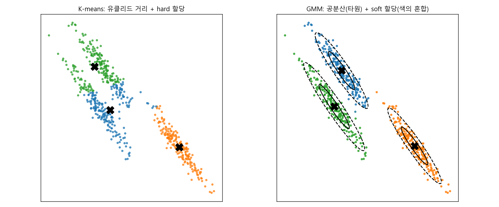
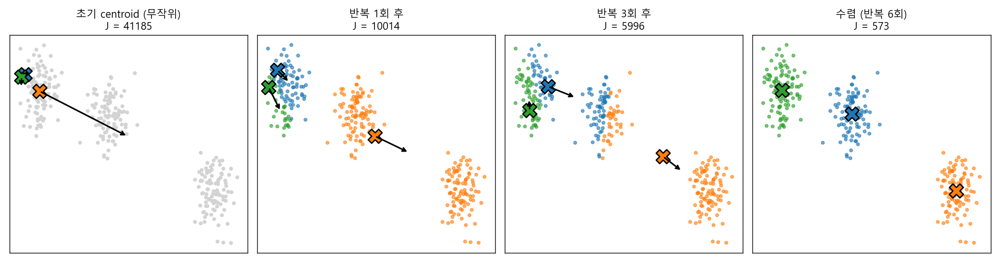
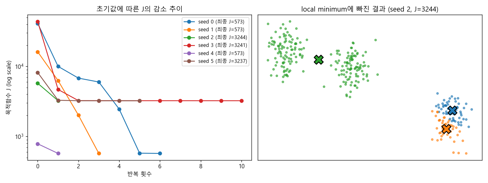
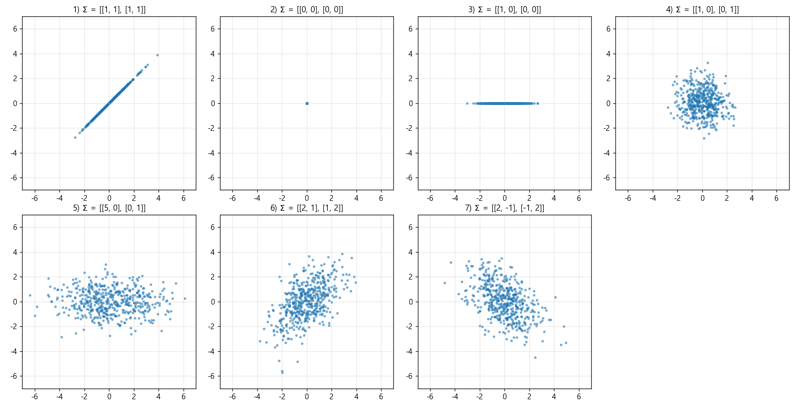
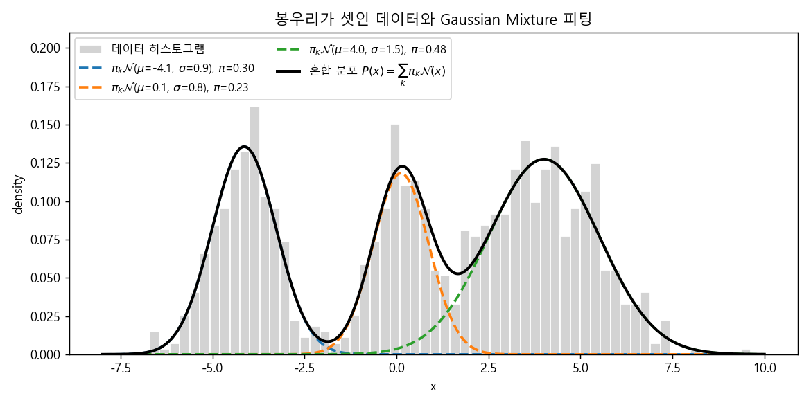

### 비지도 학습의 첫걸음, K-means에서 Gaussian Mixture Model까지


> 라벨 없이 데이터를 묶는 가장 단순한 방법인 K-means를 살펴보고, 그 한계를 넘어서기 위해 다항 분포와 다변수 가우시안 분포를 조합한 Gaussian Mixture Model(GMM)을 정의해 봅니다.  


<br>

<center></center>    


<br/>


>  **1. K-means는 각 점과 가장 가까운 centroid 사이의 거리 제곱합 J를 최소화하는 알고리즘으로, 할당(r_nk)과 centroid(mu_k)를 번갈아 최적화하는 EM 방식으로 학습한다**
>
>  **2. K-means는 군집 수와 초기값에 민감하고, 유클리드 거리만 사용하며, 0/1의 hard clustering만 가능하다는 한계를 가진다**
>
>  **3. GMM은 군집 선택을 다항 분포로, 각 군집의 모양을 다변수 가우시안 분포로 모델링한 mixture model로, 공분산과 soft clustering을 통해 K-means의 한계를 극복한다**


<br/>

----

#### Contents

<br/>

1.	[비지도 학습과 클러스터링](#unsupervised)
2.	[K-means 알고리즘](#kmeans)
3.  [K-means의 최적화: 할당과 업데이트의 반복](#kmeans-em)
4.  [K-means의 한계](#kmeans-limit)
5.  [다항 분포와 라그랑지 승수법](#multinomial)
6.  [다변수 가우시안 분포](#mvn)
7.  [Mixture Model과 GMM](#gmm)

<br />

[지난 포스트](https://myeonghak.github.io/general%20machine%20learning/General-ML-train-set-batch-8.-%EB%B2%A0%EC%9D%B4%EC%A7%80%EC%95%88-%EB%84%A4%ED%8A%B8%EC%9B%8C%ED%81%AC-2/)에서는 베이지안 네트워크의 추론과 학습에 대해 살펴보았습니다. 지금까지 다룬 모델들은 대부분 정답(라벨)이 주어진 상황을 가정했는데요. 이번 시간에는 정답 없이 데이터의 구조를 찾아내는 **비지도 학습**, 그중에서도 가장 대표적인 클러스터링 알고리즘인 K-means와 Gaussian Mixture Model(GMM)을 알아보겠습니다. 내용이 길어 두 편으로 나누었고, 이번 편에서는 GMM을 정의하는 데까지 다룹니다.  


<a id="unsupervised"></a>
### 1. 비지도 학습과 클러스터링  

#### 비지도 학습이란  

**비지도 학습(Unsupervised Learning)** 은 true value를 모르는 상태, 혹은 알고 있더라도 모델에 제공할 수 없는 상황에서의 학습을 말합니다. 대표적으로 다음과 같은 문제를 풉니다.  

1) **군집(Clustering)**: 비슷한 데이터끼리 묶음  
2) **잠재 변인(Latent factor) 탐색**: 데이터가 군집을 이룰 때, 그 군집을 이루게 만드는 잠재적인 힘이나 원인이 있다고 가정하고 그 변인을 찾음  
3) **그래프 구조(Graph structure) 탐색**: 변수 간의 관계 구조를 데이터로부터 찾음 (지난 편의 베이지안 네트워크 구조 학습이 여기에 해당함)  

응용 분야도 군집에 그치지 않습니다.  

- 텍스트 데이터에서 표현력 있는 토픽 단어를 추출함 (토픽 모델링)  
- 얼굴 이미지에서 잠재적인 기저 이미지를 찾음  
- 불완전한 상품-리뷰 행렬을 채워 넣음 (Matrix Factorization, completion)  
- 궤적(trajectory) 데이터에서 노이즈를 제거함 (filtering)  

방법론의 관점에서 정리하면, **군집화**는 표본들의 집합과 그 인근 대상을 추정하는 것이고, **필터링**은 신호와 노이즈가 섞인 혼합물에서 근본적인 신호를 추정해 내는 것이라고 볼 수 있습니다.  

#### 클러스터링의 관점  

라벨이 없는 데이터 포인트를 어떻게 묶을 수 있을까요? 우리는 클래스에 대한 구체적인 지식이 없습니다. 하지만 **각 클래스마다 그 클래스를 이루게 만드는 잠재적인(latent, hidden) 요인이 있다**고 가정할 수는 있겠죠.  

비유하자면 호수에 돌을 몇 개 던졌을 때, 돌이 떨어진 지점(중심)에서 어떤 사건이 일어났고, 그 영향으로 주변에 물결(데이터)이 생겼다고 보는 접근입니다. 우리는 물결만 관찰할 수 있으니, 거꾸로 돌이 어디에 떨어졌는지, 그리고 각 물결이 어느 돌 때문에 생겼는지를 추정하는 것이 클러스터링의 목표가 됩니다. 즉 데이터를 잠재 클래스에 **최적으로 할당(optimal assignment)** 하는 문제입니다.  

다만 여러 클러스터에 동시에 속할 것 같은 애매한 데이터를 어떤 기준으로 나눌지 정하는 것은 생각보다 어려운 일인데요. 이 고민이 뒤에서 GMM으로 넘어가는 동기가 됩니다.  


<a id="kmeans"></a>
### 2. K-means 알고리즘  

#### 아이디어  

K-means는 **$K$개의 잠재적인 요인(동력)이 존재하고, 이로부터 $N$개의 사건(데이터)이 발생했다**고 가정합니다. 그리고 $K$개의 **중심점(centroid, 혹은 prototype)** 을 설정한 뒤, 각 데이터 포인트를 거리 기준으로 가장 가까운 centroid에 묶습니다. 따라서 K-means는 크게 두 파트로 구성됩니다.  

1) $K$개의 centroid의 위치를 찾음  
2) 각 데이터 포인트를 가장 가까운 centroid에 할당함  

이름이 비슷해서 자주 헷갈리는 **KNN(K-Nearest Neighbors)** 과는 아예 다른 방법론입니다. KNN은 지도학습 알고리즘으로, 새로운 데이터가 들어오면 거리 기준으로 $K$개의 이웃을 찾고, 이웃들의 라벨을 참고해 새 데이터의 라벨을 결정합니다. 반면 K-means의 $K$는 이웃 수가 아니라 **군집의 수**이고, 라벨은 애초에 존재하지 않습니다.  

#### 목적함수  

K-means가 최소화하는 목적함수 $J$는 다음과 같습니다.  

$$
J = \sum_{n=1}^{N} \sum_{k=1}^{K} r_{nk} \lVert x_n - \mu_k \rVert^2
$$

- $r_{nk} \in \{0, 1\}$: 데이터 포인트의 클러스터 할당. $n$번째 데이터 $x_n$이 $k$번째 centroid $\mu_k$에 할당되었다면 1, 아니면 0인 indicator임  
- $\mu_k$: $k$번째 centroid의 위치. **반드시 데이터 포인트 중 하나일 필요는 없음**  

각 점은 하나의 클러스터에만 할당되므로 $\sum_k r_{nk} = 1$이고, 결국 $J$는 **각 점과 자신이 속한 centroid 사이의 거리 제곱의 총합**이 됩니다. 문제는 $r_{nk}$와 $\mu_k$라는 두 종류의 변수가 서로 얽혀 있다는 점인데요. 할당이 정해져야 centroid를 정할 수 있고, centroid가 정해져야 할당을 정할 수 있는 닭과 달걀의 관계입니다. 그래서 K-means는 이 둘을 **번갈아 가며 반복적으로** 최적화합니다.  


<a id="kmeans-em"></a>
### 3. K-means의 최적화: 할당과 업데이트의 반복  

#### Expectation과 Maximization  

이렇게 잠재 변수와 파라미터를 번갈아 최적화하는 방식을 **EM(Expectation-Maximization) 알고리즘**이라고 부릅니다. EM의 일반적인 형태와 유도는 다음 편에서 자세히 다루기로 하고, 지금은 K-means에 맞춘 버전으로 받아들이고 넘어가 보겠습니다.  

- **Expectation step**: centroid $\mu_k$가 주어졌다고 보고, 각 데이터 포인트를 가장 가까운 centroid에 할당함. 즉 $r_{nk}$를 최적화함  
- **Maximization step**: 할당 $r_{nk}$가 주어졌다고 보고, centroid $\mu_k$의 위치를 업데이트함  

(일반적인 EM은 log-likelihood를 "최대화"하는 언어로 쓰이지만, K-means에서는 거리 합 $J$를 "최소화"하는 것이 같은 역할을 합니다.)  

정리하면, 처음에는 엉터리인 centroid를 아무렇게나 찍어 두고, 그 위치가 맞다고 가정한 채 할당을 최적화합니다. 엉터리 centroid 기준이긴 하지만 어쨌든 할당은 최적화가 되죠. 이번에는 그 할당이 맞다고 가정하고 centroid를 다시 최적화하고, 다시 할당을 최적화하고... 이를 반복하면서 두 변수를 모두 최적화해 나가는 것입니다.  

#### E-step: $r_{nk}$의 최적화  

$r_{nk}$는 0 또는 1의 discrete한 값이므로 미분할 필요도 없습니다. $J$를 가장 작게 만드는 논리적인 선택은 그냥 **가장 가까운 centroid를 고르는 것**입니다.  

$$
r_{nk} =
\begin{cases}
1 & \text{if } k = \arg\min_{j} \lVert x_n - \mu_j \rVert^2 \\
0 & \text{otherwise}
\end{cases}
$$

#### M-step: $\mu_k$의 최적화  

$r_{nk}$를 고정하면 $J$는 $\mu_k$에 대한 이차함수이므로, 편미분해서 0으로 놓으면 됩니다.  

$$
\frac{\partial J}{\partial \mu_k} = -2 \sum_{n=1}^{N} r_{nk} (x_n - \mu_k) = 0
\quad \Rightarrow \quad
\mu_k = \frac{\sum_{n} r_{nk} x_n}{\sum_{n} r_{nk}}
$$

$r_{nk}$가 0 또는 1이므로, 분모는 $k$번 클러스터에 할당된 점의 개수, 분자는 그 점들의 합입니다. 즉 **centroid는 할당된 점들의 평균**으로 이동하는데요, 알고리즘 이름에 means가 들어간 이유가 바로 여기에 있습니다.  

#### 직접 구현해 보기  

numpy만으로 간단히 구현해 보겠습니다.  

```python
import numpy as np
from sklearn.datasets import make_blobs

X, _ = make_blobs(n_samples=300, centers=3, cluster_std=1.0, random_state=7)

def kmeans(X, k, n_iter=50, seed=0, verbose=False):
    rng = np.random.default_rng(seed)
    mu = X[rng.choice(len(X), k, replace=False)]                 # 초기 centroid
    for it in range(n_iter):
        dist = ((X[:, None, :] - mu[None, :, :]) ** 2).sum(-1)  # (N, K) 거리 제곱
        r = dist.argmin(1)                                       # E-step: r_nk 할당
        J = dist[np.arange(len(X)), r].sum()
        if verbose:
            print(f'iter {it}: J = {J:.1f}')
        new_mu = np.array([X[r == j].mean(0) for j in range(k)])  # M-step: 평균으로 이동
        if np.allclose(new_mu, mu):
            break
        mu = new_mu
    return mu, r, J

mu, r, J = kmeans(X, k=3, seed=0, verbose=True)
print(np.round(mu, 2))
print([round(kmeans(X, k=3, seed=s)[2], 1) for s in range(6)])
```

```
iter 0: J = 41184.7
iter 1: J = 10014.4
iter 2: J = 6809.1
iter 3: J = 5995.8
iter 4: J = 2459.9
iter 5: J = 578.0
iter 6: J = 573.4
[[-1.26  4.38]
 [ 9.63  0.54]
 [-8.55  5.57]]
[573.4, 573.4, 3244.1, 3241.1, 573.4, 3236.9]
```

반복할수록 $J$가 단조 감소하다가 iter 6에서 수렴했습니다. 이 과정을 그림으로 보면 다음과 같습니다. (화살표는 다음 M-step에서 centroid가 이동할 방향입니다.)  

<br>

<center></center>    

<br>

처음에는 세 centroid가 왼쪽 위에 몰려 있어서 엉뚱한 할당이 일어나지만, 할당과 평균 이동을 몇 번 반복하자 세 군집을 깔끔하게 찾아가는 것을 볼 수 있습니다.  

#### 그런데, local minimum  

E-step과 M-step은 각각 $J$를 줄이거나 최소한 늘리지는 않으므로 $J$는 반복에 따라 감소하고, 결국 수렴이 보장됩니다. 하지만 그 수렴점이 **전역 최솟값(global minimum)이라는 보장은 없습니다.** 위 코드의 마지막 줄을 다시 보시면, 초기값(seed)에 따라 최종 $J$가 573 근처인 경우와 3,240 근처인 경우로 갈리는 것을 확인할 수 있는데요.  

<br>

<center></center>    

<br>

오른쪽 그림처럼 centroid 두 개가 오른쪽 아래 군집 하나를 나눠 갖고, 나머지 하나가 두 군집을 떠맡은 채로 멈춰 버린 경우입니다. 이 상태에서는 어떤 점을 다른 centroid로 옮겨도 $J$가 줄지 않기 때문에 알고리즘이 빠져나오지 못합니다. 좋은 동네를 놔두고 애매한 곳에 집을 지어 버린 셈이죠.  


<a id="kmeans-limit"></a>
### 4. K-means의 한계  

K-means는 단순하고 빠르지만, 다음과 같은 특징이자 한계를 가지고 있습니다.  

- **centroid의 개수가 불확실함**: $K$를 사람이 미리 정해 주어야 함. 데이터로부터 군집 수까지 추정하고 싶다면 Bayesian non-parametric 방법(예: Dirichlet Process Mixture)을 사용할 수 있음  
- **centroid의 초기 위치에 민감함**: 평균이나 무작위 값으로 초기점을 잡는데, 앞서 본 것처럼 local minimum에 빠질 수 있음. 초기 위치를 바꿔 가며 여러 번 시행한 뒤 $J$가 가장 작은 결과를 골라야 robust한 결과를 얻을 수 있음 (sklearn의 `n_init`, 그리고 k-means++ 초기화가 이 문제를 다룸)  
- **거리 측도의 한계**: 유클리드 거리는 데이터 포인트에 대한 매우 제한된 정보만 반영함. 모든 방향을 똑같이 취급하므로, 군집이 타원형으로 길쭉하게 퍼져 있으면 이를 제대로 반영하지 못함  
- **hard clustering**: 클러스터에 0/1로 딱 잘라 할당하기 때문에, 경계에 걸친 애매한 점의 불확실성을 표현하지 못함. 이를 클러스터별 확률처럼 부드럽게 분포된 값으로 표현하는 방식을 **soft clustering**이라 함  

맨 위의 그림이 세 번째와 네 번째 한계를 잘 보여 주는데요. 왼쪽의 K-means는 길쭉하게 비스듬히 누운 군집 두 개를 가로로 잘라 버렸습니다. 유클리드 거리 기준으로는 "원 모양"의 군집만 상상할 수 있기 때문입니다. 반면 오른쪽의 GMM은 각 군집의 **공분산(타원)** 을 함께 학습해 모양을 제대로 잡아내고, 각 점이 각 군집에 속할 **확률**까지 알려 줍니다.  

이처럼 **GMM을 사용하면 거리 측도의 한계와 hard clustering의 한계를 극복할 수 있습니다.** GMM을 만들기 위해서는 두 가지 재료가 필요한데요, 바로 "어느 군집을 고를지"를 표현할 **다항 분포**와 "그 군집이 어떤 모양인지"를 표현할 **다변수 가우시안 분포**입니다. 하나씩 준비해 보겠습니다.  


<a id="multinomial"></a>
### 5. 다항 분포와 라그랑지 승수법  

#### 다항 분포  

binary한 변수는 0 또는 1의 값만 갖고, 이를 베르누이(이항) 분포로 모델링했었죠. 이제 선택지가 $K$개인 경우로 일반화해 보겠습니다. 예를 들어 주사위를 한 번 던져 3이 나왔다면, 이를 one-hot 벡터로 다음과 같이 표현할 수 있습니다.  

$$
X = (0, 0, 1, 0, 0, 0)
$$

6개의 선택지 중 3번째를 선택했다는 뜻이고, 1은 하나뿐이므로 $\sum_k x_k = 1$입니다. 이 변수의 확률분포는 다음과 같습니다.  

$$
P(X \mid \mu) = \prod_{k=1}^{K} \mu_k^{x_k}, \qquad \mu_k \ge 0, \quad \sum_{k} \mu_k = 1
$$

$x_k = 1$인 항 하나만 살아남고 나머지는 $\mu_k^0 = 1$이 되므로, 결국 선택된 선택지의 확률 $\mu_k$만 남는 형태입니다. 이항 분포의 일반화된 형태라고 볼 수 있습니다. (엄밀하게는 시행이 1회인 이 경우를 categorical 분포, 여러 번 시행한 횟수의 분포를 multinomial 분포로 구분하기도 합니다.)  

#### MLE 구하기  

$N$개의 샘플 $D = \{x_1, x_2, \dots, x_N\}$이 있을 때 likelihood는 다음과 같습니다.  

$$
P(D \mid \mu) = \prod_{n=1}^{N} \prod_{k=1}^{K} \mu_k^{x_{nk}} = \prod_{k=1}^{K} \mu_k^{m_k}, \qquad m_k = \sum_{n=1}^{N} x_{nk}
$$

같은 밑의 거듭제곱의 곱은 지수의 합으로 정리할 수 있기 때문에, $m_k$는 **$N$개의 샘플 중 $k$번째 선택지에 할당된 개수**가 됩니다. 그럼 최적의 $\mu$는 무엇일까요? 지금까지 해 온 대로 MLE를 해 보면 되는데, 이번에는 $\mu_k \ge 0, \sum_k \mu_k = 1$이라는 **제약 조건**이 붙어 있습니다.  

#### 라그랑지 승수법(Lagrange Method)  

제약식이 있는 최적화 문제는 라그랑지 승수법으로 풀 수 있습니다.  

$$
\text{maximize } f(x, y) \quad \text{subject to } g(x, y) = c
$$

$f$와 $g$가 연속적인 편미분을 갖는다고 가정할 때, 다음 순서로 풉니다.  

1) 라그랑지 승수 $\lambda$를 도입해 라그랑지 함수를 만듦: $L(x, y, \lambda) = f(x, y) + \lambda (g(x, y) - c)$  
2) 각 변수에 대한 1계 도함수를 구해 0으로 놓음  
3) 제약식을 활용해 최적 해를 계산함  

다항 분포의 경우, likelihood에 로그를 취해도 최적해의 위치는 변하지 않으므로 log-likelihood에 대해 라그랑지 함수를 세웁니다.  

$$
L(\mu, \lambda) = \sum_{k=1}^{K} m_k \ln \mu_k + \lambda \left( \sum_{k=1}^{K} \mu_k - 1 \right)
$$

$\mu_k$로 편미분하면,  

$$
\frac{\partial L}{\partial \mu_k} = \frac{m_k}{\mu_k} + \lambda = 0 \quad \Rightarrow \quad \mu_k = -\frac{m_k}{\lambda}
$$

이를 제약식 $\sum_k \mu_k = 1$에 대입하면 $-\frac{1}{\lambda}\sum_k m_k = -\frac{N}{\lambda} = 1$, 즉 $\lambda = -N$이 되고, 최종적으로  

$$
\hat{\mu}_k = \frac{m_k}{N}
$$

을 얻습니다. 전체 샘플 수 분의 해당 선택지에 할당된 개수, 즉 **관측된 비율이 곧 MLE**라는 아주 직관적인 결과인데요. 동전 던지기에서 앞면 비율이 MLE였던 것과 똑같은 구조로, 다항 분포가 이항 분포의 일반화임을 다시 한번 보여 줍니다. 간단히 확인해 보겠습니다.  

```python
import numpy as np

rng = np.random.default_rng(0)
true_mu = np.array([0.5, 0.3, 0.2])
X = rng.multinomial(1, true_mu, size=1000)   # one-hot 샘플 1000개 (N x K)
print(X[:3])
m = X.sum(0)                                  # m_k = sum_n x_nk
print('m_k   :', m)
print('MLE mu:', m / len(X))
```

```
[[1 0 0]
 [0 1 0]
 [0 0 1]]
m_k   : [502 281 217]
MLE mu: [0.502 0.281 0.217]
```

참값 $(0.5, 0.3, 0.2)$에 가까운 값이 단순한 개수 세기로 얻어지는 것을 볼 수 있습니다.  


<a id="mvn"></a>
### 6. 다변수 가우시안 분포  

#### 정의  

다변수 가우시안 분포(Multivariate Gaussian Distribution)는 가우시안 분포를 여러 차원으로 확장한 것일 뿐입니다. 1차원 가우시안 $P(x \mid \mu, \sigma^2)$와 비교하면 다음이 바뀝니다.  

- 평균 $\mu$가 단일 수치가 아니라 **벡터**가 됨  
- 분산 $\sigma^2$가 **공분산 행렬** $\Sigma$가 됨  
- 수식이 행렬 연산의 형태로 바뀜  

$d$차원 벡터 $x$에 대해 확률밀도는 다음과 같습니다.  

$$
\mathcal{N}(x \mid \mu, \Sigma) = \frac{1}{(2\pi)^{d/2} (\det \Sigma)^{1/2}} \exp\left( -\frac{1}{2} (x - \mu)^T \Sigma^{-1} (x - \mu) \right)
$$

지수 안의 $(x - \mu)^T \Sigma^{-1} (x - \mu)$는 공분산으로 보정한 거리(Mahalanobis distance의 제곱)인데요. K-means가 쓰던 $\lVert x - \mu \rVert^2$에서 $\Sigma$가 단위행렬인 특수한 경우를 일반화한 것이라고 보시면 됩니다. 바로 이 부분이 K-means의 "거리 측도의 한계"를 풀어 주는 열쇠가 됩니다.  

#### MLE와 trace trick  

$N$개의 샘플에 대한 log-likelihood는 다음과 같습니다.  

$$
\ln P(D \mid \mu, \Sigma) = -\frac{N}{2} \ln \det \Sigma - \frac{1}{2} \sum_{n=1}^{N} (x_n - \mu)^T \Sigma^{-1} (x_n - \mu) + \text{const}
$$

먼저 $\mu$에 대해 미분하면 $\Sigma^{-1} \sum_n (x_n - \mu) = 0$이므로, $\hat{\mu} = \frac{1}{N} \sum_n x_n$, 즉 **표본 평균**입니다.  

공분산 행렬은 조금 까다로운데, 여기서 **trace trick**을 사용합니다. 스칼라는 $1 \times 1$ 행렬이므로 자기 자신의 trace와 같고, trace는 순환 순서를 바꿔도 값이 같다($\mathrm{tr}(ABC) = \mathrm{tr}(CAB)$)는 성질을 이용하면,  

$$
(x_n - \mu)^T \Sigma^{-1} (x_n - \mu) = \mathrm{tr}\left( \Sigma^{-1} (x_n - \mu)(x_n - \mu)^T \right)
$$

로 바꿀 수 있습니다. $\Lambda = \Sigma^{-1}$, $S = \sum_n (x_n - \hat{\mu})(x_n - \hat{\mu})^T$로 두면 log-likelihood는  

$$
\frac{N}{2} \ln \det \Lambda - \frac{1}{2} \mathrm{tr}(\Lambda S) + \text{const}
$$

가 되고, 행렬 미분 공식 $\frac{\partial}{\partial A} \ln \det A = A^{-T}$, $\frac{\partial}{\partial A} \mathrm{tr}(AB) = B^T$를 적용해 0으로 놓으면 $\frac{N}{2}\Lambda^{-1} - \frac{1}{2}S = 0$, 즉  

$$
\hat{\Sigma} = \frac{1}{N} \sum_{n=1}^{N} (x_n - \hat{\mu})(x_n - \hat{\mu})^T
$$

로 **표본 공분산 행렬**이 MLE가 됩니다. 1차원에서 분산의 MLE가 편차 제곱의 평균이었던 것과 정확히 같은 모양이죠.  

#### 공분산 행렬에 따른 모양  

공분산은 상관관계(correlation)와 밀접하게 연관되어 있습니다. 대각 원소는 각 축 방향의 분산, 비대각 원소는 두 축이 함께 움직이는 정도를 나타냅니다. 평균이 원점인 2차원 가우시안에서 공분산 행렬만 바꿔 가며 샘플을 뽑아 보겠습니다.  

<br>

<center></center>    

<br>

| # | $\Sigma$ | 모양 | 해석 |
|---|---|---|---|
| 1 | [[1, 1], [1, 1]] | $y = x$ 위의 직선 | 두 축 모두 분산 1, 공분산도 1이라 완전히 같이 움직임 |
| 2 | [[0, 0], [0, 0]] | 한 점 | 어느 방향으로도 퍼짐이 없음 |
| 3 | [[1, 0], [0, 0]] | x축과 평행한 선 | x축 방향에만 분산이 존재함 |
| 4 | [[1, 0], [0, 1]] | 원 | 각 축에 분산은 있지만 서로 관계가 없어 독립적으로 퍼짐 |
| 5 | [[5, 0], [0, 1]] | 가로로 누운 타원 | 4와 비슷하지만 x축 분산이 더 큼 |
| 6 | [[2, 1], [1, 2]] | 우상향하는 타원 | 각 축 분산도 크고 양의 공분산도 존재함 |
| 7 | [[2, -1], [-1, 2]] | 우하향하는 타원 | 공분산이 음수 |

참고로 1~3번은 행렬식이 0인(singular) 공분산이라, 2차원 공간 전체에 대한 밀도함수는 정의되지 않고 직선이나 점 위로 "찌그러진(degenerate)" 분포가 됩니다. 위의 밀도 식에 $\det \Sigma$와 $\Sigma^{-1}$이 들어 있는 것을 생각하면 자연스러운 결과입니다. 그림에서처럼 $\Sigma$ 하나로 원, 타원, 기울어진 타원을 모두 표현할 수 있다는 점이 GMM에서 큰 무기가 됩니다.  


<a id="gmm"></a>
### 7. Mixture Model과 GMM  

#### Mixture Model  

이제 준비한 두 재료, 다항 분포와 다변수 가우시안 분포를 연결해 보겠습니다. 이 연결 방식을 **mixture model**이라고 합니다.  

어떤 데이터로 히스토그램을 그렸더니 서로 다른 모양의 봉우리가 세 개 나왔다고 해 볼까요? 이걸 가우시안 하나로 피팅하면 봉우리 사이 골짜기에 평균이 놓이는 엉뚱한 결과가 나오겠죠. 그보다는 세 봉우리(subpopulation)가 각각 다른 집단에서 온 샘플이라고 보고, 각 집단을 따로 정규분포로 피팅한 뒤 섞는 것이 훨씬 타당해 보입니다.  

$$
P(x) = \sum_{k=1}^{K} \pi_k \, \mathcal{N}(x \mid \mu_k, \Sigma_k)
$$

- $\pi_k$: **mixing coefficient**. $k$번째 집단이 전체에서 차지하는 비중으로, $\pi_k \ge 0, \sum_k \pi_k = 1$을 만족함 → **다항 분포**로 모델링함  
- $\mathcal{N}(x \mid \mu_k, \Sigma_k)$: **mixture component**. $k$번째 subpopulation의 분포 → **다변수 가우시안 분포**로 모델링함  

<br>

<center></center>    

<br>

점선이 각 component에 $\pi_k$를 곱한 것이고, 이 셋을 더한 검은 실선이 전체 혼합 분포입니다. 가우시안 세 개를 적절한 비율로 섞는 것만으로 복잡한 모양의 분포를 꽤 잘 표현하고 있습니다.  

#### 잠재 변수 $z$를 도입한 GMM  

이제 데이터 포인트가 **여러 개의 다변수 가우시안 분포를 혼합한 분포에서 뽑혀 왔다**고 가정해 보겠습니다. 데이터가 생성되는 과정을 다음과 같이 이야기로 풀어 볼 수 있습니다.  

1) 먼저 $K$면짜리 (공정하지 않은) 주사위를 던져 어느 군집에서 뽑을지 고름 → $z$  
2) 선택된 군집 $k$의 가우시안 분포에서 $x$를 하나 뽑음 → $x \mid z$  

여기서 $z$는 one-hot 벡터인 **selection variable**로, 앞에서 본 다항 분포를 따릅니다.  

$$
z_k \in \{0, 1\}, \quad \sum_k z_k = 1, \quad P(z_k = 1) = \pi_k
\quad \Rightarrow \quad
P(z) = \prod_{k=1}^{K} \pi_k^{z_k}
$$

그리고 $k$번째 component가 선택되었을 때 $x$가 그 클러스터에서 샘플링될 확률을 다변수 가우시안으로 모델링합니다.  

$$
P(x \mid z_k = 1) = \mathcal{N}(x \mid \mu_k, \Sigma_k)
\quad \Rightarrow \quad
P(x \mid z) = \prod_{k=1}^{K} \mathcal{N}(x \mid \mu_k, \Sigma_k)^{z_k}
$$

두 식을 곱해 $z$에 대해 marginalize하면, 앞에서 본 mixture model 식이 그대로 나옵니다.  

$$
P(x) = \sum_{z} P(z) P(x \mid z) = \sum_{k=1}^{K} \pi_k \, \mathcal{N}(x \mid \mu_k, \Sigma_k)
$$

이 구조는 지난 편에서 배운 **베이지안 네트워크**로 그대로 표현할 수 있습니다. $\pi$가 $z_n$을 결정하고, $z_n$과 $(\mu, \Sigma)$가 $x_n$을 결정하는 $z_n \rightarrow x_n$ 구조가 $N$개의 데이터에 대해 반복되는 형태입니다. 이때 $x_n$만 관측되고 $z_n$은 관측되지 않는 **잠재 변수**입니다.  

K-means와 비교해 보면 차이가 선명해지는데요. K-means의 selection variable $r_{nk}$는 0 또는 1로 딱 잘라 정해지는 discrete한 값이었지만, GMM에서는 $z$가 **확률변수**입니다. 그래서 "이 점은 1번 군집일 확률 0.7, 2번 군집일 확률 0.3"과 같은 soft한 할당이 가능해집니다. 이 사후확률 $P(z_k = 1 \mid x)$는 베이즈 정리로 $\pi_k \mathcal{N}(x \mid \mu_k, \Sigma_k) / \sum_j \pi_j \mathcal{N}(x \mid \mu_j, \Sigma_j)$와 같이 계산되는데, 자세한 내용은 다음 편에서 다루겠습니다.  

#### 학습 목표: log-likelihood의 최대화  

GMM의 파라미터는 selection variable의 분포 $\pi$, 그리고 각 가우시안의 평균 $\mu$와 공분산 $\Sigma$입니다. 이 파라미터들을 잘 조정해서 **관측된 데이터 $X$가 등장할 우도를 최대한 높이는 것**이 목표입니다.  

$$
\ln P(X \mid \pi, \mu, \Sigma) = \sum_{n=1}^{N} \ln \left( \sum_{k=1}^{K} \pi_k \, \mathcal{N}(x_n \mid \mu_k, \Sigma_k) \right)
$$

그런데 식을 잘 보면 **로그 안에 합(sum)이 들어 있습니다.** 가우시안 하나였다면 로그가 지수를 벗겨 내 깔끔한 closed-form 해가 나왔겠지만, 이번에는 로그가 합에 막혀 안으로 들어가지 못합니다. 미분해서 0으로 놓아도 각 파라미터가 서로 얽혀 한 번에 풀리지 않는데요. 만약 각 점이 어느 군집에서 왔는지($z$)를 안다면 군집별로 앞 절의 MLE를 적용하면 그만일 텐데 말이죠. 여기서 K-means에서 맛보았던 "번갈아 최적화하기", 즉 **EM 알고리즘**이 다시 등장하게 됩니다.  

맛보기로 sklearn의 `GaussianMixture`(내부적으로 EM을 사용합니다)로 위의 1차원 데이터를 피팅해 보겠습니다.  

```python
import numpy as np
from sklearn.mixture import GaussianMixture

rng = np.random.default_rng(1)
x = np.concatenate([rng.normal(-4, 1.0, 300),
                    rng.normal(0, 0.7, 200),
                    rng.normal(4, 1.5, 500)]).reshape(-1, 1)

gmm = GaussianMixture(n_components=3, random_state=0).fit(x)
order = gmm.means_.ravel().argsort()
print('pi    :', gmm.weights_[order].round(3))
print('mu    :', gmm.means_.ravel()[order].round(3))
print('sigma :', np.sqrt(gmm.covariances_.ravel()[order]).round(3))
print('responsibility of x=-2:', gmm.predict_proba([[-2.0]])[0][order].round(3))
```

```
pi    : [0.295 0.225 0.479]
mu    : [-4.142  0.118  4.007]
sigma : [0.869 0.76  1.501]
responsibility of x=-2: [0.725 0.27  0.005]
```

실제 생성에 사용한 비율 $(0.3, 0.2, 0.5)$, 평균 $(-4, 0, 4)$, 표준편차 $(1.0, 0.7, 1.5)$를 꽤 잘 복원했습니다. 그리고 두 봉우리 사이에 있는 $x = -2$에 대해서는 "첫 번째 군집일 확률 72.5%, 두 번째 군집일 확률 27%"라는 soft한 답을 내놓는데요. K-means였다면 그냥 한쪽으로 딱 잘라 할당했을 점입니다.  


<br>

----------------

<a id="conclusion"></a>
### 닫으며  

지금까지 비지도 학습의 대표 주자인 K-means를 살펴보고, 그 한계(군집 수와 초기값에 대한 민감성, 유클리드 거리, hard clustering)를 넘어서기 위해 다항 분포와 다변수 가우시안 분포를 준비해 Gaussian Mixture Model을 정의해 보았습니다. K-means가 "가장 가까운 중심에 줄 세우기"였다면, GMM은 "각 점이 어느 집단에서 왔을지 확률로 추론하기"라고 볼 수 있겠습니다.  
다음 포스트에서는 GMM의 파라미터를 실제로 학습하는 **EM 알고리즘**을 알아보겠습니다. GMM의 E-step과 M-step, GMM과 K-means의 관계, 그리고 일반적인 EM 알고리즘의 유도까지 다룰 예정입니다.  

**개선을 위한 여러분의 피드백과 제안을 코멘트로 공유해 주세요.**
**내용에 대한 지적, 혹은 질문을 환영합니다.**  

해당 포스트는 카이스트 문일철 교수님의 동의를 얻고, 강좌 내용과 자료, 그리고 reference의 자료를 참고하여 작성되었습니다. 원 강좌는 [여기](https://www.youtube.com/playlist?list=PLbhbGI_ppZISMV4tAWHlytBqNq1-lb8bz)에서 보실 수 있습니다.

**자료 공유를 허락해 주신 문일철 교수님께 감사의 말씀을 전합니다.**
