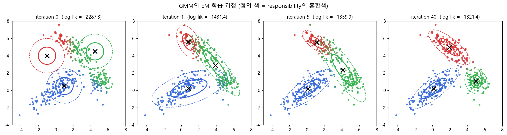
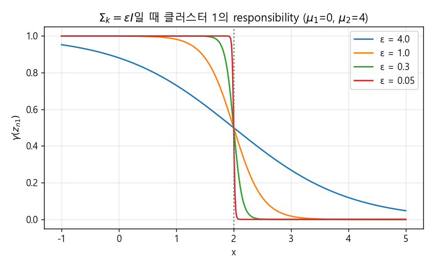
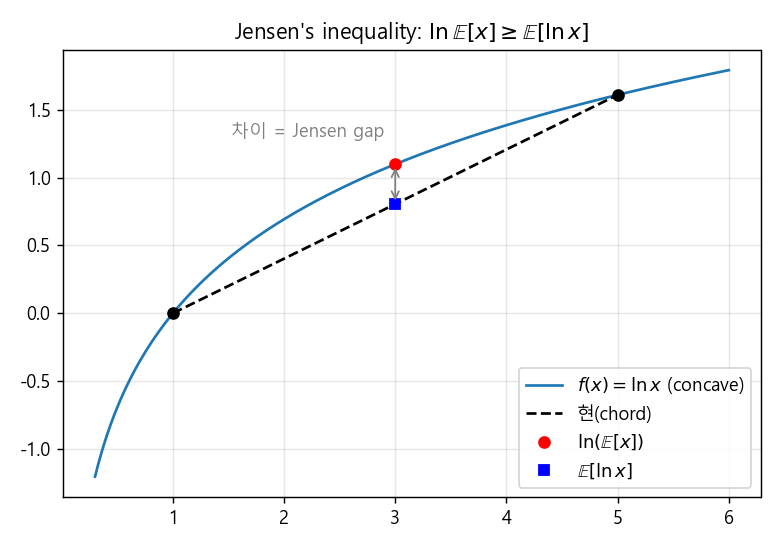
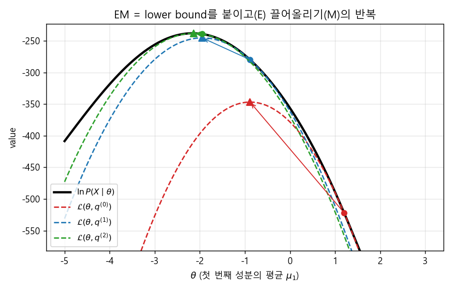
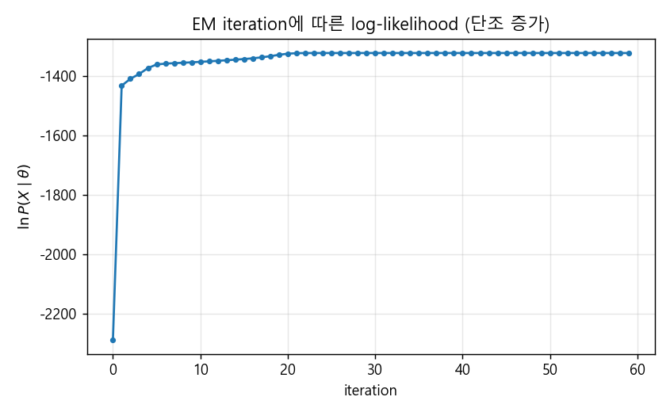

### GMM을 EM으로 학습하고, EM이 왜 동작하는지 유도해 보기


> 지난 포스트에서 정의한 GMM을 EM 알고리즘으로 학습하는 과정을 살펴보고, K-means와의 관계, 그리고 Jensen's inequality와 KL divergence를 통해 EM 알고리즘을 유도합니다.  


<br>

<center></center>    


<br/>


>  **1. GMM의 EM은 데이터 포인트가 각 클러스터에 속할 확률(responsibility)을 계산하는 E-step과, 그 확률로 가중한 MLE로 파라미터를 업데이트하는 M-step을 반복하는 알고리즘이다**
>
>  **2. 공분산 행렬을 $\epsilon I$로 고정하고 $\epsilon \to 0$으로 보내면 soft assignment가 hard assignment가 되어 GMM의 EM은 K-means와 같아진다. 즉, GMM은 K-means의 superset이다**
>
>  **3. 로그 우도는 lower bound와 KL divergence의 합으로 분해되며, EM은 E-step에서 KL divergence를 0으로 만들어 lower bound를 붙이고, M-step에서 그 lower bound를 끌어올리는 과정을 반복한다**


<br/>

----

#### Contents

<br/>

1.	[GMM을 위한 EM: E-step과 M-step](#em-for-gmm)
2.	[GMM의 학습 과정과 장단점](#gmm-properties)
3.  [GMM과 K-means의 관계](#gmm-kmeans)
4.  [잠재 변수가 있는 추론과 Jensen's inequality](#latent-variable)
5.  [EM의 유도: Lower Bound와 KL Divergence](#em-derivation)
6.  [EM 알고리즘 정리](#em-summary)

<br />

[지난 포스트](https://myeonghak.github.io/general%20machine%20learning/General-ML-train-set-batch-9.-K-means%EC%99%80-GMM/)에서는 K-means 클러스터링, 다항분포와 다변수 가우시안 분포를 거쳐 Gaussian Mixture Model(GMM)을 정의하는 데까지 살펴보았습니다. 모델은 정의했는데, 정작 그 파라미터를 어떻게 학습하는지는 숙제로 남겨 두었는데요. 이번 포스트에서는 우선 "EM이라는 방법이 있다"고 받아들인 채로 GMM을 학습해 보고, K-means와의 관계를 짚은 뒤, 마지막으로 EM 알고리즘이 왜 동작하는지를 처음부터 유도해 보겠습니다.  


<a id="em-for-gmm"></a>
### 1. GMM을 위한 EM: E-step과 M-step  

#### 지난 시간의 GMM 복습  

간단히 기억을 되살려 보겠습니다. GMM은 데이터 $x_n$이 $K$개의 가우시안 중 하나에서 생성되었다고 보는 모델입니다. 어떤 가우시안에서 왔는지를 나타내는 one-hot 잠재 변수 $z_n$은 다항분포 $P(z_k=1)=\pi_k$를 따르고, 선택된 가우시안에서 $x_n$이 생성됩니다. 이를 $z$에 대해 marginalize하면 다음과 같습니다.  

$$
P(x_n \mid \pi, \mu, \Sigma) = \sum_{k=1}^{K} \pi_k \, \mathcal{N}(x_n \mid \mu_k, \Sigma_k)
$$

#### EM of GMM의 큰 그림  

GMM의 EM은 K-means와 매우 닮았습니다. (뒤에서 보겠지만, 특정 조건 하에서는 두 알고리즘이 아예 동일한 알고리즘이 됩니다.)  

- **Expectation**: 데이터 포인트를 클러스터에 할당함  
- **Maximization**: 할당 결과를 바탕으로 파라미터를 업데이트함  

다만 K-means와 비교하면 몇 가지가 달라집니다.  

- K-means에서는 centroid의 위치가 파라미터였다면, GMM에서는 다변수 가우시안의 파라미터 $\mu_k, \Sigma_k$가 파라미터임. 공분산 행렬이 있기 때문에 원이 아닌 **타원형** 클러스터도 학습할 수 있음  
- K-means의 0/1 할당 변수 $r_{nk}$ 대신, 확률 개념을 사용해 **할당 확률**을 계산함. 그리고 이 확률을 hard하게 자르지 않고 soft한 형태 그대로 계산에 사용함  

#### E-step: assignment probability 계산  

E-step에서는 현재의 파라미터 $\pi, \mu, \Sigma$가 주어졌다고 가정하고, 각 데이터 포인트가 각 클러스터에 할당될 확률을 계산합니다. 이를 **responsibility** 혹은 assignment probability라 부르고 $\gamma(z_{nk})$로 씁니다. (강의 노트에서는 $\rho$로 표기하기도 했는데, 같은 값입니다.) 베이즈 정리를 그대로 적용하면 됩니다.  

$$
\gamma(z_{nk}) = P(z_k = 1 \mid x_n) = \frac{\pi_k \, \mathcal{N}(x_n \mid \mu_k, \Sigma_k)}{\sum_{j=1}^{K} \pi_j \, \mathcal{N}(x_n \mid \mu_j, \Sigma_j)}
$$

분자는 "$k$번 클러스터를 고를 사전확률 × 그 클러스터가 $x_n$을 만들어낼 우도"이고, 분모는 이를 모든 클러스터에 대해 더한 정규화 상수입니다. 한 데이터 포인트에 대해 $\sum_k \gamma(z_{nk}) = 1$이 되겠죠.  

#### M-step: responsibility로 가중한 MLE  

M-step에서는 E-step에서 구한 $\gamma(z_{nk})$를 주어진 것으로 보고, 로그 우도를 각 파라미터로 편미분해 최대화합니다.  

$$
\ln P(X \mid \pi, \mu, \Sigma) = \sum_{n=1}^{N} \ln \left\{ \sum_{k=1}^{K} \pi_k \, \mathcal{N}(x_n \mid \mu_k, \Sigma_k) \right\}
$$

$\mu_k$에 대해 미분하고 0으로 놓으면, 미분 결과 안에서 자연스럽게 $\gamma(z_{nk})$가 튀어나옵니다.  

$$
\frac{\partial}{\partial \mu_k} \ln P(X \mid \pi, \mu, \Sigma) = \sum_{n=1}^{N} \underbrace{\frac{\pi_k \mathcal{N}(x_n \mid \mu_k, \Sigma_k)}{\sum_j \pi_j \mathcal{N}(x_n \mid \mu_j, \Sigma_j)}}_{\gamma(z_{nk})} \Sigma_k^{-1}(x_n - \mu_k) = 0
$$

$\Sigma_k$에 대해서도 같은 방식으로, $\pi_k$에 대해서는 $\sum_k \pi_k = 1$ 제약을 라그랑주 승수로 넣어 풀면($\lambda = -N$이 나옵니다) 다음과 같은 업데이트 식을 얻습니다. 여기서 $N_k = \sum_n \gamma(z_{nk})$는 "$k$번 클러스터에 소프트하게 할당된 데이터의 개수"입니다.  

$$
\mu_k^{new} = \frac{1}{N_k} \sum_{n=1}^{N} \gamma(z_{nk}) \, x_n, \qquad
\Sigma_k^{new} = \frac{1}{N_k} \sum_{n=1}^{N} \gamma(z_{nk}) (x_n - \mu_k^{new})(x_n - \mu_k^{new})^T, \qquad
\pi_k^{new} = \frac{N_k}{N}
$$

보시면 모두 우리가 아는 평균, 공분산, 비율 계산에 **responsibility로 가중치를 준 것**에 불과합니다. 각 파라미터의 해가 $\gamma(z_{nk})$만으로 계산 가능하다는 점이 핵심인데요. 다만 $\gamma(z_{nk})$ 자체가 파라미터에 의존하기 때문에 한 번에 닫힌 해를 얻을 수는 없고, "$\gamma$ 계산 → 파라미터 업데이트 → 다시 $\gamma$ 계산"을 반복하게 됩니다.  

numpy로 직접 구현해 보면 생각보다 짧습니다. (맨 위 그림과 같은 데이터이고, 초기값만 데이터 포인트 중 랜덤으로 골랐습니다.)  

```python
import numpy as np
from scipy.stats import multivariate_normal

def em_gmm(X, K, n_iter=100, tol=1e-6, seed=0):
    rng = np.random.default_rng(seed)
    N, D = X.shape
    pi = np.ones(K) / K
    mu = X[rng.choice(N, K, replace=False)]
    Sigma = np.array([np.cov(X.T) for _ in range(K)])
    prev = -np.inf
    for t in range(n_iter):
        # E-step: responsibility gamma(z_nk) = P(z_k=1 | x_n, theta)
        p = np.stack([pi[k] * multivariate_normal.pdf(X, mu[k], Sigma[k]) for k in range(K)], axis=1)
        ll = np.log(p.sum(axis=1)).sum()
        gamma = p / p.sum(axis=1, keepdims=True)
        # M-step: responsibility로 가중한 MLE
        Nk = gamma.sum(axis=0)
        pi = Nk / N
        mu = gamma.T @ X / Nk[:, None]
        Sigma = np.array([(gamma[:, k, None] * (X - mu[k])).T @ (X - mu[k]) / Nk[k] for k in range(K)])
        if t % 5 == 0:
            print(f"iter {t:2d}  log-likelihood = {ll:.2f}")
        if ll - prev < tol:
            print(f"converged at iter {t}, log-likelihood = {ll:.2f}")
            break
        prev = ll
    return pi, mu, Sigma, gamma

rng = np.random.default_rng(0)
X = np.vstack([rng.multivariate_normal([0, 0], [[2.0, 1.5], [1.5, 1.6]], 150),
               rng.multivariate_normal([5, 1], [[0.5, 0], [0, 0.5]], 100),
               rng.multivariate_normal([2, 5], [[1.5, -0.9], [-0.9, 1.0]], 120)])
pi, mu, Sigma, gamma = em_gmm(X, K=3)
print("pi =", pi.round(3))
print("mu =", mu.round(2).tolist())
```

```
iter  0  log-likelihood = -1741.56
iter  5  log-likelihood = -1408.18
iter 10  log-likelihood = -1321.58
iter 15  log-likelihood = -1321.41
iter 20  log-likelihood = -1321.41
converged at iter 20, log-likelihood = -1321.41
pi = [0.404 0.268 0.329]
mu = [[0.17, 0.21], [5.0, 1.02], [1.95, 4.97]]
```

실제 데이터를 만든 비율은 150 : 100 : 120, 즉 약 0.405 : 0.270 : 0.324이고, 평균은 (0, 0), (5, 1), (2, 5)였는데요. 꽤 정확하게 복원해 낸 것을 확인할 수 있습니다.  


<a id="gmm-properties"></a>
### 2. GMM의 학습 과정과 장단점  

#### Progress of GMM  

맨 위의 그림을 다시 보겠습니다. 실선 타원은 각 가우시안의 1-sigma, 점선은 2-sigma 등고선이고, 점의 색은 세 클러스터 색을 responsibility로 섞은 것입니다.  

- iteration 0: 임의로 놓인 원형 가우시안에서 출발함  
- iteration 1~5: K-means처럼 중심점만 움직이는 것이 아니라, $\mu_k$와 $\Sigma_k$가 함께 업데이트되면서 타원의 크기, 기울기가 데이터에 맞춰 변함  
- iteration 40: 비스듬히 기운 두 클러스터와 동그란 클러스터 하나를 모두 잘 잡아냄  

그런데 그림을 자세히 보면, 클러스터의 경계 근처에 색이 애매하게 섞인 점들이 있습니다. 이는 해당 점에서 $\gamma(z_{n,\text{빨강}})$과 $\gamma(z_{n,\text{초록}})$처럼 여러 클래스의 확률이 비슷하게 주어졌기 때문인데요. 바로 **soft clustering**, 즉 soft assignment이기 때문에 나타나는 현상입니다. K-means였다면 이 점들도 억지로 한 쪽 색으로 칠해졌겠죠.  

#### 장점: 더 많은 정보  

- **soft clustering**: 단순하고 이산적인 할당이 아니라, "70%는 A, 30%는 B"처럼 할당의 불확실성까지 알려줌  
- **잠재 분포를 학습함**: 비지도학습에서는 데이터 뒤에 숨은 latent distribution을 학습하는 것 자체가 학습의 essence라고 할 수 있음. GMM은 클러스터 라벨뿐 아니라 데이터의 확률 밀도 자체를 추정함  
- **거리가 항상 답은 아님**: 유클리드 거리만 보는 K-means와 달리, 공분산을 통해 길쭉하거나 기울어진 분포도 표현 가능함  

#### 단점  

- **긴 연산 시간**: 공분산 행렬까지 모델링하므로 업데이트할 파라미터의 수가 많아짐 ($D$차원이면 클러스터 하나당 공분산에만 $D(D+1)/2$개)  
- **local maximum**: 초기값에 따라 지역 최적해에 빠질 수 있음  
- **$K$를 정하기 어려움**: K-means와 동일한 문제임. 다만 GMM을 Bayesian 버전으로 만들고 Bayesian non-parametric 방법(예: Dirichlet process mixture)을 사용하면 해결할 수 있음  

실무에서는 빠른 K-means와 느린 GMM을 결합해 단점을 중화시키기도 합니다. K-means로 먼저 대략적인 중심을 잡은 뒤, 이를 GMM의 초기값으로 사용하는 식이죠. 실제로 scikit-learn의 `GaussianMixture`도 기본 초기화 방식(`init_params='kmeans'`)이 이렇게 되어 있습니다.  


<a id="gmm-kmeans"></a>
### 3. GMM과 K-means의 관계  

앞에서 "특정 조건 하에서는 두 알고리즘이 동일하다"고 했는데, 그 조건을 확인해 보겠습니다. 모든 클러스터의 공분산 행렬을 $\Sigma_k = \epsilon I$로 고정해 봅시다. 대각원소만 값이 있고 나머지는 0이니 변수 간 공분산이 없다고 가정하는 것이고, 작은 상수 $\epsilon$이 각 변수 내부의 분산을 조절합니다. 그러면 가우시안은 다음과 같이 단순해집니다.  

$$
\mathcal{N}(x_n \mid \mu_k, \epsilon I) = \frac{1}{(2\pi\epsilon)^{D/2}} \exp\left( -\frac{1}{2\epsilon} \lVert x_n - \mu_k \rVert^2 \right)
$$

이를 responsibility 식에 넣으면, 앞의 상수는 분자 분모에서 약분되어 다음처럼 정리됩니다.  

$$
\gamma(z_{nk}) = \frac{\pi_k \exp\left( -\lVert x_n - \mu_k \rVert^2 / 2\epsilon \right)}{\sum_{j} \pi_j \exp\left( -\lVert x_n - \mu_j \rVert^2 / 2\epsilon \right)}
$$

이제 $\epsilon \to 0$을 생각해 볼까요? 지수 안의 거리 제곱이 $1/\epsilon$배로 증폭되기 때문에, 가장 가까운 중심이 아닌 $k$에 대한 항은 매우 빠르게 0으로 수렴하고, 가장 가까운 $k$의 항만 살아남습니다. 결국 dominant한 클래스 하나가 생기고, $\gamma(z_{nk})$는 0 또는 1의 값, 즉 K-means의 **hard assignment** $r_{nk}$가 됩니다.  

```python
import numpy as np

x, mu = 1.5, np.array([0.0, 4.0])   # 데이터 포인트 하나, 두 클러스터 중심
pi = np.array([0.5, 0.5])
for eps in [4.0, 1.0, 0.3, 0.05]:
    a = pi * np.exp(-(x - mu) ** 2 / (2 * eps))
    print(f"eps = {eps:<4}  gamma = {np.round(a / a.sum(), 4)}")
```

```
eps = 4.0   gamma = [0.6225 0.3775]
eps = 1.0   gamma = [0.8808 0.1192]
eps = 0.3   gamma = [0.9987 0.0013]
eps = 0.05  gamma = [1. 0.]
```

<br>

<center></center>    

<br>

$\epsilon$이 작아질수록 responsibility 곡선이 두 중심의 중간 지점($x=2$)에서 뚝 끊기는 계단 함수가 되는 것을 볼 수 있습니다. 이 상태에서 M-step의 $\mu_k$ 업데이트는 "자기 클러스터에 할당된 점들의 평균", 즉 K-means의 centroid 업데이트와 똑같아집니다. (기대 complete-data 로그 우도도 상수를 빼면 $-\frac{1}{2\epsilon}\sum_n \sum_k r_{nk} \lVert x_n - \mu_k \rVert^2$가 되어, K-means의 목적함수 $J$를 최소화하는 문제와 같아집니다.)  

정리하면 **GMM은 K-means의 superset**입니다. K-means로 할 수 있는 것은 모두 GMM으로 처리할 수 있는 셈이죠.  


<a id="latent-variable"></a>
### 4. 잠재 변수가 있는 추론과 Jensen's inequality  

지금까지는 "EM이라는 게 있다"고 믿고 써 왔는데요. 이제 EM이 어디서 나왔는지 일반적인 형태로 유도해 보겠습니다.  

#### Inference with latent variable  

분류와 군집화의 차이는 latent variable의 유무라고 해도 과언이 아닙니다. 분류에서는 클래스 라벨이 관측되지만, 군집화에서는 "이 점이 어느 클러스터에서 왔는가"가 숨겨져 있으니까요. 기호를 정리하면 다음과 같습니다.  

- $\{X, Z\}$: 변수들의 전체 집합  
- $X$: 관측된 변수  
- $Z$: 숨겨진(잠재) 변수  
- $\theta$: 분포를 위한 파라미터  

주어진 데이터 $X$에 대해 $P(X \mid \theta)$를 최대화하는 $\theta$를 찾는 것이 머신러닝의 에센스인데요. $Z$가 있으면 이를 marginalize out해야 하므로 로그 우도가 다음과 같아집니다.  

$$
\ln P(X \mid \theta) = \ln \sum_{Z} P(X, Z \mid \theta)
$$

분류에서는 $\ln P(X \mid \theta)$를 바로 다룰 수 있었지만, 군집화에서는 **log 안에 summation**이 들어가 버렸습니다. summation이 log 밖에 있으면 항별로 미분하면 되니 문제가 없는데, 안에 있으면 미분 결과가 서로 얽혀서 아주 까다로워집니다. 1절의 $\mu_k$ 미분 식에서 분모에 모든 클러스터의 합이 들어가 닫힌 해를 못 구했던 것도 같은 이유입니다. 우리가 원하는 것은 $Z$와 $\theta$ 둘 다인데요. 이 두 항 사이의 상호작용(interaction)을 만들어 번갈아 최적화하겠다는 전략이 바로 EM입니다.  

#### Jensen's inequality  

log 안의 합을 밖으로 꺼내기 위해 사용하는 도구가 Jensen's inequality입니다.  

- 함수가 **concave**한 경우: 여러 $x$ 값을 먼저 (가중)평균 낸 뒤 함수에 넣은 값이, 각각을 함수에 넣은 뒤 가중평균 낸 값보다 크거나 같음. 즉 $f(\mathbb{E}[x]) \geq \mathbb{E}[f(x)]$  
- 함수가 **convex**한 경우: 그 반대  
- log 함수는 concave함!  

<br>

<center></center>    

<br>

그림에서 두 점 1과 5를 반반 섞은 경우, 평균 3을 log에 넣은 빨간 점이 log 값들을 평균 낸 파란 점(현 위의 점)보다 항상 위에 있습니다. 위로 볼록한 곡선이니 당연한 결과이죠.  

#### Probability Decomposition  

이제 트릭을 하나 씁니다. 임의의 분포 $q(Z)$를 분자 분모에 곱해 주고, Jensen's inequality를 적용합니다.  

$$
\ln P(X \mid \theta) = \ln \sum_{Z} q(Z) \frac{P(X, Z \mid \theta)}{q(Z)} \;\geq\; \sum_{Z} q(Z) \ln \frac{P(X, Z \mid \theta)}{q(Z)}
$$

등호(equality)를 잃는 대신 log가 summation 안쪽으로 들어왔습니다. 이제부터는 부등식의 우변을 가지고 논의를 전개해 나가려고 하는데요. 우변을 풀어 쓰면 다음과 같습니다.  

$$
\sum_{Z} q(Z) \ln P(X, Z \mid \theta) - \sum_{Z} q(Z) \ln q(Z) = \mathbb{E}_{q(Z)} \left[ \ln P(X, Z \mid \theta) \right] + H(q)
$$

첫째 항은 $q(Z)$에 대한 complete-data 로그 우도의 기댓값(Expectation)이고, 둘째 항은 $q$의 엔트로피입니다. ($q(Z)$가 확률분포일 때에만 엔트로피라는 이름을 붙일 수 있으므로, 이후 $q$는 $Z$ 위의 확률분포로 둡니다. 그 외에는 어떤 분포든 상관 없습니다.) 이 우변을 $\mathcal{L}(\theta, q)$라고 부르겠습니다. (강의에서는 $Q(\theta, q)$로 표기하기도 합니다.)  

$\mathcal{L}(\theta, q)$는 $\ln P(X \mid \theta)$의 **lower bound**입니다. lower bound를 최대화하는 것이 원래 목표를 직접 최대화하는 것은 아니지만, 적어도 원래 목표를 끌어올리는 데 도움이 되겠죠. 그리고 이 lower bound를 **tight하게** 만들수록 원래 최적화하려던 식을 최대화할 가능성이 올라갑니다. 그렇다면 언제 tight해질까요?  


<a id="em-derivation"></a>
### 5. EM의 유도: Lower Bound와 KL Divergence  

#### Maximizing Lower Bound (1)  

$P(X, Z \mid \theta) = P(Z \mid X, \theta) P(X \mid \theta)$로 분해한 뒤, $\sum_Z q(Z) = 1$이라는 성질을 이용해 lower bound를 다시 정리해 보겠습니다.  

$$
\begin{aligned}
\mathcal{L}(\theta, q) &= \sum_{Z} q(Z) \ln \frac{P(Z \mid X, \theta) P(X \mid \theta)}{q(Z)} \\
&= \sum_{Z} q(Z) \ln P(X \mid \theta) + \sum_{Z} q(Z) \ln \frac{P(Z \mid X, \theta)}{q(Z)} \\
&= \ln P(X \mid \theta) - \sum_{Z} q(Z) \ln \frac{q(Z)}{P(Z \mid X, \theta)}
\end{aligned}
$$

마지막 줄의 빼는 항이 바로 **KL divergence** $\mathrm{KL}(q(Z) \,\Vert\, P(Z \mid X, \theta))$입니다. 즉,  

$$
\ln P(X \mid \theta) = \mathcal{L}(\theta, q) + \mathrm{KL}\left(q(Z) \,\Vert\, P(Z \mid X, \theta)\right)
$$

로그 우도가 lower bound와 KL divergence의 합으로 깔끔하게 분해되었습니다. 이 KL 항이 바로 부등식을 만드는 factor인데요. 이를 없애 주면 lower bound를 원래 로그 우도까지 착! 붙일 수 있습니다.  

#### KL Divergence  

Kullback-Leibler divergence는 두 확률분포가 얼마나 다른지를 측정합니다.  

$$
\mathrm{KL}(P \,\Vert\, Q) = \sum_{i} P(i) \ln \frac{P(i)}{Q(i)}
$$

- 항상 0 이상임 ($-\ln$이 convex하므로 Jensen's inequality로 $\mathrm{KL} \geq -\ln \sum_i Q(i) = 0$이 증명됨)  
- 두 분포가 동일할 때에만 0이 됨  
- **non-symmetric**함: $\mathrm{KL}(P \,\Vert\, Q) \neq \mathrm{KL}(Q \,\Vert\, P)$. 기댓값을 취하는 기준 분포가 $P$냐 $Q$냐가 다르기 때문임. 그래서 "거리(distance)"가 아니라 "divergence"라고 부름  

```python
import numpy as np

def kl(p, q):
    return np.sum(p * np.log(p / q))

P = np.array([0.7, 0.2, 0.1])
Q = np.array([0.4, 0.4, 0.2])
print(f"KL(P||Q) = {kl(P, Q):.4f}")
print(f"KL(Q||P) = {kl(Q, P):.4f}")
print(f"KL(P||P) = {kl(P, P):.4f}")
```

```
KL(P||Q) = 0.1838
KL(Q||P) = 0.1920
KL(P||P) = 0.0000
```

#### Maximizing Lower Bound (2)  

이제 전략이 보입니다. KL divergence를 0으로 만드는 확률분포를 $q$로 잡는 것이 핵심인데요. 처음으로 돌아가 보면, 우리는 $q(Z)$에 대한 아무런 추가 지식이 없어서 lower bound를 어떻게 다뤄야 할지 막막했습니다. 그런데 KL 항이 $q(Z)$에 대해 답을 알려주고 있습니다. **$q(Z)$를 $P(Z \mid X, \theta)$로 놓으면 된다**는 것이죠.  

시점 $t$에서 파라미터가 $\theta^t$로 고정되어 있다고 해 봅시다. 그러면 첫째 항 $\ln P(X \mid \theta^t)$는 $q$와 무관하므로 우리가 할 수 있는 일이 없습니다. 대신 KL 항을 최소화하면 $\mathcal{L}(\theta^t, q)$가 최대가 됩니다.  

$$
q^t(Z) = P(Z \mid X, \theta^t) \quad \Rightarrow \quad \mathrm{KL} = 0, \quad \mathcal{L}(\theta^t, q^t) = \ln P(X \mid \theta^t)
$$

즉, 특정 iteration의 파라미터 $\theta^t$와 $X$가 주어졌을 때 계산되는 $Z$의 사후분포를 그대로 $q$로 받아들이면, KL이 0이 되어 lower bound가 원래 로그 우도에 딱 붙습니다. 이것이 **E-step**입니다.  

그 다음, $q^t(Z)$를 주어진 것으로 받아들이면 $\mathcal{L}(\theta, q^t)$는 $\theta$에 대한 식이 되고, 이제는 log 안에 summation이 없으므로 미분으로 최적화할 수 있습니다. 엔트로피 $H(q^t)$는 $\theta$와 무관하므로 실제로는 기댓값 항만 최대화하면 됩니다.  

$$
\theta^{t+1} = \arg\max_{\theta} \; \mathbb{E}_{q^t(Z)} \left[ \ln P(X, Z \mid \theta) \right]
$$

이것이 **M-step**입니다. 그런데 $\theta$가 $\theta^{t+1}$로 바뀌는 순간, $q^t(Z)$는 더 이상 $P(Z \mid X, \theta^{t+1})$과 같지 않으므로 KL이 다시 생겨납니다. 그러면 다시 E-step으로 $q$를 업데이트하고... 이를 수렴할 때까지 반복하는 것이죠.  

<br>

<center></center>    

<br>

위 그림은 1차원 2-성분 GMM에서 첫 번째 평균 $\mu_1$ 하나만 파라미터 $\theta$로 두고, 실제로 로그 우도(검은 실선)와 각 iteration의 lower bound(점선)를 계산해 그린 것입니다.  

- 동그라미: E-step 직후. lower bound가 현재 $\theta^t$에서 로그 우도에 접함 (KL = 0)  
- 세모: M-step 결과. 점선 lower bound의 꼭대기로 $\theta$를 옮김  
- 새 $\theta$에서 다시 lower bound를 붙이면 로그 우도는 그 꼭대기보다 높거나 같은 곳에 있게 됨  

이 과정을 부등식으로 쓰면 EM이 로그 우도를 절대 감소시키지 않는다는 것도 바로 보입니다.  

$$
\ln P(X \mid \theta^{t+1}) \;\geq\; \mathcal{L}(\theta^{t+1}, q^t) \;\geq\; \mathcal{L}(\theta^{t}, q^t) \;=\; \ln P(X \mid \theta^{t})
$$

첫 번째 부등호는 KL $\geq 0$에서, 두 번째는 M-step이 $\mathcal{L}$을 최대화한다는 사실에서, 마지막 등호는 E-step에서 KL을 0으로 만들었다는 사실에서 나옵니다.  

#### GMM으로 돌아와서  

GMM에서 $Z$는 각 데이터 포인트의 클러스터 할당이므로, E-step의 $q^t(z_{nk}=1) = P(z_k = 1 \mid x_n, \theta^t)$는 1절의 responsibility $\gamma(z_{nk})$ 그 자체입니다. 그리고 M-step의 목적함수는  

$$
\mathbb{E}_{q}\left[ \ln P(X, Z \mid \theta) \right] = \sum_{n=1}^{N} \sum_{k=1}^{K} \gamma(z_{nk}) \left\{ \ln \pi_k + \ln \mathcal{N}(x_n \mid \mu_k, \Sigma_k) \right\}
$$

처럼 log가 summation 바깥으로 나온 형태가 됩니다. 이를 미분하면 1절의 가중 MLE 업데이트 식이 그대로 나옵니다. 1절에서 "일단 믿고 썼던" 알고리즘이 사실은 이 일반적인 EM의 특수한 경우였던 것이죠.  


<a id="em-summary"></a>
### 6. EM 알고리즘 정리  

전체 흐름을 한 번에 정리해 보겠습니다.  

1. 우리가 알고 싶은 것은 $l(\theta) = \ln P(X \mid \theta)$, 즉 주어진 파라미터에서 데이터 $X$가 등장할 확률을 극대화하는 것이었음  
2. 알 수 없는 잠재 변수 $Z$가 도입되면서 $Z$에 대해 marginalize out한 식이 되었고, log 안에 summation이 생겨 직접적인 최적화가 불가능해졌음  
3. 이를 극복하고자 Jensen's inequality를 사용해 부등식(lower bound)으로 재정리함  
4. 이를 다시 정리하니 $\ln P(X \mid \theta) = \mathcal{L}(\theta, q) + \mathrm{KL}(q \,\Vert\, p)$, 즉 lower bound + KL divergence로 분해됨  
5. $q$를 사후분포 $p = P(Z \mid X, \theta)$로 만들어 KL을 0으로 만듦 (E-step)  
6. $q$에 대한 정보가 생겼으므로 이를 토대로 $\theta$를 업데이트함 (M-step)  
7. 업데이트된 $\theta$ 때문에 새로운 KL이 생기고, 이를 다시 없애는 작업이 반복됨  

알고리즘 형태로 쓰면 다음과 같습니다.  

| 단계 | 하는 일 | GMM에서는 |
|---|---|---|
| 초기화 | $\theta^0$를 임의의 값으로 설정 | $\pi, \mu, \Sigma$ 초기화 (K-means 결과 활용 가능) |
| E-step | $q^t(Z) = P(Z \mid X, \theta^t)$로 설정해 KL 최소화 | responsibility $\gamma(z_{nk})$ 계산 |
| M-step | $q^t(Z)$를 고정하고 $\theta^{t+1} = \arg\max_\theta \mathbb{E}_{q^t}[\ln P(X, Z \mid \theta)]$ | $\gamma$로 가중한 평균, 공분산, 비율 계산 |
| 반복 | 로그 우도가 수렴할 때까지 E, M 반복 | |

M-step에서 $q(Z)$를 고정한다는 것은, 마치 관측되지 않은 데이터가 없는 것처럼(모든 변수가 관측된 것처럼) 취급한다는 의미입니다. 그래서 M-step은 결국 우리가 익숙한 일반적인 MLE와 같은 방법으로 풀립니다.  

<br>

<center></center>    

<br>

맨 위 그림의 학습에서 iteration별 로그 우도를 그려 보면, 앞에서 증명한 대로 한 번도 감소하지 않고 단조 증가하다가 수렴하는 것을 확인할 수 있습니다.  

#### 주의할 점  

- EM은 항상 global optimum을 찾아주지는 않음. local maximum뿐 아니라 saddle point에 빠지기도 함  
- 그래서 실무에서는 여러 초기값으로 돌려 가장 높은 로그 우도를 택하는 방식을 흔히 사용함 (sklearn의 `n_init` 파라미터)  
- 그럼에도 현실에서 꽤 잘 동작하며, latent variable이 있는 모델에서 maximum likelihood solution을 찾는 매우 유용한 도구임  


<br>

----------------

<a id="conclusion"></a>
### 닫으며  

지금까지 GMM을 EM으로 학습하는 방법, GMM과 K-means의 관계, 그리고 Jensen's inequality와 KL divergence를 이용한 EM 알고리즘의 유도까지 살펴보았습니다. "답을 모르는 $Z$를 일단 현재 파라미터로 추측하고, 그 추측을 믿고 파라미터를 고친다"는 단순한 아이디어가, lower bound를 붙이고 끌어올리는 깔끔한 수학으로 정당화된다는 점이 EM의 매력인 것 같습니다.  
다음 포스트에서는 잠재 변수가 시간의 흐름에 따라 이어지는 모델, **히든 마코프 모델(HMM)** 을 알아보겠습니다. 여기서도 EM이 다시 등장하니 오늘 내용을 기억해 두시면 좋겠습니다.  

**개선을 위한 여러분의 피드백과 제안을 코멘트로 공유해 주세요.**
**내용에 대한 지적, 혹은 질문을 환영합니다.**  

해당 포스트는 카이스트 문일철 교수님의 동의를 얻고, 강좌 내용과 자료, 그리고 reference의 자료를 참고하여 작성되었습니다. 원 강좌는 [여기](https://www.youtube.com/playlist?list=PLbhbGI_ppZISMV4tAWHlytBqNq1-lb8bz)에서 보실 수 있습니다.

**자료 공유를 허락해 주신 문일철 교수님께 감사의 말씀을 전합니다.**
