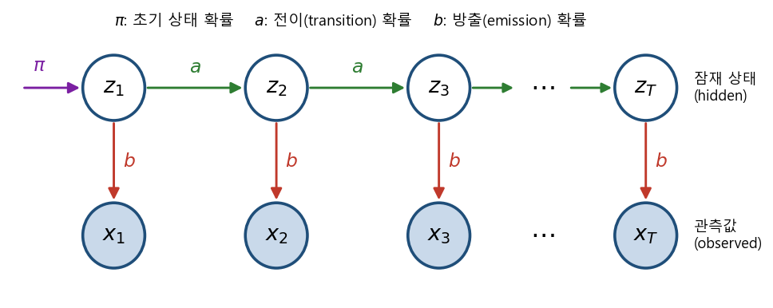
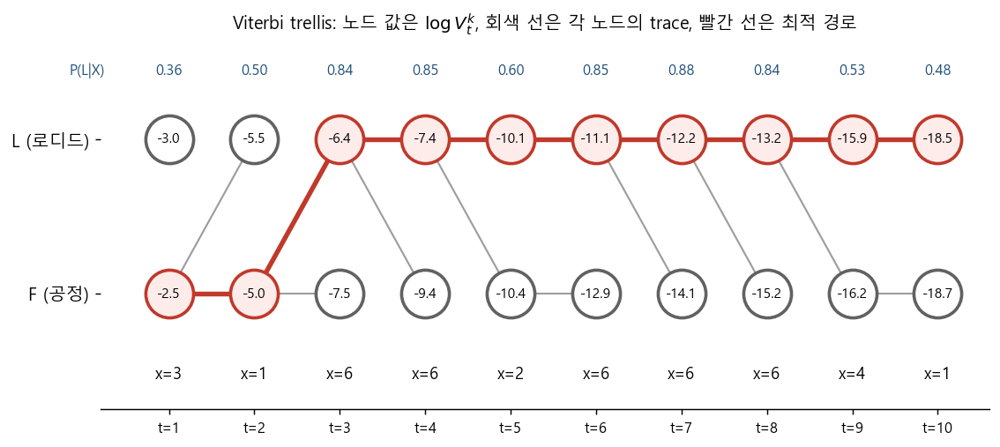
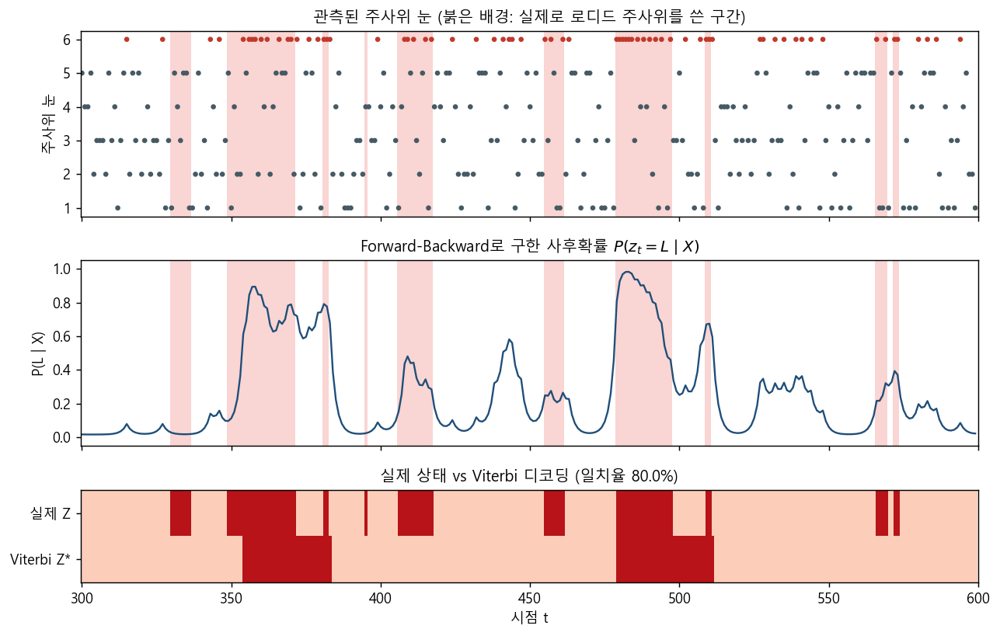
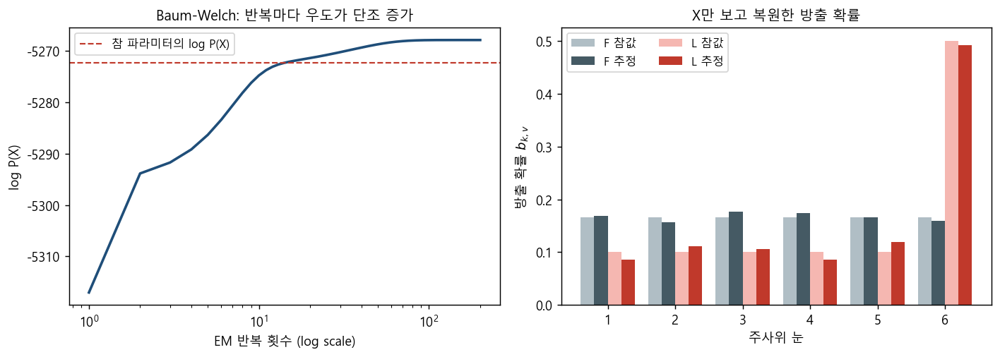

### 시간 축 위의 잠재 변수 모델: Forward-Backward, Viterbi, 그리고 Baum-Welch


> 관측 뒤에 숨은 상태가 시간에 따라 변해가는 데이터를 모델링하는 히든 마코프 모델(HMM)과, 그 세 가지 핵심 질문을 푸는 알고리즘을 살펴봅니다.  


<br>

<center></center>    


<br/>


>  **1. HMM은 시간에 따라 전이하는 잠재 상태 Z와 각 상태에서 방출되는 관측 X로 이루어진 베이지안 네트워크로, 초기 확률 π, 전이 확률 a, 방출 확률 b로 완전히 정의된다**
>
>  **2. Evaluation과 Decoding 질문은 반복되는 부분 문제를 memoization table에 채워가는 동적 프로그래밍(Forward-Backward, Viterbi)으로 효율적으로 풀 수 있다**
>
>  **3. X만 주어졌을 때 파라미터를 학습하는 Learning 질문은 EM 알고리즘으로 푸는데, HMM에 특화된 이 EM을 Baum-Welch 알고리즘이라 부른다**


<br/>

----

#### Contents

<br/>

1.	[시간이 흐르는 데이터와 HMM](#hmm-concept)
2.	[HMM의 세 가지 질문](#three-questions)
3.  [Joint Probability와 Marginal Probability](#joint-marginal)
4.  [Forward-Backward 확률 계산](#forward-backward)
5.  [Viterbi 디코딩 알고리즘](#viterbi)
6.  [Baum-Welch 알고리즘](#baum-welch)

<br />

[지난 포스트](https://myeonghak.github.io/general%20machine%20learning/General-ML-train-set-batch-10.-EM-%EC%95%8C%EA%B3%A0%EB%A6%AC%EC%A6%98/)에서는 잠재 변수가 있는 모델의 MLE를 구하는 EM 알고리즘을 살펴보았습니다. 이번 시간에는 여기에 **시간**이라는 차원을 하나 더 얹어 보려고 하는데요. 데이터 포인트들이 서로 독립이 아니라 앞뒤로 줄줄이 엮여 있을 때, 그 뒤에 숨은 상태를 어떻게 모델링할 수 있을지를 히든 마코프 모델(Hidden Markov Model, HMM)을 통해 알아보겠습니다.  


<a id="hmm-concept"></a>
### 1. 시간이 흐르는 데이터와 HMM  

#### 독립이 아닌 데이터  

GMM에서는 모든 데이터 포인트가 **독립 시행**이라고 가정했습니다. 그런데 주가지수나 자연어 발화 같은 데이터를 생각해 보면, 오늘의 값은 어제의 값과 무관하지 않습니다. 게다가 이런 관측치는 눈에 보이지 않는 어떤 **내부 동력**(시장의 국면, 문장의 문법 구조 등)에 영향을 받아 나타나는 것처럼 보이죠. 비가역적인 time이라는 차원이 추가되었을 때의 GMM, 이것이 바로 HMM이 풀고자 하는 문제입니다.  

- **시간적 관계**: 시점 $t$에서 $t+1$로 인과성이 존재함  
- **전반적 추세**: 이를 잠재 상태 변수(latent state variable)로 표현함  
- 시간에 따라 소속 클러스터가 바뀌어 가는 셈이므로 **dynamic clustering**이라고 부르기도 함  

#### 관측 변수와 잠재 변수  

- **관측 $x_t$**: 시점 $t$의 관측값. 이산/연속 모두 가능하며, 이산이면 다항분포를, 연속이면 정규분포 등을 방출 분포로 사용함. 이번 포스트에서는 이산 관측만 다룸 ($x_t \in \lbrace c_1, \dots, c_m \rbrace$, one-hot 벡터로 표현 가능)  
- **잠재 상태 $z_t$**: $K$개의 원소를 갖는 one-hot 벡터로, $K$개의 클러스터(상태) 중 어디에 있는지를 나타냄. 잠재 상태가 연속이고 선형 가우시안이라면 이 모델은 **칼만 필터(Kalman filter)** 가 됨  

#### 세 종류의 파라미터  

HMM은 다음 세 가지 확률만 있으면 완전히 정의됩니다.  

- **초기 상태 확률 $\pi$**: 첫 상태는 다항분포에서 샘플링됨  

$$
P(z_1) \sim \text{Mult}(\pi_1, \dots, \pi_K)
$$

- **전이 확률(transition probability) $a$**: $i$번째 상태에 있을 때 다음 시점에 $j$번째 상태로 옮겨갈 확률  

$$
P(z_t^j = 1 \mid z_{t-1}^i = 1) = a_{i,j}
$$

- **방출 확률(emission probability) $b$**: $i$번째 상태에 있을 때 $j$번째 관측값이 나올 확률  

$$
P(x_t = c_j \mid z_t^i = 1) = b_{i,j}
$$

맨 위의 그림처럼, 시간 축을 따라 **잠재 상태의 사슬**과 **거기서 떨어져 나오는 관측값**이 깔끔하게 분리된다는 것이 HMM의 특징입니다. $z_t$는 오직 $z_{t-1}$에만 의존하고(1차 마르코프 가정), $x_t$는 오직 $z_t$에만 의존합니다.  


<a id="three-questions"></a>
### 2. HMM의 세 가지 질문  

베이지안 네트워크의 구조, 즉 HMM이라는 모델 $M$이 주어졌을 때 우리가 던질 수 있는 질문은 크게 세 가지입니다.  

| 질문 | 주어진 것 | 구하는 것 | 의미 |
|---|---|---|---|
| Evaluation | $\pi, a, b, X$ | $P(X \mid M, \pi, a, b)$ | 이 모델에서 $X$가 관측될 가능성은 얼마나 되나? |
| Decoding | $\pi, a, b, X$ | $\arg\max_Z P(Z \mid X, M, \pi, a, b)$ | $X$를 만들어냈을 가장 그럴듯한 상태 시퀀스는? |
| Learning | $X$ | $\arg\max_{\pi, a, b} P(X \mid M, \pi, a, b)$ | $X$ 뒤에 깔린 파라미터는 무엇인가? |

Decoding은 정답 데이터로 파라미터를 이미 학습해 두고 새 입력에 라벨을 붙이는 것이므로 **지도학습**에 가깝고, Learning은 $X$만 보고 상태 구조를 찾아내는 것이므로 temporal(dynamic) clustering, 즉 **비지도학습**에 가깝습니다. Learning 질문에는 $Z$가 표기되어 있지 않은데, GMM 때처럼 $Z$를 marginalize out해야 하므로 EM이 등장하게 됩니다.  

#### X와 Z를 모두 안다면? 그냥 세면 됩니다  

강좌에서 사용하는 예시는 **로디드 주사위(Loaded, L)와 공정한 주사위(Fair, F)를 몰래 바꿔 쓰는 딜러**입니다. 어떤 주사위를 썼는지(잠재 변수)는 딜러만 알고, 우리는 나온 눈(관측)만 봅니다.  

만약 딜러의 주사위 교체 기록 $Z$까지 우리가 모두 관측했다면, 파라미터 추정은 간단합니다.  

- $a_{L,L} = P(z_{t+1} = L \mid z_t = L)$: L 다음에 L이 나온 횟수를 L이 나온 횟수로 나눔  
- $b_{L,1} = P(x_t = 1 \mid z_t = L)$: L을 썼을 때 1이 나온 비율  
- 즉 counting, 다시 말해 MLE(혹은 prior를 얹으면 MAP)로 바로 구해짐  

문제는 현실에서는 $Z$를 거의 볼 수 없다는 것이죠. 이제부터는 그 상황을 차근차근 풀어가 보겠습니다.  


<a id="joint-marginal"></a>
### 3. Joint Probability와 Marginal Probability  

#### Joint Probability: 그래프를 따라 곱하기  

HMM도 베이지안 네트워크이므로, 그래프 구조 덕분에 full joint를 간단히 factorize할 수 있습니다. 길이 3의 시퀀스라면,  

$$
P(X, Z) = P(z_1)\,P(x_1 \mid z_1)\,P(z_2 \mid z_1)\,P(x_2 \mid z_2)\,P(z_3 \mid z_2)\,P(x_3 \mid z_3)
$$

보시다시피 **초기 확률, 전이 확률, 방출 확률의 곱**에 불과합니다. 강좌의 예시 설정으로 직접 계산해 보겠습니다.  

- L: 1~5가 각각 1/10, 6이 5/10의 확률로 나옴. F: 모든 눈이 1/6  
- $a_{L,L} = 0.7$, $a_{F,F} = 0.5$, 초기 확률은 각각 0.5  
- 관측 $X = (1, 6, 6)$에 대해 $Z$가 LLL인 경우와 FFF인 경우를 비교  

$$
P(166, LLL) = 0.5 \times 0.1 \times 0.7 \times 0.5 \times 0.7 \times 0.5 = 0.006125
$$

$$
P(166, FFF) = 0.5 \times \tfrac{1}{6} \times 0.5 \times \tfrac{1}{6} \times 0.5 \times \tfrac{1}{6} \approx 0.000579
$$

6이 두 번 연속 나왔으니 LLL 쪽이 10배 이상 그럴듯하다는 결론인데요. 그런데 길이 3짜리 시퀀스에도 $Z$의 경우의 수는 $2^3 = 8$가지이고, 길이 $T$라면 $K^T$가지입니다. 이걸 전부 점검해서 디코딩하는 건 금방 불가능해지겠죠.  

#### Marginal Probability와 재귀 구조  

Evaluation 질문에 답하려면 GMM에서처럼 $Z$를 marginalize out해야 합니다.  

$$
P(X) = \sum_{Z} P(X, Z) = \sum_{z_1} \sum_{z_2} \cdots \sum_{z_T} P(x_1, \dots, x_T, z_1, \dots, z_T)
$$

이 다중 시그마를 그대로 계산하면 같은 곱셈을 수없이 반복하게 됩니다. 여기서 조건 없이 항상 성립하는 chain rule $P(A,B,C) = P(A)P(B \mid A)P(C \mid A,B)$와 그래프의 조건부 독립성을 함께 사용하면 식을 크게 줄일 수 있습니다. 마지막 상태 $z_t$만 남기고 나머지를 marginalize하는 양을 정의해 보겠습니다.  

$$
\begin{aligned}
\alpha_t^k &= P(x_1, \dots, x_t, z_t^k = 1) \\
&= \sum_i P(x_1, \dots, x_{t-1}, z_{t-1}^i = 1)\, P(z_t^k = 1 \mid z_{t-1}^i = 1)\, P(x_t \mid z_t^k = 1) \\
&= b_{k, x_t} \sum_i \alpha_{t-1}^i \, a_{i,k}
\end{aligned}
$$

- $z_t$를 구할 때는 $x_1, \dots, x_{t-1}$을 알 필요 없이 $z_{t-1}$만 알면 됨  
- $x_t$를 구할 때는 $z_t$만 있으면 됨. 나머지는 모두 소거됨  

결국 $\alpha_t$는 $\alpha_{t-1}$로 **재귀적으로** 정의되는 반복 구조가 됩니다.  


<a id="forward-backward"></a>
### 4. Forward-Backward 확률 계산  

#### Detour: Dynamic Programming과 Memoization  

재귀가 등장했으니 잠시 짚고 넘어가겠습니다. 피보나치 수열 $F(n) = F(n-1) + F(n-2)$를 순진한 재귀로 계산하면 $F(2)$ 같은 컴포넌트를 여러 번 다시 계산하게 됩니다.  

- **Recursion**: top-down 방식. $F(4)$부터 divide and conquer하며 다음 작업(함수 호출)을 stack frame에 쌓음  
- **Dynamic Programming(DP)**: overlapping subinstance가 있는 recurrence를 푸는 알고리즘 디자인 기법. 작은 문제부터 계산해 저장하며 쌓아 올리는 bottom-up 방식  
- **Memoization table**: DP에서 계산치를 기록해 두는 테이블. DP의 핵심 테크닉임  

#### Forward probability  

$\alpha_t^k$가 바로 memoization table의 한 칸이 됩니다.  

1) 초기화: $\alpha_1^k = \pi_k \, b_{k, x_1}$  
2) $t = 2, \dots, T$에 대해 $\alpha_t^k = b_{k, x_t} \sum_i \alpha_{t-1}^i a_{i,k}$로 테이블을 채워 나감  
3) 마지막 시점에서 상태에 대해 합하면 $z_T$가 사라지며 $P(X) = \sum_i \alpha_T^i$  

$K^T$개의 경로를 다 더하는 대신 $O(K^2 T)$의 연산으로 Evaluation 질문에 답할 수 있게 된 것입니다. 앞의 주사위 예시로 정말 같은 값이 나오는지 확인해 보겠습니다.  

```python
import numpy as np
from itertools import product

pi = np.array([0.5, 0.5])                 # 0: F(공정), 1: L(로디드)
A  = np.array([[0.5, 0.5],
               [0.3, 0.7]])               # A[i, j] = P(z_t=j | z_(t-1)=i)
B  = np.array([[1/6]*6,
               [0.1]*5 + [0.5]])          # B[k, v] = P(x_t=v+1 | z_t=k)
X  = np.array([1, 6, 6]) - 1              # 눈금 1~6 -> 인덱스 0~5

def forward(X, pi, A, B):
    alpha = np.zeros((len(X), len(pi)))
    alpha[0] = pi * B[:, X[0]]
    for t in range(1, len(X)):
        alpha[t] = B[:, X[t]] * (alpha[t-1] @ A)
    return alpha

def joint(X, Z):
    p = pi[Z[0]] * B[Z[0], X[0]]
    for t in range(1, len(X)):
        p *= A[Z[t-1], Z[t]] * B[Z[t], X[t]]
    return p

alpha = forward(X, pi, A, B)
print('P(166, LLL) =', round(joint(X, [1, 1, 1]), 6))
print('P(166, FFF) =', round(joint(X, [0, 0, 0]), 6))
print('forward P(X) =', round(alpha[-1].sum(), 6))
print('brute   P(X) =', round(sum(joint(X, Z) for Z in product([0, 1], repeat=3)), 6))
```

```
P(166, LLL) = 0.006125
P(166, FFF) = 0.000579
forward P(X) = 0.018481
brute   P(X) = 0.018481
```

8개 경로를 일일이 더한 값과 forward 알고리즘의 값이 정확히 일치합니다.  

#### Backward probability  

그런데 forward 확률은 시점 $t$ **이전**의 시퀀스만 입력으로 받습니다. 이대로라면 $z_2$는 $x_3$의 영향을 전혀 받지 않는 것처럼 모델링되는데, 실제로는 미래의 관측도 현재 상태에 대한 정보를 담고 있죠. (위 예시에서 두 번째 6을 보고 나면 첫 번째 6을 던질 때도 L이었을 것 같다는 생각이 들지 않나요?)  

그래서 우리가 진짜 알고 싶은 것은 $P(z_t^k = 1, x_1, \dots, x_t)$가 아니라 전체 관측을 본 뒤의 $P(z_t^k = 1 \mid X)$이고, 이를 위해 joint부터 계산합니다.  

$$
\begin{aligned}
P(z_t^k = 1, X) &= P(x_1, \dots, x_t, z_t^k = 1)\, P(x_{t+1}, \dots, x_T \mid x_1, \dots, x_t, z_t^k = 1) \\
&= \alpha_t^k \, P(x_{t+1}, \dots, x_T \mid z_t^k = 1) = \alpha_t^k \, \beta_t^k
\end{aligned}
$$

$z_t$가 주어지면 미래는 과거와 독립이므로 $x_1, \dots, x_t$가 조건에서 떨어져 나갑니다. 이 $\beta_t^k$를 **backward probability**라고 하는데요, 그대로는 going nowhere이니 $z_{t+1}$을 끼워 넣고 marginalize한 뒤 그래프 구조로 불필요한 변수를 날려 주면, 역시 $a$, $b$, $\beta$로 이루어진 재귀식이 됩니다.  

$$
\beta_t^k = \sum_j a_{k,j}\, b_{j, x_{t+1}}\, \beta_{t+1}^j, \qquad \beta_T^k = 1
$$

forward는 앞에서부터, backward는 뒤에서부터 DP로 테이블을 채우고, 둘을 곱해 $P(X)$로 나누면 각 시점의 사후확률 $P(z_t^k = 1 \mid X)$를 얻습니다. 이 forward, backward 확률이 이후 디코딩과 학습의 밑재료가 됩니다.  


<a id="viterbi"></a>
### 5. Viterbi 디코딩 알고리즘  

#### 시점별 최선과 시퀀스 전체의 최선은 다르다  

$\alpha_t^k \beta_t^k$로 구한 $P(z_t^k = 1 \mid X)$는 **단일(single) 잠재 변수** $z_t$에 대한 most probable assignment를 알려줍니다. 하지만 우리가 원하는 것은 **시퀀스 전체** $Z$에 대한 most probable assignment이고, 각 시점의 최선을 이어 붙인다고 전체의 최선이 되리라는 보장은 없습니다. 그래서 시퀀스 전체를 다루는 decoding 알고리즘이 따로 필요한데요, 그 대표가 **Viterbi 알고리즘**입니다.  

조건부확률을 최대화하는 것은 정규화 항 $P(X)$가 상수이므로 joint를 최대화하는 것과 같습니다. 이를 이용해, $z_t$를 $k$로 고정했을 때 그 앞의 상태들을 가장 그럴듯하게 고른 확률을 정의합니다.  

$$
V_t^k = \max_{z_1, \dots, z_{t-1}} P(x_1, \dots, x_{t-1}, z_1, \dots, z_{t-1}, x_t, z_t^k = 1)
$$

forward 때와 같은 방식으로 factorize하면, $\alpha$의 재귀식에서 $\sum$이 $\max$로 바뀐 형태가 나옵니다.  

$$
V_t^k = b_{k, x_t} \max_{i} a_{i,k} V_{t-1}^i, \qquad \text{trace}_t^k = \arg\max_{i} a_{i,k} V_{t-1}^i
$$

#### Detour: 조립 라인 스케줄링  

강좌에서는 이를 **assembly line scheduling** 문제에 빗대어 설명합니다. 두 개의 조립 라인이 있고 각 공정 단계마다 어느 라인에서 작업할지 고를 수 있을 때, 라인을 갈아타는 비용까지 고려해 총 소요 시간이 가장 짧은 경로를 DP로 찾는 문제죠. 시간 대신 확률을, 합 대신 곱을, 최소 대신 최대를 쓰면 Viterbi가 됩니다. 각 단계에서 "여기까지 오는 최선의 경로와 그 직전 위치"만 기억해 두면, 끝에서부터 거꾸로 따라가 전체 최적 경로를 복원할 수 있습니다.  

#### 알고리즘 정리  

- $V_t^k$에는 두 가지를 저장함: 시점 $t$까지의 최대 확률, 그리고 어디서 왔는지를 나타내는 trace  
- 초기화: $V_1^k = \pi_k \, b_{k, x_1}$  
- $t = 2, \dots, T$에 대해 bottom-up으로 $V_t^k$와 $\text{trace}_t^k$를 채움  
- 종료 및 retrace: $P(X, Z^\ast) = \max_k V_T^k$, $z_T^\ast = \arg\max_k V_T^k$, $z_{t-1}^\ast = \text{trace}_t^{z_t^\ast}$  

구현상의 함정이 하나 있는데요, 1보다 작은 확률을 계속 곱하다 보면 컴퓨터가 0으로 처리해 버리는 **underflow**가 발생합니다. 그래서 실제로는 로그를 취해 곱을 합으로 바꾼 **log domain**에서 계산합니다. ($\max$는 단조 변환에 영향을 받지 않으니 결과는 그대로입니다.)  

```python
def backward(X, A, B):
    beta = np.ones((len(X), A.shape[0]))
    for t in range(len(X) - 2, -1, -1):
        beta[t] = A @ (B[:, X[t+1]] * beta[t+1])
    return beta

def viterbi(X, pi, A, B):
    logA, logB = np.log(A), np.log(B)
    V = np.zeros((len(X), len(pi)))
    trace = np.zeros((len(X), len(pi)), dtype=int)
    V[0] = np.log(pi) + logB[:, X[0]]
    for t in range(1, len(X)):
        scores = V[t-1][:, None] + logA          # scores[i, k]: i에서 k로 올 때
        trace[t] = scores.argmax(axis=0)
        V[t] = logB[:, X[t]] + scores.max(axis=0)
    z = [int(V[-1].argmax())]
    for t in range(len(X) - 1, 0, -1):           # retrace
        z.append(int(trace[t, z[-1]]))
    return z[::-1], V[-1].max()

X = np.array([3, 1, 6, 6, 2, 6, 6, 6, 4, 1]) - 1
alpha, beta = forward(X, pi, A, B), backward(X, A, B)
gamma = alpha * beta / alpha[-1].sum()           # P(z_t = k | X)
z_vit, logp = viterbi(X, pi, A, B)
z_brute = max(product([0, 1], repeat=len(X)), key=lambda Z: joint(X, Z))

name = np.array(['F', 'L'])
print('P(z_t=L | X)  :', np.round(gamma[:, 1], 2))
print('marginal 디코딩:', ''.join(name[gamma.argmax(1)]))
print('Viterbi 디코딩 :', ''.join(name[z_vit]), ' log P(X,Z*) =', round(logp, 4))
print('brute force    :', ''.join(name[list(z_brute)]))
```

```
P(z_t=L | X)  : [0.36 0.5  0.84 0.85 0.6  0.85 0.88 0.84 0.53 0.48]
marginal 디코딩: FFLLLLLLLF
Viterbi 디코딩 : FFLLLLLLLL  log P(X,Z*) = -18.5332
brute force    : FFLLLLLLLL
```

Viterbi의 결과는 $2^{10} = 1024$개 경로를 전부 뒤져서 찾은 답과 정확히 같습니다. 재미있는 것은 마지막 시점인데요, 시점별 사후확률만 보면 $P(z_{10} = L \mid X) = 0.48$이라 F로 찍게 되지만, 시퀀스 전체로 보면 L이 계속 이어지는 쪽이 가장 그럴듯한 경로입니다. 앞에서 말한 "시점별 최선 ≠ 시퀀스 전체의 최선"이 실제로 일어난 것이죠.  

<br>

<center></center>    

<br>

각 노드에는 $\log V_t^k$가, 회색 선에는 각 노드가 기억하는 trace(직전 최선 상태)가 그려져 있습니다. 마지막 시점에서 더 큰 L 노드($-18.5$)에서 출발해 trace를 거꾸로 따라가면 빨간 경로가 복원됩니다.  

조금 더 현실적인 상황도 보겠습니다. 이번에는 딜러가 주사위를 자주 바꾸지 않도록 $a_{F,F} = 0.95$, $a_{L,L} = 0.9$로 두고 3,000번의 굴림을 시뮬레이션한 뒤, 그중 300개 구간을 그려 보았습니다.  

<br>

<center></center>    

<br>

- 6이 몰려 나오는 구간에서 사후확률이 치솟고, Viterbi도 그 구간을 L로 묶어냄  
- 다만 길이가 짧은 L 구간은 놓치기도 함. 6이 몇 번 연달아 나오기 전까지는 운인지 로디드인지 구분할 근거가 부족하기 때문임  
- 3,000개 전체 기준으로 Viterbi의 일치율은 약 79.9%로, 전부 F라고 찍는 baseline(70.7%)보다 확실히 나음  

이렇게 $\pi, a, b$가 추정되어 있다면 새로운 시퀀스가 들어올 때마다 most probable assignment를 구할 수 있고, 이를 단어 시퀀스에 적용하면 품사 태깅(POS tagging) 같은 작업을 할 수 있습니다.  


<a id="baum-welch"></a>
### 6. Baum-Welch 알고리즘  

#### X만 주어졌다면?  

지금까지의 Forward 알고리즘(evaluation)과 Viterbi 알고리즘(decoding)은 모두 $\pi, a, b$를 **안다**는 사실에 기대고 있었습니다. 그리고 그 파라미터를 counting으로 구하려면 $X$와 $Z$를 모두 관측해야 했죠. 하지만 $Z$는 보통 tagging, annotation 같은 비싼 작업이 필요하고, 애초에 잠재 공간 자체가 우리가 알고 싶은 대상인 경우가 많습니다.  

그래서 가장 현실적인 시나리오는 **$X$만 알고, $Z, \pi, a, b$를 모두 찾아야 하는** 상황입니다. 닭이 먼저냐 달걀이 먼저냐 같은 문제인데요.  

- $\pi, a, b$를 알면 가장 그럴듯한 $Z$를 찾을 수 있음  
- $Z$를 알면 $\pi, a, b$를 counting으로 구할 수 있음  
- 그렇다면 둘을 번갈아 최적화하면 되지 않을까? 바로 **EM 알고리즘**임  

#### Detour: EM 알고리즘 복습  

[지난 포스트](https://myeonghak.github.io/general%20machine%20learning/General-ML-train-set-batch-10.-EM-%EC%95%8C%EA%B3%A0%EB%A6%AC%EC%A6%98/)에서 본 EM을 간단히 되짚어 보겠습니다. 잠재 변수가 있으면 로그 우도가 $\ln P(X \mid \theta) = \ln \sum_Z P(X, Z \mid \theta)$ 꼴이 되어 직접 최적화하기 어려웠죠.  

- **E-step**: $q^{t+1}(Z) = \arg\min_q KL(q \lVert P(Z \mid X, \theta^t))$, 즉 $q^{t+1}(Z) = P(Z \mid X, \theta^t)$로 $Z$를 할당함  
- **M-step**: $\theta^{t+1} = \arg\max_\theta Q(\theta, q^{t+1})$. $Z$의 분포가 고정되었으니 관측되지 않은 변수가 없는 것처럼 일반적인 MLE와 똑같이 최적화함  

#### EM for HMM  

HMM에 그대로 적용하면 다음과 같습니다. (여기서 위첨자 $t$는 HMM의 시점이 아니라 **EM의 반복 횟수**이니 혼동에 주의하세요.)  

- $\pi^0, a^0, b^0$을 임의의 지점에서 초기화하고, 우도가 수렴할 때까지 반복함  
- **E-step**: $q^{t+1}(Z) = P(Z \mid X, \pi^t, a^t, b^t)$로 $Z$를 할당함  
- **M-step**: $\pi^{t+1}, a^{t+1}, b^{t+1} = \arg\max_{\pi, a, b} E_{q^{t+1}(Z)}[\ln P(X, Z \mid \pi, a, b)] + H(q)$  

여기서 E-step에 필요한 것이 바로 앞에서 만든 forward, backward 확률입니다. 두 가지 사후확률을 계산해 두는데요.  

$$
\gamma_t(k) = P(z_t^k = 1 \mid X) = \frac{\alpha_t^k \beta_t^k}{P(X)}, \qquad
\xi_t(i, j) = P(z_t^i = 1, z_{t+1}^j = 1 \mid X) = \frac{\alpha_t^i \, a_{i,j} \, b_{j, x_{t+1}} \, \beta_{t+1}^j}{P(X)}
$$

여기서 $P(X) = \sum_i \alpha_T^i$입니다. 그러면 기대 완전 로그 우도는 세 파라미터별로 깔끔하게 분리됩니다.  

$$
E_q[\ln P(X, Z)] = \sum_k \gamma_1(k) \ln \pi_k + \sum_{t=1}^{T-1} \sum_{i,j} \xi_t(i,j) \ln a_{i,j} + \sum_{t=1}^{T} \sum_k \gamma_t(k) \ln b_{k, x_t}
$$

#### M-step 업데이트의 유도  

각 파라미터는 확률이므로 합이 1이라는 제약이 붙고, 따라서 **라그랑주 승수법**으로 편미분해 풉니다. $\pi$의 경우를 보면,  

$$
\frac{\partial}{\partial \pi_k}\left[ \sum_k \gamma_1(k) \ln \pi_k + \lambda \left(1 - \sum_k \pi_k\right) \right] = \frac{\gamma_1(k)}{\pi_k} - \lambda = 0
\;\Rightarrow\; \pi_k = \frac{\gamma_1(k)}{\lambda}
$$

제약식에서 $\lambda = \sum_k \gamma_1(k) = 1$이 되어 $\pi_k = \gamma_1(k)$입니다. $a$와 $b$도 같은 스토리 라인으로 유도하면 다음 업데이트를 얻습니다.  

$$
\pi_i^{t+1} = \gamma_1(i), \qquad
a_{i,j}^{t+1} = \frac{\sum_{t=1}^{T-1} \xi_t(i,j)}{\sum_{t=1}^{T-1} \gamma_t(i)}, \qquad
b_{i,j}^{t+1} = \frac{\sum_{t=1}^{T} \gamma_t(i) \, \mathbb{1}[x_t = c_j]}{\sum_{t=1}^{T} \gamma_t(i)}
$$

수식이 어려워 보이지만 해석은 간단합니다. $Z$를 알 때 했던 counting을 그대로 하되, **딱 떨어지는 횟수 대신 사후확률로 가중한 기대 횟수(soft count)** 를 세는 것뿐입니다. 이 HMM 전용 EM을 **Baum-Welch 알고리즘**이라 부르고, E-step이 forward-backward 계산 그 자체이므로 **Forward-Backward 알고리즘**이라고도 합니다.  

#### 직접 학습시켜 보기  

앞의 시뮬레이션 데이터 3,000개에서 $Z$는 버리고 $X$만으로 학습해 보겠습니다. 긴 시퀀스에서는 $\alpha$, $\beta$ 자체가 underflow되므로, 매 시점 $\alpha_t$를 정규화하고 그 정규화 상수 $c_t$를 저장하는 scaling 기법을 사용했습니다. ($\ln P(X) = \sum_t \ln c_t$가 됩니다.)  

```python
def e_step(X, pi, A, B):                      # scaled forward-backward
    T, K = len(X), len(pi)
    alpha, beta, c = np.zeros((T, K)), np.ones((T, K)), np.zeros(T)
    alpha[0] = pi * B[:, X[0]]; c[0] = alpha[0].sum(); alpha[0] /= c[0]
    for t in range(1, T):
        alpha[t] = B[:, X[t]] * (alpha[t-1] @ A); c[t] = alpha[t].sum(); alpha[t] /= c[t]
    for t in range(T - 2, -1, -1):
        beta[t] = A @ (B[:, X[t+1]] * beta[t+1]) / c[t+1]
    gamma = alpha * beta                                       # P(z_t | X)
    xi = alpha[:-1, :, None] * A[None] * (B[:, X[1:]].T * beta[1:])[:, None, :] / c[1:, None, None]
    return gamma, xi, np.log(c).sum()                          # log P(X)

def m_step(X, gamma, xi):
    pi = gamma[0]
    A = xi.sum(0) / gamma[:-1].sum(0)[:, None]
    B = np.stack([gamma[X == v].sum(0) for v in range(6)], axis=1) / gamma.sum(0)[:, None]
    return pi, A, B

# X_obs: 참 파라미터 A_true = [[0.95, 0.05], [0.10, 0.90]]로 샘플링한 3,000개의 주사위 눈
pi_h, A_h = np.array([0.5, 0.5]), np.array([[0.8, 0.2], [0.2, 0.8]])
B_h = np.array([[0.16, 0.17, 0.17, 0.17, 0.17, 0.16],
                [0.15, 0.15, 0.15, 0.15, 0.15, 0.25]])
for it in range(200):
    gamma, xi, ll = e_step(X_obs, pi_h, A_h, B_h)
    pi_h, A_h, B_h = m_step(X_obs, gamma, xi)
print('log P(X) =', round(ll, 2), '/ iterations =', it + 1)
print('A_hat =\n', np.round(A_h, 3))
print('B_hat =\n', np.round(B_h, 3))
```

```
log P(X) = -5267.89 / iterations = 200
A_hat =
 [[0.951 0.049]
 [0.122 0.878]]
B_hat =
 [[0.168 0.157 0.176 0.174 0.165 0.159]
 [0.087 0.111 0.106 0.086 0.119 0.491]]
```

주사위를 바꾼 기록은 한 번도 보여주지 않았는데, 전이 확률(0.95 / 0.90)과 "6이 절반 나오는 주사위"를 꽤 정확하게 복원해 냈습니다.  

<br>

<center></center>    

<br>

- 왼쪽: EM답게 매 반복마다 로그 우도가 단조 증가함. 학습된 파라미터의 우도가 참 파라미터의 우도(점선)보다 조금 높은데, 유한한 데이터에 대한 MLE이기 때문이며 오버피팅의 기미로도 볼 수 있음  
- 오른쪽: 방출 확률도 참값과 거의 일치함  
- 단, EM은 local optimum에 빠질 수 있고, 상태의 이름(어느 쪽이 F이고 L인지)은 초기값에 따라 뒤바뀔 수 있음. 여기서는 두 번째 상태의 6 확률을 살짝 높게 초기화해 L 역할을 맡도록 유도함  


<br>

----------------

<a id="conclusion"></a>
### 닫으며  

지금까지 시간 축 위의 잠재 변수 모델인 HMM을 살펴보았습니다. $\pi, a, b$라는 세 파라미터로 모델을 정의하고, Evaluation은 forward 알고리즘으로, Decoding은 Viterbi 알고리즘으로, Learning은 EM의 HMM 버전인 Baum-Welch 알고리즘으로 풀어 보았는데요. 지수적으로 늘어나는 경로의 수를 DP 하나로 다항 시간에 다룰 수 있다는 점이 특히 인상적이었던 것 같습니다.  
다음 포스트에서는 정확한 계산이 불가능할 때 샘플을 뽑아 확률을 근사하는 **Sampling Based Inference**를 알아보겠습니다.  

**개선을 위한 여러분의 피드백과 제안을 코멘트로 공유해 주세요.**
**내용에 대한 지적, 혹은 질문을 환영합니다.**  

해당 포스트는 카이스트 문일철 교수님의 동의를 얻고, 강좌 내용과 자료, 그리고 reference의 자료를 참고하여 작성되었습니다. 원 강좌는 [여기](https://www.youtube.com/playlist?list=PLbhbGI_ppZISMV4tAWHlytBqNq1-lb8bz)에서 보실 수 있습니다.

**자료 공유를 허락해 주신 문일철 교수님께 감사의 말씀을 전합니다.**
