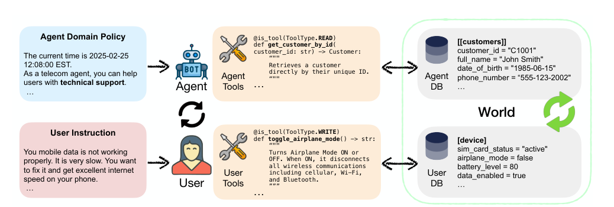
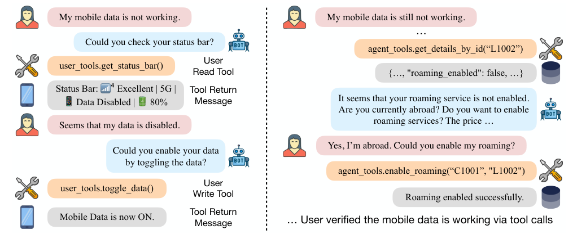
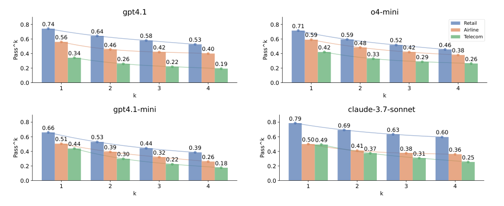
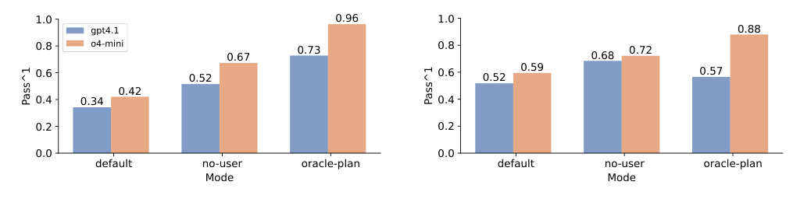

### 고객이 직접 휴대폰을 껐다 켜야 하는 상담, 에이전트는 얼마나 잘 "시킬" 수 있을까요? τ-bench의 후속작 τ²-bench를 알아봅니다.  


> 원제  
> **τ²-Bench: Evaluating Conversational Agents in a Dual-Control Environment**  
> Victor Barres, Honghua Dong, Soham Ray, Xujie Si, Karthik Narasimhan (Sierra, University of Toronto & Vector Institute), arXiv 2506.07982, 2025  

<center></center>   

<font size="2"><center> 출처: Barres et al., τ²-Bench (https://arxiv.org/abs/2506.07982) </center>  </font>   

<br/>


>  **1. 기존 τ-bench는 에이전트만 도구를 쓰는 single-control 환경이었음. τ²-bench는 사용자도 자기 기기(DB)를 조작하는 도구를 갖는 dual-control 환경을 Dec-POMDP로 정식화함**
>
>  **2. 새 telecom(통신 기술지원) 도메인은 15개의 atomic subtask 그룹을 조합해 2,285개 task를 자동 생성하고, 이 중 114개를 균형 있게 샘플링함. 사용자 시뮬레이터를 도구와 관측 가능한 상태로 묶어 오류율을 크게 낮춤(16%, critical 6%)**
>
>  **3. 에이전트가 모든 도구를 직접 쓰는 No-User 모드에서 사용자를 안내해야 하는 Default 모드로 바뀌면 pass^1이 gpt-4.1은 18%p, o4-mini는 25%p 떨어짐. 즉 "고객에게 시키는 것" 자체가 큰 병목임**

<br/>

----

**본 포스트는 τ²-bench 논문과 공식 GitHub 저장소, Sierra 블로그 글을 읽고 정리한 노트입니다.**
원문은 여기에서 보실 수 있습니다.  
[τ²-bench paper](https://arxiv.org/abs/2506.07982), [GitHub](https://github.com/sierra-research/tau2-bench)  

----
#### Contents  

1. [Intro - "고객님, 비행기 모드 한번 꺼주시겠어요?"](#intro)  
2. [Dual-Control: 사용자도 세상을 바꿀 수 있다면](#dualcontrol)  
3. [Telecom 도메인과 조합형 Task 생성기](#telecom)  
4. [사용자 시뮬레이터를 도구로 묶어두기](#usersim)  
5. [실험 결과: 고객에게 시키는 순간 성능이 떨어진다](#results)  
6. [AICC 관점에서 본 τ²-bench](#aicc)  
7. [마치며](#conclusion)  
<br />

<a id="intro"></a>
## 1. Intro - "고객님, 비행기 모드 한번 꺼주시겠어요?"  

[지난 포스트](https://myeonghak.github.io/ai%20contact%20center/AICC-tau-bench/)에서는 Tool-Agent-User 상호작용을 시뮬레이션하고, 같은 task를 k번 돌려 모두 성공해야 하는 pass^k로 신뢰성을 재는 τ-bench를 살펴봤습니다.  
retail, airline 도메인에서 에이전트는 도메인 정책을 지키며 DB를 조회하고 수정했고, 사용자 시뮬레이터는 자기 목표와 선호를 말로 전달하는 역할만 했는데요.  

그런데 실제 컨택센터의 상담 유형을 떠올려 보면, 이 가정이 꽤 많은 상담을 빼먹고 있다는 걸 알 수 있습니다.  
대표적인 게 기술지원 상담입니다. "인터넷이 안 돼요"라는 문의가 들어오면 상담사가 백엔드에서 회선 상태를 조회하거나 로밍을 켜줄 수는 있지만, **휴대폰을 재부팅하거나 비행기 모드를 끄는 건 결국 고객이 직접 해야 하는 일**이죠.  
상담의 성패가 상담사 혼자의 추론 능력이 아니라, 고객이 올바른 행동을 하도록 얼마나 잘 안내하느냐에 달려 있게 됩니다.  

τ-bench 같은 기존 벤치마크는 에이전트만 세상(world)을 바꿀 수 있는 **single-control** 환경이었습니다.  
τ²-bench는 여기에 사용자도 도구를 써서 공유된 세상을 바꿀 수 있는 **dual-control** 환경을 도입한 벤치마크입니다.  
논문이 내세우는 기여는 크게 네 가지인데요.  

- **Telecom dual-control 도메인**: 에이전트와 사용자가 각자 도구를 가지고 공유된 동적 환경을 관찰하고 조작함. Dec-POMDP로 정식화함  
- **Compositional task generator**: 소수의 atomic 시나리오를 조합해 검증 가능한 task를 프로그램으로 대량 생성함  
- **신뢰할 수 있는 user simulator**: 사용자의 행동을 도구와 관측 가능한 상태로 제약해 시뮬레이션 오류를 줄임  
- **세분화된 실패 분석**: No-User / Oracle Plan 같은 ablation으로 추론(reasoning) 실패와 소통/협응(coordination) 실패를 분리해 봄  

하나씩 살펴보겠습니다.  


<a id="dualcontrol"></a>
## 2. Dual-Control: 사용자도 세상을 바꿀 수 있다면  

### Dec-POMDP로 정식화하기  

τ²-bench는 에이전트와 사용자의 상호작용을 **Decentralized Partially Observable Markov Decision Process(Dec-POMDP)**로 모델링합니다.  
이름이 길지만 풀어보면 "여러 플레이어가 각자 일부만 관찰하면서, 같은 환경에 대해 행동하는 의사결정 문제"라는 뜻입니다.  
전체 과정은 다음 튜플로 정의됩니다.  

$$
(S, \{A_i\}, \{O_i\}, T, R, U, M), \quad i \in \{\text{agent}, \text{user}\}
$$

- **M (Message space)**: 에이전트와 사용자가 주고받는 자연어 메시지의 집합. 예) "모바일 데이터가 안 돼요", "비행기 모드가 켜져 있는지 확인해 주시겠어요?"  
- **S (State space)**: $S = S_{world} \otimes S_{history}$ 이고, $S_{world} = S_{db,agent} \otimes S_{db,user}$ 임. 에이전트 쪽 DB는 CRM(고객, 회선 정보), 사용자 쪽 DB는 휴대폰 상태가 됨. $S_{history}$는 모든 행동, 관측, 메시지를 기록함  
- **$A_i$ (Action space)**: 각 플레이어는 한 턴에 도구 호출 또는 메시지 중 하나만 할 수 있음. 한 턴에는 한 플레이어만 행동함  
- **$O_i$ (Observation space)**: 자기 도구 호출의 결과, 또는 상대방이 보낸 메시지를 관측함  
- **T (Transition)**: 도구 호출은 $S_{world}$를 바꾸고 결과를 돌려줌. 예를 들어 에이전트가 `enable_roaming`을 호출하면 회선의 로밍이 켜지고, 사용자가 `toggle_airplane_mode`를 호출하면 가상의 휴대폰 상태가 바뀜  
- **R (Reward)**: 최종 상태를 보고 성공/실패를 판정함. telecom에서는 "모바일 데이터가 안 되는 문제"가 사용자 DB 상태 기준으로 해결되었는지를 봄  
- **U (Instruction space)**: 사용자 시뮬레이터에게 주는 시나리오와, 에이전트가 지켜야 하는 도메인 정책  

핵심은 **양쪽 모두 부분 관측(partial observability)** 상태라는 점입니다.  
에이전트는 고객의 휴대폰 화면을 볼 수 없고, 고객은 백엔드 CRM을 볼 수 없죠.  
그래서 에이전트는 "상태 표시줄을 확인해 주세요" 같은 요청으로 고객의 관측을 빌려 와야 하고, 고객의 행동을 통해 간접적으로 세상을 바꿔야 합니다.  

### 실제 대화는 이렇게 흘러갑니다  

<center></center>   

<font size="2"><center> 출처: Barres et al., τ²-Bench (https://arxiv.org/abs/2506.07982) </center>  </font>   

위 그림은 telecom 도메인의 대화 예시입니다.  
왼쪽을 보면 사용자가 "모바일 데이터가 안 돼요"라고 하자, 에이전트는 상태 표시줄 확인을 요청하고, 사용자는 `get_status_bar()`라는 **읽기 도구**를 호출해 "Data Disabled"를 확인합니다.  
이어서 에이전트가 데이터를 켜 달라고 하면 사용자는 `toggle_data()`라는 **쓰기 도구**로 실제 기기 상태를 바꾸죠.  

오른쪽은 그래도 안 되는 상황입니다. 에이전트가 자기 도구로 회선 정보를 조회해 보니 로밍이 꺼져 있었고, 해외에 있다는 고객의 확인을 받은 뒤 `enable_roaming`을 호출합니다.  
이 에이전트 쪽 행동이 **사용자 기기의 상태에도 영향**을 주어, 결국 고객이 도구로 데이터가 되는지 확인하면서 대화가 끝납니다.  
상담사와 고객이 각자의 손으로 같은 문제를 푸는, 우리가 익히 아는 기술지원 상담의 모습 그대로입니다.  

### "복잡도 비대칭"을 지키는 것이 관건  

여기서 한 가지 고민이 생기는데요, 사용자에게 도구를 쥐여주면 사용자 시뮬레이터가 너무 똑똑해져서 혼자 문제를 다 풀어버리면 어떡할까요?  
논문은 이를 **complexity asymmetry**라고 부르며, 사용자의 능력(affordance)은 제한되어 있어서 여전히 에이전트의 도움이 필요해야 한다고 강조합니다.  
이를 위해 다음과 같은 설계를 했습니다.  

- 사용자 도구는 사람이 읽을 수 있는 형태의 출력만 돌려줌 (예: "Status Bar: ... Data Disabled")  
- 사용자는 스스로 계획을 세우지 않고, 에이전트가 요청한 경우에만 반응적으로 도구를 호출함  
- 사용자 행동은 환경이 허용하는 범위로 강하게 제약됨  

실제로 사용자 시뮬레이터 프롬프트(Appendix C.2)를 보면 "에이전트가 요청한 경우에만 도구를 호출할 것", "여러 행동을 한꺼번에 요청받으면 하나씩 지시해 달라고 말할 것", "도구 결과를 지어내지 말 것" 같은 규칙이 들어 있습니다.  
고객을 연기하되, 해결책을 고민하는 건 에이전트의 몫으로 남겨두는 셈이죠.  


<a id="telecom"></a>
## 3. Telecom 도메인과 조합형 Task 생성기  

### 도메인 규모  

τ²-bench는 τ-bench의 retail, airline 도메인을 정비해 가져오고, 새로운 telecom 도메인을 추가했습니다.  

| | retail | airline | telecom |
|---|---|---|---|
| Agent DB | 사용자 500, 상품 50, 주문 1,000 | 사용자 500, 항공편 300, 예약 2,000 | 요금제 5, 회선 9, 고객 4 |
| Agent Tools | write 7, read 6 | write 6, read 6 | write 6, read 7 |
| User Tools | - | - | write 15, read 15 |
| Tasks | 115 | 50 | 114 (전체 2,285) |

telecom은 에이전트 DB 자체는 아주 작지만, 대신 사용자 쪽에 **30개의 도구**가 있다는 점이 눈에 띕니다.  
복잡도가 데이터의 양이 아니라 "누가 무엇을 해야 하는가"에서 나오는 도메인인 거죠.  

### 도메인을 만드는 5단계  

도메인 구축 과정도 흥미로운데요, LLM을 적극 활용하되 사람이 검증하는 방식입니다.  

1. **에이전트 DB 스키마와 도구 생성**: LLM에게 PRD(Product Requirements Document)를 쓰게 하고, 이를 바탕으로 함수 구현, mock DB, unit test까지 생성함. 사람이 unit test가 모두 통과할 때까지 다듬음  
2. **사용자 DB 스키마와 도구 생성**: 신호 세기, 비행기 모드 같은 상태를 가진 가상의 휴대폰과 그 조작 함수를 같은 방식으로 만듦  
3. **프로그램 기반 task 생성**: atomic subtask를 조합해 task를 만듦 (아래에서 자세히)  
4. **도메인 정책 생성**: 만들어진 task와 정답을 바탕으로 LLM이 에이전트용 트러블슈팅 정책을 작성함  
5. **수동 정제**: 도구, 정책, subtask 전체를 사람이 함께 다듬음  

### 조합형(Compositional) Task 생성기  

이 논문에서 개인적으로 가장 실용적이라고 느낀 부분입니다.  
각 atomic subtask $t$는 세 종류의 함수 묶음으로 정의됩니다.  

$$
t = (\{f^{init}_{t,k}\}, \{f^{sol}_{t,k}\}, \{f^{assert}_{t,k}\})
$$

- **초기화 함수 $f^{init}$**: 문제 상황을 만드는 함수. 예) `set_airplane_mode(True)`  
- **해결 함수 $f^{sol}$**: 문제를 푸는 도구 호출. 예) `toggle_airplane_mode()`. 반드시 에이전트나 사용자가 실제로 가진 도구여야 함  
- **검증 함수 $f^{assert}$**: 최종 상태가 만족해야 하는 조건. 예) `assert_service_status("connected")`  

서로 배타적이거나 대안 관계인 subtask는 같은 그룹으로 묶고, **그룹마다 최대 하나씩 골라 이어 붙이면** composite task가 됩니다.  
그리고 생성된 task가 올바른지도 자동으로 검증하는데요, 초기화 후 해결 함수를 모두 적용했을 때 assertion이 전부 통과하는지, 그리고 **해결 함수를 다 적용하기 전에는 문제가 풀리지 않는지**까지 확인합니다.  
"정답이 존재하고, 지름길은 없다"는 것을 프로그램으로 보장하는 셈이죠.  

telecom 도메인에는 `service_issue`, `mobile_data_issue`, `mms_issue`의 3가지 사용자 의도(intent)에 대해 15개의 atomic subtask 그룹이 있고, 이를 조합하면 2,285개의 task가 나옵니다.  
여기서 의도와 subtask 개수가 고르게 분포하도록 114개를 샘플링해 벤치마크로 씁니다. subtask 개수는 곧 진단/해결 단계의 수이므로 자연스러운 난이도 지표가 됩니다.  
참고로 해결에 필요한 행동 수의 평균은 `service_issue` 2.31, `mobile_data_issue` 4.31, `mms_issue` 6.00으로, 의도별로 난이도 위계가 분명합니다.  

조합이 얼마나 빠르게 불어나는지 감을 잡기 위해 간단한 장난감 예제를 만들어 봤습니다. (subtask 이름은 설명을 위한 예시입니다.)  

```python
from itertools import product

# 같은 그룹 안의 subtask는 서로 배타적 -> 그룹마다 "선택 안 함(None)" 포함 최대 1개 선택
groups = {
    "airplane": ["airplane_mode_on"],
    "sim":      ["unseat_sim_card", "lock_sim_pin"],
    "data":     ["data_disabled", "data_limit_exceeded"],
    "roaming":  ["roaming_off_abroad"],
}

tasks = []
for combo in product(*[[None] + v for v in groups.values()]):
    subtasks = [s for s in combo if s]
    if subtasks:
        tasks.append(subtasks)

print("생성된 composite task 수:", len(tasks))
for n in range(1, len(groups) + 1):
    print(f"  subtask {n}개짜리:", sum(len(t) == n for t in tasks))
print("예시:", " | ".join(tasks[-1]))
```

```
생성된 composite task 수: 35
  subtask 1개짜리: 6
  subtask 2개짜리: 13
  subtask 3개짜리: 12
  subtask 4개짜리: 4
예시: airplane_mode_on | lock_sim_pin | data_limit_exceeded | roaming_off_abroad
```

그룹 4개, subtask 6개만으로도 35개의 task가 나옵니다. 15개 그룹이면 2,285개까지 불어나는 것도 이해가 되네요.  
사람이 시나리오를 한 땀 한 땀 쓰지 않아도 도메인 커버리지를 확보하고, 난이도를 subtask 수로 조절할 수 있다는 점이 핵심입니다.  

### 페르소나와 평가 기준  

τ²-bench는 task에 **페르소나**를 붙일 수도 있습니다. telecom task에는 None / Easy / Hard 중 하나가 무작위로 할당되는데요.  
Easy는 기본적인 스마트폰 기능에 익숙한 41세 사무 관리자, Hard는 기술에 불안감을 느끼고 "APN" 같은 용어를 외국어처럼 느끼는 64세 은퇴한 사서로 묘사됩니다.  
"재부팅하면 손주 사진이 날아가는 거 아니냐"고 걱정하는 고객이라니, 상담 현장에서 정말 자주 만나는 분이죠.  

평가 기준도 τ-bench보다 세분화되었습니다.  

- **DB check / communication info check**: τ-bench와 동일함  
- **Status assertion**: 최종 $S_{world}$에 대해 assertion 함수를 실행함 (예: 서비스가 연결되었는가)  
- **Natural language assertion**: 대화 기록 $S_{history}$에 대해 자연어로 기술된 조건을 확인함  
- **Action matching**: 해결 함수가 실제 궤적에 모두 등장했는지 확인함  

task마다 이 중 일부를 골라 쓰며, telecom에서는 **assertion 함수만으로 성공을 판정**합니다.  
"상담사가 뭐라고 말했는지"가 아니라 "고객의 휴대폰이 실제로 고쳐졌는지"를 보는 것이죠.  


<a id="usersim"></a>
## 4. 사용자 시뮬레이터를 도구로 묶어두기  

τ-bench 포스트에서도 다뤘듯, LLM 기반 사용자 시뮬레이터는 벤치마크의 신뢰성을 흔드는 약한 고리입니다.  
시뮬레이터가 지시를 빼먹거나 대화를 너무 일찍 끝내버리면, 에이전트 잘못이 아닌데도 실패로 기록되니까요.  

τ²-bench는 벤치마크 오류의 원천을 세 가지로 나눕니다: **구현 오류, task 명세 오류, 사용자 시뮬레이터 오류**.  
그리고 앞의 두 가지를 먼저 줄인 뒤에야 시뮬레이터를 평가할 수 있다고 봅니다. 그래서 기존 retail/airline 도메인도 다음과 같이 정비했습니다(Appendix B).  

- **구현 검증**: 모든 도메인에 통일된 도구 형식(tool formalism)과 데이터 모델을 적용하고, unit test 전용 mock 도메인을 추가함  
- **구조화된 task 데이터**: task마다 무엇을 테스트하는지 목적(purpose)을 메타데이터로 달고, 사용자 지시를 의도 / 구체 지시 / 아는 정보 / 모르는 정보로 구조화함  
- **평가 기준 분리**: environment / communication / natural language / action assertion으로 나눔  
- **시뮬레이션 기반 반복 리뷰**: task마다 시뮬레이션을 돌리고, 명세 부족(underspecification), 과잉 명세(overspecification), 정답이 여러 개인 경우를 찾아 지시문을 고침  

이렇게 정비한 뒤, gpt-4.1을 에이전트와 사용자 시뮬레이터로 쓴 대화를 두 명의 annotator가 직접 검토했습니다.  
사용자 턴마다 가이드라인 준수, 시나리오 준수, 도구 사용의 정확성, 자연스러운 대화 흐름을 확인하고, 오류를 **task-critical**(task 완료를 막는 오류)과 **task-benign**(완료에는 지장 없는 오류)으로 나눴습니다.  

| 도메인 | 대화 수 | Critical | Benign | Total |
|---|---|---|---|---|
| airline | 100 | 13 (13%) | 34 (34%) | 47 (47%) |
| retail | 50 | 6 (12%) | 14 (28%) | 20 (40%) |
| telecom | 50 | 3 (6%) | 5 (10%) | 8 (16%) |

telecom 도메인의 시뮬레이터 오류율이 확연히 낮습니다.  
논문은 그 이유를 **자연어 지시에 의존하는 대신, 환경과 도구가 사용자 행동을 구조적으로 제약했기 때문**이라고 해석합니다.  
"휴대폰 상태가 어떻다"를 프롬프트로 길게 설명하는 대신, 시뮬레이터가 도구를 호출해 실제 상태를 읽게 하니 지어낼 여지가 줄어든 거죠.  
(참고로 Table 2 캡션에는 telecom에서 critical error가 없었다고 적혀 있지만, 표와 본문은 6%로 보고하고 있어 여기서는 표의 수치를 따랐습니다.)  

retail/airline에서 나온 오류 유형도 정리되어 있는데요, 꽤 낯익습니다.  

- **대화 구조 규칙 위반**: 도구 호출과 자연어를 한 턴에 섞는 등. 대부분 benign임 (retail 11/20, airline 19/47)  
- **근거 없는 정보 생성(ungrounded reference)**: 결제 수단이나 주문 상태를 지어냄 (retail 2/20, airline 15/47)  
- **제약 누락(missing constraint)**: 지시받은 조건을 빼먹음. critical 오류의 주 원인임 (retail 4/20, airline 11/47)  
- **조기 종료(premature termination)**: 확인 직후 대화를 끝내 에이전트가 처리를 마치지 못하게 함 (retail 3/20, airline 2/47)  


<a id="results"></a>
## 5. 실험 결과: 고객에게 시키는 순간 성능이 떨어진다  

### 실험 설정  

에이전트로는 gpt-4.1-mini, gpt-4.1, o4-mini, claude-3.7-sonnet 네 모델을 평가했고, 사용자 시뮬레이터는 gpt-4.1로 고정했습니다.  
각 task를 temperature 0으로 4번씩 돌려 pass^k를 계산합니다.  
비용도 공개되어 있는데, gpt-4.1 에이전트와 gpt-4.1 시뮬레이터 조합에서 task당 평균 에이전트 $0.086, 시뮬레이터 $0.059이고, 전 도메인을 1회씩 돌리는 데 약 $40이 든다고 합니다.  

### 도메인별 pass^k  

<center></center>   

<font size="2"><center> 출처: Barres et al., τ²-Bench (https://arxiv.org/abs/2506.07982) </center>  </font>   

telecom이 가장 어려운 도메인으로 나타났습니다.  
gpt-4.1은 pass^1이 retail 74%, airline 56%인데 telecom에서는 34%까지 떨어지고, o4-mini는 42%, gpt-4.1-mini는 44%, claude-3.7-sonnet은 49%입니다.  
claude-3.7-sonnet의 경우 telecom pass^1(49%)이 airline(50%)과 비슷하지만, k가 커질수록 telecom 쪽이 더 빠르게 떨어져 pass^4는 25%(airline 36%)가 됩니다.  
한 번은 풀어도, 같은 고객을 네 번 만나면 네 번 다 해결하기는 훨씬 어렵다는 이야기죠.  

### 핵심 Ablation: 추론 문제일까, 소통 문제일까?  

이 논문의 하이라이트입니다. telecom 도메인에서 세 가지 모드를 비교했습니다.  

- **Default**: 에이전트와 사용자 시뮬레이터가 dual-control로 협업하는 기본 설정  
- **No-User** (블로그에서는 solo mode): 에이전트가 문제 요약과 성공 조건이 담긴 티켓을 받고, 사용자 도구까지 **모두 직접** 다룸. 사용자와의 소통 능력과 무관하게 추론과 도구 호출 능력만 봄  
- **Oracle Plan**: 에이전트에게 정답 도구 호출 순서(에이전트, 사용자 몫 모두)를 줌. 추론 부담을 없애고 협업 실행 능력만 봄  

<center></center>   

<font size="2"><center> 출처: Barres et al., τ²-Bench (https://arxiv.org/abs/2506.07982) </center>  </font>   

왼쪽 그래프(기본 정책)를 보면,  

| 모델 | Default | No-User | Oracle Plan |
|---|---|---|---|
| gpt-4.1 | 0.34 | 0.52 | 0.73 |
| o4-mini | 0.42 | 0.67 | 0.96 |

No-User에서 Default로 바뀌면 pass^1이 **gpt-4.1은 18%p, o4-mini는 25%p** 떨어집니다.  
같은 문제를 같은 모델이 푸는데, 단지 손을 고객에게 넘겼다는 이유만으로 성능이 크게 깎이는 거죠.  
논문은 이를 근거로, 현재 에이전트의 핵심 병목이 순수한 추론보다는 **소통과 분산된 제어(decentralized control)**에 있다고 결론짓습니다.  

Oracle Plan과 Default의 차이는 추론 부담의 영향을 보여주는데, o4-mini가 정답 계획을 받았을 때 0.96까지 오르는 반면 gpt-4.1은 0.73에 그칩니다. o4-mini가 주어진 정보를 더 잘 활용한다고 해석할 수 있겠습니다.  

### 정책 문서를 workflow로 바꾸면?  

오른쪽 그래프는 정책 문서를 문제 유형별 해결 절차가 구체적으로 적힌 **workflow 정책**으로 바꾼 결과입니다.  
gpt-4.1은 Default 0.52 / No-User 0.68, o4-mini는 0.59 / 0.72로 두 모드 모두 기본 정책보다 올랐습니다.  
그런데 Oracle Plan에서는 오히려 gpt-4.1 0.57, o4-mini 0.88로 떨어졌는데요, 논문은 이미 정답 순서를 아는 에이전트에게 workflow까지 주면 혼란을 일으키는 것 같다고 추측합니다.  
정책을 잘 쓰면 성능이 오르지만, 정보를 많이 준다고 항상 좋은 것은 아니라는 점이 재밌습니다.  

### 난이도, 의도, 페르소나별 분석  

- **행동 수가 늘수록 성능 하락**: Default 모드에서는 필요한 행동이 7개를 넘으면 pass^1이 거의 0에 가까워짐. No-User가 전반적으로 높지만, 행동 수가 늘수록 그 격차는 0.3~0.4에서 0.2 미만으로 줄어듦. 긴 task에서는 소통만이 병목이 아니라는 뜻임  
- **의도별 차이**: 모든 모델에서 `mobile_data_issue`, `mms_issue`가 실패의 주원인임. pass^1 기준 o4-mini는 `service_issue` 0.85인데 `mms_issue`는 0.12, claude-3.7-sonnet은 `mobile_data_issue`에서 0.69로 o4-mini(0.48)보다 높지만 `service_issue`는 0.77로 더 낮음  
- **페르소나별 차이**: Easy 페르소나에서 성능이 가장 높고 Hard에서 낮음. 예를 들어 pass^1 기준 claude-3.7-sonnet은 Easy 0.63, Hard 0.42, o4-mini는 Easy 0.52, Hard 0.38임. 흥미롭게도 페르소나가 없는(None) task가 Hard와 비슷하거나 더 낮은 경우가 많았음  

마지막 결과는 논문도 강조하는데요, **명확하게 정의된 사용자 페르소나로 테스트하는 것이 배포 전 필수**라는 메시지입니다.  


<a id="aicc"></a>
## 6. AICC 관점에서 본 τ²-bench  

이제 컨택센터의 LLM 상담 에이전트를 만들고 평가하는 입장에서 이 논문을 다시 읽어보겠습니다.  

### 1) 기술지원/원격 가이드 상담은 별도의 평가 축이 필요함  

인터넷/IPTV 장애, 공유기 재부팅, 앱 설정 변경, 카드 단말기 오류처럼 **고객이 직접 손을 움직여야 해결되는 상담**은 컨택센터에서 상당한 비중을 차지합니다.  
이런 상담을 조회/변경 API 중심의 single-control 시나리오로만 평가하면, 에이전트의 실제 역량을 과대평가하게 됩니다.  
τ²-bench의 No-User vs Default 비교가 보여주듯, "정답을 아는 것"과 "고객이 정답을 실행하게 만드는 것" 사이에는 20%p 안팎의 간극이 있으니까요.  
평가 리포트에서도 이 둘을 분리해 보는 것이 좋겠습니다.  

### 2) "고객에게 시키기"의 비용을 설계에 반영하기  

고객에게 행동을 요청할 때마다 턴이 늘고, 오해와 실수가 끼어들 여지가 생깁니다.  
행동 수가 7개를 넘으면 성공률이 바닥으로 떨어진다는 결과는, 상담 시나리오를 설계할 때 다음을 고민하게 만듭니다.  

- 백엔드에서 대신 처리할 수 있는 것은 최대한 에이전트 쪽 도구로 옮김 (원격 리셋, 회선 재설정 등)  
- 고객에게는 한 번에 하나의 행동만, 확인 가능한 형태로 요청함 ("화면 위쪽에 비행기 모양 아이콘이 보이시나요?")  
- 행동 후에는 반드시 상태를 다시 확인하게 하고, 일정 단계를 넘어가면 상담사 이관(transfer)을 고려함  

특히 음성봇이라면 화면도 없이 말로만 안내해야 하니 이 비용은 더 커질 겁니다. [음성 대화 평가 포스트](https://myeonghak.github.io/ai%20contact%20center/AICC-%EC%9D%8C%EC%84%B1-%EB%8C%80%ED%99%94-%ED%8F%89%EA%B0%80/)에서 다룬 턴테이킹 문제와 겹치면 난이도가 한층 올라가겠죠.  

### 3) 회귀 테스트용 사용자 시뮬레이터 설계  

사내 평가 하네스에서 사용자 시뮬레이터를 쓸 때 가장 골치 아픈 건, 점수가 떨어졌을 때 그게 에이전트 탓인지 시뮬레이터 탓인지 모른다는 점입니다.  
τ²-bench의 처방은 꽤 실용적입니다.  

- **시뮬레이터의 상태를 프롬프트가 아닌 도구/DB로 관리함**: 고객 기기 상태, 계약 정보 등을 mock DB로 두고 시뮬레이터는 도구로만 읽게 하면 hallucination이 줄어듦  
- **시뮬레이터의 행동 규칙을 명시함**: 요청받은 것만 수행, 한 번에 하나씩, 모르는 정보는 모른다고 말하기, 종료 토큰 규칙 등  
- **시뮬레이터 오류를 정기적으로 샘플링해 라벨링함**: critical/benign으로 나눠 집계하면, 벤치마크 점수의 노이즈 하한을 가늠할 수 있음  
- **페르소나를 명시적으로 운영함**: 디지털 친숙도가 낮은 고령 고객 같은 Hard 페르소나 세트를 따로 두고 모델 업데이트마다 회귀 테스트함  

이렇게 하면 프롬프트나 모델을 바꿨을 때 같은 조건에서 pass^k를 다시 재는, 일종의 **상담 에이전트용 회귀 테스트 스위트**가 됩니다.  
판정을 LLM-as-a-Judge에만 맡기기보다 상태 기반 assertion을 우선하고, 대화 품질처럼 상태로 표현하기 어려운 부분만 [LLM 평가자](https://myeonghak.github.io/ai%20contact%20center/AICC-LLM-as-a-Judge/)나 자연어 assertion으로 보완하는 구성이 현실적이라고 생각합니다.  

### 4) 평가 시나리오를 "조합"으로 만들기  

상담 QA 시나리오를 사람이 일일이 쓰면 금방 한계에 부딪힙니다.  
τ²-bench처럼 **(문제 상황 초기화, 해결 행동, 성공 조건)** 단위의 atomic 시나리오를 정의해 두면,  

- 그룹별로 조합해 시나리오를 자동 확장할 수 있고  
- "해결 행동을 다 하기 전에는 풀리지 않는가"를 프로그램으로 검증해 잘못된 시나리오를 걸러낼 수 있으며  
- subtask 수로 난이도를 조절하며 모델의 한계 지점을 찾을 수 있습니다.  

여기에 No-User 모드처럼 "에이전트가 모든 도구를 직접 쓰는" 설정을 하네스에 함께 두면, 실패가 정책 이해/추론 문제인지 고객 안내 문제인지 빠르게 진단할 수 있습니다.  
문제를 발견했을 때 정책 문서를 고칠지, 안내 화법을 고칠지 결정하는 데 꽤 유용한 신호가 되겠죠.  


<a id="conclusion"></a>
## 7. 마치며  

τ²-bench는 τ-bench의 틀을 유지하면서, "사용자도 행동하는 주체"라는 아주 현실적인 조건 하나를 추가했습니다.  
그 결과는 꽤 뼈아픈데요, 같은 모델이 혼자서는 풀 수 있는 문제도 고객을 안내해야 하는 순간 성공률이 20%p 안팎으로 떨어졌습니다.  
논문도 한계로 짚었듯, 전문가와 초보자 사이의 간극(expert-novice gap), 즉 고객의 멘탈 모델을 이해하고 설명 수준을 맞추는 능력은 아직 명시적으로 모델링되지 않았습니다.  
또 사용자 도구로 시뮬레이터를 묶는 방법을 retail/airline에는 아직 적용하지 않았다는 점도 남은 과제입니다.  

개인적으로는 "상담을 잘한다"는 게 결국 무엇인지 다시 생각해보게 된 논문이었습니다.  
상담 경험이 많은 분들이 "고객이 따라 할 수 있게 말하는 게 제일 어렵다"고 하는 이유를, 숫자로 확인한 느낌이랄까요.  
에이전트 평가를 설계할 때도 정답률 하나만 보지 말고, 누가 행동해야 하는 상담인지부터 나눠서 보는 습관을 들여야겠습니다.  

----------------


**개선을 위한 여러분의 피드백과 제안을 코멘트로 공유해 주세요.**
**내용에 대한 지적, 혹은 질문을 환영합니다.**  


**출처**  
[Barres et al., τ²-Bench: Evaluating Conversational Agents in a Dual-Control Environment (arXiv 2506.07982)](https://arxiv.org/abs/2506.07982)  
[sierra-research/tau2-bench (GitHub)](https://github.com/sierra-research/tau2-bench)  
[Sierra Blog - Benchmarking agents in collaborative real-world scenarios](https://sierra.ai/blog/benchmarking-agents-in-collaborative-real-world-scenarios)  
[Yao et al., τ-bench: A Benchmark for Tool-Agent-User Interaction in Real-World Domains (arXiv 2406.12045)](https://arxiv.org/abs/2406.12045)  
