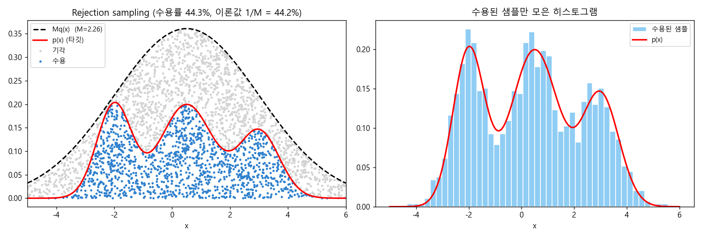
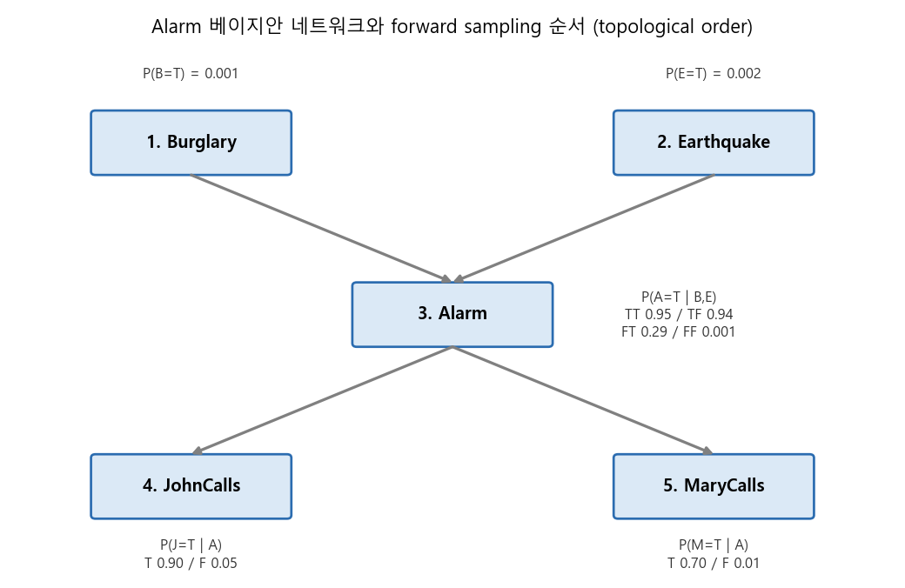
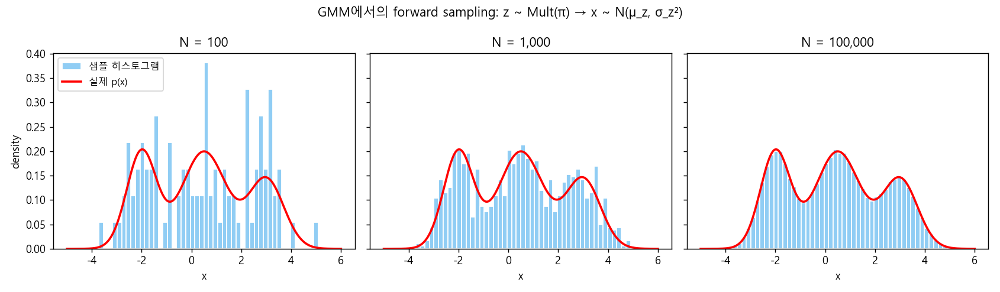
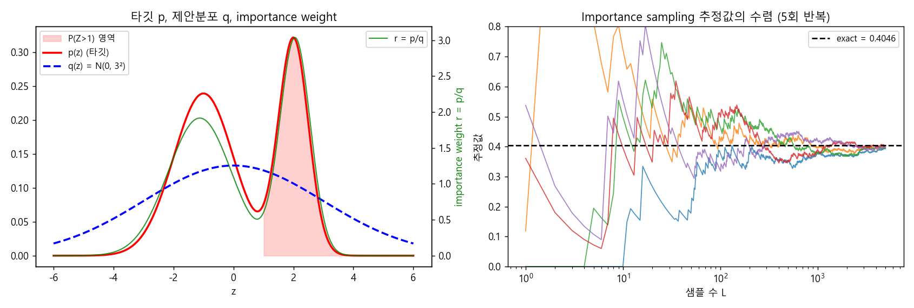
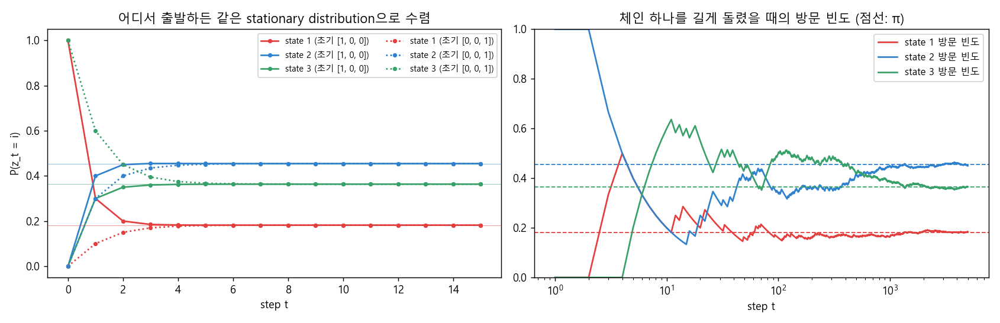

### 샘플을 뽑아서 확률을 추론하기: Forward, Rejection, Importance Sampling과 Markov Chain


> 계산하기 어려운 확률과 기댓값을 "직접 풀지 말고, 많이 뽑아서 세어 보자"는 sampling based inference의 기본 기법들과, MCMC의 토대가 되는 Markov chain의 성질을 살펴봅니다.  


<br>

<center></center>    


<br/>


>  **1. Forward sampling은 베이지안 네트워크(혹은 생성 모델)를 topological order대로 표집해 경험적 분포를 만들고, rejection sampling은 evidence와 맞지 않거나 p(x)/Mq(x) 비율 검사를 통과하지 못한 샘플을 버리는 방식이다. 둘 다 버려지는 샘플이 많아 비효율적이다**
>
>  **2. Importance sampling은 샘플링이 쉬운 q(z)에서 표집하고 importance weight p(z)/q(z)를 곱해 기댓값을 직접 추정한다. 이산 베이지안 네트워크에서는 likelihood weighting으로 구현된다**
>
>  **3. Irreducible하고 ergodic한 Markov chain은 초기 상태와 무관하게 유일한 stationary distribution으로 수렴하며, detailed balance를 만족하면 그 분포는 반드시 stationary다. MCMC는 원하는 분포를 stationary distribution으로 갖는 전이 규칙을 설계해 샘플링하는 방법이다**


<br/>

----

#### Contents

<br/>

1.	[왜 샘플링으로 추론하는가](#why-sampling)
2.	[Forward Sampling](#forward-sampling)
3.  [Rejection Sampling](#rejection-sampling)
4.  [Importance Sampling과 Likelihood Weighting](#importance-sampling)
5.  [Markov Chain과 Stationary Distribution](#markov-chain)
6.  [Markov Chain을 샘플링에 활용하기](#mc-for-sampling)

<br />

[지난 포스트](https://myeonghak.github.io/general%20machine%20learning/General-ML-train-set-batch-11.-%ED%9E%88%EB%93%A0-%EB%A7%88%EC%BD%94%ED%94%84-%EB%AA%A8%EB%8D%B8/)에서는 히든 마코프 모델과 forward-backward, Viterbi, 그리고 Baum-Welch(EM)를 통한 파라미터 학습을 살펴보았습니다. 지금까지 우리는 추론을 주로 "식을 정리해서 최적화하는" 방식으로 풀어왔는데요. 이번 시간부터는 관점을 조금 바꿔서, **샘플을 많이 뽑아서 세어 보는** 방식으로 추론하는 sampling based inference를 다뤄보려고 합니다. 이번 편에서는 기본적인 샘플링 기법과 Markov chain을, 다음 편에서는 이를 바탕으로 한 MCMC 알고리즘을 살펴보겠습니다.  


<a id="why-sampling"></a>
### 1. 왜 샘플링으로 추론하는가  

GMM이나 HMM에서 EM으로 parameter inference를 했던 것을 떠올려 보겠습니다. E step에서는 latent variable $Z$의 posterior $P(Z \mid X, \theta)$를 계산해야 했는데요, 모델이 단순할 때는 이 값을 닫힌 형태로 구할 수 있었지만 latent variable이 여러 단계로 얽힌 모델에서는 이 계산 자체가 버거워집니다.  

이럴 때 꺼낼 수 있는 다른 카드가 바로 sampling based approach입니다. 아이디어는 아주 단순합니다.  

- 확률 분포에서 샘플을 아주 많이 뽑음  
- 그 중 관심 있는 사건이 몇 번 나왔는지 셈  
- 그 비율(혹은 평균)로 확률이나 기댓값을 근사함  

동전이 앞면이 나올 확률을 모를 때 수식을 세우는 대신 만 번 던져 보는 것과 같은 이치죠. 대수의 법칙(law of large numbers) 덕분에 샘플 수가 늘어날수록 추정치는 참값에 가까워집니다. 이번 편에서는 가장 기본적인 forward sampling에서 출발해, 버려지는 샘플을 줄이기 위한 rejection, importance sampling을 거쳐, 샘플을 i.i.d가 아닌 "체인"으로 엮는 Markov chain까지 차례로 살펴보겠습니다.  


<a id="forward-sampling"></a>
### 2. Forward Sampling  

#### 베이지안 네트워크에서의 forward sampling  

가장 기본적인 샘플링 방법은 **forward sampling**입니다. 베이지안 네트워크가 주어졌을 때, 부모 노드부터 자식 노드 순서(topological order)로 조건부 확률표(CPT)를 따라 하나씩 값을 뽑는 방식입니다. 예제로는 베이지안 네트워크 편에서 익숙한 Alarm 네트워크를 사용하겠습니다.  

<br>

<center></center>    

<br>

한 번의 샘플링은 다음과 같이 진행됩니다.  

1) $B$를 $P(B)$에서 뽑음 → False  
2) $E$를 $P(E)$에서 뽑음 → False  
3) $A$를 $P(A \mid B=F, E=F)$에서 뽑음 → True  
4) $JC$를 $P(JC \mid A=T)$에서 뽑음 → True  
5) $MC$를 $P(MC \mid A=T)$에서 뽑음 → False  

이렇게 하면 $(B, E, A, JC, MC) = (F, F, T, T, F)$라는 샘플 하나가 완성됩니다. 이 과정을 무수히 반복한 뒤, 관심 있는 케이스의 개수를 세면 됩니다. 예를 들어 $P(E \mid MC)$가 궁금하다면 다음과 같이 계산합니다.  

$$
P(E=T \mid MC=T) = \frac{P(E=T, MC=T)}{P(MC=T)} \approx \frac{\#(E=T, MC=T)}{\#(MC=T)}
$$

#### 문제점  

간단하고 직관적이지만, 단점도 분명합니다.  

- 샘플링 기반이기 때문에 항상 샘플링 오차가 존재함  
- 오차를 무시할 수 있을 만큼 줄이려면 샘플이 매우 많이 필요함  
- 그만큼 시간이 오래 걸려 실제로 쓰기 어려운 경우가 많음  

특히 위 네트워크처럼 $P(B=T)=0.001$인 사건이 조건에 들어가면, 백만 개를 뽑아도 쓸모 있는 샘플은 천 개 남짓에 불과하겠죠.  

#### GMM에서의 forward sampling  

연속 분포에서도 똑같은 방식이 적용됩니다. GMM은 그 자체로 "생성 순서"가 정해진 모델인데요.  

- 먼저 mixture 중 하나를 가리키는 indicator $z$를 $\text{Mult}(\pi)$에서 뽑음  
- $z$가 정해지면 $x$를 $\mathcal{N}(\mu_z, \sigma_z^2)$에서 뽑음  

이를 아주 많이 반복하면 mixture distribution의 히스토그램, 즉 **경험적인 PDF**를 얻을 수 있고, 여기서 특정 구간(예: 0~5)의 확률이나 $\mu, \sigma, \pi$ 같은 값들을 추정할 수 있습니다.  

<br>

<center></center>    

<br>

샘플이 100개일 때는 들쭉날쭉하던 히스토그램이, 10만 개쯤 되면 실제 PDF와 거의 겹치는 것을 볼 수 있습니다. 요컨대 forward sampling은 **무수히 많은 샘플링으로 분포의 각 지점을 여러 번 찍어 보고, 이렇게 얻은 경험적 분포로 원하는 값을 추론하는 방법**이라고 정리할 수 있겠습니다.  


<a id="rejection-sampling"></a>
### 3. Rejection Sampling  

#### 이산 버전: evidence와 다르면 버린다  

Forward sampling을 조금 더 효율적으로 만들어 보겠습니다. 관심 있는 변수(evidence)가 원하는 값으로 나올 때만 topological order를 따라 계속 표집하고, 그렇지 않으면 그 자리에서 **기각(reject)** 하자는 아이디어입니다.  

예를 들어 $P(E=T \mid MC=T, A=F)$를 알고 싶다면,  

- 베이지안 네트워크에서 샘플링을 진행하다가 $A=T$가 나오면 즉시 버림  
- $MC=F$가 나와도 버림  
- 끝까지 살아남은 샘플 중 $E=T$인 비율을 계산함  

$$
\hat{P}(E=T \mid MC=T, A=F) = \frac{\#(E=T, MC=T, A=F)}{\#(\text{기각되지 않고 살아남은 샘플})}
$$

중간에 버리기 때문에 계산은 조금 아낄 수 있지만, 결국 남는 샘플의 수는 forward sampling과 똑같습니다. evidence의 확률이 낮으면 대부분의 샘플이 버려지는 구조적 한계는 그대로인 셈이죠.  

#### 연속 버전: envelope 분포 $Mq(x)$  

이번에는 numerical한 관점에서 보겠습니다. 다음과 같은 상황을 가정합니다.  

- 타깃 분포 $p(x)$: 직접 샘플링하기는 어렵지만, 주어진 $x$에서 값은 계산할 수 있음  
- 제안 분포 $q(x)$: 정규분포처럼 샘플링이 쉬운 분포  
- 상수 $M$: 모든 $x$에 대해 $p(x) \le Mq(x)$가 되도록 하는 scaling 상수. 즉 $Mq(x)$가 $p(x)$를 위에서 덮는 envelope 역할을 함  

알고리즘은 다음과 같습니다.  

1) $x_i \sim q(x)$를 뽑음  
2) $u \sim \text{Uniform}(0, 1)$을 뽑음  
3) $u \le \dfrac{p(x_i)}{Mq(x_i)}$이면 수용, 아니면 기각  

이산 버전에서는 evidence와 맞는지 아닌지로 step function처럼 기각 여부가 결정됐다면, 여기서는 **두 분포 값의 비율**로 확률적으로 결정하는 것이 차이입니다. 그림으로 보면, $Mq(x)$ 아래에 균일하게 점을 뿌리고 $p(x)$ 곡선 아래에 떨어진 점만 남기는 것과 같습니다. 맨 위 대표 이미지가 바로 그 모습인데요, 수용된 점들만 모아 히스토그램을 그리면 $p(x)$를 잘 따라가는 것을 확인할 수 있습니다.  

왜 이렇게 하면 $p(x)$를 따르는 샘플이 나올까요? 수용된 샘플의 밀도는 다음과 같이 쓸 수 있습니다.  

$$
q(x) \cdot \frac{p(x)}{Mq(x)} = \frac{p(x)}{M} \propto p(x)
$$

또한 전체 수용률은 $\int p(x)/M \, dx = 1/M$입니다. 위 그림에서도 실제 수용률 44.3%가 이론값 $1/M \approx 44.2\%$와 거의 같게 나왔습니다.  

#### GMM에 적용할 때의 딜레마  

GMM처럼 봉우리가 여러 개인 분포에 rejection sampling을 적용할 때는,  

- 여러 개의 $q$를 섞은 mixture를 제안 분포로 쓸 수도 있고  
- 하나의 단일 분포를 쓸 수도 있음  

후자의 경우 $M$을 충분히 크게 잡지 않으면 $Mq(x)$가 mixture distribution을 다 덮지 못해 분포를 제대로 추정하지 못하게 됩니다. 그렇다고 $M$을 키우면 수용률 $1/M$이 떨어져 버려지는 샘플이 늘고 시간이 오래 걸리죠. 고차원이나 큰 규모의 베이지안 네트워크에서는 이 낭비가 기하급수적으로 커지기 때문에 역시 적절하지 않습니다.  


<a id="importance-sampling"></a>
### 4. Importance Sampling과 Likelihood Weighting  

#### 히스토그램이 목표는 아니다  

Forward, rejection sampling은 너무 많은 샘플을 버린다는 문제가 있었습니다. 여기서 한 걸음 물러나 생각해 보면, 우리가 히스토그램을 그려 온 것은 그 자체가 목적이 아니었습니다. 진짜 목표는 **어떤 기댓값이나 확률값을 계산하는 것**이었죠. 그렇다면 분포 전체를 재현하지 않고도, 원하는 질문에만 답할 수 있으면 충분합니다. 이를 수리적으로 풀어낸 것이 **importance sampling**입니다.  

#### 기댓값을 $q$로 바꿔 쓰기  

함수 $f(z)$의 기댓값을 알고 싶다고 하겠습니다. $z$가 $p(z)$를 따른다면,  

$$
\mathbb{E}_p[f] = \int f(z)\, p(z)\, dz
$$

입니다. 여기에 샘플링이 쉬운 분포 $q(z)$를 곱하고 나누어 끼워 넣으면,  

$$
\mathbb{E}_p[f] = \int f(z) \frac{p(z)}{q(z)}\, q(z)\, dz = \mathbb{E}_q\left[ f(z) \frac{p(z)}{q(z)} \right] \approx \frac{1}{L} \sum_{l=1}^{L} r^l f(z^l), \quad z^l \sim q(z)
$$

가 됩니다. 무한히 샘플링할 수는 없으므로 적분을 $L$개 샘플의 평균으로 근사한 것이죠. 여기서 $r^l = p(z^l)/q(z^l)$을 **importance weight**라고 부릅니다. $q$에서 너무 자주 뽑히는 곳은 가중치를 낮추고, $p$에 비해 덜 뽑히는 곳은 가중치를 높여 보정해 주는 역할입니다. 샘플을 하나도 버리지 않는다는 점이 핵심입니다.  

#### 정규화 상수를 모를 때  

현실에서는 $p(z) = \tilde{p}(z)/Z_p$처럼 정규화되지 않은 형태 $\tilde{p}$만 계산할 수 있는 경우가 많습니다(베이즈 정리의 분모를 모르는 posterior가 대표적이죠). $q$도 마찬가지로 $q = \tilde{q}/Z_q$라 하면,  

$$
\mathbb{E}_p[f] = \frac{Z_q}{Z_p} \int f(z) \frac{\tilde{p}(z)}{\tilde{q}(z)} q(z)\, dz \approx \frac{Z_q}{Z_p} \frac{1}{L} \sum_{l=1}^{L} \tilde{r}^l f(z^l), \quad \tilde{r}^l = \frac{\tilde{p}(z^l)}{\tilde{q}(z^l)}
$$

이고, 같은 샘플로 $Z_p/Z_q \approx \frac{1}{L}\sum_l \tilde{r}^l$도 추정할 수 있습니다. 둘을 합치면 정규화 상수 없이도 계산 가능한 **self-normalized importance sampling**이 됩니다.  

$$
\mathbb{E}_p[f] \approx \sum_{l=1}^{L} w^l f(z^l), \quad w^l = \frac{\tilde{r}^l}{\sum_{m} \tilde{r}^m}
$$

#### 예제: $P(Z > 1)$ 추정  

$p(z)$에서 직접 샘플링은 못 하지만 확률값 계산(probability evaluation)은 가능하다고 가정하겠습니다. 확률도 결국 기댓값의 일종이므로, indicator function을 $f$로 두면 됩니다.  

$$
P(Z > 1) = \int I(z > 1)\, p(z)\, dz = \int I(z > 1) \frac{p(z)}{q(z)} q(z)\, dz \approx \frac{1}{L} \sum_{l=1}^{L} I(z^l > 1)\, r^l
$$

$p$가 mixture model처럼 복잡한 형태라도 값만 계산할 수 있으면 이 방법이 그대로 통합니다. 2개의 component를 가진 GMM에 대해 직접 해 보겠습니다.  

```python
import numpy as np
from scipy.stats import norm
rng = np.random.default_rng(42)

# 타깃 p(z): 2-component GMM (직접 샘플링은 어렵다고 "가정")
pis, mus, sds = np.array([0.6, 0.4]), np.array([-1.0, 2.0]), np.array([1.0, 0.5])
p = lambda z: (pis * norm.pdf(z[:, None], mus, sds)).sum(axis=1)
p_tilde = lambda z: 7.3 * p(z)          # normalizing constant를 모르는 경우

# 제안 분포 q(z): 샘플링이 쉬운 넓은 정규분포
L = 10_000
z = rng.normal(0, 3, L)
q = norm.pdf(z, 0, 3)
f = (z > 1).astype(float)                # identity function I(z > 1)

r = p(z) / q                             # importance weight
print('IS 추정            :', round(np.mean(f * r), 4))
w = p_tilde(z) / q
print('self-normalized IS :', round(np.sum(f * w) / np.sum(w), 4))
print('Exact              :', round((pis * norm.sf(1, mus, sds)).sum(), 4))
```

```
IS 추정            : 0.4031
self-normalized IS : 0.4025
Exact              : 0.4046
```

정규화 상수를 일부러 망가뜨린 $\tilde{p}$로도 self-normalized 버전은 정답에 가깝게 추정하는 것을 볼 수 있습니다.  

<br>

<center></center>    

<br>

왼쪽 그림의 초록 선이 importance weight인데, $p$가 $q$보다 뾰족한 $z \approx 2$ 부근에서 가중치가 3 가까이 커집니다. 오른쪽은 샘플 수가 늘어남에 따라 추정값이 정답으로 모여드는 모습입니다. 한 가지 주의할 점은, $q$가 $p$의 꼬리를 충분히 덮지 못하면 가끔 엄청나게 큰 가중치가 튀어나와 분산이 폭발한다는 것입니다. 그래서 $q$는 $p$보다 약간 넓게 잡는 것이 안전합니다.  

#### Likelihood Weighting: 이산 도메인의 importance sampling  

이제 다시 Alarm 네트워크로 돌아가 $P(E=T \mid MC=T, A=F)$를 구해 보겠습니다. 이산 베이지안 네트워크에서의 importance sampling을 **likelihood weighting**이라고 부릅니다. 핵심은 evidence 변수는 **뽑지 않고 관측값으로 고정**하되, 그 값이 나올 likelihood를 가중치에 곱해 주는 것입니다.  

1) $SumSW = NormSW = 0$으로 초기화  
2) 아래를 여러 번 반복  
   - Sampling weight $SW = 1$  
   - $B$, $E$를 평소처럼 샘플링 → 예: $B=F, E=F$  
   - $A$는 evidence이므로 $A=F$로 고정하고, $SW \leftarrow SW \times P(A=F \mid B=F, E=F) = 1 \times 0.999$  
   - $JC$는 평소처럼 샘플링 → 예: True (질의와 무관하므로 중요하지 않음)  
   - $MC$는 evidence이므로 $MC=T$로 고정하고, $SW \leftarrow SW \times P(MC=T \mid A=F) = 0.999 \times 0.01$  
   - 이 샘플에서 $E=T$였다면 $SumSW \mathrel{+}= SW$  
   - 모든 샘플에 대해 $NormSW \mathrel{+}= SW$  
3) $SumSW / NormSW$를 반환  

강의 메모에는 $E=T$가 아닌 경우에만 $NormSW$에 더하는 것처럼 적혀 있었는데, 표준적인 likelihood weighting에서는 **모든 샘플의 가중치**를 $NormSW$에 더해 정규화합니다(앞의 self-normalized 식에서 분모 $\sum_m \tilde{r}^m$에 해당). 이렇게 보면 연속 버전과의 대응도 명확해집니다.  

| 연속 importance sampling | Likelihood weighting |
|---|---|
| 제안 분포 $q(z)$ | evidence를 고정한 채 나머지를 prior대로 뽑는 분포 |
| importance weight $p/q$ | evidence 노드들의 likelihood 곱 $SW$ |
| 분자 $\sum_l \tilde{r}^l f(z^l)$ | $SumSW$ |
| 분모 $\sum_l \tilde{r}^l$ | $NormSW$ |

세 방법을 실제로 비교해 보겠습니다. 백만 개를 뽑아서 forward → rejection 결과와 likelihood weighting 결과를 정답과 비교합니다.  

```python
import numpy as np
rng = np.random.default_rng(0)
N = 1_000_000

# Alarm 네트워크 CPT
P_B, P_E = 0.001, 0.002
P_A = {(1, 1): 0.95, (1, 0): 0.94, (0, 1): 0.29, (0, 0): 0.001}
P_J = {1: 0.90, 0: 0.05}
P_M = {1: 0.70, 0: 0.01}

def bern(p):
    return rng.random(N) < p

# 1) Forward sampling: topological order대로 전부 표집
B = bern(P_B)
E = bern(P_E)
pA = np.select([B & E, B & ~E, ~B & E], [P_A[1, 1], P_A[1, 0], P_A[0, 1]], P_A[0, 0])
A = rng.random(N) < pA
J = rng.random(N) < np.where(A, P_J[1], P_J[0])
M = rng.random(N) < np.where(A, P_M[1], P_M[0])

# 2) Rejection: evidence(MC=T, A=F)와 맞지 않는 샘플은 버림
keep = M & ~A
print('살아남은 샘플 수:', keep.sum(), '/', N)
print('Rejection 추정 P(E=T|MC=T,A=F):', round(E[keep].mean(), 5))

# 3) Likelihood weighting: evidence는 고정하고 likelihood를 가중치로 곱함
SW = (1 - pA) * P_M[0]            # P(A=F|B,E) * P(MC=T|A=F)
print('Likelihood weighting 추정:', round(SW[E].sum() / SW.sum(), 5))

# 정답(exact)
num = P_E * sum((P_B if b else 1 - P_B) * (1 - P_A[b, 1]) for b in (0, 1))
den = num + (1 - P_E) * sum((P_B if b else 1 - P_B) * (1 - P_A[b, 0]) for b in (0, 1))
print('Exact:', round(num / den, 5))
```

```
살아남은 샘플 수: 9944 / 1000000
Rejection 추정 P(E=T|MC=T,A=F): 0.00201
Likelihood weighting 추정: 0.00141
Exact: 0.00142
```

백만 개를 뽑았는데 rejection에서 살아남은 샘플은 1% 남짓이고, 그 안에서 $E=T$인 샘플은 고작 스무 개 정도라 추정값이 정답보다 40% 넘게 어긋났습니다. 반면 likelihood weighting은 모든 샘플을 가중치와 함께 활용하기 때문에 훨씬 정확합니다.  


<a id="markov-chain"></a>
### 5. Markov Chain과 Stationary Distribution  

#### EM을 샘플링으로 바꿔 보면  

앞으로 배울 Gibbs sampling은 Metropolis-Hastings(MH) 알고리즘의 special case이고, MH를 이해하려면 Markov chain을 먼저 알아야 합니다. 그 전에 왜 이 이야기가 나오는지 EM을 잠깐 복습해 보겠습니다.  

- EM은 latent variable을 포함한 모델의 maximum likelihood solution을 찾는 알고리즘임  
- $P(X \mid \theta)$를 $Z$에 대해 marginalize하면 $\log \sum_Z$ 형태가 생겨 직접 최적화가 어려웠음  
- 그래서 부등식(Jensen)으로 lower bound를 만들고, E step과 M step을 번갈아 수행하는 coordinate update로 해결했음  

sampling based inference가 끼어드는 곳은 바로 E step, 즉 "$P(Z \mid X, \theta)$에 따라 $Z$를 할당하는" 부분입니다. 기존에는 이 posterior를 계산(최적화)해서 구했다면, 이제는 **$Z$를 계속 샘플링해서 할당하고, 그 과정에서 최적화된 $\theta$를 얻자**는 전략입니다. 사실 GMM처럼 단순한 모델에서는 굳이 이럴 필요가 없고, LDA처럼 여러 단계의 latent variable이 순차적으로 연결된 모델에서 진가를 발휘합니다(LDA는 다음 편에서 다룹니다).  

여기서 중요한 차이가 하나 있습니다. 지금까지의 forward, rejection, importance sampling은 모두 **매 샘플이 i.i.d.** 였습니다. 반면 MH와 Gibbs sampling은 Markov chain을 이용해 이전 샘플을 참고하여 다음 샘플을 만들어 내기 때문에, 앞에서처럼 샘플을 대량으로 버리지 않아도 됩니다.  

#### Markov Chain의 구성  

Markov chain은 노드와 링크로 생각할 수 있습니다.  

- **노드**: 시스템이 각 state에 있을 확률 분포 벡터를 가짐  
  - concrete한 관측: $[1, 0, 0]$ (확실히 state 1에 있음)  
  - stochastic한 관측: $[0.7, 0.2, 0.1]$  
- **링크**: 확률적인 state 천이를 나타내며, 천이 확률 행렬 $T$를 가짐. 예를 들어 지금 state 1에 있다면 다음 state의 분포가 $[0.3, 0.4, 0.3]$인 식임  

노드의 분포 벡터에 천이 행렬을 곱하면 다음 시점의 분포가 됩니다.  

$$
P(z_{t+1}) = P(z_t)\, T, \quad T_{ij} = P(z_{t+1}=j \mid z_t=i)
$$

이렇게 다음 상태가 오직 현재 상태에만 의존하며 확률적으로 천이해 나가는 사슬을 Markov chain이라고 부릅니다.  

#### Markov Chain의 성질들  

- **Accessible**: $i$에서 $j$로 (몇 단계를 거치든) 천이될 확률이 0보다 크면 $j$는 $i$에서 accessible함. 양방향으로 accessible하면 $i$와 $j$는 **communicate**한다고 함  
- **Irreducibility**: 모든 state 쌍이 서로 communicate하는 체인. 즉 어디서 출발하든 결국 모든 state에 갈 수 있음  
- **Periodicity**: state $i$로 돌아올 수 있는 단계 수들의 최대공약수 $d$를 주기라 함. 4, 8, 12단계마다만 돌아올 수 있다면 $d=4$이고, 7, 8, 13단계처럼 최대공약수가 1이면 주기가 없는 **aperiodic**임  
- **Transience와 Recurrence**: state $j$에서 출발해 언젠가 $j$로 돌아올 확률이 1이면 recurrent, 1보다 작아 영영 돌아오지 못할 가능성이 있으면 transient임  
- **Ergodicity**: (positive) recurrent하면서 aperiodic한 state를 ergodic하다고 하고, 모든 state가 ergodic하면 체인도 ergodic함  

#### Stationary Distribution과 Limit Theorem  

MH 알고리즘이 동작하는 핵심이 바로 **stationary distribution**입니다. 먼저 return time $RT_i$를 state $i$에서 출발해 다시 $i$로 돌아오는 데 걸리는 시간으로 정의합니다.  

**Limit theorem**: Markov chain이 irreducible하고 ergodic하다면(모든 state가 communicate하고 recurrent, aperiodic하다면),  

$$
\lim_{t \to \infty} P(z_t = j \mid z_0 = i) = \pi_j
$$

가 초기 상태 $i$와 무관하게 존재하고, 다음을 만족합니다.  

- $\pi_j = \dfrac{1}{\mathbb{E}[RT_j]}$: 평균적으로 자주 돌아오는 state일수록 머무는 비중이 큼  
- $\pi$는 다음 세 조건으로 **유일하게** 결정됨  

$$
\pi_j \ge 0, \quad \sum_j \pi_j = 1, \quad \pi = \pi T
$$

앞의 두 조건은 확률 분포가 되기 위한 조건이고, 마지막 조건이 핵심입니다. 노드마다 정의되는 일반적인 state 분포는 천이할 때마다 바뀌지만, stationary distribution은 **한 번 더 천이시켜도 그대로**입니다. 결국 천이 행렬 $T$만 주어지면 이 연립방정식을 풀어 $\pi$를 계산할 수 있습니다.  

#### Reversibility와 Detailed Balance  

Stationary보다 더 강한 조건이 있습니다. 다음 **detailed balance**(balance equation)를 만족하는 체인을 reversible Markov chain이라고 합니다.  

$$
\pi_i T_{ij} = \pi_j T_{ji} \quad \text{for all } i, j
$$

stationary 상태에서 $i \to j$로 흘러가는 확률 질량과 $j \to i$로 흘러오는 확률 질량이 정확히 같다는 뜻입니다. 이 조건이 성립하면 양변을 $i$에 대해 더해서 바로 stationary임을 보일 수 있습니다.  

$$
\sum_i \pi_i T_{ij} = \sum_i \pi_j T_{ji} = \pi_j \sum_i T_{ji} = \pi_j
$$

즉 **reversible이면 $\pi$는 stationary distribution**이지만(충분조건), **stationary라고 해서 reversible인 것은 아닙니다**. 직접 확인해 보겠습니다.  

```python
import numpy as np

T = np.array([[0.3, 0.4, 0.3],
              [0.2, 0.6, 0.2],
              [0.1, 0.3, 0.6]])

# (1) 아무 초기 분포에서 출발해 T를 계속 곱하기
P = np.array([1.0, 0.0, 0.0])
for t in range(50):
    P = P @ T
print('50 step 후      :', P.round(4))

# (2) pi T = pi, sum(pi) = 1 을 연립방정식으로 풀기
A = np.vstack([(T.T - np.eye(3))[:-1], np.ones(3)])
pi = np.linalg.solve(A, [0, 0, 1])
print('연립방정식 해 pi:', pi.round(4))
print('pi T            :', (pi @ T).round(4))

# (3) 기대 return time의 역수
rng = np.random.default_rng(0)
s, visits = 0, []
for t in range(200_000):
    s = rng.choice(3, p=T[s])
    visits.append(s)
visits = np.array(visits)
rt = np.diff(np.flatnonzero(visits == 0))
print('1 / E[RT_0]     :', round(1 / rt.mean(), 4))

# (4) detailed balance 확인: pi_i T_ij == pi_j T_ji ?
F = pi[:, None] * T
print('detailed balance:', np.allclose(F, F.T))
```

```
50 step 후      : [0.1818 0.4545 0.3636]
연립방정식 해 pi: [0.1818 0.4545 0.3636]
pi T            : [0.1818 0.4545 0.3636]
1 / E[RT_0]     : 0.1821
detailed balance: False
```

$\pi = (2/11, 5/11, 4/11)$이 세 가지 방법(반복 곱셈, 연립방정식, return time)에서 모두 일치합니다. 하지만 $\pi_1 T_{12} = \frac{2}{11} \times 0.4 \ne \pi_2 T_{21} = \frac{5}{11} \times 0.2$이므로 detailed balance는 성립하지 않습니다. stationary지만 reversible하지는 않은 예시인 셈이죠.  

<br>

<center></center>    

<br>

왼쪽은 서로 다른 초기 분포에서 출발해도 몇 step 만에 같은 $\pi$로 수렴하는 모습이고, 오른쪽은 체인 하나를 길게 돌렸을 때 각 state의 방문 빈도가 $\pi$로 수렴하는 모습입니다. 이 오른쪽 그림이 바로 다음 절의 핵심 아이디어입니다. **체인을 오래 돌리면서 방문한 state들을 기록하면, 그것이 곧 $\pi$에서 뽑은 샘플이 된다**는 것이죠.  


<a id="mc-for-sampling"></a>
### 6. Markov Chain을 샘플링에 활용하기  

지금까지 Markov chain이 무엇인지, 어떤 성질을 갖는지, stationary distribution이 어떻게 정의되는지, 그리고 그보다 강한 reversibility까지 살펴봤습니다. 이 모든 것은 결국 샘플링 기반으로 inference하기 위한 준비였는데요.  

기존 forward, rejection, importance sampling의 문제점을 다시 정리하면,  

1) 조건에 맞지 않는 샘플을 버림  
2) 샘플들이 서로 i.i.d.라서 이전에 얻은 정보를 다음 샘플에 활용하지 못함  

#### $Z$를 프로세스의 형태로 할당하기  

결국 핵심 문제는 latent variable $Z$에 값을 잘 할당(assign)하는 것입니다. 예를 들어 $P(E \mid MC=T, A=F)$를 알고 싶을 때 $E$가 latent variable이라면, 주어진 evidence 하에서 코인 토스를 해서 $E$에 값을 할당해 보자는 것이죠. 이렇게 하면 EM의 E step을 최적화가 아니라 샘플링으로 수행할 수 있습니다.  

여기에 Markov chain의 아이디어를 더해, 할당을 하나의 **확률 과정(stochastic process)** 으로 만듭니다.  

- 1번 스텝에서 할당한 값의 정보를 바탕으로 2번 스텝의 값을 할당함  
- 2번 스텝의 정보로 3번 스텝을 할당하는 식으로 계속 진행함  
- 다음 할당은 오로지 현재 state에만 의존하므로, 이 할당의 시퀀스는 Markov chain이 됨  

#### Markov Chain Theory vs MCMC  

같은 Markov chain을 다루지만 두 분야는 문제를 푸는 방향이 정반대입니다.  

| | Markov Chain Theory | Markov Chain Monte Carlo |
|---|---|---|
| 주어진 것 | 전이 규칙 $P(z^{t+1} \mid z^t)$ | 타깃 분포 $\pi(z)$ |
| 구하려는 것 | stationary distribution $\pi(z)$ | $\pi(z)$에 도달하는 효율적인 전이 규칙 |

MCMC는 **우리가 원하는 분포 $\pi(z)$를 stationary distribution으로 갖는 Markov chain을 설계하고, 그 체인을 돌려 샘플을 얻는 알고리즘**입니다. 앞 절에서 detailed balance가 stationary의 충분조건이라는 것을 봤는데요, 덕분에 "detailed balance를 만족하도록 $T$를 만들기만 하면 $\pi$가 stationary임이 보장된다"는 설계 전략이 가능해집니다.  

동작 방식은 다음과 같습니다.  

- 처음에는 임의의 초기점에서 마구잡이로 할당하며 체인을 시작함  
- 이전 할당을 참조해 다음 할당을 확률적으로 결정하는 과정을 반복함  
- 충분히 반복하면 할당의 분포가 우리가 원하는 stationary distribution에 가까워짐  

#### 베이지안 네트워크 위에서의 MCMC  

Alarm 네트워크에서 $A$와 $MC$만 관측되었다고 해 보겠습니다. 이 두 노드가 evidence이고, 나머지 $B, E, JC$는 latent variable $Z$가 됩니다. MCMC는 $Z$의 가능한 할당들, 즉 state 사이를 확률적으로 오가며 진행됩니다. 어디로 튈지는 매번 알 수 없지만, 잘 설계된 전이 규칙을 따르면 자주 등장해야 할 likely한 할당에는 오래 머물고, unlikely한 할당에는 잠깐 들르는 식으로 $Z$의 공간을 탐색하게 됩니다. 그렇게 모은 할당의 빈도가 곧 $P(Z \mid \text{evidence})$의 추정치가 되는 것이죠.  

그렇다면 "잘 설계된 전이 규칙"은 구체적으로 어떻게 만들까요? 그 답이 바로 다음 편에서 다룰 **Metropolis-Hastings 알고리즘**과, 그 special case인 **Gibbs sampling**입니다.  


<br>

----------------

<a id="conclusion"></a>
### 닫으며  

지금까지 샘플을 뽑아 확률을 추론하는 기본 기법들을 살펴보았습니다. 모든 변수를 뽑는 forward sampling, 조건에 맞지 않으면 버리는 rejection sampling, 버리는 대신 가중치를 곱하는 importance sampling(likelihood weighting)으로 점점 효율을 높여 왔고, 마지막으로 샘플을 i.i.d.가 아닌 체인으로 엮기 위한 도구로 Markov chain의 stationary distribution과 detailed balance를 정리했습니다.  
다음 포스트에서는 이 토대 위에서 **MCMC - Metropolis-Hastings와 Gibbs Sampling**을 알아보고, LDA에 Gibbs sampling을 적용하는 과정까지 살펴보겠습니다.  

**개선을 위한 여러분의 피드백과 제안을 코멘트로 공유해 주세요.**
**내용에 대한 지적, 혹은 질문을 환영합니다.**  

해당 포스트는 카이스트 문일철 교수님의 동의를 얻고, 강좌 내용과 자료, 그리고 reference의 자료를 참고하여 작성되었습니다. 원 강좌는 [여기](https://www.youtube.com/playlist?list=PLbhbGI_ppZISMV4tAWHlytBqNq1-lb8bz)에서 보실 수 있습니다.

**자료 공유를 허락해 주신 문일철 교수님께 감사의 말씀을 전합니다.**
