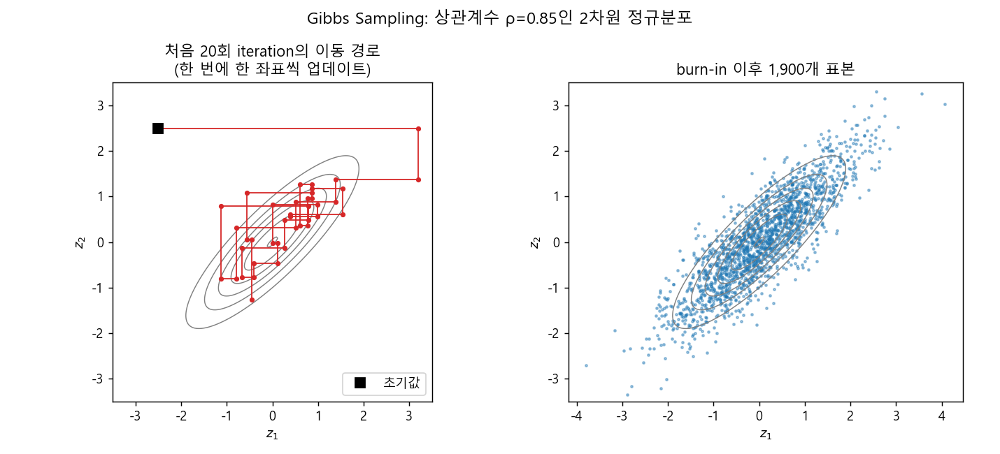
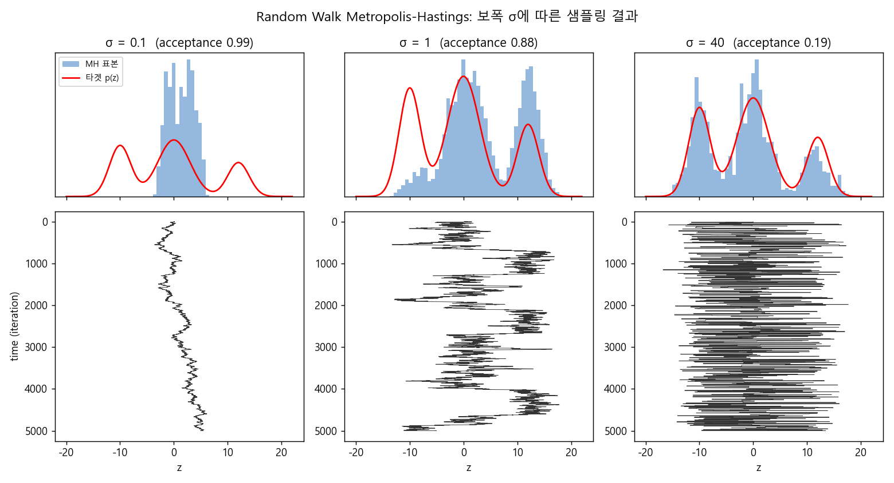
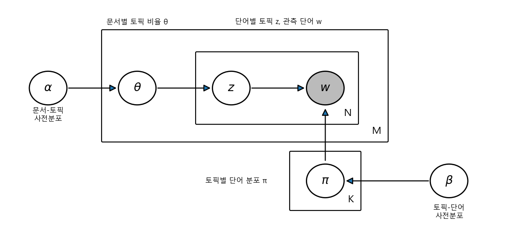
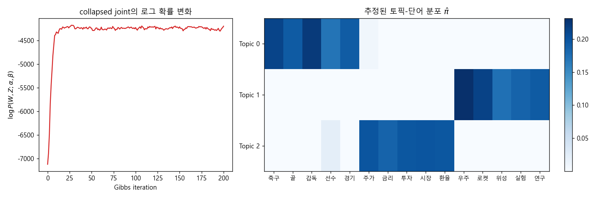

### Metropolis-Hastings 알고리즘, Gibbs Sampling, 그리고 LDA의 Collapsed Gibbs Sampler


> 원하는 stationary distribution을 갖는 Markov chain을 "역으로 설계"하는 MCMC의 대표 알고리즘인 Metropolis-Hastings와 Gibbs Sampling을 알아보고, 이를 토픽 모델링의 대표 주자인 LDA에 적용해 봅니다.  


<br>

<center></center>    


<br/>


>  **1. Metropolis-Hastings는 임의의 proposal distribution으로 다음 상태를 제안하고, acceptance probability $\min(1, r)$로 수락 여부를 결정해 detailed balance를 강제로 맞춰주는 MCMC의 일반 알고리즘이다**
>
>  **2. Gibbs Sampling은 proposal로 모델의 조건부 분포 $P(z_k \mid z_{-k})$를 사용하는 MH의 special case로, 한 번에 한 변수만 업데이트하며 acceptance probability가 항상 1이 된다**
>
>  **3. LDA에서는 Dirichlet가 Multinomial의 conjugate prior라는 성질 덕분에 $\theta$와 $\pi$를 적분으로 없앨(collapse) 수 있고, 남은 topic assignment $Z$만 단어 카운트 기반의 간단한 식으로 Gibbs sampling하면 된다**


<br/>

----

#### Contents

<br/>

1.	[Metropolis-Hastings 알고리즘](#metropolis-hastings)
2.	[Random Walk MH와 보폭의 딜레마](#random-walk-mh)
3.  [Gibbs Sampling: proposal을 모델에게 맡기기](#gibbs-sampling)
4.  [LDA 이해하기](#understand-lda)
5.  [LDA를 위한 Collapsed Gibbs Sampling](#collapsed-gibbs)
6.  [Gibbs Sampling 기반 LDA 학습 루틴](#lda-routine)

<br />

[지난 포스트](https://myeonghak.github.io/general%20machine%20learning/General-ML-train-set-batch-12.-Sampling-Based-Inference-1/)에서는 forward sampling, rejection sampling, importance sampling을 거쳐 Markov chain과 stationary distribution까지 살펴보았습니다. 그리고 MCMC란 "우리가 원하는 분포 $\pi$를 stationary distribution으로 갖도록 하는 transition rule을 역산하는 것"이라고 정리했었는데요. 이번 시간에는 그 transition rule을 실제로 어떻게 만드는지, 즉 **Metropolis-Hastings**와 **Gibbs Sampling**을 알아보고, Gibbs Sampling이 가장 빛을 발하는 사례인 **LDA(Latent Dirichlet Allocation)** 까지 이어가 보겠습니다.  


<a id="metropolis-hastings"></a>
### 1. Metropolis-Hastings 알고리즘  

#### 다음 상태를 "제안"하고, "수락"할지 정한다  

Metropolis-Hastings(MH) 알고리즘은 주어진 ideal stationary distribution $\pi$에 대해 transition rule을 만들어 주는 MCMC의 general한 알고리즘입니다. 현재 latent variable의 assignment가 $z^t$라고 해볼까요. MH는 다음 시점의 후보 assignment $z^\ast$를 하나 제안합니다. 알람 네트워크 예제로 치면 "Alarm과 MaryCall이 이렇게 알려져 있을 때, JohnCall은 T로 해보자" 같은 식이죠.  

$$
z^\ast \sim q(z^\ast \mid z^t)
$$

- $q$는 **proposal distribution**이라고 부름. 엄밀성을 위해 transition distribution이라고 부르지 않음 (실제 transition은 $q$에 수락 단계까지 합쳐져야 완성되기 때문)  
- "제안 분포에서 뽑는다"는 구조 자체는 rejection, importance sampling과 비슷하지만, 직전 상태 $z^t$에 조건부로 뽑는다는 점, 즉 **Markov property를 활용한다는 점**에서 구별됨  

그리고 여기에 MH의 핵심인 **acceptance probability $\alpha$** 가 등장합니다. 제안된 $z^\ast$를 무조건 받아들이는 것이 아니라, 확률 $\alpha$로 coin toss를 해서  

- accept가 나오면 $z^{t+1} = z^\ast$로 이동  
- reject가 나오면 기존의 $z^t$를 다음 시점에도 그대로 가져감 ($z^{t+1} = z^t$)  

#### 왜 acceptance probability가 필요할까?  

지난 시간에 본 성질을 떠올려 보면, Markov chain이 **reversible**하다면, 즉 아래의 **detailed balance equation**을 만족한다면 $\pi$는 그 chain의 stationary distribution이 됩니다.  

$$
\pi(z)\, T(z \to z') = \pi(z')\, T(z' \to z) \quad \text{for all } z, z'
$$

문제는 $q$가 우리가 마음대로 고른 분포라는 점입니다. $q$는 reversible MC가 되도록 설계된 적이 없으니, 그대로 쓰면 detailed balance가 깨질 수밖에 없죠. 그래서 그 어긋난 정도를 비율로 측정해 보겠습니다.  

$$
r(z^\ast \mid z^t) = \frac{q(z^t \mid z^\ast)\, p(z^\ast)}{q(z^\ast \mid z^t)\, p(z^t)}
$$

여기서 $p$는 베이지안 네트워크에서 assignment가 주어지면 evaluate할 수 있는 분포입니다. 분모는 "$z^t$에 있다가 $z^\ast$로 가는 흐름", 분자는 "$z^\ast$에 있다가 $z^t$로 돌아오는 흐름"이니, **$r = 1$이면 detailed balance가 이미 성립**하는 상황입니다. $r$이 1이 아닐 때는 둘 중 하나를 조정해 줘야 합니다.  

- **$r < 1$인 경우**: $z^t \to z^\ast$ 흐름이 반대 방향보다 과하게 큼. 확률은 1보다 커질 수 없으니 반대 방향($z^\ast \to z^t$)을 더 늘릴 수는 없고, 대신 $z^t \to z^\ast$를 비율 $r$만큼 깎아줌 → $\alpha(z^\ast \mid z^t) = r$  
- **$r \ge 1$인 경우**: 반대로 $z^\ast \to z^t$ 흐름이 더 큼. 이번에는 $z^t \to z^\ast$ 쪽을 최대한, 즉 1까지 늘려줌 → $\alpha(z^\ast \mid z^t) = 1$ (깎는 일은 반대 방향 이동을 평가할 때 그쪽의 $\alpha$가 맡게 됨)  

두 경우를 합치면 MH의 acceptance probability가 완성됩니다.  

$$
\alpha(z^\ast \mid z^t) = \min\left(1,\; r(z^\ast \mid z^t)\right) = \min\left(1,\; \frac{q(z^t \mid z^\ast)\, p(z^\ast)}{q(z^\ast \mid z^t)\, p(z^t)}\right)
$$

정말 detailed balance가 성립하는지 확인해 볼까요? $r < 1$이라고 하면 $\alpha(z^\ast \mid z^t) = r$이고, 반대 방향의 비율은 $1/r > 1$이므로 $\alpha(z^t \mid z^\ast) = 1$입니다. 따라서  

$$
p(z^t)\, q(z^\ast \mid z^t)\, \alpha(z^\ast \mid z^t) = p(z^t)\, q(z^\ast \mid z^t) \cdot \frac{q(z^t \mid z^\ast)\, p(z^\ast)}{q(z^\ast \mid z^t)\, p(z^t)} = p(z^\ast)\, q(z^t \mid z^\ast)\, \alpha(z^t \mid z^\ast)
$$

가 되어 양변이 정확히 같아집니다. ($r \ge 1$인 경우는 대칭입니다.) 결국 실제 transition probability는  

$$
T_{t,\ast} = q(z^\ast \mid z^t)\, \alpha(z^\ast \mid z^t)
$$

로, "제안되고(proposal) 그리고 수락될(acceptance)" 동시발생 확률이 됩니다.  

정리하자면 MH의 시나리오는 이렇습니다. **성질을 잘 모르는 $q$를 쓰더라도, ratio로 만든 acceptance probability가 detailed balance를 맞춰 reversible MC를 만들어 주고, 이 chain을 계속 transition시키면 결국 stationary distribution $p$로 수렴한다.** 덤으로 $r$에는 $p$의 비율만 들어가므로, $p$의 normalizing constant를 몰라도 된다는 실용적인 장점이 있습니다. 베이지안 추론에서 사후분포의 분모(evidence)를 계산하기 어려운 경우가 대부분이라는 걸 생각하면 꽤 큰 장점이죠.  


<a id="random-walk-mh"></a>
### 2. Random Walk MH와 보폭의 딜레마  

#### proposal을 정하면 MH의 "종류"가 정해진다  

지금까지 $p(z)$는 베이지안 네트워크 안에서 쉽게 evaluate된다고 가정해 왔습니다. 그리고 아직 정하지 않은 것이 $q(z^\ast \mid z^t)$인데요, proposal이니 어떤 분포든 들어갈 수 있습니다. 물론 그중에 더 나은 것과 덜 나은 것은 있고, **어떤 $q$를 고르느냐가 MH 알고리즘의 타입을 결정**합니다.  

가장 간단한 인스턴스가 **Random Walk MH**입니다. 가정 하나만 추가하면 됩니다.  

$$
z^\ast \sim \mathcal{N}(z^t, \sigma^2)
$$

- 직전 위치 $z^t$를 중심으로 정규분포에서 뽑은 값으로 왔다갔다 함. 이 때 표준편차 $\sigma$가 random walk의 **보폭** 역할을 함  
- 제안된 값은 acceptance 평가를 통과해야 다음으로 넘어감  
- 정규분포는 대칭이라 $q(z^\ast \mid z^t) = q(z^t \mid z^\ast)$가 되어, $r$이 단순히 $p(z^\ast)/p(z^t)$로 줄어듦 (이런 대칭 proposal을 쓰는 특수한 경우를 원조 Metropolis 알고리즘이라고 부르기도 함)  

#### 실험: 보폭 $\sigma$를 바꿔보면  

강좌에서는 앞서 다뤘던 GMM 같은 mixture 분포를 $\sigma = 0.1, 1, 40$으로 근사해 보는 예제가 나오는데요, 비슷한 실험을 직접 해보겠습니다. 봉우리가 3개인 Gaussian mixture를 타겟으로 두고, 정규화 상수 없이 $\tilde{p}(z)$만 아는 상황에서 5,000번 샘플링합니다.  

```python
import numpy as np
from scipy.stats import norm

# 타겟: 세 개의 봉우리를 갖는 Gaussian Mixture (정규화 상수는 몰라도 됨)
w, mu, sd = [0.3, 0.5, 0.2], [-10, 0, 12], [2, 3, 2]
def p_tilde(z):
    return sum(wk * norm.pdf(z, m, s) for wk, m, s in zip(w, mu, sd))

def rw_mh(sigma, n_iter=5000, z0=0.0, seed=0):
    rng = np.random.default_rng(seed)
    z, samples, n_acc = z0, [], 0
    for _ in range(n_iter):
        z_star = rng.normal(z, sigma)              # q(z*|z^t) = N(z^t, sigma^2)
        r = p_tilde(z_star) / p_tilde(z)           # 대칭 q라서 q 비율은 약분됨
        if rng.uniform() < min(1.0, r):            # alpha = min(1, r)
            z, n_acc = z_star, n_acc + 1
        samples.append(z)
    return np.array(samples), n_acc / n_iter

for sigma in [0.1, 1, 40]:
    s, acc = rw_mh(sigma)
    print(f"sigma={sigma:>4}: acceptance={acc:.3f}, 표본 범위=[{s.min():6.1f}, {s.max():6.1f}]")
```

```
sigma= 0.1: acceptance=0.991, 표본 범위=[  -3.6,    6.1]
sigma=   1: acceptance=0.883, 표본 범위=[ -13.3,   17.8]
sigma=  40: acceptance=0.185, 표본 범위=[ -16.8,   17.7]
```

<br>

<center></center>    

<br>

아래쪽 trace plot은 세로축이 time(iteration)입니다. 결과를 해석해 보면 다음과 같습니다.  

- **$\sigma = 0.1$**: 거의 모든 제안이 수락(0.99)되지만, 보폭이 너무 작아 시작점 근처의 한 mode 안에서만 맴돎. 그 mode 안에서는 아주 촘촘하게 샘플링하지만, 왼쪽/오른쪽 봉우리에는 끝내 도달하지 못함  
- **$\sigma = 1$**: 봉우리 사이를 가끔 건너가긴 하지만, 한 번 넘어가면 한동안 그 봉우리에 머무름. 5,000번으로는 봉우리 간 비율이 아직 정확하지 않음  
- **$\sigma = 40$**: 전체 mode를 모두 잡아내지만 수락률이 0.19로 떨어져서, 같은 값이 여러 번 반복되는 계단 모양이 됨. 각 mode에 대한 정밀도는 상대적으로 떨어짐  

결국 보폭은 **exploration(전체 mode 탐색)과 precision(국소적인 정밀도) 사이의 trade-off**입니다. 그래서 처음에는 큰 $\sigma$로 전체 mode를 잡아낸 뒤, 점점 $\sigma$를 줄여 정밀하게 샘플링하는 전략이 유효할 수 있겠습니다. 큰 그물로 물고기 떼의 위치를 먼저 파악하고, 그다음 촘촘한 그물로 바꾸는 느낌이랄까요.  


<a id="gibbs-sampling"></a>
### 3. Gibbs Sampling: proposal을 모델에게 맡기기  

#### "왜 새로운 proposal을 잡아? 잘 아는 $p$가 있는데"  

MH의 특징은 proposal distribution이 있고, 그 성질을 잘 모르기 때문에 acceptance probability로 비율을 조정했다는 점이었습니다. Gibbs Sampling은 여기서 이런 아이디어를 던집니다. "굳이 성질도 모르는 새 proposal을 잡을 필요가 있나? 모델이 제안하는 확률 분포 $P$를 이미 알고 있는데." 그래서 Gibbs Sampling은 **MH의 special case**가 됩니다.  

또 하나의 차이는, 모든 latent variable을 한 번에 업데이트하는 대신 **한 번의 샘플링에서 단 하나의 변수 $z_k$만 업데이트**한다는 점입니다. $z_{-k}$를 $k$ 이외의 모든 변수라고 하면  

$$
z^t = (z_k^t, z_{-k}^t) \;\longrightarrow\; z^\ast = (z_k^\ast, z_{-k}^t)
$$

이고, proposal을 모델의 조건부 분포로 바꿔줍니다.  

$$
q(z^\ast \mid z^t) = P(z_k^\ast, z_{-k}^t \mid z_{-k}^t) = P(z_k^\ast \mid z_{-k}^t)
$$

#### detailed balance가 공짜로 성립한다  

이 상황에서 MH의 ratio $r$을 계산해 보겠습니다. $z^\ast$와 $z^t$는 $z_{-k}$를 공유하므로 $P(z) = P(z_k \mid z_{-k})P(z_{-k})$로 분해하면  

$$
r = \frac{P(z^\ast)\, q(z^t \mid z^\ast)}{P(z^t)\, q(z^\ast \mid z^t)} = \frac{P(z_k^\ast \mid z_{-k}^t)\, P(z_{-k}^t)\; P(z_k^t \mid z_{-k}^t)}{P(z_k^t \mid z_{-k}^t)\, P(z_{-k}^t)\; P(z_k^\ast \mid z_{-k}^t)} = 1
$$

분자와 분모가 완전히 같아서 약분됩니다. 즉 **detailed balance equation이 자동으로 항상 만족**되고, acceptance probability는 언제나 $\min(1, 1) = 1$이 됩니다. acceptance 단계 자체가 필요 없어지는 것이죠.  

#### 알람 네트워크 예제  

Gibbs Sampling은 joint distribution을 모르거나 직접 샘플링하기 어렵지만, **각 변수의 조건부 분포는 알려져 있고 간단한 경우**에 특히 유용합니다. 베이지안 네트워크 예제에서 MaryCall=T, Alarm=F가 evidence로 주어졌다고 해보겠습니다.  

- Burglary를 업데이트하려면, **Markov blanket**(부모, 자식, 자식의 다른 부모)만 고정되어 있으면 그 바깥 변수는 상관이 없음. 여기선 MaryCall, JohnCall은 무관해지고, Earthquake의 현재 값(예: T)만 할당해 두면 $P(B \mid E, A) \propto P(B)\, P(A \mid B, E)$를 계산할 수 있음  
- 그 확률로 coin toss를 해서 B의 T/F를 정함. MH라면 여기서 acceptance를 한 번 더 검증하겠지만, Gibbs는 **그냥 받아들임**  
- 다음 스텝에서는 다른 latent variable(예: Earthquake)에 대해 같은 작업을 수행  

#### Gibbs Sampling의 절차  

full joint가 $p(z) = p(z_1, \dots, z_M)$이고 state가 $\lbrace z_i : i = 1, \dots, M \rbrace$일 때,  

1) $\lbrace z_i \rbrace$를 초기화함. 완전히 임의로 하기보다는 적당한 사전지식을 넣어주는 것이 좋음. 그렇지 않으면 수렴(burn-in)에 매우 오래 걸릴 수 있음  
2) 한 변수 $z_k$를 골라, 나머지가 주어졌다고 보고 $z_k \sim P(z_k \mid z_{-k})$로 값을 대체함  
3) 정해진 순서대로 변수를 순회하거나, 특정 분포에서 다음에 업데이트할 변수를 무작위로 골라 2)를 반복함  

맨 위의 대표 그림이 바로 이 과정입니다. 상관계수 0.85인 2차원 정규분포에서, $z_1$과 $z_2$를 번갈아 하나씩 업데이트하니 축에 평행한 계단 모양으로 움직이죠. EM 알고리즘이 좌표를 번갈아 최적화하는 모습과 닮았지만, 매 스텝이 **확률적인 샘플링**이라 가끔 엉뚱한 방향으로 나가기도 합니다. 그래도 chain을 충분히 돌리면 오른쪽 그림처럼 타겟 분포를 잘 채우게 됩니다.  

#### Gibbs Sampling 기반 GMM과 두 개의 기둥  

GMM도 Gibbs Sampling으로 학습할 수 있습니다. mode의 파라미터가 주어졌을 때 각 데이터의 $Z$를 샘플링으로 할당하고, 다시 파라미터를 갱신하는 과정을 반복하는 식인데요.  

- 실제 효용이 크진 않지만 사용은 가능함  
- 수렴은 EM보다 느리지만, 확률 기반이라 탈출 여지가 있어서 안장점이나 local optima에 빠질 가능성이 EM보다 낮음  

강좌에서는 PGM(Probabilistic Graphical Model) 계열 모델의 parameter inference에 **두 개의 큰 기둥**이 있다고 정리합니다. 하나는 EM을 발전시킨 **Variational Inference**, 다른 하나는 **Gibbs Sampler 계열의 샘플링 기반 inference**입니다. 이어서 볼 LDA도 원 논문(Blei et al., 2003)에서는 Variational Inference를 썼지만, Gibbs로도 얼마든지 풀 수 있고 최근 구현체는 Gibbs를 많이들 사용합니다.  


<a id="understand-lda"></a>
### 4. LDA 이해하기  

#### 토픽 모델링  

토픽 모델링은 텍스트 뭉치를 clustering하는 방법론입니다. 예를 들어 'Obama'라는 키워드로 수집한 뉴스에 토픽 모델링을 수행하면 "가정, 여성", "전쟁" 같은 이슈들이 튀어나오는데요. 하나의 주제를 하나의 클러스터로 보고 **soft clustering**을 수행하는 것이고, 이를 통해 세 가지를 알 수 있습니다.  

1) **토픽** 자체  
2) **토픽들 사이의 비중**: 전체 말뭉치에서 어떤 토픽이 우세한지 등의 트렌드  
3) **토픽을 잘 설명하는 단어군**: 토픽 내에서 가장 probable한 단어들  

전체 코퍼스를 일일이 읽지 않고도 군집화가 가능하다는 게 매력이죠.  

#### Latent Dirichlet Allocation  

LDA는 토픽 모델링 붐을 일으킨 대표 모델입니다.  

- 텍스트 데이터에 대한 soft clustering 모델임  
- "문서 안에 단어가 있다"는 말뭉치의 구조를 베이지안 네트워크(plate notation)로 표현함  
- prior($\alpha$, $\beta$)를 가진 베이지안 모델임  
- 각 단어 $w$마다 topic assignment $z$를 샘플링함  

<br>

<center></center>    

<br>

각 노드의 의미를 정리해 보겠습니다.  

- $w$: 관측된 단어(observation). $z$: 각 단어의 토픽을 나타내는 latent variable. **GMM과 완전히 유사한 구조**임 (GMM의 $x$와 $z$를 떠올려 보세요)  
- $\theta$: 문서별 토픽 비율(document-topic distribution). $K$차원 multinomial의 파라미터  
- $\pi$: 토픽별로 각 단어가 등장할 확률(word-topic distribution). 토픽마다 하나씩, $K$개가 있음  
- $\alpha$: $\theta$의 Dirichlet prior. 코퍼스 내 topic proportion의 형태에 대한 사전지식  
- $\beta$: $\pi$의 Dirichlet prior. 어떤 단어가 어떤 토픽에서 얼마나 자주 쓰이는지에 대한 사전지식  
- plate $N$은 문서 내 단어 수, $M$은 문서 수, $K$는 토픽 수만큼 반복됨 (GMM에서 클러스터 수만큼 반복하던 것과 같음)  

#### Generative Process  

알람 네트워크에서 특정 이벤트가 "MaryCall"을 generate한다고 생각했던 것처럼, LDA도 문서가 생성되는 과정을 수학적으로 모델링합니다.  

$$
\theta_i \sim \text{Dir}(\alpha), \qquad \pi_k \sim \text{Dir}(\beta), \qquad z_{i,l} \sim \text{Mult}(\theta_i), \qquad w_{i,l} \sim \text{Mult}(\pi_{z_{i,l}})
$$

- 문서-토픽 분포 $\theta$는 $\alpha$로부터 생성됨  
- 단어-토픽 분포 $\pi$는 $\beta$로부터 생성됨  
- 토픽 $z$는 문서-토픽 분포 $\theta$에서 생성됨  
- 단어 $w$는 그 토픽에 해당하는 단어 분포 $\pi_z$에서 생성됨  

즉 **토픽별 단어 확률($\pi$)과 토픽 할당($z$), 이 두 가지가 합쳐져 $w$가 결정되는 것**이 LDA입니다. 기자가 "이번 기사는 정치 70%, 경제 30%로 써야지"라고 정한 뒤, 단어 하나를 쓸 때마다 주사위를 굴려 토픽을 고르고 그 토픽의 단어장에서 단어를 뽑는 모습을 상상하면 됩니다. (실제 기자분들은 이렇게 쓰지 않으시겠지만요.)  

#### 핵심은 $z$다  

- $w$는 관측값이라 바뀔 리 없음  
- $\alpha$, $\beta$는 prior knowledge로 주어짐 (학습할 수도 있지만, 조정하지 않으면 고정)  
- 남은 floating 변수는 $z$, $\theta$, $\pi$뿐인데, 이 중 evidence에 가장 가까이 붙어 있는 것이 $z$임  
- $z$가 주어졌다고 가정하면, 카운트를 세서 평균을 내든 기댓값을 취하든 $\theta$와 $\pi$를 쉽게 추정할 수 있음  

결국 **가장 likely한 topic assignment $z$를 찾는 것이 LDA의 핵심**입니다. 그러고 나면 $\theta$를 모아 코퍼스에 토픽이 얼마만큼 존재하는지를, $\pi$를 보고 토픽별로 가장 probable한 단어 표를 만들 수 있겠죠.  


<a id="collapsed-gibbs"></a>
### 5. LDA를 위한 Collapsed Gibbs Sampling  

#### Factorize 후 $\theta$, $\pi$를 collapse하기  

$z$를 잘 allocation하는 방법이 바로 Gibbs Sampling입니다. 먼저 joint를 graphical model에 따라 factorize합니다. (세미콜론 뒤의 $\alpha$, $\beta$는 변하지 않는 사전지식임을 구분하는 표기입니다.)  

$$
P(W, Z, \theta, \pi; \alpha, \beta) = \prod_{i=1}^{K} P(\pi_i; \beta) \prod_{j=1}^{M} P(\theta_j; \alpha) \prod_{l=1}^{N} P(z_{j,l} \mid \theta_j)\, P(w_{j,l} \mid \pi_{z_{j,l}})
$$

이제 $\theta$와 $\pi$를 없애서 $W$(데이터), $Z$(샘플링 타겟), $\alpha$, $\beta$(prior)만 남기려고 합니다. 이렇게 일부 변수를 제거한 상태에서 하는 Gibbs Sampling을 **collapsed Gibbs sampling**이라 하는데요. 제거하는 방법은 marginalize out밖에 없고, $\pi$와 $\theta$에 대한 적분은 서로 독립이라 곱으로 분리됩니다.  

$$
P(W, Z; \alpha, \beta) = \underbrace{\int \prod_{i=1}^{K} P(\pi_i; \beta) \prod_{j=1}^{M}\prod_{l=1}^{N} P(w_{j,l} \mid \pi_{z_{j,l}})\, d\pi}_{\pi \text{ 파트}} \times \underbrace{\int \prod_{j=1}^{M} P(\theta_j; \alpha) \prod_{l=1}^{N} P(z_{j,l} \mid \theta_j)\, d\theta}_{\theta \text{ 파트}}
$$

#### 카운트 변수 $n_{j,r}^{i}$  

식을 정리하기 위해 카운트 변수를 하나 도입합니다. **$n_{j,r}^{i}$ 는 $j$번째 문서에서 $r$번째 unique word가 $i$번째 토픽에 몇 개 할당되었는지**를 나타냅니다.  

- 예: 문서 $j$에서 10,000개 vocab 중 17번째 단어인 'KAIST'가 3번 나왔고, 그중 첫째·둘째 'KAIST'는 토픽 1에, 셋째는 토픽 2에 할당되었다면 $n_{j,17}^{1} = 2$, $n_{j,17}^{2} = 1$  
- 아래첨자 자리에 $(\cdot)$을 쓰면 그 인덱스에 대해 합한다는 뜻. $n_{(\cdot),v}^{i}$는 문서와 상관없이 토픽 $i$에 할당된 단어 $v$의 총 개수, $n_{j,(\cdot)}^{i}$는 단어와 상관없이 문서 $j$에서 토픽 $i$에 할당된 단어 수  

#### $\pi$ 파트 정리  

$\pi$를 토픽(행) × vocab(열) 행렬로 그려보면, 각 행은 합이 1인 독립된 분포입니다. 그러니 행(토픽)별로 적분한 뒤 곱하면 됩니다. 앞쪽은 Dirichlet pdf (차원 $V$ = vocab size), 뒤쪽 multinomial은 카운트를 써서 $\prod_v \pi_{i,v}^{n_{(\cdot),v}^{i}}$로 간결하게 쓸 수 있습니다.  

$$
\int \frac{\Gamma\left(\sum_{v=1}^{V} \beta_v\right)}{\prod_{v=1}^{V} \Gamma(\beta_v)} \prod_{v=1}^{V} \pi_{i,v}^{\beta_v - 1} \prod_{v=1}^{V} \pi_{i,v}^{n_{(\cdot),v}^{i}}\, d\pi_i = \frac{\Gamma\left(\sum_{v} \beta_v\right)}{\prod_{v} \Gamma(\beta_v)} \cdot \frac{\prod_{v} \Gamma\left(n_{(\cdot),v}^{i} + \beta_v\right)}{\Gamma\left(\sum_{v} \left(n_{(\cdot),v}^{i} + \beta_v\right)\right)}
$$

여기서 하나의 트릭이 쓰입니다. 적분 안의 $\prod_v \pi_{i,v}^{n + \beta_v - 1}$은 파라미터가 $n_{(\cdot),v}^{i} + \beta_v$인 Dirichlet pdf의 커널과 같습니다. 그래서 해당 Dirichlet의 정규화 상수를 곱하고 나눠주면, 적분 부분은 "pdf를 전체 영역에서 적분한 것", 즉 **1**이 되어 사라지고 정규화 상수의 비율만 남습니다.  

#### $\theta$ 파트 정리  

$\theta$ 파트도 똑같습니다. $\theta_j$는 문서 $j$의 토픽 분포이므로 $K$차원이고, 이번에는 단어는 don't care하고 "문서 $j$에서 토픽 $i$에 몇 개가 할당되었나"인 $n_{j,(\cdot)}^{i}$만 세면 됩니다.  

$$
\int \frac{\Gamma\left(\sum_{i=1}^{K} \alpha_i\right)}{\prod_{i=1}^{K} \Gamma(\alpha_i)} \prod_{i=1}^{K} \theta_{j,i}^{\alpha_i - 1} \prod_{i=1}^{K} \theta_{j,i}^{n_{j,(\cdot)}^{i}}\, d\theta_j = \frac{\Gamma\left(\sum_{i} \alpha_i\right)}{\prod_{i} \Gamma(\alpha_i)} \cdot \frac{\prod_{i} \Gamma\left(n_{j,(\cdot)}^{i} + \alpha_i\right)}{\Gamma\left(\sum_{i} \left(n_{j,(\cdot)}^{i} + \alpha_i\right)\right)}
$$

#### Collapse가 가능했던 이유: Conjugacy  

두 파트 모두 **Dirichlet × Multinomial이 다시 Dirichlet 꼴이 되어**, 전체 영역을 cover하는 적분이 1로 바뀌면서 식이 간결해졌습니다. 일반적으로 likelihood $P(X \mid \theta)$와 prior $P(\theta)$의 곱이 prior와 같은 분포족으로 귀결될 때 이 prior를 **conjugate prior**라고 하는데요, Dirichlet가 바로 Multinomial의 conjugate prior입니다.  

- conjugate 관계 덕분에 "sum-to-one" 테크닉으로 적분을 완전히 없앨 수 있음  
- LDA가 Dirichlet를 prior로, Multinomial을 topic assignment 파라미터로 둔 덕분에 inference가 아주 쉬워짐  
- collapsed Gibbs sampler를 만드는 데 이 conjugacy가 핵심적으로 활용됨  

#### 한 단어의 topic assignment에 대한 조건부 분포  

이제 $P(W, Z; \alpha, \beta)$를 얻었습니다. Gibbs Sampling은 한 번에 하나씩 업데이트하므로, 다른 모든 assignment가 고정된 상황에서 **$m$번째 문서의 $l$번째 단어의 토픽 $z_{m,l}$만 샘플링**하는 식이 필요합니다.  

$$
P(z_{m,l} = k \mid Z_{-(m,l)}, W; \alpha, \beta) = \frac{P(z_{m,l} = k, Z_{-(m,l)}, W; \alpha, \beta)}{P(Z_{-(m,l)}, W; \alpha, \beta)} \propto P(z_{m,l} = k, Z_{-(m,l)}, W; \alpha, \beta)
$$

분모의 normalizing term은 $k$에 무엇이 할당되든 무관하므로 날리고 비례식으로 바꿀 수 있습니다. 이제 남은 일은 joint 식에서 $z_{m,l}$과 관련 없는 constant를 정리하는 것입니다.  

- $\theta$ 파트에서는 문서 $m$을 제외한 다른 문서의 항이 모두 상수, $\pi$ 파트에서는 단어 $v = w_{m,l}$이 아닌 단어의 항과 정규화 상수들이 상수가 됨  
- 남은 항에서 $(m,l)$ 위치를 제외하고 센 카운트를 $n^{k,-(m,l)}$로 표기하면, $z_{m,l} = k$일 때 토픽 $k$ 관련 카운트만 1씩 늘어남  
- 감마함수의 성질 $\Gamma(x+1) = x\,\Gamma(x)$ (정수에서는 $\Gamma(x) = (x-1)!$)을 이용하면, "+1"된 감마함수가 원래 감마함수와 $x$의 곱으로 풀리고 감마함수 부분은 $k$와 무관한 상수로 빠짐  

이를 쭉 정리하면, Gibbs Sampling을 할 수 있을 정도로 단순화된 element-wise 확률식이 나옵니다.  

$$
P(z_{m,l} = k \mid Z_{-(m,l)}, W; \alpha, \beta) \propto \left(n_{m,(\cdot)}^{k,-(m,l)} + \alpha_k\right) \cdot \frac{n_{(\cdot),v}^{k,-(m,l)} + \beta_v}{\sum_{r=1}^{V} \left(n_{(\cdot),r}^{k,-(m,l)} + \beta_r\right)}, \qquad v = w_{m,l}
$$

해석해 보면 꽤 직관적입니다.  

- 첫 번째 항: **이 문서가 토픽 $k$를 얼마나 좋아하는가** (문서 $m$에서 토픽 $k$에 할당된 단어 수)  
- 두 번째 항: **토픽 $k$가 이 단어를 얼마나 좋아하는가** (전체 코퍼스에서 토픽 $k$에 할당된 단어 $v$의 비율)  
- $\alpha$, $\beta$는 주어진 값이고, 카운트는 단어들을 iterate하면서 "이 단어는 어디에, 저 단어는 어디에 할당되었나"를 세면 알 수 있음  

"축구 기사에 나온 '골'이라는 단어는, 이 문서가 스포츠 이야기를 많이 하고 있고 스포츠 토픽이 '골'을 자주 쓰니 스포츠 토픽일 가능성이 크다"는 상식을 그대로 수식으로 옮긴 셈입니다. 이 분포로 coin toss를 해서 $z_{m,l}$을 정하면 됩니다.  


<a id="lda-routine"></a>
### 6. Gibbs Sampling 기반 LDA 학습 루틴  

강좌에서 정리한 학습 루틴은 다음과 같습니다. 예를 들어 문서 10,000개, 문서당 100개 단어로 이루어진 코퍼스 $T$가 있다고 하면  

1) $T$의 모든 단어에 $Z$를 랜덤으로 할당함  
2) 주어진 $Z$에 근거해 카운트 $n_{j,r}^{i}$를 집계함  
3) 성능지표(perplexity 등)가 수렴할 때까지 반복: 바깥 루프는 문서 $M$(10,000)개, 안쪽 루프는 각 문서의 단어 $L$(100)개를 돌면서, 위의 조건부 분포로 $z_{m,l}$을 샘플링하고 카운트를 즉시 갱신함. 갱신된 카운트는 바로 다음 샘플링에 반영됨  
4) 수렴하면 카운트로부터 $\pi$(토픽-단어 확률)와 $\theta$(문서-토픽 확률)를 추정함  

4)의 추정식은 Dirichlet-Multinomial 사후분포의 평균을 쓰면 됩니다.  

$$
\hat{\pi}_{k,v} = \frac{n_{(\cdot),v}^{k} + \beta_v}{\sum_{r=1}^{V} \left(n_{(\cdot),r}^{k} + \beta_r\right)}, \qquad \hat{\theta}_{m,k} = \frac{n_{m,(\cdot)}^{k} + \alpha_k}{\sum_{i=1}^{K} \left(n_{m,(\cdot)}^{i} + \alpha_i\right)}
$$

참고로 perplexity는 soft clustering의 성능 지표로 쓰이지만 계산에 시간이 꽤 걸린다는 점은 알아두시면 좋겠습니다.  

#### 직접 돌려보기  

스포츠/경제/과학 세 토픽을 정답으로 두고 generative process로 가상의 문서 60개(문서당 30단어)를 만든 뒤, collapsed Gibbs Sampling으로 토픽을 복원해 보겠습니다. 위의 조건부 분포 식이 코드 한 줄(`p = ...`)로 들어간다는 점에 주목해 주세요.  

```python
import numpy as np
rng = np.random.default_rng(42)

# 정답 토픽 3개로 가상의 코퍼스를 생성 (generative process 그대로)
vocab = ["축구", "골", "감독", "선수", "경기",
         "주가", "금리", "투자", "시장", "환율",
         "우주", "로켓", "위성", "실험", "연구"]
V, K, M, L = len(vocab), 3, 60, 30
true_pi = np.full((K, V), 0.01)
for k in range(K):
    true_pi[k, 5*k:5*k+5] = 1.0
true_pi /= true_pi.sum(1, keepdims=True)
docs = []
for m in range(M):
    theta = rng.dirichlet([0.3] * K)
    z = rng.choice(K, size=L, p=theta)
    docs.append([rng.choice(V, p=true_pi[k]) for k in z])

# Collapsed Gibbs Sampling
alpha, beta = 0.5, 0.1
Z = [rng.integers(K, size=L) for _ in range(M)]           # 1) 랜덤 초기화
n_mk = np.zeros((M, K)); n_kv = np.zeros((K, V)); n_k = np.zeros(K)
for m in range(M):                                        # 2) 카운트 집계
    for w, k in zip(docs[m], Z[m]):
        n_mk[m, k] += 1; n_kv[k, w] += 1; n_k[k] += 1

for it in range(200):                                     # 3) 반복
    for m in range(M):
        for l, w in enumerate(docs[m]):
            k = Z[m][l]                                   # 자기 자신을 카운트에서 제외
            n_mk[m, k] -= 1; n_kv[k, w] -= 1; n_k[k] -= 1
            p = (n_mk[m] + alpha) * (n_kv[:, w] + beta) / (n_k + V * beta)
            k = rng.choice(K, p=p / p.sum())              # 조건부 분포에서 샘플링
            Z[m][l] = k
            n_mk[m, k] += 1; n_kv[k, w] += 1; n_k[k] += 1

# 4) 수렴 후 pi, theta 추정
pi_hat = (n_kv + beta) / (n_k[:, None] + V * beta)
theta_hat = (n_mk + alpha) / (n_mk.sum(1, keepdims=True) + K * alpha)
for k in range(K):
    top = np.argsort(-pi_hat[k])[:5]
    print(f"Topic {k}:", ", ".join(f"{vocab[v]}({pi_hat[k, v]:.2f})" for v in top))
print("문서 0의 theta:", np.round(theta_hat[0], 2))
```

```
Topic 0: 감독(0.22), 축구(0.21), 골(0.19), 경기(0.19), 선수(0.17)
Topic 1: 우주(0.23), 로켓(0.21), 연구(0.19), 실험(0.19), 위성(0.17)
Topic 2: 주가(0.20), 시장(0.20), 투자(0.20), 환율(0.20), 금리(0.19)
문서 0의 theta: [0.33 0.02 0.65]
```

토픽 번호는 정답과 다르게 붙었지만(라벨 순서는 원래 식별 불가능합니다), 세 토픽이 깔끔하게 복원되었습니다. 문서 0은 경제 65%, 스포츠 33% 정도가 섞인 문서로 추정되었네요. 매 iteration마다 앞에서 유도한 collapsed joint $\log P(W, Z; \alpha, \beta)$를 계산해 보면 아래 왼쪽 그림처럼 랜덤 초기화 상태에서 빠르게 올라간 뒤 수렴 구간에서 출렁이는 것을 확인할 수 있습니다. 샘플링이므로 최댓값에 딱 멈추지 않고 그 근처를 계속 돌아다니는 것이 정상입니다.  

<br>

<center></center>    

<br>

이렇게 $\theta$와 $\pi$를 계산해 내면, 샘플링 결과로 코퍼스의 topic proportion과 토픽별로 이를 가장 잘 설명하는 단어 집합을 뽑아낼 수 있습니다. 서두에서 말한 토픽 모델링의 세 가지 산출물이 모두 나온 셈이죠.  


<br>

----------------

<a id="conclusion"></a>
### 닫으며  

지금까지 MCMC의 일반 알고리즘인 Metropolis-Hastings에서 출발해, proposal을 모델의 조건부 분포로 바꿔 acceptance 단계를 없앤 Gibbs Sampling, 그리고 conjugacy를 활용해 $\theta$와 $\pi$를 collapse한 LDA의 Gibbs sampler까지 살펴보았습니다. 복잡해 보이던 감마함수 덩어리가 결국 "문서가 토픽을 얼마나 좋아하나 × 토픽이 단어를 얼마나 좋아하나"라는 카운트 비율로 정리되는 과정이 이번 편의 백미였던 것 같습니다.  
다음 포스트에서는 parameter inference의 또 다른 기둥인 **Variational Inference**를 알아보겠습니다.  

**개선을 위한 여러분의 피드백과 제안을 코멘트로 공유해 주세요.**
**내용에 대한 지적, 혹은 질문을 환영합니다.**  

해당 포스트는 카이스트 문일철 교수님의 동의를 얻고, 강좌 내용과 자료, 그리고 reference의 자료를 참고하여 작성되었습니다. 원 강좌는 [여기](https://www.youtube.com/playlist?list=PLbhbGI_ppZISMV4tAWHlytBqNq1-lb8bz)에서 보실 수 있습니다.

**자료 공유를 허락해 주신 문일철 교수님께 감사의 말씀을 전합니다.**
