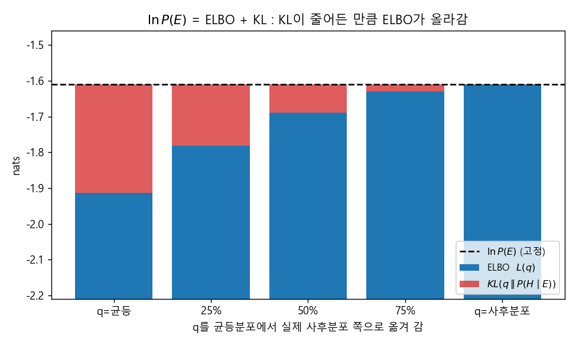
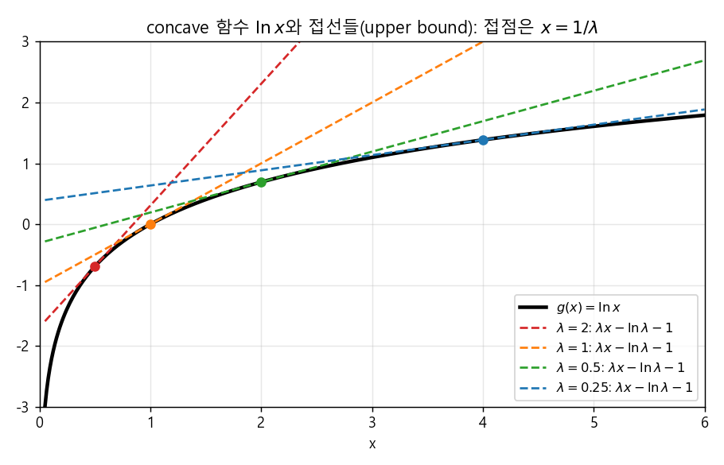
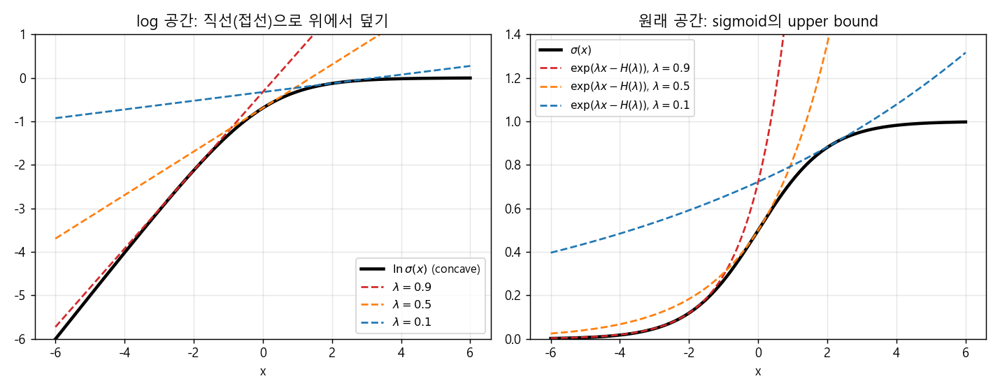
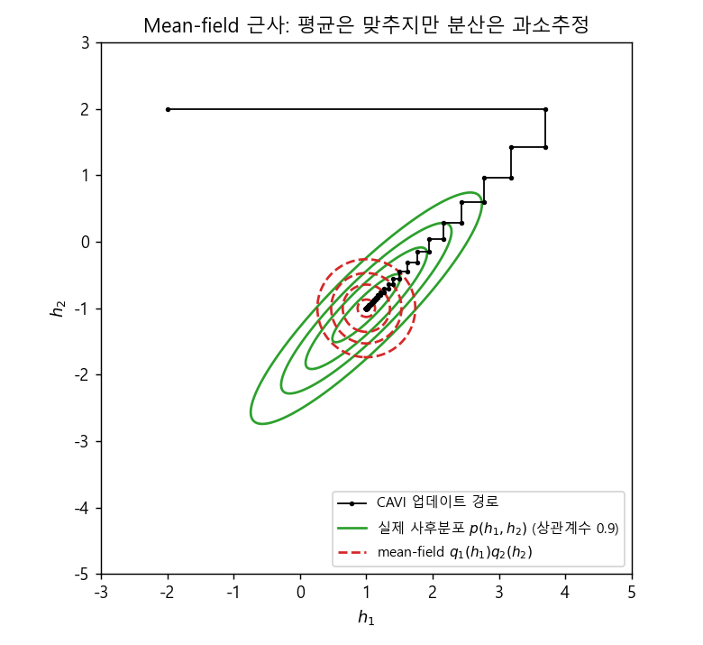
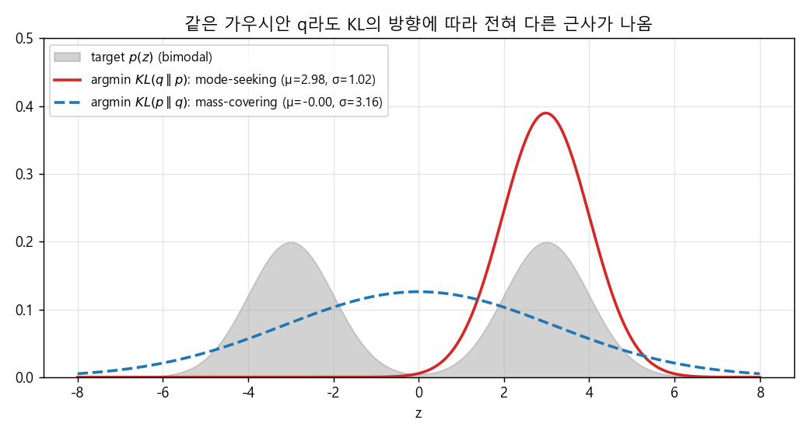

### 복잡한 함수와 분포를 단순한 것으로 바꾸는 기술, Variational Inference


> 샘플링 대신 최적화로 사후분포를 근사하는 Variational Inference의 출발점인 variational transform부터, ELBO와 mean field 근사에 이르는 이론적 뼈대를 살펴봅니다.  


<br>

<center></center>    


<br/>


>  **1. Variational transform은 복잡한 비선형 함수를 variational parameter $\lambda$가 붙은 단순한 함수로 바꾸는 기법이다. 복잡성은 사라지지 않고, $\lambda$를 최적화하는 문제로 옮겨 갈 뿐이다**
>
>  **2. 사후분포 $P(H \mid E)$를 직접 구하기 어려울 때, 단순한 분포 $Q(H \mid E, \lambda)$를 도입하면 $\ln P(E)$ = ELBO + KL 로 분해된다. ELBO를 최대화하는 것은 곧 $Q$와 실제 사후분포 사이의 KL divergence를 최소화하는 것이다**
>
>  **3. Mean field 가정으로 $Q$를 hidden 변수별로 쪼개면, 각 $q_j$의 최적해는 나머지 분포들로 취한 기댓값 $\ln q_j^* = \mathbb{E}_{i \neq j}[\ln P(H, E \mid \theta)] + C$ 로 주어지며, 이를 번갈아 업데이트하면 된다**


<br/>

----

#### Contents

<br/>

1.	[샘플링에서 최적화로](#sampling-to-optimization)
2.	[Variational Transform: 로그 함수를 직선으로](#variational-transform)
3.  [Logistic 함수와 log-concavity](#logistic)
4.  [Convex Duality와 확률분포로의 확장](#convex-duality)
5.  [Evidence와 ELBO](#elbo)
6.  [Lower Bound 최적화: Variational EM](#variational-em)
7.  [Mean Field 근사와 Freeform Optimization](#mean-field)

<br />

[지난 포스트](https://myeonghak.github.io/general%20machine%20learning/General-ML-train-set-batch-13.-MCMC%EC%99%80-Gibbs-Sampling/)에서는 MCMC와 Gibbs Sampling으로 복잡한 확률 모델의 사후분포를 "샘플을 뽑아서" 추론하는 방법을 살펴보았습니다. 이번 시간부터는 같은 문제를 전혀 다른 방식으로 푸는 **Variational Inference(VI)** 를 알아보려고 하는데요. 이번 편에서는 VI의 이론적 토대를, 다음 편에서는 간단한 모델 예제와 LDA에의 적용을 다루겠습니다.  


<a id="sampling-to-optimization"></a>
### 1. 샘플링에서 최적화로  

Graphical model, 혹은 확률 모델에서 우리가 하고 싶은 일은 대체로 같습니다. 관측된 변수가 주어졌을 때 숨겨진(latent) 변수의 분포, 즉 사후분포를 알아내는 것이죠. 그런데 모델이 조금만 복잡해져도 이 사후분포를 정확히 계산하는 것은 불가능에 가까워집니다.  

이 문제에 대한 접근은 크게 두 갈래로 나뉩니다.  

- **Sampling based inference**: 사후분포에서 샘플을 많이 뽑아서 분포를 흉내 냄. 지난 시간에 다룬 Gibbs Sampling이 대표적임  
- **Optimization based inference**: 다루기 쉬운 분포족을 하나 정해 두고, 그 안에서 사후분포와 가장 가까운 분포를 "최적화"로 찾아냄. 이것이 Variational Inference임  

두 방법은 같은 기능을 하지만, 접근하는 방식이 완전히 다릅니다. 간단히 비교해 보면 다음과 같습니다.  

| 구분 | MCMC (Gibbs Sampling 등) | Variational Inference |
|---|---|---|
| 핵심 아이디어 | 사후분포에서 샘플링 | 단순한 분포로 근사 후 최적화 |
| 정확도 | 샘플이 충분하면 정확한 분포에 수렴 | 선택한 분포족의 한계만큼 편향이 남음 |
| 속도 | 대체로 느림, 수렴 판단이 어려움 | 대체로 빠름, 목적함수로 수렴 확인 가능 |
| 결과물 | 샘플들의 집합 | 파라미터 $\lambda$로 표현된 분포 |

VI는 Gibbs Sampling과 함께 확률 모델 추론의 대표적인 방법론이 되었는데요. 이 방법을 이해하려면 먼저 "variational"이라는 말이 어디서 왔는지, 즉 **variational transform** 이라는 아이디어부터 살펴보는 것이 좋습니다.  


<a id="variational-transform"></a>
### 2. Variational Transform: 로그 함수를 직선으로  

#### 비선형 함수를 선형으로 바꿀 수 없을까?  

$g(x) = \ln x$ 같은 비선형 함수를 떠올려 보겠습니다. 이런 함수는 다소 복잡하고, 다른 식과 얽혀 있을 때 처리하기 난처합니다. 그렇다면 이를 단순한 함수, 예컨대 선형 함수로 바꿀 수는 없을까요? 이것이 variational transform의 기능입니다.  

한 지점 $x$를 잡으면, 그 지점에서 $\ln x$에 접하는 직선을 하나 찾을 수 있습니다. 문제는 $\ln x$의 기울기가 지점마다 달라진다는 것인데요. 그래서 직선 하나를 고정해서 쓰는 것은 곤란하지만, **기울기 자체를 변수로 두어** 그 증감의 경향을 반영하게 해 주면 이야기가 달라집니다.  

- 선형 함수: $f(x) = \lambda x + b(\lambda)$. 여기서 $\lambda$는 접점에서의 기울기이고, 절편 $b$도 $\lambda$에 따라 달라짐  
- 로그 함수: $g(x) = \ln x$. concave이면서 monotonic increasing이라는 성질을 가짐  

#### 접선의 조건 구하기  

$f(x)$가 $g(x)$에 접하려면 두 조건이 필요합니다. 기울기가 같고, 함숫값이 같아야 하죠.  

$$
\frac{d}{dx}\ln x = \frac{1}{x} = \lambda \quad\Rightarrow\quad x = \frac{1}{\lambda}
$$

이를 $f(x) = g(x)$에 대입하면 절편이 나옵니다.  

$$
\lambda \cdot \frac{1}{\lambda} + b(\lambda) = \ln \frac{1}{\lambda} \quad\Rightarrow\quad b(\lambda) = -\ln \lambda - 1
$$

따라서 $\ln x$를 근사하는 직선은 다음과 같습니다.  

$$
f(x) = \lambda x - \ln \lambda - 1
$$

<br>

<center></center>    

<br>

그림에서 볼 수 있듯이, $\ln x$는 concave이므로 모든 접선은 항상 함수의 **위쪽**에 있습니다. 즉 어떤 $\lambda > 0$에 대해서도 $\ln x \le \lambda x - \ln \lambda - 1$ 이고, 등호는 $\lambda = 1/x$일 때 성립합니다. 그래서 다음과 같이 정확하게 쓸 수 있습니다.  

$$
\ln x = \min_{\lambda > 0} \left\{ \lambda x - \ln \lambda - 1 \right\}
$$

정말 그런지 숫자로 확인해 볼까요?  

```python
import numpy as np

lams = np.linspace(0.01, 5, 100000)          # variational parameter 후보
for x in [0.5, 1.0, 3.0]:
    vals = lams * x - np.log(lams) - 1        # lambda*x - f*(lambda)
    i = vals.argmin()
    print(f"x={x}: min={vals[i]:.5f}, ln x={np.log(x):.5f}, "
          f"argmin lambda={lams[i]:.4f}, 1/x={1/x:.4f}")
```

```
x=0.5: min=-0.69315, ln x=-0.69315, argmin lambda=2.0000, 1/x=2.0000
x=1.0: min=0.00000, ln x=0.00000, argmin lambda=1.0000, 1/x=1.0000
x=3.0: min=1.09861, ln x=1.09861, argmin lambda=0.3334, 1/x=0.3333
```

직선들의 최솟값이 정확히 $\ln x$와 일치하고, 그때의 $\lambda$가 $1/x$임을 확인할 수 있습니다.  

#### 무엇을 얻고 무엇을 내주었나  

여기서 중요한 관찰이 하나 있습니다.  

- $f(x)$는 $x$에 대해서는 명백히 선형 함수임  
- 그러나 $\lambda$의 관점에서 보면 $-\ln\lambda$ 항 때문에 선형이 아님  
- 즉, $\lambda$라는 floating parameter를 도입함으로써 $x$ 도메인의 비선형성을 비껴낸 것이고, 그 대가로 $\lambda$가 새로운 **최적화 대상**이 됨  

이 $\lambda$를 **variational parameter** 라고 부릅니다. 앞으로 계속 등장할 핵심 캐릭터이니 기억해 두시면 좋겠습니다.  


<a id="logistic"></a>
### 3. Logistic 함수와 log-concavity  

로그 함수는 concave여서 다루기 편했는데요. Logistic(sigmoid) 함수 $\sigma(x) = 1/(1+e^{-x})$는 S커브 형태라서 concave하지도, convex하지도 않습니다. 그렇다면 접선으로 덮는 트릭을 쓸 수 없을까요?  

해결책은 의외로 간단합니다. **로그를 씌워서 concave 함수로 가져오면 됩니다.** $\ln \sigma(x) = -\ln(1+e^{-x})$는 concave 함수인데, 이런 함수를 log-concave라고 합니다.  

- $x$는 실수 전체를 자유롭게 움직이지만 $\sigma(x)$는 0과 1 사이의 값만 가짐  
- 이 구간의 $\ln \sigma(x)$는 concave이므로, 앞에서와 똑같이 variational parameter를 도입한 직선으로 근사 가능함  
- 근사한 결과를 원래 sigmoid 도메인으로 가져가려면 로그를 풀어 주면(exponential을 취하면) 됨  

이렇게 정리하면 다음과 같은 식을 얻습니다.  

$$
\sigma(x) = \min_{\lambda} \exp\left( \lambda x - H(\lambda) \right), \qquad H(\lambda) = -\lambda \ln \lambda - (1-\lambda)\ln(1-\lambda)
$$

여기서 $H(\lambda)$는 공교롭게도 binary entropy 함수의 형태가 됩니다. (바로 다음 절의 conjugate function을 계산하면 이 식이 나옵니다.)  

<br>

<center></center>    

<br>

왼쪽 그림의 log 공간에서는 직선이 $\ln\sigma(x)$를 위에서 덮고, 오른쪽의 원래 공간에서는 지수 함수가 sigmoid를 위에서 덮습니다. 눈여겨볼 점은 **$\lambda$의 값에 따라 근사의 질이 매우 달라진다** 는 것입니다. $\lambda = 0.5$는 $x = 0$ 근처에서는 거의 완벽하지만 멀어질수록 크게 빗나가죠. 결국 "관심 있는 지점에서 좋은 $\lambda$를 고르는 것", 즉 최적화가 핵심이 됩니다.  


<a id="convex-duality"></a>
### 4. Convex Duality와 확률분포로의 확장  

#### 더 체계적인 방법: Conjugate function  

지금까지는 미분을 이용해 접선을 손으로 구했고, concave하지 않은 함수는 로그를 씌워 처리했습니다. 이 과정을 좀 더 체계적으로 할 수는 없을까요? 이때 쓰는 도구가 **convex duality** 입니다.  

concave 함수 $f(x)$에 대해, 다음 관계를 만족하는 conjugate(dual) function $f^*(\lambda)$를 정의할 수 있습니다.  

$$
f(x) = \min_{\lambda} \left\{ \lambda^T x - f^*(\lambda) \right\}, \qquad f^*(\lambda) = \min_{x} \left\{ \lambda^T x - f(x) \right\}
$$

두 식이 대칭적인 모양이라는 게 보이시나요? $\lambda$에 대해 조정할지, $x$에 대해 조정할지 관점만 바꾸면 $f(x)$와 $f^*(\lambda)$가 서로 interchangeable 하다는 의미입니다. (convex 함수라면 min 대신 max를 쓰고 부등호 방향이 반대가 됩니다.)  

$f(x) = \ln x$로 확인해 보면, $f^*(\lambda) = \min_x \{\lambda x - \ln x\}$는 $x = 1/\lambda$에서 최소가 되므로 $f^*(\lambda) = 1 + \ln\lambda$ 입니다. 따라서  

$$
\ln x = \min_{\lambda} \left\{ \lambda x - (\ln\lambda + 1) \right\}
$$

로, 앞 절에서 미분으로 구한 결과와 정확히 같습니다.  

#### 복잡성은 사라지지 않고 옮겨 간다  

이 식이 주는 교훈이 VI 전체를 관통하는 정신인데요.  

- $\lambda$를 잘 조정해 주면, 특정 $x$에서의 $\ln x$ 값을 $x$에 대해 선형인 함수로 표현할 수 있음  
- 하지만 $\ln x$의 복잡성은 사라진 것이 아니라, $\lambda$로 이루어진 dual function $f^*(\lambda) = \ln\lambda + 1$로 **전이** 된 것임. 즉 절편이 대신 복잡해짐  
- 반대로 보면 $\lambda$의 관점에서 선형으로 모델링할 수도 있는데, 이때는 복잡성을 $x$가 흡수함  

> 복잡한 함수를 간단하게 근사해도 그 복잡성은 사라지지 않는다. 단순화된 함수의 파라미터로 그 복잡성이 전이될 뿐이다.  

공짜 점심은 없다는 말을 수학적으로 표현한 셈이죠.  

#### 확률분포로의 확장  

이제 이 아이디어를 확률 모델로 가져가 보겠습니다. 확률밀도함수(pdf)도 결국 함수입니다. 다만 pdf를 직선으로 바꾸려는 것은 아니고, **우리가 잘 모르는 복잡한 확률분포를, 우리가 잘 아는 단순한 확률분포의 형태로 변환** 하려는 것입니다.  

예를 들어 다음과 같은 Bayesian network를 생각해 보겠습니다. $S_1, S_3$는 parent가 없는 노드이고, 부모 노드 집합을 $\pi(\cdot)$로 쓰면 $\pi(2) = \lbrace 1, 3 \rbrace$, $\pi(4) = \lbrace 3 \rbrace$ 입니다. 이 모델의 joint distribution은  

$$
P(S) = \prod_i P(S_i \mid S_{\pi(i)}) = P(S_1)\,P(S_3)\,P(S_2 \mid S_1, S_3)\,P(S_4 \mid S_3)
$$

로 factorize 됩니다. 이때 다루기 어려운 conditional들에 variational transform을 적용해, 변분 파라미터 $\lambda_i^U$가 붙은 단순한 upper bound 함수 $P^U$로 바꿀 수 있습니다.  

$$
P(S_i \mid S_{\pi(i)}) \le P^U(S_i \mid S_{\pi(i)}, \lambda_i^U)
\quad\Rightarrow\quad
P(S) \le \prod_i P^U(S_i \mid S_{\pi(i)}, \lambda_i^U)
$$

물론 이 bound가 원래 함수를 잘 근사하려면 $\lambda^U$를 잘 골라야 하므로, 여기에도 $\min_{\lambda}$라는 최적화 파트가 들어갑니다. 앞의 sigmoid 예시가 바로 이런 식으로 쓰이는데요. 예컨대 sigmoid belief network의 conditional은 sigmoid 형태라서, 이를 지수 함수 꼴의 bound로 바꿔 주면 계산이 훨씬 수월해집니다.  


<a id="elbo"></a>
### 5. Evidence와 ELBO  

#### Evidence와 Hypothesis  

이제 본격적인 VI 이론으로 들어가 보겠습니다. 확률 모델의 변수들을 두 그룹으로 나눕니다.  

- **Evidence $E$**: 관측된 변수. 고정되어 있고, 확실한 사실임  
- **Hypothesis $H$**: 숨겨진 변수. 추정·추론의 대상이며 가변적임  
- $E$와 $H$는 상호배타적이며, 둘의 합집합은 전체 변수 집합 $S$가 됨  

우리가 원하는 것은 사후분포입니다.  

$$
P(H \mid E) = \frac{P(H, E)}{P(E)}
$$

분자는 모델이 주어지면 계산할 수 있지만, 분모인 $P(E)$가 문제입니다. $P(E) = \sum_H P(H, E)$ 처럼 hidden 변수에 대해 marginalize해야 하는데, 모델이 복잡하면 이 합이 지수적으로 커지기 때문이죠. 그래서 $P(E)$를 먼저 근사해 보려고 합니다.  

#### Jensen's inequality로 lower bound 만들기  

먼저 로그를 취하고, 곱하고 나누기 트릭으로 임의의 분포 $Q(H \mid E, \lambda)$를 끼워 넣습니다.  

$$
\ln P(E) = \ln \sum_H P(H, E) = \ln \sum_H Q(H \mid E, \lambda) \frac{P(H, E)}{Q(H \mid E, \lambda)}
$$

$\ln$은 concave이므로 Jensen's inequality, 즉 $\ln \mathbb{E}[X] \ge \mathbb{E}[\ln X]$를 적용할 수 있습니다.  

$$
\ln P(E) \ge \sum_H Q(H \mid E, \lambda) \ln \frac{P(H, E)}{Q(H \mid E, \lambda)}
= \underbrace{\sum_H Q \ln P(H, E)}_{\text{expectation}} \; \underbrace{- \sum_H Q \ln Q}_{\text{entropy}}
$$

부등식이 되는 대신, 로그가 합 안쪽으로 들어와서 우리가 처리할 수 있는 형태가 되었습니다. 첫 항은 $Q$에 대한 기댓값, 두 번째 항은 $Q$의 엔트로피(negative entropy에 마이너스를 붙인 것)입니다.  

여기서 $P(H, E) = P(E \mid H) P(H)$로 아무 조건 없이 바꿔 쓸 수 있으므로, 이를 대입해 정리하면  

$$
\ln P(E) \ge \mathbb{E}_{Q}\left[\ln P(E \mid H)\right] - KL\left(Q(H \mid E, \lambda) \parallel P(H)\right)
$$

가 됩니다. 이것이 evidence에 대한 lower bound, 즉 **ELBO(Evidence Lower BOund)** 입니다. 엄밀히는 앞의 전개 과정에 나온 식들도 모두 ELBO이지만, 이 "기댓값 - KL" 형태가 가장 널리 알려져 있습니다.  

#### 등호와 부등호 사이의 간격  

그렇다면 lower bound와 실제 $\ln P(E)$ 사이의 간격은 정확히 얼마일까요? $P(H, E) = P(H \mid E) P(E)$로 바꿔 쓰면 다음과 같은 정확한 등식을 얻습니다.  

$$
\ln P(E) = \underbrace{\sum_H Q \ln \frac{P(H, E)}{Q}}_{L(\lambda)\;=\;\text{ELBO}} + \underbrace{\sum_H Q \ln \frac{Q}{P(H \mid E)}}_{KL(Q \parallel P(H \mid E))}
$$

- $\ln P(E)$는 $Q$와 무관한 고정값임  
- KL divergence는 항상 0 이상이므로 ELBO는 항상 $\ln P(E)$ 이하임  
- 따라서 **ELBO를 최대화하는 것 = $Q$와 실제 사후분포의 KL divergence를 최소화하는 것** 임  
- $Q(H \mid E, \lambda) = P(H \mid E)$일 때 KL이 0이 되고, ELBO가 $\ln P(E)$와 같아짐  

맨 위의 대표 이미지가 바로 이 관계를 보여 줍니다. 5개의 상태를 갖는 이산 hidden 변수에 대해, $Q$를 균등분포에서 실제 사후분포 쪽으로 조금씩 옮겨 가며 계산한 결과인데요. 막대의 전체 높이($\ln P(E)$)는 그대로이고, 빨간 KL 부분이 줄어든 만큼 파란 ELBO가 정확히 올라가는 것을 볼 수 있습니다. 파이 크기는 정해져 있고, KL에게 뺏긴 몫을 ELBO가 되찾아 오는 게임인 셈이죠.  

#### Detour: EM에서 본 그 식  

이 분해, 어디선가 본 것 같지 않으신가요? GMM과 EM 알고리즘을 다룰 때 probability decomposition에서 똑같은 전개를 했었습니다.  

$$
\ln P(X \mid \theta) = L(q, \theta) + KL\left(q(Z) \parallel P(Z \mid X, \theta)\right)
$$

그때는 $q(Z)$를 도입해 전개한 뒤, $\theta$를 고정하고 $Z$의 분포를 맞추고(즉 $q$를 만들고), 다시 그에 맞춰 $\theta$를 최적화하는 과정을 반복했습니다. VI는 바로 이 틀을 확장한 것입니다.  


<a id="variational-em"></a>
### 6. Lower Bound 최적화: Variational EM  

#### $Q$는 variational distribution  

앞에서 곱하고 나누기 트릭으로 도입한 $Q(H \mid E, \lambda)$는, 원래 추정하려는 사후분포를 단순화하기 위해 도입한 variational function, 즉 **variational distribution** 입니다. 여기서 variational transform의 에센스가 다시 등장하는데요.  

> 복잡한 함수(사후분포)를 단순화된 형태($Q$)로 표현하는데, 그 단순성은 거저 주어지는 것이 아니라 variational parameter $\lambda$를 조정함으로써 얻어진다.  

#### Coordinate ascent  

모델 파라미터 $\theta$까지 포함해 쓰면 목적함수는 $L(\lambda, \theta)$가 됩니다. 이제 이 lower bound를 **최대화** 해야 하는데, EM에서처럼 coordinate ascent 방식으로 번갈아 최적화합니다.  

1) **$\theta$를 고정하고 $\lambda$를 최적화**  
- $\ln P(E \mid \theta)$는 $\lambda$와 무관하므로, $\lambda$에 대해 ELBO를 올리는 것은 곧 $KL(Q(H \mid E, \lambda) \parallel P(H \mid E, \theta))$를 줄이는 것임  
- 이상적으로는 $Q(H \mid E, \lambda) = P(H \mid E, \theta)$가 되어야 ELBO $= \ln P(E \mid \theta)$가 성립함  

2) **$\lambda$를 고정하고 $\theta$를 최적화**  
- 이 부분은 EM의 M-step과 동일함  

이때 $\lambda$와 $\theta$는 하나의 변수가 아니라 여러 개의 변수 묶음일 수 있습니다. 큰 그림에서 EM과 매우 유사하기 때문에 이 과정을 **Variational EM** 이라고 부르기도 합니다.  

| 단계 | EM | Variational EM |
|---|---|---|
| E-step | $q(Z) = P(Z \mid X, \theta)$를 정확히 계산 | variational parameter $\lambda$를 최적화 |
| M-step | $\theta$ 최적화 | model parameter $\theta$ 최적화 |

#### GMM에서는 왜 그냥 됐을까?  

GMM의 EM에서도 $q$를 구체적으로 설명하지 않고 도입했었는데, 사실 그것이 variational distribution이었습니다. 다만 GMM에서는  

$$
q^t(Z) = P(Z \mid X, \theta^t)
$$

로 등호를 두고 그대로 계산할 수 있었습니다. 모델이 단순해서 사후분포를 정확히 구할 수 있었기 때문이죠. 그런데 복잡한 모델에서는 이 우변의 $P$를 구하는 것 자체가 불가능합니다. 그래서 이 등호를 **근사** 로 바꾸고, $q$를 variational parameter가 붙은 단순한 분포로 설정해서, 그 파라미터를 최적화하는 방식으로 모델링하는 것입니다.  

그런데 아직 해결하지 못한 질문이 남아 있습니다. **$\lambda$를 구체적으로 어떻게 최적화할까요?** 그리고 그 전에, $Q$는 어떤 형태여야 할까요?  


<a id="mean-field"></a>
### 7. Mean Field 근사와 Freeform Optimization  

#### $Q$를 어떻게 고를까?  

$Q$가 어떤 분포여야 하는지 정해진 것은 없습니다. 다만 원래의 복잡한 확률 모델보다는 **우리가 잘 아는** 분포를 골라 단순화된 형태를 만들고 싶을 것입니다. 여기서 "잘 안다"는 것은 두 가지를 의미합니다.  

- $Q$의 분포 형식을 알고 있음  
- 좋은 $\lambda$를 선택하는 방법을 알고 있음  

가장 좋은 설정은 $P(H \mid E, \theta) = Q(H \mid E, \lambda)$이지만, $P$가 복잡하니 단순한 $Q$를 쓰려는 것이고, 이 근사로 생기는 오차를 $\lambda$로 최소화하겠다는 것이 목표입니다.  

#### Mean field 가정  

가장 널리 쓰이는 단순화는 **hidden 변수들이 variational parameter가 주어지면 서로 독립** 이라고 가정하는 것입니다. 예를 들어 $H_3 \to H_1$, $H_1 \to E$, $H_2 \to E$ 구조의 Bayesian network가 있다면, 원래 joint는  

$$
P(H, E) = P(H_3)\,P(H_1 \mid H_3)\,P(H_2)\,P(E \mid H_1, H_2)
$$

로 hidden 변수들이 서로 얽혀 있습니다. 특히 $E$가 관측되면 $H_1$과 $H_2$는 explaining away 때문에 사후분포에서 서로 의존하게 되죠. Mean field 근사에서는 이 dependency structure를 모두 끊고 다음과 같이 둡니다.  

$$
Q(H \mid \lambda) = q_3(H_3 \mid \lambda_3)\, q_1(H_1 \mid \lambda_1)\, q_2(H_2 \mid \lambda_2) = \prod_i q_i(H_i \mid \lambda_i)
$$

- hidden끼리 entangle된 구조가 사라지므로 다루기가 매우 간결해짐  
- ELBO 안의 $Q$가 곱의 형태가 되고, 로그를 취하면 합의 형태로 쪼개짐  
- 전체 $\lambda$를 한꺼번에 최적화하는 대신 개별 $\lambda_i$로 분리해 최적화할 수 있음  

이 가정을 **mean field approximation**, 이를 적용한 VI를 **mean field variational inference** 라고 부릅니다.  

#### 하나의 변수에 집중하기  

이제 $j$번째 factor $q_j$만 남기고 나머지 $q_{i \neq j}$는 고정한 채로 ELBO를 정리해 보겠습니다. $\mathbb{E}_{i \neq j}[\cdot]$를 $q_j$를 제외한 나머지 분포들에 대한 기댓값이라고 하면,  

$$
\begin{aligned}
L(\lambda_j) &= \sum_H \prod_i q_i \left[ \ln P(H, E \mid \theta) - \sum_i \ln q_i \right] \\
&= \sum_{H_j} q_j \, \mathbb{E}_{i \neq j}\left[\ln P(H, E \mid \theta)\right] - \sum_{H_j} q_j \ln q_j + \text{const}
\end{aligned}
$$

가 됩니다. 여기서 새로운 함수 $\tilde{P}$를 다음과 같이 정의합니다.  

$$
\ln \tilde{P}(H_j, E \mid \theta) = \mathbb{E}_{i \neq j}\left[\ln P(H, E \mid \theta)\right] + C
$$

$\ln \tilde{P}$는 원래 $\ln P(H, E \mid \theta)$를 나머지 분포들로 가중합한 것, 즉 기댓값의 형태입니다. $q_j$를 뺀 나머지에 대해서만 기댓값을 취했기 때문에 $H_j$의 함수로 남는다는 점이 포인트입니다. 이를 대입하면  

$$
L(\lambda_j) = \sum_{H_j} q_j \ln \frac{\tilde{P}(H_j, E \mid \theta)}{q_j(H_j \mid E, \lambda_j)} + \text{const}
= -KL\left(q_j \parallel \tilde{P}\right) + \text{const}
$$

#### Freeform optimization  

또다시 negative KL이 등장했습니다. 앞에서와 똑같은 논리로, 이 KL을 0으로 만드는 $q_j$가 최적해입니다.  

$$
\ln q_j^*(H_j \mid E, \lambda_j) = \ln \tilde{P}(H_j, E \mid \theta) = \mathbb{E}_{i \neq j}\left[\ln P(H, E \mid \theta)\right] + C
$$

기존 KL 식의 목표는 $Q(H \mid E, \lambda) = P(H \mid E, \theta)$ 전체를 맞추는 것이었다면, mean field에서는 각 factor를 $\tilde{P}$에 하나씩 맞추는 문제로 바뀐 것입니다. 이 식을 해석하면 다음과 같습니다.  

- 특정 hidden 변수 $H_j$의 variational distribution을 최적화하려면  
- $H_j$를 뺀 나머지 모든 variational distribution을 고정하고, 우리가 제안한 확률 모델 $P(H, E \mid \theta)$의 로그에 대한 기댓값을 구하면 됨  
- 이 기댓값을 미분해서 0으로 두는 것이 곧 $\ln q_j^*$를 최적화하는 것과 같음  
- 이를 $\lambda$의 개수만큼 개별적으로 반복해 $q_1^*$부터 $q_n^*$까지 만들어 주면 됨  

$q_j$의 함수 형태를 미리 정하지 않았는데도 최적 형태가 저절로 결정된다는 의미에서 이를 **freeform optimization** 이라고 부릅니다. 그리고 각 factor를 번갈아 업데이트하는 이 알고리즘은 흔히 CAVI(Coordinate Ascent Variational Inference)라고 불립니다. Gibbs Sampling이 "나머지를 고정하고 하나씩 샘플링"했다면, CAVI는 "나머지를 고정하고 하나씩 기댓값으로 업데이트"하는 셈이니, 둘은 꽤 닮은 꼴입니다.  

#### 작은 예제: 상관된 2차원 가우시안  

감을 잡기 위해, 실제 사후분포가 상관계수 0.9인 2차원 가우시안 $\mathcal{N}(\mu, \Sigma)$라고 가정하고 mean field로 근사해 보겠습니다. precision matrix를 $\Lambda = \Sigma^{-1}$이라 하면, 위 공식에서 $\ln q_1^*(h_1)$은 $h_1$의 2차식이 되어 다음과 같은 가우시안이 나옵니다.  

$$
q_1^*(h_1) = \mathcal{N}\left(h_1 \,;\, \mu_1 - \frac{\Lambda_{12}}{\Lambda_{11}}\left(\mathbb{E}[h_2] - \mu_2\right),\; \Lambda_{11}^{-1}\right)
$$

$q_2^*$도 대칭적으로 구해지고, 이 둘을 번갈아 업데이트하면 됩니다.  

```python
import numpy as np

mu = np.array([1.0, -1.0])
Sigma = np.array([[1.0, 0.9], [0.9, 1.0]])
Lam = np.linalg.inv(Sigma)                    # precision matrix

m = np.array([-2.0, 2.0])                     # q1, q2의 평균 초기값
for it in range(100):
    # ln q1*(h1) = E_{q2}[ln p(h1,h2)] + C  ->  가우시안
    m[0] = mu[0] - Lam[0, 1] / Lam[0, 0] * (m[1] - mu[1])
    m[1] = mu[1] - Lam[1, 0] / Lam[1, 1] * (m[0] - mu[0])

print("q 평균  :", m.round(4), " / 실제 평균:", mu)
print("q 분산  :", (1 / np.diag(Lam)).round(4), " / 실제 분산:", np.diag(Sigma))
```

```
q 평균  : [ 1. -1.]  / 실제 평균: [ 1. -1.]
q 분산  : [0.19 0.19]  / 실제 분산: [1. 1.]
```

<br>

<center></center>    

<br>

평균은 정확히 맞추지만, 분산은 $1 - 0.9^2 = 0.19$로 실제(1.0)보다 훨씬 작게 잡히는 것을 볼 수 있습니다. 축에 평행한 원만 그릴 수 있는 $q$가, 비스듬히 누운 타원 안에 "삐져나가지 않게" 들어가려다 보니 생기는 현상인데요. 이는 mean field VI의 잘 알려진 특징인 **분산 과소추정** 입니다.  

#### 왜 하필 $KL(Q \parallel P)$일까?  

이 현상은 VI가 최소화하는 KL의 방향과 관련이 있습니다. KL divergence는 비대칭이라서, 어느 쪽을 기준으로 두느냐에 따라 근사 결과가 크게 달라집니다.  

<br>

<center></center>    

<br>

- **$KL(q \parallel p)$ (VI가 쓰는 방향)**: $p$가 거의 0인 곳에 $q$가 질량을 두면 큰 벌점을 받음. 그래서 봉우리 하나에 딱 붙는 **mode-seeking** 성향을 보임  
- **$KL(p \parallel q)$ (반대 방향)**: $p$가 있는 곳을 $q$가 놓치면 큰 벌점을 받음. 그래서 두 봉우리를 모두 덮으려고 넓게 퍼지는 **mass-covering** 성향을 보임  

VI가 $KL(q \parallel p)$를 쓰는 이유는 간단합니다. 계산 가능한 $q$에 대한 기댓값만으로 식이 표현되어, 모르는 $P(H \mid E)$에 대한 기댓값을 구할 필요가 없기 때문이죠. 그 대가로 사후분포의 불확실성을 다소 좁게 보는 경향이 생긴다는 점은 기억해 둘 만합니다.  


<br>

----------------

<a id="conclusion"></a>
### 닫으며  

지금까지 Variational Inference의 이론적 토대를 살펴보았습니다. 로그 함수를 접선으로 근사하는 작은 트릭에서 출발해, convex duality를 거쳐 "복잡성은 사라지지 않고 variational parameter로 옮겨 간다"는 정신을 확인했고, 이를 확률분포에 적용해 ELBO와 KL의 분해, Variational EM, 그리고 mean field 근사와 freeform optimization까지 이어지는 흐름을 정리했습니다. 샘플링 대신 최적화로 추론한다는 것이 어떤 의미인지 조금은 감이 오셨으면 좋겠습니다.  
다음 포스트에서는 **Variational Inference 2 - 예제와 LDA** 를 통해, 간단한 모델에서 $q_j^*$를 실제로 유도해 보고 LDA에 VI를 적용하는 과정을 살펴보겠습니다.  

**개선을 위한 여러분의 피드백과 제안을 코멘트로 공유해 주세요.**
**내용에 대한 지적, 혹은 질문을 환영합니다.**  

해당 포스트는 카이스트 문일철 교수님의 동의를 얻고, 강좌 내용과 자료, 그리고 reference의 자료를 참고하여 작성되었습니다. 원 강좌는 [여기](https://www.youtube.com/playlist?list=PLbhbGI_ppZISMV4tAWHlytBqNq1-lb8bz)에서 보실 수 있습니다.

**자료 공유를 허락해 주신 문일철 교수님께 감사의 말씀을 전합니다.**
