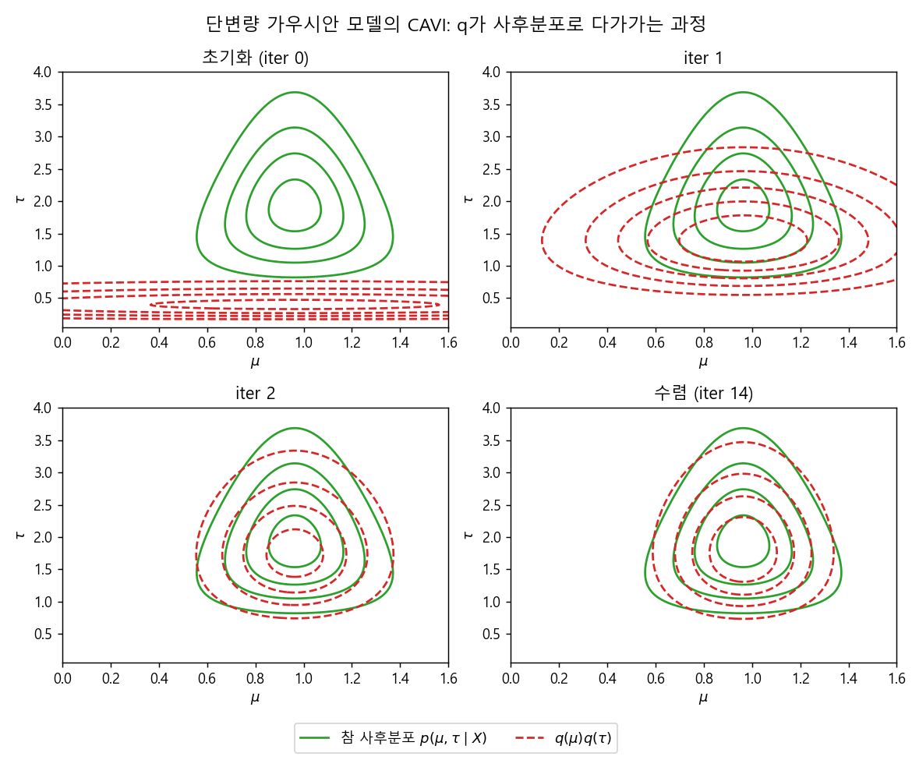
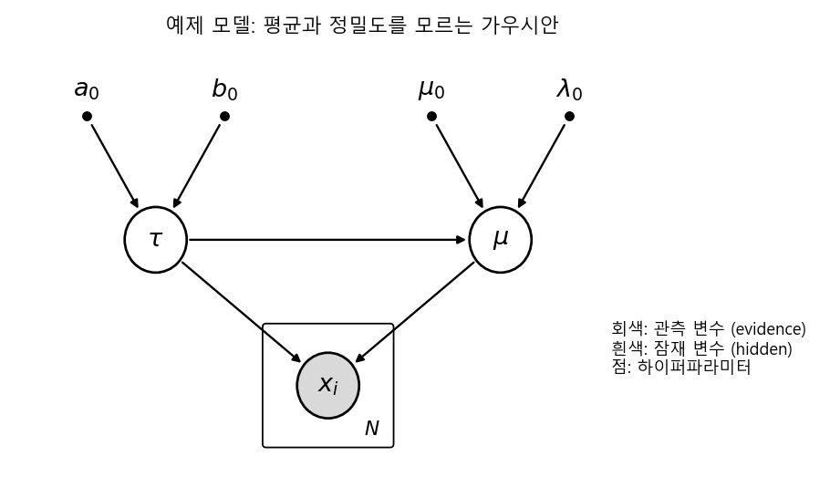
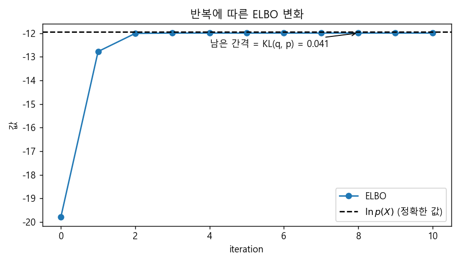
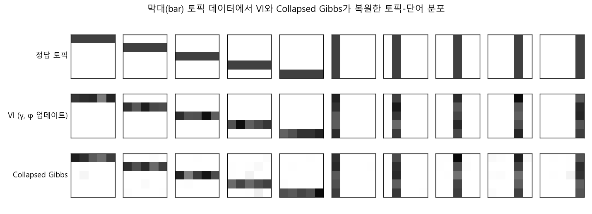

### 간단한 가우시안 모델로 따라가 보는 Mean-Field VI, 그리고 LDA의 Variational Inference


> 평균과 정밀도를 모르는 가우시안 모델에 mean-field variational inference를 직접 적용해 보고, 그 레시피를 LDA로 확장해 봅니다.  


<br>

<center></center>    


<br/>


>  **1. Mean-field 가정 하에서 각 variational distribution의 최적해는 "나를 제외한 나머지 잠재변수에 대한 log joint의 기댓값"으로 주어지며, 분포의 형태를 따로 정하지 않아도 정규분포, 감마분포처럼 익숙한 꼴이 저절로 드러난다**
>
>  **2. 각 q의 파라미터는 서로 다른 q의 기댓값을 필요로 하는 interlocking 구조이므로, 하나씩 번갈아 업데이트하는 coordinate ascent(CAVI)로 ELBO를 단조 증가시키며 수렴시킨다**
>
>  **3. 같은 레시피를 LDA에 적용하면 문서별 토픽 비율의 Dirichlet 파라미터 γ와 단어별 토픽 할당 확률 φ를 번갈아 업데이트하는 알고리즘이 되며, 이는 Gibbs sampling과 달리 결정론적이고 빠르지만 사후분포의 분산을 과소추정하는 경향이 있다**


<br/>

----

#### Contents

<br/>

1.	[예제 모델: 평균과 정밀도를 모르는 가우시안](#simple-model)
2.	[q(μ) 구하기: 정규분포가 저절로 나타난다](#optimal-q-mu)
3.  [q(τ) 구하기: 이번엔 감마분포](#optimal-q-tau)
4.  [Coordinate Update: 서로 맞물린 파라미터 풀기](#coordinate-update)
5.  [일반화된 Variational Inference 레시피](#recipe)
6.  [LDA에 Variational Inference 적용하기](#lda-vi)

<br />

[지난 포스트](https://myeonghak.github.io/general%20machine%20learning/General-ML-train-set-batch-14.-Variational-Inference-1/)에서는 variational transform에서 출발해 ELBO와 KL divergence의 관계, 그리고 mean-field 가정 하에서 최적의 variational distribution이 어떤 꼴을 갖는지까지 살펴보았습니다. 이론만 보면 "그래서 실제로 어떻게 계산하는데?"라는 의문이 남기 마련인데요. 이번 포스트에서는 아주 작은 모델 하나를 붙잡고 처음부터 끝까지 손으로 유도해 본 뒤, 그 레시피를 지난 13편에서 Gibbs sampling으로 풀었던 LDA에 그대로 적용해 보겠습니다. 이번 편이 이 시리즈의 마지막 포스트이기도 합니다.  


<a id="simple-model"></a>
### 1. 예제 모델: 평균과 정밀도를 모르는 가우시안  

#### 모델 정의  

관측값 $x_1, \dots, x_N$이 정규분포에서 나왔다고 하는데, 그 평균 $\mu$와 정밀도(precision, 분산의 역수) $\tau$를 모두 모르는 상황을 생각해 보겠습니다. 베이지안답게 두 파라미터에도 prior를 줍니다.  

- $\tau$는 하이퍼파라미터 $a_0, b_0$를 갖는 감마분포를 따름  
- $\mu$는 $\mu_0, \lambda_0$, 그리고 $\tau$에 의해 결정되는 정규분포를 따름  
- $x_i$는 $\mu, \tau$가 주어지면 서로 독립인 정규분포를 따름  

$$
p(\tau) = \text{Gam}(\tau \mid a_0, b_0), \quad p(\mu \mid \tau) = \mathcal{N}(\mu \mid \mu_0, (\lambda_0 \tau)^{-1}), \quad p(x_i \mid \mu, \tau) = \mathcal{N}(x_i \mid \mu, \tau^{-1})
$$

<br>

<center></center>    

<br>

여기서 evidence $E$는 관측된 $X$이고, hidden $H$는 $\mu$와 $\tau$입니다. 사실 이 모델은 conjugate prior(Normal-Gamma)를 쓰고 있어서 정확한 사후분포를 닫힌 형태로 구할 수 있는데요. 그래서 오히려 연습용으로 딱 좋습니다. VI가 낸 답을 정답과 직접 비교해 볼 수 있으니까요.  

#### Joint의 factorization  

지난 편에서 정리한 mean-field의 핵심 결과를 다시 꺼내 보면, 잠재변수를 $Q(H) = \prod_j q_j(H_j)$로 쪼갰을 때 각 조각의 최적해는 다음과 같았습니다.  

$$
\ln q_j^*(H_j) = \mathbb{E}_{i \neq j}\left[\ln P(H, E)\right] + C
$$

즉 $q_j$의 log는 "자기 자신을 제외한 나머지 잠재변수들로 log joint의 기댓값을 취한 것"입니다. 그러니 먼저 log joint부터 펼쳐 놓아야 하겠죠. 그래피컬 모델을 따라 factorize하면 다음과 같습니다.  

$$
\ln p(X, \mu, \tau) = \underbrace{\frac{N}{2}\ln \tau - \frac{\tau}{2}\sum_{i=1}^{N}(x_i - \mu)^2}_{\ln p(X \mid \mu, \tau)} + \underbrace{\frac{1}{2}\ln(\lambda_0 \tau) - \frac{\lambda_0 \tau}{2}(\mu - \mu_0)^2}_{\ln p(\mu \mid \tau)} + \underbrace{(a_0 - 1)\ln \tau - b_0 \tau}_{\ln p(\tau)} + C
$$

이제 mean-field 가정에 따라 $Q(\mu, \tau \mid X) = q_\mu(\mu)\, q_\tau(\tau)$로 놓습니다. 원래 모델에서는 $\mu$가 $\tau$에 의존했지만, $q$의 세계에서는 둘을 독립으로 끊어 버리는 것입니다. 대신 각 $q$는 evidence $X$로부터 정보를 받아 추정하게 됩니다.  


<a id="optimal-q-mu"></a>
### 2. q(μ) 구하기: 정규분포가 저절로 나타난다  

잠재변수가 $\mu, \tau$ 두 개뿐이므로, $q_\mu$를 구할 때는 $\tau$에 대해서만 기댓값을 취하면 됩니다. $\mu$와 관련 없는 항은 전부 상수 $C$로 밀어 넣으면 다음과 같습니다.  

$$
\ln q_\mu^*(\mu) = \mathbb{E}_\tau\left[\ln p(X, \mu, \tau)\right] + C = -\frac{\mathbb{E}[\tau]}{2}\left\{\lambda_0(\mu - \mu_0)^2 + \sum_{i=1}^{N}(x_i - \mu)^2\right\} + C
$$

중괄호 안을 $\mu$에 대해 정리하면 $\mu$에 대한 2차식이 되는데요. log를 씌운 값이 2차식이라는 것은 곧 원래 분포가 정규분포라는 뜻입니다. 완전제곱식으로 정리하면 다음과 같습니다.  

$$
q_\mu^*(\mu) = \mathcal{N}(\mu \mid \mu_N, \lambda_N^{-1}), \quad \mu_N = \frac{\lambda_0 \mu_0 + N\bar{x}}{\lambda_0 + N}, \quad \lambda_N = (\lambda_0 + N)\,\mathbb{E}[\tau]
$$

여기서 재미있는 점이 하나 있습니다. 우리는 $q$에 대해 **mean-field라는 가정 단 하나만** 했을 뿐, $q_\mu$가 어떤 분포여야 하는지는 정한 적이 없습니다. 그런데 식을 정리하다 보니 정규분포의 모양이 저절로 드러났고, 그래서 "그럼 $q_\mu$를 정규분포로 두고 그 파라미터 두 개(평균과 정밀도)만 찾으면 되겠다"는 결론에 이르게 됩니다. 함수 공간 전체를 뒤지는 문제가 파라미터 두 개를 찾는 문제로 바뀐 셈입니다.  

- $\mu_N$: 하이퍼파라미터 $\lambda_0, \mu_0$, 데이터 수 $N$, 그리고 $\sum_i x_i$만 있으면 바로 계산됨  
- $\lambda_N$: 그런데 여기엔 $\mathbb{E}[\tau]$가 들어 있음. 이는 $q_\tau$를 알아야 계산 가능함  

참고로 여기서의 $N$은 관측 데이터의 개수입니다. 결국 $q_\mu$를 완성하려면 $q_\tau$도 똑같은 방식으로 구해야 합니다.  


<a id="optimal-q-tau"></a>
### 3. q(τ) 구하기: 이번엔 감마분포  

이번엔 $\mu$에 대해 기댓값을 취하고, $\tau$와 무관한 항을 상수로 보냅니다.  

$$
\ln q_\tau^*(\tau) = (a_0 - 1)\ln \tau - b_0 \tau + \frac{N + 1}{2}\ln \tau - \frac{\tau}{2}\,\mathbb{E}_\mu\left[\sum_{i=1}^{N}(x_i - \mu)^2 + \lambda_0(\mu - \mu_0)^2\right] + C
$$

이번에는 $\ln \tau$에 대한 항과 $\tau$에 대한 1차항만 남았는데요. 감마분포의 log pdf가 정확히 $(a - 1)\ln \tau - b\tau + C$ 꼴이므로, $q_\tau$는 감마분포가 됩니다. (감마분포를 shape $k$, scale $\theta$로 표기하기도 하는데, 여기서는 shape $a$, rate $b = 1/\theta$ 표기를 쓰겠습니다.)  

$$
q_\tau^*(\tau) = \text{Gam}(\tau \mid a_N, b_N), \quad a_N = a_0 + \frac{N + 1}{2}
$$

$$
b_N = b_0 + \frac{1}{2}\,\mathbb{E}_\mu\left[\sum_{i=1}^{N}(x_i - \mu)^2 + \lambda_0(\mu - \mu_0)^2\right] = b_0 + \frac{1}{2}\left[\sum_i x_i^2 - 2\mathbb{E}[\mu]\sum_i x_i + N\mathbb{E}[\mu^2] + \lambda_0\left(\mathbb{E}[\mu^2] - 2\mu_0\mathbb{E}[\mu] + \mu_0^2\right)\right]
$$

- $a_N$: $a_0$와 $N$만 있으면 바로 계산됨. 한 번 구하면 끝  
- $b_N$: $a_0, b_0, N, x_i, \mu_0, \lambda_0$는 다 알지만, $\mathbb{E}[\mu]$와 $\mathbb{E}[\mu^2]$를 모름  

어디서 본 상황 같지 않나요? $q_\mu$를 구할 때 $\tau$ 관련 정보만 빼고 다 알고 있었던 것과 정확히 대칭인 상황입니다.  


<a id="coordinate-update"></a>
### 4. Coordinate Update: 서로 맞물린 파라미터 풀기  

#### Interlocking  

필요한 기댓값들의 의존 관계를 정리해 보면 다음과 같습니다.  

- $\mathbb{E}[\mu] = \mu_N$: 아무것도 필요 없이 바로 구할 수 있음  
- $\mathbb{E}[\mu^2] = \mu_N^2 + \lambda_N^{-1}$: $\lambda_N$, 즉 $\mathbb{E}[\tau]$가 필요함  
- $\mathbb{E}[\tau] = a_N / b_N$: $b_N$, 즉 $\mathbb{E}[\mu^2]$가 필요함  

즉 $\mathbb{E}[\tau]$와 $\mathbb{E}[\mu^2]$가 서로 맞물려(interlocking) 있습니다. 닭이 먼저냐 달걀이 먼저냐의 문제인데요. 이 구조, GMM과 HMM에서 EM을 다루며 자주 보았던 모습입니다. 다만 차이가 있다면, EM에서는 관측(observation)과 hidden이 서로를 조율했다면 여기서는 **hidden끼리** 서로를 조율한다는 점입니다. 해법은 EM과 비슷하게, 하나를 고정하고 다른 하나를 업데이트하는 coordinate ascent입니다. 이를 흔히 CAVI(Coordinate Ascent Variational Inference)라고 부릅니다.  

#### 파라미터 업데이트 알고리즘  

1) $a_0, b_0, \mu_0, \lambda_0$는 가정으로 주어지고, $x_i$는 관측되어 있음  
2) $\mu_N$, $a_N$은 한 번만 계산함  
3) $\lambda_N$에 임의의 초기값을 줌  
4) $\lambda_N$으로 $\mathbb{E}[\mu^2]$를 계산하고, 이를 이용해 $b_N$을 업데이트함  
5) $b_N$으로 $\mathbb{E}[\tau]$를 계산하고, 이를 이용해 $\lambda_N$을 업데이트함  
6) 수렴할 때까지 4~5를 반복함  

numpy로 그대로 옮겨 보겠습니다. 참값 $\mu = 1, \tau = 2$인 정규분포에서 10개의 샘플을 뽑았습니다.  

```python
import numpy as np

rng = np.random.default_rng(0)
x = rng.normal(loc=1.0, scale=1/np.sqrt(2.0), size=10)   # 참값: mu=1, tau=2
N, xbar = len(x), x.mean()
mu0, lam0, a0, b0 = 0.0, 1.0, 1.0, 1.0                    # 하이퍼파라미터

mu_N = (lam0*mu0 + N*xbar) / (lam0 + N)                   # 한 번만 계산하면 됨
a_N = a0 + (N + 1) / 2                                    # 한 번만 계산하면 됨
lam_N = 0.5                                               # 임의의 초기값

for it in range(6):
    E_mu, E_mu2 = mu_N, mu_N**2 + 1/lam_N                 # q(mu)의 moment
    b_N = b0 + 0.5*(np.sum(x**2) - 2*E_mu*np.sum(x) + N*E_mu2
                    + lam0*(E_mu2 - 2*mu0*E_mu + mu0**2))
    E_tau = a_N / b_N                                     # q(tau)의 moment
    lam_N = (lam0 + N) * E_tau
    print(f"iter {it}: b_N={b_N:.4f}, E[tau]={E_tau:.4f}, lambda_N={lam_N:.4f}")

print(f"q(mu)  = N({mu_N:.4f}, 1/{lam_N:.4f})")
print(f"q(tau) = Gamma({a_N:.1f}, {b_N:.4f})")
```

```
iter 0: b_N=13.8842, E[tau]=0.4682, lambda_N=5.1497
iter 1: b_N=3.9522, E[tau]=1.6447, lambda_N=18.0912
iter 2: b_N=3.1882, E[tau]=2.0388, lambda_N=22.4264
iter 3: b_N=3.1294, E[tau]=2.0771, lambda_N=22.8476
iter 4: b_N=3.1249, E[tau]=2.0801, lambda_N=22.8807
iter 5: b_N=3.1246, E[tau]=2.0803, lambda_N=22.8832
q(mu)  = N(0.9635, 1/22.8832)
q(tau) = Gamma(6.5, 3.1246)
```

일부러 엉뚱한 초기값($\lambda_N = 0.5$)에서 출발했는데도 몇 번 만에 값이 안정되는 것을 볼 수 있습니다. 맨 위의 대표 이미지가 바로 이 과정을 그린 것인데요. 초록색 실선이 Normal-Gamma로 정확히 구한 참 사후분포, 빨간 점선이 $q_\mu(\mu)q_\tau(\tau)$입니다. 처음에는 엉뚱한 곳에 있던 $q$가 두어 번의 업데이트 만에 사후분포 위로 포개집니다.  

매 반복마다 ELBO를 계산해 보면 단조 증가하면서, 정확히 계산한 $\ln p(X)$ 바로 아래에서 멈춥니다.  

<br>

<center></center>    

<br>

지난 편에서 본 $\ln p(X) = \text{ELBO}(q) + KL(q \parallel p)$ 관계를 떠올려 보면, 끝까지 메워지지 않는 약 0.041의 간격이 바로 수렴 후에도 남는 KL divergence입니다. mean-field라는 가정 자체가 $\mu$와 $\tau$의 상관관계를 표현할 수 없기 때문에, 이 간격은 반복을 아무리 더 해도 0이 되지 않습니다. 실제로 그림의 수렴 결과를 다시 보면 참 사후분포는 $\tau$가 작을수록 $\mu$ 방향으로 넓게 퍼진 삼각형 모양인데, $q$는 축에 나란한 타원 모양에 머물러 있죠. 참 사후분포와 moment를 비교해 보면 다음과 같습니다.  

| | $\mathbb{E}[\mu]$ | $\text{Var}[\mu]$ | $\mathbb{E}[\tau]$ | $\text{Var}[\tau]$ |
|---|---|---|---|---|
| 참 사후분포 (Normal-Gamma) | 0.9635 | 0.0524 | 2.0803 | 0.7213 |
| Mean-field VI | 0.9635 | 0.0437 | 2.0803 | 0.6658 |

평균은 거의 정확하게 맞추지만, 분산은 작게 잡습니다. 이것이 $KL(q \parallel p)$를 최소화하는 mean-field VI의 잘 알려진 특징인 **분산 과소추정**입니다. $q$가 $p$의 확률이 낮은 곳에 질량을 두는 것을 강하게 벌받기 때문에, 조심스럽게 안쪽으로 오그라드는 경향이 있는 것이죠.  


<a id="recipe"></a>
### 5. 일반화된 Variational Inference 레시피  

이 예제에서 한 일을 일반적인 절차로 정리하면 다음과 같습니다.  

1) **모델링**: Probabilistic graphical model을 정의함  
2) **변수 구분**: 데이터(E), 파라미터($\theta$), 잠재변수(H)를 구분함  
3) **분할**: H를 작은 subset으로 나눔. mean-field approximation으로 full factorization을 적용함  
4) **최적 분포 유도**: 각 파티션 $H_j$에 대해 $\ln q_j^*(H_j \mid E) = \mathbb{E}_{i \neq j}[\ln P(H, E)] + C$로 최적 근사분포를 구함. 즉 자기 자신을 제외한 모든 잠재변수의 관점에서 joint의 기댓값을 취함  
5) **분포 식별**: 위 식을 정리해 정규분포, 감마분포, Dirichlet 등 잘 아는 분포의 꼴로 만들고, 그 분포의 파라미터 집합을 구함  
6) **반복 최적화**: 파티션 사이에 서로 맞물린 파라미터가 있으면 EM과 비슷한(정확히 EM은 아닌) iterative approach로 번갈아 최적화함  
7) **결과 활용**: 수렴하면 각 잠재변수에 대해 $P$를 가장 잘 설명하는 $q$를 얻게 되고, 여기서 mode, 평균, 분산 같은 주요 정보를 계산할 수 있음  

5번 단계가 "잘 아는 분포의 꼴"로 떨어지려면, 모델이 conditionally conjugate한 구조(지수족 + conjugate prior)를 갖는 것이 결정적입니다. 이 조건이 깨지면 4번의 기댓값이 닫힌 형태로 나오지 않는데, 그럴 때는 기댓값을 샘플로 근사하는 black-box VI나 reparameterization trick 같은 방법이 동원됩니다. VAE가 바로 그 계보에 있습니다.  


<a id="lda-vi"></a>
### 6. LDA에 Variational Inference 적용하기  

#### 왜 LDA에 VI인가  

13편에서 LDA를 Bayesian 기반의 soft clustering으로 소개하고, 사후분포를 collapsed Gibbs sampling으로 추론했습니다. 그런데 LDA를 처음 제안한 Blei, Ng & Jordan(2003)의 원 논문은 사실 sampling이 아니라 variational inference로 추론을 수행했는데요. 문서 하나에 대해 LDA의 생성 과정을 다시 적어 보면 다음과 같습니다.  

- 문서의 토픽 비율: $\theta \sim \text{Dir}(\alpha)$  
- 각 단어 위치 $n$의 토픽: $z_n \sim \text{Mult}(\theta)$  
- 각 단어: $w_n \sim \text{Mult}(\beta_{z_n})$  

우리가 원하는 사후분포 $p(\theta, z \mid w, \alpha, \beta)$는 분모 $p(w \mid \alpha, \beta)$를 계산할 때 $\theta$와 $\beta$가 얽혀 적분이 intractable해집니다. 지난 편에서 VI가 필요한 이유로 들었던 바로 그 상황입니다.  

#### Variational family  

원 논문은 문제를 일으키는 $\theta$와 $z$ 사이의 연결을 끊고, 각각에 자유로운 variational parameter를 붙입니다.  

$$
q(\theta, z \mid \gamma, \phi) = q(\theta \mid \gamma)\prod_{n=1}^{N} q(z_n \mid \phi_n)
$$

- $q(\theta \mid \gamma)$: Dirichlet 분포. $\gamma$는 문서별 토픽 비율에 대한 variational parameter임  
- $q(z_n \mid \phi_n)$: Multinomial 분포. $\phi_{ni}$는 $n$번째 단어가 토픽 $i$에 속할 확률임  

이것이 앞 절 레시피의 3번 단계(분할)에 해당합니다.  

#### 업데이트 식 유도  

레시피 4번을 그대로 적용해 보겠습니다. 먼저 $z_n$에 대해서는, $\theta$로 기댓값을 취하면 log joint 중 $z_n$과 관련된 항은 $\ln \theta_{z_n} + \ln \beta_{z_n, w_n}$뿐입니다.  

$$
\ln q^*(z_n = i) = \mathbb{E}_q[\ln \theta_i] + \ln \beta_{i, w_n} + C
$$

Dirichlet 분포의 성질에 의해 $\mathbb{E}_q[\ln \theta_i] = \Psi(\gamma_i) - \Psi(\sum_{j=1}^{K}\gamma_j)$ 입니다. ($\Psi$는 digamma 함수) 따라서 다음을 얻습니다.  

$$
\phi_{ni} \propto \beta_{i, w_n}\exp\left(\Psi(\gamma_i) - \Psi\left(\sum_{j=1}^{K}\gamma_j\right)\right)
$$

다음으로 $\theta$에 대해서는, 모든 $z_n$으로 기댓값을 취하면 $\theta_i$의 지수에 prior의 $\alpha_i - 1$과 각 단어의 소속 확률 $\phi_{ni}$가 더해집니다.  

$$
\ln q^*(\theta) = \sum_{i=1}^{K}\left(\alpha_i - 1 + \sum_{n=1}^{N}\phi_{ni}\right)\ln \theta_i + C \quad \Rightarrow \quad \gamma_i = \alpha_i + \sum_{n=1}^{N}\phi_{ni}
$$

예상하셨겠지만, 이번에도 레시피 5번처럼 Dirichlet 꼴이 저절로 나타났습니다. 그리고 $\phi$를 구하려면 $\gamma$가, $\gamma$를 구하려면 $\phi$가 필요한 interlocking 구조도 가우시안 예제와 똑같습니다. 그러니 문서마다 $\gamma$와 $\phi$를 수렴할 때까지 번갈아 업데이트하면 됩니다.  

#### Variational EM  

여기까지가 문서별 E-step이고, 토픽-단어 분포 $\beta$는 모든 문서의 $\phi$를 모아서 업데이트합니다. ($w_{dn}^{j}$는 문서 $d$의 $n$번째 단어가 단어 $j$이면 1)  

$$
\beta_{ij} \propto \sum_{d=1}^{M}\sum_{n=1}^{N_d}\phi_{dni}\, w_{dn}^{j}
$$

- **E-step**: 각 문서에 대해 $\gamma, \phi$를 수렴할 때까지 번갈아 업데이트함 (CAVI)  
- **M-step**: 모든 문서의 $\phi$로 $\beta$를 업데이트함. $\alpha$도 Newton-Raphson으로 추정할 수 있음  
- **반복**: 전체 ELBO가 수렴할 때까지 E-step과 M-step을 반복함  

hidden끼리의 coordinate update(E-step 내부)와 hidden-파라미터 사이의 EM(바깥 루프)이 이중으로 돌아가는 구조입니다. 이번 시리즈에서 배운 것들이 한 알고리즘 안에 다 모여 있는 셈이죠.  

#### Gibbs sampling과 비교  

5×5 격자의 가로, 세로 막대 10개를 토픽으로 삼아 300개의 가상 문서를 만들고, 위의 variational EM과 13편의 collapsed Gibbs sampling으로 각각 토픽을 복원해 보았습니다. (둘 다 numpy로 단순하게 짠 구현입니다.)  

<br>

<center></center>    

<br>

두 방법 모두 10개의 막대를 잘 찾아냈습니다. 제 환경에서는 VI(100회 EM 반복)가 약 12초, Gibbs(200 sweep)가 약 102초 걸렸는데, 어디까지나 단순한 Python 구현끼리의 비교라 참고 정도로만 봐 주시면 좋겠습니다. 일반적으로 알려진 두 방법의 차이를 정리하면 다음과 같습니다.  

| | Variational Inference | Collapsed Gibbs Sampling |
|---|---|---|
| 접근 방식 | 최적화 (ELBO 최대화) | 샘플링 (MCMC) |
| 결과 | 결정론적. 같은 초기값이면 같은 답 | 확률적. 실행마다 다른 샘플 |
| 수렴 판단 | ELBO 변화량으로 판단하기 쉬움 | burn-in, mixing 판단이 까다로움 |
| 정확도 | mean-field 가정에 의한 bias 존재, 분산 과소추정 | 샘플이 충분하면 정확한 사후분포에 수렴 |
| 확장성 | 미니배치 기반 stochastic/online VI로 대규모 코퍼스에 적합 | 토큰 단위 순차 업데이트라 병렬화가 상대적으로 어려움 |
| 구현 | 업데이트 식 유도가 필요함 | 조건부 분포만 있으면 구현이 간단함 |

실무에서 많이 쓰는 scikit-learn의 `LatentDirichletAllocation`이나 gensim의 `LdaModel`이 바로 이 variational Bayes를 미니배치로 확장한 online VI(Hoffman et al., 2010)를 기반으로 하고 있습니다. 정확도를 조금 내주고 속도와 확장성을 얻는 trade-off인 셈입니다.  


<br>

----------------

<a id="conclusion"></a>
### 닫으며  

이번 포스트에서는 평균과 정밀도를 모르는 가우시안 모델로 mean-field VI를 처음부터 끝까지 유도해 보고, 같은 레시피를 LDA에 적용해 Gibbs sampling과 비교해 보았습니다.  

그리고 이 포스트로 [General ML Train set] 시리즈를 마무리합니다. 확률과 MLE, MAP에서 출발해 룰 기반 학습과 Decision Tree, 나이브 베이즈, 로지스틱 회귀, 정규화, 베이지안 네트워크, GMM과 EM, HMM, Sampling을 거쳐 Variational Inference까지 왔네요. 2021년에 첫 글을 올렸으니 생각보다 꽤 오래 걸렸습니다. 중간에 손을 놓았던 기간도 길었지만, 그래도 끝까지 왔다는 데에 작은 의미를 두고 싶습니다.  

정리하면서 새삼 느낀 것은, 이 고전적인 아이디어들이 지금도 전혀 낡지 않았다는 점입니다. VAE는 이번 편의 ELBO를 신경망과 reparameterization trick으로 최적화하는 모델이고, diffusion model의 학습 목표 역시 ELBO에서 유도됩니다. LLM을 학습시키는 cross-entropy loss는 1편의 MLE 그 자체이며, RLHF에서 정책이 원래 모델에서 너무 멀어지지 않도록 붙이는 KL penalty도 이번에 다룬 KL divergence입니다. 도구는 바뀌어도 그 밑에 깔린 언어는 여전히 확률과 추론인 것 같습니다. 부족한 글을 끝까지 읽어 주셔서 감사합니다.  

**개선을 위한 여러분의 피드백과 제안을 코멘트로 공유해 주세요.**
**내용에 대한 지적, 혹은 질문을 환영합니다.**  

해당 포스트는 카이스트 문일철 교수님의 동의를 얻고, 강좌 내용과 자료, 그리고 reference의 자료를 참고하여 작성되었습니다. 원 강좌는 [여기](https://www.youtube.com/playlist?list=PLbhbGI_ppZISMV4tAWHlytBqNq1-lb8bz)에서 보실 수 있습니다.

**자료 공유를 허락해 주신 문일철 교수님께 감사의 말씀을 전합니다.**
